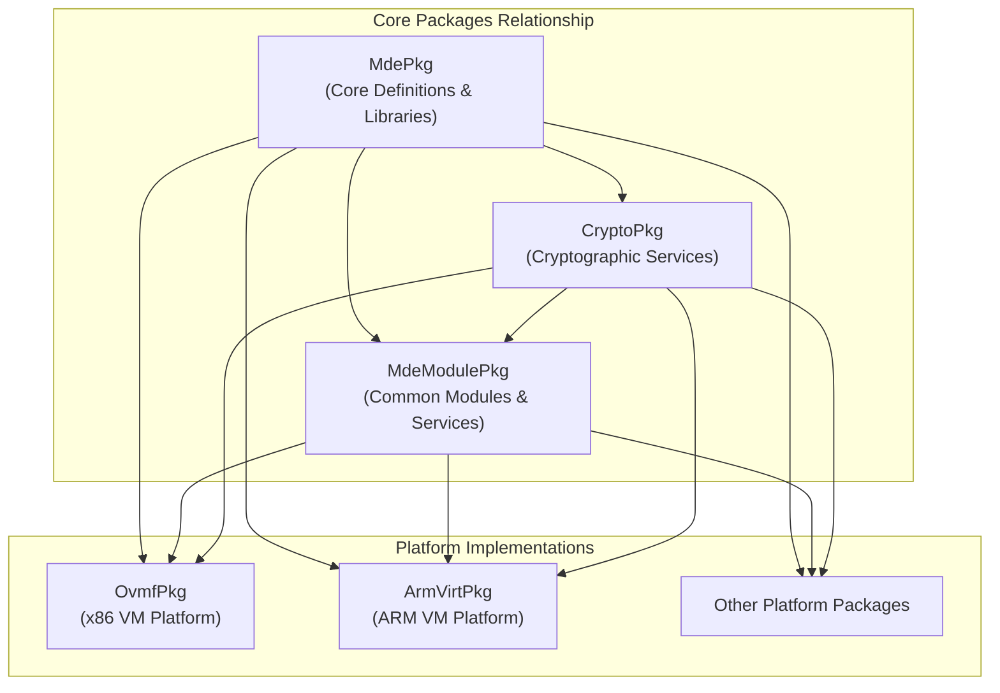
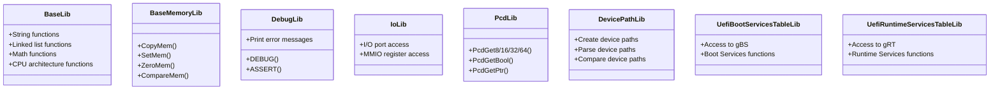
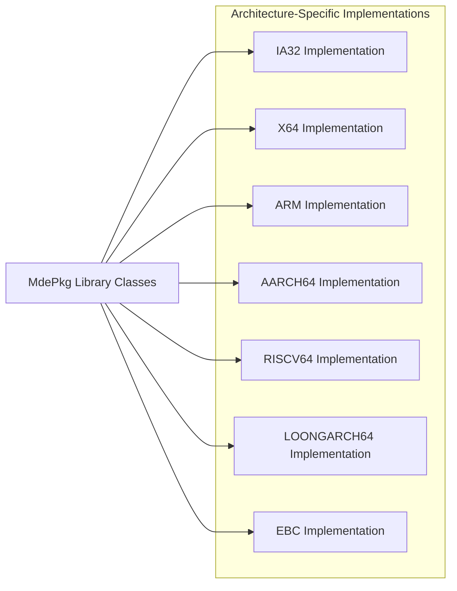
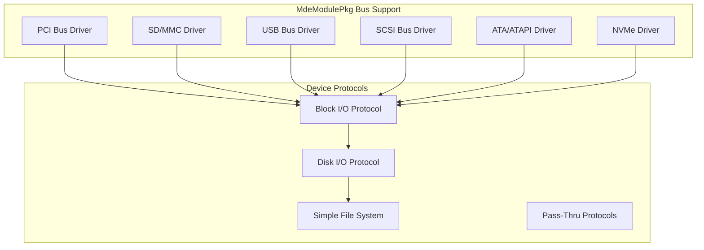
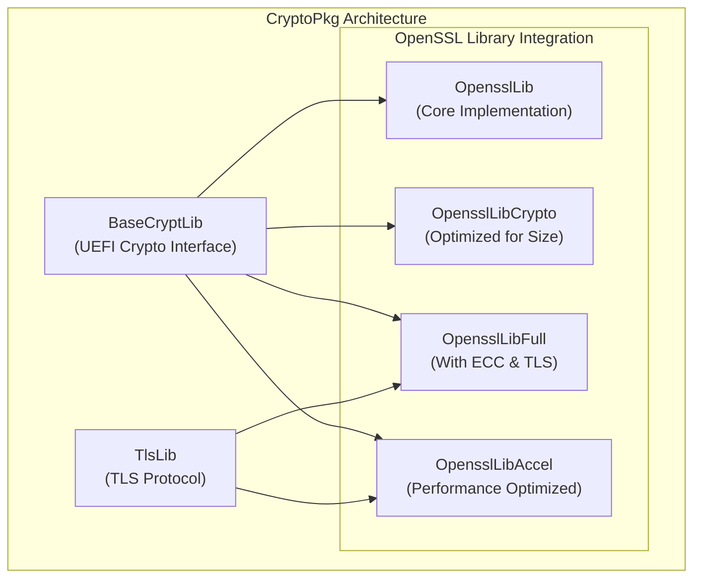
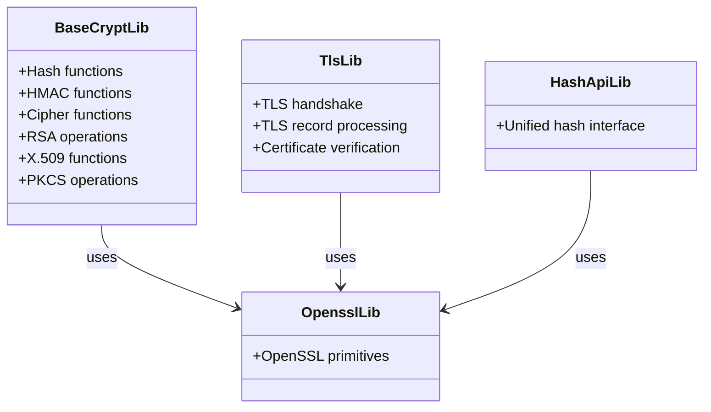
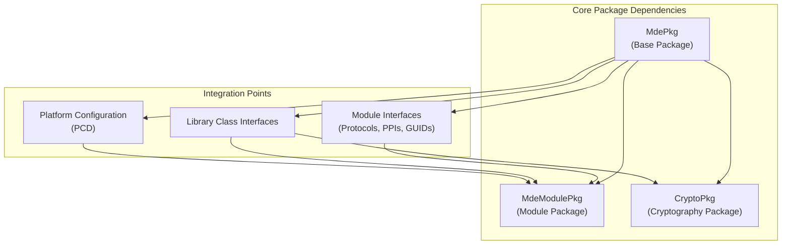

<!-- source: DeepWiki mcp.deepwiki.com · repo NVIDIA/edk2 · page 4 Core Services and Packages · fetched 2026-10-26 -->

# Core Services and Packages

Relevant source files

The following files were used as context for generating this wiki page:

- [CryptoPkg/CryptoPkg.ci.yaml](CryptoPkg/CryptoPkg.ci.yaml)
- [CryptoPkg/CryptoPkg.dec](CryptoPkg/CryptoPkg.dec)
- [CryptoPkg/CryptoPkg.uni](CryptoPkg/CryptoPkg.uni)
- [CryptoPkg/Include/Library/HashApiLib.h](CryptoPkg/Include/Library/HashApiLib.h)
- [CryptoPkg/Library/BaseCryptLib/Hash/CryptSm3.c](CryptoPkg/Library/BaseCryptLib/Hash/CryptSm3.c)
- [CryptoPkg/Library/BaseHashApiLib/BaseHashApiLib.c](CryptoPkg/Library/BaseHashApiLib/BaseHashApiLib.c)
- [CryptoPkg/Library/BaseHashApiLib/BaseHashApiLib.inf](CryptoPkg/Library/BaseHashApiLib/BaseHashApiLib.inf)
- [CryptoPkg/Library/BaseHashApiLib/BaseHashApiLib.uni](CryptoPkg/Library/BaseHashApiLib/BaseHashApiLib.uni)
- [CryptoPkg/Library/Include/fcntl.h](CryptoPkg/Library/Include/fcntl.h)
- [CryptoPkg/Library/OpensslLib/OpenSSL-HOWTO.txt](CryptoPkg/Library/OpensslLib/OpenSSL-HOWTO.txt)
- [CryptoPkg/Library/OpensslLib/OpensslLib.inf](CryptoPkg/Library/OpensslLib/OpensslLib.inf)
- [CryptoPkg/Library/OpensslLib/OpensslLib.uni](CryptoPkg/Library/OpensslLib/OpensslLib.uni)
- [CryptoPkg/Library/OpensslLib/OpensslLibAccel.inf](CryptoPkg/Library/OpensslLib/OpensslLibAccel.inf)
- [CryptoPkg/Library/OpensslLib/OpensslLibAccel.uni](CryptoPkg/Library/OpensslLib/OpensslLibAccel.uni)
- [CryptoPkg/Library/OpensslLib/OpensslLibConstructor.c](CryptoPkg/Library/OpensslLib/OpensslLibConstructor.c)
- [CryptoPkg/Library/OpensslLib/OpensslLibCrypto.inf](CryptoPkg/Library/OpensslLib/OpensslLibCrypto.inf)
- [CryptoPkg/Library/OpensslLib/OpensslLibCrypto.uni](CryptoPkg/Library/OpensslLib/OpensslLibCrypto.uni)
- [CryptoPkg/Library/OpensslLib/OpensslLibFull.inf](CryptoPkg/Library/OpensslLib/OpensslLibFull.inf)
- [CryptoPkg/Library/OpensslLib/OpensslLibFullAccel.inf](CryptoPkg/Library/OpensslLib/OpensslLibFullAccel.inf)
- [CryptoPkg/Library/OpensslLib/OpensslStub/EncoderNull.c](CryptoPkg/Library/OpensslLib/OpensslStub/EncoderNull.c)
- [CryptoPkg/Library/OpensslLib/OpensslStub/Pkcs12Null.c](CryptoPkg/Library/OpensslLib/OpensslStub/Pkcs12Null.c)
- [CryptoPkg/Library/OpensslLib/OpensslStub/SslExtServNull.c](CryptoPkg/Library/OpensslLib/OpensslStub/SslExtServNull.c)
- [CryptoPkg/Library/OpensslLib/OpensslStub/SslStatServNull.c](CryptoPkg/Library/OpensslLib/OpensslStub/SslStatServNull.c)
- [CryptoPkg/Library/OpensslLib/UefiAsm.conf](CryptoPkg/Library/OpensslLib/UefiAsm.conf)
- [CryptoPkg/Library/OpensslLib/X64/ApiHooks.c](CryptoPkg/Library/OpensslLib/X64/ApiHooks.c)
- [CryptoPkg/Library/OpensslLib/buildinf.c](CryptoPkg/Library/OpensslLib/buildinf.c)
- [CryptoPkg/Library/OpensslLib/buildinf.h](CryptoPkg/Library/OpensslLib/buildinf.h)
- [CryptoPkg/Library/OpensslLib/configure.py](CryptoPkg/Library/OpensslLib/configure.py)
- [CryptoPkg/Library/OpensslLib/perl2json.pl](CryptoPkg/Library/OpensslLib/perl2json.pl)
- [CryptoPkg/Private/Ppi/Crypto.h](CryptoPkg/Private/Ppi/Crypto.h)
- [CryptoPkg/Private/Protocol/SmmCrypto.h](CryptoPkg/Private/Protocol/SmmCrypto.h)
- [MdeModulePkg/Bus/Pci/SdMmcPciHcDxe/EmmcDevice.c](MdeModulePkg/Bus/Pci/SdMmcPciHcDxe/EmmcDevice.c)
- [MdeModulePkg/Bus/Pci/SdMmcPciHcDxe/SdDevice.c](MdeModulePkg/Bus/Pci/SdMmcPciHcDxe/SdDevice.c)
- [MdeModulePkg/Bus/Pci/SdMmcPciHcDxe/SdMmcPciHcDxe.c](MdeModulePkg/Bus/Pci/SdMmcPciHcDxe/SdMmcPciHcDxe.c)
- [MdeModulePkg/Bus/Pci/SdMmcPciHcDxe/SdMmcPciHcDxe.h](MdeModulePkg/Bus/Pci/SdMmcPciHcDxe/SdMmcPciHcDxe.h)
- [MdeModulePkg/Bus/Pci/SdMmcPciHcDxe/SdMmcPciHcDxe.inf](MdeModulePkg/Bus/Pci/SdMmcPciHcDxe/SdMmcPciHcDxe.inf)
- [MdeModulePkg/Bus/Pci/SdMmcPciHcDxe/SdMmcPciHcDxe.uni](MdeModulePkg/Bus/Pci/SdMmcPciHcDxe/SdMmcPciHcDxe.uni)
- [MdeModulePkg/Bus/Pci/SdMmcPciHcDxe/SdMmcPciHci.c](MdeModulePkg/Bus/Pci/SdMmcPciHcDxe/SdMmcPciHci.c)
- [MdeModulePkg/Bus/Pci/SdMmcPciHcDxe/SdMmcPciHci.h](MdeModulePkg/Bus/Pci/SdMmcPciHcDxe/SdMmcPciHci.h)
- [MdeModulePkg/Include/Ppi/CapsuleOnDisk.h](MdeModulePkg/Include/Ppi/CapsuleOnDisk.h)
- [MdeModulePkg/Include/Ppi/MemoryAttribute.h](MdeModulePkg/Include/Ppi/MemoryAttribute.h)
- [MdeModulePkg/Include/Protocol/FormBrowserEx.h](MdeModulePkg/Include/Protocol/FormBrowserEx.h)
- [MdeModulePkg/Include/Protocol/SdMmcOverride.h](MdeModulePkg/Include/Protocol/SdMmcOverride.h)
- [MdeModulePkg/MdeModulePkg.dec](MdeModulePkg/MdeModulePkg.dec)
- [MdeModulePkg/MdeModulePkg.uni](MdeModulePkg/MdeModulePkg.uni)
- [MdeModulePkg/Universal/CapsuleRuntimeDxe/Arm/CapsuleReset.c](MdeModulePkg/Universal/CapsuleRuntimeDxe/Arm/CapsuleReset.c)
- [MdeModulePkg/Universal/CapsuleRuntimeDxe/CapsuleCache.c](MdeModulePkg/Universal/CapsuleRuntimeDxe/CapsuleCache.c)
- [MdeModulePkg/Universal/CapsuleRuntimeDxe/CapsuleCacheNull.c](MdeModulePkg/Universal/CapsuleRuntimeDxe/CapsuleCacheNull.c)
- [MdeModulePkg/Universal/CapsuleRuntimeDxe/CapsuleReset.c](MdeModulePkg/Universal/CapsuleRuntimeDxe/CapsuleReset.c)
- [MdeModulePkg/Universal/CapsuleRuntimeDxe/CapsuleRuntimeDxe.inf](MdeModulePkg/Universal/CapsuleRuntimeDxe/CapsuleRuntimeDxe.inf)
- [MdeModulePkg/Universal/CapsuleRuntimeDxe/CapsuleService.c](MdeModulePkg/Universal/CapsuleRuntimeDxe/CapsuleService.c)
- [MdeModulePkg/Universal/CapsuleRuntimeDxe/CapsuleService.h](MdeModulePkg/Universal/CapsuleRuntimeDxe/CapsuleService.h)
- [MdePkg/Include/Guid/EventGroup.h](MdePkg/Include/Guid/EventGroup.h)
- [MdePkg/Include/IndustryStandard/IpmiKcs.h](MdePkg/Include/IndustryStandard/IpmiKcs.h)
- [MdePkg/Include/Library/ArmTrngLib.h](MdePkg/Include/Library/ArmTrngLib.h)
- [MdePkg/Include/Library/MipiSysTLib.h](MdePkg/Include/Library/MipiSysTLib.h)
- [MdePkg/Include/Library/TraceHubDebugSysTLib.h](MdePkg/Include/Library/TraceHubDebugSysTLib.h)
- [MdePkg/Include/LoongArch64/ProcessorBind.h](MdePkg/Include/LoongArch64/ProcessorBind.h)
- [MdePkg/Include/Protocol/MemoryAccept.h](MdePkg/Include/Protocol/MemoryAccept.h)
- [MdePkg/Include/Protocol/MemoryAttribute.h](MdePkg/Include/Protocol/MemoryAttribute.h)
- [MdePkg/Include/Register/Amd/SmramSaveStateMap.h](MdePkg/Include/Register/Amd/SmramSaveStateMap.h)
- [MdePkg/Library/MipiSysTLib/GenMipiSystH.py](MdePkg/Library/MipiSysTLib/GenMipiSystH.py)
- [MdePkg/Library/MipiSysTLib/MipiSysTLib.c](MdePkg/Library/MipiSysTLib/MipiSysTLib.c)
- [MdePkg/Library/MipiSysTLib/MipiSysTLib.inf](MdePkg/Library/MipiSysTLib/MipiSysTLib.inf)
- [MdePkg/Library/MipiSysTLib/Platform.c](MdePkg/Library/MipiSysTLib/Platform.c)
- [MdePkg/Library/MipiSysTLib/Platform.h](MdePkg/Library/MipiSysTLib/Platform.h)
- [MdePkg/Library/MipiSysTLib/Readme.md](MdePkg/Library/MipiSysTLib/Readme.md)
- [MdePkg/Library/MipiSysTLib/mipi_syst.h](MdePkg/Library/MipiSysTLib/mipi_syst.h)
- [MdePkg/Library/TraceHubDebugSysTLibNull/TraceHubDebugSysTLibNull.c](MdePkg/Library/TraceHubDebugSysTLibNull/TraceHubDebugSysTLibNull.c)
- [MdePkg/Library/TraceHubDebugSysTLibNull/TraceHubDebugSysTLibNull.inf](MdePkg/Library/TraceHubDebugSysTLibNull/TraceHubDebugSysTLibNull.inf)
- [MdePkg/Library/UefiDevicePathLib/DevicePathUtilitiesBase.c](MdePkg/Library/UefiDevicePathLib/DevicePathUtilitiesBase.c)
- [MdePkg/Library/UefiDevicePathLib/UefiDevicePathLibBase.inf](MdePkg/Library/UefiDevicePathLib/UefiDevicePathLibBase.inf)
- [MdePkg/MdePkg.ci.yaml](MdePkg/MdePkg.ci.yaml)
- [MdePkg/MdePkg.dec](MdePkg/MdePkg.dec)
- [MdePkg/MdePkg.dsc](MdePkg/MdePkg.dsc)

This document provides an overview of the foundational services and packages that form the core of the UEFI Development Kit II (EDK II) implementation. These packages provide essential definitions, protocols, services, and library implementations that serve as building blocks for UEFI firmware development.

For platform-specific implementations, see [Platform Support](#3). For information about security features like System Management Mode (SMM) and Confidential Computing, see [Security Features](#5).

## Overview of Core Packages

EDK II organizes its codebase into packages, each with a specific purpose. The three fundamental packages that provide core services are:

1. **MdePkg** (Module Development Environment Package) - Contains core definitions, library classes, and interfaces that comply with UEFI and PI specifications
2. **MdeModulePkg** (Module Development Environment Module Package) - Provides common UEFI module implementations and services
3. **CryptoPkg** - Provides cryptographic services leveraging OpenSSL

Together, these packages form the foundation upon which platform-specific implementations are built.

Sources: [MdePkg/MdePkg.dec:1-26](), [MdeModulePkg/MdeModulePkg.dec:1-24](), [CryptoPkg/CryptoPkg.dec:1-18]()

## MdePkg: The Foundation Package

MdePkg serves as the foundation for all other packages in EDK II. It provides the basic definitions, library classes, protocols, and GUIDs that conform to industry standards.

### Key Characteristics

- Contains only definitions, library interface declarations, and basic library implementations
- Adheres strictly to UEFI and PI specifications (UEFI 2.7/PI 1.7)
- Architecture-independent where possible, with architecture-specific implementations as needed
- Provides no platform-specific functionality

### Library Classes

MdePkg defines numerous library classes that provide core functionality. These library classes are abstractions with multiple possible implementations.

Sources: [MdePkg/MdePkg.dec:54-304]()

### Protocol Definitions

MdePkg defines UEFI protocol interfaces as C structures with associated GUIDs. It provides hundreds of protocol definitions, including:

- Device access protocols (Block I/O, Disk I/O, Simple File System)
- Bus protocols (PCI, USB, SCSI)
- Console protocols (Simple Text Input/Output)
- Graphics protocols (Graphics Output)
- Network protocols (TCP, IP, DHCP)

### Architecture-Specific Support

MdePkg provides architecture-specific implementations for different CPU architectures:

Sources: [MdePkg/MdePkg.dsc:18-20](), [MdePkg/MdePkg.dec:33-52]()

## MdeModulePkg: Common UEFI Module Package

MdeModulePkg builds on MdePkg to provide concrete implementations of UEFI modules that conform to UEFI/PI industry standards.

### Purpose and Scope

- Provides ready-to-use UEFI module implementations
- Implements common UEFI drivers and services
- Adds additional definitions (PPIs/PROTOCOLs/GUIDs) and library classes
- Provides library implementations for these additional interfaces

### Core Services

MdeModulePkg implements several critical firmware services:

| Service | Description | Key Files |
|---------|-------------|-----------|
| Variable Services | UEFI variable storage and retrieval | Universal/Variable |
| Boot Manager | Boot option management and platform boot | Universal/BdsDxe |
| Capsule Services | Firmware update capabilities | Universal/CapsuleRuntimeDxe |
| Console Services | Text and graphics console | Universal/Console |
| Reset System | System reset capabilities | Include/Library/ResetSystemLib.h |
| Report Status | Status code reporting | ReportStatusCodeRouterDxe |

Sources: [MdeModulePkg/MdeModulePkg.dec:33-166](), [MdeModulePkg/Universal/CapsuleRuntimeDxe/CapsuleRuntimeDxe.inf:1-7]()

### Bus and Device Support

MdeModulePkg includes drivers for various buses and devices:

Sources: [MdeModulePkg/Bus/Pci/SdMmcPciHcDxe/SdMmcPciHcDxe.c:1-14](), [MdeModulePkg/Bus/Pci/SdMmcPciHcDxe/SdMmcPciHci.c:1-13]()

### Specific Features: SD/MMC Controller Example

As an example of a specific feature, the MdeModulePkg includes an SD/MMC PCI host controller driver, which:

- Manages SD/MMC PCI host controllers compliant with SD Host Controller Simplified Specification 3.00
- Supports 64-bit System Addressing from SD Host Controller Simplified Specification 4.20
- Exposes the EFI_SD_MMC_PASS_THRU_PROTOCOL for upper layers
- Handles device initialization and command transactions

Sources: [MdeModulePkg/Bus/Pci/SdMmcPciHcDxe/SdDevice.c:1-9](), [MdeModulePkg/Bus/Pci/SdMmcPciHcDxe/EmmcDevice.c:1-9](), [MdeModulePkg/Include/Protocol/SdMmcOverride.h:1-7]()

## CryptoPkg: Cryptographic Services

CryptoPkg provides cryptographic services for EDK II through the integration of the OpenSSL library. These services are essential for security features, secure boot, and encrypted communications.

### OpenSSL Integration

CryptoPkg integrates the OpenSSL library to provide cryptographic primitives:

Sources: [CryptoPkg/Library/OpensslLib/OpensslLib.inf:1-9](), [CryptoPkg/Library/OpensslLib/OpensslLibCrypto.inf:1-9](), [CryptoPkg/Library/OpensslLib/OpensslLibFull.inf:1-14](), [CryptoPkg/Library/OpensslLib/OpensslLibAccel.inf:1-9]()

### Cryptographic Services

CryptoPkg provides several library variants with different feature sets:

| Library Variant | Features | Size Impact | Use Case |
|-----------------|----------|-------------|----------|
| OpensslLib | Basic cryptographic functions | Base size | General use |
| OpensslLibCrypto | Optimized for size, no ECC | Reduced size | Size-constrained |
| OpensslLibFull | Includes ECC and TLS | +115KB | Certificate processing |
| OpensslLibAccel | Performance optimized | Varies | Performance-critical |

The package supports cryptographic operations including:

- Hash functions (SHA-1, SHA-256, SHA-512, MD5)
- Symmetric cryptography (AES)
- Asymmetric cryptography (RSA, optional ECC)
- Digital signatures
- Certificate handling
- TLS protocol

Sources: [CryptoPkg/Library/OpensslLib/OpensslLib.inf:35-51](), [CryptoPkg/Library/OpensslLib/OpensslLibCrypto.inf:35-51]()

### Library Classes

CryptoPkg defines key library classes for cryptographic operations:

Sources: [CryptoPkg/CryptoPkg.dec:32-51](), [CryptoPkg/Library/OpensslLib/OpenSSL-HOWTO.txt:1-7]()

## Package Dependencies and Integration

The core packages form a hierarchy with clear dependencies and integration points.

### Package Dependency Structure

Sources: [MdePkg/MdePkg.dsc:13-23](), [MdeModulePkg/MdeModulePkg.dec:697-711]()

### Library Implementation Strategy

The core packages use a consistent library implementation strategy:

1. **Library Class Definitions**: Defined in MdePkg with clear interfaces
2. **Multiple Implementations**: Each library class can have multiple implementations
3. **Platform Selection**: Platform chooses appropriate implementation
4. **Layered Services**: Higher-level services built on lower-level ones

This approach enables:
- Modularity and code reuse
- Platform customization
- Architecture-specific optimizations
- Feature scaling for different contexts

Sources: [MdePkg/MdePkg.dec:54-304](), [MdeModulePkg/MdeModulePkg.dec:32-166]()

## Summary

EDK II's core packages provide the foundation for UEFI firmware development:

- **MdePkg**: Defines the fundamental interfaces, protocols, and basic libraries that conform to UEFI/PI specifications
- **MdeModulePkg**: Implements common UEFI modules and services that are needed across platforms
- **CryptoPkg**: Provides cryptographic services through OpenSSL integration

These packages work together to create a modular, extensible framework for platform-specific implementations, enabling standardized firmware development across diverse hardware platforms.

---

