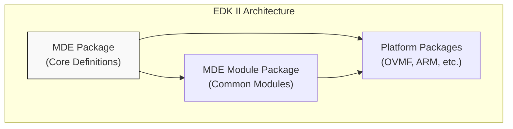
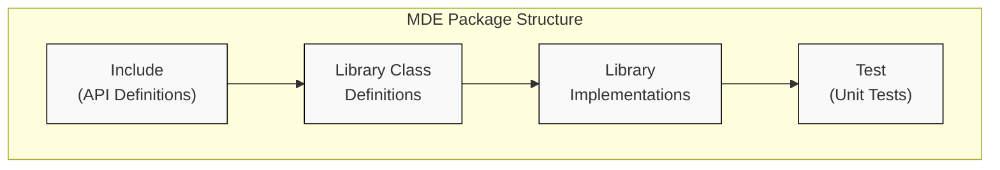
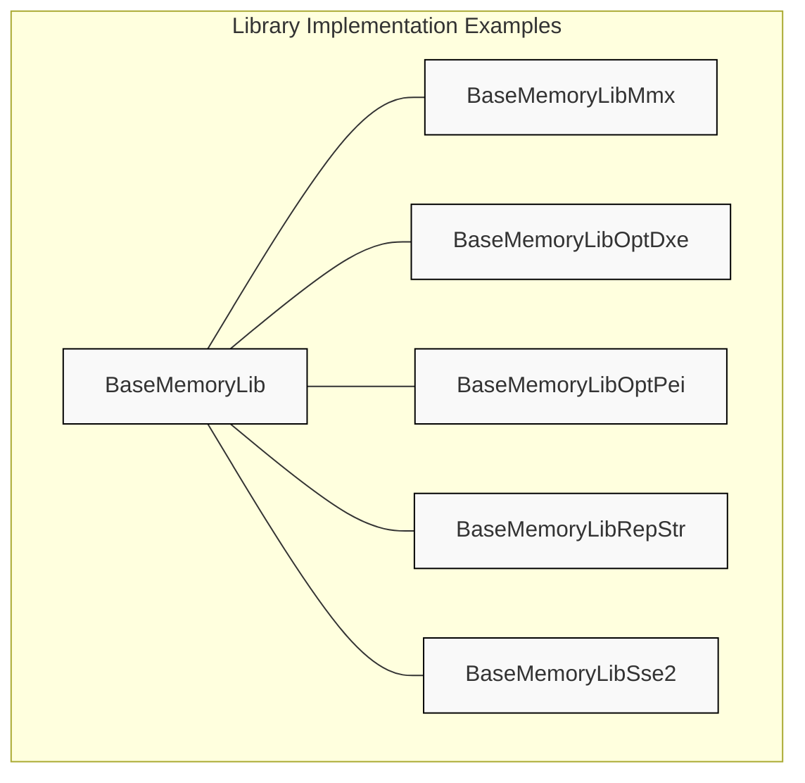
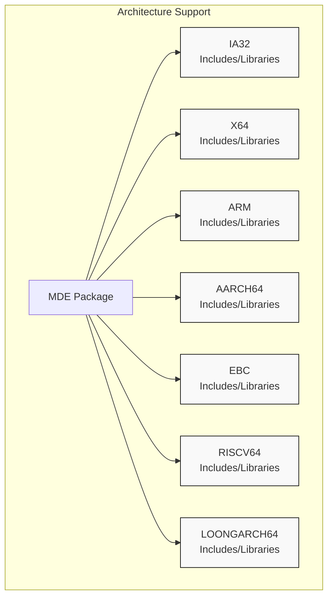

<!-- source: DeepWiki mcp.deepwiki.com · repo NVIDIA/edk2 · page 4.1 MDE Package · fetched 2026-10-26 -->

# MDE Package

<details>
<summary>Relevant source files</summary>

The following files were used as context for generating this wiki page:

- [MdeModulePkg/Include/Protocol/FormBrowserEx.h](MdeModulePkg/Include/Protocol/FormBrowserEx.h)
- [MdePkg/Include/Guid/EventGroup.h](MdePkg/Include/Guid/EventGroup.h)
- [MdePkg/Include/IndustryStandard/IpmiKcs.h](MdePkg/Include/IndustryStandard/IpmiKcs.h)
- [MdePkg/Include/Library/ArmTrngLib.h](MdePkg/Include/Library/ArmTrngLib.h)
- [MdePkg/Include/Library/MipiSysTLib.h](MdePkg/Include/Library/MipiSysTLib.h)
- [MdePkg/Include/Library/TraceHubDebugSysTLib.h](MdePkg/Include/Library/TraceHubDebugSysTLib.h)
- [MdePkg/Include/LoongArch64/ProcessorBind.h](MdePkg/Include/LoongArch64/ProcessorBind.h)
- [MdePkg/Include/Protocol/MemoryAccept.h](MdePkg/Include/Protocol/MemoryAccept.h)
- [MdePkg/Include/Protocol/MemoryAttribute.h](MdePkg/Include/Protocol/MemoryAttribute.h)
- [MdePkg/Include/Register/Amd/SmramSaveStateMap.h](MdePkg/Include/Register/Amd/SmramSaveStateMap.h)
- [MdePkg/Library/MipiSysTLib/GenMipiSystH.py](MdePkg/Library/MipiSysTLib/GenMipiSystH.py)
- [MdePkg/Library/MipiSysTLib/MipiSysTLib.c](MdePkg/Library/MipiSysTLib/MipiSysTLib.c)
- [MdePkg/Library/MipiSysTLib/MipiSysTLib.inf](MdePkg/Library/MipiSysTLib/MipiSysTLib.inf)
- [MdePkg/Library/MipiSysTLib/Platform.c](MdePkg/Library/MipiSysTLib/Platform.c)
- [MdePkg/Library/MipiSysTLib/Platform.h](MdePkg/Library/MipiSysTLib/Platform.h)
- [MdePkg/Library/MipiSysTLib/Readme.md](MdePkg/Library/MipiSysTLib/Readme.md)
- [MdePkg/Library/MipiSysTLib/mipi_syst.h](MdePkg/Library/MipiSysTLib/mipi_syst.h)
- [MdePkg/Library/TraceHubDebugSysTLibNull/TraceHubDebugSysTLibNull.c](MdePkg/Library/TraceHubDebugSysTLibNull/TraceHubDebugSysTLibNull.c)
- [MdePkg/Library/TraceHubDebugSysTLibNull/TraceHubDebugSysTLibNull.inf](MdePkg/Library/TraceHubDebugSysTLibNull/TraceHubDebugSysTLibNull.inf)
- [MdePkg/Library/UefiDevicePathLib/DevicePathUtilitiesBase.c](MdePkg/Library/UefiDevicePathLib/DevicePathUtilitiesBase.c)
- [MdePkg/Library/UefiDevicePathLib/UefiDevicePathLibBase.inf](MdePkg/Library/UefiDevicePathLib/UefiDevicePathLibBase.inf)
- [MdePkg/MdePkg.ci.yaml](MdePkg/MdePkg.ci.yaml)
- [MdePkg/MdePkg.dec](MdePkg/MdePkg.dec)
- [MdePkg/MdePkg.dsc](MdePkg/MdePkg.dsc)

</details>


## Purpose and Scope

The MDE (Module Development Environment) Package serves as the foundational component of the EDK II (UEFI Development Kit II), providing core definitions, library classes, and library instances that enable UEFI firmware development. It defines essential interfaces, protocols, and services according to UEFI and PI (Platform Initialization) specifications. 

The MDE Package establishes the base infrastructure upon which all other UEFI modules and packages are built, offering standardized access to system resources through well-defined interfaces. For information about modules built with these core services, see [MDE Module Package](#4.2).

Sources: [MdePkg/MdePkg.dec:1-26]()

## Architecture Overview

The MDE Package forms the foundation of the EDK II architecture by providing low-level services and definitions that abstract the hardware details from higher-level firmware components.



Sources: [MdePkg/MdePkg.dec:1-26]()

### Organization Structure

The MDE Package is organized into several key components:



Sources: [MdePkg/MdePkg.dec:27-53](), [MdePkg/MdePkg.dsc:35-203]()

## Key Components

### Library Class Definitions

The MDE Package defines over 50 library classes that provide standardized interfaces for common operations. These library classes fall into several categories:

#### Base Services

These libraries provide fundamental services independent of the UEFI environment:

| Library Class | Description | File Path |
|---------------|-------------|-----------|
| BaseLib | Core functions for string operations, linked lists, math, and CPU-specific features | Include/Library/BaseLib.h |
| BaseMemoryLib | Memory operations (copy, set, compare) | Include/Library/BaseMemoryLib.h |
| PrintLib | Formatted string printing | Include/Library/PrintLib.h |
| DebugLib | Debug message output | Include/Library/DebugLib.h |
| IoLib | I/O port and MMIO register access | Include/Library/IoLib.h |
| PcdLib | Platform Configuration Database access | Include/Library/PcdLib.h |
| TimerLib | Time delay and performance counter services | Include/Library/TimerLib.h |

Sources: [MdePkg/MdePkg.dec:54-201]()

#### UEFI Services

These libraries provide access to UEFI Boot Services and Runtime Services:

| Library Class | Description | File Path |
|---------------|-------------|-----------|
| UefiBootServicesTableLib | Access to the EFI Boot Services Table | Include/Library/UefiBootServicesTableLib.h |
| UefiRuntimeServicesTableLib | Access to the EFI Runtime Services Table | Include/Library/UefiRuntimeServicesTableLib.h |
| UefiLib | Common UEFI operations | Include/Library/UefiLib.h |
| UefiApplicationEntryPoint | Entry point for UEFI Applications | Include/Library/UefiApplicationEntryPoint.h |
| UefiDriverEntryPoint | Entry point for UEFI Drivers | Include/Library/UefiDriverEntryPoint.h |
| DevicePathLib | UEFI Device Path operations | Include/Library/DevicePathLib.h |

Sources: [MdePkg/MdePkg.dec:70-84](), [MdePkg/MdePkg.dec:109-119]()

#### Pre-EFI Initialization (PEI) Services

These libraries support the PEI phase of UEFI firmware:

| Library Class | Description | File Path |
|---------------|-------------|-----------|
| PeiServicesLib | PEI Services functions | Include/Library/PeiServicesLib.h |
| PeiServicesTablePointerLib | Access to PEI Services Table | Include/Library/PeiServicesTablePointerLib.h |
| PeimEntryPoint | Entry point for PEIMs | Include/Library/PeimEntryPoint.h |
| PeiCoreEntryPoint | Entry point for PEI Core | Include/Library/PeiCoreEntryPoint.h |
| HobLib | HOB (Hand-Off Block) creation and parsing | Include/Library/HobLib.h |

Sources: [MdePkg/MdePkg.dec:116-126]()

#### Driver Execution Environment (DXE) Services

These libraries support the DXE phase:

| Library Class | Description | File Path |
|---------------|-------------|-----------|
| DxeServicesTableLib | Access to DXE Services Table | Include/Library/DxeServicesTableLib.h |
| DxeServicesLib | DXE Services functions | Include/Library/DxeServicesLib.h |
| DxeCoreEntryPoint | Entry point for DXE Core | Include/Library/DxeCoreEntryPoint.h |

Sources: [MdePkg/MdePkg.dec:173-178](), [MdePkg/MdePkg.dec:208-209]()

#### System Management Mode (SMM) Libraries

Libraries specific to SMM operations:

| Library Class | Description | File Path |
|---------------|-------------|-----------|
| SmmServicesTableLib | Access to SMM Services Table | Include/Library/SmmServicesTableLib.h |
| SmmLib | SMI generation and detection | Include/Library/SmmLib.h |
| SmmMemLib | SMM Memory operations | Include/Library/SmmMemLib.h |
| StandaloneMmDriverEntryPoint | Entry point for standalone MM drivers | Include/Library/StandaloneMmDriverEntryPoint.h |

Sources: [MdePkg/MdePkg.dec:310-331]()

### Library Implementations

MDE Package provides multiple implementations for many library classes to support different requirements:



Sources: [MdePkg/MdePkg.dsc:47-48](), [MdePkg/MdePkg.dsc:162-166]()

### Protocol and GUID Definitions

The MDE Package defines hundreds of GUIDs and protocols used by UEFI firmware, including:

1. Event GUIDs for system events:
   - `gEfiEventReadyToBootGuid`
   - `gEfiEventExitBootServicesGuid`
   - `gEfiEventVirtualAddressChangeGuid`

2. Table GUIDs for system tables:
   - `gEfiAcpiTableGuid`
   - `gEfiSmbiosTableGuid`
   - `gEfiMpsTableGuid`

3. File System GUIDs:
   - `gEfiFileInfoGuid`
   - `gEfiFileSystemInfoGuid`
   - `gEfiFileSystemVolumeLabelInfoIdGuid`

4. Security-related GUIDs:
   - `gEfiImageSecurityDatabaseGuid`
   - `gEfiCertSha256Guid`
   - `gEfiCertRsa2048Guid`

Sources: [MdePkg/MdePkg.dec:341-686]()

### Architecture Support

The MDE Package supports multiple CPU architectures through architecture-specific includes and implementations:



Each architecture has its specific processor binding headers, assembly implementations, and optimized library implementations.

Sources: [MdePkg/MdePkg.dec:33-52](), [MdePkg/MdePkg.dsc:19](), [MdePkg/Include/LoongArch64/ProcessorBind.h:1-121]()

## Usage in Firmware Development

The MDE Package is used in three primary ways:

1. **Headers and Definitions**: Firmware modules include MDE Package headers to access standard UEFI/PI definitions.

2. **Library Class Interfaces**: Modules declare dependencies on MDE Package library classes, relying on the interface without being tied to a specific implementation.

3. **Library Implementations**: Build configurations select specific library implementations from MDE Package.

### Library Class Usage Example

A typical module INF file will reference MDE Package library classes:

```
[LibraryClasses]
  UefiDriverEntryPoint
  UefiBootServicesTableLib
  MemoryAllocationLib
  BaseMemoryLib
  DebugLib
```

Then, the code will use these libraries without needing to know their implementation details:

```c
#include <Library/UefiBootServicesTableLib.h>
#include <Library/MemoryAllocationLib.h>

EFI_STATUS
EFIAPI
MyDriverEntryPoint (
  IN EFI_HANDLE        ImageHandle,
  IN EFI_SYSTEM_TABLE  *SystemTable
  )
{
  VOID  *Buffer;
  
  // Use MDE Package library functions
  Buffer = AllocatePool (1024);
  if (Buffer == NULL) {
    return EFI_OUT_OF_RESOURCES;
  }
  
  gBS->SetMem (Buffer, 1024, 0);
  
  // Additional code...
  
  FreePool (Buffer);
  return EFI_SUCCESS;
}
```

## Testing

The MDE Package includes unit tests to verify the functionality of its libraries:

1. **Host-based Unit Tests**: Tests that run on the development system.
2. **UEFI-based Unit Tests**: Tests that run in the UEFI environment.

Examples include tests for BaseLib and BaseSafeIntLib.

Sources: [MdePkg/MdePkg.dsc:142-154]()

## Integration with Build System

The MDE Package integrates with the EDK II build system through DSC and DEC files:

- **MdePkg.dec**: Declares all library classes, GUIDs, protocols, and includes.
- **MdePkg.dsc**: Defines the build configurations and library implementations.

This allows consumers to reference MDE Package components in their own packages.

Sources: [MdePkg/MdePkg.dec:1-26](), [MdePkg/MdePkg.dsc:1-22]()

## Recent Additions

Recent additions to the MDE Package include:

1. Support for new architectures:
   - LOONGARCH64 architecture
   - RISCV64 architecture enhancements

2. New libraries:
   - MIPI SysT Library for trace capabilities
   - TraceHubDebugSysTLib for Trace Hub debug messaging
   - JedecJep106Lib for JEDEC manufacturer identification
   - FdtLib for Flattened Device Tree support

3. Enhanced security features:
   - Memory attribute handling
   - ARM True Random Number Generator (TRNG) support

Sources: [MdePkg/Include/LoongArch64/ProcessorBind.h:1-121](), [MdePkg/Library/MipiSysTLib/MipiSysTLib.inf:1-55](), [MdePkg/Include/Library/TraceHubDebugSysTLib.h:1-81](), [MdePkg/Include/Library/ArmTrngLib.h:1-106]()

---

