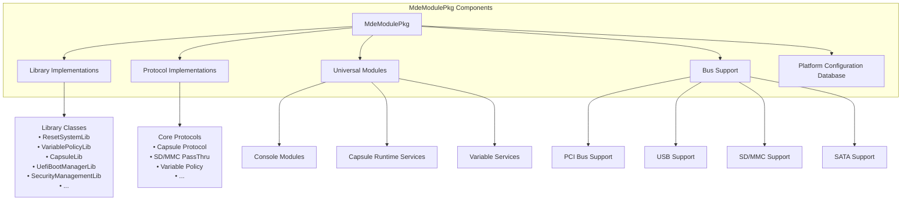
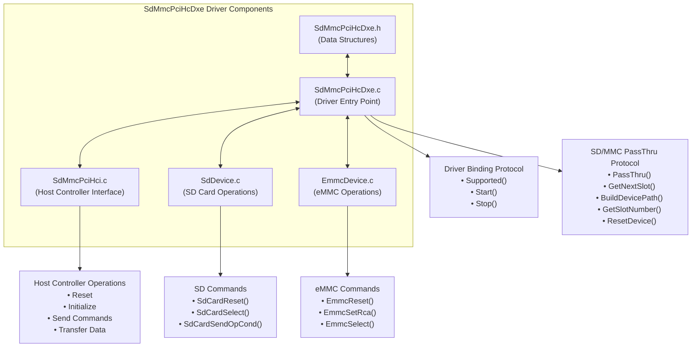
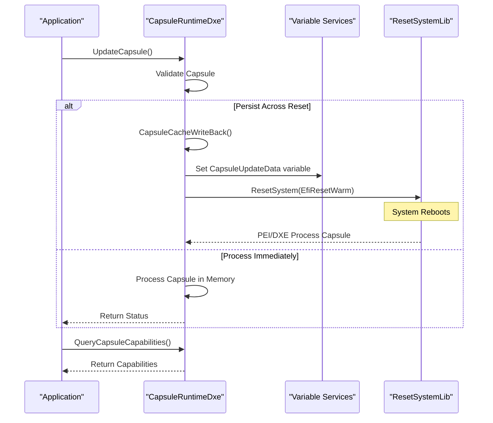
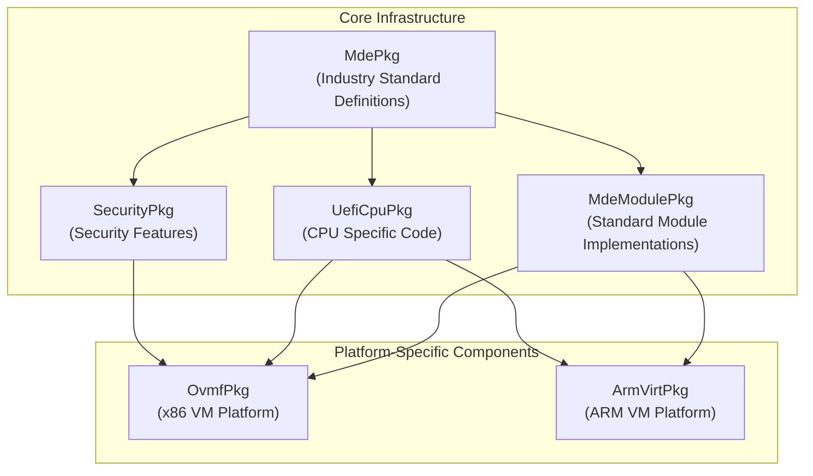

<!-- source: DeepWiki mcp.deepwiki.com · repo NVIDIA/edk2 · page 4.2 MDE Module Package · fetched 2026-10-26 -->

# MDE Module Package

Relevant source files

The following files were used as context for generating this wiki page:

- [MdeModulePkg/Bus/Pci/SdMmcPciHcDxe/EmmcDevice.c](MdeModulePkg/Bus/Pci/SdMmcPciHcDxe/EmmcDevice.c)
- [MdeModulePkg/Bus/Pci/SdMmcPciHcDxe/SdDevice.c](MdeModulePkg/Bus/Pci/SdMmcPciHcDxe/SdDevice.c)
- [MdeModulePkg/Bus/Pci/SdMmcPciHcDxe/SdMmcPciHcDxe.c](MdeModulePkg/Bus/Pci/SdMmcPciHcDxe/SdMmcPciHcDxe.c)
- [MdeModulePkg/Bus/Pci/SdMmcPciHcDxe/SdMmcPciHcDxe.h](MdeModulePkg/Bus/Pci/SdMmcPciHcDxe/SdMmcPciHcDxe.h)
- [MdeModulePkg/Bus/Pci/SdMmcPciHcDxe/SdMmcPciHcDxe.inf](MdeModulePkg/Bus/Pci/SdMmcPciHcDxe/SdMmcPciHcDxe.inf)
- [MdeModulePkg/Bus/Pci/SdMmcPciHcDxe/SdMmcPciHcDxe.uni](MdeModulePkg/Bus/Pci/SdMmcPciHcDxe/SdMmcPciHcDxe.uni)
- [MdeModulePkg/Bus/Pci/SdMmcPciHcDxe/SdMmcPciHci.c](MdeModulePkg/Bus/Pci/SdMmcPciHcDxe/SdMmcPciHci.c)
- [MdeModulePkg/Bus/Pci/SdMmcPciHcDxe/SdMmcPciHci.h](MdeModulePkg/Bus/Pci/SdMmcPciHcDxe/SdMmcPciHci.h)
- [MdeModulePkg/Include/Ppi/CapsuleOnDisk.h](MdeModulePkg/Include/Ppi/CapsuleOnDisk.h)
- [MdeModulePkg/Include/Ppi/MemoryAttribute.h](MdeModulePkg/Include/Ppi/MemoryAttribute.h)
- [MdeModulePkg/Include/Protocol/SdMmcOverride.h](MdeModulePkg/Include/Protocol/SdMmcOverride.h)
- [MdeModulePkg/MdeModulePkg.dec](MdeModulePkg/MdeModulePkg.dec)
- [MdeModulePkg/MdeModulePkg.uni](MdeModulePkg/MdeModulePkg.uni)
- [MdeModulePkg/Universal/CapsuleRuntimeDxe/Arm/CapsuleReset.c](MdeModulePkg/Universal/CapsuleRuntimeDxe/Arm/CapsuleReset.c)
- [MdeModulePkg/Universal/CapsuleRuntimeDxe/CapsuleCache.c](MdeModulePkg/Universal/CapsuleRuntimeDxe/CapsuleCache.c)
- [MdeModulePkg/Universal/CapsuleRuntimeDxe/CapsuleCacheNull.c](MdeModulePkg/Universal/CapsuleRuntimeDxe/CapsuleCacheNull.c)
- [MdeModulePkg/Universal/CapsuleRuntimeDxe/CapsuleReset.c](MdeModulePkg/Universal/CapsuleRuntimeDxe/CapsuleReset.c)
- [MdeModulePkg/Universal/CapsuleRuntimeDxe/CapsuleRuntimeDxe.inf](MdeModulePkg/Universal/CapsuleRuntimeDxe/CapsuleRuntimeDxe.inf)
- [MdeModulePkg/Universal/CapsuleRuntimeDxe/CapsuleService.c](MdeModulePkg/Universal/CapsuleRuntimeDxe/CapsuleService.c)
- [MdeModulePkg/Universal/CapsuleRuntimeDxe/CapsuleService.h](MdeModulePkg/Universal/CapsuleRuntimeDxe/CapsuleService.h)

The MDE (Module Development Environment) Module Package is a core component of the EDK II firmware architecture that provides implementations of modules conforming to UEFI/PI (Unified Extensible Firmware Interface/Platform Initialization) industry standards. It functions as an essential middleware layer, offering standardized definitions and implementations that platform developers can use and extend.

For information about the core definitions used by this package, see [MDE Package](#4.1).

## Package Overview and Structure

The MDE Module Package serves as a collection of ready-to-use UEFI and PI modules, providing both functionality that is required by the UEFI/PI specifications and useful extensions that adhere to those standards. It includes driver modules, runtime services, bus support, and protocol implementations that can be used across different platforms and architectures.

Sources: [MdeModulePkg/MdeModulePkg.dec:1-25](), [MdeModulePkg/MdeModulePkg.uni:1-16]()

## Key Components

### Library Classes

The package defines over 40 library classes that abstract common operations and provide implementation-agnostic interfaces. These libraries are defined in the `MdeModulePkg.dec` file and can be implemented in various ways depending on platform needs.

Key library classes include:

| Library Class | Description | Defined In |
|--------------|-------------|------------|
| ResetSystemLib | Provides methods to reset the whole system | [MdeModulePkg/MdeModulePkg.dec:33-34]() |
| VariablePolicyLib | Logic for storing and testing variable policies | [MdeModulePkg/MdeModulePkg.dec:36-37]() |
| HiiLib | Functions for Human Interface Infrastructure | [MdeModulePkg/MdeModulePkg.dec:42-43]() |
| CapsuleLib | Interfaces for processing capsule image updates | [MdeModulePkg/MdeModulePkg.dec:45-46]() |
| UefiBootManagerLib | Core boot manager functions | [MdeModulePkg/MdeModulePkg.dec:88-89]() |
| SecurityManagementLib | Interfaces to abstract security policy | [MdeModulePkg/MdeModulePkg.dec:53-55]() |

Sources: [MdeModulePkg/MdeModulePkg.dec:32-166]()

### Protocols

The MDE Module Package implements numerous UEFI protocols that provide standardized interfaces for communication between drivers and applications. These protocols enable modular, component-based development.

Important protocols include:

| Protocol | GUID | Purpose |
|----------|------|---------|
| EfiSdMmcPassThruProtocol | gEfiSdMmcPassThruProtocolGuid | Provides access to SD/MMC devices |
| EfiCapsuleArchProtocol | gEfiCapsuleArchProtocolGuid | Signals capsule runtime services availability |
| EfiVariablePolicyProtocol | gEdkiiVariablePolicyProtocolGuid | Controls variable access policies |
| EfiBootLogoProtocol | gEfiBootLogoProtocolGuid | Displays boot logos during startup |

Sources: [MdeModulePkg/MdeModulePkg.dec:534-697]()

### GUIDs

The package defines over 100 GUIDs used for various purposes:

| GUID Name | Purpose |
|-----------|---------|
| gEfiMdeModulePkgTokenSpaceGuid | Package token space |
| gEfiCapsuleVendorGuid | Identifies capsule update data |
| gEfiVariableGuid | Variable store header signature |
| gEfiMemoryTypeInformationGuid | Specifies platform memory type info |

Sources: [MdeModulePkg/MdeModulePkg.dec:167-447]()

### PPIs (PEIM-to-PEIM Interfaces)

The package defines Pre-EFI Initialization Module (PEIM) interfaces to facilitate communication during the early boot phase:

| PPI | Purpose |
|-----|---------|
| gEdkiiPeiCapsuleOnDiskPpiGuid | Supports loading capsules from disk |
| gPeiUsbHostControllerPpiGuid | Provides USB host controller access |
| gEdkiiPeiSdMmcHostControllerPpiGuid | Controls SD/MMC host controllers |

Sources: [MdeModulePkg/MdeModulePkg.dec:448-533](), [MdeModulePkg/Include/Ppi/CapsuleOnDisk.h:1-56]()

## Module Implementation Examples

### SD/MMC PCI Host Controller Driver

The SD/MMC PCI Host Controller Driver is a robust example of a bus driver implementation in the MDE Module Package. This driver supports SD/MMC PCI host controllers compliant with the SD Host Controller Simplified Specification versions 3.0 and 4.20, including 64-bit addressing support.

Key features:
- Implements `EFI_SD_MMC_PASS_THRU_PROTOCOL` to enable communication with SD/MMC devices
- Supports SD, SDIO, MMC, and eMMC devices
- Handles device enumeration and hot-plug events
- Processes asynchronous and synchronous command execution
- Abstracts hardware details to provide a consistent interface to upper layers

Sources: [MdeModulePkg/Bus/Pci/SdMmcPciHcDxe/SdMmcPciHcDxe.c:1-565](), [MdeModulePkg/Bus/Pci/SdMmcPciHcDxe/SdMmcPciHci.c:1-77](), [MdeModulePkg/Bus/Pci/SdMmcPciHcDxe/SdMmcPciHcDxe.h:1-116](), [MdeModulePkg/Bus/Pci/SdMmcPciHcDxe/SdMmcPciHcDxe.inf:1-75]()

### Capsule Runtime Services

The Capsule Runtime module provides UEFI capsule services, which are essential for firmware updates across system resets. This implementation follows the UEFI specification and installs the Capsule Architectural Protocol.

Key features:
- Implements two UEFI runtime services: `UpdateCapsule()` and `QueryCapsuleCapabilities()`
- Supports capsules that persist across system resets
- Manages the different requirements of various platform architectures
- Integrates with the Variable Services for storing capsule data
- Provides platform-specific reset behaviors through library abstraction

Sources: [MdeModulePkg/Universal/CapsuleRuntimeDxe/CapsuleService.c:1-61](), [MdeModulePkg/Universal/CapsuleRuntimeDxe/CapsuleRuntimeDxe.inf:1-107](), [MdeModulePkg/Universal/CapsuleRuntimeDxe/CapsuleService.h:1-71]()

## MDE Module Package in EDK II Architecture

The MDE Module Package builds upon the core definitions provided in the MDE Package and implements the modules needed by platforms.

Sources: System diagrams provided in the prompt

## Implementation Areas

The package is organized into several key implementation areas:

1. **Universal Modules** (`MdeModulePkg/Universal/`):
   - Core services that operate across various platforms
   - Examples: Capsule services, Variable services, Console drivers

2. **Bus Drivers** (`MdeModulePkg/Bus/`):
   - Support for standard bus protocols
   - Examples: PCI, USB, SD/MMC, SATA controllers

3. **Library Implementations** (`MdeModulePkg/Library/`):
   - Concrete implementations of library classes defined in the package
   - Used by various modules to perform common operations

4. **Core Components**:
   - Fundamental services required by the UEFI specification
   - Boot services, runtime services, and driver model support

## Platform Integration Considerations

When integrating the MDE Module Package into a platform:

- Platform Configuration Database (PCD) settings can be adjusted to customize behavior
- Platform-specific library implementations may be needed
- Module selection should be based on hardware requirements
- The package provides standard implementations, but platforms may need extensions

The MDE Module Package is designed to provide a solid foundation of UEFI and PI-compliant modules that platform developers can leverage to reduce development time and ensure standards compliance.

Sources: [MdeModulePkg/MdeModulePkg.dec:1-697](), [MdeModulePkg/MdeModulePkg.uni:1-259]()

---

