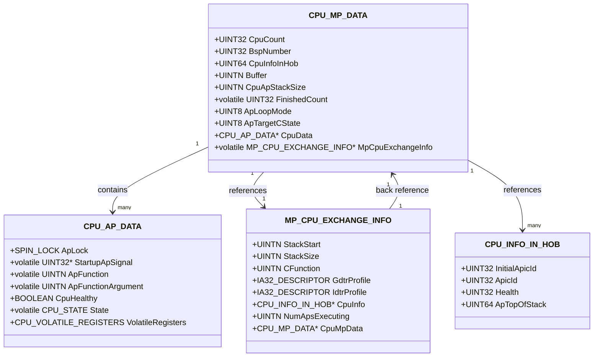
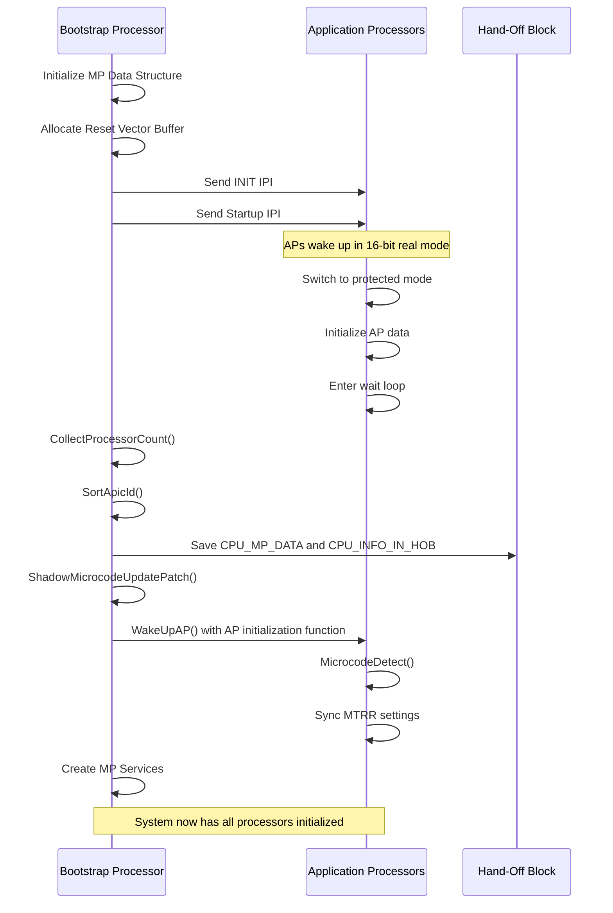
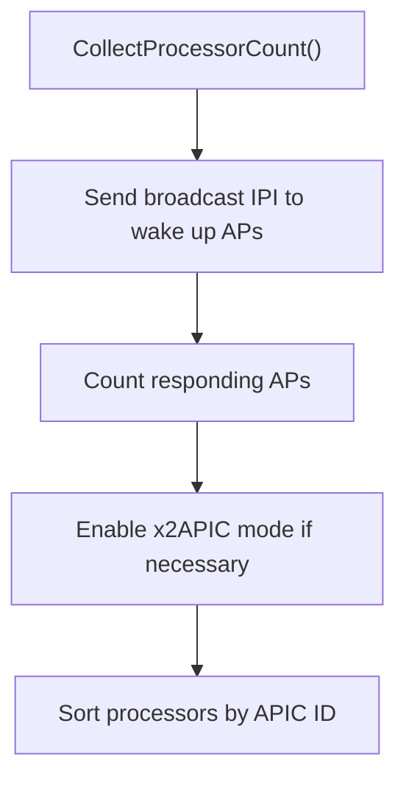
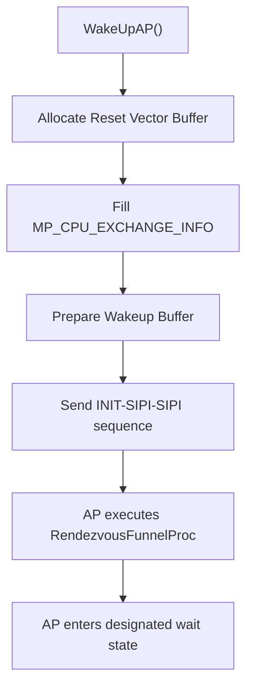
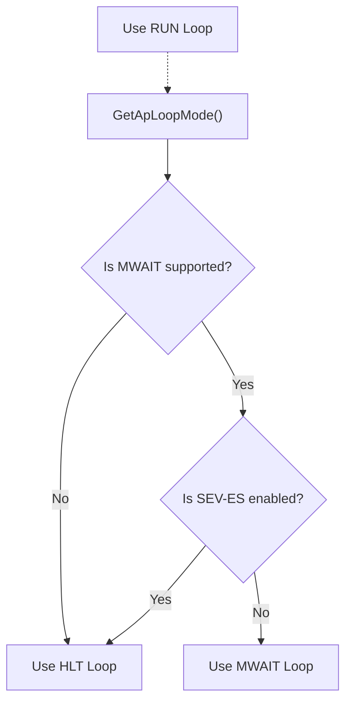
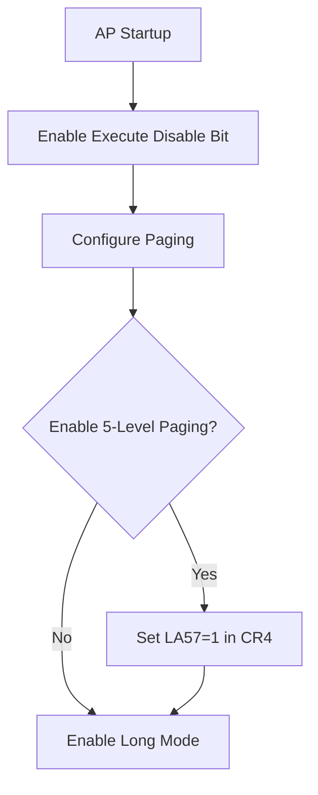
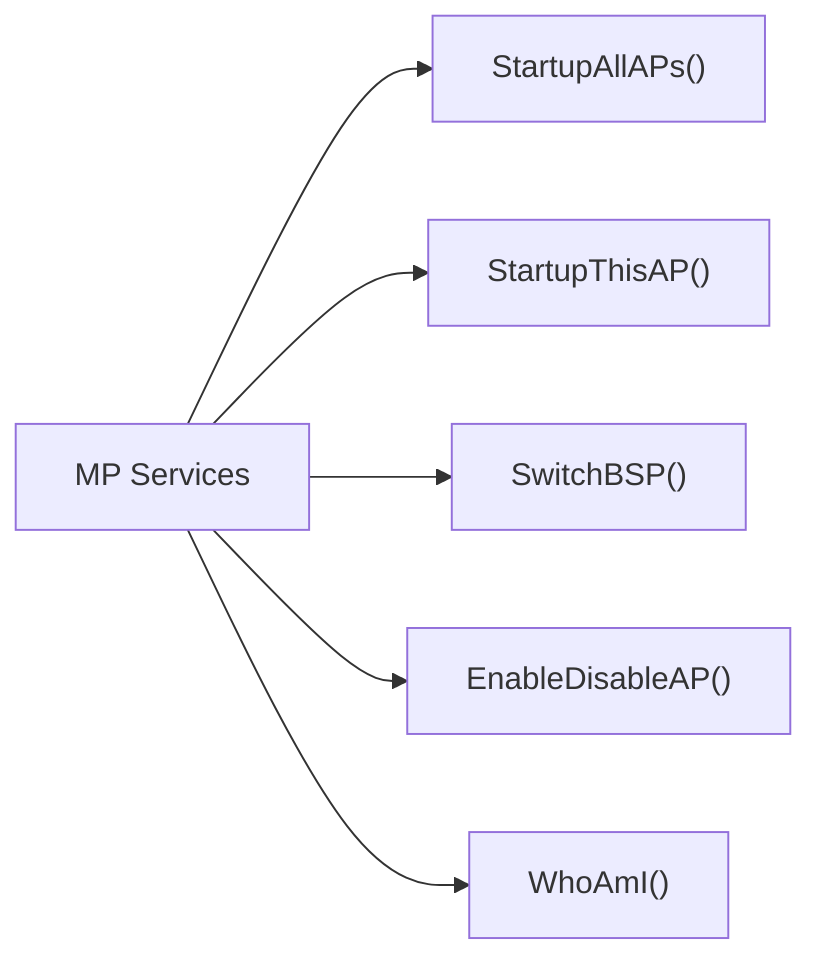
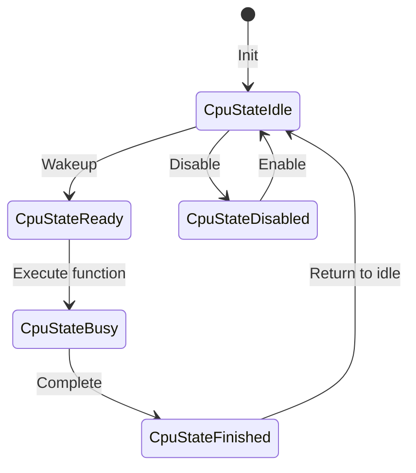
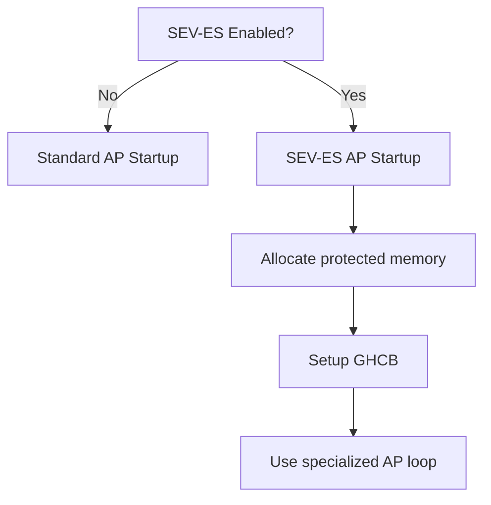
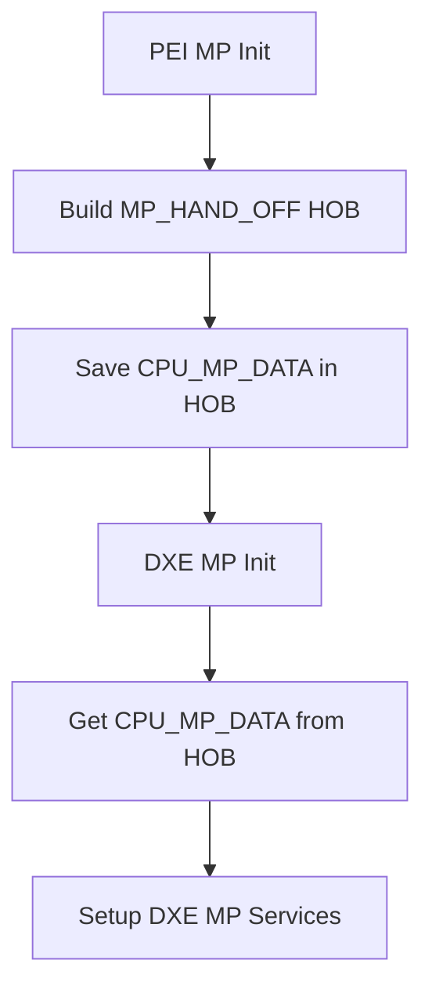

<!-- source: DeepWiki mcp.deepwiki.com · repo NVIDIA/edk2 · page 4.3 CPU Initialization and Multi-processor Support · fetched 2026-10-26 -->

# CPU Initialization and Multi-processor Support

<details>
<summary>Relevant source files</summary>

The following files were used as context for generating this wiki page:

- [UefiCpuPkg/Include/Library/MmSaveStateLib.h](UefiCpuPkg/Include/Library/MmSaveStateLib.h)
- [UefiCpuPkg/Library/MpInitLib/AmdSev.c](UefiCpuPkg/Library/MpInitLib/AmdSev.c)
- [UefiCpuPkg/Library/MpInitLib/DxeMpInitLib.inf](UefiCpuPkg/Library/MpInitLib/DxeMpInitLib.inf)
- [UefiCpuPkg/Library/MpInitLib/DxeMpLib.c](UefiCpuPkg/Library/MpInitLib/DxeMpLib.c)
- [UefiCpuPkg/Library/MpInitLib/Ia32/MpFuncs.nasm](UefiCpuPkg/Library/MpInitLib/Ia32/MpFuncs.nasm)
- [UefiCpuPkg/Library/MpInitLib/Microcode.c](UefiCpuPkg/Library/MpInitLib/Microcode.c)
- [UefiCpuPkg/Library/MpInitLib/MpEqu.inc](UefiCpuPkg/Library/MpInitLib/MpEqu.inc)
- [UefiCpuPkg/Library/MpInitLib/MpHandOff.h](UefiCpuPkg/Library/MpInitLib/MpHandOff.h)
- [UefiCpuPkg/Library/MpInitLib/MpLib.c](UefiCpuPkg/Library/MpInitLib/MpLib.c)
- [UefiCpuPkg/Library/MpInitLib/MpLib.h](UefiCpuPkg/Library/MpInitLib/MpLib.h)
- [UefiCpuPkg/Library/MpInitLib/PeiMpInitLib.inf](UefiCpuPkg/Library/MpInitLib/PeiMpInitLib.inf)
- [UefiCpuPkg/Library/MpInitLib/PeiMpLib.c](UefiCpuPkg/Library/MpInitLib/PeiMpLib.c)
- [UefiCpuPkg/Library/MpInitLib/X64/AmdSev.nasm](UefiCpuPkg/Library/MpInitLib/X64/AmdSev.nasm)
- [UefiCpuPkg/Library/MpInitLib/X64/MpFuncs.nasm](UefiCpuPkg/Library/MpInitLib/X64/MpFuncs.nasm)
- [UefiCpuPkg/UefiCpuPkg.dec](UefiCpuPkg/UefiCpuPkg.dec)
- [UefiCpuPkg/UefiCpuPkg.uni](UefiCpuPkg/UefiCpuPkg.uni)

</details>


This document describes the multi-processor (MP) initialization and support functionality in EDK II, focusing on how processors are detected, initialized, and managed throughout the boot process. For information about specific CPU features like System Management Mode (SMM), see [Security Features](#5) and [SMM](#5.1).

## 1. Overview

The MP initialization library provides the foundation for multi-processor support in UEFI firmware. It is responsible for:

- Detecting and initializing all processors in the system
- Distinguishing between Bootstrap Processor (BSP) and Application Processors (APs)
- Managing processor state transitions
- Supporting processor-specific features like microcode updates
- Providing MP services for higher-level firmware components

The library works across both Pre-EFI Initialization (PEI) and Driver Execution Environment (DXE) phases, with phase-specific implementations that share common core functionality.

Sources: [UefiCpuPkg/Library/MpInitLib/MpLib.h:14-921](), [UefiCpuPkg/UefiCpuPkg.dec:48-50]()

## 2. Key Data Structures

The MP library uses several key data structures to manage processor information and state:



- **CPU_MP_DATA**: The central data structure containing information about all processors and their state
- **CPU_AP_DATA**: Contains AP-specific data including state information and function pointers
- **MP_CPU_EXCHANGE_INFO**: Facilitates communication between BSP and APs during initialization
- **CPU_INFO_IN_HOB**: Basic CPU information stored in the Hand-Off Block (HOB) for transition between phases

Sources: [UefiCpuPkg/Library/MpInitLib/MpLib.h:74-311]()

## 3. MP Initialization Process

### 3.1 Initialization Flow

The MP initialization process follows a sequence of steps to detect, initialize, and configure all processors in the system:



The initialization sequence differs slightly between PEI and DXE phases:

1. **PEI Phase** initialization sets up basic MP functionality with limited resources
2. **DXE Phase** initialization builds on PEI phase data and provides full MP services

Sources: [UefiCpuPkg/Library/MpInitLib/MpLib.c:498-581](), [UefiCpuPkg/Library/MpInitLib/PeiMpLib.c:171-319](), [UefiCpuPkg/Library/MpInitLib/DxeMpLib.c:473-658]()

### 3.2 Processor Detection and Enumeration

The `CollectProcessorCount` function is responsible for detecting and counting all processors in the system:



Key aspects of processor detection:

- The BSP sends an initial IPI to wake up all APs
- Each AP responds, allowing the system to count them
- APIC IDs are collected and used for processor identification
- x2APIC mode is enabled if needed (more than 255 processors or high APIC IDs)

Sources: [UefiCpuPkg/Library/MpInitLib/MpLib.c:498-581]()

## 4. AP Startup and Management

### 4.1 AP Startup Mechanism

Application Processors (APs) are started using a specific sequence:



The BSP uses the INIT-SIPI-SIPI sequence to wake up the APs, which then execute the startup code in the reset vector buffer. The startup code transitions the AP from real mode to protected/long mode and then executes the designated initialization code.

Sources: [UefiCpuPkg/Library/MpInitLib/MpLib.c:1217-1226](), [UefiCpuPkg/Library/MpInitLib/X64/MpFuncs.nasm:32-149]()

### 4.2 AP Loop Modes

After initialization, APs enter a wait state based on the configured loop mode:

1. **Halt Loop Mode (ApInHltLoop)**: APs use the HLT instruction to enter a low-power state until interrupted.
2. **Mwait Loop Mode (ApInMwaitLoop)**: APs use the MWAIT instruction to enter a processor-specific C-state.
3. **Run Loop Mode (ApInRunLoop)**: APs continuously execute a pause instruction, consuming more power but responding faster.



The loop mode selection affects power consumption and response time when waking APs.

Sources: [UefiCpuPkg/Library/MpInitLib/MpLib.c:306-349](), [UefiCpuPkg/Library/MpInitLib/MpLib.c:644-707]()

## 5. Processor Feature Initialization

### 5.1 Microcode Update

The MP initialization process includes loading microcode updates to ensure processors have the latest patches:

```mermaid
flowchart TD
    A["MicrocodeDetect()"]
    B{"Is first thread in core?"}
    C{"Same as BSP?"}
    D{"Need to search for microcode?"}
    E["Use BSP's microcode"]
    F["Search microcode patches"]
    G["Is newer revision found?"}
    H["Load microcode patch"]
    I["Record microcode revision"]
    
    A --> B
    B -->|No| I
    B -->|Yes| C
    C -->|Yes| E
    C -->|No| D
    D -->|Yes| F
    F --> G
    G -->|Yes| H
    G -->|No| I
    E --> I
    H --> I
```

The process optimizes performance by:
- Only loading microcode on the first thread of each core
- Reusing BSP's microcode for identical processors
- Checking microcode revision to only load newer updates

Sources: [UefiCpuPkg/Library/MpInitLib/Microcode.c:19-119]()

### 5.2 Security Features

The library initializes various CPU security features including:

1. **Execute Disable Bit**: Enables memory execution protection
2. **Paging Modes**: Configures appropriate paging modes including 5-level paging when supported
3. **Confidential Computing Features**: Supports specialized environments like AMD SEV (Secure Encrypted Virtualization)



Sources: [UefiCpuPkg/Library/MpInitLib/X64/MpFuncs.nasm:82-144]()

## 6. MP Services

The MP initialization library provides a set of services for managing processors:

### 6.1 Core Services



- **StartupAllAPs**: Executes a function on all available APs
- **StartupThisAP**: Executes a function on a specific AP
- **SwitchBSP**: Switches the BSP functionality to a different processor
- **EnableDisableAP**: Enables or disables specified APs
- **WhoAmI**: Returns the processor number of the calling processor

Sources: [UefiCpuPkg/Library/MpInitLib/DxeMpLib.c:661-1129]()

### 6.2 AP State Management

The library tracks AP states through a state machine:



This state tracking allows the BSP to monitor AP execution and manage task distribution.

Sources: [UefiCpuPkg/Library/MpInitLib/MpLib.h:132-138](), [UefiCpuPkg/Library/MpInitLib/MpLib.c:125-147]()

## 7. Confidential Computing Support

The library includes support for confidential computing technologies:

### 7.1 AMD SEV Support

AMD SEV (Secure Encrypted Virtualization) and SEV-ES (Encrypted State) require special handling for AP initialization:

- SEV-ES APs must use a secure method for startup using GHCB (Guest Hypervisor Communication Block)
- Special memory allocation for SEV-ES functionality
- Protected AP reset mechanisms



Sources: [UefiCpuPkg/Library/MpInitLib/AmdSev.c:94-123](), [UefiCpuPkg/Library/MpInitLib/X64/AmdSev.nasm:18-67]()

## 8. Phase Transition

When transitioning from PEI to DXE phase, MP initialization information is passed through HOBs (Hand-Off Blocks):



This ensures that information about processors detected in PEI is available in DXE without re-detecting all processors.

Sources: [UefiCpuPkg/Library/MpInitLib/PeiMpLib.c:124-169](), [UefiCpuPkg/Library/MpInitLib/MpHandOff.h:10-46]()

## 9. Summary

The MP initialization library in EDK II provides a comprehensive set of services for processor detection, initialization, and management. It supports various processor features, confidential computing technologies, and efficient AP state management across both PEI and DXE phases. This framework enables UEFI firmware to fully utilize multi-processor capabilities while maintaining a clean, structured approach to processor management.

---

