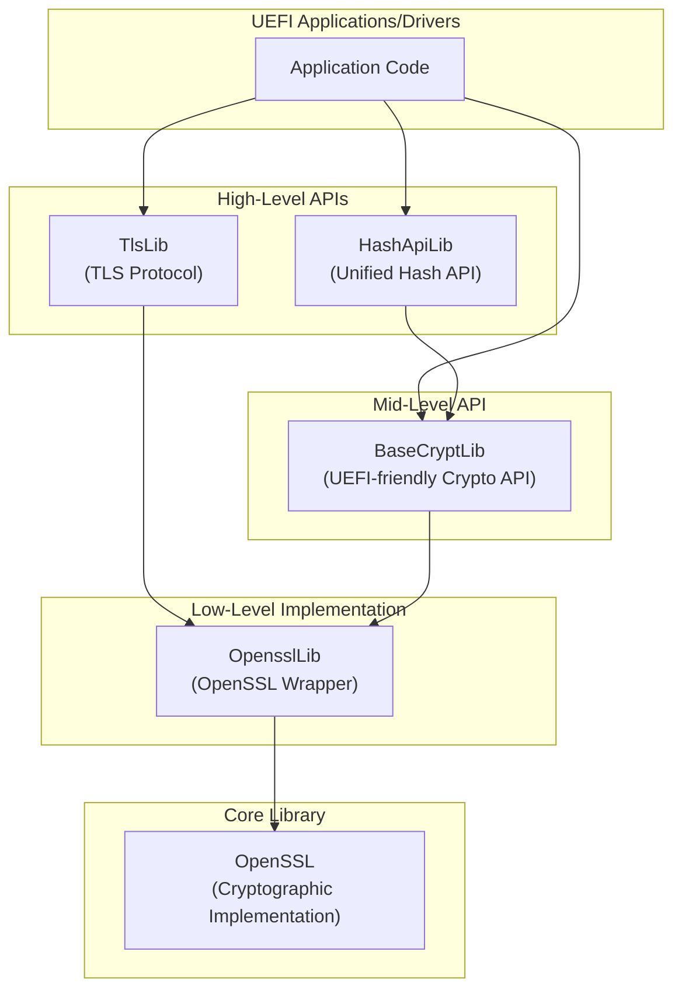
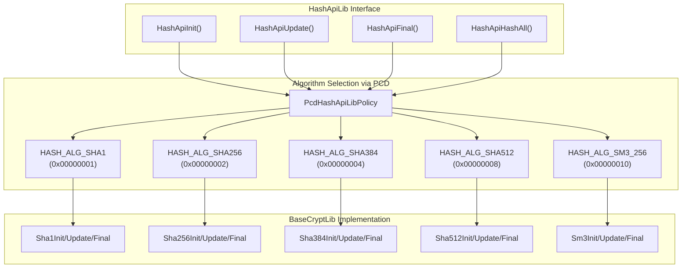
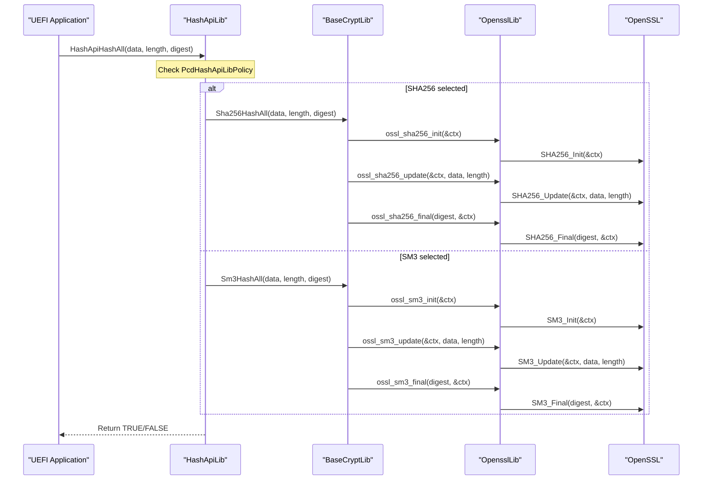

<!-- source: DeepWiki mcp.deepwiki.com · repo NVIDIA/edk2 · page 4.4 Cryptographic Services · fetched 2026-10-26 -->

# Cryptographic Services

Relevant source files

The following files were used as context for generating this wiki page:

- [CryptoPkg/CryptoPkg.ci.yaml](CryptoPkg/CryptoPkg.ci.yaml)
- [CryptoPkg/CryptoPkg.dec](CryptoPkg/CryptoPkg.dec)
- [CryptoPkg/CryptoPkg.uni](CryptoPkg/CryptoPkg.uni)
- [CryptoPkg/Include/Library/HashApiLib.h](CryptoPkg/Include/Library/HashApiLib.h)
- [CryptoPkg/Library/BaseCryptLib/Hash/CryptSm3.c](CryptoPkg/Library/BaseCryptLib/Hash/CryptSm3.c)
- [CryptoPkg/Library/BaseHashApiLib/BaseHashApiLib.c](CryptoPkg/Library/BaseHashApiLib/BaseHashApiLib.c)
- [CryptoPkg/Library/BaseHashApiLib/BaseHashApiLib.inf](CryptoPkg/Library/BaseHashApiLib/BaseHashApiLib.inf)
- [CryptoPkg/Library/BaseHashApiLib/BaseHashApiLib.uni](CryptoPkg/Library/BaseHashApiLib/BaseHashApiLib.uni)
- [CryptoPkg/Library/Include/fcntl.h](CryptoPkg/Library/Include/fcntl.h)
- [CryptoPkg/Library/OpensslLib/OpenSSL-HOWTO.txt](CryptoPkg/Library/OpensslLib/OpenSSL-HOWTO.txt)
- [CryptoPkg/Library/OpensslLib/OpensslLib.inf](CryptoPkg/Library/OpensslLib/OpensslLib.inf)
- [CryptoPkg/Library/OpensslLib/OpensslLib.uni](CryptoPkg/Library/OpensslLib/OpensslLib.uni)
- [CryptoPkg/Library/OpensslLib/OpensslLibAccel.inf](CryptoPkg/Library/OpensslLib/OpensslLibAccel.inf)
- [CryptoPkg/Library/OpensslLib/OpensslLibAccel.uni](CryptoPkg/Library/OpensslLib/OpensslLibAccel.uni)
- [CryptoPkg/Library/OpensslLib/OpensslLibConstructor.c](CryptoPkg/Library/OpensslLib/OpensslLibConstructor.c)
- [CryptoPkg/Library/OpensslLib/OpensslLibCrypto.inf](CryptoPkg/Library/OpensslLib/OpensslLibCrypto.inf)
- [CryptoPkg/Library/OpensslLib/OpensslLibCrypto.uni](CryptoPkg/Library/OpensslLib/OpensslLibCrypto.uni)
- [CryptoPkg/Library/OpensslLib/OpensslLibFull.inf](CryptoPkg/Library/OpensslLib/OpensslLibFull.inf)
- [CryptoPkg/Library/OpensslLib/OpensslLibFullAccel.inf](CryptoPkg/Library/OpensslLib/OpensslLibFullAccel.inf)
- [CryptoPkg/Library/OpensslLib/OpensslStub/EncoderNull.c](CryptoPkg/Library/OpensslLib/OpensslStub/EncoderNull.c)
- [CryptoPkg/Library/OpensslLib/OpensslStub/Pkcs12Null.c](CryptoPkg/Library/OpensslLib/OpensslStub/Pkcs12Null.c)
- [CryptoPkg/Library/OpensslLib/OpensslStub/SslExtServNull.c](CryptoPkg/Library/OpensslLib/OpensslStub/SslExtServNull.c)
- [CryptoPkg/Library/OpensslLib/OpensslStub/SslStatServNull.c](CryptoPkg/Library/OpensslLib/OpensslStub/SslStatServNull.c)
- [CryptoPkg/Library/OpensslLib/UefiAsm.conf](CryptoPkg/Library/OpensslLib/UefiAsm.conf)
- [CryptoPkg/Library/OpensslLib/X64/ApiHooks.c](CryptoPkg/Library/OpensslLib/X64/ApiHooks.c)
- [CryptoPkg/Library/OpensslLib/buildinf.c](CryptoPkg/Library/OpensslLib/buildinf.c)
- [CryptoPkg/Library/OpensslLib/buildinf.h](CryptoPkg/Library/OpensslLib/buildinf.h)
- [CryptoPkg/Library/OpensslLib/configure.py](CryptoPkg/Library/OpensslLib/configure.py)
- [CryptoPkg/Library/OpensslLib/perl2json.pl](CryptoPkg/Library/OpensslLib/perl2json.pl)
- [CryptoPkg/Private/Ppi/Crypto.h](CryptoPkg/Private/Ppi/Crypto.h)
- [CryptoPkg/Private/Protocol/SmmCrypto.h](CryptoPkg/Private/Protocol/SmmCrypto.h)

This document provides a detailed overview of the cryptographic services available in EDK II through the CryptoPkg. It covers the architecture, implementation details, available cryptographic algorithms, and usage patterns of the integrated OpenSSL library and its wrapper interfaces.

## Overview

The CryptoPkg in EDK II provides cryptographic services for UEFI security modules by integrating OpenSSL, a well-known open-source implementation of SSL/TLS protocols and cryptographic algorithms. These services enable critical security features in UEFI firmware, including:

- Authenticated variable services
- Secure boot validation
- Driver signing verification
- Secure communication via TLS
- Various other security operations requiring cryptographic primitives

The implementation follows a layered approach, where OpenSSL provides the low-level cryptographic operations, with several wrapper libraries offering progressively more UEFI-friendly interfaces.

## Architecture

The cryptographic services are implemented as a layered architecture, with each layer providing specific functionality and abstractions:

Sources: [CryptoPkg/CryptoPkg.dec:4-9](), [CryptoPkg/Library/OpensslLib/OpenSSL-HOWTO.txt:1-15](), [CryptoPkg/Library/OpensslLib/OpensslLib.inf:1-10]()

## Key Components

### OpensslLib

OpensslLib serves as the wrapper around the OpenSSL library, providing integration with the UEFI environment. The library comes in multiple variants, each tailored for different use cases:

| Variant | Description | File | Size Impact |
|---------|-------------|------|------------|
| OpensslLib | Basic implementation with TLS features | [CryptoPkg/Library/OpensslLib/OpensslLib.inf]() | Base size |
| OpensslLibCrypto | Implementation with ECC and TLS features removed | [CryptoPkg/Library/OpensslLib/OpensslLibCrypto.inf]() | Reduced size |
| OpensslLibAccel | Performance-optimized implementations for specific algorithms | [CryptoPkg/Library/OpensslLib/OpensslLibAccel.inf]() | Base size |
| OpensslLibFull | Complete implementation with ECC and TLS | [CryptoPkg/Library/OpensslLib/OpensslLibFull.inf]() | +115KB over OpensslLibAccel |

The OpensslLib instance that includes hardware acceleration provides optimized implementations for:
- SHA1, SHA256, SHA512 hashing algorithms
- AES encryption with AESNI and VPAED instructions
- GHASH for GCM mode operations

The library is configured during build time with specific options to tailor it for the UEFI environment, as shown in the `configure.py` script.

Sources: [CryptoPkg/Library/OpensslLib/OpensslLib.inf:1-24](), [CryptoPkg/Library/OpensslLib/OpensslLibCrypto.inf:1-24](), [CryptoPkg/Library/OpensslLib/OpensslLibAccel.inf:1-32](), [CryptoPkg/Library/OpensslLib/OpensslLibFull.inf:1-34](), [CryptoPkg/Library/OpensslLib/configure.py:11-32]()

### BaseCryptLib

BaseCryptLib provides a UEFI-friendly API on top of OpensslLib, exposing cryptographic functions with interfaces suitable for UEFI applications and drivers. It implements functions for:

- Hash calculation (SHA family, SM3)
- HMAC operations
- Random number generation
- Symmetric encryption (AES, etc.)
- Asymmetric cryptography (RSA, DH)
- Digital signatures
- X.509 certificate handling

The library abstracts the implementation details of OpenSSL, providing a consistent interface even as the underlying OpenSSL version changes.

Sources: [CryptoPkg/Library/BaseCryptLib/Hash/CryptSm3.c:1-236]()

### HashApiLib

HashApiLib provides a unified API for hash calculations, allowing the actual hash algorithm to be configured through a PCD (Platform Configuration Database) setting. This allows for flexibility in choosing the appropriate hash algorithm based on security requirements or platform capabilities.

Sources: [CryptoPkg/Library/BaseHashApiLib/BaseHashApiLib.c:1-246](), [CryptoPkg/Include/Library/HashApiLib.h:1-111]()

## Supported Cryptographic Algorithms

The CryptoPkg provides support for a wide range of cryptographic algorithms:

### Hash Algorithms
- SHA-1 (Note: deprecated for security-sensitive applications)
- SHA-256
- SHA-384
- SHA-512
- SM3 (Chinese standard)

### Symmetric Encryption
- AES (CBC, CCM, GCM, XTS modes)
- 3DES
- RC4 (Note: considered insecure for new applications)

### Asymmetric Cryptography
- RSA (key generation, encryption/decryption, signing/verification)
- Diffie-Hellman (DH) key exchange
- Elliptic Curve Cryptography (ECC) - in OpensslLibFull and OpensslLibFullAccel

### Other
- HMAC (Hash-based Message Authentication Code)
- PKCS#7 (for signed data)
- X.509 certificate processing
- Random number generation

Sources: [CryptoPkg/Library/OpensslLib/OpensslLib.inf:30-647](), [CryptoPkg/Library/BaseHashApiLib/BaseHashApiLib.c:30-95]()

## Crypto Flow

The following sequence diagram illustrates the typical flow for a hash operation through the various layers of the cryptographic architecture:

Sources: [CryptoPkg/Library/BaseHashApiLib/BaseHashApiLib.c:204-237](), [CryptoPkg/Library/BaseCryptLib/Hash/CryptSm3.c:186-235]()

## Configuration Options

The cryptographic services can be configured through Platform Configuration Database (PCD) settings:

### PcdHashApiLibPolicy

This PCD determines which hash algorithm is used by the HashApiLib:

| Value | Algorithm |
|-------|-----------|
| 0x00000001 | SHA-1 |
| 0x00000002 | SHA-256 (default) |
| 0x00000004 | SHA-384 |
| 0x00000008 | SHA-512 |
| 0x00000010 | SM3-256 |

### PcdCryptoServiceFamilyEnable

This structured PCD enables or disables specific cryptographic services provided by the EDK II Crypto Protocols/PPIs. By default, all services are disabled.

Sources: [CryptoPkg/CryptoPkg.dec:71-95](), [CryptoPkg/CryptoPkg.uni:18-28]()

## Crypto Protocol and PPI

EDK II provides standardized interfaces for accessing cryptographic services across different phases of the boot process:

- `gEdkiiCryptoProtocolGuid` - For DXE phase access
- `gEdkiiSmmCryptoProtocolGuid` - For SMM access
- `gEdkiiCryptoPpiGuid` - For PEI phase access

These interfaces ensure consistent access to cryptographic services regardless of the boot phase.

Sources: [CryptoPkg/CryptoPkg.dec:53-65](), [CryptoPkg/Private/Protocol/SmmCrypto.h:1-17](), [CryptoPkg/Private/Ppi/Crypto.h:1-15]()

## Building and Integration

To integrate the OpenSSL library, EDK II provides tools and scripts:

- `configure.py` - Sets up OpenSSL configuration for UEFI environment
- `perl2json.pl` - Processes OpenSSL configuration data
- `UefiAsm.conf` - Configures assembly optimizations for different platforms

The build process handles compiler-specific flags and optimizations for the supported architectures (IA32, X64, ARM, AARCH64).

Sources: [CryptoPkg/Library/OpensslLib/configure.py:1-30](), [CryptoPkg/Library/OpensslLib/UefiAsm.conf:1-31]()

## Security Considerations

When using the cryptographic services provided by CryptoPkg, consider the following:

1. SHA-1 is deprecated for security-sensitive applications due to known weaknesses
2. The default hash algorithm for HashApiLib is SHA-256
3. Different OpensslLib variants provide different feature sets and security properties
4. Hardware acceleration may provide better performance but might introduce side-channel risks

For applications requiring maximum security, use the more recent hash algorithms (SHA-256, SHA-384, SHA-512) and the appropriate cryptographic primitives based on the security requirements.

---

