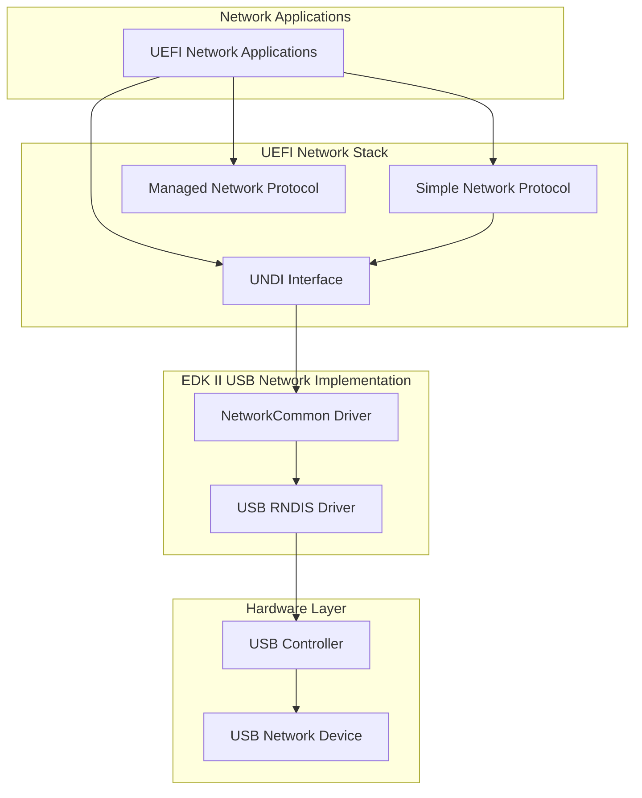
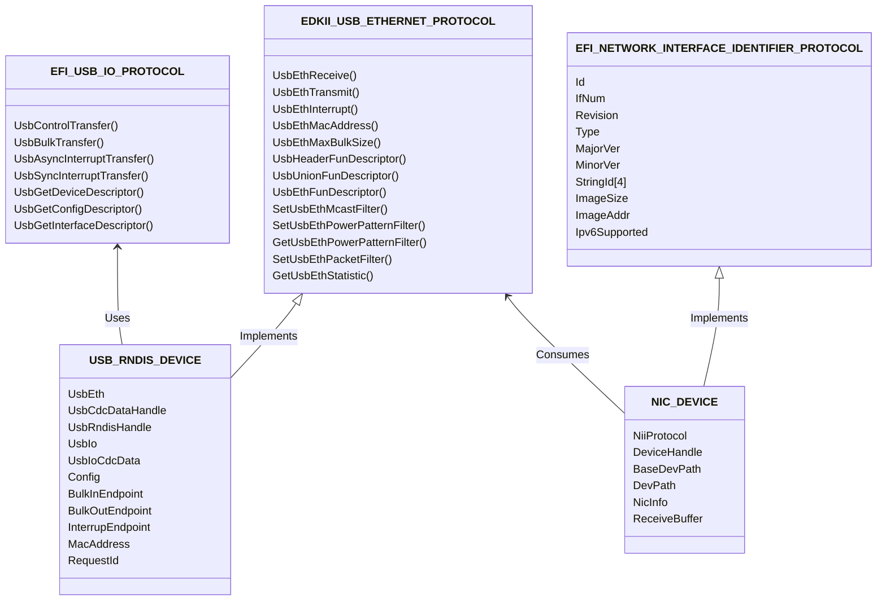
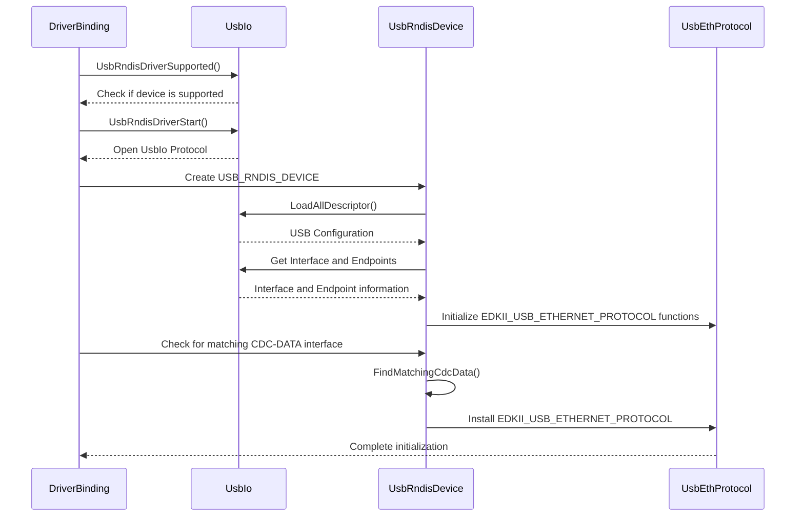
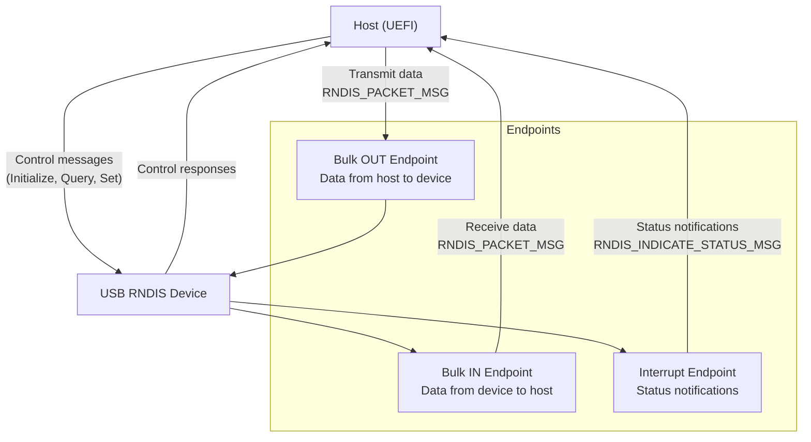
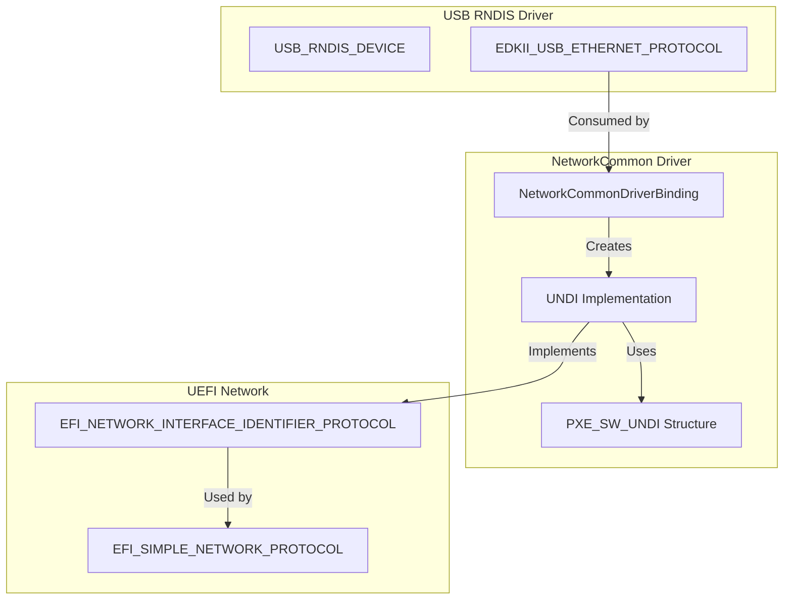
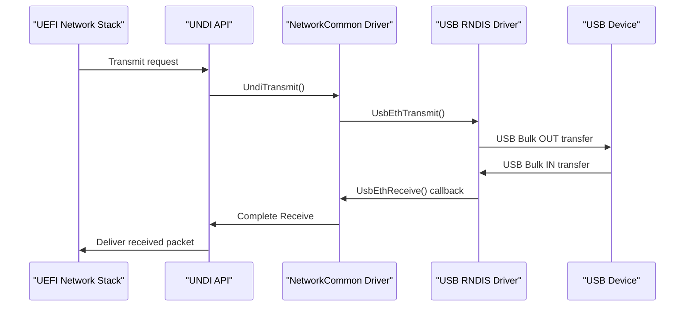
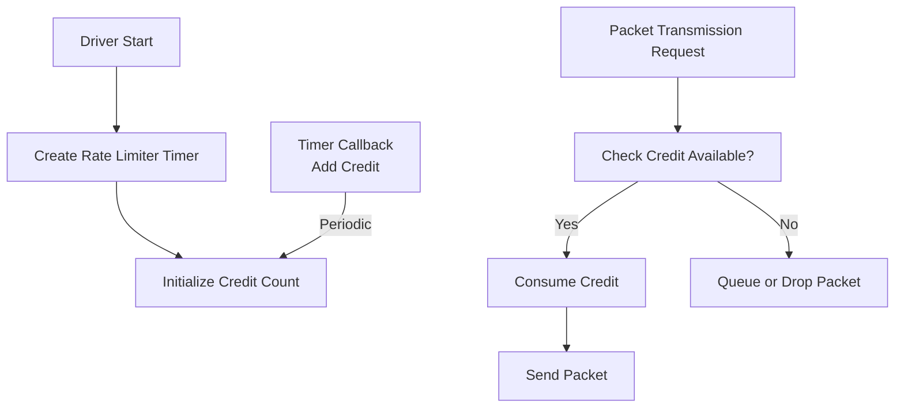
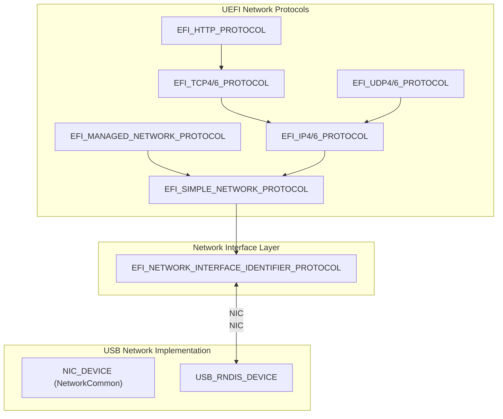

<!-- source: DeepWiki mcp.deepwiki.com · repo NVIDIA/edk2 · page 4.5 USB and Network Support · fetched 2026-10-26 -->

# USB and Network Support

<details>
<summary>Relevant source files</summary>

The following files were used as context for generating this wiki page:

- [Maintainers.txt](Maintainers.txt)
- [MdeModulePkg/Bus/Usb/UsbNetwork/NetworkCommon/ComponentName.c](MdeModulePkg/Bus/Usb/UsbNetwork/NetworkCommon/ComponentName.c)
- [MdeModulePkg/Bus/Usb/UsbNetwork/NetworkCommon/DriverBinding.c](MdeModulePkg/Bus/Usb/UsbNetwork/NetworkCommon/DriverBinding.c)
- [MdeModulePkg/Bus/Usb/UsbNetwork/NetworkCommon/DriverBinding.h](MdeModulePkg/Bus/Usb/UsbNetwork/NetworkCommon/DriverBinding.h)
- [MdeModulePkg/Bus/Usb/UsbNetwork/NetworkCommon/NetworkCommon.inf](MdeModulePkg/Bus/Usb/UsbNetwork/NetworkCommon/NetworkCommon.inf)
- [MdeModulePkg/Bus/Usb/UsbNetwork/NetworkCommon/PxeFunction.c](MdeModulePkg/Bus/Usb/UsbNetwork/NetworkCommon/PxeFunction.c)
- [MdeModulePkg/Bus/Usb/UsbNetwork/UsbRndis/ComponentName.c](MdeModulePkg/Bus/Usb/UsbNetwork/UsbRndis/ComponentName.c)
- [MdeModulePkg/Bus/Usb/UsbNetwork/UsbRndis/UsbRndis.c](MdeModulePkg/Bus/Usb/UsbNetwork/UsbRndis/UsbRndis.c)
- [MdeModulePkg/Bus/Usb/UsbNetwork/UsbRndis/UsbRndis.h](MdeModulePkg/Bus/Usb/UsbNetwork/UsbRndis/UsbRndis.h)
- [MdeModulePkg/Bus/Usb/UsbNetwork/UsbRndis/UsbRndis.inf](MdeModulePkg/Bus/Usb/UsbNetwork/UsbRndis/UsbRndis.inf)
- [MdeModulePkg/Bus/Usb/UsbNetwork/UsbRndis/UsbRndisFunction.c](MdeModulePkg/Bus/Usb/UsbNetwork/UsbRndis/UsbRndisFunction.c)

</details>


This page documents the USB network support in EDK II, focusing primarily on the USB Remote Network Driver Interface Specification (RNDIS) implementation. The page covers the architecture of USB network drivers, core components, and how they interact to enable network connectivity through USB devices.

For general network support not related to USB, see [Core Services and Packages](#4).

## Overview

EDK II provides USB network functionality through a layered driver architecture that enables UEFI network stacks to communicate with USB network adapters. The key focus is the RNDIS protocol implementation, which is a common protocol used by many USB network devices, especially those in mobile and embedded systems.

The implementation consists of two primary drivers:
1. **USB RNDIS Driver** - Communicates directly with USB network devices using the RNDIS protocol
2. **Network Common Driver** - Bridges between the RNDIS driver and UEFI network stack using UNDI (Universal Network Driver Interface)

Together, these drivers enable UEFI applications and the operating system to communicate over the network using USB network adapters.

Sources: [MdeModulePkg/Bus/Usb/UsbNetwork/UsbRndis/UsbRndis.inf](), [MdeModulePkg/Bus/Usb/UsbNetwork/NetworkCommon/NetworkCommon.inf]()

## Architecture Overview

The USB Network stack in EDK II follows a layered approach:



The USB Network implementation consists of two key layers:

1. **USB RNDIS Driver**: Interfaces directly with USB hardware to communicate with RNDIS-capable network devices
2. **Network Common Driver**: Provides the UNDI interface implementation that translates between UEFI network protocols and the USB Ethernet protocol

This layered approach allows for clean separation of concerns between USB-specific communication and general network functionality.

Sources: [MdeModulePkg/Bus/Usb/UsbNetwork/UsbRndis/UsbRndis.c](), [MdeModulePkg/Bus/Usb/UsbNetwork/NetworkCommon/DriverBinding.c]()

## Protocol Relationships

The relationships between the various protocols involved in USB networking are shown below:



The diagram shows how the different protocols interact:
- `USB_RNDIS_DEVICE` consumes `EFI_USB_IO_PROTOCOL` to communicate with USB devices
- `USB_RNDIS_DEVICE` implements `EDKII_USB_ETHERNET_PROTOCOL` to provide network functionality
- `NIC_DEVICE` consumes `EDKII_USB_ETHERNET_PROTOCOL` from the RNDIS driver
- `NIC_DEVICE` implements `EFI_NETWORK_INTERFACE_IDENTIFIER_PROTOCOL` (UNDI) for the UEFI network stack

Sources: [MdeModulePkg/Bus/Usb/UsbNetwork/UsbRndis/UsbRndis.h:23-43](), [MdeModulePkg/Bus/Usb/UsbNetwork/NetworkCommon/DriverBinding.h:43-50]()

## USB RNDIS Driver

The USB RNDIS driver is responsible for communicating with USB network devices that support the RNDIS protocol. It detects compatible devices, initializes them, and provides an implementation of the EDKII USB Ethernet Protocol.

### Driver Binding Process



The driver binding process involves:

1. Checking if the device is a supported RNDIS device
2. Creating and initializing a USB_RNDIS_DEVICE structure
3. Loading descriptors and configuring endpoints
4. Finding matching CDC-DATA interface (if available)
5. Installing the EDKII_USB_ETHERNET_PROTOCOL

The RNDIS driver handles two types of interfaces:
- RNDIS control interface (for control messages)
- CDC data interface (for data transmission/reception)

Sources: [MdeModulePkg/Bus/Usb/UsbNetwork/UsbRndis/UsbRndis.c:468-731]()

### RNDIS Protocol Handling

The USB RNDIS driver implements the RNDIS protocol, which involves several message types:

| Message Type | Description | Direction |
|--------------|-------------|-----------|
| RNDIS_INITIALIZE_MSG | Initialize the RNDIS device | Host → Device |
| RNDIS_INITIALIZE_CMPLT | Initialization complete | Device → Host |
| RNDIS_QUERY_MSG | Query device attributes | Host → Device |
| RNDIS_QUERY_CMPLT | Query response | Device → Host |
| RNDIS_SET_MSG | Set device attributes | Host → Device |
| RNDIS_SET_CMPLT | Set operation complete | Device → Host |
| RNDIS_RESET_MSG | Reset the device | Host → Device |
| RNDIS_RESET_CMPLT | Reset complete | Device → Host |
| RNDIS_INDICATE_STATUS_MSG | Status indication | Device → Host |
| RNDIS_KEEPALIVE_MSG | Keep connection alive | Host → Device |
| RNDIS_PACKET_MSG | Data packet | Both directions |

The driver handles these messages through control and data endpoints, with separate paths for command and data transfer.

Sources: [MdeModulePkg/Bus/Usb/UsbNetwork/UsbRndis/UsbRndis.h:327-339]()

### Endpoint Management

The USB RNDIS driver manages three types of endpoints:



The endpoints are discovered and configured in the `GetEndpoint` function which identifies:
- Bulk IN endpoint for receiving data
- Bulk OUT endpoint for sending data
- Interrupt endpoint for status notifications

Sources: [MdeModulePkg/Bus/Usb/UsbNetwork/UsbRndis/UsbRndisFunction.c:168-221]()

## NetworkCommon Driver

The NetworkCommon driver bridges between the USB Ethernet protocol and the UNDI (Universal Network Driver Interface) protocol used by the UEFI network stack.

### Driver Architecture



The NetworkCommon driver:
1. Discovers devices with the EDKII_USB_ETHERNET_PROTOCOL
2. Creates a NIC_DEVICE structure for each device
3. Initializes the global PXE_SW_UNDI structure if needed
4. Implements the EFI_NETWORK_INTERFACE_IDENTIFIER_PROTOCOL

Sources: [MdeModulePkg/Bus/Usb/UsbNetwork/NetworkCommon/DriverBinding.c:143-416]()

### UNDI Implementation

The NetworkCommon driver implements the UNDI API, which includes the following key commands:

| UNDI Command | Function | Description |
|--------------|----------|-------------|
| GET_STATE | UndiGetState | Get driver state |
| START | UndiStart | Start the driver |
| STOP | UndiStop | Stop the driver |
| INITIALIZE | UndiInitialize | Initialize the NIC |
| RESET | UndiReset | Reset the NIC |
| SHUTDOWN | UndiShutdown | Shutdown the driver |
| TRANSMIT | UndiTransmit | Send a packet |
| RECEIVE | UndiReceive | Receive a packet |
| RECEIVE_FILTERS | UndiReceiveFilter | Set receive filters |
| GET_STATUS | UndiGetStatus | Get device status |

These commands allow the UEFI network stack to control the network interface and transmit/receive data.

Sources: [MdeModulePkg/Bus/Usb/UsbNetwork/NetworkCommon/PxeFunction.c:11-30]()

### Packet Handling



The packet handling process involves:
1. **Transmit path**:
   - UEFI network stack invokes the UNDI transmit command
   - NetworkCommon driver processes the request and calls UsbEthTransmit
   - RNDIS driver packages the data in an RNDIS packet and sends via the Bulk OUT endpoint

2. **Receive path**:
   - RNDIS driver receives data via the Bulk IN endpoint
   - Data is parsed and provided to the NetworkCommon driver
   - NetworkCommon driver delivers the data to the UEFI network stack via UNDI

Sources: [MdeModulePkg/Bus/Usb/UsbNetwork/NetworkCommon/PxeFunction.c]()

## Device Detection and Configuration

### USB Device Class Detection

The RNDIS driver identifies compatible devices by checking the USB Interface Descriptor class, subclass, and protocol values:

```
Interface Class    | Interface Subclass | Interface Protocol
------------------|--------------------|------------------
0x02 (CDC)        | 0x02              | 0xFF
0xEF (Misc)       | 0x04              | 0x01
0x0A (CDC-Data)   | 0x00              | 0x00
```

The driver supports three types of interface combinations:
1. CDC control interface with RNDIS functionality
2. CDC data interface for packet transfer
3. Miscellaneous device class with RNDIS functionality

Sources: [MdeModulePkg/Bus/Usb/UsbNetwork/UsbRndis/UsbRndis.c:29-58]()

### USB Descriptors

The RNDIS driver processes several USB descriptor types:

| Descriptor Type | Description | Usage |
|-----------------|-------------|-------|
| Device Descriptor | Basic device information | Identify the device |
| Configuration Descriptor | Device configuration | Set device configuration |
| Interface Descriptor | Interface details | Identify RNDIS interfaces |
| Endpoint Descriptor | Endpoint details | Find bulk/interrupt endpoints |
| Functional Descriptors | CDC class-specific descriptors | Get ethernet capabilities |

Functional descriptors are particularly important:
- Header Functional Descriptor - Basic CDC information
- Union Functional Descriptor - Related interfaces
- Ethernet Functional Descriptor - Ethernet capabilities, MAC address, filters

Sources: [MdeModulePkg/Bus/Usb/UsbNetwork/UsbRndis/UsbRndisFunction.c:111-159](), [MdeModulePkg/Bus/Usb/UsbNetwork/UsbRndis/UsbRndisFunction.c:529-626]()

## Rate Limiting

The NetworkCommon driver implements a rate limiting mechanism to prevent network flooding:



The rate limiting feature:
- Can be enabled/disabled via PCD (`PcdEnableUsbNetworkRateLimiting`)
- Configured with credit amount (`PcdUsbNetworkRateLimitingCredit`)
- Uses a timer to periodically add credits
- Prevents network flooding by controlling packet transmission rate

Sources: [MdeModulePkg/Bus/Usb/UsbNetwork/NetworkCommon/DriverBinding.c:40-53](), [MdeModulePkg/Bus/Usb/UsbNetwork/NetworkCommon/DriverBinding.c:582-584]()

## Integration with UEFI Network Stack

The USB Network drivers integrate with the UEFI network stack through the UNDI protocol. This integration allows UEFI applications and operating systems to use USB network devices through standard UEFI network protocols.



The key integration points are:
1. The NetworkCommon driver creates a NIC_DEVICE for each USB Ethernet device
2. It implements the EFI_NETWORK_INTERFACE_IDENTIFIER_PROTOCOL (UNDI)
3. The UEFI network stack uses UNDI to communicate with the network device
4. Higher-level protocols (IP, TCP, UDP, HTTP) build on this foundation

Sources: [MdeModulePkg/Bus/Usb/UsbNetwork/NetworkCommon/DriverBinding.c:362-371]()

## Summary

The USB and Network Support in EDK II provides a comprehensive solution for integrating USB network devices into the UEFI environment. The implementation follows a layered approach:

1. The **USB RNDIS Driver** handles USB-specific communication with RNDIS devices, managing descriptors, endpoints, and RNDIS protocol messages.

2. The **Network Common Driver** bridges between the USB Ethernet protocol and the UNDI interface, providing the necessary glue to integrate with the UEFI network stack.

This implementation allows UEFI applications and operating systems to use USB network devices through standard UEFI network protocols, enabling network boot, pre-OS networking, and other network-dependent UEFI applications.

Sources: [MdeModulePkg/Bus/Usb/UsbNetwork/UsbRndis/UsbRndis.inf](), [MdeModulePkg/Bus/Usb/UsbNetwork/NetworkCommon/NetworkCommon.inf]()

---

