<!-- source: DeepWiki mcp.deepwiki.com · repo NVIDIA/edk2 · page 5 Security Features · fetched 2026-10-26 -->

# Security Features

Relevant source files

The following files were used as context for generating this wiki page:

- [OvmfPkg/Include/Library/PlatformInitLib.h](OvmfPkg/Include/Library/PlatformInitLib.h)
- [OvmfPkg/Library/PeilessStartupLib/Hob.c](OvmfPkg/Library/PeilessStartupLib/Hob.c)
- [OvmfPkg/Library/PlatformInitLib/IntelTdx.c](OvmfPkg/Library/PlatformInitLib/IntelTdx.c)
- [OvmfPkg/Library/PlatformInitLib/IntelTdxNull.c](OvmfPkg/Library/PlatformInitLib/IntelTdxNull.c)
- [OvmfPkg/Library/PlatformInitLib/MemDetect.c](OvmfPkg/Library/PlatformInitLib/MemDetect.c)
- [OvmfPkg/Library/PlatformInitLib/Platform.c](OvmfPkg/Library/PlatformInitLib/Platform.c)
- [OvmfPkg/Library/PlatformInitLib/PlatformInitLib.inf](OvmfPkg/Library/PlatformInitLib/PlatformInitLib.inf)
- [OvmfPkg/Library/SmmCpuFeaturesLib/SmmCpuFeaturesLib.c](OvmfPkg/Library/SmmCpuFeaturesLib/SmmCpuFeaturesLib.c)
- [OvmfPkg/Library/SmmCpuFeaturesLib/SmmCpuFeaturesLib.inf](OvmfPkg/Library/SmmCpuFeaturesLib/SmmCpuFeaturesLib.inf)
- [OvmfPkg/PlatformPei/AmdSev.c](OvmfPkg/PlatformPei/AmdSev.c)
- [OvmfPkg/PlatformPei/ClearCache.c](OvmfPkg/PlatformPei/ClearCache.c)
- [OvmfPkg/PlatformPei/FeatureControl.c](OvmfPkg/PlatformPei/FeatureControl.c)
- [OvmfPkg/PlatformPei/Fv.c](OvmfPkg/PlatformPei/Fv.c)
- [OvmfPkg/PlatformPei/IntelTdx.c](OvmfPkg/PlatformPei/IntelTdx.c)
- [OvmfPkg/PlatformPei/MemDetect.c](OvmfPkg/PlatformPei/MemDetect.c)
- [OvmfPkg/PlatformPei/MemTypeInfo.c](OvmfPkg/PlatformPei/MemTypeInfo.c)
- [OvmfPkg/PlatformPei/Platform.c](OvmfPkg/PlatformPei/Platform.c)
- [OvmfPkg/PlatformPei/Platform.h](OvmfPkg/PlatformPei/Platform.h)
- [OvmfPkg/PlatformPei/PlatformPei.inf](OvmfPkg/PlatformPei/PlatformPei.inf)
- [UefiCpuPkg/Include/StuffRsbNasm.inc](UefiCpuPkg/Include/StuffRsbNasm.inc)
- [UefiCpuPkg/Library/SmmCpuFeaturesLib/Ia32/SmiEntry.nasm](UefiCpuPkg/Library/SmmCpuFeaturesLib/Ia32/SmiEntry.nasm)
- [UefiCpuPkg/Library/SmmCpuFeaturesLib/Ia32/SmiException.nasm](UefiCpuPkg/Library/SmmCpuFeaturesLib/Ia32/SmiException.nasm)
- [UefiCpuPkg/Library/SmmCpuFeaturesLib/SmmStm.h](UefiCpuPkg/Library/SmmCpuFeaturesLib/SmmStm.h)
- [UefiCpuPkg/Library/SmmCpuFeaturesLib/X64/SmiEntry.nasm](UefiCpuPkg/Library/SmmCpuFeaturesLib/X64/SmiEntry.nasm)
- [UefiCpuPkg/Library/SmmCpuFeaturesLib/X64/SmiException.nasm](UefiCpuPkg/Library/SmmCpuFeaturesLib/X64/SmiException.nasm)
- [UefiCpuPkg/PiSmmCpuDxeSmm/CpuS3.c](UefiCpuPkg/PiSmmCpuDxeSmm/CpuS3.c)
- [UefiCpuPkg/PiSmmCpuDxeSmm/Ia32/PageTbl.c](UefiCpuPkg/PiSmmCpuDxeSmm/Ia32/PageTbl.c)
- [UefiCpuPkg/PiSmmCpuDxeSmm/Ia32/SmiEntry.nasm](UefiCpuPkg/PiSmmCpuDxeSmm/Ia32/SmiEntry.nasm)
- [UefiCpuPkg/PiSmmCpuDxeSmm/Ia32/SmiException.nasm](UefiCpuPkg/PiSmmCpuDxeSmm/Ia32/SmiException.nasm)
- [UefiCpuPkg/PiSmmCpuDxeSmm/Ia32/SmmFuncsArch.c](UefiCpuPkg/PiSmmCpuDxeSmm/Ia32/SmmFuncsArch.c)
- [UefiCpuPkg/PiSmmCpuDxeSmm/Ia32/SmmInit.nasm](UefiCpuPkg/PiSmmCpuDxeSmm/Ia32/SmmInit.nasm)
- [UefiCpuPkg/PiSmmCpuDxeSmm/Ia32/SmmProfileArch.c](UefiCpuPkg/PiSmmCpuDxeSmm/Ia32/SmmProfileArch.c)
- [UefiCpuPkg/PiSmmCpuDxeSmm/MpService.c](UefiCpuPkg/PiSmmCpuDxeSmm/MpService.c)
- [UefiCpuPkg/PiSmmCpuDxeSmm/PiSmmCpuDxeSmm.c](UefiCpuPkg/PiSmmCpuDxeSmm/PiSmmCpuDxeSmm.c)
- [UefiCpuPkg/PiSmmCpuDxeSmm/PiSmmCpuDxeSmm.h](UefiCpuPkg/PiSmmCpuDxeSmm/PiSmmCpuDxeSmm.h)
- [UefiCpuPkg/PiSmmCpuDxeSmm/PiSmmCpuDxeSmm.inf](UefiCpuPkg/PiSmmCpuDxeSmm/PiSmmCpuDxeSmm.inf)
- [UefiCpuPkg/PiSmmCpuDxeSmm/SmmCpuMemoryManagement.c](UefiCpuPkg/PiSmmCpuDxeSmm/SmmCpuMemoryManagement.c)
- [UefiCpuPkg/PiSmmCpuDxeSmm/SmmMpPerf.c](UefiCpuPkg/PiSmmCpuDxeSmm/SmmMpPerf.c)
- [UefiCpuPkg/PiSmmCpuDxeSmm/SmmMpPerf.h](UefiCpuPkg/PiSmmCpuDxeSmm/SmmMpPerf.h)
- [UefiCpuPkg/PiSmmCpuDxeSmm/SmmProfile.c](UefiCpuPkg/PiSmmCpuDxeSmm/SmmProfile.c)
- [UefiCpuPkg/PiSmmCpuDxeSmm/SmmProfile.h](UefiCpuPkg/PiSmmCpuDxeSmm/SmmProfile.h)
- [UefiCpuPkg/PiSmmCpuDxeSmm/SmmProfileInternal.h](UefiCpuPkg/PiSmmCpuDxeSmm/SmmProfileInternal.h)
- [UefiCpuPkg/PiSmmCpuDxeSmm/SmramSaveState.c](UefiCpuPkg/PiSmmCpuDxeSmm/SmramSaveState.c)
- [UefiCpuPkg/PiSmmCpuDxeSmm/X64/MpFuncs.nasm](UefiCpuPkg/PiSmmCpuDxeSmm/X64/MpFuncs.nasm)
- [UefiCpuPkg/PiSmmCpuDxeSmm/X64/PageTbl.c](UefiCpuPkg/PiSmmCpuDxeSmm/X64/PageTbl.c)
- [UefiCpuPkg/PiSmmCpuDxeSmm/X64/Semaphore.c](UefiCpuPkg/PiSmmCpuDxeSmm/X64/Semaphore.c)
- [UefiCpuPkg/PiSmmCpuDxeSmm/X64/SmiEntry.nasm](UefiCpuPkg/PiSmmCpuDxeSmm/X64/SmiEntry.nasm)
- [UefiCpuPkg/PiSmmCpuDxeSmm/X64/SmiException.nasm](UefiCpuPkg/PiSmmCpuDxeSmm/X64/SmiException.nasm)
- [UefiCpuPkg/PiSmmCpuDxeSmm/X64/SmmFuncsArch.c](UefiCpuPkg/PiSmmCpuDxeSmm/X64/SmmFuncsArch.c)
- [UefiCpuPkg/PiSmmCpuDxeSmm/X64/SmmInit.nasm](UefiCpuPkg/PiSmmCpuDxeSmm/X64/SmmInit.nasm)
- [UefiCpuPkg/PiSmmCpuDxeSmm/X64/SmmProfileArch.c](UefiCpuPkg/PiSmmCpuDxeSmm/X64/SmmProfileArch.c)

This page documents the security features implemented in EDK II, covering System Management Mode (SMM), memory protection mechanisms, and confidential computing technologies. These features form the foundation of the platform's security architecture, protecting firmware from unauthorized access and providing secure execution environments.

For details on platform-specific implementations, see [Platform Support](#3).

## Overview

EDK II implements a comprehensive set of security features to protect the firmware and system from various threats. These features operate at different levels, from hardware-based protection mechanisms to software-based access controls.

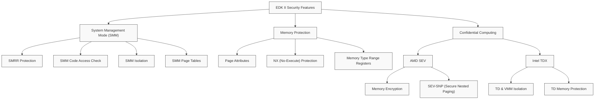

Sources:
- [UefiCpuPkg/PiSmmCpuDxeSmm/PiSmmCpuDxeSmm.h]()
- [OvmfPkg/PlatformPei/Platform.c]()
- [OvmfPkg/PlatformPei/AmdSev.c]()
- [OvmfPkg/Library/PlatformInitLib/IntelTdx.c]()

## System Management Mode (SMM)

System Management Mode is a special operating mode in x86 processors that provides an isolated execution environment. EDK II implements a comprehensive SMM infrastructure to ensure secure system management operations.

### SMM Architecture

The SMM implementation consists of several key components:

1. **SMRAM** - Protected memory region that contains SMM code and data
2. **SMI Handler** - Code that executes when an SMI (System Management Interrupt) occurs
3. **SMBASE** - Base address of the SMRAM region
4. **CPU State Save Area** - Area where processor state is saved upon SMM entry
5. **SMM Page Tables** - Page tables used for memory protection in SMM

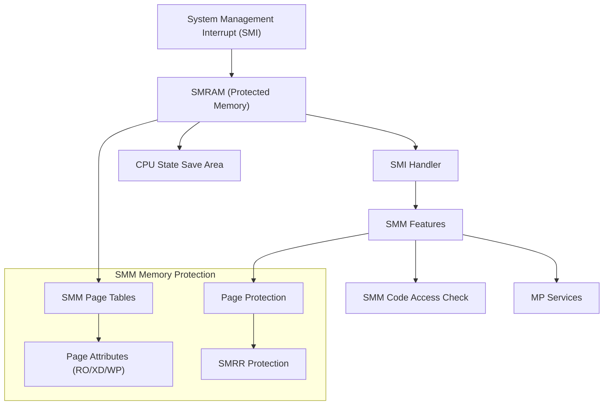

Sources:
- [UefiCpuPkg/PiSmmCpuDxeSmm/PiSmmCpuDxeSmm.h:14-137]()
- [UefiCpuPkg/PiSmmCpuDxeSmm/PiSmmCpuDxeSmm.c:18-175]()

### SMM Initialization

SMM initialization happens during platform boot and involves several key steps:

1. **SMRAM Setup** - Allocates and configures SMRAM regions
2. **SMI Handler Registration** - Sets up handlers for SMI
3. **SMBASE Relocation** - Relocates SMBASE for each processor
4. **Protection Setup** - Configures protection mechanisms for SMRAM

The initialization sequence is primarily implemented in `PiCpuSmmEntry` function, which sets up the SMM environment:

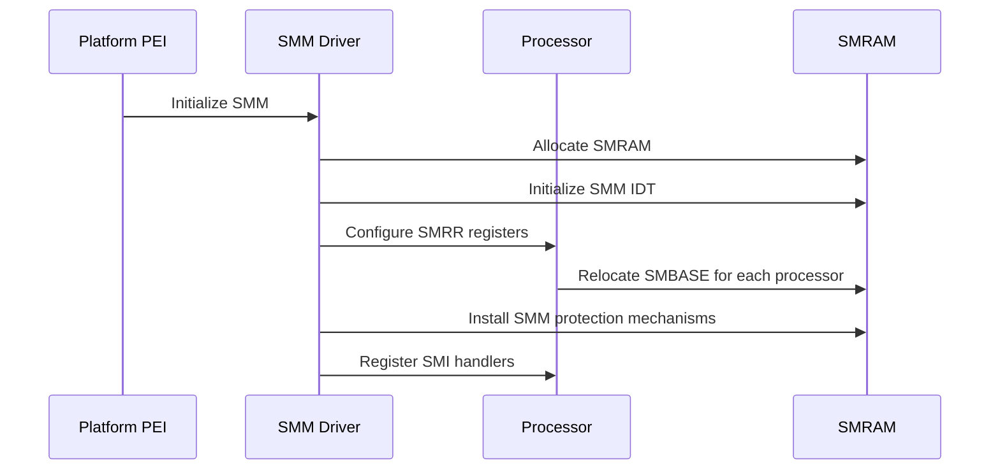

Sources:
- [UefiCpuPkg/PiSmmCpuDxeSmm/PiSmmCpuDxeSmm.c:599-1073]()
- [OvmfPkg/PlatformPei/MemDetect.c:43-84]()
- [OvmfPkg/PlatformPei/MemDetect.c:86-124]()

### SMRAM Protection

SMRAM is protected through multiple mechanisms to prevent unauthorized access:

1. **SMRR (System Management Range Registers)** - Hardware feature that restricts access to SMRAM when not in SMM
2. **SMM Code Access Check** - Ensures only legitimate code can execute in SMM
3. **Page Table Protection** - Controls memory access permissions in SMM

Q35 chipset support provides specific SMRAM protection features, as shown in `Q35TsegMbytesInitialization` and `Q35SmramAtDefaultSmbaseInitialization` functions:

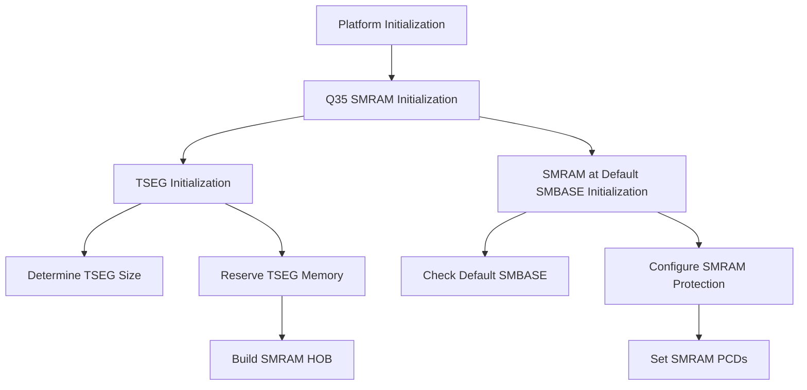

Sources:
- [OvmfPkg/PlatformPei/MemDetect.c:43-84]()
- [OvmfPkg/PlatformPei/MemDetect.c:86-124]()
- [UefiCpuPkg/PiSmmCpuDxeSmm/PiSmmCpuDxeSmm.c:872-876]()

### SMM Code Access Check

SMM Code Access Check is a feature that helps protect SMM code from unauthorized execution. This feature is configured in the `ConfigSmmCodeAccessCheck` function:

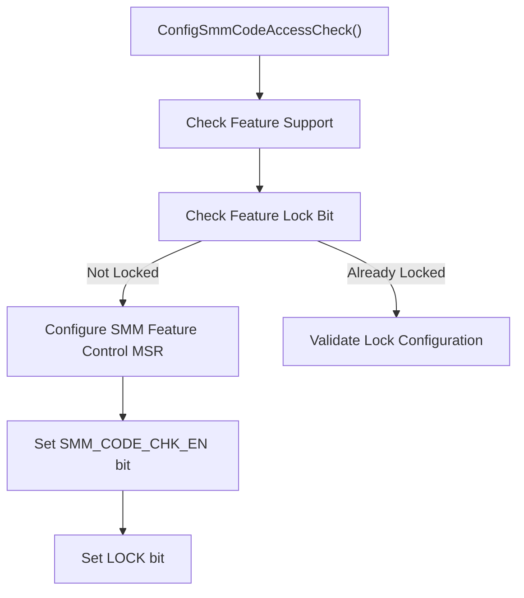

Sources:
- [UefiCpuPkg/PiSmmCpuDxeSmm/PiSmmCpuDxeSmm.h:114-121]()
- [UefiCpuPkg/PiSmmCpuDxeSmm/PiSmmCpuDxeSmm.c:113-114]()

### SMM Page Tables

SMM uses a dedicated set of page tables to control memory access within SMM. The page tables are initialized in the `SmmInitPageTable` function:

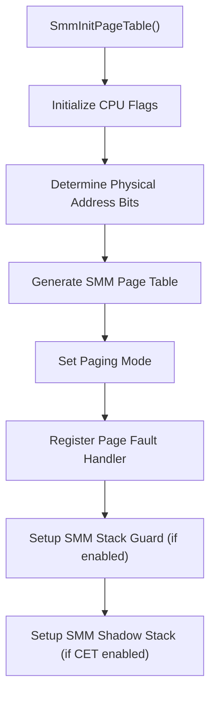

Sources:
- [UefiCpuPkg/PiSmmCpuDxeSmm/X64/PageTbl.c:176-302]()
- [UefiCpuPkg/PiSmmCpuDxeSmm/Ia32/PageTbl.c:20-67]()

## Memory Protection

EDK II implements multiple memory protection mechanisms to safeguard system memory from unauthorized access and execution.

### Page Attribute Protection

Memory pages can be assigned various protection attributes:

1. **Read-Only (RO)** - Prevents writing to the page
2. **Execute Disable (XD/NX)** - Prevents code execution from the page
3. **Present (P)** - Controls whether the page is accessible

These attributes are managed through the page table entries and are controlled using the `SmmSetMemoryAttributes` and `SmmClearMemoryAttributes` functions.

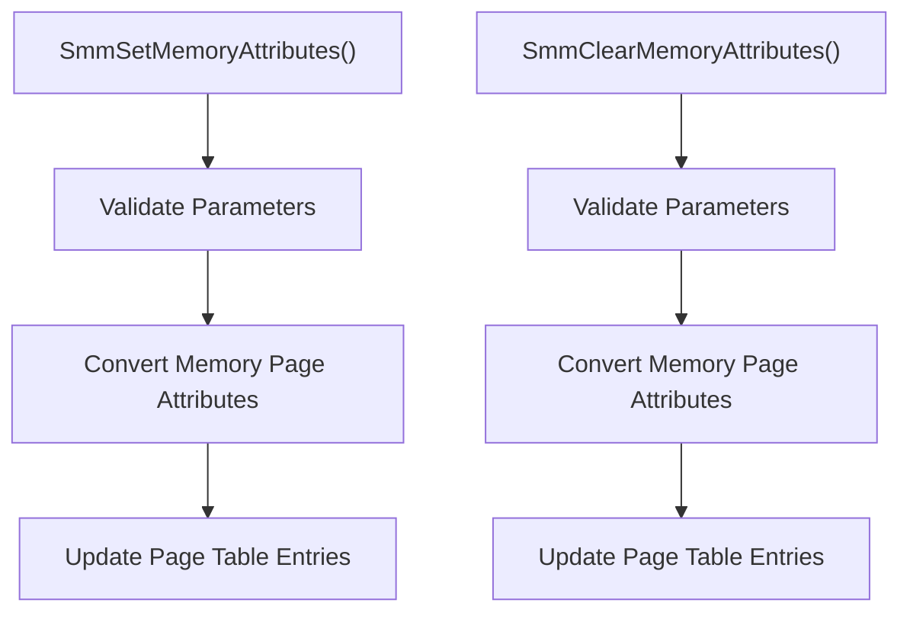

Sources:
- [UefiCpuPkg/PiSmmCpuDxeSmm/SmmCpuMemoryManagement.c:737-771]()
- [UefiCpuPkg/PiSmmCpuDxeSmm/SmmCpuMemoryManagement.c:765-771]()

### Page Table Management

Page tables are used to implement memory protection by controlling access permissions to memory pages. The `ConvertMemoryPageAttributes` function is central to this mechanism:

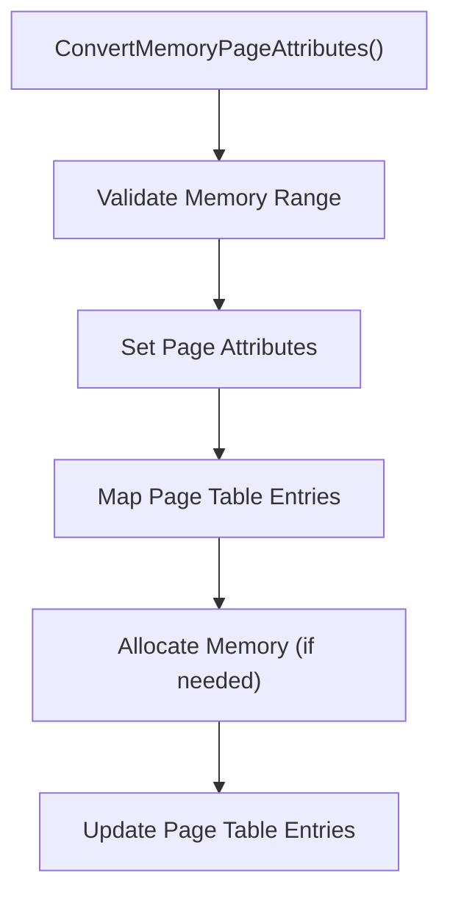

Sources:
- [UefiCpuPkg/PiSmmCpuDxeSmm/SmmCpuMemoryManagement.c:364-528]()
- [UefiCpuPkg/PiSmmCpuDxeSmm/X64/PageTbl.c:225-305]()

## Confidential Computing Features

EDK II supports confidential computing technologies that provide memory encryption and isolated execution environments for virtual machines.

### AMD Secure Encrypted Virtualization (SEV)

AMD SEV provides memory encryption for virtual machines, protecting guest VMs from the hypervisor and other VMs.

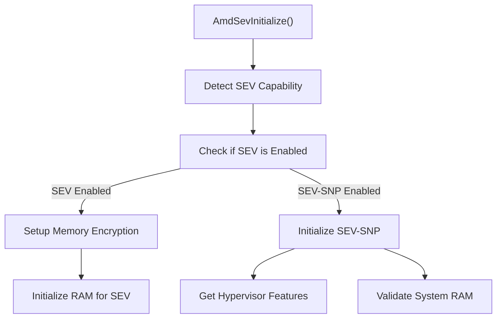

Sources:
- [OvmfPkg/PlatformPei/AmdSev.c:39-207]()
- [OvmfPkg/PlatformPei/AmdSev.c:209-229]()
- [OvmfPkg/PlatformPei/Platform.c:361-369]()

### AMD SEV-SNP (Secure Nested Paging)

SEV-SNP is an extension to SEV that provides additional security features through the SNP (Secure Nested Paging) mechanism:

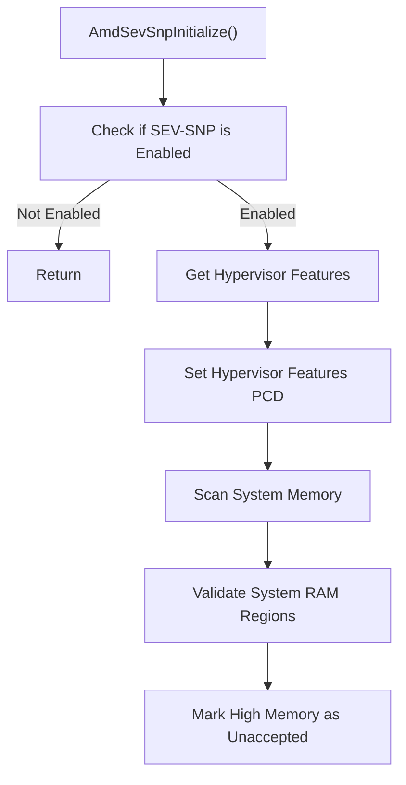

Sources:
- [OvmfPkg/PlatformPei/AmdSev.c:39-81]()
- [OvmfPkg/PlatformPei/AmdSev.c:116-153]()

### Intel Trust Domain Extensions (TDX)

Intel TDX provides confidential computing capabilities for Intel platforms through isolated execution environments called Trust Domains (TDs).

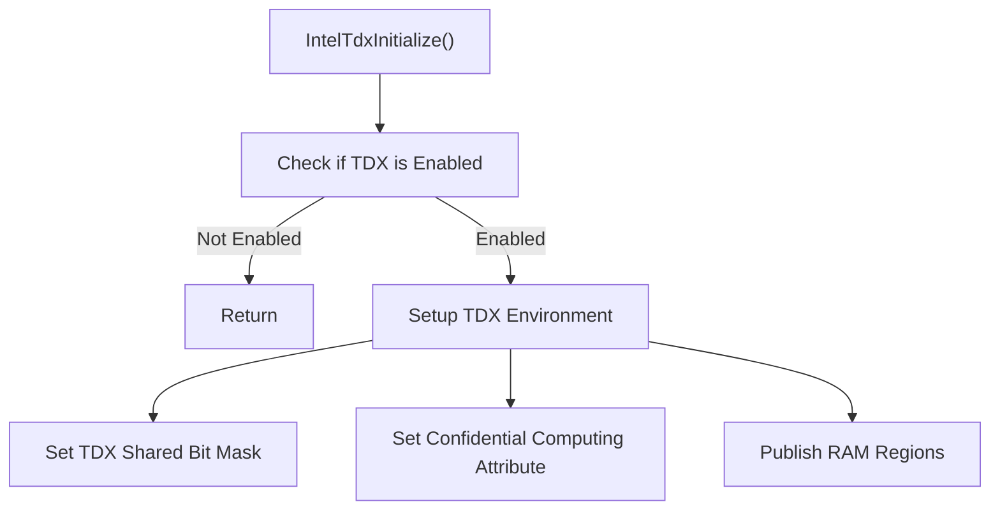

Sources:
- [OvmfPkg/PlatformPei/Platform.c:368]()
- [OvmfPkg/Library/PlatformInitLib/IntelTdx.c]()

## Multi-processor Support in SMM

EDK II provides multi-processor support for SMM, allowing all processors to enter and coordinate within SMM.

### MP Synchronization

SMM MP synchronization ensures that processors coordinate properly when entering and exiting SMM:

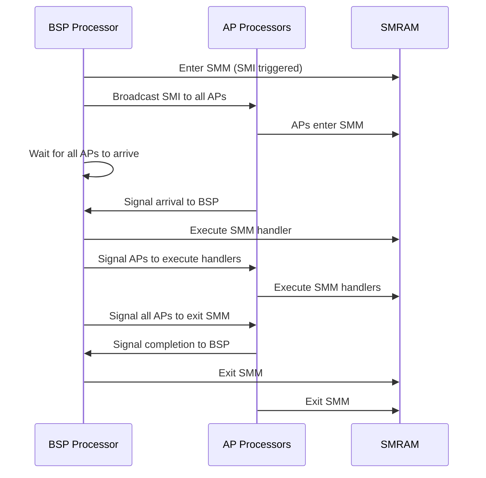

Sources:
- [UefiCpuPkg/PiSmmCpuDxeSmm/MpService.c:335-443]()
- [UefiCpuPkg/PiSmmCpuDxeSmm/MpService.c:564-807]()

### SMM CPU Service Protocol

The SMM CPU Service Protocol provides services for processors in SMM, including processor information and state management:

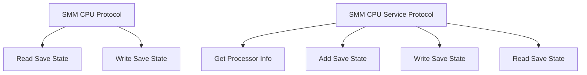

Sources:
- [UefiCpuPkg/PiSmmCpuDxeSmm/PiSmmCpuDxeSmm.c:71-75]()
- [UefiCpuPkg/PiSmmCpuDxeSmm/PiSmmCpuDxeSmm.c:227-332]()

## SMM S3 Resume Support

EDK II provides special support for resuming from S3 sleep state, which requires reinitializing SMM:

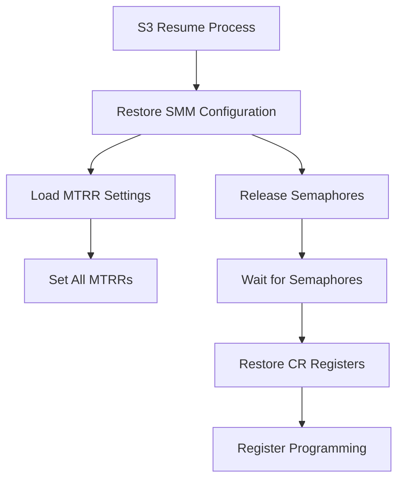

Sources:
- [UefiCpuPkg/PiSmmCpuDxeSmm/CpuS3.c:97-121]()
- [UefiCpuPkg/PiSmmCpuDxeSmm/PiSmmCpuDxeSmm.c:566-587]()

## Platform-specific Security Features

The OVMF platform (Open Virtual Machine Firmware) implements platform-specific security features for virtualized environments.

### Q35 Platform SMRAM Configuration

The Q35 platform configures SMRAM in a specific way:

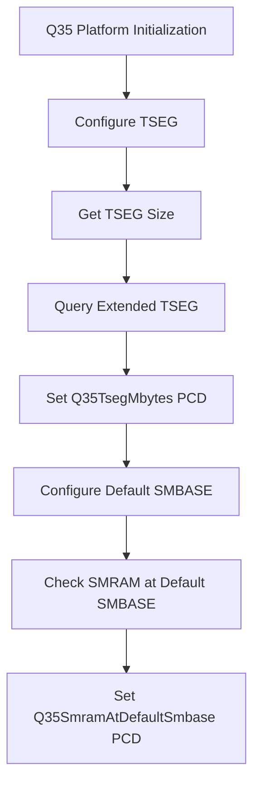

Sources:
- [OvmfPkg/PlatformPei/MemDetect.c:43-84]()
- [OvmfPkg/PlatformPei/MemDetect.c:86-124]()

## Summary of Security Features

The following table summarizes the key security features provided by EDK II:

| Feature | Description | Key Implementation Files |
|---------|-------------|--------------------------|
| SMM | Special execution mode for system management | UefiCpuPkg/PiSmmCpuDxeSmm/PiSmmCpuDxeSmm.c |
| SMRAM Protection | Protects SMRAM using hardware features | OvmfPkg/PlatformPei/MemDetect.c |
| SMM Code Access Check | Prevents unauthorized code execution in SMM | UefiCpuPkg/PiSmmCpuDxeSmm/PiSmmCpuDxeSmm.c |
| Page Table Protection | Controls memory access using page tables | UefiCpuPkg/PiSmmCpuDxeSmm/X64/PageTbl.c |
| AMD SEV | Memory encryption for VMs | OvmfPkg/PlatformPei/AmdSev.c |
| Intel TDX | Trust Domain Extensions for VMs | OvmfPkg/Library/PlatformInitLib/IntelTdx.c |
| SMM MP Services | Multi-processor support in SMM | UefiCpuPkg/PiSmmCpuDxeSmm/MpService.c |

Sources:
- [UefiCpuPkg/PiSmmCpuDxeSmm/PiSmmCpuDxeSmm.h]()
- [OvmfPkg/PlatformPei/Platform.c]()
- [OvmfPkg/PlatformPei/MemDetect.c]()
- [OvmfPkg/PlatformPei/AmdSev.c]()

---

