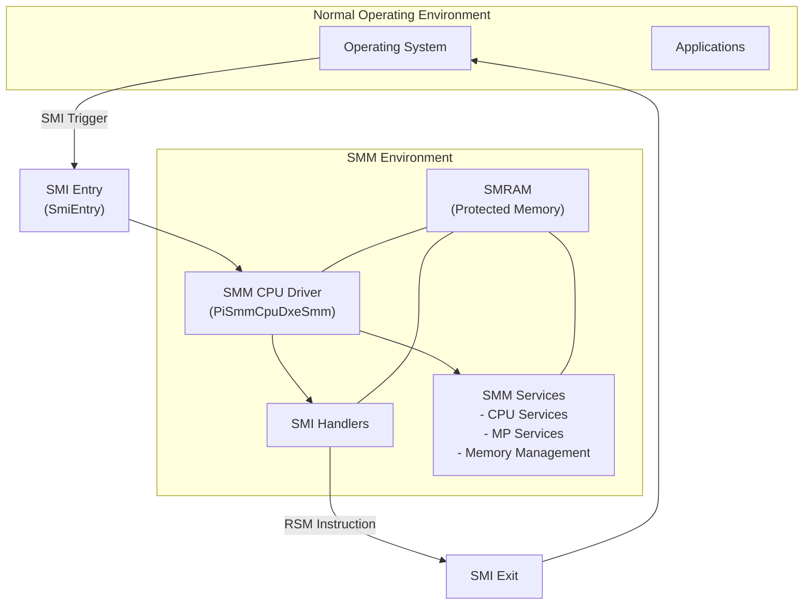
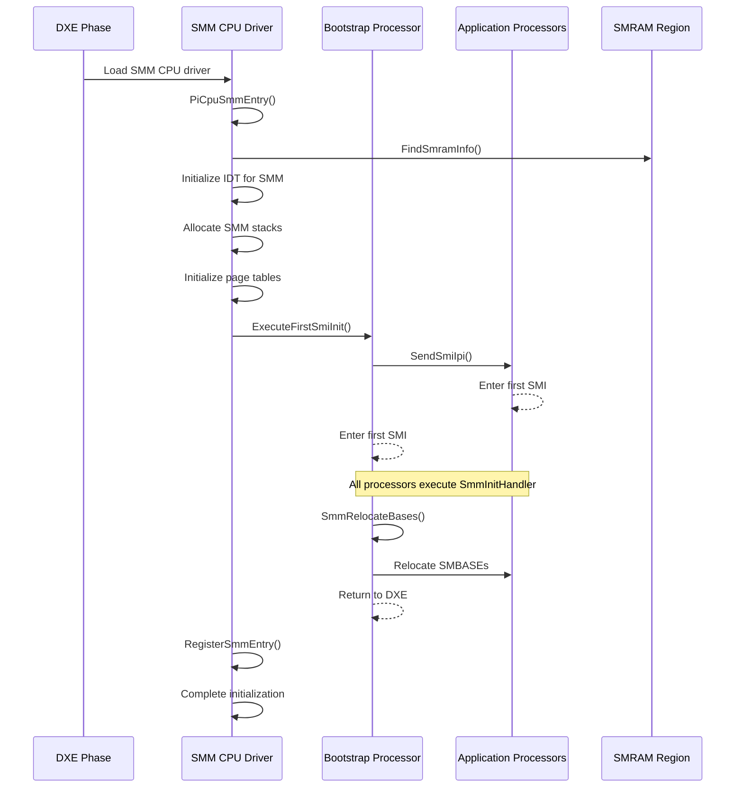
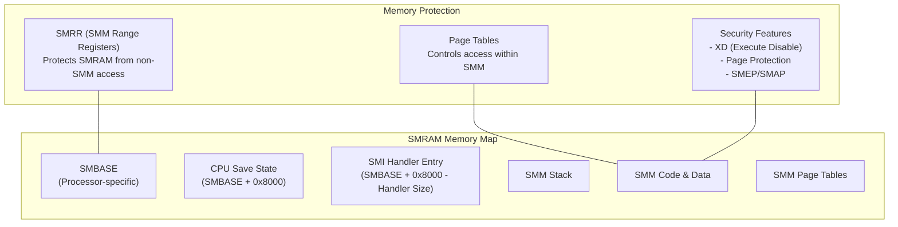
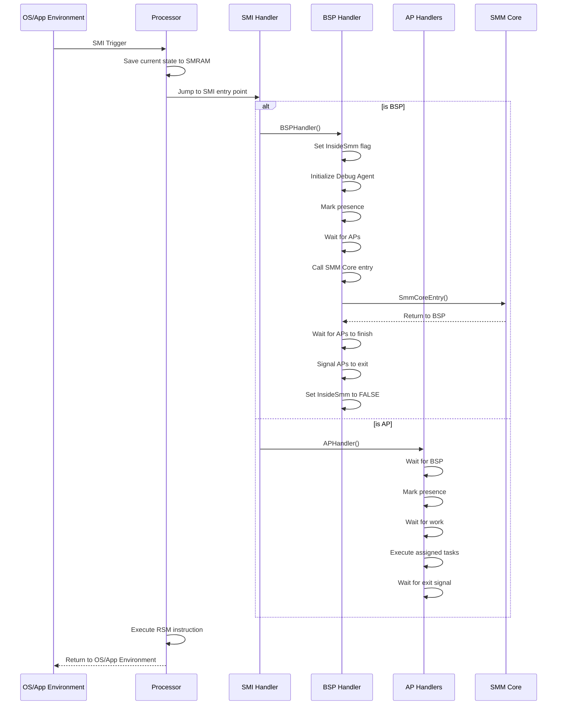
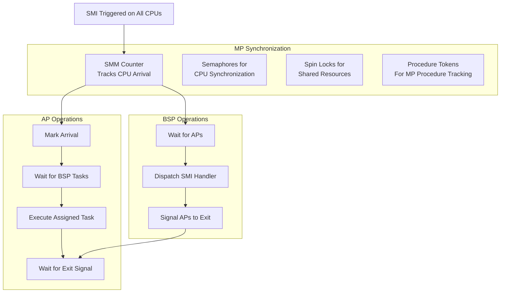
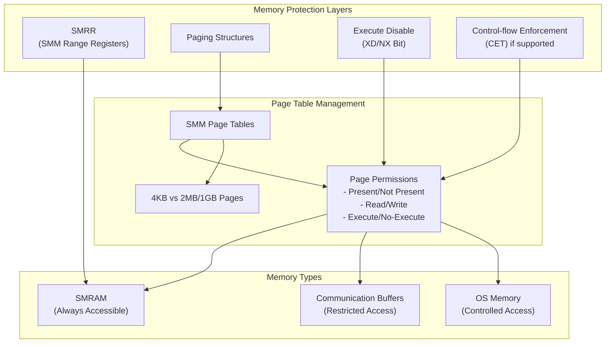
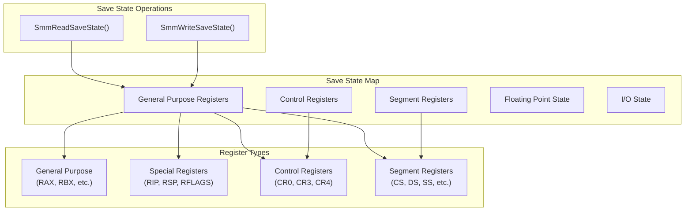
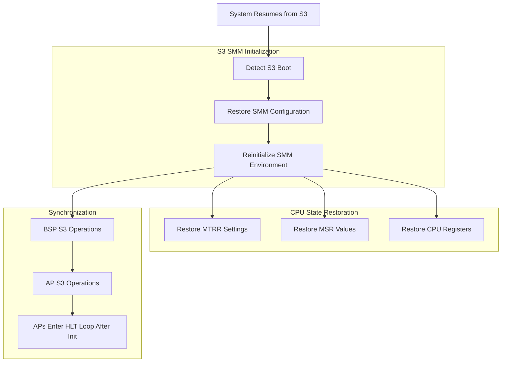
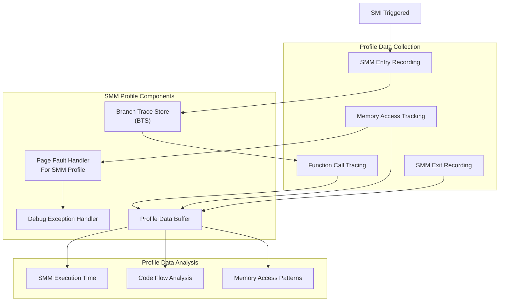

<!-- source: DeepWiki mcp.deepwiki.com · repo NVIDIA/edk2 · page 5.1 System Management Mode (SMM) · fetched 2026-10-26 -->

# System Management Mode (SMM)

Relevant source files

The following files were used as context for generating this wiki page:

- [UefiCpuPkg/Include/StuffRsbNasm.inc](UefiCpuPkg/Include/StuffRsbNasm.inc)
- [UefiCpuPkg/Library/SmmCpuFeaturesLib/Ia32/SmiEntry.nasm](UefiCpuPkg/Library/SmmCpuFeaturesLib/Ia32/SmiEntry.nasm)
- [UefiCpuPkg/Library/SmmCpuFeaturesLib/Ia32/SmiException.nasm](UefiCpuPkg/Library/SmmCpuFeaturesLib/Ia32/SmiException.nasm)
- [UefiCpuPkg/Library/SmmCpuFeaturesLib/SmmStm.h](UefiCpuPkg/Library/SmmCpuFeaturesLib/SmmStm.h)
- [UefiCpuPkg/Library/SmmCpuFeaturesLib/X64/SmiEntry.nasm](UefiCpuPkg/Library/SmmCpuFeaturesLib/X64/SmiEntry.nasm)
- [UefiCpuPkg/Library/SmmCpuFeaturesLib/X64/SmiException.nasm](UefiCpuPkg/Library/SmmCpuFeaturesLib/X64/SmiException.nasm)
- [UefiCpuPkg/PiSmmCpuDxeSmm/CpuS3.c](UefiCpuPkg/PiSmmCpuDxeSmm/CpuS3.c)
- [UefiCpuPkg/PiSmmCpuDxeSmm/Ia32/PageTbl.c](UefiCpuPkg/PiSmmCpuDxeSmm/Ia32/PageTbl.c)
- [UefiCpuPkg/PiSmmCpuDxeSmm/Ia32/SmiEntry.nasm](UefiCpuPkg/PiSmmCpuDxeSmm/Ia32/SmiEntry.nasm)
- [UefiCpuPkg/PiSmmCpuDxeSmm/Ia32/SmiException.nasm](UefiCpuPkg/PiSmmCpuDxeSmm/Ia32/SmiException.nasm)
- [UefiCpuPkg/PiSmmCpuDxeSmm/Ia32/SmmFuncsArch.c](UefiCpuPkg/PiSmmCpuDxeSmm/Ia32/SmmFuncsArch.c)
- [UefiCpuPkg/PiSmmCpuDxeSmm/Ia32/SmmInit.nasm](UefiCpuPkg/PiSmmCpuDxeSmm/Ia32/SmmInit.nasm)
- [UefiCpuPkg/PiSmmCpuDxeSmm/Ia32/SmmProfileArch.c](UefiCpuPkg/PiSmmCpuDxeSmm/Ia32/SmmProfileArch.c)
- [UefiCpuPkg/PiSmmCpuDxeSmm/MpService.c](UefiCpuPkg/PiSmmCpuDxeSmm/MpService.c)
- [UefiCpuPkg/PiSmmCpuDxeSmm/PiSmmCpuDxeSmm.c](UefiCpuPkg/PiSmmCpuDxeSmm/PiSmmCpuDxeSmm.c)
- [UefiCpuPkg/PiSmmCpuDxeSmm/PiSmmCpuDxeSmm.h](UefiCpuPkg/PiSmmCpuDxeSmm/PiSmmCpuDxeSmm.h)
- [UefiCpuPkg/PiSmmCpuDxeSmm/PiSmmCpuDxeSmm.inf](UefiCpuPkg/PiSmmCpuDxeSmm/PiSmmCpuDxeSmm.inf)
- [UefiCpuPkg/PiSmmCpuDxeSmm/SmmCpuMemoryManagement.c](UefiCpuPkg/PiSmmCpuDxeSmm/SmmCpuMemoryManagement.c)
- [UefiCpuPkg/PiSmmCpuDxeSmm/SmmMpPerf.c](UefiCpuPkg/PiSmmCpuDxeSmm/SmmMpPerf.c)
- [UefiCpuPkg/PiSmmCpuDxeSmm/SmmMpPerf.h](UefiCpuPkg/PiSmmCpuDxeSmm/SmmMpPerf.h)
- [UefiCpuPkg/PiSmmCpuDxeSmm/SmmProfile.c](UefiCpuPkg/PiSmmCpuDxeSmm/SmmProfile.c)
- [UefiCpuPkg/PiSmmCpuDxeSmm/SmmProfile.h](UefiCpuPkg/PiSmmCpuDxeSmm/SmmProfile.h)
- [UefiCpuPkg/PiSmmCpuDxeSmm/SmmProfileInternal.h](UefiCpuPkg/PiSmmCpuDxeSmm/SmmProfileInternal.h)
- [UefiCpuPkg/PiSmmCpuDxeSmm/SmramSaveState.c](UefiCpuPkg/PiSmmCpuDxeSmm/SmramSaveState.c)
- [UefiCpuPkg/PiSmmCpuDxeSmm/X64/MpFuncs.nasm](UefiCpuPkg/PiSmmCpuDxeSmm/X64/MpFuncs.nasm)
- [UefiCpuPkg/PiSmmCpuDxeSmm/X64/PageTbl.c](UefiCpuPkg/PiSmmCpuDxeSmm/X64/PageTbl.c)
- [UefiCpuPkg/PiSmmCpuDxeSmm/X64/Semaphore.c](UefiCpuPkg/PiSmmCpuDxeSmm/X64/Semaphore.c)
- [UefiCpuPkg/PiSmmCpuDxeSmm/X64/SmiEntry.nasm](UefiCpuPkg/PiSmmCpuDxeSmm/X64/SmiEntry.nasm)
- [UefiCpuPkg/PiSmmCpuDxeSmm/X64/SmiException.nasm](UefiCpuPkg/PiSmmCpuDxeSmm/X64/SmiException.nasm)
- [UefiCpuPkg/PiSmmCpuDxeSmm/X64/SmmFuncsArch.c](UefiCpuPkg/PiSmmCpuDxeSmm/X64/SmmFuncsArch.c)
- [UefiCpuPkg/PiSmmCpuDxeSmm/X64/SmmInit.nasm](UefiCpuPkg/PiSmmCpuDxeSmm/X64/SmmInit.nasm)
- [UefiCpuPkg/PiSmmCpuDxeSmm/X64/SmmProfileArch.c](UefiCpuPkg/PiSmmCpuDxeSmm/X64/SmmProfileArch.c)

System Management Mode (SMM) is a special operating mode in x86 processors that provides a separate execution environment for handling system-wide functions with high privileges. This document explains the implementation of SMM in EDK2, focusing on how SMM is initialized, how processors enter and exit SMM, and the key services provided in SMM.

## Overview of SMM

SMM is a highly privileged operating mode designed to execute system management tasks isolated from the main operating system. It is entered through a System Management Interrupt (SMI), which can be triggered by hardware or software events. In EDK2, the `PiSmmCpuDxeSmm` module implements SMM functionality, providing:

- SMM initialization and setup 
- SMI entry/exit handling
- CPU state saving and restoring
- Memory isolation and protection
- Multi-processor synchronization in SMM
- SMM-specific services

Sources: [UefiCpuPkg/PiSmmCpuDxeSmm/PiSmmCpuDxeSmm.c](), [UefiCpuPkg/PiSmmCpuDxeSmm/PiSmmCpuDxeSmm.h]()

## SMM Architecture

Sources: [UefiCpuPkg/PiSmmCpuDxeSmm/PiSmmCpuDxeSmm.c](), [UefiCpuPkg/PiSmmCpuDxeSmm/X64/SmiEntry.nasm](), [UefiCpuPkg/PiSmmCpuDxeSmm/Ia32/SmiEntry.nasm]()

## SMM Initialization Process

The SMM initialization process sets up the environment for SMM operation and prepares processors to handle SMIs.

The key steps in SMM initialization are:

1. **Driver Entry**: The SMM CPU driver is loaded during the DXE phase and begins initialization in `PiCpuSmmEntry()`.
2. **SMRAM Setup**: Locates SMRAM regions and sets up necessary structures.
3. **Processor Preparation**: All processors enter SMM for the first time to configure their SMBASE addresses and other settings.
4. **Page Table Initialization**: Page tables are set up for memory isolation in SMM.
5. **SMM Core Registration**: The driver registers itself with the SMM Core.

Sources: [UefiCpuPkg/PiSmmCpuDxeSmm/PiSmmCpuDxeSmm.c:598-1180](), [UefiCpuPkg/PiSmmCpuDxeSmm/PiSmmCpuDxeSmm.c:338-402](), [UefiCpuPkg/PiSmmCpuDxeSmm/PiSmmCpuDxeSmm.c:454-553]()

## SMM Memory Layout

In SMM, memory is carefully managed to ensure isolation and protection. The diagram below shows the key memory regions and their organization:

Key aspects of SMM memory management:

1. **SMBASE**: Each processor has its own SMBASE address, which determines where its SMM code and save state are located.
2. **CPU Save State**: When entering SMM, processor state is saved at SMBASE + 0x8000.
3. **SMI Handler**: The entry point for SMI handling code.
4. **Memory Protection**:
   - SMRRs (System Management Range Registers) protect SMRAM from access outside of SMM
   - Page tables control memory access within SMM
   - Additional CPU features like XD (Execute Disable) provide further protection

Sources: [UefiCpuPkg/PiSmmCpuDxeSmm/PiSmmCpuDxeSmm.h:723-739](), [UefiCpuPkg/PiSmmCpuDxeSmm/SmmCpuMemoryManagement.c](), [UefiCpuPkg/PiSmmCpuDxeSmm/X64/PageTbl.c]()

## SMI Entry and Exit Flow

When an SMI is triggered, processors enter SMM through a specific flow:

Key components in SMI handling:

1. **SMI Entry**:
   - Processor saves its state in SMRAM
   - Switches to a separate stack in SMRAM
   - Executes the SMI handler code

2. **BSP vs. AP Handling**:
   - BSP (Bootstrap Processor) coordinates the SMI response
   - APs (Application Processors) wait for BSP instructions
   - Synchronization ensures ordered execution

3. **SMM Core Execution**:
   - BSP calls the SMM Core entry point to handle the SMI
   - Core dispatches appropriate SMI handlers

4. **SMI Exit**:
   - BSP signals all APs to exit SMM
   - All processors execute RSM (Resume from System Management Mode) instruction
   - Processor state is restored from SMRAM

Sources: [UefiCpuPkg/PiSmmCpuDxeSmm/MpService.c:564-808](), [UefiCpuPkg/PiSmmCpuDxeSmm/MpService.c:818-1015](), [UefiCpuPkg/PiSmmCpuDxeSmm/X64/SmiEntry.nasm](), [UefiCpuPkg/PiSmmCpuDxeSmm/Ia32/SmiEntry.nasm]()

## Multi-Processor Synchronization

SMM includes comprehensive multi-processor support to handle SMIs across all processors in the system:

Key aspects of the MP synchronization in SMM:

1. **Coordination Mechanisms**:
   - A counter tracks the number of CPUs that have entered SMM
   - Semaphores synchronize operations between processors
   - Spin locks protect shared resources from concurrent access

2. **BSP-AP Coordination**:
   - BSP waits for APs to arrive before proceeding
   - APs wait for BSP to provide tasks or signal exit
   - `SmmWaitForApArrival()` handles AP arrival synchronization

3. **Task Distribution**:
   - `SmmStartupThisAp()` dispatches tasks to specific APs
   - Procedure tokens track task execution across processors
   - Tasks can be executed in blocking or non-blocking mode

Sources: [UefiCpuPkg/PiSmmCpuDxeSmm/MpService.c:42-161](), [UefiCpuPkg/PiSmmCpuDxeSmm/MpService.c:334-443](), [UefiCpuPkg/PiSmmCpuDxeSmm/PiSmmCpuDxeSmm.h:404-461]()

## SMM Memory Protection

SMM implements several memory protection mechanisms to ensure security and isolation:

Key memory protection features:

1. **SMRR Protection**:
   - SMRR registers define and protect the SMRAM region
   - Only code running in SMM can access SMRAM when SMRRs are enabled

2. **Page Table Management**:
   - SMM uses dedicated page tables for memory access control
   - Different paging modes are supported (4-level, 5-level, with/without 1GB pages)
   - Memory is mapped with appropriate permissions (read, write, execute)

3. **Memory Attributes**:
   - `SmmSetMemoryAttributes()` and `SmmClearMemoryAttributes()` control memory attributes
   - Execute Disable (XD/NX) bit prevents code execution in data pages
   - Page tables are set up to restrict access to non-SMRAM regions

4. **Special Handling**:
   - Page fault handlers (`SmiPFHandler()`) manage memory access violations
   - Memory attribute handling and reporting in SMM is available through protocols

Sources: [UefiCpuPkg/PiSmmCpuDxeSmm/SmmCpuMemoryManagement.c:364-541](), [UefiCpuPkg/PiSmmCpuDxeSmm/X64/PageTbl.c:169-302](), [UefiCpuPkg/PiSmmCpuDxeSmm/Ia32/PageTbl.c:66-204]()

## SMM Save State

When processors enter SMM, their state is saved to a special structure in SMRAM, which can be accessed and modified through specific APIs:

Key aspects of SMM save state management:

1. **Save State Access**:
   - `SmmReadSaveState()` reads values from the save state map
   - `SmmWriteSaveState()` modifies values in the save state map
   - Save state is processor-specific (each CPU has its own save state)

2. **Save State Content**:
   - General purpose registers (RAX, RBX, RCX, etc.)
   - Special registers (RIP, RSP, RFLAGS)
   - Segment registers (CS, DS, SS, etc.)
   - Control registers (CR0, CR3, CR4)
   - Other processor state information

3. **Architecture Differences**:
   - Different save state formats for 32-bit and 64-bit modes
   - The `MmSaveStateLib` provides an abstraction layer for accessing save state

Sources: [UefiCpuPkg/PiSmmCpuDxeSmm/PiSmmCpuDxeSmm.c:212-332](), [UefiCpuPkg/PiSmmCpuDxeSmm/SmramSaveState.c]()

## S3 Resume Support

The SMM implementation includes support for S3 (Suspend to RAM) resume:

Key aspects of S3 resume support in SMM:

1. **S3 Detection and Configuration**:
   - The system detects if it's resuming from S3 sleep state
   - SMM configuration is restored from saved data
   - `RestoreSmmConfigurationInS3()` handles configuration restoration

2. **CPU State Restoration**:
   - Memory Type Range Registers (MTRRs) are restored
   - Model Specific Registers (MSRs) are restored
   - Other CPU configuration is reapplied

3. **AP Handling During S3**:
   - APs are brought online during S3 resume
   - After initialization, APs enter a safe HLT loop
   - `TransferApToSafeState()` moves APs to a waiting state

Sources: [UefiCpuPkg/PiSmmCpuDxeSmm/CpuS3.c:66-230](), [UefiCpuPkg/PiSmmCpuDxeSmm/CpuS3.c:337-573](), [UefiCpuPkg/PiSmmCpuDxeSmm/CpuS3.c:1156-1220]()

## SMM Profiling (Optional Feature)

SMM Profiling is an optional feature that collects data about SMM execution for analysis and debugging:

Key aspects of SMM profiling:

1. **Profiling Mechanisms**:
   - Branch Trace Store (BTS) for code flow tracking
   - Page fault handling for memory access profiling
   - Debug exceptions for step-by-step execution tracking

2. **Data Collection**:
   - Records when SMM is entered and exited
   - Tracks function calls within SMM
   - Monitors memory access patterns in SMM

3. **Configuration**:
   - Enabled via PCD (`PcdCpuSmmProfileEnable`)
   - Configurable buffer size (`PcdCpuSmmProfileSize`)
   - Can use ring buffer mode for continuous monitoring

Sources: [UefiCpuPkg/PiSmmCpuDxeSmm/SmmProfile.c](), [UefiCpuPkg/PiSmmCpuDxeSmm/SmmProfileInternal.h](), [UefiCpuPkg/PiSmmCpuDxeSmm/X64/SmmProfileArch.c]()

## Security Features

SMM implements various security features to protect system integrity:

| Feature | Description | Implementation |
|---------|-------------|----------------|
| SMRR Protection | Hardware mechanism that restricts access to SMRAM outside of SMM | Enabled during initialization |
| Page Table Isolation | Separate page tables for SMM that control memory access | Configured in `SmmInitPageTable()` |
| Execute Disable (XD) | Prevents execution from data pages | Enabled in SMI entry code if supported |
| Control-flow Enforcement Technology (CET) | Protects against control-flow attacks | Supported if hardware capable |
| SMM Communication Buffer Checks | Validates buffers passed between SMM and non-SMM code | Implemented in `IsSmmCommBufferForbiddenAddress()` |
| SMM Ready-to-Lock Protocol | Locks down SMM configuration after initialization | Handled in `SmmReadyToLockEventNotify()` |
| Stack Guard | Protects against SMM stack overflow attacks | Enabled via PCD, uses guard pages |
| Null Pointer Detection | Detects and handles null pointer dereferences | Configurable protection mechanism |

Sources: [UefiCpuPkg/PiSmmCpuDxeSmm/PiSmmCpuDxeSmm.c:567-587](), [UefiCpuPkg/PiSmmCpuDxeSmm/X64/PageTbl.c:296-397](), [UefiCpuPkg/PiSmmCpuDxeSmm/X64/SmiEntry.nasm:152-190]()

## Protocols and Services

The SMM CPU driver provides several protocols and services:

| Protocol | Description | Key Functions |
|----------|-------------|--------------|
| `EFI_SMM_CPU_PROTOCOL` | Provides access to processor state in SMM | `SmmReadSaveState()`, `SmmWriteSaveState()` |
| `EFI_SMM_CPU_SERVICE_PROTOCOL` | Extended CPU services for SMM | CPU hotplug support, processor information |
| `EDKII_SMM_MEMORY_ATTRIBUTE_PROTOCOL` | Manages memory attributes in SMM | `EdkiiSmmGetMemoryAttributes()`, `EdkiiSmmSetMemoryAttributes()` |
| `EFI_MM_MP_PROTOCOL` | Provides MP services in MM environment | Dispatch procedures to specific processors |
| `EFI_SMM_CONFIGURATION_PROTOCOL` | Configures SMM operations | `RegisterSmmEntry()` |

Services provided include:

1. **CPU State Management**:
   - Reading and writing processor state
   - Managing processor features

2. **Memory Management**:
   - Setting and clearing memory attributes
   - Page table management

3. **Multi-Processor Support**:
   - Running code on specific processors
   - Synchronizing processor operations

4. **Communication Services**:
   - Safe communication between SMM and non-SMM code

Sources: [UefiCpuPkg/PiSmmCpuDxeSmm/PiSmmCpuDxeSmm.inf:107-116](), [UefiCpuPkg/PiSmmCpuDxeSmm/PiSmmCpuDxeSmm.c:63-84](), [UefiCpuPkg/PiSmmCpuDxeSmm/CpuService.c]()

## Conclusion

System Management Mode provides a secure execution environment for system management functions that operate independently of the main operating system. The EDK2 implementation of SMM includes comprehensive initialization, processor coordination, memory protection, and security features to ensure safe and efficient SMM operation.

The modular design supports both 32-bit and 64-bit architectures, various CPU features, and optional components like SMM profiling. The robust memory protection and isolation features help maintain system security by preventing unauthorized access to or from SMM.

---

