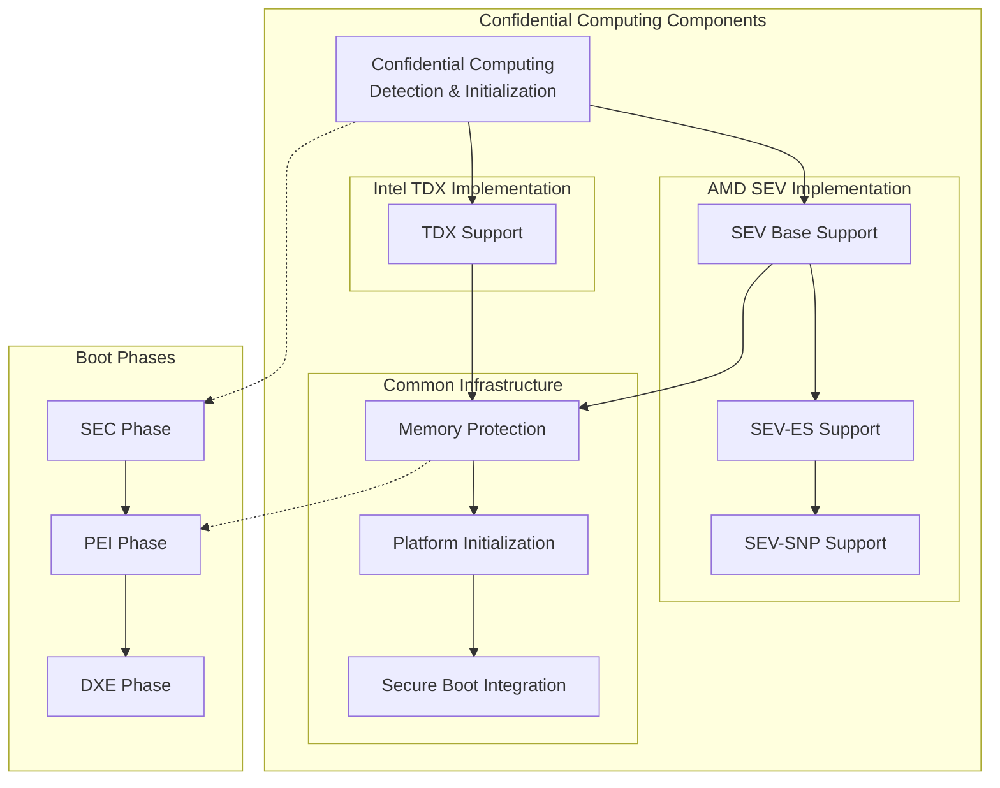
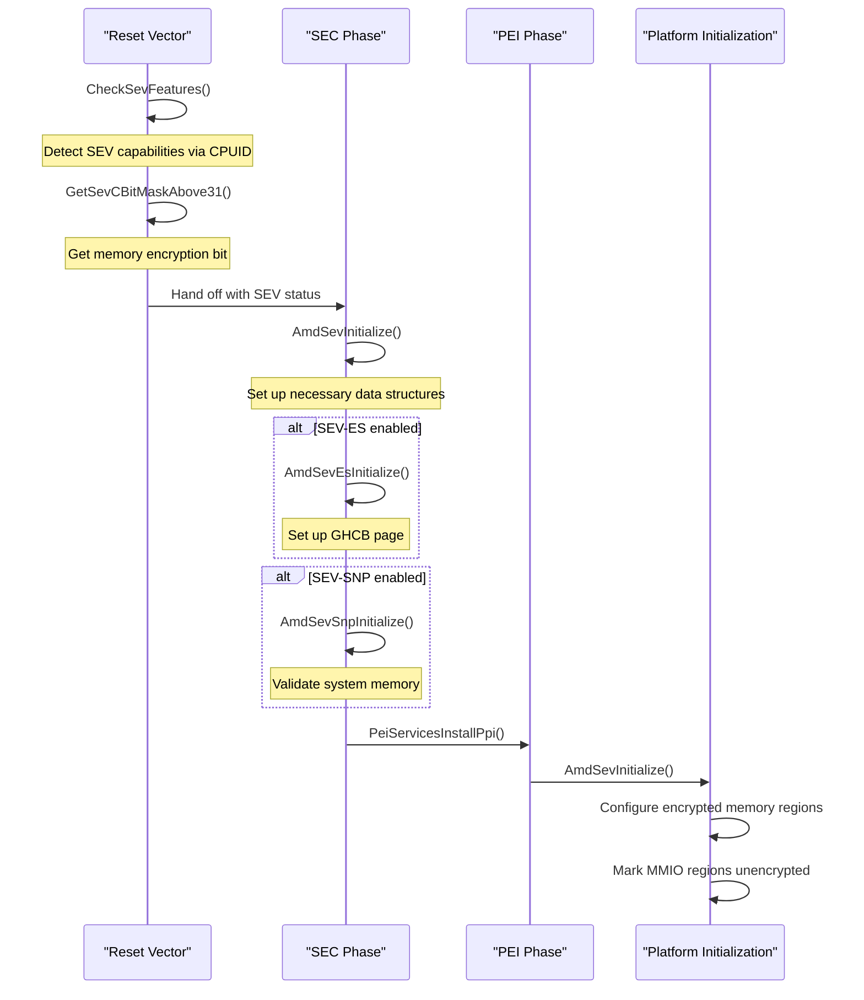
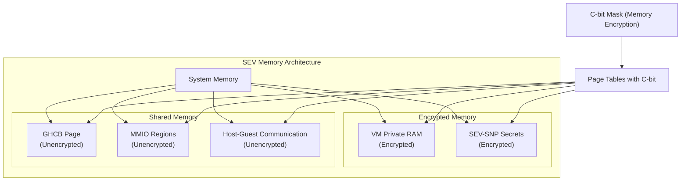
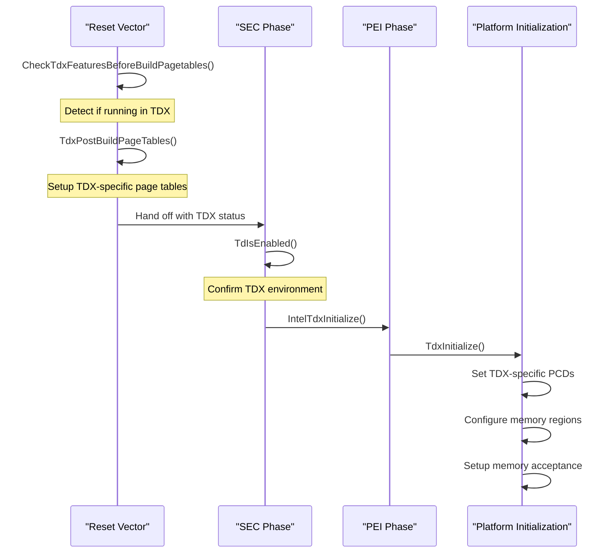
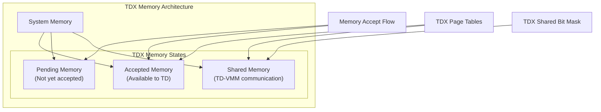
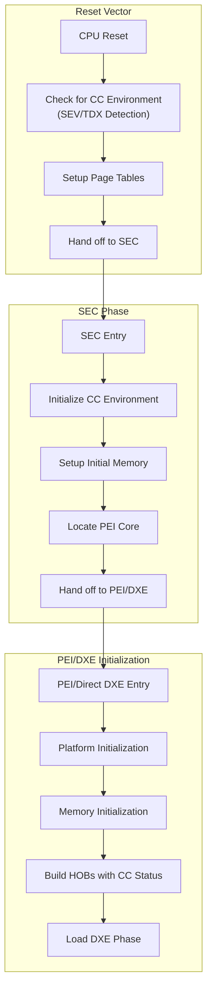
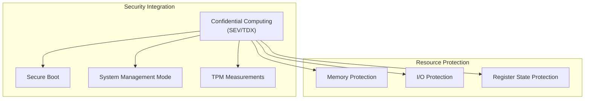

<!-- source: DeepWiki mcp.deepwiki.com · repo NVIDIA/edk2 · page 5.2 Confidential Computing Features · fetched 2026-10-26 -->

# Confidential Computing Features

<details>
<summary>Relevant source files</summary>

The following files were used as context for generating this wiki page:

- [OvmfPkg/Include/Fdf/FvmainCompactScratchEnd.fdf.inc](OvmfPkg/Include/Fdf/FvmainCompactScratchEnd.fdf.inc)
- [OvmfPkg/Include/Fdf/OvmfPkgDefines.fdf.inc](OvmfPkg/Include/Fdf/OvmfPkgDefines.fdf.inc)
- [OvmfPkg/Include/Fdf/VarStore.fdf.inc](OvmfPkg/Include/Fdf/VarStore.fdf.inc)
- [OvmfPkg/Include/Fdf/XenElfHeader.fdf.inc](OvmfPkg/Include/Fdf/XenElfHeader.fdf.inc)
- [OvmfPkg/Include/Library/PlatformInitLib.h](OvmfPkg/Include/Library/PlatformInitLib.h)
- [OvmfPkg/Include/TdxCommondefs.inc](OvmfPkg/Include/TdxCommondefs.inc)
- [OvmfPkg/Include/WorkArea.h](OvmfPkg/Include/WorkArea.h)
- [OvmfPkg/IntelTdx/Sec/SecMain.c](OvmfPkg/IntelTdx/Sec/SecMain.c)
- [OvmfPkg/IntelTdx/Sec/SecMain.inf](OvmfPkg/IntelTdx/Sec/SecMain.inf)
- [OvmfPkg/IntelTdx/Sec/X64/IntelTdxAPs.nasm](OvmfPkg/IntelTdx/Sec/X64/IntelTdxAPs.nasm)
- [OvmfPkg/IntelTdx/Sec/X64/SecEntry.nasm](OvmfPkg/IntelTdx/Sec/X64/SecEntry.nasm)
- [OvmfPkg/IntelTdx/TdxHelperLib/SecTdxHelper.c](OvmfPkg/IntelTdx/TdxHelperLib/SecTdxHelper.c)
- [OvmfPkg/IntelTdx/TdxHelperLib/SecTdxHelperLib.inf](OvmfPkg/IntelTdx/TdxHelperLib/SecTdxHelperLib.inf)
- [OvmfPkg/IntelTdx/TdxHelperLib/TdxMeasurementHob.c](OvmfPkg/IntelTdx/TdxHelperLib/TdxMeasurementHob.c)
- [OvmfPkg/Library/PeilessStartupLib/Hob.c](OvmfPkg/Library/PeilessStartupLib/Hob.c)
- [OvmfPkg/Library/PeilessStartupLib/PeilessStartup.c](OvmfPkg/Library/PeilessStartupLib/PeilessStartup.c)
- [OvmfPkg/Library/PeilessStartupLib/PeilessStartupInternal.h](OvmfPkg/Library/PeilessStartupLib/PeilessStartupInternal.h)
- [OvmfPkg/Library/PeilessStartupLib/PeilessStartupLib.inf](OvmfPkg/Library/PeilessStartupLib/PeilessStartupLib.inf)
- [OvmfPkg/Library/PlatformInitLib/IntelTdx.c](OvmfPkg/Library/PlatformInitLib/IntelTdx.c)
- [OvmfPkg/Library/PlatformInitLib/IntelTdxNull.c](OvmfPkg/Library/PlatformInitLib/IntelTdxNull.c)
- [OvmfPkg/Library/PlatformInitLib/MemDetect.c](OvmfPkg/Library/PlatformInitLib/MemDetect.c)
- [OvmfPkg/Library/PlatformInitLib/Platform.c](OvmfPkg/Library/PlatformInitLib/Platform.c)
- [OvmfPkg/Library/PlatformInitLib/PlatformInitLib.inf](OvmfPkg/Library/PlatformInitLib/PlatformInitLib.inf)
- [OvmfPkg/Library/SmmCpuFeaturesLib/SmmCpuFeaturesLib.c](OvmfPkg/Library/SmmCpuFeaturesLib/SmmCpuFeaturesLib.c)
- [OvmfPkg/Library/SmmCpuFeaturesLib/SmmCpuFeaturesLib.inf](OvmfPkg/Library/SmmCpuFeaturesLib/SmmCpuFeaturesLib.inf)
- [OvmfPkg/Library/TdxMailboxLib/TdxMailbox.c](OvmfPkg/Library/TdxMailboxLib/TdxMailbox.c)
- [OvmfPkg/Library/TdxMailboxLib/TdxMailboxLib.inf](OvmfPkg/Library/TdxMailboxLib/TdxMailboxLib.inf)
- [OvmfPkg/Library/TdxMailboxLib/TdxMailboxLibNull.inf](OvmfPkg/Library/TdxMailboxLib/TdxMailboxLibNull.inf)
- [OvmfPkg/OvmfPkg.dec](OvmfPkg/OvmfPkg.dec)
- [OvmfPkg/PlatformPei/AmdSev.c](OvmfPkg/PlatformPei/AmdSev.c)
- [OvmfPkg/PlatformPei/ClearCache.c](OvmfPkg/PlatformPei/ClearCache.c)
- [OvmfPkg/PlatformPei/FeatureControl.c](OvmfPkg/PlatformPei/FeatureControl.c)
- [OvmfPkg/PlatformPei/Fv.c](OvmfPkg/PlatformPei/Fv.c)
- [OvmfPkg/PlatformPei/IntelTdx.c](OvmfPkg/PlatformPei/IntelTdx.c)
- [OvmfPkg/PlatformPei/MemDetect.c](OvmfPkg/PlatformPei/MemDetect.c)
- [OvmfPkg/PlatformPei/MemTypeInfo.c](OvmfPkg/PlatformPei/MemTypeInfo.c)
- [OvmfPkg/PlatformPei/Platform.c](OvmfPkg/PlatformPei/Platform.c)
- [OvmfPkg/PlatformPei/Platform.h](OvmfPkg/PlatformPei/Platform.h)
- [OvmfPkg/PlatformPei/PlatformPei.inf](OvmfPkg/PlatformPei/PlatformPei.inf)
- [OvmfPkg/ResetVector/Ia16/ResetVectorVtf0.asm](OvmfPkg/ResetVector/Ia16/ResetVectorVtf0.asm)
- [OvmfPkg/ResetVector/Ia32/AmdSev.asm](OvmfPkg/ResetVector/Ia32/AmdSev.asm)
- [OvmfPkg/ResetVector/Ia32/Flat32ToFlat64.asm](OvmfPkg/ResetVector/Ia32/Flat32ToFlat64.asm)
- [OvmfPkg/ResetVector/Ia32/IntelTdx.asm](OvmfPkg/ResetVector/Ia32/IntelTdx.asm)
- [OvmfPkg/ResetVector/Ia32/PageTables64.asm](OvmfPkg/ResetVector/Ia32/PageTables64.asm)
- [OvmfPkg/ResetVector/Main.asm](OvmfPkg/ResetVector/Main.asm)
- [OvmfPkg/ResetVector/ResetVector.inf](OvmfPkg/ResetVector/ResetVector.inf)
- [OvmfPkg/ResetVector/ResetVector.nasmb](OvmfPkg/ResetVector/ResetVector.nasmb)
- [OvmfPkg/ResetVector/X64/IntelTdxMetadata.asm](OvmfPkg/ResetVector/X64/IntelTdxMetadata.asm)
- [OvmfPkg/ResetVector/X64/OvmfSevMetadata.asm](OvmfPkg/ResetVector/X64/OvmfSevMetadata.asm)
- [OvmfPkg/Sec/AmdSev.c](OvmfPkg/Sec/AmdSev.c)
- [OvmfPkg/Sec/AmdSev.h](OvmfPkg/Sec/AmdSev.h)
- [OvmfPkg/Sec/SecMain.c](OvmfPkg/Sec/SecMain.c)
- [OvmfPkg/Sec/SecMain.inf](OvmfPkg/Sec/SecMain.inf)
- [OvmfPkg/Sec/X64/SecEntry.nasm](OvmfPkg/Sec/X64/SecEntry.nasm)

</details>


This page documents the implementation of confidential computing technologies in the OVMF firmware. It covers how the firmware detects, initializes, and operates in AMD SEV (Secure Encrypted Virtualization) and Intel TDX (Trust Domain Extensions) confidential computing environments.

For information about general security features, see [Security Features](#5).

## Overview

Confidential computing protects data in use by performing computations in hardware-based Trusted Execution Environments (TEEs). The OVMF implementation supports the following confidential computing technologies:

1. **AMD SEV (Secure Encrypted Virtualization)**:
   - **SEV**: Memory encryption for VMs
   - **SEV-ES (Encrypted State)**: Additional protection for CPU register state
   - **SEV-SNP (Secure Nested Paging)**: Enhanced protection against hypervisor attacks

2. **Intel TDX (Trust Domain Extensions)**:
   - Hardware-enforced isolation for virtual machines
   - Memory encryption and integrity protection

These technologies help create isolated execution environments where even the hypervisor cannot access the VM's memory and execution state.

Sources: [OvmfPkg/OvmfPkg.dec:1-163](), [OvmfPkg/PlatformPei/AmdSev.c:1-78](), [OvmfPkg/Library/PlatformInitLib/IntelTdx.c:1-20]()

## Architecture and Components



The confidential computing implementation in OVMF is spread across several key components:

1. **Early Detection**: In the SEC (Security) phase, the firmware detects if it's running in a confidential computing environment
2. **Technology-specific Libraries**: Separate libraries handle AMD SEV and Intel TDX specifics
3. **Memory Protection**: Infrastructure to handle encrypted memory and secure page tables
4. **Platform Integration**: Ensuring secure handoffs between boot phases

Sources: [OvmfPkg/PlatformPei/Platform.c:300-371](), [OvmfPkg/ResetVector/Ia32/AmdSev.asm:1-150](), [OvmfPkg/Sec/SecMain.c:1-50]()

## AMD SEV Implementation

### SEV Detection and Initialization

OVMF detects AMD SEV during the early boot phase by checking CPUID and MSR values specific to SEV. When AMD SEV features are detected, the firmware:

1. Sets up memory encryption masks
2. Configures page tables to mark appropriate memory regions as encrypted/unencrypted
3. Initializes the Guest-Hypervisor Communication Block (GHCB) for SEV-ES
4. Sets up protection for the SMRAM (System Management RAM) if SMM is enabled



The SEV initialization is primarily handled in `AmdSevInitialize()` which performs:
- Memory encryption mask configuration
- GHCB (Guest-Hypervisor Communication Block) setup for SEV-ES
- Memory validation for SEV-SNP
- Setting confidential computing guest attributes

Sources: [OvmfPkg/PlatformPei/AmdSev.c:342-438](), [OvmfPkg/ResetVector/Ia32/AmdSev.asm:216-370](), [OvmfPkg/Sec/AmdSev.c:1-100]()

### SEV Memory Management

SEV introduces memory encryption where the VM's memory is encrypted with a key inaccessible to the hypervisor. The implementation handles:

1. C-bit management (memory encryption bit)
2. Page table setup with encryption attributes
3. Shared pages (for host communication) vs. private pages
4. GHCB handling for SEV-ES intercepts

For SEV-SNP, additional features include:
- System memory validation 
- Secrets page management
- CPUID page management



Sources: [OvmfPkg/PlatformPei/AmdSev.c:445-469](), [OvmfPkg/ResetVector/Ia32/PageTables64.asm:94-116](), [OvmfPkg/PlatformPei/MemDetect.c:1-50]()

## Intel TDX Implementation

### TDX Detection and Initialization

Intel TDX detection occurs early in the boot process, checking for TDX-specific capabilities and measurements. The TDX initialization includes:

1. Setting up TDX-specific page tables and memory protection
2. Configuring TDX memory accept flows
3. Initializing the TDX measurement and attestation systems



For TDX guests, the firmware often uses a "pei-less" startup path that skips the traditional PEI phase for efficiency, going directly from SEC to DXE phase.

Sources: [OvmfPkg/PlatformPei/IntelTdx.c:1-100](), [OvmfPkg/ResetVector/Ia32/Flat32ToFlat64.asm:1-100](), [OvmfPkg/Library/PeilessStartupLib/PeilessStartup.c:89-118]()

### TDX Memory Management

TDX memory management has unique characteristics:

1. Memory must be explicitly "accepted" before use
2. Shared bit masking for memory sharing with the hypervisor
3. Special handling for MMIO regions
4. TDX-specific memory layout and protection



The TDX implementation includes special support for memory acceptance, which can be done at different granularities (4K pages or 2MB pages). This is controlled by `PcdTdxAcceptPageSize`.

Sources: [OvmfPkg/OvmfPkg.dec:423-424](), [OvmfPkg/PlatformPei/MemDetect.c:353-372](), [OvmfPkg/Library/PlatformInitLib/IntelTdx.c:1-100]()

## Boot Flow in Confidential Computing Environment



The boot flow for confidential computing guests has several specialized steps:

1. **Early Detection**: During the reset vector, the firmware detects if it's running in a confidential computing environment.
2. **SEC Initialization**: The SEC phase initializes the CC-specific infrastructure.
3. **Memory Setup**: Memory is initialized with encryption attributes and protections.
4. **Platform HOB**: CC attributes are stored in the platform information HOB.
5. **Phase Handoff**: For TDX, a "pei-less" startup may bypass PEI and directly load DXE.

In SEV-SNP environments, additional validation of memory occurs, and in TDX environments, memory must be explicitly "accepted" before use.

Sources: [OvmfPkg/PlatformPei/Platform.c:300-371](), [OvmfPkg/Sec/SecMain.c:487-500](), [OvmfPkg/Library/PeilessStartupLib/PeilessStartup.c:39-118]()

## Platform Integration and Configuration

Confidential computing features are integrated with the platform through several mechanisms:

### Platform Configuration PCDs

OVMF uses several PCDs (Platform Configuration Database) values specific to confidential computing:

| PCD Name | Description | Technology |
|----------|-------------|------------|
| `PcdConfidentialComputingGuestAttr` | Identifies the CC technology in use | All |
| `PcdPteMemoryEncryptionAddressOrMask` | Memory encryption bit mask | AMD SEV |
| `PcdGhcbBase` | Base address of GHCB | AMD SEV-ES |
| `PcdGhcbSize` | Size of GHCB | AMD SEV-ES |
| `PcdOvmfSnpSecretsBase` | Base of SEV-SNP secrets area | AMD SEV-SNP |
| `PcdOvmfSnpSecretsSize` | Size of SEV-SNP secrets area | AMD SEV-SNP |
| `PcdTdxSharedBitMask` | Shared memory bit mask | Intel TDX |
| `PcdTdxAcceptPageSize` | Granularity for memory acceptance | Intel TDX |

These PCDs are set during initialization based on the detected confidential computing environment.

Sources: [OvmfPkg/OvmfPkg.dec:162-164](), [OvmfPkg/OvmfPkg.dec:423-424](), [OvmfPkg/PlatformPei/AmdSev.c:367-369]()

### Work Area Structure

Confidential computing status and information is stored in a work area structure:

```c
// Simplified work area structure
typedef struct {
  UINT8  GuestTypeInfo;    // 0=Standard, 1=SEV, 2=TDX
  UINT8  PageTableSetup;   // Page table setup status
  UINT32 GpawValue;        // Physical address width
  // Other fields for SEV/TDX specifics
} CC_WORK_AREA_HEADER;
```

This structure is placed at `PcdOvmfWorkAreaBase` and is used to communicate status between boot phases.

Sources: [OvmfPkg/Include/WorkArea.h:1-20](), [OvmfPkg/ResetVector/ResetVector.nasmb:50-63]()

### Security Integration

The confidential computing implementation integrates with other security features:

1. **Secure Boot**: CC environments typically require secure boot
2. **SMM**: Special handling when System Management Mode is enabled
3. **Resource protection**: Ensuring secure access to sensitive resources



Sources: [OvmfPkg/Library/SmmCpuFeaturesLib/SmmCpuFeaturesLib.c:1-50](), [OvmfPkg/PlatformPei/AmdSev.c:375-401]()

## Confidential Computing Detection

The firmware detects confidential computing features using different methods depending on the technology:

### AMD SEV Detection

AMD SEV is detected through CPUID and MSR checks:

1. `CPUID` with EAX=0x8000001F to check for SEV support
2. MSR 0xC0010131 (SEV_STATUS_MSR) to check if SEV is active
3. Additional flags to determine SEV-ES or SEV-SNP capabilities

```c
// Simplified SEV detection
BOOLEAN
IsSevEnabled(VOID)
{
  UINT32 RegEax, RegEbx, RegEcx, RegEdx;
  
  // Check CPUID for SEV support
  AsmCpuid(0x8000001F, &RegEax, &RegEbx, &RegEcx, &RegEdx);
  
  // Check if SEV is enabled (bit 0 in RegEax)
  if ((RegEax & 0x1) == 0) {
    return FALSE;
  }
  
  // Read SEV_STATUS_MSR to see if SEV is active
  return ((AsmReadMsr64(SEV_STATUS_MSR) & 0x1) != 0);
}
```

Sources: [OvmfPkg/ResetVector/Ia32/AmdSev.asm:216-370](), [OvmfPkg/PlatformPei/AmdSev.c:342-356]()

### Intel TDX Detection

Intel TDX is detected through TDX-specific leaf functions:

1. TDCALL instruction with specific parameters to query TDX status
2. Checking for TDX-specific capabilities and measurements
3. Work area flags that indicate TDX environment

Sources: [OvmfPkg/ResetVector/Ia32/IntelTdx.asm:1-100](), [OvmfPkg/Library/PlatformInitLib/IntelTdx.c:1-100]()

## Guest-Hypervisor Communication

Confidential computing introduces special mechanisms for secure communication between the guest and hypervisor:

### SEV-ES GHCB (Guest-Hypervisor Communication Block)

For SEV-ES, operations that would normally trigger VMEXITs require using the GHCB:

1. A special 4KB page is allocated for GHCB during SEV-ES initialization
2. The page is marked unencrypted (C-bit cleared) for hypervisor access
3. Guest-hypervisor communication follows the GHCB protocol using MSRs and VMGEXITs

```c
// Simplified GHCB allocation
VOID
AllocateGhcbPage(VOID)
{
  // Allocate pages for GHCB (must be 4KB aligned)
  GhcbPage = AllocateReservedPages(1);
  
  // Mark the page unencrypted
  MemEncryptSevClearPageEncMask(0, GhcbBase, 1);
  
  // Zero the GHCB memory
  ZeroMem(GhcbPage, EFI_PAGE_SIZE);
  
  // Update the GHCB MSR with the page address
  AsmWriteMsr64(SEV_GHCB_MSR, (UINT64)(UINTN)GhcbPage);
}
```

Sources: [OvmfPkg/PlatformPei/AmdSev.c:207-333](), [OvmfPkg/ResetVector/Ia32/AmdSev.asm:86-147]()

### TDX Shared Memory

For TDX, shared memory regions facilitate guest-hypervisor communication:

1. Memory with the "shared bit" set can be accessed by the hypervisor
2. Special TDCALL instructions are used for TDX-VMM communication
3. Secure I/O operations using TDX-specific mechanisms

Sources: [OvmfPkg/Library/PlatformInitLib/IntelTdx.c:1-100](), [OvmfPkg/OvmfPkg.dec:423-424]()

## Summary

Confidential computing in OVMF provides a foundation for secure VM execution with hardware-backed memory encryption and integrity protection. The implementation:

1. Supports AMD SEV, SEV-ES, SEV-SNP, and Intel TDX technologies
2. Provides early detection and initialization of confidential computing features
3. Manages secure memory with encryption and integrity protection
4. Facilitates secure guest-hypervisor communication
5. Integrates with platform security features

This foundation enables higher-level security features and secure workloads in virtual environments.

Sources: [OvmfPkg/OvmfPkg.dec:1-50](), [OvmfPkg/PlatformPei/Platform.c:300-371]()