# Page: EDK II Overview

# EDK II Overview

<details>
<summary>Relevant source files</summary>

The following files were used as context for generating this wiki page:

- [Maintainers.txt](Maintainers.txt)
- [MdeModulePkg/Bus/Usb/UsbNetwork/NetworkCommon/ComponentName.c](MdeModulePkg/Bus/Usb/UsbNetwork/NetworkCommon/ComponentName.c)
- [MdeModulePkg/Bus/Usb/UsbNetwork/NetworkCommon/DriverBinding.c](MdeModulePkg/Bus/Usb/UsbNetwork/NetworkCommon/DriverBinding.c)
- [MdeModulePkg/Bus/Usb/UsbNetwork/NetworkCommon/DriverBinding.h](MdeModulePkg/Bus/Usb/UsbNetwork/NetworkCommon/DriverBinding.h)
- [MdeModulePkg/Bus/Usb/UsbNetwork/NetworkCommon/NetworkCommon.inf](MdeModulePkg/Bus/Usb/UsbNetwork/NetworkCommon/NetworkCommon.inf)
- [MdeModulePkg/Bus/Usb/UsbNetwork/NetworkCommon/PxeFunction.c](MdeModulePkg/Bus/Usb/UsbNetwork/NetworkCommon/PxeFunction.c)
- [MdeModulePkg/Bus/Usb/UsbNetwork/UsbRndis/ComponentName.c](MdeModulePkg/Bus/Usb/UsbNetwork/UsbRndis/ComponentName.c)
- [MdeModulePkg/Bus/Usb/UsbNetwork/UsbRndis/UsbRndis.c](MdeModulePkg/Bus/Usb/UsbNetwork/UsbRndis/UsbRndis.c)
- [MdeModulePkg/Bus/Usb/UsbNetwork/UsbRndis/UsbRndis.h](MdeModulePkg/Bus/Usb/UsbNetwork/UsbRndis/UsbRndis.h)
- [MdeModulePkg/Bus/Usb/UsbNetwork/UsbRndis/UsbRndis.inf](MdeModulePkg/Bus/Usb/UsbNetwork/UsbRndis/UsbRndis.inf)
- [MdeModulePkg/Bus/Usb/UsbNetwork/UsbRndis/UsbRndisFunction.c](MdeModulePkg/Bus/Usb/UsbNetwork/UsbRndis/UsbRndisFunction.c)
- [MdeModulePkg/Include/Protocol/FormBrowserEx.h](MdeModulePkg/Include/Protocol/FormBrowserEx.h)
- [MdePkg/Include/Guid/EventGroup.h](MdePkg/Include/Guid/EventGroup.h)
- [MdePkg/Include/IndustryStandard/IpmiKcs.h](MdePkg/Include/IndustryStandard/IpmiKcs.h)
- [MdePkg/Include/Library/ArmTrngLib.h](MdePkg/Include/Library/ArmTrngLib.h)
- [MdePkg/Include/Library/MipiSysTLib.h](MdePkg/Include/Library/MipiSysTLib.h)
- [MdePkg/Include/Library/TraceHubDebugSysTLib.h](MdePkg/Include/Library/TraceHubDebugSysTLib.h)
- [MdePkg/Include/LoongArch64/ProcessorBind.h](MdePkg/Include/LoongArch64/ProcessorBind.h)
- [MdePkg/Include/Protocol/MemoryAccept.h](MdePkg/Include/Protocol/MemoryAccept.h)
- [MdePkg/Include/Protocol/MemoryAttribute.h](MdePkg/Include/Protocol/MemoryAttribute.h)
- [MdePkg/Include/Register/Amd/SmramSaveStateMap.h](MdePkg/Include/Register/Amd/SmramSaveStateMap.h)
- [MdePkg/Library/MipiSysTLib/GenMipiSystH.py](MdePkg/Library/MipiSysTLib/GenMipiSystH.py)
- [MdePkg/Library/MipiSysTLib/MipiSysTLib.c](MdePkg/Library/MipiSysTLib/MipiSysTLib.c)
- [MdePkg/Library/MipiSysTLib/MipiSysTLib.inf](MdePkg/Library/MipiSysTLib/MipiSysTLib.inf)
- [MdePkg/Library/MipiSysTLib/Platform.c](MdePkg/Library/MipiSysTLib/Platform.c)
- [MdePkg/Library/MipiSysTLib/Platform.h](MdePkg/Library/MipiSysTLib/Platform.h)
- [MdePkg/Library/MipiSysTLib/Readme.md](MdePkg/Library/MipiSysTLib/Readme.md)
- [MdePkg/Library/MipiSysTLib/mipi_syst.h](MdePkg/Library/MipiSysTLib/mipi_syst.h)
- [MdePkg/Library/TraceHubDebugSysTLibNull/TraceHubDebugSysTLibNull.c](MdePkg/Library/TraceHubDebugSysTLibNull/TraceHubDebugSysTLibNull.c)
- [MdePkg/Library/TraceHubDebugSysTLibNull/TraceHubDebugSysTLibNull.inf](MdePkg/Library/TraceHubDebugSysTLibNull/TraceHubDebugSysTLibNull.inf)
- [MdePkg/Library/UefiDevicePathLib/DevicePathUtilitiesBase.c](MdePkg/Library/UefiDevicePathLib/DevicePathUtilitiesBase.c)
- [MdePkg/Library/UefiDevicePathLib/UefiDevicePathLibBase.inf](MdePkg/Library/UefiDevicePathLib/UefiDevicePathLibBase.inf)
- [MdePkg/MdePkg.ci.yaml](MdePkg/MdePkg.ci.yaml)
- [MdePkg/MdePkg.dec](MdePkg/MdePkg.dec)
- [MdePkg/MdePkg.dsc](MdePkg/MdePkg.dsc)

</details>


EDK II (UEFI Development Kit II) is a modern, open-source framework implementation of the Unified Extensible Firmware Interface (UEFI) specification. It provides the necessary tools, libraries, and definitions for developing UEFI-compliant firmware for various platforms and architectures. This overview explains the fundamental architecture, key components, and relationships within the EDK II codebase.

For information about the build system, see [Build System](#2). For information about specific platform implementations, see [Platform Support](#3).

## Key Components and Structure

EDK II is organized into a hierarchical structure of packages, each serving a specific purpose in the firmware development ecosystem. The core components of EDK II include packages with foundational definitions, platform-specific implementations, and services that facilitate various firmware operations.

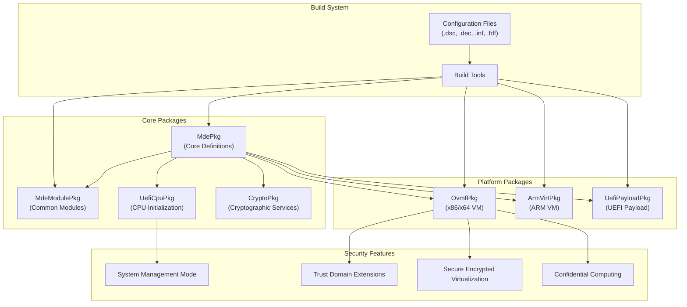

Sources: [Maintainers.txt:1-675](Maintainers.txt:1-675), [MdePkg/MdePkg.dec:1-304](MdePkg/MdePkg.dec:1-304)

## MdePkg - The Foundation

The MdePkg (Module Development Environment Package) serves as the foundation of the EDK II framework. It provides the core definitions, library classes, and implementations needed by all other packages in the ecosystem.

Key characteristics of MdePkg:

- Defines the interfaces specified in the UEFI and PI specifications
- Provides platform-independent library classes and implementations
- Includes architecture-specific definitions for various CPU types
- Contains industry standard definitions for protocols and formats

### Library Class Architecture

MdePkg defines a comprehensive set of library classes that provide various services to EDK II modules. These library classes are implemented in different ways depending on the phase and environment in which they're used.

```mermaid
graph TD
    subgraph "Base Libraries"
        BaseLib["BaseLib\n(Core Functions)"]
        BaseMemoryLib["BaseMemoryLib\n(Memory Operations)"]
        DebugLib["DebugLib\n(Debug Services)"]
        IoLib["IoLib\n(I/O Operations)"]
        PcdLib["PcdLib\n(Platform Configuration)"]
    end
    
    subgraph "UEFI Libraries"
        UefiLib["UefiLib\n(UEFI Services)"]
        UefiBootServicesTableLib["UefiBootServicesTableLib"]
        UefiRuntimeServicesTableLib["UefiRuntimeServicesTableLib"]
        DevicePathLib["DevicePathLib"]
        UefiDriverEntryPoint["UefiDriverEntryPoint"]
        UefiApplicationEntryPoint["UefiApplicationEntryPoint"]
    end
    
    subgraph "PEI Libraries"
        PeiServicesLib["PeiServicesLib"]
        PeiServicesTablePointerLib["PeiServicesTablePointerLib"]
        PeimEntryPoint["PeimEntryPoint"]
    end
    
    subgraph "DXE Libraries"
        DxeServicesLib["DxeServicesLib"]
        DxeServicesTableLib["DxeServicesTableLib"]
        HobLib["HobLib"]
    end
    
    BaseLib --> UefiLib
    BaseMemoryLib --> UefiLib
    DebugLib --> UefiLib
    
    UefiBootServicesTableLib --> UefiLib
    UefiRuntimeServicesTableLib --> UefiLib
    DevicePathLib --> UefiDriverEntryPoint
    DevicePathLib --> UefiApplicationEntryPoint
    
    PcdLib --> PeiServicesLib
    PcdLib --> DxeServicesLib
    
    BaseLib --> PeiServicesLib
    BaseLib --> DxeServicesLib
```

Sources: [MdePkg/MdePkg.dec:54-303](MdePkg/MdePkg.dec:54-303), [MdePkg/MdePkg.dsc:35-142](MdePkg/MdePkg.dsc:35-142)

### Supported Architectures

EDK II provides cross-platform support for multiple architectures, including:

| Architecture | Description | Header Location |
|--------------|-------------|-----------------|
| IA32         | 32-bit x86  | Include/Ia32    |
| X64          | 64-bit x86  | Include/X64     |
| EBC          | EFI Byte Code | Include/Ebc   |
| ARM          | 32-bit ARM  | Include/Arm     |
| AARCH64      | 64-bit ARM  | Include/AArch64 |
| RISCV64      | 64-bit RISC-V | Include/RiscV64 |
| LOONGARCH64  | 64-bit LoongArch | Include/LoongArch64 |

Sources: [MdePkg/MdePkg.dec:33-52](MdePkg/MdePkg.dec:33-52), [MdePkg/Include/LoongArch64/ProcessorBind.h:1-121](MdePkg/Include/LoongArch64/ProcessorBind.h:1-121)

## Firmware Execution Flow

The UEFI firmware execution progresses through several defined phases, each with specific responsibilities in the boot process.

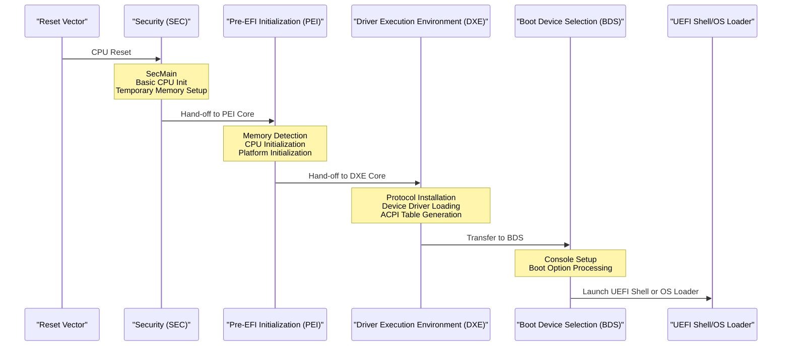

The firmware execution flow is coordinated through a series of event notifications. EDK II defines several standard event groups for significant phases in the boot process:

| Event Group | GUID | Purpose |
|-------------|------|---------|
| ExitBootServices | gEfiEventExitBootServicesGuid | Signals when boot services are about to terminate |
| ReadyToBoot | gEfiEventReadyToBootGuid | Signals when system is about to load OS |
| MemoryMapChange | gEfiEventMemoryMapChangeGuid | Signals when memory map has changed |
| VirtualAddressChange | gEfiEventVirtualAddressChangeGuid | Signals when virtual addressing starts |
| EndOfDxe | gEfiEndOfDxeEventGroupGuid | Signals end of DXE phase initialization |

Sources: [MdePkg/Include/Guid/EventGroup.h:1-53](MdePkg/Include/Guid/EventGroup.h:1-53)

## Build System

The EDK II build system transforms source code into firmware images through a well-defined process that handles dependencies, generates intermediate files, and creates the final binary outputs.

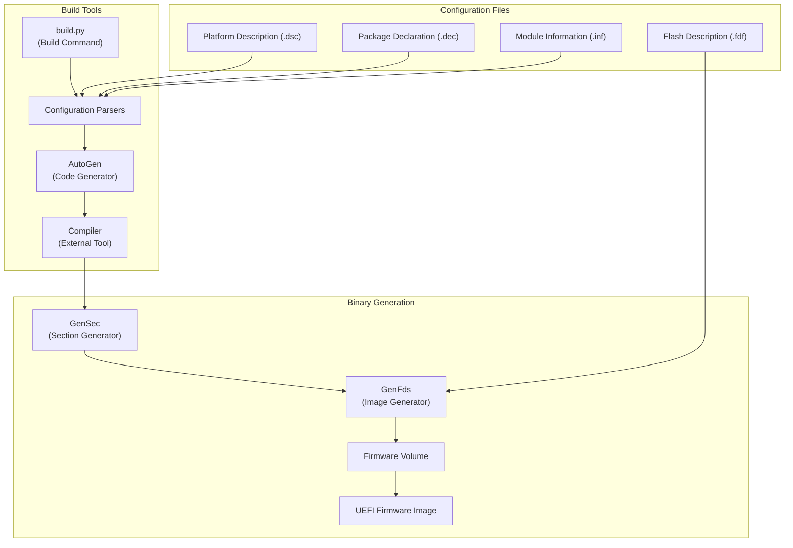

The build system typically runs CI (Continuous Integration) tests to ensure code quality, as specified in configuration files like `MdePkg.ci.yaml`.

Sources: [MdePkg/MdePkg.ci.yaml:1-189](MdePkg/MdePkg.ci.yaml:1-189)

## Recent Additions and Technologies

EDK II is continuously evolving with new features and technologies. Some recent additions include:

### Trace Hub Debug Support

The TraceHubDebugSysTLib provides an interface for outputting debug messages to a Trace Hub, which offers an alternative debugging channel that can be useful when traditional debug methods aren't available.

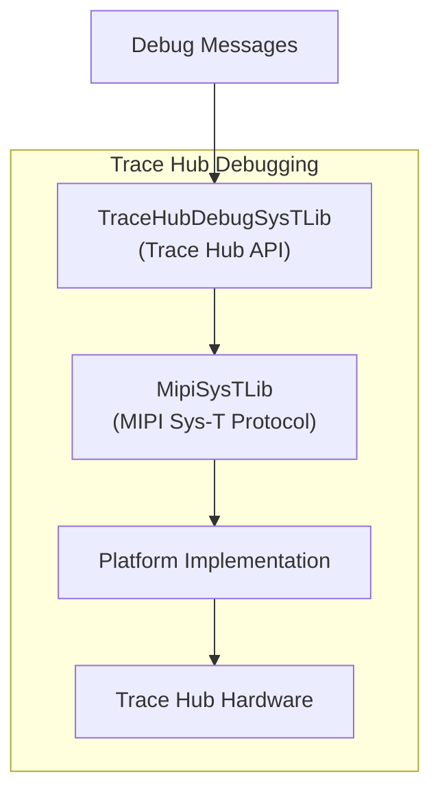

Sources: [MdePkg/Include/Library/TraceHubDebugSysTLib.h:1-82](MdePkg/Include/Library/TraceHubDebugSysTLib.h:1-82), [MdePkg/Library/TraceHubDebugSysTLibNull/TraceHubDebugSysTLibNull.c:1-77](MdePkg/Library/TraceHubDebugSysTLibNull/TraceHubDebugSysTLibNull.c:1-77), [MdePkg/Library/MipiSysTLib/MipiSysTLib.c:1-14](MdePkg/Library/MipiSysTLib/MipiSysTLib.c:1-14)

### USB Network Support

Recent additions to the MdeModulePkg include USB networking capabilities, specifically support for the RNDIS (Remote Network Driver Interface Specification) protocol, allowing for UEFI network functionality over USB connections.

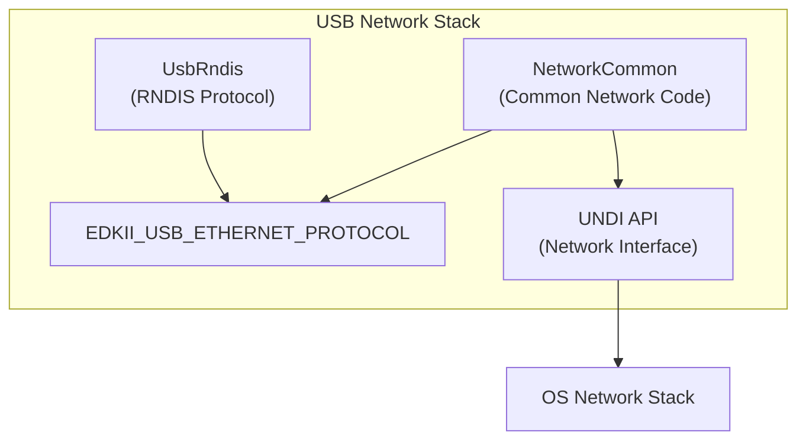

Sources: [MdeModulePkg/Bus/Usb/UsbNetwork/UsbRndis/UsbRndis.h:1-265](MdeModulePkg/Bus/Usb/UsbNetwork/UsbRndis/UsbRndis.h:1-265), [MdeModulePkg/Bus/Usb/UsbNetwork/UsbRndis/UsbRndis.c:1-183](MdeModulePkg/Bus/Usb/UsbNetwork/UsbRndis/UsbRndis.c:1-183), [MdeModulePkg/Bus/Usb/UsbNetwork/NetworkCommon/DriverBinding.h:1-84](MdeModulePkg/Bus/Usb/UsbNetwork/NetworkCommon/DriverBinding.h:1-84)

### Security Features

EDK II includes extensive security features, including:

- System Management Mode (SMM) for privileged system management
- Memory protection mechanisms through the Memory Attribute Protocol
- Cryptographic services through the CryptoPkg
- Hardware security features like ARM TRNG (True Random Number Generator) support
- Confidential Computing features like AMD SEV and Intel TDX

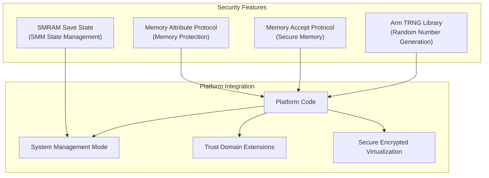

Sources: [MdePkg/Include/Protocol/MemoryAttribute.h:1-47](MdePkg/Include/Protocol/MemoryAttribute.h:1-47), [MdePkg/Include/Protocol/MemoryAccept.h:1-38](MdePkg/Include/Protocol/MemoryAccept.h:1-38), [MdePkg/Include/Library/ArmTrngLib.h:1-21](MdePkg/Include/Library/ArmTrngLib.h:1-21), [MdePkg/Include/Register/Amd/SmramSaveStateMap.h:1-195](MdePkg/Include/Register/Amd/SmramSaveStateMap.h:1-195)

## Conclusion

EDK II provides a comprehensive framework for developing UEFI-compliant firmware across multiple architectures and platforms. Its modular design, extensive library support, and standardized interfaces create a flexible ecosystem for firmware development. The framework continues to evolve with new features, improved security mechanisms, and support for the latest hardware technologies.

Sources: [Maintainers.txt:56-675](Maintainers.txt:56-675), [MdePkg/MdePkg.dec:1-646](MdePkg/MdePkg.dec:1-646), [MdePkg/MdePkg.dsc:1-204](MdePkg/MdePkg.dsc:1-204)

---

# Page: Build System

# Build System

<details>
<summary>Relevant source files</summary>

The following files were used as context for generating this wiki page:

- [ArmPkg/Library/GnuNoteBti.bin](ArmPkg/Library/GnuNoteBti.bin)
- [BaseTools/BinWrappers/PosixLike/AmlToC](BaseTools/BinWrappers/PosixLike/AmlToC)
- [BaseTools/BinWrappers/WindowsLike/AmlToC.bat](BaseTools/BinWrappers/WindowsLike/AmlToC.bat)
- [BaseTools/BuildEnv](BaseTools/BuildEnv)
- [BaseTools/Conf/build_rule.template](BaseTools/Conf/build_rule.template)
- [BaseTools/Conf/target.template](BaseTools/Conf/target.template)
- [BaseTools/Conf/tools_def.template](BaseTools/Conf/tools_def.template)
- [BaseTools/Scripts/SetVisualStudio.bat](BaseTools/Scripts/SetVisualStudio.bat)
- [BaseTools/Scripts/ShowEnvironment.bat](BaseTools/Scripts/ShowEnvironment.bat)
- [BaseTools/Source/C/GenFfs/GenFfs.c](BaseTools/Source/C/GenFfs/GenFfs.c)
- [BaseTools/Source/C/GenSec/GenSec.c](BaseTools/Source/C/GenSec/GenSec.c)
- [BaseTools/Source/C/Include/Common/BaseTypes.h](BaseTools/Source/C/Include/Common/BaseTypes.h)
- [BaseTools/Source/C/Include/Common/PiFirmwareFile.h](BaseTools/Source/C/Include/Common/PiFirmwareFile.h)
- [BaseTools/Source/Python/AmlToC/AmlToC.py](BaseTools/Source/Python/AmlToC/AmlToC.py)
- [BaseTools/Source/Python/AutoGen/AutoGen.py](BaseTools/Source/Python/AutoGen/AutoGen.py)
- [BaseTools/Source/Python/AutoGen/AutoGenWorker.py](BaseTools/Source/Python/AutoGen/AutoGenWorker.py)
- [BaseTools/Source/Python/AutoGen/BuildEngine.py](BaseTools/Source/Python/AutoGen/BuildEngine.py)
- [BaseTools/Source/Python/AutoGen/DataPipe.py](BaseTools/Source/Python/AutoGen/DataPipe.py)
- [BaseTools/Source/Python/AutoGen/GenC.py](BaseTools/Source/Python/AutoGen/GenC.py)
- [BaseTools/Source/Python/AutoGen/GenMake.py](BaseTools/Source/Python/AutoGen/GenMake.py)
- [BaseTools/Source/Python/AutoGen/GenPcdDb.py](BaseTools/Source/Python/AutoGen/GenPcdDb.py)
- [BaseTools/Source/Python/AutoGen/GenVar.py](BaseTools/Source/Python/AutoGen/GenVar.py)
- [BaseTools/Source/Python/AutoGen/IncludesAutoGen.py](BaseTools/Source/Python/AutoGen/IncludesAutoGen.py)
- [BaseTools/Source/Python/AutoGen/ModuleAutoGen.py](BaseTools/Source/Python/AutoGen/ModuleAutoGen.py)
- [BaseTools/Source/Python/AutoGen/ModuleAutoGenHelper.py](BaseTools/Source/Python/AutoGen/ModuleAutoGenHelper.py)
- [BaseTools/Source/Python/AutoGen/PlatformAutoGen.py](BaseTools/Source/Python/AutoGen/PlatformAutoGen.py)
- [BaseTools/Source/Python/AutoGen/StrGather.py](BaseTools/Source/Python/AutoGen/StrGather.py)
- [BaseTools/Source/Python/AutoGen/WorkspaceAutoGen.py](BaseTools/Source/Python/AutoGen/WorkspaceAutoGen.py)
- [BaseTools/Source/Python/BPDG/GenVpd.py](BaseTools/Source/Python/BPDG/GenVpd.py)
- [BaseTools/Source/Python/Common/DataType.py](BaseTools/Source/Python/Common/DataType.py)
- [BaseTools/Source/Python/Common/Expression.py](BaseTools/Source/Python/Common/Expression.py)
- [BaseTools/Source/Python/Common/GlobalData.py](BaseTools/Source/Python/Common/GlobalData.py)
- [BaseTools/Source/Python/Common/Misc.py](BaseTools/Source/Python/Common/Misc.py)
- [BaseTools/Source/Python/Common/RangeExpression.py](BaseTools/Source/Python/Common/RangeExpression.py)
- [BaseTools/Source/Python/Common/StringUtils.py](BaseTools/Source/Python/Common/StringUtils.py)
- [BaseTools/Source/Python/Common/TargetTxtClassObject.py](BaseTools/Source/Python/Common/TargetTxtClassObject.py)
- [BaseTools/Source/Python/Common/ToolDefClassObject.py](BaseTools/Source/Python/Common/ToolDefClassObject.py)
- [BaseTools/Source/Python/Common/VpdInfoFile.py](BaseTools/Source/Python/Common/VpdInfoFile.py)
- [BaseTools/Source/Python/GenFds/DataSection.py](BaseTools/Source/Python/GenFds/DataSection.py)
- [BaseTools/Source/Python/GenFds/EfiSection.py](BaseTools/Source/Python/GenFds/EfiSection.py)
- [BaseTools/Source/Python/GenFds/FdfParser.py](BaseTools/Source/Python/GenFds/FdfParser.py)
- [BaseTools/Source/Python/GenFds/FfsInfStatement.py](BaseTools/Source/Python/GenFds/FfsInfStatement.py)
- [BaseTools/Source/Python/GenFds/Fv.py](BaseTools/Source/Python/GenFds/Fv.py)
- [BaseTools/Source/Python/GenFds/FvImageSection.py](BaseTools/Source/Python/GenFds/FvImageSection.py)
- [BaseTools/Source/Python/GenFds/GenFds.py](BaseTools/Source/Python/GenFds/GenFds.py)
- [BaseTools/Source/Python/GenFds/GenFdsGlobalVariable.py](BaseTools/Source/Python/GenFds/GenFdsGlobalVariable.py)
- [BaseTools/Source/Python/GenFds/Region.py](BaseTools/Source/Python/GenFds/Region.py)
- [BaseTools/Source/Python/GenFds/Section.py](BaseTools/Source/Python/GenFds/Section.py)
- [BaseTools/Source/Python/PatchPcdValue/PatchPcdValue.py](BaseTools/Source/Python/PatchPcdValue/PatchPcdValue.py)
- [BaseTools/Source/Python/TargetTool/TargetTool.py](BaseTools/Source/Python/TargetTool/TargetTool.py)
- [BaseTools/Source/Python/UPT/Library/DataType.py](BaseTools/Source/Python/UPT/Library/DataType.py)
- [BaseTools/Source/Python/Workspace/BuildClassObject.py](BaseTools/Source/Python/Workspace/BuildClassObject.py)
- [BaseTools/Source/Python/Workspace/DecBuildData.py](BaseTools/Source/Python/Workspace/DecBuildData.py)
- [BaseTools/Source/Python/Workspace/DscBuildData.py](BaseTools/Source/Python/Workspace/DscBuildData.py)
- [BaseTools/Source/Python/Workspace/InfBuildData.py](BaseTools/Source/Python/Workspace/InfBuildData.py)
- [BaseTools/Source/Python/Workspace/MetaDataTable.py](BaseTools/Source/Python/Workspace/MetaDataTable.py)
- [BaseTools/Source/Python/Workspace/MetaFileParser.py](BaseTools/Source/Python/Workspace/MetaFileParser.py)
- [BaseTools/Source/Python/Workspace/MetaFileTable.py](BaseTools/Source/Python/Workspace/MetaFileTable.py)
- [BaseTools/Source/Python/Workspace/WorkspaceCommon.py](BaseTools/Source/Python/Workspace/WorkspaceCommon.py)
- [BaseTools/Source/Python/Workspace/WorkspaceDatabase.py](BaseTools/Source/Python/Workspace/WorkspaceDatabase.py)
- [BaseTools/Source/Python/build/BuildReport.py](BaseTools/Source/Python/build/BuildReport.py)
- [BaseTools/Source/Python/build/build.py](BaseTools/Source/Python/build/build.py)
- [BaseTools/Source/Python/build/buildoptions.py](BaseTools/Source/Python/build/buildoptions.py)
- [BaseTools/Tests/PythonTest.py](BaseTools/Tests/PythonTest.py)
- [BaseTools/Tests/RunTests.py](BaseTools/Tests/RunTests.py)
- [BaseTools/get_vsvars.bat](BaseTools/get_vsvars.bat)
- [BaseTools/set_vsprefix_envs.bat](BaseTools/set_vsprefix_envs.bat)
- [BaseTools/toolsetup.bat](BaseTools/toolsetup.bat)
- [edksetup.bat](edksetup.bat)
- [edksetup.sh](edksetup.sh)

</details>


The EDK II build system transforms platform description files, module source code, and other inputs into UEFI firmware binaries. This document explains the architecture of the build system, the build process flow, key components, and configuration files used in the build process.

## Architecture Overview

The EDK II build system is primarily implemented in Python with supporting batch files and shell scripts for environment setup. It orchestrates the build process by parsing configuration files, generating source files and makefiles, invoking toolchains, and producing final firmware images.

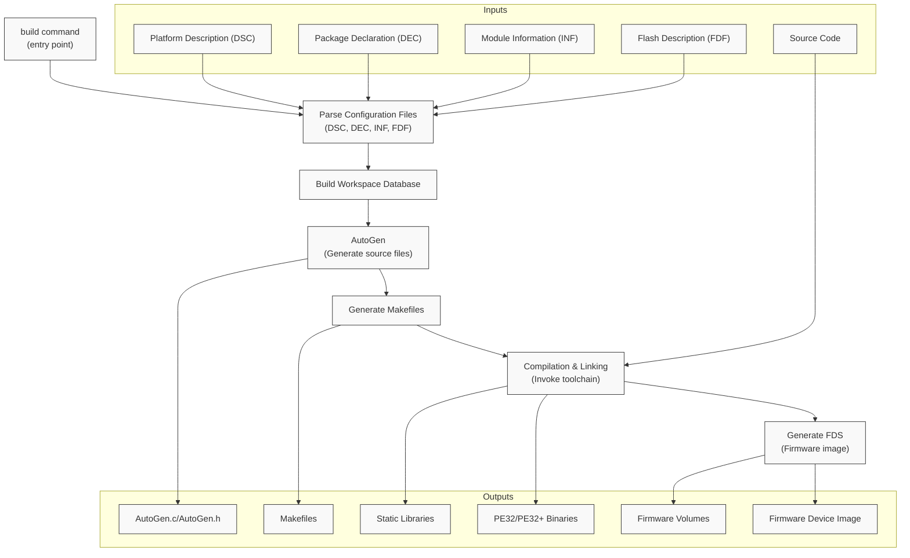

**Build System Architecture**

Sources: [BaseTools/Source/Python/build/build.py:1-114](), [BaseTools/Source/Python/AutoGen/AutoGen.py:1-114](), [BaseTools/Source/Python/GenFds/GenFds.py:1-89]()

## Environment Setup

Before using the build system, the development environment must be configured. This is done using the `edksetup.bat` (Windows) or `edksetup.sh` (Linux/macOS) scripts, which call `BaseTools/toolsetup.bat` or equivalent to set up necessary environment variables and paths.

Key environment variables include:
- `WORKSPACE`: The root directory of the EDK II workspace
- `EDK_TOOLS_PATH`: The directory containing the build tools
- `PACKAGES_PATH`: Additional directories containing packages (optional)

Sources: [BaseTools/toolsetup.bat:1-14](), [edksetup.bat:1-5](), [edksetup.sh:1-5]()

## Build Process Flow

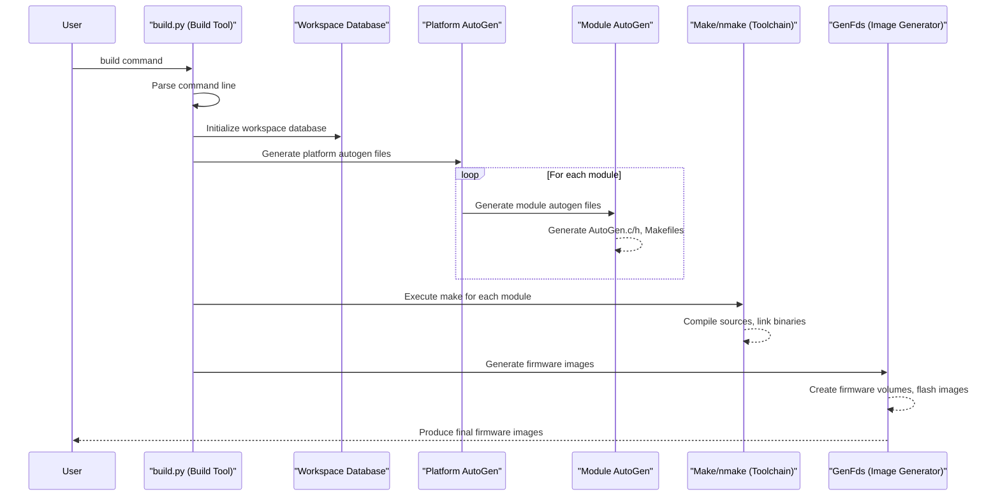

**Build Process Flow**

Sources: [BaseTools/Source/Python/build/build.py:67-119](), [BaseTools/Source/Python/build/build.py:293-368]()

## Build Components in Detail

### 1. Workspace Management

The build process begins by setting up a workspace database that tracks all packages, modules, libraries, and other components. This database is populated by parsing the configuration files and is used throughout the build process.

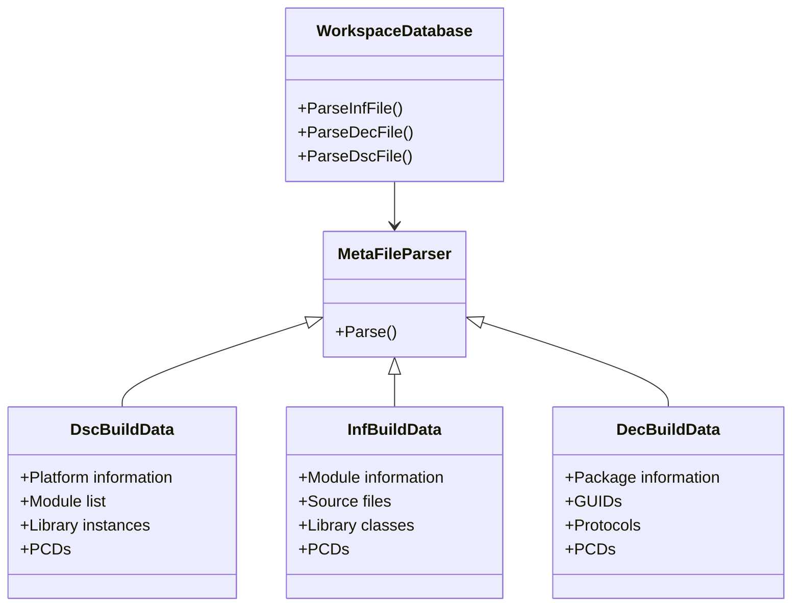

**Workspace Database Class Relationships**

Sources: [BaseTools/Source/Python/Workspace/WorkspaceDatabase.py](), [BaseTools/Source/Python/Workspace/DscBuildData.py:1-20](), [BaseTools/Source/Python/Workspace/InfBuildData.py:1-30](), [BaseTools/Source/Python/Workspace/DecBuildData.py:1-20]()

### 2. Configuration Files Parsing

The build system uses several types of configuration files:

#### Platform Description (DSC) Files

DSC files define the platform being built, including:
- Platform information (name, GUID, version)
- Modules to be built
- Library instances to be used
- Platform-specific PCDs (Platform Configuration Database entries)
- Build options

Example DSC file section (simplified):
```
[Defines]
  PLATFORM_NAME           = MyPlatform
  PLATFORM_GUID           = 12345678-1234-1234-1234-123456789012
  PLATFORM_VERSION        = 0.1
  
[LibraryClasses]
  BaseLib|MdePkg/Library/BaseLib/BaseLib.inf
  
[Components]
  MyPkg/MyModule/MyModule.inf
```

DSC files are parsed by the `DscBuildData` class, which extracts platform information, modules, libraries, PCDs, and build options.

Sources: [BaseTools/Source/Python/Workspace/DscBuildData.py:20-100](), [BaseTools/Source/Python/Workspace/DscBuildData.py:183-207]()

#### Module Information (INF) Files

INF files define individual modules, including:
- Module information (name, GUID, version)
- Module type (PEIM, DXE_DRIVER, etc.)
- Source files
- Library classes needed
- Protocols/PPIs consumed or produced
- GUIDs used
- Module-specific PCDs

Example INF file section (simplified):
```
[Defines]
  INF_VERSION             = 0x00010005
  BASE_NAME               = MyModule
  FILE_GUID               = 12345678-1234-1234-1234-123456789012
  MODULE_TYPE             = DXE_DRIVER
  
[Sources]
  MyModule.c
  
[LibraryClasses]
  BaseLib
  UefiBootServicesTableLib
```

INF files are parsed by the `InfBuildData` class, which extracts module information, source files, library dependencies, and other module-specific data.

Sources: [BaseTools/Source/Python/Workspace/InfBuildData.py:62-100]()

#### Package Declaration (DEC) Files

DEC files define packages, including:
- Package information (name, GUID, version)
- GUIDs, Protocols, PPIs provided by the package
- PCDs defined by the package
- Include paths

Example DEC file section (simplified):
```
[Defines]
  DEC_SPECIFICATION       = 0x00010005
  PACKAGE_NAME            = MyPackage
  PACKAGE_GUID            = 12345678-1234-1234-1234-123456789012
  
[Guids]
  gMyPkgTokenSpaceGuid    = { 0x12345678, 0x1234, 0x1234, { 0x12, 0x34, 0x56, 0x78, 0x9a, 0xbc, 0xde, 0xf0 } }
  
[Protocols]
  gMyProtocolGuid         = { 0x12345678, 0x1234, 0x1234, { 0x12, 0x34, 0x56, 0x78, 0x9a, 0xbc, 0xde, 0xf0 } }
```

DEC files are parsed by the `DecBuildData` class, which extracts package information, GUIDs, protocols, and PCDs.

Sources: [BaseTools/Source/Python/Workspace/DecBuildData.py:1-20]()

#### Flash Description (FDF) Files

FDF files define the flash layout and firmware volumes, including:
- Flash device layout (regions)
- Firmware volumes
- Firmware files (modules) to include in each volume
- Rules for processing files

Example FDF file section (simplified):
```
[FD.MyFlashDevice]
  BaseAddress   = 0xFF800000
  Size          = 0x00800000
  
[FV.MyFirmwareVolume]
  FvAlignment   = 16
  
  INF MyPkg/MyModule/MyModule.inf
```

FDF files are parsed by the `FdfParser` class, which extracts flash layout information, firmware volumes, and firmware files.

Sources: [BaseTools/Source/Python/GenFds/FdfParser.py:1-100]()

### 3. AutoGen Process

The AutoGen process generates C code, header files, and makefiles needed to build modules. This includes:

- `AutoGen.c` - Contains generated code such as PCD access methods, entry points, and configuration data
- `AutoGen.h` - Contains declarations, PCD definitions, and other generated information
- Makefiles - Used by the toolchain to compile and link the module

The AutoGen process is performed by the `PlatformAutoGen` and `ModuleAutoGen` classes, which generate platform-level and module-level files respectively.

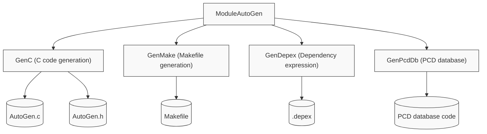

**AutoGen Components**

Sources: [BaseTools/Source/Python/AutoGen/ModuleAutoGen.py:1-24](), [BaseTools/Source/Python/AutoGen/GenC.py:1-57](), [BaseTools/Source/Python/AutoGen/GenMake.py:1-60](), [BaseTools/Source/Python/AutoGen/GenPcdDb.py:1-25]()

### 4. Build Tasks Management

The build system manages build tasks using the `BuildTask` class, which schedules and executes the compilation of modules. The process is multi-threaded to improve performance.

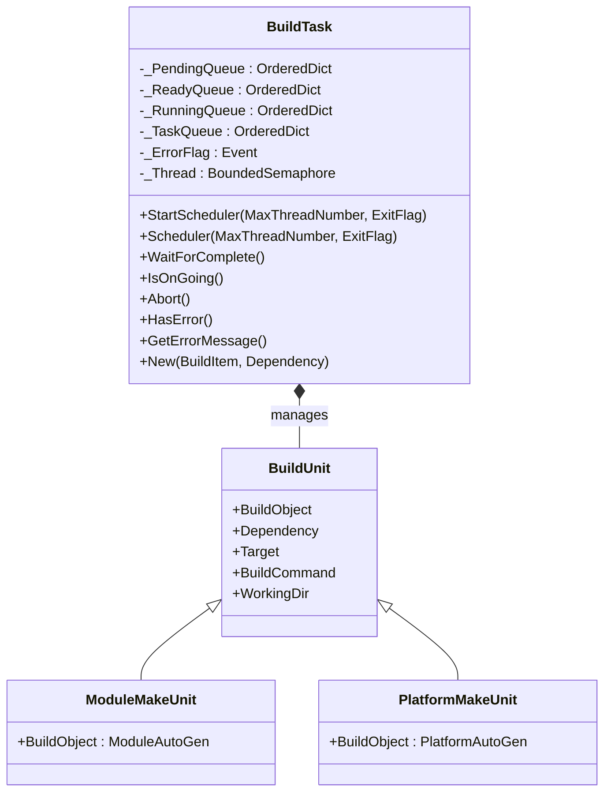

**Build Task Management Classes**

Sources: [BaseTools/Source/Python/build/build.py:285-556]()

### 5. Toolchain Integration

The build system integrates with different toolchains (compilers, linkers, etc.) through a toolchain definition file (`tools_def.template`). This file defines:

- Paths to toolchain executables
- Compiler flags
- Linker flags
- Other toolchain-specific settings

The toolchain definitions are processed and used to generate appropriate makefiles and build commands.

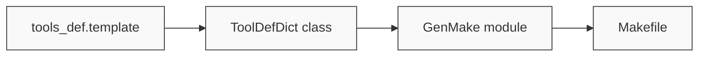

**Toolchain Integration Flow**

Sources: [BaseTools/Conf/tools_def.template:1-30](), [BaseTools/Source/Python/Common/ToolDefClassObject.py]()

The toolchain definition file is structured with patterns like:

```
*_TOOLCHAIN_ARCH_COMMANDTYPE_ATTRIBUTE = Value
```

Where:
- `*` is a wildcard matching any target or tool
- `TOOLCHAIN` is the toolchain family (MSFT, GCC, etc.)
- `ARCH` is the architecture (IA32, X64, etc.)
- `COMMANDTYPE` is the command type (CC, LINK, ASM, etc.)
- `ATTRIBUTE` is the attribute (FLAGS, PATH, etc.)

Sources: [BaseTools/Source/Python/AutoGen/AutoGen.py:74-114]()

### 6. Firmware Image Generation

After modules are built, the build system generates firmware images using the GenFds module. This process:

1. Parses the FDF file
2. Creates firmware volumes (FVs)
3. Adds firmware files (FFs) to volumes
4. Creates firmware device (FD) images

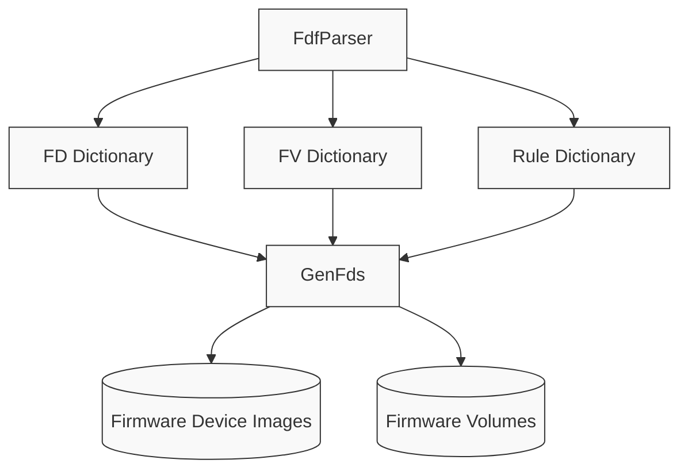

**Firmware Image Generation Components**

Sources: [BaseTools/Source/Python/GenFds/GenFds.py:1-60](), [BaseTools/Source/Python/GenFds/FdfParser.py:1-60](), [BaseTools/Source/Python/GenFds/Fv.py:1-20]()

## Build Rules

The build system uses build rules to specify how different file types should be processed. These rules are defined in the build_rule.template file and specify:

- How to process different source file types
- How to generate output files
- Command-line options for toolchain tools

Example rule (simplified):
```
[C-Code-File]
  <InputFile>
    ?.c
  <ExtraDependency>
    $(MAKE_FILE)
  <OutputFile>
    $(OUTPUT_DIR)(+)${s_dir}(+)${s_base}.obj
  <Command>
    "$(CC)" /Fo${dst} $(CC_FLAGS) $(INC) ${src}
```

Sources: [BaseTools/Conf/build_rule.template:1-85]()

## Building with the EDK II Build System

### Common Build Commands

The build command has the following format:
```
build [options] [target]
```

Common options include:
- `-p, --platform`: Specify platform DSC file
- `-m, --module`: Specify module INF file
- `-a, --arch`: Specify architecture
- `-t, --tagname`: Specify toolchain
- `-b, --buildtarget`: Specify build target (DEBUG/RELEASE)

Common targets include:
- `all`: Build all modules (default)
- `modules`: Build modules only
- `libraries`: Build libraries only
- `fds`: Build firmware image
- `clean`: Clean intermediate files
- `cleanall`: Clean all generated files

Sources: [BaseTools/Source/Python/build/build.py:66-69]()

### Build Process Example

A typical build process for a platform might look like:

1. Setup environment:
   ```bash
   . edksetup.sh
   ```

2. Build a platform:
   ```bash
   build -p OvmfPkg/OvmfPkgX64.dsc -a X64 -t GCC5
   ```

3. Build a single module:
   ```bash
   build -p OvmfPkg/OvmfPkgX64.dsc -m MdeModulePkg/Core/Dxe/DxeMain.inf -a X64 -t GCC5
   ```

4. Clean build outputs:
   ```bash
   build -p OvmfPkg/OvmfPkgX64.dsc -a X64 -t GCC5 clean
   ```

## Platform Configuration Database (PCD)

PCDs are a key mechanism in EDK II for configuring modules and platforms. The build system processes PCD definitions and values from DEC, INF, and DSC files, and generates code to access PCDs.

PCD types include:
- FeatureFlag: Boolean value for enabling/disabling features
- FixedAtBuild: Value fixed at build time
- PatchableInModule: Value can be patched in the binary module
- Dynamic/DynamicEx: Value set at runtime
- DynamicHii/DynamicExHii: Value from HII
- DynamicVpd/DynamicExVpd: Value from VPD

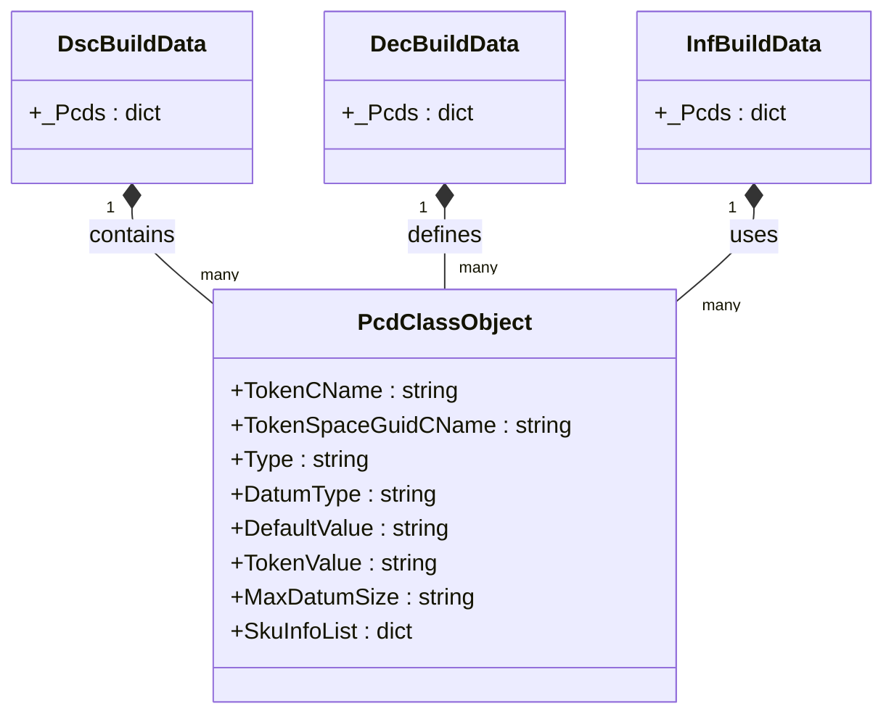

**PCD Processing Classes**

Sources: [BaseTools/Source/Python/Workspace/BuildClassObject.py:48-115](), [BaseTools/Source/Python/AutoGen/GenPcdDb.py:1-24]()

## Conclusion

The EDK II build system is a comprehensive set of tools that automate the process of building firmware images from source code and configuration files. It handles the complexity of module dependencies, platform configurations, and toolchain integration, allowing developers to focus on writing UEFI code rather than managing build details.

The build system's modular design makes it extensible and adaptable to different platforms, architectures, and toolchains. By understanding the build system's architecture and components, developers can more effectively customize their build process and troubleshoot build issues.

For information on specific platforms and how to build them, see the Platform Support documentation [Platform Support](#3).

Sources: [BaseTools/Source/Python/build/build.py](), [BaseTools/Source/Python/AutoGen](), [BaseTools/Source/Python/Workspace](), [BaseTools/Source/Python/GenFds]()

---

# Page: Platform Support

# Platform Support

<details>
<summary>Relevant source files</summary>

The following files were used as context for generating this wiki page:

- [ArmPkg/Drivers/ArmPciCpuIo2Dxe/ArmPciCpuIo2Dxe.inf](ArmPkg/Drivers/ArmPciCpuIo2Dxe/ArmPciCpuIo2Dxe.inf)
- [ArmVirtPkg/ArmVirt.dsc.inc](ArmVirtPkg/ArmVirt.dsc.inc)
- [ArmVirtPkg/ArmVirtCloudHv.dsc](ArmVirtPkg/ArmVirtCloudHv.dsc)
- [ArmVirtPkg/ArmVirtCloudHv.fdf](ArmVirtPkg/ArmVirtCloudHv.fdf)
- [ArmVirtPkg/ArmVirtKvmTool.dsc](ArmVirtPkg/ArmVirtKvmTool.dsc)
- [ArmVirtPkg/ArmVirtKvmTool.fdf](ArmVirtPkg/ArmVirtKvmTool.fdf)
- [ArmVirtPkg/ArmVirtPkg.dec](ArmVirtPkg/ArmVirtPkg.dec)
- [ArmVirtPkg/ArmVirtQemu.dsc](ArmVirtPkg/ArmVirtQemu.dsc)
- [ArmVirtPkg/ArmVirtQemu.fdf](ArmVirtPkg/ArmVirtQemu.fdf)
- [ArmVirtPkg/ArmVirtQemuFvMain.fdf.inc](ArmVirtPkg/ArmVirtQemuFvMain.fdf.inc)
- [ArmVirtPkg/ArmVirtQemuKernel.dsc](ArmVirtPkg/ArmVirtQemuKernel.dsc)
- [ArmVirtPkg/ArmVirtQemuKernel.fdf](ArmVirtPkg/ArmVirtQemuKernel.fdf)
- [ArmVirtPkg/ArmVirtRules.fdf.inc](ArmVirtPkg/ArmVirtRules.fdf.inc)
- [ArmVirtPkg/ArmVirtXen.dsc](ArmVirtPkg/ArmVirtXen.dsc)
- [ArmVirtPkg/ArmVirtXen.fdf](ArmVirtPkg/ArmVirtXen.fdf)
- [ArmVirtPkg/CloudHvAcpiPlatformDxe/CloudHvAcpi.c](ArmVirtPkg/CloudHvAcpiPlatformDxe/CloudHvAcpi.c)
- [ArmVirtPkg/CloudHvAcpiPlatformDxe/CloudHvAcpiPlatformDxe.inf](ArmVirtPkg/CloudHvAcpiPlatformDxe/CloudHvAcpiPlatformDxe.inf)
- [ArmVirtPkg/CloudHvPlatformHasAcpiDtDxe/CloudHvHasAcpiDtDxe.c](ArmVirtPkg/CloudHvPlatformHasAcpiDtDxe/CloudHvHasAcpiDtDxe.c)
- [ArmVirtPkg/CloudHvPlatformHasAcpiDtDxe/CloudHvHasAcpiDtDxe.inf](ArmVirtPkg/CloudHvPlatformHasAcpiDtDxe/CloudHvHasAcpiDtDxe.inf)
- [ArmVirtPkg/Include/Guid/Early16550UartBaseAddress.h](ArmVirtPkg/Include/Guid/Early16550UartBaseAddress.h)
- [ArmVirtPkg/KvmtoolPlatformDxe/KvmtoolPlatformDxe.c](ArmVirtPkg/KvmtoolPlatformDxe/KvmtoolPlatformDxe.c)
- [ArmVirtPkg/KvmtoolPlatformDxe/KvmtoolPlatformDxe.inf](ArmVirtPkg/KvmtoolPlatformDxe/KvmtoolPlatformDxe.inf)
- [ArmVirtPkg/Library/ArmVirtPsciResetSystemPeiLib/ArmVirtPsciResetSystemPeiLib.c](ArmVirtPkg/Library/ArmVirtPsciResetSystemPeiLib/ArmVirtPsciResetSystemPeiLib.c)
- [ArmVirtPkg/Library/ArmVirtPsciResetSystemPeiLib/ArmVirtPsciResetSystemPeiLib.inf](ArmVirtPkg/Library/ArmVirtPsciResetSystemPeiLib/ArmVirtPsciResetSystemPeiLib.inf)
- [ArmVirtPkg/Library/KvmtoolRtcFdtClientLib/KvmtoolRtcFdtClientLib.c](ArmVirtPkg/Library/KvmtoolRtcFdtClientLib/KvmtoolRtcFdtClientLib.c)
- [ArmVirtPkg/Library/KvmtoolRtcFdtClientLib/KvmtoolRtcFdtClientLib.inf](ArmVirtPkg/Library/KvmtoolRtcFdtClientLib/KvmtoolRtcFdtClientLib.inf)
- [ArmVirtPkg/Library/KvmtoolVirtMemInfoLib/KvmtoolVirtMemInfoLib.c](ArmVirtPkg/Library/KvmtoolVirtMemInfoLib/KvmtoolVirtMemInfoLib.c)
- [ArmVirtPkg/Library/KvmtoolVirtMemInfoLib/KvmtoolVirtMemInfoLib.inf](ArmVirtPkg/Library/KvmtoolVirtMemInfoLib/KvmtoolVirtMemInfoLib.inf)
- [ArmVirtPkg/Library/NorFlashKvmtoolLib/NorFlashKvmtool.c](ArmVirtPkg/Library/NorFlashKvmtoolLib/NorFlashKvmtool.c)
- [ArmVirtPkg/Library/NorFlashKvmtoolLib/NorFlashKvmtoolLib.inf](ArmVirtPkg/Library/NorFlashKvmtoolLib/NorFlashKvmtoolLib.inf)
- [ArmVirtPkg/Library/XenArmGenericTimerVirtCounterLib/XenArmGenericTimerVirtCounterLib.c](ArmVirtPkg/Library/XenArmGenericTimerVirtCounterLib/XenArmGenericTimerVirtCounterLib.c)
- [ArmVirtPkg/Library/XenArmGenericTimerVirtCounterLib/XenArmGenericTimerVirtCounterLib.inf](ArmVirtPkg/Library/XenArmGenericTimerVirtCounterLib/XenArmGenericTimerVirtCounterLib.inf)
- [OvmfPkg/AmdSev/AmdSevX64.dsc](OvmfPkg/AmdSev/AmdSevX64.dsc)
- [OvmfPkg/AmdSev/AmdSevX64.fdf](OvmfPkg/AmdSev/AmdSevX64.fdf)
- [OvmfPkg/Bhyve/BhyveDefines.fdf.inc](OvmfPkg/Bhyve/BhyveDefines.fdf.inc)
- [OvmfPkg/Bhyve/BhyveX64.dsc](OvmfPkg/Bhyve/BhyveX64.dsc)
- [OvmfPkg/Bhyve/BhyveX64.fdf](OvmfPkg/Bhyve/BhyveX64.fdf)
- [OvmfPkg/CloudHv/CloudHvDefines.fdf.inc](OvmfPkg/CloudHv/CloudHvDefines.fdf.inc)
- [OvmfPkg/CloudHv/CloudHvX64.dsc](OvmfPkg/CloudHv/CloudHvX64.dsc)
- [OvmfPkg/CloudHv/CloudHvX64.fdf](OvmfPkg/CloudHv/CloudHvX64.fdf)
- [OvmfPkg/IntelTdx/IntelTdxX64.dsc](OvmfPkg/IntelTdx/IntelTdxX64.dsc)
- [OvmfPkg/IntelTdx/IntelTdxX64.fdf](OvmfPkg/IntelTdx/IntelTdxX64.fdf)
- [OvmfPkg/Microvm/MicrovmX64.dsc](OvmfPkg/Microvm/MicrovmX64.dsc)
- [OvmfPkg/Microvm/MicrovmX64.fdf](OvmfPkg/Microvm/MicrovmX64.fdf)
- [OvmfPkg/OvmfPkgIa32.dsc](OvmfPkg/OvmfPkgIa32.dsc)
- [OvmfPkg/OvmfPkgIa32.fdf](OvmfPkg/OvmfPkgIa32.fdf)
- [OvmfPkg/OvmfPkgIa32X64.dsc](OvmfPkg/OvmfPkgIa32X64.dsc)
- [OvmfPkg/OvmfPkgIa32X64.fdf](OvmfPkg/OvmfPkgIa32X64.fdf)
- [OvmfPkg/OvmfPkgX64.dsc](OvmfPkg/OvmfPkgX64.dsc)
- [OvmfPkg/OvmfPkgX64.fdf](OvmfPkg/OvmfPkgX64.fdf)
- [OvmfPkg/OvmfXen.dsc](OvmfPkg/OvmfXen.dsc)
- [OvmfPkg/OvmfXen.fdf](OvmfPkg/OvmfXen.fdf)
- [OvmfPkg/PlatformHasAcpiDtDxe/PlatformHasAcpiDtDxe.c](OvmfPkg/PlatformHasAcpiDtDxe/PlatformHasAcpiDtDxe.c)
- [OvmfPkg/PlatformHasAcpiDtDxe/PlatformHasAcpiDtDxe.inf](OvmfPkg/PlatformHasAcpiDtDxe/PlatformHasAcpiDtDxe.inf)
- [SecurityPkg/Tcg/TdTcg2Dxe/MeasureBootPeCoff.c](SecurityPkg/Tcg/TdTcg2Dxe/MeasureBootPeCoff.c)
- [SecurityPkg/Tcg/TdTcg2Dxe/TdTcg2Dxe.inf](SecurityPkg/Tcg/TdTcg2Dxe/TdTcg2Dxe.inf)
- [UefiPayloadPkg/BlSupportDxe/BlSupportDxe.c](UefiPayloadPkg/BlSupportDxe/BlSupportDxe.c)
- [UefiPayloadPkg/BlSupportDxe/BlSupportDxe.h](UefiPayloadPkg/BlSupportDxe/BlSupportDxe.h)
- [UefiPayloadPkg/BlSupportDxe/BlSupportDxe.inf](UefiPayloadPkg/BlSupportDxe/BlSupportDxe.inf)
- [UefiPayloadPkg/Include/Library/BlParseLib.h](UefiPayloadPkg/Include/Library/BlParseLib.h)
- [UefiPayloadPkg/Library/CbParseLib/CbParseLib.c](UefiPayloadPkg/Library/CbParseLib/CbParseLib.c)
- [UefiPayloadPkg/Library/PciSegmentInfoLibAcpiBoardInfo/PciSegmentInfoLibAcpiBoardInfo.c](UefiPayloadPkg/Library/PciSegmentInfoLibAcpiBoardInfo/PciSegmentInfoLibAcpiBoardInfo.c)
- [UefiPayloadPkg/Library/PciSegmentInfoLibAcpiBoardInfo/PciSegmentInfoLibAcpiBoardInfo.inf](UefiPayloadPkg/Library/PciSegmentInfoLibAcpiBoardInfo/PciSegmentInfoLibAcpiBoardInfo.inf)
- [UefiPayloadPkg/Library/PlatformBootManagerLib/PlatformBootManager.c](UefiPayloadPkg/Library/PlatformBootManagerLib/PlatformBootManager.c)
- [UefiPayloadPkg/Library/PlatformBootManagerLib/PlatformBootManagerLib.inf](UefiPayloadPkg/Library/PlatformBootManagerLib/PlatformBootManagerLib.inf)
- [UefiPayloadPkg/Library/PlatformBootManagerLib/PlatformConsole.c](UefiPayloadPkg/Library/PlatformBootManagerLib/PlatformConsole.c)
- [UefiPayloadPkg/Library/PlatformBootManagerLib/PlatformConsole.h](UefiPayloadPkg/Library/PlatformBootManagerLib/PlatformConsole.h)
- [UefiPayloadPkg/Library/SblParseLib/SblParseLib.c](UefiPayloadPkg/Library/SblParseLib/SblParseLib.c)
- [UefiPayloadPkg/Library/SblParseLib/SblParseLib.inf](UefiPayloadPkg/Library/SblParseLib/SblParseLib.inf)
- [UefiPayloadPkg/UefiPayloadEntry/AcpiTable.c](UefiPayloadPkg/UefiPayloadEntry/AcpiTable.c)
- [UefiPayloadPkg/UefiPayloadEntry/LoadDxeCore.c](UefiPayloadPkg/UefiPayloadEntry/LoadDxeCore.c)
- [UefiPayloadPkg/UefiPayloadEntry/PrintHob.c](UefiPayloadPkg/UefiPayloadEntry/PrintHob.c)
- [UefiPayloadPkg/UefiPayloadEntry/UefiPayloadEntry.c](UefiPayloadPkg/UefiPayloadEntry/UefiPayloadEntry.c)
- [UefiPayloadPkg/UefiPayloadEntry/UefiPayloadEntry.h](UefiPayloadPkg/UefiPayloadEntry/UefiPayloadEntry.h)
- [UefiPayloadPkg/UefiPayloadEntry/UefiPayloadEntry.inf](UefiPayloadPkg/UefiPayloadEntry/UefiPayloadEntry.inf)
- [UefiPayloadPkg/UefiPayloadEntry/UniversalPayloadEntry.c](UefiPayloadPkg/UefiPayloadEntry/UniversalPayloadEntry.c)
- [UefiPayloadPkg/UefiPayloadEntry/UniversalPayloadEntry.inf](UefiPayloadPkg/UefiPayloadEntry/UniversalPayloadEntry.inf)
- [UefiPayloadPkg/UefiPayloadPkg.dec](UefiPayloadPkg/UefiPayloadPkg.dec)
- [UefiPayloadPkg/UefiPayloadPkg.dsc](UefiPayloadPkg/UefiPayloadPkg.dsc)
- [UefiPayloadPkg/UefiPayloadPkg.fdf](UefiPayloadPkg/UefiPayloadPkg.fdf)

</details>


This document provides an overview of the platform packages available in EDK II, explaining their structure, key differences, and use cases. It focuses on the architecture and relationships between different platform implementations within the NVIDIA edk2 codebase.

## Platform Package Overview

EDK II provides several platform packages that implement UEFI firmware for various virtual and physical hardware platforms. Each platform package is tailored to a specific hardware environment or use case, containing the necessary drivers, libraries, and configurations for that environment.

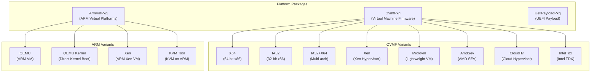

Sources: [OvmfPkg/OvmfPkgX64.dsc](), [OvmfPkg/OvmfPkgIa32.dsc](), [OvmfPkg/OvmfPkgIa32X64.dsc](), [OvmfPkg/OvmfXen.dsc](), [OvmfPkg/Microvm/MicrovmX64.dsc](), [OvmfPkg/AmdSev/AmdSevX64.dsc](), [OvmfPkg/Bhyve/BhyveX64.dsc](), [OvmfPkg/CloudHv/CloudHvX64.dsc](), [OvmfPkg/IntelTdx/IntelTdxX64.dsc](), [ArmVirtPkg/ArmVirtQemu.dsc](), [ArmVirtPkg/ArmVirtQemuKernel.dsc](), [ArmVirtPkg/ArmVirtXen.dsc](), [ArmVirtPkg/ArmVirtKvmTool.dsc](), [UefiPayloadPkg/UefiPayloadPkg.dsc]()

## Platform Package Structure

Each platform package in EDK II follows a similar structure, consisting of the following key components:

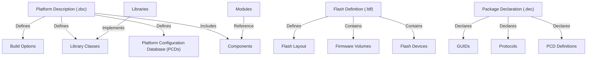

Key files:
- **DSC (Platform Description)**: Defines the platform characteristics, libraries, and components to build
- **FDF (Flash Definition)**: Defines the flash device layout and firmware volumes
- **DEC (Package Declaration)**: Declares the package information, including GUIDs, protocols, and PCDs

Sources: [OvmfPkg/OvmfPkgX64.dsc:1-137](), [OvmfPkg/OvmfPkgX64.fdf:1-40](), [UefiPayloadPkg/UefiPayloadPkg.dec]()

## Platform Initialization Flow

All platforms in EDK II follow the UEFI platform initialization specification, with phases that initialize the system from reset to OS handoff:

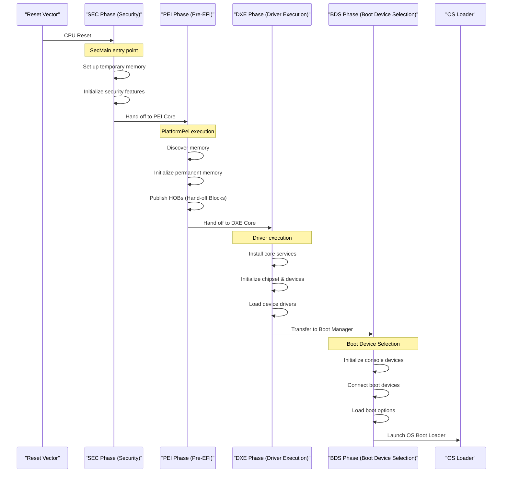

While all platforms follow this flow, each platform provides its own specific implementations for certain components, particularly in the early SEC and PEI phases where hardware initialization occurs.

Sources: [OvmfPkg/Sec/SecMain.inf](), [OvmfPkg/PlatformPei/PlatformPei.inf](), [ArmVirtPkg/MemoryInitPei/MemoryInitPeim.inf]()

## OVMF (Open Virtual Machine Firmware)

The Open Virtual Machine Firmware (OVMF) platform is designed to provide UEFI support for virtual machines. It's the most extensive platform in EDK II with multiple variants for different virtualization technologies and security features.

### OVMF Architecture Variants

| Variant | Description | Key Features |
|---------|-------------|-------------|
| OvmfPkgX64 | 64-bit x86 | Standard OVMF for 64-bit VMs |
| OvmfPkgIa32 | 32-bit x86 | Legacy 32-bit support |
| OvmfPkgIa32X64 | Dual architecture | Supports both 32-bit and 64-bit |

Each variant is defined in its own DSC file which specifies the supported architectures and components to include.

Sources: [OvmfPkg/OvmfPkgX64.dsc:17-27](), [OvmfPkg/OvmfPkgIa32.dsc:17-27](), [OvmfPkg/OvmfPkgIa32X64.dsc:17-27]()

### OVMF Hypervisor Variants

OVMF supports several hypervisors, each with specific optimizations:

| Variant | Target Hypervisor | Notes |
|---------|-------------------|-------|
| Standard OVMF | QEMU/KVM | Primary development target |
| OvmfXen | Xen | Optimized for Xen hypervisor |
| BhyveX64 | bhyve | FreeBSD's hypervisor |
| MicrovmX64 | Microvm | Lightweight VMs |
| CloudHvX64 | Cloud Hypervisor | Rust-based hypervisor |

The hypervisor-specific variants implement platform services appropriate for each virtualization technology.

Sources: [OvmfPkg/OvmfXen.dsc:17-27](), [OvmfPkg/Bhyve/BhyveX64.dsc:17-27](), [OvmfPkg/Microvm/MicrovmX64.dsc:17-27](), [OvmfPkg/CloudHv/CloudHvX64.dsc:17-27]()

### OVMF Security Extension Variants

OVMF has variants specifically designed for confidential computing technologies:

| Variant | Security Technology | Features |
|---------|---------------------|----------|
| AmdSevX64 | AMD SEV (Secure Encrypted Virtualization) | Memory encryption, attestation, secret injection |
| IntelTdxX64 | Intel TDX (Trust Domain Extensions) | Protected VM execution, attestation |

These variants include specialized libraries and modules to interact with the security features provided by the hardware.

Sources: [OvmfPkg/AmdSev/AmdSevX64.dsc:17-68](), [OvmfPkg/IntelTdx/IntelTdxX64.dsc]()

## ArmVirtPkg (ARM Virtual Platforms)

The ArmVirtPkg provides UEFI firmware implementations for ARM-based virtual machines. It supports several hypervisors and configurations.

### ArmVirt Variants

| Variant | Description | Key Features |
|---------|-------------|-------------|
| ArmVirtQemu | Standard ARM VM for QEMU | Full UEFI implementation |
| ArmVirtQemuKernel | Direct kernel loading | Optimized for direct kernel boot |
| ArmVirtXen | Xen on ARM | Xen hypervisor support |
| ArmVirtKvmTool | KVM tools for ARM | KVM virtualization support |

All ARM virtual platforms share common code through `ArmVirt.dsc.inc`, which defines shared libraries and components.

Sources: [ArmVirtPkg/ArmVirtQemu.dsc:15-45](), [ArmVirtPkg/ArmVirtQemuKernel.dsc:15-42](), [ArmVirtPkg/ArmVirtXen.dsc](), [ArmVirtPkg/ArmVirt.dsc.inc:11-36]()

### ArmVirt Architecture Characteristics

The ArmVirt platform supports both 32-bit ARM and 64-bit AArch64 architectures. Key features include:

- Device Tree support for hardware discovery
- PSCI (Power State Coordination Interface) for power management
- ARM GIC (Generic Interrupt Controller) support
- Virtio device support
- PCI support via the ECAM (Enhanced Configuration Access Mechanism)

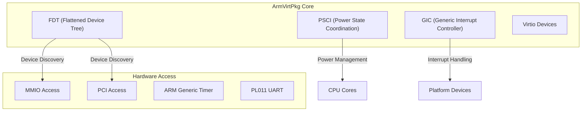

Sources: [ArmVirtPkg/ArmVirtQemu.dsc:56-83](), [ArmVirtPkg/Library/QemuVirtMemInfoLib/QemuVirtMemInfoLib.inf]()

## UefiPayloadPkg

The UefiPayloadPkg is designed to provide UEFI environment as a payload for other bootloaders, rather than functioning as a complete firmware solution itself.

### UefiPayload Characteristics

| Feature | Description |
|---------|-------------|
| Purpose | UEFI payload for bootloaders like coreboot or Slim Bootloader |
| Target Architectures | IA32, X64 |
| Memory Model | Uses bootloader-provided memory map |
| Device Discovery | Relies on bootloader-provided device information |

Unlike OVMF or ArmVirtPkg, which initialize hardware from scratch, UefiPayloadPkg relies on the bootloader's initialization and handoff information.

Sources: [UefiPayloadPkg/UefiPayloadPkg.dsc:17-58]()

### UefiPayload Boot Flow

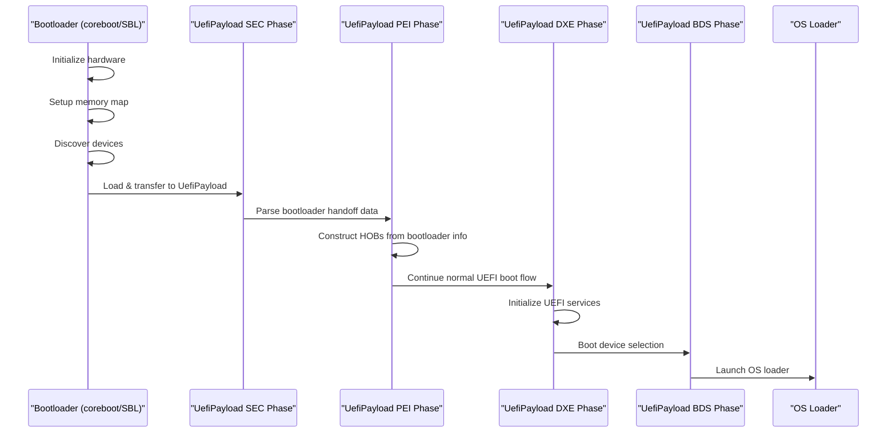

The key difference is that UefiPayloadPkg does not perform low-level hardware initialization, instead using the information provided by the bootloader.

Sources: [UefiPayloadPkg/UefiPayloadPkg.dsc:287-325]()

## Platform Configuration Options

Each platform provides build-time configuration options that can be customized to enable or disable specific features. Common platform configuration options include:

| Option | Description | Availability |
|--------|-------------|--------------|
| SECURE_BOOT_ENABLE | Enable UEFI Secure Boot | OVMF, ArmVirt |
| SMM_REQUIRE | Enable System Management Mode | OVMF (x86 only) |
| SOURCE_DEBUG_ENABLE | Enable source-level debugging | All platforms |
| NETWORK_TLS_ENABLE | Enable TLS for network stack | All platforms |
| NETWORK_IP6_ENABLE | Enable IPv6 support | All platforms |
| TPM_ENABLE | Enable TPM support | OVMF, ArmVirt |
| FD_SIZE_IN_KB | Control flash device size | OVMF, ArmVirt |

These options are typically defined in the platform DSC file and can be set using `-D` flags when building.

Sources: [OvmfPkg/OvmfPkgX64.dsc:32-36](), [ArmVirtPkg/ArmVirtQemu.dsc:29-36](), [UefiPayloadPkg/UefiPayloadPkg.dsc:29-47]()

## Platform Selection Guide

When choosing a platform for a specific use case, consider the following factors:

1. **Hardware Architecture**:
   - x86 (32/64-bit): Use OvmfPkg variants
   - ARM: Use ArmVirtPkg variants
   - Bootloader integration: Use UefiPayloadPkg

2. **Virtualization Technology**:
   - QEMU/KVM: Standard OVMF or ArmVirtQemu
   - Xen: OvmfXen or ArmVirtXen
   - bhyve: BhyveX64
   - Microvm/Cloud Hypervisor: MicrovmX64 or CloudHvX64

3. **Security Requirements**:
   - AMD SEV: AmdSevX64
   - Intel TDX: IntelTdxX64
   - Secure Boot: Any platform with SECURE_BOOT_ENABLE=TRUE

4. **Special Requirements**:
   - Direct kernel boot: ArmVirtQemuKernel
   - Bootloader payload: UefiPayloadPkg
   - SMM support: OVMF with SMM_REQUIRE=TRUE

Sources: [OvmfPkg/OvmfPkgX64.dsc](), [ArmVirtPkg/ArmVirtQemu.dsc](), [UefiPayloadPkg/UefiPayloadPkg.dsc]()

## Common Platform Components

While each platform has unique characteristics, they share many common components:

| Component Type | Description | Examples |
|----------------|-------------|----------|
| Core Components | Standard UEFI services | DxeCore, PeiCore, SecurityStubDxe |
| Platform-specific Drivers | Platform hardware drivers | QemuVideoDxe, XenBusDxe, VirtioBlkDxe |
| Console Support | User interface drivers | ConPlatformDxe, GraphicsConsoleDxe, TerminalDxe |
| Boot Support | Boot management | BdsDxe, UefiBootManagerLib |
| Platform Libraries | Hardware abstraction | PlatformBootManagerLib, QemuFwCfgLib, ArmVirtMemInfoLib |

Each platform provides specialized implementations of these components tailored to its unique environment.

Sources: [OvmfPkg/OvmfPkgX64.dsc:720-803](), [ArmVirtPkg/ArmVirtQemu.dsc:333-472](), [UefiPayloadPkg/UefiPayloadPkg.dsc:643-698]()

---

# Page: OVMF Platform (x86/x64 Virtual Machines)

# OVMF Platform (x86/x64 Virtual Machines)

<details>
<summary>Relevant source files</summary>

The following files were used as context for generating this wiki page:

- [OvmfPkg/AmdSev/AmdSevX64.dsc](OvmfPkg/AmdSev/AmdSevX64.dsc)
- [OvmfPkg/AmdSev/AmdSevX64.fdf](OvmfPkg/AmdSev/AmdSevX64.fdf)
- [OvmfPkg/Bhyve/BhyveDefines.fdf.inc](OvmfPkg/Bhyve/BhyveDefines.fdf.inc)
- [OvmfPkg/Bhyve/BhyveX64.dsc](OvmfPkg/Bhyve/BhyveX64.dsc)
- [OvmfPkg/Bhyve/BhyveX64.fdf](OvmfPkg/Bhyve/BhyveX64.fdf)
- [OvmfPkg/CloudHv/CloudHvDefines.fdf.inc](OvmfPkg/CloudHv/CloudHvDefines.fdf.inc)
- [OvmfPkg/CloudHv/CloudHvX64.dsc](OvmfPkg/CloudHv/CloudHvX64.dsc)
- [OvmfPkg/CloudHv/CloudHvX64.fdf](OvmfPkg/CloudHv/CloudHvX64.fdf)
- [OvmfPkg/Include/Fdf/FvmainCompactScratchEnd.fdf.inc](OvmfPkg/Include/Fdf/FvmainCompactScratchEnd.fdf.inc)
- [OvmfPkg/Include/Fdf/OvmfPkgDefines.fdf.inc](OvmfPkg/Include/Fdf/OvmfPkgDefines.fdf.inc)
- [OvmfPkg/Include/Fdf/VarStore.fdf.inc](OvmfPkg/Include/Fdf/VarStore.fdf.inc)
- [OvmfPkg/Include/Fdf/XenElfHeader.fdf.inc](OvmfPkg/Include/Fdf/XenElfHeader.fdf.inc)
- [OvmfPkg/Include/Library/PlatformInitLib.h](OvmfPkg/Include/Library/PlatformInitLib.h)
- [OvmfPkg/Include/TdxCommondefs.inc](OvmfPkg/Include/TdxCommondefs.inc)
- [OvmfPkg/Include/WorkArea.h](OvmfPkg/Include/WorkArea.h)
- [OvmfPkg/IntelTdx/IntelTdxX64.dsc](OvmfPkg/IntelTdx/IntelTdxX64.dsc)
- [OvmfPkg/IntelTdx/IntelTdxX64.fdf](OvmfPkg/IntelTdx/IntelTdxX64.fdf)
- [OvmfPkg/IntelTdx/Sec/SecMain.c](OvmfPkg/IntelTdx/Sec/SecMain.c)
- [OvmfPkg/IntelTdx/Sec/SecMain.inf](OvmfPkg/IntelTdx/Sec/SecMain.inf)
- [OvmfPkg/IntelTdx/Sec/X64/IntelTdxAPs.nasm](OvmfPkg/IntelTdx/Sec/X64/IntelTdxAPs.nasm)
- [OvmfPkg/IntelTdx/Sec/X64/SecEntry.nasm](OvmfPkg/IntelTdx/Sec/X64/SecEntry.nasm)
- [OvmfPkg/IntelTdx/TdxHelperLib/SecTdxHelper.c](OvmfPkg/IntelTdx/TdxHelperLib/SecTdxHelper.c)
- [OvmfPkg/IntelTdx/TdxHelperLib/SecTdxHelperLib.inf](OvmfPkg/IntelTdx/TdxHelperLib/SecTdxHelperLib.inf)
- [OvmfPkg/IntelTdx/TdxHelperLib/TdxMeasurementHob.c](OvmfPkg/IntelTdx/TdxHelperLib/TdxMeasurementHob.c)
- [OvmfPkg/Library/PeilessStartupLib/Hob.c](OvmfPkg/Library/PeilessStartupLib/Hob.c)
- [OvmfPkg/Library/PeilessStartupLib/PeilessStartup.c](OvmfPkg/Library/PeilessStartupLib/PeilessStartup.c)
- [OvmfPkg/Library/PeilessStartupLib/PeilessStartupInternal.h](OvmfPkg/Library/PeilessStartupLib/PeilessStartupInternal.h)
- [OvmfPkg/Library/PeilessStartupLib/PeilessStartupLib.inf](OvmfPkg/Library/PeilessStartupLib/PeilessStartupLib.inf)
- [OvmfPkg/Library/PlatformInitLib/IntelTdx.c](OvmfPkg/Library/PlatformInitLib/IntelTdx.c)
- [OvmfPkg/Library/PlatformInitLib/IntelTdxNull.c](OvmfPkg/Library/PlatformInitLib/IntelTdxNull.c)
- [OvmfPkg/Library/PlatformInitLib/MemDetect.c](OvmfPkg/Library/PlatformInitLib/MemDetect.c)
- [OvmfPkg/Library/PlatformInitLib/Platform.c](OvmfPkg/Library/PlatformInitLib/Platform.c)
- [OvmfPkg/Library/PlatformInitLib/PlatformInitLib.inf](OvmfPkg/Library/PlatformInitLib/PlatformInitLib.inf)
- [OvmfPkg/Library/SmmCpuFeaturesLib/SmmCpuFeaturesLib.c](OvmfPkg/Library/SmmCpuFeaturesLib/SmmCpuFeaturesLib.c)
- [OvmfPkg/Library/SmmCpuFeaturesLib/SmmCpuFeaturesLib.inf](OvmfPkg/Library/SmmCpuFeaturesLib/SmmCpuFeaturesLib.inf)
- [OvmfPkg/Library/TdxMailboxLib/TdxMailbox.c](OvmfPkg/Library/TdxMailboxLib/TdxMailbox.c)
- [OvmfPkg/Library/TdxMailboxLib/TdxMailboxLib.inf](OvmfPkg/Library/TdxMailboxLib/TdxMailboxLib.inf)
- [OvmfPkg/Library/TdxMailboxLib/TdxMailboxLibNull.inf](OvmfPkg/Library/TdxMailboxLib/TdxMailboxLibNull.inf)
- [OvmfPkg/Microvm/MicrovmX64.dsc](OvmfPkg/Microvm/MicrovmX64.dsc)
- [OvmfPkg/Microvm/MicrovmX64.fdf](OvmfPkg/Microvm/MicrovmX64.fdf)
- [OvmfPkg/OvmfPkg.dec](OvmfPkg/OvmfPkg.dec)
- [OvmfPkg/OvmfPkgIa32.dsc](OvmfPkg/OvmfPkgIa32.dsc)
- [OvmfPkg/OvmfPkgIa32.fdf](OvmfPkg/OvmfPkgIa32.fdf)
- [OvmfPkg/OvmfPkgIa32X64.dsc](OvmfPkg/OvmfPkgIa32X64.dsc)
- [OvmfPkg/OvmfPkgIa32X64.fdf](OvmfPkg/OvmfPkgIa32X64.fdf)
- [OvmfPkg/OvmfPkgX64.dsc](OvmfPkg/OvmfPkgX64.dsc)
- [OvmfPkg/OvmfPkgX64.fdf](OvmfPkg/OvmfPkgX64.fdf)
- [OvmfPkg/OvmfXen.dsc](OvmfPkg/OvmfXen.dsc)
- [OvmfPkg/OvmfXen.fdf](OvmfPkg/OvmfXen.fdf)
- [OvmfPkg/PlatformPei/AmdSev.c](OvmfPkg/PlatformPei/AmdSev.c)
- [OvmfPkg/PlatformPei/ClearCache.c](OvmfPkg/PlatformPei/ClearCache.c)
- [OvmfPkg/PlatformPei/FeatureControl.c](OvmfPkg/PlatformPei/FeatureControl.c)
- [OvmfPkg/PlatformPei/Fv.c](OvmfPkg/PlatformPei/Fv.c)
- [OvmfPkg/PlatformPei/IntelTdx.c](OvmfPkg/PlatformPei/IntelTdx.c)
- [OvmfPkg/PlatformPei/MemDetect.c](OvmfPkg/PlatformPei/MemDetect.c)
- [OvmfPkg/PlatformPei/MemTypeInfo.c](OvmfPkg/PlatformPei/MemTypeInfo.c)
- [OvmfPkg/PlatformPei/Platform.c](OvmfPkg/PlatformPei/Platform.c)
- [OvmfPkg/PlatformPei/Platform.h](OvmfPkg/PlatformPei/Platform.h)
- [OvmfPkg/PlatformPei/PlatformPei.inf](OvmfPkg/PlatformPei/PlatformPei.inf)
- [OvmfPkg/ResetVector/Ia16/ResetVectorVtf0.asm](OvmfPkg/ResetVector/Ia16/ResetVectorVtf0.asm)
- [OvmfPkg/ResetVector/Ia32/AmdSev.asm](OvmfPkg/ResetVector/Ia32/AmdSev.asm)
- [OvmfPkg/ResetVector/Ia32/Flat32ToFlat64.asm](OvmfPkg/ResetVector/Ia32/Flat32ToFlat64.asm)
- [OvmfPkg/ResetVector/Ia32/IntelTdx.asm](OvmfPkg/ResetVector/Ia32/IntelTdx.asm)
- [OvmfPkg/ResetVector/Ia32/PageTables64.asm](OvmfPkg/ResetVector/Ia32/PageTables64.asm)
- [OvmfPkg/ResetVector/Main.asm](OvmfPkg/ResetVector/Main.asm)
- [OvmfPkg/ResetVector/ResetVector.inf](OvmfPkg/ResetVector/ResetVector.inf)
- [OvmfPkg/ResetVector/ResetVector.nasmb](OvmfPkg/ResetVector/ResetVector.nasmb)
- [OvmfPkg/ResetVector/X64/IntelTdxMetadata.asm](OvmfPkg/ResetVector/X64/IntelTdxMetadata.asm)
- [OvmfPkg/ResetVector/X64/OvmfSevMetadata.asm](OvmfPkg/ResetVector/X64/OvmfSevMetadata.asm)
- [OvmfPkg/Sec/AmdSev.c](OvmfPkg/Sec/AmdSev.c)
- [OvmfPkg/Sec/AmdSev.h](OvmfPkg/Sec/AmdSev.h)
- [OvmfPkg/Sec/SecMain.c](OvmfPkg/Sec/SecMain.c)
- [OvmfPkg/Sec/SecMain.inf](OvmfPkg/Sec/SecMain.inf)
- [OvmfPkg/Sec/X64/SecEntry.nasm](OvmfPkg/Sec/X64/SecEntry.nasm)
- [SecurityPkg/Tcg/TdTcg2Dxe/MeasureBootPeCoff.c](SecurityPkg/Tcg/TdTcg2Dxe/MeasureBootPeCoff.c)
- [SecurityPkg/Tcg/TdTcg2Dxe/TdTcg2Dxe.inf](SecurityPkg/Tcg/TdTcg2Dxe/TdTcg2Dxe.inf)

</details>


OVMF (Open Virtual Machine Firmware) is an implementation of the UEFI (Unified Extensible Firmware Interface) specification designed specifically for x86 and x64 virtual machines. It provides a UEFI environment that enables modern operating systems to boot in virtual machines using the UEFI boot process rather than legacy BIOS methods. This document explains the architecture, components, and functionality of the OVMF platform within the EDK II ecosystem.

For information about ARM virtual platforms, see [ARM Virtual Platform](#3.2).

## OVMF Overview

OVMF is designed to run on various hypervisors, with QEMU being the primary target. It supports multiple processor architectures (IA32, X64, and mixed IA32/X64) and offers a range of platform variants optimized for specific virtualization technologies like AMD SEV, Intel TDX, Xen, Bhyve, and microVMs.

### Platform Variations

OVMF supports several platform configurations, each defined by a specific DSC (Platform Description) file:

| Platform Variant | DSC File | Target Environment |
|-----------------|----------|-------------------|
| X64 | OvmfPkgX64.dsc | 64-bit x86 virtual machines |
| IA32 | OvmfPkgIa32.dsc | 32-bit x86 virtual machines |
| IA32/X64 | OvmfPkgIa32X64.dsc | Mixed 32/64-bit environments |
| Xen | OvmfXen.dsc | Xen-based virtual machines |
| AMD SEV | AmdSev/AmdSevX64.dsc | AMD Secure Encrypted Virtualization |
| Bhyve | Bhyve/BhyveX64.dsc | FreeBSD Bhyve hypervisor |
| CloudHv | CloudHv/CloudHvX64.dsc | Cloud hypervisor VMs |
| Microvm | Microvm/MicrovmX64.dsc | Lightweight microVMs |
| Intel TDX | IntelTdx/IntelTdxX64.dsc | Intel Trust Domain Extensions |

Sources: [OvmfPkg/OvmfPkgX64.dsc](), [OvmfPkg/OvmfPkgIa32.dsc](), [OvmfPkg/OvmfPkgIa32X64.dsc](), [OvmfPkg/OvmfXen.dsc](), [OvmfPkg/AmdSev/AmdSevX64.dsc](), [OvmfPkg/Bhyve/BhyveX64.dsc](), [OvmfPkg/CloudHv/CloudHvX64.dsc](), [OvmfPkg/Microvm/MicrovmX64.dsc](), [OvmfPkg/IntelTdx/IntelTdxX64.dsc]()

## OVMF Architecture

### UEFI Boot Flow in OVMF

OVMF follows the standard UEFI boot flow with platform-specific adaptations for virtualized environments.

#### OVMF Boot Flow Diagram

```mermaid
sequenceDiagram
    participant "Reset Vector" as Reset
    participant "SEC Phase" as SEC
    participant "PEI Phase" as PEI
    participant "DXE Phase" as DXE
    participant "BDS Phase" as BDS
    participant "OS Loader" as OS

    Reset->>SEC: CPU Reset
    Note over SEC: SecMain in OvmfPkg/Sec/SecMain.c<br>Basic CPU initialization<br>Temporary memory setup
    
    SEC->>PEI: Hand off to PEI Core
    Note over PEI: PlatformPei in OvmfPkg/PlatformPei/Platform.c<br>Memory detection<br>CPU initialization<br>Host bridge setup
    
    PEI->>DXE: Hand off to DXE Core
    Note over DXE: Driver initialization<br>Protocol installation<br>Device detection
    
    DXE->>BDS: Transfer to BDS
    Note over BDS: Boot device selection<br>Console setup<br>Boot option processing
    
    BDS->>OS: Launch OS Loader
```

Sources: [OvmfPkg/Sec/SecMain.c](), [OvmfPkg/PlatformPei/Platform.c]()

### Memory Map and Layout

OVMF organizes its firmware in memory using multiple firmware volumes (FVs):

```mermaid
graph TD
    subgraph "OVMF Memory Layout"
        SECFV["SEC FV (SecMain)<br>Reset Vector, SEC phase code"]
        PEIFV["PEI FV<br>Platform initialization"]
        DXEFV["DXE FV<br>Driver execution environment"]
        VARSTORE["Variable Store<br>UEFI variables storage"]
    end

    RESET[/"Reset Vector"/] --> SECFV
    SECFV --> PEIFV
    PEIFV --> DXEFV
    DXEFV --> OS[/"OS Loader"/]

    VARSTORE -.-> DXEFV
```

Sources: [OvmfPkg/OvmfPkgX64.fdf]()

## Platform Initialization Process

The platform initialization process in OVMF is primarily handled by the `PlatformPei` module, which performs various initialization tasks during the PEI phase.

### Initialization Flow

```mermaid
flowchart TD
    start["CPU Reset"] --> SecMain["SEC: SecMain"]
    SecMain --> PlatformPei["PEI: InitializePlatform()"]
    
    PlatformPei --> BuildPlatformInfoHob["Build Platform Info HOB"]
    BuildPlatformInfoHob --> BootModeInit["Boot Mode Initialization"]
    BootModeInit --> HostBridgeDetect["Detect Host Bridge (I440FX/Q35)"]
    HostBridgeDetect --> AddrWidthInit["Address Width Initialization"]
    AddrWidthInit --> MaxCpuInit["Max CPU Count Initialization"]
    
    MaxCpuInit --> SmmCheck{"SMM Required?"}
    SmmCheck -->|Yes| Q35Check["Q35 Board Verification"]
    SmmCheck -->|No| MemPublish["Publish PEI Memory"]
    Q35Check --> TsegInit["Q35 TSEG Initialization"]
    TsegInit --> SmramInit["SMRAM Initialization"]
    SmramInit --> MemPublish
    
    MemPublish --> RamInit["Initialize RAM Regions"]
    RamInit --> BootCheck{"Boot Mode?"}
    BootCheck -->|Normal Boot| VarStore["Reserve Variable Storage"]
    BootCheck -->|S3 Resume| S3Path["S3 Resume Path"]
    VarStore --> FvInit["PEI FV Initialization"]
    S3Path --> Cleanup["Install Callbacks"]
    FvInit --> MemTypeInit["Memory Type Initialization"]
    MemTypeInit --> MemMapInit["Memory Map Initialization"]
    MemMapInit --> NoexecInit["No-Execute DXE Initialization"]
    NoexecInit --> Cleanup
    
    Cleanup --> AmdSevInit["AMD SEV Initialization"]
    AmdSevInit --> MiscInit["Miscellaneous Initialization"]
    MiscInit --> TdxInit["Intel TDX Initialization"]
    TdxInit --> InstallFCCallback["Install Feature Control Callback"]
    InstallFCCallback --> end["End PEI Phase"]
```

Sources: [OvmfPkg/PlatformPei/Platform.c:300-372]()

### Host Bridge Detection

OVMF supports two main host bridge types, which are detected during platform initialization:

1. **I440FX**: The traditional QEMU chipset, based on the Intel 440FX chipset
2. **Q35**: More modern chipset with PCIe support, based on the Intel Q35 MCH

The host bridge detection is performed by reading the PCI device ID:

```mermaid
flowchart TD
    InitPlatform["InitializePlatform()"] --> ReadDID["Read Host Bridge Device ID"]
    ReadDID --> CheckID{"Device ID?"}
    CheckID -->|0x8086_1237| I440FX["Legacy I440FX Chipset<br>(Simple PCI)"]
    CheckID -->|0x8086_29C0| Q35["Modern Q35 Chipset<br>(PCIe Support)"]
    CheckID -->|0xFFFF| Microvm["Microvm Environment<br>(Minimalist Interface)"]
```

Sources: [OvmfPkg/PlatformPei/Platform.c:332]()

### Memory Detection Process

Memory detection in OVMF is a critical part of platform initialization. The algorithm differs based on the hypervisor and platform type:

```mermaid
flowchart TD
    MemDetect["Memory Detection"] --> QemuCheck{"QEMU fw_cfg<br>Available?"}
    QemuCheck -->|Yes| QemuPath["Query Memory Map<br>from QEMU fw_cfg"]
    QemuCheck -->|No| LegacyPath["Use E820 or<br>Platform-Specific Method"]
    
    QemuPath --> HobCreation["Create Memory Resource HOBs"]
    LegacyPath --> HobCreation
    
    HobCreation --> ConfigMem["Configure Memory Regions"]
    ConfigMem --> AddressWidth["Set Physical Address Width"]
    AddressWidth --> MemRegions["Define Memory Regions<br>for SMRAM, PCI MMIO, etc."]
```

Sources: [OvmfPkg/PlatformPei/MemDetect.c](), [OvmfPkg/Library/PlatformInitLib/MemDetect.c]()

## Security Features

OVMF includes support for several advanced security technologies depending on the platform variant.

### Confidential Computing Features

```mermaid
graph TD
    subgraph "OVMF Security Features"
        direction TB
        
        SMM["System Management Mode (SMM)<br>Secure system management operations"]
        SEV["AMD SEV<br>Secure Encrypted Virtualization"]
        TDX["Intel TDX<br>Trust Domain Extensions"]
        
        subgraph "SEV Features"
            SEV_ES["SEV-ES<br>Encrypted State"]
            SEV_SNP["SEV-SNP<br>Secure Nested Paging"]
        end
        
        SEV --> SEV_ES
        SEV --> SEV_SNP
    end
    
    HOST["Hypervisor/Host"]
    GUEST["Guest OS"]
    
    HOST --> |"Isolation"| SMM
    HOST --> |"Memory Encryption"| SEV
    HOST --> |"Trust Domain"| TDX
    
    SMM --> GUEST
    SEV --> GUEST
    TDX --> GUEST
```

Sources: [OvmfPkg/PlatformPei/AmdSev.c](), [OvmfPkg/PlatformPei/IntelTdx.c]()

### AMD SEV Support

AMD SEV (Secure Encrypted Virtualization) provides memory encryption for virtual machines, protecting VM data from the hypervisor. OVMF includes support for AMD SEV through:

1. SEV detection during platform initialization
2. Configuration of memory encryption
3. Implementation of secret injection and attestation mechanisms

The `AmdSev.c` module initializes SEV support during the PEI phase, setting up encrypted memory and configuring platform components for SEV operation.

Sources: [OvmfPkg/PlatformPei/AmdSev.c](), [OvmfPkg/AmdSev/AmdSevX64.dsc]()

### Intel TDX Support

Intel TDX (Trust Domain Extensions) provides hardware-based isolation of virtual machines. OVMF's TDX support includes:

1. TDX detection during platform initialization
2. Configuration of secure memory regions
3. Implementation of TDX-specific interfaces

Sources: [OvmfPkg/PlatformPei/IntelTdx.c](), [OvmfPkg/IntelTdx/IntelTdxX64.dsc]()

## Hypervisor Integration

OVMF integrates with various hypervisors through specialized interfaces and protocols.

### QEMU Integration

```mermaid
graph TD
    OVMF["OVMF Firmware"] --> FwCfg["fw_cfg Interface<br>Configuration & data exchange"]
    OVMF --> MMIO["MMIO Device Access"]
    OVMF --> VirtIO["VirtIO Devices"]
    
    FwCfg --> QemuFwCfgLib["QemuFwCfgLib<br>Firmware configuration access"]
    MMIO --> MemoryMap["Memory-mapped Device Access"]
    VirtIO --> VirtioLib["VirtioLib<br>VirtIO device support"]
    
    QemuFwCfgLib --> QEMU["QEMU Hypervisor"]
    MemoryMap --> QEMU
    VirtioLib --> QEMU
```

Sources: [OvmfPkg/Library/QemuFwCfgLib/QemuFwCfgDxeLib.inf](), [OvmfPkg/Library/VirtioLib/VirtioLib.inf]()

### Other Hypervisor Support

OVMF includes support for various other hypervisors through specialized platform variants:

1. **Xen Support**: Implemented in the OvmfXen platform variant, using Xen-specific interfaces
2. **Bhyve Support**: Implemented in the BhyveX64 platform variant
3. **MicroVM Support**: Lightweight VM support implemented in the MicrovmX64 platform variant

## Build Configuration Options

OVMF can be built with various configuration options to enable or disable features:

| Option | Description | Default |
|--------|-------------|---------|
| `SECURE_BOOT_ENABLE` | Enable UEFI Secure Boot support | FALSE |
| `SMM_REQUIRE` | Enable System Management Mode support | FALSE |
| `SOURCE_DEBUG_ENABLE` | Enable source-level debugging | FALSE |
| `NETWORK_TLS_ENABLE` | Enable TLS support for networking | FALSE |
| `NETWORK_IP6_ENABLE` | Enable IPv6 support | FALSE |
| `FD_SIZE_IN_KB` | Flash device size in KB | 4096 |
| `BUILD_SHELL` | Include UEFI shell | TRUE |

Sources: [OvmfPkg/OvmfPkgX64.dsc:32-79]()

### Flash Memory Layout

OVMF organizes its firmware in a flash memory layout defined by the FDF (Flash Description File):

```mermaid
graph TD
    subgraph "OVMF Flash Layout"
        direction TB
        
        VARS["Variable Store<br>UEFI Variables"]
        MAIN["FVMAIN_COMPACT<br>Main Firmware Volume"]
        SEC["SECFV<br>SEC Phase Code"]
    end
    
    VARS --> MAIN
    MAIN --> SEC
```

The flash layout can be built in two ways:
1. **Single flash device**: Variables and firmware in one image
2. **Split flash device**: Variables in `OVMF_VARS.fd` and firmware in `OVMF_CODE.fd`

Sources: [OvmfPkg/OvmfPkgX64.fdf:20-59]()

## Library Components

OVMF includes several specialized libraries for platform-specific functionality:

| Library | Purpose | 
|---------|---------|
| `QemuFwCfgLib` | Interface to QEMU firmware configuration |
| `MemEncryptSevLib` | AMD SEV memory encryption support |
| `MemEncryptTdxLib` | Intel TDX memory encryption support |
| `PlatformInitLib` | Platform initialization routines |
| `ResetSystemLib` | System reset functionality |
| `QemuBootOrderLib` | QEMU boot order handling |
| `VirtioLib` | VirtIO device support |
| `XenHypercallLib` | Xen hypercall support |

Sources: [OvmfPkg/OvmfPkg.dec:22-146]()

## Conclusion

The OVMF platform provides a complete UEFI implementation for virtual machines on x86 and x64 platforms. It supports a wide range of hypervisors and includes advanced features like AMD SEV and Intel TDX for confidential computing. The modular architecture and extensive configuration options make it adaptable to various virtualization environments and use cases.

---

# Page: ARM Virtual Platform

# ARM Virtual Platform

<details>
<summary>Relevant source files</summary>

The following files were used as context for generating this wiki page:

- [ArmPkg/Drivers/ArmPciCpuIo2Dxe/ArmPciCpuIo2Dxe.inf](ArmPkg/Drivers/ArmPciCpuIo2Dxe/ArmPciCpuIo2Dxe.inf)
- [ArmVirtPkg/ArmVirt.dsc.inc](ArmVirtPkg/ArmVirt.dsc.inc)
- [ArmVirtPkg/ArmVirtCloudHv.dsc](ArmVirtPkg/ArmVirtCloudHv.dsc)
- [ArmVirtPkg/ArmVirtCloudHv.fdf](ArmVirtPkg/ArmVirtCloudHv.fdf)
- [ArmVirtPkg/ArmVirtKvmTool.dsc](ArmVirtPkg/ArmVirtKvmTool.dsc)
- [ArmVirtPkg/ArmVirtKvmTool.fdf](ArmVirtPkg/ArmVirtKvmTool.fdf)
- [ArmVirtPkg/ArmVirtPkg.dec](ArmVirtPkg/ArmVirtPkg.dec)
- [ArmVirtPkg/ArmVirtQemu.dsc](ArmVirtPkg/ArmVirtQemu.dsc)
- [ArmVirtPkg/ArmVirtQemu.fdf](ArmVirtPkg/ArmVirtQemu.fdf)
- [ArmVirtPkg/ArmVirtQemuFvMain.fdf.inc](ArmVirtPkg/ArmVirtQemuFvMain.fdf.inc)
- [ArmVirtPkg/ArmVirtQemuKernel.dsc](ArmVirtPkg/ArmVirtQemuKernel.dsc)
- [ArmVirtPkg/ArmVirtQemuKernel.fdf](ArmVirtPkg/ArmVirtQemuKernel.fdf)
- [ArmVirtPkg/ArmVirtRules.fdf.inc](ArmVirtPkg/ArmVirtRules.fdf.inc)
- [ArmVirtPkg/ArmVirtXen.dsc](ArmVirtPkg/ArmVirtXen.dsc)
- [ArmVirtPkg/ArmVirtXen.fdf](ArmVirtPkg/ArmVirtXen.fdf)
- [ArmVirtPkg/CloudHvAcpiPlatformDxe/CloudHvAcpi.c](ArmVirtPkg/CloudHvAcpiPlatformDxe/CloudHvAcpi.c)
- [ArmVirtPkg/CloudHvAcpiPlatformDxe/CloudHvAcpiPlatformDxe.inf](ArmVirtPkg/CloudHvAcpiPlatformDxe/CloudHvAcpiPlatformDxe.inf)
- [ArmVirtPkg/CloudHvPlatformHasAcpiDtDxe/CloudHvHasAcpiDtDxe.c](ArmVirtPkg/CloudHvPlatformHasAcpiDtDxe/CloudHvHasAcpiDtDxe.c)
- [ArmVirtPkg/CloudHvPlatformHasAcpiDtDxe/CloudHvHasAcpiDtDxe.inf](ArmVirtPkg/CloudHvPlatformHasAcpiDtDxe/CloudHvHasAcpiDtDxe.inf)
- [ArmVirtPkg/Include/Guid/Early16550UartBaseAddress.h](ArmVirtPkg/Include/Guid/Early16550UartBaseAddress.h)
- [ArmVirtPkg/KvmtoolPlatformDxe/KvmtoolPlatformDxe.c](ArmVirtPkg/KvmtoolPlatformDxe/KvmtoolPlatformDxe.c)
- [ArmVirtPkg/KvmtoolPlatformDxe/KvmtoolPlatformDxe.inf](ArmVirtPkg/KvmtoolPlatformDxe/KvmtoolPlatformDxe.inf)
- [ArmVirtPkg/Library/ArmVirtPsciResetSystemPeiLib/ArmVirtPsciResetSystemPeiLib.c](ArmVirtPkg/Library/ArmVirtPsciResetSystemPeiLib/ArmVirtPsciResetSystemPeiLib.c)
- [ArmVirtPkg/Library/ArmVirtPsciResetSystemPeiLib/ArmVirtPsciResetSystemPeiLib.inf](ArmVirtPkg/Library/ArmVirtPsciResetSystemPeiLib/ArmVirtPsciResetSystemPeiLib.inf)
- [ArmVirtPkg/Library/KvmtoolRtcFdtClientLib/KvmtoolRtcFdtClientLib.c](ArmVirtPkg/Library/KvmtoolRtcFdtClientLib/KvmtoolRtcFdtClientLib.c)
- [ArmVirtPkg/Library/KvmtoolRtcFdtClientLib/KvmtoolRtcFdtClientLib.inf](ArmVirtPkg/Library/KvmtoolRtcFdtClientLib/KvmtoolRtcFdtClientLib.inf)
- [ArmVirtPkg/Library/KvmtoolVirtMemInfoLib/KvmtoolVirtMemInfoLib.c](ArmVirtPkg/Library/KvmtoolVirtMemInfoLib/KvmtoolVirtMemInfoLib.c)
- [ArmVirtPkg/Library/KvmtoolVirtMemInfoLib/KvmtoolVirtMemInfoLib.inf](ArmVirtPkg/Library/KvmtoolVirtMemInfoLib/KvmtoolVirtMemInfoLib.inf)
- [ArmVirtPkg/Library/NorFlashKvmtoolLib/NorFlashKvmtool.c](ArmVirtPkg/Library/NorFlashKvmtoolLib/NorFlashKvmtool.c)
- [ArmVirtPkg/Library/NorFlashKvmtoolLib/NorFlashKvmtoolLib.inf](ArmVirtPkg/Library/NorFlashKvmtoolLib/NorFlashKvmtoolLib.inf)
- [ArmVirtPkg/Library/XenArmGenericTimerVirtCounterLib/XenArmGenericTimerVirtCounterLib.c](ArmVirtPkg/Library/XenArmGenericTimerVirtCounterLib/XenArmGenericTimerVirtCounterLib.c)
- [ArmVirtPkg/Library/XenArmGenericTimerVirtCounterLib/XenArmGenericTimerVirtCounterLib.inf](ArmVirtPkg/Library/XenArmGenericTimerVirtCounterLib/XenArmGenericTimerVirtCounterLib.inf)
- [DynamicTablesPkg/DynamicTables.dsc.inc](DynamicTablesPkg/DynamicTables.dsc.inc)
- [DynamicTablesPkg/Include/AcpiTableGenerator.h](DynamicTablesPkg/Include/AcpiTableGenerator.h)
- [DynamicTablesPkg/Include/AmlCpcInfo.h](DynamicTablesPkg/Include/AmlCpcInfo.h)
- [DynamicTablesPkg/Include/ArmNameSpaceObjects.h](DynamicTablesPkg/Include/ArmNameSpaceObjects.h)
- [DynamicTablesPkg/Include/Library/TableHelperLib.h](DynamicTablesPkg/Include/Library/TableHelperLib.h)
- [DynamicTablesPkg/Library/Acpi/Arm/AcpiDbg2LibArm/AcpiDbg2LibArm.inf](DynamicTablesPkg/Library/Acpi/Arm/AcpiDbg2LibArm/AcpiDbg2LibArm.inf)
- [DynamicTablesPkg/Library/Acpi/Arm/AcpiDbg2LibArm/Dbg2Generator.c](DynamicTablesPkg/Library/Acpi/Arm/AcpiDbg2LibArm/Dbg2Generator.c)
- [DynamicTablesPkg/Library/Acpi/Arm/AcpiFadtLibArm/FadtGenerator.c](DynamicTablesPkg/Library/Acpi/Arm/AcpiFadtLibArm/FadtGenerator.c)
- [DynamicTablesPkg/Library/Acpi/Arm/AcpiGtdtLibArm/GtdtGenerator.c](DynamicTablesPkg/Library/Acpi/Arm/AcpiGtdtLibArm/GtdtGenerator.c)
- [DynamicTablesPkg/Library/Acpi/Arm/AcpiIortLibArm/IortGenerator.c](DynamicTablesPkg/Library/Acpi/Arm/AcpiIortLibArm/IortGenerator.c)
- [DynamicTablesPkg/Library/Acpi/Arm/AcpiMadtLibArm/MadtGenerator.c](DynamicTablesPkg/Library/Acpi/Arm/AcpiMadtLibArm/MadtGenerator.c)
- [DynamicTablesPkg/Library/Acpi/Arm/AcpiMcfgLibArm/McfgGenerator.c](DynamicTablesPkg/Library/Acpi/Arm/AcpiMcfgLibArm/McfgGenerator.c)
- [DynamicTablesPkg/Library/Acpi/Arm/AcpiMpamLibArm/AcpiMpamLibArm.inf](DynamicTablesPkg/Library/Acpi/Arm/AcpiMpamLibArm/AcpiMpamLibArm.inf)
- [DynamicTablesPkg/Library/Acpi/Arm/AcpiMpamLibArm/MpamGenerator.c](DynamicTablesPkg/Library/Acpi/Arm/AcpiMpamLibArm/MpamGenerator.c)
- [DynamicTablesPkg/Library/Acpi/Arm/AcpiMpamLibArm/MpamGenerator.h](DynamicTablesPkg/Library/Acpi/Arm/AcpiMpamLibArm/MpamGenerator.h)
- [DynamicTablesPkg/Library/Acpi/Arm/AcpiSpcrLibArm/AcpiSpcrLibArm.inf](DynamicTablesPkg/Library/Acpi/Arm/AcpiSpcrLibArm/AcpiSpcrLibArm.inf)
- [DynamicTablesPkg/Library/Acpi/Arm/AcpiSpcrLibArm/SpcrGenerator.c](DynamicTablesPkg/Library/Acpi/Arm/AcpiSpcrLibArm/SpcrGenerator.c)
- [DynamicTablesPkg/Library/Acpi/Arm/AcpiSpmiLibArm/AcpiSpmiLibArm.inf](DynamicTablesPkg/Library/Acpi/Arm/AcpiSpmiLibArm/AcpiSpmiLibArm.inf)
- [DynamicTablesPkg/Library/Acpi/Arm/AcpiSpmiLibArm/SpmiGenerator.c](DynamicTablesPkg/Library/Acpi/Arm/AcpiSpmiLibArm/SpmiGenerator.c)
- [DynamicTablesPkg/Library/Acpi/Arm/AcpiSsdtCpuTopologyLibArm/SsdtCpuTopologyGenerator.c](DynamicTablesPkg/Library/Acpi/Arm/AcpiSsdtCpuTopologyLibArm/SsdtCpuTopologyGenerator.c)
- [DynamicTablesPkg/Library/Acpi/Arm/AcpiSsdtCpuTopologyLibArm/SsdtCpuTopologyGenerator.h](DynamicTablesPkg/Library/Acpi/Arm/AcpiSsdtCpuTopologyLibArm/SsdtCpuTopologyGenerator.h)
- [DynamicTablesPkg/Library/Acpi/Arm/AcpiSsdtCpuTopologyLibArm/SsdtCpuTopologyLibArm.inf](DynamicTablesPkg/Library/Acpi/Arm/AcpiSsdtCpuTopologyLibArm/SsdtCpuTopologyLibArm.inf)
- [DynamicTablesPkg/Library/Acpi/Arm/AcpiTpm2LibArm/AcpiTpm2LibArm.inf](DynamicTablesPkg/Library/Acpi/Arm/AcpiTpm2LibArm/AcpiTpm2LibArm.inf)
- [DynamicTablesPkg/Library/Acpi/Arm/AcpiTpm2LibArm/Tpm2Generator.c](DynamicTablesPkg/Library/Acpi/Arm/AcpiTpm2LibArm/Tpm2Generator.c)
- [DynamicTablesPkg/Library/Common/TableHelperLib/ConfigurationManagerObjectParser.c](DynamicTablesPkg/Library/Common/TableHelperLib/ConfigurationManagerObjectParser.c)
- [DynamicTablesPkg/Library/Common/TableHelperLib/ConfigurationManagerObjectParser.h](DynamicTablesPkg/Library/Common/TableHelperLib/ConfigurationManagerObjectParser.h)
- [DynamicTablesPkg/Library/Common/TableHelperLib/TableHelper.c](DynamicTablesPkg/Library/Common/TableHelperLib/TableHelper.c)
- [DynamicTablesPkg/Library/Common/TableHelperLib/TableHelperLib.inf](DynamicTablesPkg/Library/Common/TableHelperLib/TableHelperLib.inf)
- [MdePkg/Include/IndustryStandard/ServiceProcessorManagementInterfaceTable.h](MdePkg/Include/IndustryStandard/ServiceProcessorManagementInterfaceTable.h)
- [OvmfPkg/PlatformHasAcpiDtDxe/PlatformHasAcpiDtDxe.c](OvmfPkg/PlatformHasAcpiDtDxe/PlatformHasAcpiDtDxe.c)
- [OvmfPkg/PlatformHasAcpiDtDxe/PlatformHasAcpiDtDxe.inf](OvmfPkg/PlatformHasAcpiDtDxe/PlatformHasAcpiDtDxe.inf)

</details>


The ARM Virtual Platform (ArmVirtPkg) is a component of the UEFI Development Kit II (EDK II) that provides UEFI firmware implementation for ARM-based virtual machines. It supports various virtualization technologies including QEMU, KVM, Xen, and other hypervisors, enabling standard UEFI boot capabilities in virtualized ARM environments for both 32-bit (ARM) and 64-bit (AArch64) architectures.

This document covers the architecture, components, and functionality of the ARM Virtual Platform. For information about device-specific platforms, see [Platform Support](#3).

## Architecture Overview

The ARM Virtual Platform provides a modular architecture that adapts to different virtualization technologies through dedicated platform configurations while sharing common code.

### ARM Virtual Platform Architecture

```mermaid
flowchart TD
    subgraph "Common Infrastructure"
        ArmVirtInc["ArmVirt.dsc.inc<br>Common Build Definitions"]
        FdtSupport["FDT Support<br>Device Tree Parsing"]
        VirtIO["VirtIO Libraries<br>Virtualized I/O"]
        CommonLibs["Common Libraries<br>- Memory Management<br>- Timer Support<br>- Reset System"]
    end

    subgraph "Platform Variants"
        QemuPlat["QEMU Platform<br>(ArmVirtQemu.dsc)"]
        QemuKernel["QEMU Kernel Platform<br>(ArmVirtQemuKernel.dsc)"]
        XenPlat["Xen Platform<br>(ArmVirtXen.dsc)"]
        KvmTool["KVMTool Platform<br>(ArmVirtKvmTool.dsc)"]
    end

    subgraph "Boot Phases"
        PrePi["Pre-PI Phase<br>- Initial CPU Setup<br>- Memory Discovery"]
        Dxe["DXE Phase<br>- Platform Initialization<br>- Device Drivers"]
        Bds["BDS Phase<br>Boot Device Selection"]
    end

    subgraph "Hardware Abstraction"
        GicSupport["GIC Support<br>Interrupt Controller"]
        TimerSupport["Generic Timer"]
        VirtHardware["Virtualized Hardware<br>- Serial Port<br>- Network<br>- Storage"]
        PciSupport["PCI Support"]
    end

    subgraph "ACPI Support"
        DynTables["Dynamic Tables"]
        AcpiTables["ACPI Tables<br>- FADT<br>- MADT<br>- GTDT<br>- DBG2<br>- SPCR"]
    end

    ArmVirtInc --> QemuPlat
    ArmVirtInc --> QemuKernel
    ArmVirtInc --> XenPlat
    ArmVirtInc --> KvmTool

    QemuPlat --> PrePi
    QemuKernel --> PrePi
    XenPlat --> PrePi
    KvmTool --> PrePi

    PrePi --> Dxe
    Dxe --> Bds

    CommonLibs --> PrePi
    FdtSupport --> Dxe
    VirtIO --> VirtHardware

    Dxe --> GicSupport
    Dxe --> TimerSupport
    Dxe --> VirtHardware
    Dxe --> PciSupport
    Dxe --> DynTables

    DynTables --> AcpiTables
```

Sources: 
- [ArmVirtPkg/ArmVirt.dsc.inc]()
- [ArmVirtPkg/ArmVirtQemu.dsc]()
- [ArmVirtPkg/ArmVirtQemuKernel.dsc]()
- [ArmVirtPkg/ArmVirtXen.dsc]()
- [ArmVirtPkg/ArmVirtKvmTool.dsc]()

### Supported Virtual Platforms

The ARM Virtual Platform package provides support for several virtualization technologies, each with its own platform configuration:

| Platform | Description | Configuration File | Hypervisors |
|----------|-------------|-------------------|-------------|
| QEMU | Standard QEMU ARM platform | ArmVirtQemu.dsc | QEMU, KVM |
| QEMU Kernel | QEMU with direct kernel loading | ArmVirtQemuKernel.dsc | QEMU, KVM |
| Xen | Xen hypervisor support | ArmVirtXen.dsc | Xen |
| KVMTool | KVMTool lightweight hypervisor | ArmVirtKvmTool.dsc | KVMTool |
| CloudHv | Cloud hypervisors | ArmVirtCloudHv.dsc | Various cloud hypervisors |

Sources:
- [ArmVirtPkg/ArmVirtQemu.dsc]()
- [ArmVirtPkg/ArmVirtQemuKernel.dsc]()
- [ArmVirtPkg/ArmVirtXen.dsc]()
- [ArmVirtPkg/ArmVirtKvmTool.dsc]()
- [ArmVirtPkg/ArmVirtCloudHv.dsc]()

## Platform Components

The ARM Virtual Platform implementations share common components with configuration differences to support specific hypervisors.

```mermaid
flowchart LR
    subgraph "Core Components"
        PrePi["Pre-PI<br>ArmVirtPrePiUniCoreRelocatable.inf"]
        DxeCore["DXE Core<br>DxeMain.inf"]
        Drivers["Common Drivers<br>- ArmGicDxe<br>- TimerDxe<br>- SerialDxe"]
    end

    subgraph "Virtualization Layer"
        FdtClient["FDT Client<br>FdtClientDxe.inf"]
        VirtioBlk["VirtIO Block<br>VirtioBlk.inf"]
        VirtioNet["VirtIO Network<br>VirtioNet.inf"]
        VirtioScsi["VirtIO SCSI<br>VirtioScsi.inf"]
        XenBus["Xen Bus<br>(Xen only)"]
    end

    subgraph "Platform-Specific"
        QemuPlatform["QEMU Platform<br>- QemuFwCfgLib<br>- QemuRamfbDxe"]
        XenPlatform["Xen Platform<br>- XenBusDxe<br>- XenPvBlkDxe"]
        KvmPlatform["KVM Platform<br>- KvmtoolPlatformPeiLib<br>- NorFlashKvmtoolLib"]
    end

    subgraph "ACPI Generation"
        AcpiPlat["ACPI Platform<br>AcpiPlatformDxe.inf"]
        DynTablesFramework["Dynamic Tables Framework<br>DynamicTableManagerDxe.inf"]
        AcpiGenerators["ACPI Table Generators<br>- MADT<br>- GTDT<br>- FADT<br>- SPCR<br>- DBG2"]
    end

    PrePi --> DxeCore
    DxeCore --> Drivers
    DxeCore --> FdtClient

    FdtClient --> VirtioBlk
    FdtClient --> VirtioNet
    FdtClient --> VirtioScsi
    
    Drivers --> QemuPlatform
    Drivers --> XenPlatform
    Drivers --> KvmPlatform

    FdtClient --> AcpiPlat
    AcpiPlat --> DynTablesFramework
    DynTablesFramework --> AcpiGenerators
```

Sources:
- [ArmVirtPkg/ArmVirtQemu.fdf]()
- [ArmVirtPkg/ArmVirtQemuKernel.fdf]()
- [ArmVirtPkg/ArmVirtXen.fdf]()
- [ArmVirtPkg/ArmVirtKvmTool.fdf]()
- [ArmVirtPkg/ArmVirtQemuFvMain.fdf.inc]()

### Common Libraries and Components

The ARM Virtual Platform provides essential libraries that abstract hardware and virtualization technologies:

| Library | Purpose | Used By |
|---------|---------|---------|
| ArmVirtMemInfoLib | Provides memory information from hypervisor | Memory initialization |
| NorFlashQemuLib/NorFlashKvmtoolLib | Flash device emulation | Variable storage |
| VirtioLib | VirtIO protocol support | Block, Network, SCSI devices |
| VirtioMmioDeviceLib | Memory-mapped VirtIO devices | VirtIO device drivers |
| QemuFwCfgLib | QEMU firmware configuration interface | Platform initialization |
| PlatformPeiLib | Platform Pre-EFI initialization | PrePi phase |
| PlatformBootManagerLib | Boot device handling | BDS phase |
| FdtPciPcdProducerLib | FDT PCIe information extraction | PCI initialization |

Sources:
- [ArmVirtPkg/ArmVirtQemu.dsc:54-82]()
- [ArmVirtPkg/ArmVirtQemuKernel.dsc:53-81]()
- [ArmVirtPkg/ArmVirtXen.dsc:31-53]()
- [ArmVirtPkg/ArmVirtKvmTool.dsc:41-86]()

## Boot Flow

The ARM Virtual Platform follows the standard EDK II boot flow but with platform-specific considerations for virtualized environments.

```mermaid
sequenceDiagram
    participant Reset as "Reset Vector"
    participant PrePi as "ArmVirtPrePi<br>(Initial Setup)"
    participant DxeCore as "DXE Core"
    participant FdtDxe as "FDT Client DXE"
    participant PlatDxe as "Platform DXE Drivers"
    participant BDS as "BDS Phase"
    participant ACPI as "ACPI Support"
    participant OS as "OS Loader"

    Reset->>PrePi: CPU Reset
    Note over PrePi: - CPU Basic Setup<br>- FDT Location Parse<br>- Memory Detection<br>- HOB Construction
    
    PrePi->>DxeCore: Hand off to DXE
    
    DxeCore->>FdtDxe: Load FDT Client
    Note over FdtDxe: Parse Device Tree
    
    FdtDxe->>PlatDxe: Configure Platform
    Note over PlatDxe: - GIC Setup<br>- Timer Init<br>- Serial Port Init<br>- VirtIO Device Discovery
    
    PlatDxe->>ACPI: Initialize ACPI
    Note over ACPI: - Generate ACPI Tables<br>- Configure for OS
    
    DxeCore->>BDS: Transfer to BDS
    Note over BDS: - Console Setup<br>- Boot Option Discovery
    
    BDS->>OS: Launch OS Loader
```

Sources:
- [ArmVirtPkg/PrePi/ArmVirtPrePiUniCoreRelocatable.inf]()
- [ArmVirtPkg/ArmVirtQemuFvMain.fdf.inc:41-62]()
- [ArmVirtPkg/ArmVirtQemu.dsc:260-347]()

### Pre-PI Phase

The Pre-PI phase is responsible for the initial setup of the virtual platform. It performs these key functions:

1. Basic CPU initialization
2. Location and parsing of the Flattened Device Tree (FDT) provided by the hypervisor
3. Memory detection and setup
4. Construction of the Hand-Off Block (HOB) list for DXE phase
5. Preparation for the DXE phase

The Pre-PI component is either implemented as a standalone module (ArmVirtPrePiUniCoreRelocatable.inf) for kernel-loaded configurations or as a combination of components (PrePeiCore, PeiMain, PlatformPeim) for traditional UEFI boot flows.

Sources:
- [ArmVirtPkg/PrePi/ArmVirtPrePiUniCoreRelocatable.inf]()
- [ArmVirtPkg/ArmVirtQemu.dsc:337-340]()
- [ArmVirtPkg/ArmVirtQemuKernel.dsc:264-275]()

### DXE Phase

The DXE phase loads drivers that initialize the platform hardware and provides runtime services. For the ARM Virtual Platform, the key DXE components include:

1. FDT Client (parses the device tree provided by the hypervisor)
2. ARM GIC driver (interrupt controller)
3. ARM Timer driver
4. PCI support (when available)
5. VirtIO device drivers for block, SCSI, network, and other virtualized I/O
6. Dynamic ACPI table generation

Sources:
- [ArmVirtPkg/ArmVirtQemuFvMain.fdf.inc:50-75]()
- [ArmVirtPkg/ArmVirtQemu.dsc:384-426]()

## Virtualized Hardware Support

The ARM Virtual Platform supports various virtualized hardware through abstraction layers and device-specific drivers.

### Generic Interrupt Controller (GIC)

The platform supports ARM's Generic Interrupt Controller (GIC) which handles interrupt routing in the virtualized environment. The ACPI MADT (Multiple APIC Description Table) table describes the GIC configuration to the operating system.

```mermaid
flowchart TD
    subgraph "GIC Configuration"
        GICDInfo["GIC Distributor Info<br>CM_ARM_GICD_INFO"]
        GICCInfo["GIC CPU Interface Info<br>CM_ARM_GICC_INFO"]
        GICRedistInfo["GIC Redistributor Info<br>CM_ARM_GIC_REDIST_INFO"]
        GICItsInfo["GIC ITS Info<br>CM_ARM_GIC_ITS_INFO"]
    end

    subgraph "ACPI Tables"
        MadtGen["MADT Generator<br>AcpiMadtLibArm"]
        MadtTable["MADT Table<br>- GIC Distributor<br>- GIC CPU Interfaces<br>- GIC Redistributors<br>- GIC ITS"]
    end

    subgraph "Drivers"
        GicDxe["ArmGicDxe Driver<br>Interrupt Handling"]
    end

    GICDInfo --> MadtGen
    GICCInfo --> MadtGen
    GICRedistInfo --> MadtGen
    GICItsInfo --> MadtGen

    MadtGen --> MadtTable
    MadtTable --> GicDxe
```

Sources:
- [DynamicTablesPkg/Library/Acpi/Arm/AcpiMadtLibArm/MadtGenerator.c:1-254]()
- [DynamicTablesPkg/Include/ArmNameSpaceObjects.h:111-224]()

### ARM Generic Timer

The ARM Virtual Platform uses the ARM Architectural Timer, which is presented to the OS through the GTDT (Generic Timer Description Table) in ACPI.

```mermaid
flowchart TD
    subgraph "Timer Configuration"
        GenericTimerInfo["Generic Timer Info<br>CM_ARM_GENERIC_TIMER_INFO"]
        GTBlockInfo["GT Block Info<br>CM_ARM_GTBLOCK_INFO"]
        WatchdogInfo["Generic Watchdog Info<br>CM_ARM_GENERIC_WATCHDOG_INFO"]
    end

    subgraph "ACPI Tables"
        GtdtGen["GTDT Generator<br>AcpiGtdtLibArm"]
        GtdtTable["GTDT Table<br>- Arch Timers<br>- Platform GT Block<br>- Watchdog"]
    end

    subgraph "Drivers"
        TimerDxe["TimerDxe Driver<br>Timer Services"]
        WatchdogDxe["WatchdogTimer Driver"]
    end

    GenericTimerInfo --> GtdtGen
    GTBlockInfo --> GtdtGen
    WatchdogInfo --> GtdtGen

    GtdtGen --> GtdtTable
    GtdtTable --> TimerDxe
    GtdtTable --> WatchdogDxe
```

Sources:
- [DynamicTablesPkg/Library/Acpi/Arm/AcpiGtdtLibArm/GtdtGenerator.c:1-70]()
- [DynamicTablesPkg/Include/ArmNameSpaceObjects.h:337-378]()

### VirtIO Devices

VirtIO provides a standardized interface for virtualized I/O devices. The ArmVirtPkg supports several VirtIO devices:

| VirtIO Device | Driver | Description |
|---------------|--------|-------------|
| VirtIO Block | VirtioBlkDxe | Block storage device |
| VirtIO SCSI | VirtioScsiDxe | SCSI device for more complex storage |
| VirtIO Network | VirtioNetDxe | Network adapter |
| VirtIO Serial | VirtioSerialDxe | Serial communication device |
| VirtIO RNG | VirtioRngDxe | Random number generator |
| VirtIO GPU | VirtioGpuDxe | Graphics adapter |
| VirtIO File System | VirtioFsDxe | Shared file system |

All VirtIO devices rely on the common VirtioLib and use either VirtioMmioDeviceLib for memory-mapped devices or VirtioPciDeviceDxe for PCI-based VirtIO devices.

Sources:
- [ArmVirtPkg/ArmVirtQemuFvMain.fdf.inc:95-102]()
- [ArmVirtPkg/ArmVirtQemu.dsc:448-452]()

## Dynamic ACPI Table Generation

The ARM Virtual Platform uses the Dynamic Tables Framework for ACPI table generation, providing flexible ACPI support for different configurations.

```mermaid
flowchart TD
    subgraph "Configuration Manager"
        CfgMgr["Configuration Manager Protocol<br>Platform-specific Configuration"]
        ArmObjects["ARM Objects<br>- GIC Info<br>- Timer Info<br>- Serial Port Info<br>- PCI Info"]
    end

    subgraph "Dynamic Tables Framework"
        TableMgr["Dynamic Table Manager<br>DynamicTableManagerDxe"]
        TableFactory["Table Factory<br>DynamicTableFactoryDxe"]
        
        TableGenerators["Table Generators<br>- MADT Generator<br>- GTDT Generator<br>- FADT Generator<br>- SPCR Generator<br>- DBG2 Generator<br>- IORT Generator"]
    end

    subgraph "ACPI Tables"
        AcpiTables["Generated ACPI Tables<br>- MADT<br>- GTDT<br>- FADT<br>- SPCR<br>- DBG2<br>- IORT<br>- SSDT"]
    end

    CfgMgr --> TableMgr
    ArmObjects --> TableGenerators
    
    TableMgr --> TableFactory
    TableFactory --> TableGenerators
    
    TableGenerators --> AcpiTables
```

Sources:
- [DynamicTablesPkg/DynamicTables.dsc.inc:23-80]()
- [DynamicTablesPkg/Include/AcpiTableGenerator.h:1-74]()

### ACPI Tables

The ARM Virtual Platform generates the following ACPI tables for ARM-based virtual machines:

| ACPI Table | Generator | Purpose |
|------------|-----------|---------|
| FADT | AcpiFadtLibArm | Fixed ACPI Description Table - platform configuration |
| MADT | AcpiMadtLibArm | Multiple APIC Description Table - GIC configuration |
| GTDT | AcpiGtdtLibArm | Generic Timer Description Table - ARM timer configuration |
| SPCR | AcpiSpcrLibArm | Serial Port Console Redirection Table - debug console |
| DBG2 | AcpiDbg2LibArm | Debug Port Table 2 - debug port information |
| IORT | AcpiIortLibArm | IO Remapping Table - I/O topology information |
| SSDT CPU | SsdtCpuTopologyLibArm | Secondary System Description Table - CPU topology |

The Dynamic Tables Framework allows for the generation of these tables based on platform-specific information provided via the Configuration Manager.

Sources:
- [DynamicTablesPkg/Library/Acpi/Arm/AcpiMadtLibArm/MadtGenerator.c]()
- [DynamicTablesPkg/Library/Acpi/Arm/AcpiGtdtLibArm/GtdtGenerator.c]()
- [DynamicTablesPkg/Library/Acpi/Arm/AcpiFadtLibArm/FadtGenerator.c]()
- [DynamicTablesPkg/Library/Acpi/Arm/AcpiSpcrLibArm/SpcrGenerator.c]()
- [DynamicTablesPkg/Library/Acpi/Arm/AcpiDbg2LibArm/Dbg2Generator.c]()
- [DynamicTablesPkg/Library/Acpi/Arm/AcpiIortLibArm/IortGenerator.c]()
- [DynamicTablesPkg/Library/Acpi/Arm/AcpiSsdtCpuTopologyLibArm/SsdtCpuTopologyGenerator.c]()

### Configuration Manager Objects

The Configuration Manager provides platform-specific information through well-defined objects:

```mermaid
flowchart LR
    subgraph "ARM Object Namespace"
        direction TB
        GIC["GIC Objects<br>- EArmObjGicCInfo<br>- EArmObjGicDInfo<br>- EArmObjGicRedistributorInfo"]
        Timer["Timer Objects<br>- EArmObjGenericTimerInfo<br>- EArmObjPlatformGTBlockInfo"]
        Serial["Serial Objects<br>- EArmObjSerialConsolePortInfo<br>- EArmObjSerialPortInfo"]
        Platform["Platform Objects<br>- EArmObjBootArchInfo<br>- EArmObjPowerManagementProfileInfo"]
        PCI["PCI Objects<br>- EArmObjPciConfigSpaceInfo"]
        CPU["CPU Objects<br>- EArmObjProcHierarchyInfo<br>- EArmObjCacheInfo<br>- EArmObjCpcInfo"]
    end

    subgraph "Table Generators"
        MADT["MADT Generator"]
        GTDT["GTDT Generator"]
        FADT["FADT Generator"]
        SPCR["SPCR Generator"]
        DBG2["DBG2 Generator"]
        SSDT["SSDT CPU Generator"]
    end

    GIC --> MADT
    Timer --> GTDT
    Platform --> FADT
    Serial --> SPCR
    Serial --> DBG2
    CPU --> SSDT
    PCI --> SSDT
```

Sources:
- [DynamicTablesPkg/Include/ArmNameSpaceObjects.h:24-79]()
- [DynamicTablesPkg/Library/Common/TableHelperLib/ConfigurationManagerObjectParser.c:30-394]()

## Platform-Specific Features

### QEMU-specific Features

QEMU platforms have specific features and components:

1. QemuFwCfgLib - Provides access to QEMU's firmware configuration interface
2. QemuRamfbDxe - Simple framebuffer support
3. QemuKernelLoaderFsDxe - Supports loading kernels directly from QEMU
4. VirtioGpuDxe - VirtIO GPU support

Sources:
- [ArmVirtPkg/ArmVirtQemu.dsc:61-66]()
- [ArmVirtPkg/ArmVirtQemuFvMain.fdf.inc:165-167]()

### Xen-specific Features

Xen platforms include:

1. XenBusDxe - Xen bus support
2. XenPvBlkDxe - Paravirtualized block device support
3. XenIoMmioLib - Memory-mapped I/O support for Xen
4. XenConsoleSerialPortLib - Console support for Xen

Sources:
- [ArmVirtPkg/ArmVirtXen.dsc:31-35]()
- [ArmVirtPkg/ArmVirtXen.fdf:228-229]()

### KVMTool-specific Features

KVMTool platforms include:

1. KvmtoolPlatformPeiLib - Platform initialization for KVMTool
2. KvmtoolVirtMemInfoLib - Memory information for KVMTool
3. NorFlashKvmtoolLib - NOR flash emulation for KVMTool

Sources:
- [ArmVirtPkg/ArmVirtKvmTool.dsc:50-53]()
- [ArmVirtPkg/Library/NorFlashKvmtoolLib/NorFlashKvmtoolLib.inf]()

## Conclusion

The ARM Virtual Platform (ArmVirtPkg) provides a flexible, modular UEFI firmware implementation for ARM-based virtual machines. It supports various virtualization technologies through platform-specific configurations while sharing common components. The Dynamic Tables Framework enables generating appropriate ACPI tables based on the platform configuration, allowing the same codebase to support different virtual hardware configurations.

The package leverages device trees provided by hypervisors for hardware discovery and configuration, translating this information into UEFI and ACPI representations that can be consumed by operating systems. This abstraction allows operating systems to boot on ARM virtual machines using standard interfaces regardless of the underlying virtualization technology.

---

# Page: UEFI Payload Package

# UEFI Payload Package

<details>
<summary>Relevant source files</summary>

The following files were used as context for generating this wiki page:

- [UefiPayloadPkg/BlSupportDxe/BlSupportDxe.c](UefiPayloadPkg/BlSupportDxe/BlSupportDxe.c)
- [UefiPayloadPkg/BlSupportDxe/BlSupportDxe.h](UefiPayloadPkg/BlSupportDxe/BlSupportDxe.h)
- [UefiPayloadPkg/BlSupportDxe/BlSupportDxe.inf](UefiPayloadPkg/BlSupportDxe/BlSupportDxe.inf)
- [UefiPayloadPkg/Include/Library/BlParseLib.h](UefiPayloadPkg/Include/Library/BlParseLib.h)
- [UefiPayloadPkg/Library/CbParseLib/CbParseLib.c](UefiPayloadPkg/Library/CbParseLib/CbParseLib.c)
- [UefiPayloadPkg/Library/PciSegmentInfoLibAcpiBoardInfo/PciSegmentInfoLibAcpiBoardInfo.c](UefiPayloadPkg/Library/PciSegmentInfoLibAcpiBoardInfo/PciSegmentInfoLibAcpiBoardInfo.c)
- [UefiPayloadPkg/Library/PciSegmentInfoLibAcpiBoardInfo/PciSegmentInfoLibAcpiBoardInfo.inf](UefiPayloadPkg/Library/PciSegmentInfoLibAcpiBoardInfo/PciSegmentInfoLibAcpiBoardInfo.inf)
- [UefiPayloadPkg/Library/PlatformBootManagerLib/PlatformBootManager.c](UefiPayloadPkg/Library/PlatformBootManagerLib/PlatformBootManager.c)
- [UefiPayloadPkg/Library/PlatformBootManagerLib/PlatformBootManagerLib.inf](UefiPayloadPkg/Library/PlatformBootManagerLib/PlatformBootManagerLib.inf)
- [UefiPayloadPkg/Library/PlatformBootManagerLib/PlatformConsole.c](UefiPayloadPkg/Library/PlatformBootManagerLib/PlatformConsole.c)
- [UefiPayloadPkg/Library/PlatformBootManagerLib/PlatformConsole.h](UefiPayloadPkg/Library/PlatformBootManagerLib/PlatformConsole.h)
- [UefiPayloadPkg/Library/SblParseLib/SblParseLib.c](UefiPayloadPkg/Library/SblParseLib/SblParseLib.c)
- [UefiPayloadPkg/Library/SblParseLib/SblParseLib.inf](UefiPayloadPkg/Library/SblParseLib/SblParseLib.inf)
- [UefiPayloadPkg/UefiPayloadEntry/AcpiTable.c](UefiPayloadPkg/UefiPayloadEntry/AcpiTable.c)
- [UefiPayloadPkg/UefiPayloadEntry/LoadDxeCore.c](UefiPayloadPkg/UefiPayloadEntry/LoadDxeCore.c)
- [UefiPayloadPkg/UefiPayloadEntry/PrintHob.c](UefiPayloadPkg/UefiPayloadEntry/PrintHob.c)
- [UefiPayloadPkg/UefiPayloadEntry/UefiPayloadEntry.c](UefiPayloadPkg/UefiPayloadEntry/UefiPayloadEntry.c)
- [UefiPayloadPkg/UefiPayloadEntry/UefiPayloadEntry.h](UefiPayloadPkg/UefiPayloadEntry/UefiPayloadEntry.h)
- [UefiPayloadPkg/UefiPayloadEntry/UefiPayloadEntry.inf](UefiPayloadPkg/UefiPayloadEntry/UefiPayloadEntry.inf)
- [UefiPayloadPkg/UefiPayloadEntry/UniversalPayloadEntry.c](UefiPayloadPkg/UefiPayloadEntry/UniversalPayloadEntry.c)
- [UefiPayloadPkg/UefiPayloadEntry/UniversalPayloadEntry.inf](UefiPayloadPkg/UefiPayloadEntry/UniversalPayloadEntry.inf)
- [UefiPayloadPkg/UefiPayloadPkg.dec](UefiPayloadPkg/UefiPayloadPkg.dec)
- [UefiPayloadPkg/UefiPayloadPkg.dsc](UefiPayloadPkg/UefiPayloadPkg.dsc)
- [UefiPayloadPkg/UefiPayloadPkg.fdf](UefiPayloadPkg/UefiPayloadPkg.fdf)

</details>


## Purpose and Scope

The UEFI Payload Package provides drivers, libraries, and definitions required to create UEFI payloads for bootloaders like Slim Bootloader (SBL) and Coreboot. It serves as a bridge between these non-UEFI bootloaders and the UEFI environment, allowing them to boot UEFI-compliant operating systems and applications.

This package enables developers to:
- Connect non-UEFI bootloaders to a UEFI environment
- Create standardized UEFI firmware that can be loaded by various bootloaders
- Provide consistent platform initialization across different bootloader implementations

For information about UEFI fundamentals and EDK II infrastructure, see page [1](#1).

Sources: [UefiPayloadPkg/UefiPayloadPkg.dec:1-9]()

## Architecture Overview

The UEFI Payload Package fits into the boot process as an interface layer between the bootloader and the UEFI DXE (Driver Execution Environment) phase.

### UEFI Payload in Boot Process

```mermaid
graph TD
    subgraph "Bootloader"
        BL["Bootloader\n(SBL/Coreboot)"] --> ENTRY
    end
    
    subgraph "UEFI Payload Package"
        ENTRY["Entry Module\n(UefiPayloadEntry/\nUniversalPayloadEntry)"] --> HOB["HOB List\nConstruction"]
        HOB --> DXELOAD["DXE Core\nLoading"]
    end
    
    subgraph "UEFI Environment"
        DXELOAD --> DXECORE["DXE Core"]
        DXECORE --> DXEDRIVERS["Platform DXE Drivers"]
        DXEDRIVERS --> BDS["Boot Device Selection"]
        BDS --> UEFIAPP["UEFI Applications/OS Loader"]
    end
```

Sources: [UefiPayloadPkg/UefiPayloadEntry/UefiPayloadEntry.c:386-478](), [UefiPayloadPkg/UefiPayloadEntry/UniversalPayloadEntry.c:450-499]()

### Key Components

```mermaid
graph TD
    subgraph "Entry Points"
        UPE["UefiPayloadEntry.c"] --> DXE["DXE Transfer"]
        UPU["UniversalPayloadEntry.c"] --> DXE
    end
    
    subgraph "Bootloader Support"
        CB["CbParseLib\n(Coreboot)"] --> HOB["HOB Construction"]
        SBL["SblParseLib\n(Slim Bootloader)"] --> HOB
    end
    
    subgraph "Platform Support"
        BMS["BlSupportDxe\n(MMIO/IO Resources)"]
        PBM["PlatformBootManagerLib\n(Boot Management)"]
        GOP["GraphicsOutputDxe\n(Display)"]
    end
    
    HOB --> DXE
    DXE --> BMS
    DXE --> PBM
    DXE --> GOP
```

Sources: [UefiPayloadPkg/UefiPayloadPkg.dsc:600-617](), [UefiPayloadPkg/UefiPayloadPkg.fdf:140-317]()

## Boot Flow

The UEFI Payload starts with the bootloader passing a parameter pointer and transitions through initialization stages to eventually reach the DXE phase.

```mermaid
sequenceDiagram
    participant BL as Bootloader
    participant Entry as UefiPayloadEntry
    participant HOB as HOB Construction
    participant DXE as DXE Core
    participant BDS as Boot Device Selection
    
    BL->>Entry: Transfer control with parameter
    Note over Entry: Initialize floating point
    Entry->>HOB: Create initial HOB list
    Note over HOB: Hand-Off Block list
    Entry->>HOB: Parse serial port info
    Entry->>HOB: Build HOBs from bootloader info
    Note over HOB: Memory map, ACPI, SMBIOS
    Entry->>HOB: Build generic HOBs
    Note over HOB: CPU info, memory type info
    Entry->>Entry: Load DXE Core
    Entry->>DXE: Hand off to DXE Core
    DXE->>DXE: Initialize DXE drivers
    DXE->>BDS: Start BDS phase
    BDS->>BDS: Connect controllers
    BDS->>BDS: Load boot options
```

Sources: [UefiPayloadPkg/UefiPayloadEntry/UefiPayloadEntry.c:394-478](), [UefiPayloadPkg/UefiPayloadEntry/UniversalPayloadEntry.c:450-499]()

## Bootloader Parameter Parsing

The payload needs to extract information from the bootloader to initialize the UEFI environment. This is done through bootloader-specific parsing libraries.

### Parsing Libraries

The package provides specialized libraries for each supported bootloader:

| Library | Target Bootloader | Description |
|---------|-------------------|-------------|
| CbParseLib | Coreboot | Parses Coreboot tables to extract memory map, ACPI, SMBIOS |
| SblParseLib | Slim Bootloader | Parses Slim Bootloader HOBs to extract required info |

Sources: [UefiPayloadPkg/Library/CbParseLib/CbParseLib.c](), [UefiPayloadPkg/Library/SblParseLib/SblParseLib.c]()

### Common Parsing Interface

Both parsing libraries implement a common interface defined in `BlParseLib.h`:

```mermaid
classDiagram
    class BlParseLib {
        +GetParameterBase()
        +ParseMemoryInfo()
        +ParseSmbiosTable()
        +ParseAcpiTableInfo()
        +ParseSerialInfo()
        +ParseGfxInfo()
        +ParseGfxDeviceInfo()
        +ParseMiscInfo()
    }
    
    class CbParseLib {
        Implements BlParseLib
        -FindCbTag()
        -IsValidCbTable()
        -cb_unpack64()
    }
    
    class SblParseLib {
        Implements BlParseLib
        -GetGuidHobDataFromSbl()
    }
    
    BlParseLib <|-- CbParseLib
    BlParseLib <|-- SblParseLib
```

Sources: [UefiPayloadPkg/Include/Library/BlParseLib.h:10-152]()

## HOB Construction

The UEFI Payload builds a series of Hand-Off Blocks (HOBs) to pass information to the DXE phase.

### HOB Types Created

1. **Memory Resource HOBs**: Define system memory layout
2. **MMIO Resource HOBs**: Define memory-mapped I/O regions
3. **Graphics Info HOBs**: Framebuffer information for GOP
4. **ACPI Table HOBs**: Pointers to ACPI tables
5. **SMBIOS Table HOBs**: Pointers to SMBIOS structures
6. **CPU Architecture HOBs**: CPU information

Sources: [UefiPayloadPkg/UefiPayloadEntry/UefiPayloadEntry.c:231-343](), [UefiPayloadPkg/UefiPayloadEntry/UniversalPayloadEntry.c:292-441]()

### Memory Map Handling

The payload converts bootloader-provided memory maps to UEFI-compatible memory types:

```mermaid
graph TD
    subgraph "Bootloader Memory Types"
        E820_RAM["E820_RAM"] --> SYSTEM["EFI_RESOURCE_SYSTEM_MEMORY"]
        E820_ACPI["E820_ACPI"] --> ACPI_RECLAIM["EfiACPIReclaimMemory"]
        E820_NVS["E820_NVS"] --> ACPI_NVS["EfiACPIMemoryNVS"]
        E820_RESERVED["E820_RESERVED"] --> RESERVED["EFI_RESOURCE_MEMORY_RESERVED"]
        E820_UNUSABLE["E820_UNUSABLE"] --> UNUSABLE["EfiUnusableMemory"]
        E820_PMEM["E820_PMEM"] --> PERSISTENT["EfiPersistentMemory"]
    end
```

Sources: [UefiPayloadPkg/UefiPayloadEntry/UefiPayloadEntry.c:180-223](), [UefiPayloadPkg/UefiPayloadEntry/UefiPayloadEntry.c:35-101]()

## Universal Payload Support

The UEFI Payload Package supports both traditional payload entry and the newer Universal Payload format.

### Universal Payload Format

The Universal Payload format provides a standardized interface between bootloaders and UEFI payloads with well-defined data structures:

```mermaid
graph TD
    subgraph "Universal Payload Structures"
        UPHDR["Universal Payload Header"]
        UPHDR --> ACPIHOB["ACPI Table HOB"]
        UPHDR --> SMBIOSHOB["SMBIOS Table HOB"]
        UPHDR --> SERIALHOB["Serial Port HOB"]
        UPHDR --> EXTRAHOB["Extra Data HOB"]
    end
    
    subgraph "Extra Data"
        EXTRAHOB --> FV["Firmware Volumes"]
        FV --> DXEFV["DXE FV"]
        FV --> BDSFV["BDS FV"]
    end
```

Sources: [UefiPayloadPkg/UefiPayloadEntry/UniversalPayloadEntry.c:59-142](), [UefiPayloadPkg/UefiPayloadEntry/UniversalPayloadEntry.inf:10-97]()

### PCD Database Fixup

Universal Payload includes a mechanism to fix up the PCD (Platform Configuration Database) to ensure compatibility:

```mermaid
graph TD
    PEI_PCD["PEI PCD Database"]
    UPL_PCD["UPL PCD Database"]
    EXMAP["ExMapTable"]
    
    PEI_PCD --> TOKEN["Local Token Count"]
    UPL_PCD --> EXMAP
    TOKEN --> FIXUP["FixUpPcdDatabase()"]
    EXMAP --> FIXUP
    FIXUP --> ADJUSTED["Adjusted Token Numbers"]
```

Sources: [UefiPayloadPkg/UefiPayloadEntry/UniversalPayloadEntry.c:49-95]()

## Platform Boot Manager

The package provides a platform boot manager that handles console initialization and boot device selection.

### Console Initialization

```mermaid
flowchart TD
    subgraph "Console Initialization"
        INIT["PlatformConsoleInit()"] --> RB["Connect Root Bridges"]
        RB --> DETECT["Detect Platform Devices"]
        DETECT --> PCI["PCI Device Detection"]
        DETECT --> KB["Keyboard Setup"]
        DETECT --> SERIAL["Serial Port Setup"]
        PCI --> GPU["Connect Video Controllers"]
    end
```

Sources: [UefiPayloadPkg/Library/PlatformBootManagerLib/PlatformConsole.c:464-479](), [UefiPayloadPkg/Library/PlatformBootManagerLib/PlatformConsole.c:406-431]()

### Boot Option Management

```mermaid
flowchart TD
    subgraph "Boot Manager"
        PBM["PlatformBootManagerAfterConsole()"] --> LOGO["Display Boot Logo"]
        LOGO --> CONNECT["Connect All Controllers"]
        CONNECT --> REFRESH["Refresh Boot Options"]
        REFRESH --> REG_SHELL["Register UEFI Shell"]
        REG_SHELL --> SHOW["Show Boot Instructions"]
    end
```

Sources: [UefiPayloadPkg/Library/PlatformBootManagerLib/PlatformBootManager.c:290-334]()

## DXE Support Drivers

The package includes several DXE drivers that provide platform support.

### BlSupportDxe

This driver reports MMIO/IO resources to the DXE core and extracts system information from HOBs:

```mermaid
flowchart TD
    BL_ENTRY["BlDxeEntryPoint()"] --> RESERVE["Reserve MMIO/IO Resources"]
    RESERVE --> REPORT_IOAPIC["Report IOAPIC"]
    RESERVE --> REPORT_HPET["Report HPET"]
    BL_ENTRY --> GET_GFX["Get Graphics Info"]
    GET_GFX --> UPDATE_PCD["Update Graphics PCDs"]
    BL_ENTRY --> GET_ACPI["Get ACPI Board Info"]
    GET_ACPI --> SET_PCIE["Set PCI Express Base"]
```

Sources: [UefiPayloadPkg/BlSupportDxe/BlSupportDxe.c:99-148]()

### GraphicsOutputDxe

Provides GOP (Graphics Output Protocol) support using framebuffer information from the bootloader.

## Configuration Options

The package supports numerous build-time configuration options through the DSC file.

### Major Configuration Options

| Option | Values | Description |
|--------|--------|-------------|
| BOOTLOADER | SBL, COREBOOT | Target bootloader |
| UNIVERSAL_PAYLOAD | TRUE, FALSE | Enable Universal Payload format |
| VARIABLE_SUPPORT | EMU, SPI, NONE | UEFI variable storage type |
| SMM_SUPPORT | TRUE, FALSE | System Management Mode support |
| SHELL_TYPE | BUILD_SHELL, MIN_BIN, NONE, UEFI_BIN | UEFI shell type |
| NETWORK_DRIVER_ENABLE | TRUE, FALSE | Network stack support |
| NVME_ENABLE | TRUE, FALSE | NVMe storage support |
| ATA_ENABLE | TRUE, FALSE | ATA storage support |
| SD_ENABLE | TRUE, FALSE | SD/MMC storage support |

Sources: [UefiPayloadPkg/UefiPayloadPkg.dsc:29-57](), [UefiPayloadPkg/UefiPayloadPkg.dsc:600-831]()

## Payload Libraries

The package provides several specialized libraries for payload operation.

### Memory Management Libraries

```mermaid
graph TD
    MEM_ALLOC["Memory Allocation"] --> ALLOC_PAGES["AllocatePages()"]
    MEM_ALLOC --> ALLOC_POOL["AllocatePool()"]
    MEM_ALLOC --> FREE_PAGES["FreePages()"]
    MEM_ALLOC --> FREE_POOL["FreePool()"]
    
    HOB_LIB["HobLib"] --> CREATE_HOB["CreateHob()"]
    HOB_LIB --> BUILD_GUID_HOB["BuildGuidHob()"]
    HOB_LIB --> BUILD_RESOURCE_HOB["BuildResourceDescriptorHob()"]
```

Sources: [UefiPayloadPkg/UefiPayloadEntry/MemoryAllocation.c]()

### Platform Support Libraries

- **PlatformHookLib**: Hardware-specific hooks for serial port initialization
- **ResetSystemLib**: System reset functionality
- **AcpiTimerLib**: Timing services using the ACPI timer
- **PciHostBridgeLib**: PCI host bridge initialization

## Summary

The UEFI Payload Package provides a bridge between non-UEFI bootloaders and the UEFI environment, allowing these bootloaders to boot UEFI-compliant operating systems. It accomplishes this by:

1. Accepting control from the bootloader
2. Building UEFI HOBs from bootloader information
3. Loading and initializing the DXE Core
4. Providing platform-specific drivers and libraries
5. Supporting both traditional and Universal Payload formats

By providing these capabilities, the package enables a standardized firmware interface across different bootloader implementations.

Sources: [UefiPayloadPkg/UefiPayloadPkg.dec:1-9](), [UefiPayloadPkg/UefiPayloadPkg.dsc:1-9]()

---

# Page: Core Services and Packages

# Core Services and Packages

<details>
<summary>Relevant source files</summary>

The following files were used as context for generating this wiki page:

- [CryptoPkg/CryptoPkg.ci.yaml](CryptoPkg/CryptoPkg.ci.yaml)
- [CryptoPkg/CryptoPkg.dec](CryptoPkg/CryptoPkg.dec)
- [CryptoPkg/CryptoPkg.uni](CryptoPkg/CryptoPkg.uni)
- [CryptoPkg/Include/Library/HashApiLib.h](CryptoPkg/Include/Library/HashApiLib.h)
- [CryptoPkg/Library/BaseCryptLib/Hash/CryptSm3.c](CryptoPkg/Library/BaseCryptLib/Hash/CryptSm3.c)
- [CryptoPkg/Library/BaseHashApiLib/BaseHashApiLib.c](CryptoPkg/Library/BaseHashApiLib/BaseHashApiLib.c)
- [CryptoPkg/Library/BaseHashApiLib/BaseHashApiLib.inf](CryptoPkg/Library/BaseHashApiLib/BaseHashApiLib.inf)
- [CryptoPkg/Library/BaseHashApiLib/BaseHashApiLib.uni](CryptoPkg/Library/BaseHashApiLib/BaseHashApiLib.uni)
- [CryptoPkg/Library/Include/fcntl.h](CryptoPkg/Library/Include/fcntl.h)
- [CryptoPkg/Library/OpensslLib/OpenSSL-HOWTO.txt](CryptoPkg/Library/OpensslLib/OpenSSL-HOWTO.txt)
- [CryptoPkg/Library/OpensslLib/OpensslLib.inf](CryptoPkg/Library/OpensslLib/OpensslLib.inf)
- [CryptoPkg/Library/OpensslLib/OpensslLib.uni](CryptoPkg/Library/OpensslLib/OpensslLib.uni)
- [CryptoPkg/Library/OpensslLib/OpensslLibAccel.inf](CryptoPkg/Library/OpensslLib/OpensslLibAccel.inf)
- [CryptoPkg/Library/OpensslLib/OpensslLibAccel.uni](CryptoPkg/Library/OpensslLib/OpensslLibAccel.uni)
- [CryptoPkg/Library/OpensslLib/OpensslLibConstructor.c](CryptoPkg/Library/OpensslLib/OpensslLibConstructor.c)
- [CryptoPkg/Library/OpensslLib/OpensslLibCrypto.inf](CryptoPkg/Library/OpensslLib/OpensslLibCrypto.inf)
- [CryptoPkg/Library/OpensslLib/OpensslLibCrypto.uni](CryptoPkg/Library/OpensslLib/OpensslLibCrypto.uni)
- [CryptoPkg/Library/OpensslLib/OpensslLibFull.inf](CryptoPkg/Library/OpensslLib/OpensslLibFull.inf)
- [CryptoPkg/Library/OpensslLib/OpensslLibFullAccel.inf](CryptoPkg/Library/OpensslLib/OpensslLibFullAccel.inf)
- [CryptoPkg/Library/OpensslLib/OpensslStub/EncoderNull.c](CryptoPkg/Library/OpensslLib/OpensslStub/EncoderNull.c)
- [CryptoPkg/Library/OpensslLib/OpensslStub/Pkcs12Null.c](CryptoPkg/Library/OpensslLib/OpensslStub/Pkcs12Null.c)
- [CryptoPkg/Library/OpensslLib/OpensslStub/SslExtServNull.c](CryptoPkg/Library/OpensslLib/OpensslStub/SslExtServNull.c)
- [CryptoPkg/Library/OpensslLib/OpensslStub/SslStatServNull.c](CryptoPkg/Library/OpensslLib/OpensslStub/SslStatServNull.c)
- [CryptoPkg/Library/OpensslLib/UefiAsm.conf](CryptoPkg/Library/OpensslLib/UefiAsm.conf)
- [CryptoPkg/Library/OpensslLib/X64/ApiHooks.c](CryptoPkg/Library/OpensslLib/X64/ApiHooks.c)
- [CryptoPkg/Library/OpensslLib/buildinf.c](CryptoPkg/Library/OpensslLib/buildinf.c)
- [CryptoPkg/Library/OpensslLib/buildinf.h](CryptoPkg/Library/OpensslLib/buildinf.h)
- [CryptoPkg/Library/OpensslLib/configure.py](CryptoPkg/Library/OpensslLib/configure.py)
- [CryptoPkg/Library/OpensslLib/perl2json.pl](CryptoPkg/Library/OpensslLib/perl2json.pl)
- [CryptoPkg/Private/Ppi/Crypto.h](CryptoPkg/Private/Ppi/Crypto.h)
- [CryptoPkg/Private/Protocol/SmmCrypto.h](CryptoPkg/Private/Protocol/SmmCrypto.h)
- [MdeModulePkg/Bus/Pci/SdMmcPciHcDxe/EmmcDevice.c](MdeModulePkg/Bus/Pci/SdMmcPciHcDxe/EmmcDevice.c)
- [MdeModulePkg/Bus/Pci/SdMmcPciHcDxe/SdDevice.c](MdeModulePkg/Bus/Pci/SdMmcPciHcDxe/SdDevice.c)
- [MdeModulePkg/Bus/Pci/SdMmcPciHcDxe/SdMmcPciHcDxe.c](MdeModulePkg/Bus/Pci/SdMmcPciHcDxe/SdMmcPciHcDxe.c)
- [MdeModulePkg/Bus/Pci/SdMmcPciHcDxe/SdMmcPciHcDxe.h](MdeModulePkg/Bus/Pci/SdMmcPciHcDxe/SdMmcPciHcDxe.h)
- [MdeModulePkg/Bus/Pci/SdMmcPciHcDxe/SdMmcPciHcDxe.inf](MdeModulePkg/Bus/Pci/SdMmcPciHcDxe/SdMmcPciHcDxe.inf)
- [MdeModulePkg/Bus/Pci/SdMmcPciHcDxe/SdMmcPciHcDxe.uni](MdeModulePkg/Bus/Pci/SdMmcPciHcDxe/SdMmcPciHcDxe.uni)
- [MdeModulePkg/Bus/Pci/SdMmcPciHcDxe/SdMmcPciHci.c](MdeModulePkg/Bus/Pci/SdMmcPciHcDxe/SdMmcPciHci.c)
- [MdeModulePkg/Bus/Pci/SdMmcPciHcDxe/SdMmcPciHci.h](MdeModulePkg/Bus/Pci/SdMmcPciHcDxe/SdMmcPciHci.h)
- [MdeModulePkg/Include/Ppi/CapsuleOnDisk.h](MdeModulePkg/Include/Ppi/CapsuleOnDisk.h)
- [MdeModulePkg/Include/Ppi/MemoryAttribute.h](MdeModulePkg/Include/Ppi/MemoryAttribute.h)
- [MdeModulePkg/Include/Protocol/FormBrowserEx.h](MdeModulePkg/Include/Protocol/FormBrowserEx.h)
- [MdeModulePkg/Include/Protocol/SdMmcOverride.h](MdeModulePkg/Include/Protocol/SdMmcOverride.h)
- [MdeModulePkg/MdeModulePkg.dec](MdeModulePkg/MdeModulePkg.dec)
- [MdeModulePkg/MdeModulePkg.uni](MdeModulePkg/MdeModulePkg.uni)
- [MdeModulePkg/Universal/CapsuleRuntimeDxe/Arm/CapsuleReset.c](MdeModulePkg/Universal/CapsuleRuntimeDxe/Arm/CapsuleReset.c)
- [MdeModulePkg/Universal/CapsuleRuntimeDxe/CapsuleCache.c](MdeModulePkg/Universal/CapsuleRuntimeDxe/CapsuleCache.c)
- [MdeModulePkg/Universal/CapsuleRuntimeDxe/CapsuleCacheNull.c](MdeModulePkg/Universal/CapsuleRuntimeDxe/CapsuleCacheNull.c)
- [MdeModulePkg/Universal/CapsuleRuntimeDxe/CapsuleReset.c](MdeModulePkg/Universal/CapsuleRuntimeDxe/CapsuleReset.c)
- [MdeModulePkg/Universal/CapsuleRuntimeDxe/CapsuleRuntimeDxe.inf](MdeModulePkg/Universal/CapsuleRuntimeDxe/CapsuleRuntimeDxe.inf)
- [MdeModulePkg/Universal/CapsuleRuntimeDxe/CapsuleService.c](MdeModulePkg/Universal/CapsuleRuntimeDxe/CapsuleService.c)
- [MdeModulePkg/Universal/CapsuleRuntimeDxe/CapsuleService.h](MdeModulePkg/Universal/CapsuleRuntimeDxe/CapsuleService.h)
- [MdePkg/Include/Guid/EventGroup.h](MdePkg/Include/Guid/EventGroup.h)
- [MdePkg/Include/IndustryStandard/IpmiKcs.h](MdePkg/Include/IndustryStandard/IpmiKcs.h)
- [MdePkg/Include/Library/ArmTrngLib.h](MdePkg/Include/Library/ArmTrngLib.h)
- [MdePkg/Include/Library/MipiSysTLib.h](MdePkg/Include/Library/MipiSysTLib.h)
- [MdePkg/Include/Library/TraceHubDebugSysTLib.h](MdePkg/Include/Library/TraceHubDebugSysTLib.h)
- [MdePkg/Include/LoongArch64/ProcessorBind.h](MdePkg/Include/LoongArch64/ProcessorBind.h)
- [MdePkg/Include/Protocol/MemoryAccept.h](MdePkg/Include/Protocol/MemoryAccept.h)
- [MdePkg/Include/Protocol/MemoryAttribute.h](MdePkg/Include/Protocol/MemoryAttribute.h)
- [MdePkg/Include/Register/Amd/SmramSaveStateMap.h](MdePkg/Include/Register/Amd/SmramSaveStateMap.h)
- [MdePkg/Library/MipiSysTLib/GenMipiSystH.py](MdePkg/Library/MipiSysTLib/GenMipiSystH.py)
- [MdePkg/Library/MipiSysTLib/MipiSysTLib.c](MdePkg/Library/MipiSysTLib/MipiSysTLib.c)
- [MdePkg/Library/MipiSysTLib/MipiSysTLib.inf](MdePkg/Library/MipiSysTLib/MipiSysTLib.inf)
- [MdePkg/Library/MipiSysTLib/Platform.c](MdePkg/Library/MipiSysTLib/Platform.c)
- [MdePkg/Library/MipiSysTLib/Platform.h](MdePkg/Library/MipiSysTLib/Platform.h)
- [MdePkg/Library/MipiSysTLib/Readme.md](MdePkg/Library/MipiSysTLib/Readme.md)
- [MdePkg/Library/MipiSysTLib/mipi_syst.h](MdePkg/Library/MipiSysTLib/mipi_syst.h)
- [MdePkg/Library/TraceHubDebugSysTLibNull/TraceHubDebugSysTLibNull.c](MdePkg/Library/TraceHubDebugSysTLibNull/TraceHubDebugSysTLibNull.c)
- [MdePkg/Library/TraceHubDebugSysTLibNull/TraceHubDebugSysTLibNull.inf](MdePkg/Library/TraceHubDebugSysTLibNull/TraceHubDebugSysTLibNull.inf)
- [MdePkg/Library/UefiDevicePathLib/DevicePathUtilitiesBase.c](MdePkg/Library/UefiDevicePathLib/DevicePathUtilitiesBase.c)
- [MdePkg/Library/UefiDevicePathLib/UefiDevicePathLibBase.inf](MdePkg/Library/UefiDevicePathLib/UefiDevicePathLibBase.inf)
- [MdePkg/MdePkg.ci.yaml](MdePkg/MdePkg.ci.yaml)
- [MdePkg/MdePkg.dec](MdePkg/MdePkg.dec)
- [MdePkg/MdePkg.dsc](MdePkg/MdePkg.dsc)

</details>


This document provides an overview of the foundational services and packages that form the core of the UEFI Development Kit II (EDK II) implementation. These packages provide essential definitions, protocols, services, and library implementations that serve as building blocks for UEFI firmware development.

For platform-specific implementations, see [Platform Support](#3). For information about security features like System Management Mode (SMM) and Confidential Computing, see [Security Features](#5).

## Overview of Core Packages

EDK II organizes its codebase into packages, each with a specific purpose. The three fundamental packages that provide core services are:

1. **MdePkg** (Module Development Environment Package) - Contains core definitions, library classes, and interfaces that comply with UEFI and PI specifications
2. **MdeModulePkg** (Module Development Environment Module Package) - Provides common UEFI module implementations and services
3. **CryptoPkg** - Provides cryptographic services leveraging OpenSSL

Together, these packages form the foundation upon which platform-specific implementations are built.

```mermaid
graph TD
    subgraph "Core Packages Relationship"
        MdePkg["MdePkg\n(Core Definitions & Libraries)"]
        MdeModulePkg["MdeModulePkg\n(Common Modules & Services)"]
        CryptoPkg["CryptoPkg\n(Cryptographic Services)"]
        
        MdePkg --> MdeModulePkg
        MdePkg --> CryptoPkg
        CryptoPkg --> MdeModulePkg
    end
    
    subgraph "Platform Implementations"
        OvmfPkg["OvmfPkg\n(x86 VM Platform)"]
        ArmVirtPkg["ArmVirtPkg\n(ARM VM Platform)"]
        Other["Other Platform Packages"]
    end
    
    MdePkg --> OvmfPkg
    MdePkg --> ArmVirtPkg
    MdePkg --> Other
    MdeModulePkg --> OvmfPkg
    MdeModulePkg --> ArmVirtPkg
    MdeModulePkg --> Other
    CryptoPkg --> OvmfPkg
    CryptoPkg --> ArmVirtPkg
    CryptoPkg --> Other
```

Sources: [MdePkg/MdePkg.dec:1-26](), [MdeModulePkg/MdeModulePkg.dec:1-24](), [CryptoPkg/CryptoPkg.dec:1-18]()

## MdePkg: The Foundation Package

MdePkg serves as the foundation for all other packages in EDK II. It provides the basic definitions, library classes, protocols, and GUIDs that conform to industry standards.

### Key Characteristics

- Contains only definitions, library interface declarations, and basic library implementations
- Adheres strictly to UEFI and PI specifications (UEFI 2.7/PI 1.7)
- Architecture-independent where possible, with architecture-specific implementations as needed
- Provides no platform-specific functionality

### Library Classes

MdePkg defines numerous library classes that provide core functionality. These library classes are abstractions with multiple possible implementations.

```mermaid
classDiagram
    class BaseLib {
        +String functions
        +Linked list functions
        +Math functions
        +CPU architecture functions
    }

    class BaseMemoryLib {
        +CopyMem()
        +SetMem()
        +ZeroMem()
        +CompareMem()
    }

    class DebugLib {
        +DEBUG()
        +ASSERT()
        +Print error messages
    }

    class IoLib {
        +I/O port access
        +MMIO register access
    }

    class PcdLib {
        +PcdGet8/16/32/64()
        +PcdGetBool()
        +PcdGetPtr()
    }

    class DevicePathLib {
        +Create device paths
        +Parse device paths
        +Compare device paths
    }

    class UefiBootServicesTableLib {
        +Access to gBS
        +Boot Services functions
    }

    class UefiRuntimeServicesTableLib {
        +Access to gRT
        +Runtime Services functions
    }
```

Sources: [MdePkg/MdePkg.dec:54-304]()

### Protocol Definitions

MdePkg defines UEFI protocol interfaces as C structures with associated GUIDs. It provides hundreds of protocol definitions, including:

- Device access protocols (Block I/O, Disk I/O, Simple File System)
- Bus protocols (PCI, USB, SCSI)
- Console protocols (Simple Text Input/Output)
- Graphics protocols (Graphics Output)
- Network protocols (TCP, IP, DHCP)

### Architecture-Specific Support

MdePkg provides architecture-specific implementations for different CPU architectures:

```mermaid
graph LR
    MdePkg["MdePkg Library Classes"]
    
    subgraph "Architecture-Specific Implementations"
        IA32["IA32 Implementation"]
        X64["X64 Implementation"]
        ARM["ARM Implementation"]
        AARCH64["AARCH64 Implementation"]
        RISCV64["RISCV64 Implementation"]
        LOONGARCH64["LOONGARCH64 Implementation"]
        EBC["EBC Implementation"]
    end
    
    MdePkg --> IA32
    MdePkg --> X64
    MdePkg --> ARM
    MdePkg --> AARCH64
    MdePkg --> RISCV64
    MdePkg --> LOONGARCH64
    MdePkg --> EBC
```

Sources: [MdePkg/MdePkg.dsc:18-20](), [MdePkg/MdePkg.dec:33-52]()

## MdeModulePkg: Common UEFI Module Package

MdeModulePkg builds on MdePkg to provide concrete implementations of UEFI modules that conform to UEFI/PI industry standards.

### Purpose and Scope

- Provides ready-to-use UEFI module implementations
- Implements common UEFI drivers and services
- Adds additional definitions (PPIs/PROTOCOLs/GUIDs) and library classes
- Provides library implementations for these additional interfaces

### Core Services

MdeModulePkg implements several critical firmware services:

| Service | Description | Key Files |
|---------|-------------|-----------|
| Variable Services | UEFI variable storage and retrieval | Universal/Variable |
| Boot Manager | Boot option management and platform boot | Universal/BdsDxe |
| Capsule Services | Firmware update capabilities | Universal/CapsuleRuntimeDxe |
| Console Services | Text and graphics console | Universal/Console |
| Reset System | System reset capabilities | Include/Library/ResetSystemLib.h |
| Report Status | Status code reporting | ReportStatusCodeRouterDxe |

Sources: [MdeModulePkg/MdeModulePkg.dec:33-166](), [MdeModulePkg/Universal/CapsuleRuntimeDxe/CapsuleRuntimeDxe.inf:1-7]()

### Bus and Device Support

MdeModulePkg includes drivers for various buses and devices:

```mermaid
graph TD
    subgraph "MdeModulePkg Bus Support"
        PciBus["PCI Bus Driver"]
        SdMmc["SD/MMC Driver"]
        Usb["USB Bus Driver"]
        Scsi["SCSI Bus Driver"]
        Ata["ATA/ATAPI Driver"]
        NVMe["NVMe Driver"]
    end
    
    subgraph "Device Protocols"
        BlockIo["Block I/O Protocol"]
        DiskIo["Disk I/O Protocol"]
        SimpleFileSystem["Simple File System"]
        PassThru["Pass-Thru Protocols"]
    end
    
    PciBus --> BlockIo
    SdMmc --> BlockIo
    Usb --> BlockIo
    Scsi --> BlockIo
    Ata --> BlockIo
    NVMe --> BlockIo
    
    BlockIo --> DiskIo
    DiskIo --> SimpleFileSystem
```

Sources: [MdeModulePkg/Bus/Pci/SdMmcPciHcDxe/SdMmcPciHcDxe.c:1-14](), [MdeModulePkg/Bus/Pci/SdMmcPciHcDxe/SdMmcPciHci.c:1-13]()

### Specific Features: SD/MMC Controller Example

As an example of a specific feature, the MdeModulePkg includes an SD/MMC PCI host controller driver, which:

- Manages SD/MMC PCI host controllers compliant with SD Host Controller Simplified Specification 3.00
- Supports 64-bit System Addressing from SD Host Controller Simplified Specification 4.20
- Exposes the EFI_SD_MMC_PASS_THRU_PROTOCOL for upper layers
- Handles device initialization and command transactions

Sources: [MdeModulePkg/Bus/Pci/SdMmcPciHcDxe/SdDevice.c:1-9](), [MdeModulePkg/Bus/Pci/SdMmcPciHcDxe/EmmcDevice.c:1-9](), [MdeModulePkg/Include/Protocol/SdMmcOverride.h:1-7]()

## CryptoPkg: Cryptographic Services

CryptoPkg provides cryptographic services for EDK II through the integration of the OpenSSL library. These services are essential for security features, secure boot, and encrypted communications.

### OpenSSL Integration

CryptoPkg integrates the OpenSSL library to provide cryptographic primitives:

```mermaid
graph TD
    subgraph "CryptoPkg Architecture"
        BaseCryptLib["BaseCryptLib\n(UEFI Crypto Interface)"]
        TlsLib["TlsLib\n(TLS Protocol)"]
        
        subgraph "OpenSSL Library Integration"
            OpensslLib["OpensslLib\n(Core Implementation)"]
            OpensslLibCrypto["OpensslLibCrypto\n(Optimized for Size)"]
            OpensslLibFull["OpensslLibFull\n(With ECC & TLS)"]
            OpensslLibAccel["OpensslLibAccel\n(Performance Optimized)"]
        end
    end
    
    BaseCryptLib --> OpensslLib
    BaseCryptLib --> OpensslLibCrypto
    BaseCryptLib --> OpensslLibFull
    BaseCryptLib --> OpensslLibAccel
    
    TlsLib --> OpensslLibFull
    TlsLib --> OpensslLibAccel
```

Sources: [CryptoPkg/Library/OpensslLib/OpensslLib.inf:1-9](), [CryptoPkg/Library/OpensslLib/OpensslLibCrypto.inf:1-9](), [CryptoPkg/Library/OpensslLib/OpensslLibFull.inf:1-14](), [CryptoPkg/Library/OpensslLib/OpensslLibAccel.inf:1-9]()

### Cryptographic Services

CryptoPkg provides several library variants with different feature sets:

| Library Variant | Features | Size Impact | Use Case |
|-----------------|----------|-------------|----------|
| OpensslLib | Basic cryptographic functions | Base size | General use |
| OpensslLibCrypto | Optimized for size, no ECC | Reduced size | Size-constrained |
| OpensslLibFull | Includes ECC and TLS | +115KB | Certificate processing |
| OpensslLibAccel | Performance optimized | Varies | Performance-critical |

The package supports cryptographic operations including:

- Hash functions (SHA-1, SHA-256, SHA-512, MD5)
- Symmetric cryptography (AES)
- Asymmetric cryptography (RSA, optional ECC)
- Digital signatures
- Certificate handling
- TLS protocol

Sources: [CryptoPkg/Library/OpensslLib/OpensslLib.inf:35-51](), [CryptoPkg/Library/OpensslLib/OpensslLibCrypto.inf:35-51]()

### Library Classes

CryptoPkg defines key library classes for cryptographic operations:

```mermaid
classDiagram
    class BaseCryptLib {
        +Hash functions
        +HMAC functions
        +Cipher functions
        +RSA operations
        +X.509 functions
        +PKCS operations
    }
    
    class TlsLib {
        +TLS handshake
        +TLS record processing
        +Certificate verification
    }
    
    class HashApiLib {
        +Unified hash interface
    }
    
    class OpensslLib {
        +OpenSSL primitives
    }
    
    BaseCryptLib --> OpensslLib : uses
    TlsLib --> OpensslLib : uses
    HashApiLib --> OpensslLib : uses
```

Sources: [CryptoPkg/CryptoPkg.dec:32-51](), [CryptoPkg/Library/OpensslLib/OpenSSL-HOWTO.txt:1-7]()

## Package Dependencies and Integration

The core packages form a hierarchy with clear dependencies and integration points.

### Package Dependency Structure

```mermaid
graph TD
    subgraph "Core Package Dependencies"
        MdePkg["MdePkg\n(Base Package)"]
        MdeModulePkg["MdeModulePkg\n(Module Package)"]
        CryptoPkg["CryptoPkg\n(Cryptography Package)"]
    end
    
    MdePkg --> MdeModulePkg
    MdePkg --> CryptoPkg
    
    subgraph "Integration Points"
        ModuleInterfaces["Module Interfaces\n(Protocols, PPIs, GUIDs)"]
        LibraryClasses["Library Class Interfaces"]
        PlatformConfiguration["Platform Configuration\n(PCD)"]
    end
    
    MdePkg --> ModuleInterfaces
    MdePkg --> LibraryClasses
    MdePkg --> PlatformConfiguration
    
    ModuleInterfaces --> MdeModulePkg
    LibraryClasses --> MdeModulePkg
    PlatformConfiguration --> MdeModulePkg
    
    LibraryClasses --> CryptoPkg
```

Sources: [MdePkg/MdePkg.dsc:13-23](), [MdeModulePkg/MdeModulePkg.dec:697-711]()

### Library Implementation Strategy

The core packages use a consistent library implementation strategy:

1. **Library Class Definitions**: Defined in MdePkg with clear interfaces
2. **Multiple Implementations**: Each library class can have multiple implementations
3. **Platform Selection**: Platform chooses appropriate implementation
4. **Layered Services**: Higher-level services built on lower-level ones

This approach enables:
- Modularity and code reuse
- Platform customization
- Architecture-specific optimizations
- Feature scaling for different contexts

Sources: [MdePkg/MdePkg.dec:54-304](), [MdeModulePkg/MdeModulePkg.dec:32-166]()

## Summary

EDK II's core packages provide the foundation for UEFI firmware development:

- **MdePkg**: Defines the fundamental interfaces, protocols, and basic libraries that conform to UEFI/PI specifications
- **MdeModulePkg**: Implements common UEFI modules and services that are needed across platforms
- **CryptoPkg**: Provides cryptographic services through OpenSSL integration

These packages work together to create a modular, extensible framework for platform-specific implementations, enabling standardized firmware development across diverse hardware platforms.

---

# Page: MDE Package

# MDE Package

<details>
<summary>Relevant source files</summary>

The following files were used as context for generating this wiki page:

- [MdeModulePkg/Include/Protocol/FormBrowserEx.h](MdeModulePkg/Include/Protocol/FormBrowserEx.h)
- [MdePkg/Include/Guid/EventGroup.h](MdePkg/Include/Guid/EventGroup.h)
- [MdePkg/Include/IndustryStandard/IpmiKcs.h](MdePkg/Include/IndustryStandard/IpmiKcs.h)
- [MdePkg/Include/Library/ArmTrngLib.h](MdePkg/Include/Library/ArmTrngLib.h)
- [MdePkg/Include/Library/MipiSysTLib.h](MdePkg/Include/Library/MipiSysTLib.h)
- [MdePkg/Include/Library/TraceHubDebugSysTLib.h](MdePkg/Include/Library/TraceHubDebugSysTLib.h)
- [MdePkg/Include/LoongArch64/ProcessorBind.h](MdePkg/Include/LoongArch64/ProcessorBind.h)
- [MdePkg/Include/Protocol/MemoryAccept.h](MdePkg/Include/Protocol/MemoryAccept.h)
- [MdePkg/Include/Protocol/MemoryAttribute.h](MdePkg/Include/Protocol/MemoryAttribute.h)
- [MdePkg/Include/Register/Amd/SmramSaveStateMap.h](MdePkg/Include/Register/Amd/SmramSaveStateMap.h)
- [MdePkg/Library/MipiSysTLib/GenMipiSystH.py](MdePkg/Library/MipiSysTLib/GenMipiSystH.py)
- [MdePkg/Library/MipiSysTLib/MipiSysTLib.c](MdePkg/Library/MipiSysTLib/MipiSysTLib.c)
- [MdePkg/Library/MipiSysTLib/MipiSysTLib.inf](MdePkg/Library/MipiSysTLib/MipiSysTLib.inf)
- [MdePkg/Library/MipiSysTLib/Platform.c](MdePkg/Library/MipiSysTLib/Platform.c)
- [MdePkg/Library/MipiSysTLib/Platform.h](MdePkg/Library/MipiSysTLib/Platform.h)
- [MdePkg/Library/MipiSysTLib/Readme.md](MdePkg/Library/MipiSysTLib/Readme.md)
- [MdePkg/Library/MipiSysTLib/mipi_syst.h](MdePkg/Library/MipiSysTLib/mipi_syst.h)
- [MdePkg/Library/TraceHubDebugSysTLibNull/TraceHubDebugSysTLibNull.c](MdePkg/Library/TraceHubDebugSysTLibNull/TraceHubDebugSysTLibNull.c)
- [MdePkg/Library/TraceHubDebugSysTLibNull/TraceHubDebugSysTLibNull.inf](MdePkg/Library/TraceHubDebugSysTLibNull/TraceHubDebugSysTLibNull.inf)
- [MdePkg/Library/UefiDevicePathLib/DevicePathUtilitiesBase.c](MdePkg/Library/UefiDevicePathLib/DevicePathUtilitiesBase.c)
- [MdePkg/Library/UefiDevicePathLib/UefiDevicePathLibBase.inf](MdePkg/Library/UefiDevicePathLib/UefiDevicePathLibBase.inf)
- [MdePkg/MdePkg.ci.yaml](MdePkg/MdePkg.ci.yaml)
- [MdePkg/MdePkg.dec](MdePkg/MdePkg.dec)
- [MdePkg/MdePkg.dsc](MdePkg/MdePkg.dsc)

</details>


## Purpose and Scope

The MDE (Module Development Environment) Package serves as the foundational component of the EDK II (UEFI Development Kit II), providing core definitions, library classes, and library instances that enable UEFI firmware development. It defines essential interfaces, protocols, and services according to UEFI and PI (Platform Initialization) specifications. 

The MDE Package establishes the base infrastructure upon which all other UEFI modules and packages are built, offering standardized access to system resources through well-defined interfaces. For information about modules built with these core services, see [MDE Module Package](#4.2).

Sources: [MdePkg/MdePkg.dec:1-26]()

## Architecture Overview

The MDE Package forms the foundation of the EDK II architecture by providing low-level services and definitions that abstract the hardware details from higher-level firmware components.

```mermaid
graph TD
    subgraph "EDK II Architecture"
        classDef base fill:#f9f9f9,stroke:#000,stroke-width:1px
        classDef lib fill:#f9f9f9,stroke:#000,stroke-width:1px
        
        MdePkg["MDE Package\n(Core Definitions)"]:::base
        MdeModulePkg["MDE Module Package\n(Common Modules)"]
        PlatformPkg["Platform Packages\n(OVMF, ARM, etc.)"]
        
        MdePkg --> MdeModulePkg
        MdePkg --> PlatformPkg
        MdeModulePkg --> PlatformPkg
    end
```

Sources: [MdePkg/MdePkg.dec:1-26]()

### Organization Structure

The MDE Package is organized into several key components:

```mermaid
graph TD
    subgraph "MDE Package Structure"
        classDef module fill:#f9f9f9,stroke:#000,stroke-width:1px
        
        Includes["Include\n(API Definitions)"]:::module
        LibDefs["Library Class\nDefinitions"]:::module
        LibImpls["Library\nImplementations"]:::module
        Tests["Test\n(Unit Tests)"]:::module
        
        Includes --> LibDefs
        LibDefs --> LibImpls
        LibImpls --> Tests
    end
```

Sources: [MdePkg/MdePkg.dec:27-53](), [MdePkg/MdePkg.dsc:35-203]()

## Key Components

### Library Class Definitions

The MDE Package defines over 50 library classes that provide standardized interfaces for common operations. These library classes fall into several categories:

#### Base Services

These libraries provide fundamental services independent of the UEFI environment:

| Library Class | Description | File Path |
|---------------|-------------|-----------|
| BaseLib | Core functions for string operations, linked lists, math, and CPU-specific features | Include/Library/BaseLib.h |
| BaseMemoryLib | Memory operations (copy, set, compare) | Include/Library/BaseMemoryLib.h |
| PrintLib | Formatted string printing | Include/Library/PrintLib.h |
| DebugLib | Debug message output | Include/Library/DebugLib.h |
| IoLib | I/O port and MMIO register access | Include/Library/IoLib.h |
| PcdLib | Platform Configuration Database access | Include/Library/PcdLib.h |
| TimerLib | Time delay and performance counter services | Include/Library/TimerLib.h |

Sources: [MdePkg/MdePkg.dec:54-201]()

#### UEFI Services

These libraries provide access to UEFI Boot Services and Runtime Services:

| Library Class | Description | File Path |
|---------------|-------------|-----------|
| UefiBootServicesTableLib | Access to the EFI Boot Services Table | Include/Library/UefiBootServicesTableLib.h |
| UefiRuntimeServicesTableLib | Access to the EFI Runtime Services Table | Include/Library/UefiRuntimeServicesTableLib.h |
| UefiLib | Common UEFI operations | Include/Library/UefiLib.h |
| UefiApplicationEntryPoint | Entry point for UEFI Applications | Include/Library/UefiApplicationEntryPoint.h |
| UefiDriverEntryPoint | Entry point for UEFI Drivers | Include/Library/UefiDriverEntryPoint.h |
| DevicePathLib | UEFI Device Path operations | Include/Library/DevicePathLib.h |

Sources: [MdePkg/MdePkg.dec:70-84](), [MdePkg/MdePkg.dec:109-119]()

#### Pre-EFI Initialization (PEI) Services

These libraries support the PEI phase of UEFI firmware:

| Library Class | Description | File Path |
|---------------|-------------|-----------|
| PeiServicesLib | PEI Services functions | Include/Library/PeiServicesLib.h |
| PeiServicesTablePointerLib | Access to PEI Services Table | Include/Library/PeiServicesTablePointerLib.h |
| PeimEntryPoint | Entry point for PEIMs | Include/Library/PeimEntryPoint.h |
| PeiCoreEntryPoint | Entry point for PEI Core | Include/Library/PeiCoreEntryPoint.h |
| HobLib | HOB (Hand-Off Block) creation and parsing | Include/Library/HobLib.h |

Sources: [MdePkg/MdePkg.dec:116-126]()

#### Driver Execution Environment (DXE) Services

These libraries support the DXE phase:

| Library Class | Description | File Path |
|---------------|-------------|-----------|
| DxeServicesTableLib | Access to DXE Services Table | Include/Library/DxeServicesTableLib.h |
| DxeServicesLib | DXE Services functions | Include/Library/DxeServicesLib.h |
| DxeCoreEntryPoint | Entry point for DXE Core | Include/Library/DxeCoreEntryPoint.h |

Sources: [MdePkg/MdePkg.dec:173-178](), [MdePkg/MdePkg.dec:208-209]()

#### System Management Mode (SMM) Libraries

Libraries specific to SMM operations:

| Library Class | Description | File Path |
|---------------|-------------|-----------|
| SmmServicesTableLib | Access to SMM Services Table | Include/Library/SmmServicesTableLib.h |
| SmmLib | SMI generation and detection | Include/Library/SmmLib.h |
| SmmMemLib | SMM Memory operations | Include/Library/SmmMemLib.h |
| StandaloneMmDriverEntryPoint | Entry point for standalone MM drivers | Include/Library/StandaloneMmDriverEntryPoint.h |

Sources: [MdePkg/MdePkg.dec:310-331]()

### Library Implementations

MDE Package provides multiple implementations for many library classes to support different requirements:

```mermaid
graph TD
    subgraph "Library Implementation Examples"
        classDef lib fill:#f9f9f9,stroke:#000,stroke-width:1px
        
        BaseMemoryLib["BaseMemoryLib"]:::lib
        BaseMemoryLibMmx["BaseMemoryLibMmx"]:::lib
        BaseMemoryLibOptDxe["BaseMemoryLibOptDxe"]:::lib
        BaseMemoryLibOptPei["BaseMemoryLibOptPei"]:::lib
        BaseMemoryLibRepStr["BaseMemoryLibRepStr"]:::lib
        BaseMemoryLibSse2["BaseMemoryLibSse2"]:::lib
        
        BaseMemoryLib --- BaseMemoryLibMmx
        BaseMemoryLib --- BaseMemoryLibOptDxe
        BaseMemoryLib --- BaseMemoryLibOptPei
        BaseMemoryLib --- BaseMemoryLibRepStr
        BaseMemoryLib --- BaseMemoryLibSse2
    end
```

Sources: [MdePkg/MdePkg.dsc:47-48](), [MdePkg/MdePkg.dsc:162-166]()

### Protocol and GUID Definitions

The MDE Package defines hundreds of GUIDs and protocols used by UEFI firmware, including:

1. Event GUIDs for system events:
   - `gEfiEventReadyToBootGuid`
   - `gEfiEventExitBootServicesGuid`
   - `gEfiEventVirtualAddressChangeGuid`

2. Table GUIDs for system tables:
   - `gEfiAcpiTableGuid`
   - `gEfiSmbiosTableGuid`
   - `gEfiMpsTableGuid`

3. File System GUIDs:
   - `gEfiFileInfoGuid`
   - `gEfiFileSystemInfoGuid`
   - `gEfiFileSystemVolumeLabelInfoIdGuid`

4. Security-related GUIDs:
   - `gEfiImageSecurityDatabaseGuid`
   - `gEfiCertSha256Guid`
   - `gEfiCertRsa2048Guid`

Sources: [MdePkg/MdePkg.dec:341-686]()

### Architecture Support

The MDE Package supports multiple CPU architectures through architecture-specific includes and implementations:

```mermaid
graph TD
    subgraph "Architecture Support"
        classDef arch fill:#f9f9f9,stroke:#000,stroke-width:1px
        
        MdePkg["MDE Package"]
        
        IA32["IA32\nIncludes/Libraries"]:::arch
        X64["X64\nIncludes/Libraries"]:::arch
        ARM["ARM\nIncludes/Libraries"]:::arch
        AARCH64["AARCH64\nIncludes/Libraries"]:::arch
        EBC["EBC\nIncludes/Libraries"]:::arch
        RISCV64["RISCV64\nIncludes/Libraries"]:::arch
        LOONGARCH64["LOONGARCH64\nIncludes/Libraries"]:::arch
        
        MdePkg --> IA32
        MdePkg --> X64
        MdePkg --> ARM
        MdePkg --> AARCH64
        MdePkg --> EBC
        MdePkg --> RISCV64
        MdePkg --> LOONGARCH64
    end
```

Each architecture has its specific processor binding headers, assembly implementations, and optimized library implementations.

Sources: [MdePkg/MdePkg.dec:33-52](), [MdePkg/MdePkg.dsc:19](), [MdePkg/Include/LoongArch64/ProcessorBind.h:1-121]()

## Usage in Firmware Development

The MDE Package is used in three primary ways:

1. **Headers and Definitions**: Firmware modules include MDE Package headers to access standard UEFI/PI definitions.

2. **Library Class Interfaces**: Modules declare dependencies on MDE Package library classes, relying on the interface without being tied to a specific implementation.

3. **Library Implementations**: Build configurations select specific library implementations from MDE Package.

### Library Class Usage Example

A typical module INF file will reference MDE Package library classes:

```
[LibraryClasses]
  UefiDriverEntryPoint
  UefiBootServicesTableLib
  MemoryAllocationLib
  BaseMemoryLib
  DebugLib
```

Then, the code will use these libraries without needing to know their implementation details:

```c
#include <Library/UefiBootServicesTableLib.h>
#include <Library/MemoryAllocationLib.h>

EFI_STATUS
EFIAPI
MyDriverEntryPoint (
  IN EFI_HANDLE        ImageHandle,
  IN EFI_SYSTEM_TABLE  *SystemTable
  )
{
  VOID  *Buffer;
  
  // Use MDE Package library functions
  Buffer = AllocatePool (1024);
  if (Buffer == NULL) {
    return EFI_OUT_OF_RESOURCES;
  }
  
  gBS->SetMem (Buffer, 1024, 0);
  
  // Additional code...
  
  FreePool (Buffer);
  return EFI_SUCCESS;
}
```

## Testing

The MDE Package includes unit tests to verify the functionality of its libraries:

1. **Host-based Unit Tests**: Tests that run on the development system.
2. **UEFI-based Unit Tests**: Tests that run in the UEFI environment.

Examples include tests for BaseLib and BaseSafeIntLib.

Sources: [MdePkg/MdePkg.dsc:142-154]()

## Integration with Build System

The MDE Package integrates with the EDK II build system through DSC and DEC files:

- **MdePkg.dec**: Declares all library classes, GUIDs, protocols, and includes.
- **MdePkg.dsc**: Defines the build configurations and library implementations.

This allows consumers to reference MDE Package components in their own packages.

Sources: [MdePkg/MdePkg.dec:1-26](), [MdePkg/MdePkg.dsc:1-22]()

## Recent Additions

Recent additions to the MDE Package include:

1. Support for new architectures:
   - LOONGARCH64 architecture
   - RISCV64 architecture enhancements

2. New libraries:
   - MIPI SysT Library for trace capabilities
   - TraceHubDebugSysTLib for Trace Hub debug messaging
   - JedecJep106Lib for JEDEC manufacturer identification
   - FdtLib for Flattened Device Tree support

3. Enhanced security features:
   - Memory attribute handling
   - ARM True Random Number Generator (TRNG) support

Sources: [MdePkg/Include/LoongArch64/ProcessorBind.h:1-121](), [MdePkg/Library/MipiSysTLib/MipiSysTLib.inf:1-55](), [MdePkg/Include/Library/TraceHubDebugSysTLib.h:1-81](), [MdePkg/Include/Library/ArmTrngLib.h:1-106]()

---

# Page: MDE Module Package

# MDE Module Package

<details>
<summary>Relevant source files</summary>

The following files were used as context for generating this wiki page:

- [MdeModulePkg/Bus/Pci/SdMmcPciHcDxe/EmmcDevice.c](MdeModulePkg/Bus/Pci/SdMmcPciHcDxe/EmmcDevice.c)
- [MdeModulePkg/Bus/Pci/SdMmcPciHcDxe/SdDevice.c](MdeModulePkg/Bus/Pci/SdMmcPciHcDxe/SdDevice.c)
- [MdeModulePkg/Bus/Pci/SdMmcPciHcDxe/SdMmcPciHcDxe.c](MdeModulePkg/Bus/Pci/SdMmcPciHcDxe/SdMmcPciHcDxe.c)
- [MdeModulePkg/Bus/Pci/SdMmcPciHcDxe/SdMmcPciHcDxe.h](MdeModulePkg/Bus/Pci/SdMmcPciHcDxe/SdMmcPciHcDxe.h)
- [MdeModulePkg/Bus/Pci/SdMmcPciHcDxe/SdMmcPciHcDxe.inf](MdeModulePkg/Bus/Pci/SdMmcPciHcDxe/SdMmcPciHcDxe.inf)
- [MdeModulePkg/Bus/Pci/SdMmcPciHcDxe/SdMmcPciHcDxe.uni](MdeModulePkg/Bus/Pci/SdMmcPciHcDxe/SdMmcPciHcDxe.uni)
- [MdeModulePkg/Bus/Pci/SdMmcPciHcDxe/SdMmcPciHci.c](MdeModulePkg/Bus/Pci/SdMmcPciHcDxe/SdMmcPciHci.c)
- [MdeModulePkg/Bus/Pci/SdMmcPciHcDxe/SdMmcPciHci.h](MdeModulePkg/Bus/Pci/SdMmcPciHcDxe/SdMmcPciHci.h)
- [MdeModulePkg/Include/Ppi/CapsuleOnDisk.h](MdeModulePkg/Include/Ppi/CapsuleOnDisk.h)
- [MdeModulePkg/Include/Ppi/MemoryAttribute.h](MdeModulePkg/Include/Ppi/MemoryAttribute.h)
- [MdeModulePkg/Include/Protocol/SdMmcOverride.h](MdeModulePkg/Include/Protocol/SdMmcOverride.h)
- [MdeModulePkg/MdeModulePkg.dec](MdeModulePkg/MdeModulePkg.dec)
- [MdeModulePkg/MdeModulePkg.uni](MdeModulePkg/MdeModulePkg.uni)
- [MdeModulePkg/Universal/CapsuleRuntimeDxe/Arm/CapsuleReset.c](MdeModulePkg/Universal/CapsuleRuntimeDxe/Arm/CapsuleReset.c)
- [MdeModulePkg/Universal/CapsuleRuntimeDxe/CapsuleCache.c](MdeModulePkg/Universal/CapsuleRuntimeDxe/CapsuleCache.c)
- [MdeModulePkg/Universal/CapsuleRuntimeDxe/CapsuleCacheNull.c](MdeModulePkg/Universal/CapsuleRuntimeDxe/CapsuleCacheNull.c)
- [MdeModulePkg/Universal/CapsuleRuntimeDxe/CapsuleReset.c](MdeModulePkg/Universal/CapsuleRuntimeDxe/CapsuleReset.c)
- [MdeModulePkg/Universal/CapsuleRuntimeDxe/CapsuleRuntimeDxe.inf](MdeModulePkg/Universal/CapsuleRuntimeDxe/CapsuleRuntimeDxe.inf)
- [MdeModulePkg/Universal/CapsuleRuntimeDxe/CapsuleService.c](MdeModulePkg/Universal/CapsuleRuntimeDxe/CapsuleService.c)
- [MdeModulePkg/Universal/CapsuleRuntimeDxe/CapsuleService.h](MdeModulePkg/Universal/CapsuleRuntimeDxe/CapsuleService.h)

</details>


The MDE (Module Development Environment) Module Package is a core component of the EDK II firmware architecture that provides implementations of modules conforming to UEFI/PI (Unified Extensible Firmware Interface/Platform Initialization) industry standards. It functions as an essential middleware layer, offering standardized definitions and implementations that platform developers can use and extend.

For information about the core definitions used by this package, see [MDE Package](#4.1).

## Package Overview and Structure

The MDE Module Package serves as a collection of ready-to-use UEFI and PI modules, providing both functionality that is required by the UEFI/PI specifications and useful extensions that adhere to those standards. It includes driver modules, runtime services, bus support, and protocol implementations that can be used across different platforms and architectures.

```mermaid
graph TD
    subgraph "MdeModulePkg Components"
        MdeModulePkg["MdeModulePkg"]
        Libraries["Library Implementations"]
        Protocols["Protocol Implementations"]
        Universal["Universal Modules"]
        Bus["Bus Support"]
        PCD["Platform Configuration Database"]
    end

    MdeModulePkg --> Libraries
    MdeModulePkg --> Protocols
    MdeModulePkg --> Universal
    MdeModulePkg --> Bus
    MdeModulePkg --> PCD

    Libraries --> LibClasses["Library Classes
    • ResetSystemLib
    • VariablePolicyLib
    • CapsuleLib
    • UefiBootManagerLib
    • SecurityManagementLib
    • ..."]

    Protocols --> CoreProtocols["Core Protocols
    • Capsule Protocol
    • SD/MMC PassThru
    • Variable Policy
    • ..."]

    Universal --> ConsoleSupport["Console Modules"]
    Universal --> CapsuleRuntime["Capsule Runtime Services"]
    Universal --> VariableServices["Variable Services"]

    Bus --> PciBus["PCI Bus Support"]
    Bus --> UsbBus["USB Support"]
    Bus --> SdMmcBus["SD/MMC Support"]
    Bus --> SataBus["SATA Support"]
```

Sources: [MdeModulePkg/MdeModulePkg.dec:1-25](), [MdeModulePkg/MdeModulePkg.uni:1-16]()

## Key Components

### Library Classes

The package defines over 40 library classes that abstract common operations and provide implementation-agnostic interfaces. These libraries are defined in the `MdeModulePkg.dec` file and can be implemented in various ways depending on platform needs.

Key library classes include:

| Library Class | Description | Defined In |
|--------------|-------------|------------|
| ResetSystemLib | Provides methods to reset the whole system | [MdeModulePkg/MdeModulePkg.dec:33-34]() |
| VariablePolicyLib | Logic for storing and testing variable policies | [MdeModulePkg/MdeModulePkg.dec:36-37]() |
| HiiLib | Functions for Human Interface Infrastructure | [MdeModulePkg/MdeModulePkg.dec:42-43]() |
| CapsuleLib | Interfaces for processing capsule image updates | [MdeModulePkg/MdeModulePkg.dec:45-46]() |
| UefiBootManagerLib | Core boot manager functions | [MdeModulePkg/MdeModulePkg.dec:88-89]() |
| SecurityManagementLib | Interfaces to abstract security policy | [MdeModulePkg/MdeModulePkg.dec:53-55]() |

Sources: [MdeModulePkg/MdeModulePkg.dec:32-166]()

### Protocols

The MDE Module Package implements numerous UEFI protocols that provide standardized interfaces for communication between drivers and applications. These protocols enable modular, component-based development.

Important protocols include:

| Protocol | GUID | Purpose |
|----------|------|---------|
| EfiSdMmcPassThruProtocol | gEfiSdMmcPassThruProtocolGuid | Provides access to SD/MMC devices |
| EfiCapsuleArchProtocol | gEfiCapsuleArchProtocolGuid | Signals capsule runtime services availability |
| EfiVariablePolicyProtocol | gEdkiiVariablePolicyProtocolGuid | Controls variable access policies |
| EfiBootLogoProtocol | gEfiBootLogoProtocolGuid | Displays boot logos during startup |

Sources: [MdeModulePkg/MdeModulePkg.dec:534-697]()

### GUIDs

The package defines over 100 GUIDs used for various purposes:

| GUID Name | Purpose |
|-----------|---------|
| gEfiMdeModulePkgTokenSpaceGuid | Package token space |
| gEfiCapsuleVendorGuid | Identifies capsule update data |
| gEfiVariableGuid | Variable store header signature |
| gEfiMemoryTypeInformationGuid | Specifies platform memory type info |

Sources: [MdeModulePkg/MdeModulePkg.dec:167-447]()

### PPIs (PEIM-to-PEIM Interfaces)

The package defines Pre-EFI Initialization Module (PEIM) interfaces to facilitate communication during the early boot phase:

| PPI | Purpose |
|-----|---------|
| gEdkiiPeiCapsuleOnDiskPpiGuid | Supports loading capsules from disk |
| gPeiUsbHostControllerPpiGuid | Provides USB host controller access |
| gEdkiiPeiSdMmcHostControllerPpiGuid | Controls SD/MMC host controllers |

Sources: [MdeModulePkg/MdeModulePkg.dec:448-533](), [MdeModulePkg/Include/Ppi/CapsuleOnDisk.h:1-56]()

## Module Implementation Examples

### SD/MMC PCI Host Controller Driver

The SD/MMC PCI Host Controller Driver is a robust example of a bus driver implementation in the MDE Module Package. This driver supports SD/MMC PCI host controllers compliant with the SD Host Controller Simplified Specification versions 3.0 and 4.20, including 64-bit addressing support.

```mermaid
graph TD
    subgraph "SdMmcPciHcDxe Driver Components"
        MainDriver["SdMmcPciHcDxe.c
        (Driver Entry Point)"]
        HcInterface["SdMmcPciHci.c
        (Host Controller Interface)"]
        SdSupport["SdDevice.c
        (SD Card Operations)"]
        EmmcSupport["EmmcDevice.c
        (eMMC Operations)"]
        HeaderFiles["SdMmcPciHcDxe.h
        (Data Structures)"]
    end

    MainDriver --> DriverBinding["Driver Binding Protocol
    • Supported()
    • Start() 
    • Stop()"]

    MainDriver --> PassThru["SD/MMC PassThru Protocol
    • PassThru()
    • GetNextSlot()
    • BuildDevicePath()
    • GetSlotNumber()
    • ResetDevice()"]

    HcInterface --> HcOperations["Host Controller Operations
    • Reset
    • Initialize
    • Send Commands
    • Transfer Data"]

    SdSupport --> SdCommands["SD Commands
    • SdCardReset()
    • SdCardSelect()
    • SdCardSendOpCond()"]

    EmmcSupport --> EmmcCommands["eMMC Commands
    • EmmcReset()
    • EmmcSetRca()
    • EmmcSelect()"]

    MainDriver <--> HcInterface
    MainDriver <--> SdSupport
    MainDriver <--> EmmcSupport
    HeaderFiles <--> MainDriver
```

Key features:
- Implements `EFI_SD_MMC_PASS_THRU_PROTOCOL` to enable communication with SD/MMC devices
- Supports SD, SDIO, MMC, and eMMC devices
- Handles device enumeration and hot-plug events
- Processes asynchronous and synchronous command execution
- Abstracts hardware details to provide a consistent interface to upper layers

Sources: [MdeModulePkg/Bus/Pci/SdMmcPciHcDxe/SdMmcPciHcDxe.c:1-565](), [MdeModulePkg/Bus/Pci/SdMmcPciHcDxe/SdMmcPciHci.c:1-77](), [MdeModulePkg/Bus/Pci/SdMmcPciHcDxe/SdMmcPciHcDxe.h:1-116](), [MdeModulePkg/Bus/Pci/SdMmcPciHcDxe/SdMmcPciHcDxe.inf:1-75]()

### Capsule Runtime Services

The Capsule Runtime module provides UEFI capsule services, which are essential for firmware updates across system resets. This implementation follows the UEFI specification and installs the Capsule Architectural Protocol.

```mermaid
sequenceDiagram
    participant App as "Application"
    participant CapsuleRT as "CapsuleRuntimeDxe"
    participant Variable as "Variable Services"
    participant Reset as "ResetSystemLib"
    
    App->>CapsuleRT: UpdateCapsule()
    CapsuleRT->>CapsuleRT: Validate Capsule
    
    alt Persist Across Reset
        CapsuleRT->>CapsuleRT: CapsuleCacheWriteBack()
        CapsuleRT->>Variable: Set CapsuleUpdateData variable
        CapsuleRT->>Reset: ResetSystem(EfiResetWarm)
        Note over Reset: System Reboots
        Reset-->>CapsuleRT: PEI/DXE Process Capsule
    else Process Immediately
        CapsuleRT->>CapsuleRT: Process Capsule in Memory
        CapsuleRT-->>App: Return Status
    end
    
    App->>CapsuleRT: QueryCapsuleCapabilities()
    CapsuleRT-->>App: Return Capabilities
```

Key features:
- Implements two UEFI runtime services: `UpdateCapsule()` and `QueryCapsuleCapabilities()`
- Supports capsules that persist across system resets
- Manages the different requirements of various platform architectures
- Integrates with the Variable Services for storing capsule data
- Provides platform-specific reset behaviors through library abstraction

Sources: [MdeModulePkg/Universal/CapsuleRuntimeDxe/CapsuleService.c:1-61](), [MdeModulePkg/Universal/CapsuleRuntimeDxe/CapsuleRuntimeDxe.inf:1-107](), [MdeModulePkg/Universal/CapsuleRuntimeDxe/CapsuleService.h:1-71]()

## MDE Module Package in EDK II Architecture

The MDE Module Package builds upon the core definitions provided in the MDE Package and implements the modules needed by platforms.

```mermaid
graph TD
    MdePkg["MdePkg
    (Industry Standard Definitions)"]
    MdeModulePkg["MdeModulePkg
    (Standard Module Implementations)"]
    OvmfPkg["OvmfPkg
    (x86 VM Platform)"]
    ArmVirtPkg["ArmVirtPkg
    (ARM VM Platform)"]
    UefiCpuPkg["UefiCpuPkg
    (CPU Specific Code)"]
    SecurityPkg["SecurityPkg
    (Security Features)"]
    
    MdePkg --> MdeModulePkg
    MdePkg --> UefiCpuPkg
    MdePkg --> SecurityPkg
    
    MdeModulePkg --> OvmfPkg
    MdeModulePkg --> ArmVirtPkg
    UefiCpuPkg --> OvmfPkg
    UefiCpuPkg --> ArmVirtPkg
    SecurityPkg --> OvmfPkg
    
    subgraph "Platform-Specific Components"
        OvmfPkg
        ArmVirtPkg
    end
    
    subgraph "Core Infrastructure"
        MdePkg
        MdeModulePkg
        UefiCpuPkg
        SecurityPkg
    end
```

Sources: System diagrams provided in the prompt

## Implementation Areas

The package is organized into several key implementation areas:

1. **Universal Modules** (`MdeModulePkg/Universal/`):
   - Core services that operate across various platforms
   - Examples: Capsule services, Variable services, Console drivers

2. **Bus Drivers** (`MdeModulePkg/Bus/`):
   - Support for standard bus protocols
   - Examples: PCI, USB, SD/MMC, SATA controllers

3. **Library Implementations** (`MdeModulePkg/Library/`):
   - Concrete implementations of library classes defined in the package
   - Used by various modules to perform common operations

4. **Core Components**:
   - Fundamental services required by the UEFI specification
   - Boot services, runtime services, and driver model support

## Platform Integration Considerations

When integrating the MDE Module Package into a platform:

- Platform Configuration Database (PCD) settings can be adjusted to customize behavior
- Platform-specific library implementations may be needed
- Module selection should be based on hardware requirements
- The package provides standard implementations, but platforms may need extensions

The MDE Module Package is designed to provide a solid foundation of UEFI and PI-compliant modules that platform developers can leverage to reduce development time and ensure standards compliance.

Sources: [MdeModulePkg/MdeModulePkg.dec:1-697](), [MdeModulePkg/MdeModulePkg.uni:1-259]()

---

# Page: CPU Initialization and Multi-processor Support

# CPU Initialization and Multi-processor Support

<details>
<summary>Relevant source files</summary>

The following files were used as context for generating this wiki page:

- [UefiCpuPkg/Include/Library/MmSaveStateLib.h](UefiCpuPkg/Include/Library/MmSaveStateLib.h)
- [UefiCpuPkg/Library/MpInitLib/AmdSev.c](UefiCpuPkg/Library/MpInitLib/AmdSev.c)
- [UefiCpuPkg/Library/MpInitLib/DxeMpInitLib.inf](UefiCpuPkg/Library/MpInitLib/DxeMpInitLib.inf)
- [UefiCpuPkg/Library/MpInitLib/DxeMpLib.c](UefiCpuPkg/Library/MpInitLib/DxeMpLib.c)
- [UefiCpuPkg/Library/MpInitLib/Ia32/MpFuncs.nasm](UefiCpuPkg/Library/MpInitLib/Ia32/MpFuncs.nasm)
- [UefiCpuPkg/Library/MpInitLib/Microcode.c](UefiCpuPkg/Library/MpInitLib/Microcode.c)
- [UefiCpuPkg/Library/MpInitLib/MpEqu.inc](UefiCpuPkg/Library/MpInitLib/MpEqu.inc)
- [UefiCpuPkg/Library/MpInitLib/MpHandOff.h](UefiCpuPkg/Library/MpInitLib/MpHandOff.h)
- [UefiCpuPkg/Library/MpInitLib/MpLib.c](UefiCpuPkg/Library/MpInitLib/MpLib.c)
- [UefiCpuPkg/Library/MpInitLib/MpLib.h](UefiCpuPkg/Library/MpInitLib/MpLib.h)
- [UefiCpuPkg/Library/MpInitLib/PeiMpInitLib.inf](UefiCpuPkg/Library/MpInitLib/PeiMpInitLib.inf)
- [UefiCpuPkg/Library/MpInitLib/PeiMpLib.c](UefiCpuPkg/Library/MpInitLib/PeiMpLib.c)
- [UefiCpuPkg/Library/MpInitLib/X64/AmdSev.nasm](UefiCpuPkg/Library/MpInitLib/X64/AmdSev.nasm)
- [UefiCpuPkg/Library/MpInitLib/X64/MpFuncs.nasm](UefiCpuPkg/Library/MpInitLib/X64/MpFuncs.nasm)
- [UefiCpuPkg/UefiCpuPkg.dec](UefiCpuPkg/UefiCpuPkg.dec)
- [UefiCpuPkg/UefiCpuPkg.uni](UefiCpuPkg/UefiCpuPkg.uni)

</details>


This document describes the multi-processor (MP) initialization and support functionality in EDK II, focusing on how processors are detected, initialized, and managed throughout the boot process. For information about specific CPU features like System Management Mode (SMM), see [Security Features](#5) and [SMM](#5.1).

## 1. Overview

The MP initialization library provides the foundation for multi-processor support in UEFI firmware. It is responsible for:

- Detecting and initializing all processors in the system
- Distinguishing between Bootstrap Processor (BSP) and Application Processors (APs)
- Managing processor state transitions
- Supporting processor-specific features like microcode updates
- Providing MP services for higher-level firmware components

The library works across both Pre-EFI Initialization (PEI) and Driver Execution Environment (DXE) phases, with phase-specific implementations that share common core functionality.

Sources: [UefiCpuPkg/Library/MpInitLib/MpLib.h:14-921](), [UefiCpuPkg/UefiCpuPkg.dec:48-50]()

## 2. Key Data Structures

The MP library uses several key data structures to manage processor information and state:

```mermaid
classDiagram
    class CPU_MP_DATA {
        +UINT32 CpuCount
        +UINT32 BspNumber
        +UINT64 CpuInfoInHob
        +UINTN Buffer
        +UINTN CpuApStackSize
        +volatile UINT32 FinishedCount
        +UINT8 ApLoopMode
        +UINT8 ApTargetCState
        +CPU_AP_DATA* CpuData
        +volatile MP_CPU_EXCHANGE_INFO* MpCpuExchangeInfo
    }
    
    class CPU_AP_DATA {
        +SPIN_LOCK ApLock
        +volatile UINT32* StartupApSignal
        +volatile UINTN ApFunction
        +volatile UINTN ApFunctionArgument
        +BOOLEAN CpuHealthy
        +volatile CPU_STATE State
        +CPU_VOLATILE_REGISTERS VolatileRegisters
    }
    
    class MP_CPU_EXCHANGE_INFO {
        +UINTN StackStart
        +UINTN StackSize
        +UINTN CFunction
        +IA32_DESCRIPTOR GdtrProfile
        +IA32_DESCRIPTOR IdtrProfile
        +CPU_INFO_IN_HOB* CpuInfo
        +UINTN NumApsExecuting
        +CPU_MP_DATA* CpuMpData
    }
    
    class CPU_INFO_IN_HOB {
        +UINT32 InitialApicId
        +UINT32 ApicId
        +UINT32 Health
        +UINT64 ApTopOfStack
    }
    
    CPU_MP_DATA "1" --> "many" CPU_AP_DATA : contains
    CPU_MP_DATA "1" --> "1" MP_CPU_EXCHANGE_INFO : references
    MP_CPU_EXCHANGE_INFO "1" --> "1" CPU_MP_DATA : back reference
    CPU_MP_DATA "1" --> "many" CPU_INFO_IN_HOB : references
```

- **CPU_MP_DATA**: The central data structure containing information about all processors and their state
- **CPU_AP_DATA**: Contains AP-specific data including state information and function pointers
- **MP_CPU_EXCHANGE_INFO**: Facilitates communication between BSP and APs during initialization
- **CPU_INFO_IN_HOB**: Basic CPU information stored in the Hand-Off Block (HOB) for transition between phases

Sources: [UefiCpuPkg/Library/MpInitLib/MpLib.h:74-311]()

## 3. MP Initialization Process

### 3.1 Initialization Flow

The MP initialization process follows a sequence of steps to detect, initialize, and configure all processors in the system:

```mermaid
sequenceDiagram
    participant BSP as Bootstrap Processor
    participant APs as Application Processors
    participant HOB as Hand-Off Block
    
    BSP->>BSP: Initialize MP Data Structure
    BSP->>BSP: Allocate Reset Vector Buffer
    BSP->>APs: Send INIT IPI
    BSP->>APs: Send Startup IPI
    Note over APs: APs wake up in 16-bit real mode
    APs->>APs: Switch to protected mode
    APs->>APs: Initialize AP data
    APs->>APs: Enter wait loop
    BSP->>BSP: CollectProcessorCount()
    BSP->>BSP: SortApicId()
    BSP->>HOB: Save CPU_MP_DATA and CPU_INFO_IN_HOB
    BSP->>BSP: ShadowMicrocodeUpdatePatch()
    BSP->>APs: WakeUpAP() with AP initialization function
    APs->>APs: MicrocodeDetect()
    APs->>APs: Sync MTRR settings
    BSP->>BSP: Create MP Services
    Note over BSP,APs: System now has all processors initialized
```

The initialization sequence differs slightly between PEI and DXE phases:

1. **PEI Phase** initialization sets up basic MP functionality with limited resources
2. **DXE Phase** initialization builds on PEI phase data and provides full MP services

Sources: [UefiCpuPkg/Library/MpInitLib/MpLib.c:498-581](), [UefiCpuPkg/Library/MpInitLib/PeiMpLib.c:171-319](), [UefiCpuPkg/Library/MpInitLib/DxeMpLib.c:473-658]()

### 3.2 Processor Detection and Enumeration

The `CollectProcessorCount` function is responsible for detecting and counting all processors in the system:

```mermaid
flowchart TD
    A["CollectProcessorCount()"]
    B["Send broadcast IPI to wake up APs"]
    C["Count responding APs"]
    D["Enable x2APIC mode if necessary"]
    E["Sort processors by APIC ID"]
    
    A --> B
    B --> C
    C --> D
    D --> E
```

Key aspects of processor detection:

- The BSP sends an initial IPI to wake up all APs
- Each AP responds, allowing the system to count them
- APIC IDs are collected and used for processor identification
- x2APIC mode is enabled if needed (more than 255 processors or high APIC IDs)

Sources: [UefiCpuPkg/Library/MpInitLib/MpLib.c:498-581]()

## 4. AP Startup and Management

### 4.1 AP Startup Mechanism

Application Processors (APs) are started using a specific sequence:

```mermaid
flowchart TD
    A["WakeUpAP()"]
    B["Allocate Reset Vector Buffer"]
    C["Fill MP_CPU_EXCHANGE_INFO"]
    D["Prepare Wakeup Buffer"]
    E["Send INIT-SIPI-SIPI sequence"]
    F["AP executes RendezvousFunnelProc"]
    G["AP enters designated wait state"]
    
    A --> B
    B --> C
    C --> D
    D --> E
    E --> F
    F --> G
```

The BSP uses the INIT-SIPI-SIPI sequence to wake up the APs, which then execute the startup code in the reset vector buffer. The startup code transitions the AP from real mode to protected/long mode and then executes the designated initialization code.

Sources: [UefiCpuPkg/Library/MpInitLib/MpLib.c:1217-1226](), [UefiCpuPkg/Library/MpInitLib/X64/MpFuncs.nasm:32-149]()

### 4.2 AP Loop Modes

After initialization, APs enter a wait state based on the configured loop mode:

1. **Halt Loop Mode (ApInHltLoop)**: APs use the HLT instruction to enter a low-power state until interrupted.
2. **Mwait Loop Mode (ApInMwaitLoop)**: APs use the MWAIT instruction to enter a processor-specific C-state.
3. **Run Loop Mode (ApInRunLoop)**: APs continuously execute a pause instruction, consuming more power but responding faster.

```mermaid
flowchart TD
    A["GetApLoopMode()"]
    B{"Is MWAIT supported?"}
    C{"Is SEV-ES enabled?"}
    D["Use HLT Loop"]
    E["Use MWAIT Loop"]
    F["Use RUN Loop"]
    
    A --> B
    B -->|No| D
    B -->|Yes| C
    C -->|Yes| D
    C -->|No| E
    F -.-> A
```

The loop mode selection affects power consumption and response time when waking APs.

Sources: [UefiCpuPkg/Library/MpInitLib/MpLib.c:306-349](), [UefiCpuPkg/Library/MpInitLib/MpLib.c:644-707]()

## 5. Processor Feature Initialization

### 5.1 Microcode Update

The MP initialization process includes loading microcode updates to ensure processors have the latest patches:

```mermaid
flowchart TD
    A["MicrocodeDetect()"]
    B{"Is first thread in core?"}
    C{"Same as BSP?"}
    D{"Need to search for microcode?"}
    E["Use BSP's microcode"]
    F["Search microcode patches"]
    G["Is newer revision found?"}
    H["Load microcode patch"]
    I["Record microcode revision"]
    
    A --> B
    B -->|No| I
    B -->|Yes| C
    C -->|Yes| E
    C -->|No| D
    D -->|Yes| F
    F --> G
    G -->|Yes| H
    G -->|No| I
    E --> I
    H --> I
```

The process optimizes performance by:
- Only loading microcode on the first thread of each core
- Reusing BSP's microcode for identical processors
- Checking microcode revision to only load newer updates

Sources: [UefiCpuPkg/Library/MpInitLib/Microcode.c:19-119]()

### 5.2 Security Features

The library initializes various CPU security features including:

1. **Execute Disable Bit**: Enables memory execution protection
2. **Paging Modes**: Configures appropriate paging modes including 5-level paging when supported
3. **Confidential Computing Features**: Supports specialized environments like AMD SEV (Secure Encrypted Virtualization)

```mermaid
flowchart TD
    A["AP Startup"]
    B["Enable Execute Disable Bit"]
    C["Configure Paging"]
    D{"Enable 5-Level Paging?"}
    E["Set LA57=1 in CR4"]
    F["Enable Long Mode"]
    
    A --> B
    B --> C
    C --> D
    D -->|Yes| E
    D -->|No| F
    E --> F
```

Sources: [UefiCpuPkg/Library/MpInitLib/X64/MpFuncs.nasm:82-144]()

## 6. MP Services

The MP initialization library provides a set of services for managing processors:

### 6.1 Core Services

```mermaid
flowchart LR
    A["MP Services"]
    B["StartupAllAPs()"]
    C["StartupThisAP()"]
    D["SwitchBSP()"]
    E["EnableDisableAP()"]
    F["WhoAmI()"]
    
    A --> B
    A --> C
    A --> D
    A --> E
    A --> F
```

- **StartupAllAPs**: Executes a function on all available APs
- **StartupThisAP**: Executes a function on a specific AP
- **SwitchBSP**: Switches the BSP functionality to a different processor
- **EnableDisableAP**: Enables or disables specified APs
- **WhoAmI**: Returns the processor number of the calling processor

Sources: [UefiCpuPkg/Library/MpInitLib/DxeMpLib.c:661-1129]()

### 6.2 AP State Management

The library tracks AP states through a state machine:

```mermaid
stateDiagram-v2
    [*] --> CpuStateIdle: Init
    CpuStateIdle --> CpuStateReady: Wakeup
    CpuStateReady --> CpuStateBusy: Execute function
    CpuStateBusy --> CpuStateFinished: Complete
    CpuStateFinished --> CpuStateIdle: Return to idle
    CpuStateIdle --> CpuStateDisabled: Disable
    CpuStateDisabled --> CpuStateIdle: Enable
```

This state tracking allows the BSP to monitor AP execution and manage task distribution.

Sources: [UefiCpuPkg/Library/MpInitLib/MpLib.h:132-138](), [UefiCpuPkg/Library/MpInitLib/MpLib.c:125-147]()

## 7. Confidential Computing Support

The library includes support for confidential computing technologies:

### 7.1 AMD SEV Support

AMD SEV (Secure Encrypted Virtualization) and SEV-ES (Encrypted State) require special handling for AP initialization:

- SEV-ES APs must use a secure method for startup using GHCB (Guest Hypervisor Communication Block)
- Special memory allocation for SEV-ES functionality
- Protected AP reset mechanisms

```mermaid
flowchart TD
    A["SEV-ES Enabled?"]
    B["Standard AP Startup"]
    C["SEV-ES AP Startup"]
    D["Allocate protected memory"]
    E["Setup GHCB"]
    F["Use specialized AP loop"]
    
    A -->|No| B
    A -->|Yes| C
    C --> D
    D --> E
    E --> F
```

Sources: [UefiCpuPkg/Library/MpInitLib/AmdSev.c:94-123](), [UefiCpuPkg/Library/MpInitLib/X64/AmdSev.nasm:18-67]()

## 8. Phase Transition

When transitioning from PEI to DXE phase, MP initialization information is passed through HOBs (Hand-Off Blocks):

```mermaid
flowchart TD
    A["PEI MP Init"]
    B["Build MP_HAND_OFF HOB"]
    C["Save CPU_MP_DATA in HOB"]
    D["DXE MP Init"]
    E["Get CPU_MP_DATA from HOB"]
    F["Setup DXE MP Services"]
    
    A --> B
    B --> C
    C --> D
    D --> E
    E --> F
```

This ensures that information about processors detected in PEI is available in DXE without re-detecting all processors.

Sources: [UefiCpuPkg/Library/MpInitLib/PeiMpLib.c:124-169](), [UefiCpuPkg/Library/MpInitLib/MpHandOff.h:10-46]()

## 9. Summary

The MP initialization library in EDK II provides a comprehensive set of services for processor detection, initialization, and management. It supports various processor features, confidential computing technologies, and efficient AP state management across both PEI and DXE phases. This framework enables UEFI firmware to fully utilize multi-processor capabilities while maintaining a clean, structured approach to processor management.

---

# Page: Cryptographic Services

# Cryptographic Services

<details>
<summary>Relevant source files</summary>

The following files were used as context for generating this wiki page:

- [CryptoPkg/CryptoPkg.ci.yaml](CryptoPkg/CryptoPkg.ci.yaml)
- [CryptoPkg/CryptoPkg.dec](CryptoPkg/CryptoPkg.dec)
- [CryptoPkg/CryptoPkg.uni](CryptoPkg/CryptoPkg.uni)
- [CryptoPkg/Include/Library/HashApiLib.h](CryptoPkg/Include/Library/HashApiLib.h)
- [CryptoPkg/Library/BaseCryptLib/Hash/CryptSm3.c](CryptoPkg/Library/BaseCryptLib/Hash/CryptSm3.c)
- [CryptoPkg/Library/BaseHashApiLib/BaseHashApiLib.c](CryptoPkg/Library/BaseHashApiLib/BaseHashApiLib.c)
- [CryptoPkg/Library/BaseHashApiLib/BaseHashApiLib.inf](CryptoPkg/Library/BaseHashApiLib/BaseHashApiLib.inf)
- [CryptoPkg/Library/BaseHashApiLib/BaseHashApiLib.uni](CryptoPkg/Library/BaseHashApiLib/BaseHashApiLib.uni)
- [CryptoPkg/Library/Include/fcntl.h](CryptoPkg/Library/Include/fcntl.h)
- [CryptoPkg/Library/OpensslLib/OpenSSL-HOWTO.txt](CryptoPkg/Library/OpensslLib/OpenSSL-HOWTO.txt)
- [CryptoPkg/Library/OpensslLib/OpensslLib.inf](CryptoPkg/Library/OpensslLib/OpensslLib.inf)
- [CryptoPkg/Library/OpensslLib/OpensslLib.uni](CryptoPkg/Library/OpensslLib/OpensslLib.uni)
- [CryptoPkg/Library/OpensslLib/OpensslLibAccel.inf](CryptoPkg/Library/OpensslLib/OpensslLibAccel.inf)
- [CryptoPkg/Library/OpensslLib/OpensslLibAccel.uni](CryptoPkg/Library/OpensslLib/OpensslLibAccel.uni)
- [CryptoPkg/Library/OpensslLib/OpensslLibConstructor.c](CryptoPkg/Library/OpensslLib/OpensslLibConstructor.c)
- [CryptoPkg/Library/OpensslLib/OpensslLibCrypto.inf](CryptoPkg/Library/OpensslLib/OpensslLibCrypto.inf)
- [CryptoPkg/Library/OpensslLib/OpensslLibCrypto.uni](CryptoPkg/Library/OpensslLib/OpensslLibCrypto.uni)
- [CryptoPkg/Library/OpensslLib/OpensslLibFull.inf](CryptoPkg/Library/OpensslLib/OpensslLibFull.inf)
- [CryptoPkg/Library/OpensslLib/OpensslLibFullAccel.inf](CryptoPkg/Library/OpensslLib/OpensslLibFullAccel.inf)
- [CryptoPkg/Library/OpensslLib/OpensslStub/EncoderNull.c](CryptoPkg/Library/OpensslLib/OpensslStub/EncoderNull.c)
- [CryptoPkg/Library/OpensslLib/OpensslStub/Pkcs12Null.c](CryptoPkg/Library/OpensslLib/OpensslStub/Pkcs12Null.c)
- [CryptoPkg/Library/OpensslLib/OpensslStub/SslExtServNull.c](CryptoPkg/Library/OpensslLib/OpensslStub/SslExtServNull.c)
- [CryptoPkg/Library/OpensslLib/OpensslStub/SslStatServNull.c](CryptoPkg/Library/OpensslLib/OpensslStub/SslStatServNull.c)
- [CryptoPkg/Library/OpensslLib/UefiAsm.conf](CryptoPkg/Library/OpensslLib/UefiAsm.conf)
- [CryptoPkg/Library/OpensslLib/X64/ApiHooks.c](CryptoPkg/Library/OpensslLib/X64/ApiHooks.c)
- [CryptoPkg/Library/OpensslLib/buildinf.c](CryptoPkg/Library/OpensslLib/buildinf.c)
- [CryptoPkg/Library/OpensslLib/buildinf.h](CryptoPkg/Library/OpensslLib/buildinf.h)
- [CryptoPkg/Library/OpensslLib/configure.py](CryptoPkg/Library/OpensslLib/configure.py)
- [CryptoPkg/Library/OpensslLib/perl2json.pl](CryptoPkg/Library/OpensslLib/perl2json.pl)
- [CryptoPkg/Private/Ppi/Crypto.h](CryptoPkg/Private/Ppi/Crypto.h)
- [CryptoPkg/Private/Protocol/SmmCrypto.h](CryptoPkg/Private/Protocol/SmmCrypto.h)

</details>


This document provides a detailed overview of the cryptographic services available in EDK II through the CryptoPkg. It covers the architecture, implementation details, available cryptographic algorithms, and usage patterns of the integrated OpenSSL library and its wrapper interfaces.

## Overview

The CryptoPkg in EDK II provides cryptographic services for UEFI security modules by integrating OpenSSL, a well-known open-source implementation of SSL/TLS protocols and cryptographic algorithms. These services enable critical security features in UEFI firmware, including:

- Authenticated variable services
- Secure boot validation
- Driver signing verification
- Secure communication via TLS
- Various other security operations requiring cryptographic primitives

The implementation follows a layered approach, where OpenSSL provides the low-level cryptographic operations, with several wrapper libraries offering progressively more UEFI-friendly interfaces.

## Architecture

The cryptographic services are implemented as a layered architecture, with each layer providing specific functionality and abstractions:

```mermaid
graph TD
    subgraph "UEFI Applications/Drivers"
        App["Application Code"]
    end
    
    subgraph "High-Level APIs"
        HashApiLib["HashApiLib\n(Unified Hash API)"]
        TlsLib["TlsLib\n(TLS Protocol)"]
    end
    
    subgraph "Mid-Level API"
        BaseCryptLib["BaseCryptLib\n(UEFI-friendly Crypto API)"]
    end
    
    subgraph "Low-Level Implementation"
        OpensslLib["OpensslLib\n(OpenSSL Wrapper)"]
    end
    
    subgraph "Core Library"
        OpenSSL["OpenSSL\n(Cryptographic Implementation)"]
    end
    
    App --> HashApiLib
    App --> TlsLib
    App --> BaseCryptLib
    HashApiLib --> BaseCryptLib
    TlsLib --> OpensslLib
    BaseCryptLib --> OpensslLib
    OpensslLib --> OpenSSL
```

Sources: [CryptoPkg/CryptoPkg.dec:4-9](), [CryptoPkg/Library/OpensslLib/OpenSSL-HOWTO.txt:1-15](), [CryptoPkg/Library/OpensslLib/OpensslLib.inf:1-10]()

## Key Components

### OpensslLib

OpensslLib serves as the wrapper around the OpenSSL library, providing integration with the UEFI environment. The library comes in multiple variants, each tailored for different use cases:

| Variant | Description | File | Size Impact |
|---------|-------------|------|------------|
| OpensslLib | Basic implementation with TLS features | [CryptoPkg/Library/OpensslLib/OpensslLib.inf]() | Base size |
| OpensslLibCrypto | Implementation with ECC and TLS features removed | [CryptoPkg/Library/OpensslLib/OpensslLibCrypto.inf]() | Reduced size |
| OpensslLibAccel | Performance-optimized implementations for specific algorithms | [CryptoPkg/Library/OpensslLib/OpensslLibAccel.inf]() | Base size |
| OpensslLibFull | Complete implementation with ECC and TLS | [CryptoPkg/Library/OpensslLib/OpensslLibFull.inf]() | +115KB over OpensslLibAccel |

The OpensslLib instance that includes hardware acceleration provides optimized implementations for:
- SHA1, SHA256, SHA512 hashing algorithms
- AES encryption with AESNI and VPAED instructions
- GHASH for GCM mode operations

The library is configured during build time with specific options to tailor it for the UEFI environment, as shown in the `configure.py` script.

Sources: [CryptoPkg/Library/OpensslLib/OpensslLib.inf:1-24](), [CryptoPkg/Library/OpensslLib/OpensslLibCrypto.inf:1-24](), [CryptoPkg/Library/OpensslLib/OpensslLibAccel.inf:1-32](), [CryptoPkg/Library/OpensslLib/OpensslLibFull.inf:1-34](), [CryptoPkg/Library/OpensslLib/configure.py:11-32]()

### BaseCryptLib

BaseCryptLib provides a UEFI-friendly API on top of OpensslLib, exposing cryptographic functions with interfaces suitable for UEFI applications and drivers. It implements functions for:

- Hash calculation (SHA family, SM3)
- HMAC operations
- Random number generation
- Symmetric encryption (AES, etc.)
- Asymmetric cryptography (RSA, DH)
- Digital signatures
- X.509 certificate handling

The library abstracts the implementation details of OpenSSL, providing a consistent interface even as the underlying OpenSSL version changes.

Sources: [CryptoPkg/Library/BaseCryptLib/Hash/CryptSm3.c:1-236]()

### HashApiLib

HashApiLib provides a unified API for hash calculations, allowing the actual hash algorithm to be configured through a PCD (Platform Configuration Database) setting. This allows for flexibility in choosing the appropriate hash algorithm based on security requirements or platform capabilities.

```mermaid
graph TD
    subgraph "HashApiLib Interface"
        HashApiInit["HashApiInit()"]
        HashApiUpdate["HashApiUpdate()"]
        HashApiFinal["HashApiFinal()"]
        HashApiHashAll["HashApiHashAll()"]
    end
    
    subgraph "Algorithm Selection via PCD"
        PCD["PcdHashApiLibPolicy"]
        SHA1["HASH_ALG_SHA1\n(0x00000001)"]
        SHA256["HASH_ALG_SHA256\n(0x00000002)"]
        SHA384["HASH_ALG_SHA384\n(0x00000004)"]
        SHA512["HASH_ALG_SHA512\n(0x00000008)"]
        SM3["HASH_ALG_SM3_256\n(0x00000010)"]
        
        PCD --> SHA1
        PCD --> SHA256
        PCD --> SHA384
        PCD --> SHA512
        PCD --> SM3
    end
    
    subgraph "BaseCryptLib Implementation"
        Sha1Impl["Sha1Init/Update/Final"]
        Sha256Impl["Sha256Init/Update/Final"]
        Sha384Impl["Sha384Init/Update/Final"]
        Sha512Impl["Sha512Init/Update/Final"]
        Sm3Impl["Sm3Init/Update/Final"]
    end
    
    HashApiInit --> PCD
    HashApiUpdate --> PCD
    HashApiFinal --> PCD
    HashApiHashAll --> PCD
    
    SHA1 --> Sha1Impl
    SHA256 --> Sha256Impl
    SHA384 --> Sha384Impl
    SHA512 --> Sha512Impl
    SM3 --> Sm3Impl
```

Sources: [CryptoPkg/Library/BaseHashApiLib/BaseHashApiLib.c:1-246](), [CryptoPkg/Include/Library/HashApiLib.h:1-111]()

## Supported Cryptographic Algorithms

The CryptoPkg provides support for a wide range of cryptographic algorithms:

### Hash Algorithms
- SHA-1 (Note: deprecated for security-sensitive applications)
- SHA-256
- SHA-384
- SHA-512
- SM3 (Chinese standard)

### Symmetric Encryption
- AES (CBC, CCM, GCM, XTS modes)
- 3DES
- RC4 (Note: considered insecure for new applications)

### Asymmetric Cryptography
- RSA (key generation, encryption/decryption, signing/verification)
- Diffie-Hellman (DH) key exchange
- Elliptic Curve Cryptography (ECC) - in OpensslLibFull and OpensslLibFullAccel

### Other
- HMAC (Hash-based Message Authentication Code)
- PKCS#7 (for signed data)
- X.509 certificate processing
- Random number generation

Sources: [CryptoPkg/Library/OpensslLib/OpensslLib.inf:30-647](), [CryptoPkg/Library/BaseHashApiLib/BaseHashApiLib.c:30-95]()

## Crypto Flow

The following sequence diagram illustrates the typical flow for a hash operation through the various layers of the cryptographic architecture:

```mermaid
sequenceDiagram
    participant App as "UEFI Application"
    participant HAL as "HashApiLib"
    participant BCL as "BaseCryptLib"
    participant OSL as "OpensslLib"
    participant SSL as "OpenSSL"
    
    App->>HAL: HashApiHashAll(data, length, digest)
    Note over HAL: Check PcdHashApiLibPolicy
    
    alt SHA256 selected
        HAL->>BCL: Sha256HashAll(data, length, digest)
        BCL->>OSL: ossl_sha256_init(&ctx)
        OSL->>SSL: SHA256_Init(&ctx)
        BCL->>OSL: ossl_sha256_update(&ctx, data, length)
        OSL->>SSL: SHA256_Update(&ctx, data, length)
        BCL->>OSL: ossl_sha256_final(digest, &ctx)
        OSL->>SSL: SHA256_Final(digest, &ctx)
    else SM3 selected
        HAL->>BCL: Sm3HashAll(data, length, digest)
        BCL->>OSL: ossl_sm3_init(&ctx)
        OSL->>SSL: SM3_Init(&ctx)
        BCL->>OSL: ossl_sm3_update(&ctx, data, length)
        OSL->>SSL: SM3_Update(&ctx, data, length)
        BCL->>OSL: ossl_sm3_final(digest, &ctx)
        OSL->>SSL: SM3_Final(digest, &ctx)
    end
    
    HAL-->>App: Return TRUE/FALSE
```

Sources: [CryptoPkg/Library/BaseHashApiLib/BaseHashApiLib.c:204-237](), [CryptoPkg/Library/BaseCryptLib/Hash/CryptSm3.c:186-235]()

## Configuration Options

The cryptographic services can be configured through Platform Configuration Database (PCD) settings:

### PcdHashApiLibPolicy

This PCD determines which hash algorithm is used by the HashApiLib:

| Value | Algorithm |
|-------|-----------|
| 0x00000001 | SHA-1 |
| 0x00000002 | SHA-256 (default) |
| 0x00000004 | SHA-384 |
| 0x00000008 | SHA-512 |
| 0x00000010 | SM3-256 |

### PcdCryptoServiceFamilyEnable

This structured PCD enables or disables specific cryptographic services provided by the EDK II Crypto Protocols/PPIs. By default, all services are disabled.

Sources: [CryptoPkg/CryptoPkg.dec:71-95](), [CryptoPkg/CryptoPkg.uni:18-28]()

## Crypto Protocol and PPI

EDK II provides standardized interfaces for accessing cryptographic services across different phases of the boot process:

- `gEdkiiCryptoProtocolGuid` - For DXE phase access
- `gEdkiiSmmCryptoProtocolGuid` - For SMM access
- `gEdkiiCryptoPpiGuid` - For PEI phase access

These interfaces ensure consistent access to cryptographic services regardless of the boot phase.

Sources: [CryptoPkg/CryptoPkg.dec:53-65](), [CryptoPkg/Private/Protocol/SmmCrypto.h:1-17](), [CryptoPkg/Private/Ppi/Crypto.h:1-15]()

## Building and Integration

To integrate the OpenSSL library, EDK II provides tools and scripts:

- `configure.py` - Sets up OpenSSL configuration for UEFI environment
- `perl2json.pl` - Processes OpenSSL configuration data
- `UefiAsm.conf` - Configures assembly optimizations for different platforms

The build process handles compiler-specific flags and optimizations for the supported architectures (IA32, X64, ARM, AARCH64).

Sources: [CryptoPkg/Library/OpensslLib/configure.py:1-30](), [CryptoPkg/Library/OpensslLib/UefiAsm.conf:1-31]()

## Security Considerations

When using the cryptographic services provided by CryptoPkg, consider the following:

1. SHA-1 is deprecated for security-sensitive applications due to known weaknesses
2. The default hash algorithm for HashApiLib is SHA-256
3. Different OpensslLib variants provide different feature sets and security properties
4. Hardware acceleration may provide better performance but might introduce side-channel risks

For applications requiring maximum security, use the more recent hash algorithms (SHA-256, SHA-384, SHA-512) and the appropriate cryptographic primitives based on the security requirements.

---

# Page: USB and Network Support

# USB and Network Support

<details>
<summary>Relevant source files</summary>

The following files were used as context for generating this wiki page:

- [Maintainers.txt](Maintainers.txt)
- [MdeModulePkg/Bus/Usb/UsbNetwork/NetworkCommon/ComponentName.c](MdeModulePkg/Bus/Usb/UsbNetwork/NetworkCommon/ComponentName.c)
- [MdeModulePkg/Bus/Usb/UsbNetwork/NetworkCommon/DriverBinding.c](MdeModulePkg/Bus/Usb/UsbNetwork/NetworkCommon/DriverBinding.c)
- [MdeModulePkg/Bus/Usb/UsbNetwork/NetworkCommon/DriverBinding.h](MdeModulePkg/Bus/Usb/UsbNetwork/NetworkCommon/DriverBinding.h)
- [MdeModulePkg/Bus/Usb/UsbNetwork/NetworkCommon/NetworkCommon.inf](MdeModulePkg/Bus/Usb/UsbNetwork/NetworkCommon/NetworkCommon.inf)
- [MdeModulePkg/Bus/Usb/UsbNetwork/NetworkCommon/PxeFunction.c](MdeModulePkg/Bus/Usb/UsbNetwork/NetworkCommon/PxeFunction.c)
- [MdeModulePkg/Bus/Usb/UsbNetwork/UsbRndis/ComponentName.c](MdeModulePkg/Bus/Usb/UsbNetwork/UsbRndis/ComponentName.c)
- [MdeModulePkg/Bus/Usb/UsbNetwork/UsbRndis/UsbRndis.c](MdeModulePkg/Bus/Usb/UsbNetwork/UsbRndis/UsbRndis.c)
- [MdeModulePkg/Bus/Usb/UsbNetwork/UsbRndis/UsbRndis.h](MdeModulePkg/Bus/Usb/UsbNetwork/UsbRndis/UsbRndis.h)
- [MdeModulePkg/Bus/Usb/UsbNetwork/UsbRndis/UsbRndis.inf](MdeModulePkg/Bus/Usb/UsbNetwork/UsbRndis/UsbRndis.inf)
- [MdeModulePkg/Bus/Usb/UsbNetwork/UsbRndis/UsbRndisFunction.c](MdeModulePkg/Bus/Usb/UsbNetwork/UsbRndis/UsbRndisFunction.c)

</details>


This page documents the USB network support in EDK II, focusing primarily on the USB Remote Network Driver Interface Specification (RNDIS) implementation. The page covers the architecture of USB network drivers, core components, and how they interact to enable network connectivity through USB devices.

For general network support not related to USB, see [Core Services and Packages](#4).

## Overview

EDK II provides USB network functionality through a layered driver architecture that enables UEFI network stacks to communicate with USB network adapters. The key focus is the RNDIS protocol implementation, which is a common protocol used by many USB network devices, especially those in mobile and embedded systems.

The implementation consists of two primary drivers:
1. **USB RNDIS Driver** - Communicates directly with USB network devices using the RNDIS protocol
2. **Network Common Driver** - Bridges between the RNDIS driver and UEFI network stack using UNDI (Universal Network Driver Interface)

Together, these drivers enable UEFI applications and the operating system to communicate over the network using USB network adapters.

Sources: [MdeModulePkg/Bus/Usb/UsbNetwork/UsbRndis/UsbRndis.inf](), [MdeModulePkg/Bus/Usb/UsbNetwork/NetworkCommon/NetworkCommon.inf]()

## Architecture Overview

The USB Network stack in EDK II follows a layered approach:

```mermaid
flowchart TD
    subgraph "Network Applications"
        NetApps["UEFI Network Applications"]
    end

    subgraph "UEFI Network Stack"
        UNDI["UNDI Interface"]
        SNP["Simple Network Protocol"]
        MNP["Managed Network Protocol"]
    end

    subgraph "EDK II USB Network Implementation"
        NC["NetworkCommon Driver"]
        RNDIS["USB RNDIS Driver"]
    end

    subgraph "Hardware Layer"
        USB["USB Controller"]
        Device["USB Network Device"]
    end

    NetApps --> UNDI
    NetApps --> SNP
    NetApps --> MNP
    
    UNDI --> NC
    SNP --> UNDI
    
    NC --> RNDIS
    RNDIS --> USB
    USB --> Device
```

The USB Network implementation consists of two key layers:

1. **USB RNDIS Driver**: Interfaces directly with USB hardware to communicate with RNDIS-capable network devices
2. **Network Common Driver**: Provides the UNDI interface implementation that translates between UEFI network protocols and the USB Ethernet protocol

This layered approach allows for clean separation of concerns between USB-specific communication and general network functionality.

Sources: [MdeModulePkg/Bus/Usb/UsbNetwork/UsbRndis/UsbRndis.c](), [MdeModulePkg/Bus/Usb/UsbNetwork/NetworkCommon/DriverBinding.c]()

## Protocol Relationships

The relationships between the various protocols involved in USB networking are shown below:

```mermaid
classDiagram
    class EFI_USB_IO_PROTOCOL {
        UsbControlTransfer()
        UsbBulkTransfer()
        UsbAsyncInterruptTransfer()
        UsbSyncInterruptTransfer()
        UsbGetDeviceDescriptor()
        UsbGetConfigDescriptor()
        UsbGetInterfaceDescriptor()
    }

    class EDKII_USB_ETHERNET_PROTOCOL {
        UsbEthReceive()
        UsbEthTransmit()
        UsbEthInterrupt()
        UsbEthMacAddress()
        UsbEthMaxBulkSize()
        UsbHeaderFunDescriptor()
        UsbUnionFunDescriptor()
        UsbEthFunDescriptor()
        SetUsbEthMcastFilter()
        SetUsbEthPowerPatternFilter()
        GetUsbEthPowerPatternFilter()
        SetUsbEthPacketFilter()
        GetUsbEthStatistic()
    }

    class EFI_NETWORK_INTERFACE_IDENTIFIER_PROTOCOL {
        Id
        IfNum
        Revision
        Type
        MajorVer
        MinorVer
        StringId[4]
        ImageSize
        ImageAddr
        Ipv6Supported
    }

    class USB_RNDIS_DEVICE {
        UsbEth
        UsbCdcDataHandle
        UsbRndisHandle
        UsbIo
        UsbIoCdcData
        Config
        BulkInEndpoint
        BulkOutEndpoint
        InterrupEndpoint
        MacAddress
        RequestId
    }

    class NIC_DEVICE {
        NiiProtocol
        DeviceHandle
        BaseDevPath
        DevPath
        NicInfo
        ReceiveBuffer
    }

    EFI_USB_IO_PROTOCOL <-- USB_RNDIS_DEVICE : Uses
    EDKII_USB_ETHERNET_PROTOCOL <|-- USB_RNDIS_DEVICE : Implements
    EDKII_USB_ETHERNET_PROTOCOL <-- NIC_DEVICE : Consumes
    EFI_NETWORK_INTERFACE_IDENTIFIER_PROTOCOL <|-- NIC_DEVICE : Implements
```

The diagram shows how the different protocols interact:
- `USB_RNDIS_DEVICE` consumes `EFI_USB_IO_PROTOCOL` to communicate with USB devices
- `USB_RNDIS_DEVICE` implements `EDKII_USB_ETHERNET_PROTOCOL` to provide network functionality
- `NIC_DEVICE` consumes `EDKII_USB_ETHERNET_PROTOCOL` from the RNDIS driver
- `NIC_DEVICE` implements `EFI_NETWORK_INTERFACE_IDENTIFIER_PROTOCOL` (UNDI) for the UEFI network stack

Sources: [MdeModulePkg/Bus/Usb/UsbNetwork/UsbRndis/UsbRndis.h:23-43](), [MdeModulePkg/Bus/Usb/UsbNetwork/NetworkCommon/DriverBinding.h:43-50]()

## USB RNDIS Driver

The USB RNDIS driver is responsible for communicating with USB network devices that support the RNDIS protocol. It detects compatible devices, initializes them, and provides an implementation of the EDKII USB Ethernet Protocol.

### Driver Binding Process

```mermaid
sequenceDiagram
    participant DB as DriverBinding
    participant USB as UsbIo
    participant Dev as UsbRndisDevice
    participant Eth as UsbEthProtocol
    
    DB->>USB: UsbRndisDriverSupported()
    USB-->>DB: Check if device is supported
    
    DB->>USB: UsbRndisDriverStart()
    USB-->>DB: Open UsbIo Protocol
    
    DB->>Dev: Create USB_RNDIS_DEVICE
    Dev->>USB: LoadAllDescriptor()
    USB-->>Dev: USB Configuration
    
    Dev->>USB: Get Interface and Endpoints
    USB-->>Dev: Interface and Endpoint information
    
    Dev->>Eth: Initialize EDKII_USB_ETHERNET_PROTOCOL functions
    
    DB->>Dev: Check for matching CDC-DATA interface
    Dev->>Dev: FindMatchingCdcData()
    
    Dev->>Eth: Install EDKII_USB_ETHERNET_PROTOCOL
    Eth-->>DB: Complete initialization
```

The driver binding process involves:

1. Checking if the device is a supported RNDIS device
2. Creating and initializing a USB_RNDIS_DEVICE structure
3. Loading descriptors and configuring endpoints
4. Finding matching CDC-DATA interface (if available)
5. Installing the EDKII_USB_ETHERNET_PROTOCOL

The RNDIS driver handles two types of interfaces:
- RNDIS control interface (for control messages)
- CDC data interface (for data transmission/reception)

Sources: [MdeModulePkg/Bus/Usb/UsbNetwork/UsbRndis/UsbRndis.c:468-731]()

### RNDIS Protocol Handling

The USB RNDIS driver implements the RNDIS protocol, which involves several message types:

| Message Type | Description | Direction |
|--------------|-------------|-----------|
| RNDIS_INITIALIZE_MSG | Initialize the RNDIS device | Host → Device |
| RNDIS_INITIALIZE_CMPLT | Initialization complete | Device → Host |
| RNDIS_QUERY_MSG | Query device attributes | Host → Device |
| RNDIS_QUERY_CMPLT | Query response | Device → Host |
| RNDIS_SET_MSG | Set device attributes | Host → Device |
| RNDIS_SET_CMPLT | Set operation complete | Device → Host |
| RNDIS_RESET_MSG | Reset the device | Host → Device |
| RNDIS_RESET_CMPLT | Reset complete | Device → Host |
| RNDIS_INDICATE_STATUS_MSG | Status indication | Device → Host |
| RNDIS_KEEPALIVE_MSG | Keep connection alive | Host → Device |
| RNDIS_PACKET_MSG | Data packet | Both directions |

The driver handles these messages through control and data endpoints, with separate paths for command and data transfer.

Sources: [MdeModulePkg/Bus/Usb/UsbNetwork/UsbRndis/UsbRndis.h:327-339]()

### Endpoint Management

The USB RNDIS driver manages three types of endpoints:

```mermaid
flowchart TD
    Host["Host (UEFI)"]
    Device["USB RNDIS Device"]

    subgraph "Endpoints"
        BulkIn["Bulk IN Endpoint\nData from device to host"]
        BulkOut["Bulk OUT Endpoint\nData from host to device"]
        Interrupt["Interrupt Endpoint\nStatus notifications"]
    end

    Host -->|"Transmit data\nRNDIS_PACKET_MSG"| BulkOut
    BulkOut --> Device
    
    Device --> BulkIn
    BulkIn -->|"Receive data\nRNDIS_PACKET_MSG"| Host
    
    Device --> Interrupt
    Interrupt -->|"Status notifications\nRNDIS_INDICATE_STATUS_MSG"| Host
    
    Host -->|"Control messages\n(Initialize, Query, Set)"| Device
    Device -->|"Control responses"| Host
```

The endpoints are discovered and configured in the `GetEndpoint` function which identifies:
- Bulk IN endpoint for receiving data
- Bulk OUT endpoint for sending data
- Interrupt endpoint for status notifications

Sources: [MdeModulePkg/Bus/Usb/UsbNetwork/UsbRndis/UsbRndisFunction.c:168-221]()

## NetworkCommon Driver

The NetworkCommon driver bridges between the USB Ethernet protocol and the UNDI (Universal Network Driver Interface) protocol used by the UEFI network stack.

### Driver Architecture

```mermaid
flowchart TD
    subgraph "NetworkCommon Driver"
        NBind["NetworkCommonDriverBinding"]
        NUNDI["UNDI Implementation"]
        NPxe["PXE_SW_UNDI Structure"]
    end

    subgraph "USB RNDIS Driver"
        RNDIS["USB_RNDIS_DEVICE"]
        UsbEth["EDKII_USB_ETHERNET_PROTOCOL"]
    end

    subgraph "UEFI Network"
        UNDI["EFI_NETWORK_INTERFACE_IDENTIFIER_PROTOCOL"]
        SNP["EFI_SIMPLE_NETWORK_PROTOCOL"]
    end

    UsbEth -->|"Consumed by"| NBind
    NBind -->|"Creates"| NUNDI
    NUNDI -->|"Uses"| NPxe
    NUNDI -->|"Implements"| UNDI
    UNDI -->|"Used by"| SNP
```

The NetworkCommon driver:
1. Discovers devices with the EDKII_USB_ETHERNET_PROTOCOL
2. Creates a NIC_DEVICE structure for each device
3. Initializes the global PXE_SW_UNDI structure if needed
4. Implements the EFI_NETWORK_INTERFACE_IDENTIFIER_PROTOCOL

Sources: [MdeModulePkg/Bus/Usb/UsbNetwork/NetworkCommon/DriverBinding.c:143-416]()

### UNDI Implementation

The NetworkCommon driver implements the UNDI API, which includes the following key commands:

| UNDI Command | Function | Description |
|--------------|----------|-------------|
| GET_STATE | UndiGetState | Get driver state |
| START | UndiStart | Start the driver |
| STOP | UndiStop | Stop the driver |
| INITIALIZE | UndiInitialize | Initialize the NIC |
| RESET | UndiReset | Reset the NIC |
| SHUTDOWN | UndiShutdown | Shutdown the driver |
| TRANSMIT | UndiTransmit | Send a packet |
| RECEIVE | UndiReceive | Receive a packet |
| RECEIVE_FILTERS | UndiReceiveFilter | Set receive filters |
| GET_STATUS | UndiGetStatus | Get device status |

These commands allow the UEFI network stack to control the network interface and transmit/receive data.

Sources: [MdeModulePkg/Bus/Usb/UsbNetwork/NetworkCommon/PxeFunction.c:11-30]()

### Packet Handling

```mermaid
sequenceDiagram
    participant UEFI as "UEFI Network Stack"
    participant UNDI as "UNDI API"
    participant NC as "NetworkCommon Driver"
    participant RNDIS as "USB RNDIS Driver"
    participant USB as "USB Device"
    
    %% Transmit path
    UEFI->>UNDI: Transmit request
    UNDI->>NC: UndiTransmit()
    NC->>RNDIS: UsbEthTransmit()
    RNDIS->>USB: USB Bulk OUT transfer
    
    %% Receive path
    USB->>RNDIS: USB Bulk IN transfer
    RNDIS->>NC: UsbEthReceive() callback
    NC->>UNDI: Complete Receive
    UNDI->>UEFI: Deliver received packet
```

The packet handling process involves:
1. **Transmit path**:
   - UEFI network stack invokes the UNDI transmit command
   - NetworkCommon driver processes the request and calls UsbEthTransmit
   - RNDIS driver packages the data in an RNDIS packet and sends via the Bulk OUT endpoint

2. **Receive path**:
   - RNDIS driver receives data via the Bulk IN endpoint
   - Data is parsed and provided to the NetworkCommon driver
   - NetworkCommon driver delivers the data to the UEFI network stack via UNDI

Sources: [MdeModulePkg/Bus/Usb/UsbNetwork/NetworkCommon/PxeFunction.c]()

## Device Detection and Configuration

### USB Device Class Detection

The RNDIS driver identifies compatible devices by checking the USB Interface Descriptor class, subclass, and protocol values:

```
Interface Class    | Interface Subclass | Interface Protocol
------------------|--------------------|------------------
0x02 (CDC)        | 0x02              | 0xFF
0xEF (Misc)       | 0x04              | 0x01
0x0A (CDC-Data)   | 0x00              | 0x00
```

The driver supports three types of interface combinations:
1. CDC control interface with RNDIS functionality
2. CDC data interface for packet transfer
3. Miscellaneous device class with RNDIS functionality

Sources: [MdeModulePkg/Bus/Usb/UsbNetwork/UsbRndis/UsbRndis.c:29-58]()

### USB Descriptors

The RNDIS driver processes several USB descriptor types:

| Descriptor Type | Description | Usage |
|-----------------|-------------|-------|
| Device Descriptor | Basic device information | Identify the device |
| Configuration Descriptor | Device configuration | Set device configuration |
| Interface Descriptor | Interface details | Identify RNDIS interfaces |
| Endpoint Descriptor | Endpoint details | Find bulk/interrupt endpoints |
| Functional Descriptors | CDC class-specific descriptors | Get ethernet capabilities |

Functional descriptors are particularly important:
- Header Functional Descriptor - Basic CDC information
- Union Functional Descriptor - Related interfaces
- Ethernet Functional Descriptor - Ethernet capabilities, MAC address, filters

Sources: [MdeModulePkg/Bus/Usb/UsbNetwork/UsbRndis/UsbRndisFunction.c:111-159](), [MdeModulePkg/Bus/Usb/UsbNetwork/UsbRndis/UsbRndisFunction.c:529-626]()

## Rate Limiting

The NetworkCommon driver implements a rate limiting mechanism to prevent network flooding:

```mermaid
flowchart TD
    Start["Driver Start"]
    Timer["Create Rate Limiter Timer"]
    Credit["Initialize Credit Count"]
    Packet["Packet Transmission Request"]
    Check["Check Credit Available?"]
    Consume["Consume Credit"]
    Queue["Queue or Drop Packet"]
    Send["Send Packet"]
    TimerFn["Timer Callback\nAdd Credit"]
    
    Start --> Timer
    Timer --> Credit
    
    Packet --> Check
    Check -->|"Yes"| Consume
    Consume --> Send
    Check -->|"No"| Queue
    
    TimerFn -->|"Periodic"| Credit
```

The rate limiting feature:
- Can be enabled/disabled via PCD (`PcdEnableUsbNetworkRateLimiting`)
- Configured with credit amount (`PcdUsbNetworkRateLimitingCredit`)
- Uses a timer to periodically add credits
- Prevents network flooding by controlling packet transmission rate

Sources: [MdeModulePkg/Bus/Usb/UsbNetwork/NetworkCommon/DriverBinding.c:40-53](), [MdeModulePkg/Bus/Usb/UsbNetwork/NetworkCommon/DriverBinding.c:582-584]()

## Integration with UEFI Network Stack

The USB Network drivers integrate with the UEFI network stack through the UNDI protocol. This integration allows UEFI applications and operating systems to use USB network devices through standard UEFI network protocols.

```mermaid
flowchart TD
    subgraph "UEFI Network Protocols"
        SNP["EFI_SIMPLE_NETWORK_PROTOCOL"]
        MNP["EFI_MANAGED_NETWORK_PROTOCOL"]
        HTTP["EFI_HTTP_PROTOCOL"]
        TCP["EFI_TCP4/6_PROTOCOL"]
        UDP["EFI_UDP4/6_PROTOCOL"]
        IP["EFI_IP4/6_PROTOCOL"]
    end
    
    subgraph "Network Interface Layer"
        UNDI["EFI_NETWORK_INTERFACE_IDENTIFIER_PROTOCOL"]
    end
    
    subgraph "USB Network Implementation"
        NIC["NIC_DEVICE (NetworkCommon)"]
        RNDIS["USB_RNDIS_DEVICE"]
    end
    
    SNP --> UNDI
    MNP --> SNP
    HTTP --> TCP
    TCP --> IP
    UDP --> IP
    IP --> SNP
    
    UNDI <-- NIC
    NIC --> RNDIS
```

The key integration points are:
1. The NetworkCommon driver creates a NIC_DEVICE for each USB Ethernet device
2. It implements the EFI_NETWORK_INTERFACE_IDENTIFIER_PROTOCOL (UNDI)
3. The UEFI network stack uses UNDI to communicate with the network device
4. Higher-level protocols (IP, TCP, UDP, HTTP) build on this foundation

Sources: [MdeModulePkg/Bus/Usb/UsbNetwork/NetworkCommon/DriverBinding.c:362-371]()

## Summary

The USB and Network Support in EDK II provides a comprehensive solution for integrating USB network devices into the UEFI environment. The implementation follows a layered approach:

1. The **USB RNDIS Driver** handles USB-specific communication with RNDIS devices, managing descriptors, endpoints, and RNDIS protocol messages.

2. The **Network Common Driver** bridges between the USB Ethernet protocol and the UNDI interface, providing the necessary glue to integrate with the UEFI network stack.

This implementation allows UEFI applications and operating systems to use USB network devices through standard UEFI network protocols, enabling network boot, pre-OS networking, and other network-dependent UEFI applications.

Sources: [MdeModulePkg/Bus/Usb/UsbNetwork/UsbRndis/UsbRndis.inf](), [MdeModulePkg/Bus/Usb/UsbNetwork/NetworkCommon/NetworkCommon.inf]()

---

# Page: Security Features

# Security Features

<details>
<summary>Relevant source files</summary>

The following files were used as context for generating this wiki page:

- [OvmfPkg/Include/Library/PlatformInitLib.h](OvmfPkg/Include/Library/PlatformInitLib.h)
- [OvmfPkg/Library/PeilessStartupLib/Hob.c](OvmfPkg/Library/PeilessStartupLib/Hob.c)
- [OvmfPkg/Library/PlatformInitLib/IntelTdx.c](OvmfPkg/Library/PlatformInitLib/IntelTdx.c)
- [OvmfPkg/Library/PlatformInitLib/IntelTdxNull.c](OvmfPkg/Library/PlatformInitLib/IntelTdxNull.c)
- [OvmfPkg/Library/PlatformInitLib/MemDetect.c](OvmfPkg/Library/PlatformInitLib/MemDetect.c)
- [OvmfPkg/Library/PlatformInitLib/Platform.c](OvmfPkg/Library/PlatformInitLib/Platform.c)
- [OvmfPkg/Library/PlatformInitLib/PlatformInitLib.inf](OvmfPkg/Library/PlatformInitLib/PlatformInitLib.inf)
- [OvmfPkg/Library/SmmCpuFeaturesLib/SmmCpuFeaturesLib.c](OvmfPkg/Library/SmmCpuFeaturesLib/SmmCpuFeaturesLib.c)
- [OvmfPkg/Library/SmmCpuFeaturesLib/SmmCpuFeaturesLib.inf](OvmfPkg/Library/SmmCpuFeaturesLib/SmmCpuFeaturesLib.inf)
- [OvmfPkg/PlatformPei/AmdSev.c](OvmfPkg/PlatformPei/AmdSev.c)
- [OvmfPkg/PlatformPei/ClearCache.c](OvmfPkg/PlatformPei/ClearCache.c)
- [OvmfPkg/PlatformPei/FeatureControl.c](OvmfPkg/PlatformPei/FeatureControl.c)
- [OvmfPkg/PlatformPei/Fv.c](OvmfPkg/PlatformPei/Fv.c)
- [OvmfPkg/PlatformPei/IntelTdx.c](OvmfPkg/PlatformPei/IntelTdx.c)
- [OvmfPkg/PlatformPei/MemDetect.c](OvmfPkg/PlatformPei/MemDetect.c)
- [OvmfPkg/PlatformPei/MemTypeInfo.c](OvmfPkg/PlatformPei/MemTypeInfo.c)
- [OvmfPkg/PlatformPei/Platform.c](OvmfPkg/PlatformPei/Platform.c)
- [OvmfPkg/PlatformPei/Platform.h](OvmfPkg/PlatformPei/Platform.h)
- [OvmfPkg/PlatformPei/PlatformPei.inf](OvmfPkg/PlatformPei/PlatformPei.inf)
- [UefiCpuPkg/Include/StuffRsbNasm.inc](UefiCpuPkg/Include/StuffRsbNasm.inc)
- [UefiCpuPkg/Library/SmmCpuFeaturesLib/Ia32/SmiEntry.nasm](UefiCpuPkg/Library/SmmCpuFeaturesLib/Ia32/SmiEntry.nasm)
- [UefiCpuPkg/Library/SmmCpuFeaturesLib/Ia32/SmiException.nasm](UefiCpuPkg/Library/SmmCpuFeaturesLib/Ia32/SmiException.nasm)
- [UefiCpuPkg/Library/SmmCpuFeaturesLib/SmmStm.h](UefiCpuPkg/Library/SmmCpuFeaturesLib/SmmStm.h)
- [UefiCpuPkg/Library/SmmCpuFeaturesLib/X64/SmiEntry.nasm](UefiCpuPkg/Library/SmmCpuFeaturesLib/X64/SmiEntry.nasm)
- [UefiCpuPkg/Library/SmmCpuFeaturesLib/X64/SmiException.nasm](UefiCpuPkg/Library/SmmCpuFeaturesLib/X64/SmiException.nasm)
- [UefiCpuPkg/PiSmmCpuDxeSmm/CpuS3.c](UefiCpuPkg/PiSmmCpuDxeSmm/CpuS3.c)
- [UefiCpuPkg/PiSmmCpuDxeSmm/Ia32/PageTbl.c](UefiCpuPkg/PiSmmCpuDxeSmm/Ia32/PageTbl.c)
- [UefiCpuPkg/PiSmmCpuDxeSmm/Ia32/SmiEntry.nasm](UefiCpuPkg/PiSmmCpuDxeSmm/Ia32/SmiEntry.nasm)
- [UefiCpuPkg/PiSmmCpuDxeSmm/Ia32/SmiException.nasm](UefiCpuPkg/PiSmmCpuDxeSmm/Ia32/SmiException.nasm)
- [UefiCpuPkg/PiSmmCpuDxeSmm/Ia32/SmmFuncsArch.c](UefiCpuPkg/PiSmmCpuDxeSmm/Ia32/SmmFuncsArch.c)
- [UefiCpuPkg/PiSmmCpuDxeSmm/Ia32/SmmInit.nasm](UefiCpuPkg/PiSmmCpuDxeSmm/Ia32/SmmInit.nasm)
- [UefiCpuPkg/PiSmmCpuDxeSmm/Ia32/SmmProfileArch.c](UefiCpuPkg/PiSmmCpuDxeSmm/Ia32/SmmProfileArch.c)
- [UefiCpuPkg/PiSmmCpuDxeSmm/MpService.c](UefiCpuPkg/PiSmmCpuDxeSmm/MpService.c)
- [UefiCpuPkg/PiSmmCpuDxeSmm/PiSmmCpuDxeSmm.c](UefiCpuPkg/PiSmmCpuDxeSmm/PiSmmCpuDxeSmm.c)
- [UefiCpuPkg/PiSmmCpuDxeSmm/PiSmmCpuDxeSmm.h](UefiCpuPkg/PiSmmCpuDxeSmm/PiSmmCpuDxeSmm.h)
- [UefiCpuPkg/PiSmmCpuDxeSmm/PiSmmCpuDxeSmm.inf](UefiCpuPkg/PiSmmCpuDxeSmm/PiSmmCpuDxeSmm.inf)
- [UefiCpuPkg/PiSmmCpuDxeSmm/SmmCpuMemoryManagement.c](UefiCpuPkg/PiSmmCpuDxeSmm/SmmCpuMemoryManagement.c)
- [UefiCpuPkg/PiSmmCpuDxeSmm/SmmMpPerf.c](UefiCpuPkg/PiSmmCpuDxeSmm/SmmMpPerf.c)
- [UefiCpuPkg/PiSmmCpuDxeSmm/SmmMpPerf.h](UefiCpuPkg/PiSmmCpuDxeSmm/SmmMpPerf.h)
- [UefiCpuPkg/PiSmmCpuDxeSmm/SmmProfile.c](UefiCpuPkg/PiSmmCpuDxeSmm/SmmProfile.c)
- [UefiCpuPkg/PiSmmCpuDxeSmm/SmmProfile.h](UefiCpuPkg/PiSmmCpuDxeSmm/SmmProfile.h)
- [UefiCpuPkg/PiSmmCpuDxeSmm/SmmProfileInternal.h](UefiCpuPkg/PiSmmCpuDxeSmm/SmmProfileInternal.h)
- [UefiCpuPkg/PiSmmCpuDxeSmm/SmramSaveState.c](UefiCpuPkg/PiSmmCpuDxeSmm/SmramSaveState.c)
- [UefiCpuPkg/PiSmmCpuDxeSmm/X64/MpFuncs.nasm](UefiCpuPkg/PiSmmCpuDxeSmm/X64/MpFuncs.nasm)
- [UefiCpuPkg/PiSmmCpuDxeSmm/X64/PageTbl.c](UefiCpuPkg/PiSmmCpuDxeSmm/X64/PageTbl.c)
- [UefiCpuPkg/PiSmmCpuDxeSmm/X64/Semaphore.c](UefiCpuPkg/PiSmmCpuDxeSmm/X64/Semaphore.c)
- [UefiCpuPkg/PiSmmCpuDxeSmm/X64/SmiEntry.nasm](UefiCpuPkg/PiSmmCpuDxeSmm/X64/SmiEntry.nasm)
- [UefiCpuPkg/PiSmmCpuDxeSmm/X64/SmiException.nasm](UefiCpuPkg/PiSmmCpuDxeSmm/X64/SmiException.nasm)
- [UefiCpuPkg/PiSmmCpuDxeSmm/X64/SmmFuncsArch.c](UefiCpuPkg/PiSmmCpuDxeSmm/X64/SmmFuncsArch.c)
- [UefiCpuPkg/PiSmmCpuDxeSmm/X64/SmmInit.nasm](UefiCpuPkg/PiSmmCpuDxeSmm/X64/SmmInit.nasm)
- [UefiCpuPkg/PiSmmCpuDxeSmm/X64/SmmProfileArch.c](UefiCpuPkg/PiSmmCpuDxeSmm/X64/SmmProfileArch.c)

</details>


This page documents the security features implemented in EDK II, covering System Management Mode (SMM), memory protection mechanisms, and confidential computing technologies. These features form the foundation of the platform's security architecture, protecting firmware from unauthorized access and providing secure execution environments.

For details on platform-specific implementations, see [Platform Support](#3).

## Overview

EDK II implements a comprehensive set of security features to protect the firmware and system from various threats. These features operate at different levels, from hardware-based protection mechanisms to software-based access controls.

```mermaid
graph TD
    classDef comp fill:#f9f9f9,stroke:#333,stroke-width:1px

    Security["EDK II Security Features"]:::comp
    SMM["System Management Mode (SMM)"]:::comp
    MemProtect["Memory Protection"]:::comp
    ConfComp["Confidential Computing"]:::comp
    
    Security --> SMM
    Security --> MemProtect
    Security --> ConfComp
    
    SMM --> SMRR["SMRR Protection"]:::comp
    SMM --> SMM_CodeCheck["SMM Code Access Check"]:::comp
    SMM --> SMM_Isolation["SMM Isolation"]:::comp
    SMM --> SMM_PageTables["SMM Page Tables"]:::comp
    
    MemProtect --> PageAttr["Page Attributes"]:::comp
    MemProtect --> NX["NX (No-Execute) Protection"]:::comp
    MemProtect --> MTRR["Memory Type Range Registers"]:::comp
    
    ConfComp --> SEV["AMD SEV"]:::comp
    ConfComp --> TDX["Intel TDX"]:::comp
    
    SEV --> SEV_Mem["Memory Encryption"]:::comp
    SEV --> SEV_SNP["SEV-SNP (Secure Nested Paging)"]:::comp
    
    TDX --> TD_VMM["TD & VMM Isolation"]:::comp
    TDX --> TD_Mem["TD Memory Protection"]:::comp
```

Sources:
- [UefiCpuPkg/PiSmmCpuDxeSmm/PiSmmCpuDxeSmm.h]()
- [OvmfPkg/PlatformPei/Platform.c]()
- [OvmfPkg/PlatformPei/AmdSev.c]()
- [OvmfPkg/Library/PlatformInitLib/IntelTdx.c]()

## System Management Mode (SMM)

System Management Mode is a special operating mode in x86 processors that provides an isolated execution environment. EDK II implements a comprehensive SMM infrastructure to ensure secure system management operations.

### SMM Architecture

The SMM implementation consists of several key components:

1. **SMRAM** - Protected memory region that contains SMM code and data
2. **SMI Handler** - Code that executes when an SMI (System Management Interrupt) occurs
3. **SMBASE** - Base address of the SMRAM region
4. **CPU State Save Area** - Area where processor state is saved upon SMM entry
5. **SMM Page Tables** - Page tables used for memory protection in SMM

```mermaid
flowchart TD
    SMI["System Management Interrupt (SMI)"] --> SMRAM["SMRAM (Protected Memory)"]
    SMRAM --> Handler["SMI Handler"]
    SMRAM --> SaveState["CPU State Save Area"]
    SMRAM --> PageTbl["SMM Page Tables"]

    Handler --> Features["SMM Features"]
    Features --> CodeCheck["SMM Code Access Check"]
    Features --> PageProt["Page Protection"]
    Features --> MPServices["MP Services"]

    subgraph "SMM Memory Protection"
        PageTbl --> PageAttr["Page Attributes (RO/XD/WP)"]
        PageProt --> SMRR["SMRR Protection"]
    end
```

Sources:
- [UefiCpuPkg/PiSmmCpuDxeSmm/PiSmmCpuDxeSmm.h:14-137]()
- [UefiCpuPkg/PiSmmCpuDxeSmm/PiSmmCpuDxeSmm.c:18-175]()

### SMM Initialization

SMM initialization happens during platform boot and involves several key steps:

1. **SMRAM Setup** - Allocates and configures SMRAM regions
2. **SMI Handler Registration** - Sets up handlers for SMI
3. **SMBASE Relocation** - Relocates SMBASE for each processor
4. **Protection Setup** - Configures protection mechanisms for SMRAM

The initialization sequence is primarily implemented in `PiCpuSmmEntry` function, which sets up the SMM environment:

```mermaid
sequenceDiagram
    participant PEIM as Platform PEI
    participant SMM as SMM Driver
    participant CPU as Processor
    participant SMRAM as SMRAM

    PEIM->>SMM: Initialize SMM
    SMM->>SMRAM: Allocate SMRAM
    SMM->>SMRAM: Initialize SMM IDT
    SMM->>CPU: Configure SMRR registers
    CPU->>SMRAM: Relocate SMBASE for each processor
    SMM->>SMRAM: Install SMM protection mechanisms
    SMM->>CPU: Register SMI handlers
```

Sources:
- [UefiCpuPkg/PiSmmCpuDxeSmm/PiSmmCpuDxeSmm.c:599-1073]()
- [OvmfPkg/PlatformPei/MemDetect.c:43-84]()
- [OvmfPkg/PlatformPei/MemDetect.c:86-124]()

### SMRAM Protection

SMRAM is protected through multiple mechanisms to prevent unauthorized access:

1. **SMRR (System Management Range Registers)** - Hardware feature that restricts access to SMRAM when not in SMM
2. **SMM Code Access Check** - Ensures only legitimate code can execute in SMM
3. **Page Table Protection** - Controls memory access permissions in SMM

Q35 chipset support provides specific SMRAM protection features, as shown in `Q35TsegMbytesInitialization` and `Q35SmramAtDefaultSmbaseInitialization` functions:

```mermaid
flowchart TD
    Platform["Platform Initialization"] --> Q35Init["Q35 SMRAM Initialization"]
    Q35Init --> TsegInit["TSEG Initialization"]
    Q35Init --> SmramInit["SMRAM at Default SMBASE Initialization"]
    
    TsegInit --> TsegSize["Determine TSEG Size"]
    TsegInit --> TsegReserve["Reserve TSEG Memory"]
    
    SmramInit --> SmramCheck["Check Default SMBASE"]
    SmramInit --> SmramConfig["Configure SMRAM Protection"]
    
    TsegReserve --> BuildHob["Build SMRAM HOB"]
    SmramConfig --> SetPcd["Set SMRAM PCDs"]
```

Sources:
- [OvmfPkg/PlatformPei/MemDetect.c:43-84]()
- [OvmfPkg/PlatformPei/MemDetect.c:86-124]()
- [UefiCpuPkg/PiSmmCpuDxeSmm/PiSmmCpuDxeSmm.c:872-876]()

### SMM Code Access Check

SMM Code Access Check is a feature that helps protect SMM code from unauthorized execution. This feature is configured in the `ConfigSmmCodeAccessCheck` function:

```mermaid
flowchart TD
    ConfigSAC["ConfigSmmCodeAccessCheck()"] --> CheckSupport["Check Feature Support"]
    CheckSupport --> LockCheck["Check Feature Lock Bit"]
    
    LockCheck -- "Not Locked" --> ConfigMSR["Configure SMM Feature Control MSR"]
    ConfigMSR --> SetCodeCheckEn["Set SMM_CODE_CHK_EN bit"]
    SetCodeCheckEn --> SetLockBit["Set LOCK bit"]
    
    LockCheck -- "Already Locked" --> ValidateLock["Validate Lock Configuration"]
```

Sources:
- [UefiCpuPkg/PiSmmCpuDxeSmm/PiSmmCpuDxeSmm.h:114-121]()
- [UefiCpuPkg/PiSmmCpuDxeSmm/PiSmmCpuDxeSmm.c:113-114]()

### SMM Page Tables

SMM uses a dedicated set of page tables to control memory access within SMM. The page tables are initialized in the `SmmInitPageTable` function:

```mermaid
flowchart TD
    SmmInit["SmmInitPageTable()"] --> CpuFlags["Initialize CPU Flags"]
    CpuFlags --> PageBits["Determine Physical Address Bits"]
    
    PageBits --> GenPageTbl["Generate SMM Page Table"]
    GenPageTbl --> PagingMode["Set Paging Mode"]
    PagingMode --> SetupPF["Register Page Fault Handler"]
    
    SetupPF --> StackGuard["Setup SMM Stack Guard (if enabled)"]
    StackGuard --> ShadowStack["Setup SMM Shadow Stack (if CET enabled)"]
```

Sources:
- [UefiCpuPkg/PiSmmCpuDxeSmm/X64/PageTbl.c:176-302]()
- [UefiCpuPkg/PiSmmCpuDxeSmm/Ia32/PageTbl.c:20-67]()

## Memory Protection

EDK II implements multiple memory protection mechanisms to safeguard system memory from unauthorized access and execution.

### Page Attribute Protection

Memory pages can be assigned various protection attributes:

1. **Read-Only (RO)** - Prevents writing to the page
2. **Execute Disable (XD/NX)** - Prevents code execution from the page
3. **Present (P)** - Controls whether the page is accessible

These attributes are managed through the page table entries and are controlled using the `SmmSetMemoryAttributes` and `SmmClearMemoryAttributes` functions.

```mermaid
flowchart TD
    SetAttr["SmmSetMemoryAttributes()"] --> ValidateParams["Validate Parameters"]
    ValidateParams --> ConvertAttr["Convert Memory Page Attributes"]
    ConvertAttr --> UpdatePageTable["Update Page Table Entries"]
    
    ClearAttr["SmmClearMemoryAttributes()"] --> ValidateParamsClear["Validate Parameters"]
    ValidateParamsClear --> ConvertAttrClear["Convert Memory Page Attributes"]
    ConvertAttrClear --> UpdatePageTableClear["Update Page Table Entries"]
```

Sources:
- [UefiCpuPkg/PiSmmCpuDxeSmm/SmmCpuMemoryManagement.c:737-771]()
- [UefiCpuPkg/PiSmmCpuDxeSmm/SmmCpuMemoryManagement.c:765-771]()

### Page Table Management

Page tables are used to implement memory protection by controlling access permissions to memory pages. The `ConvertMemoryPageAttributes` function is central to this mechanism:

```mermaid
flowchart TD
    ConvertMemory["ConvertMemoryPageAttributes()"] --> ValidateAddr["Validate Memory Range"]
    ValidateAddr --> SetPageAttr["Set Page Attributes"]
    SetPageAttr --> PageTableMap["Map Page Table Entries"]
    PageTableMap --> AllocateMem["Allocate Memory (if needed)"]
    AllocateMem --> UpdateEntries["Update Page Table Entries"]
```

Sources:
- [UefiCpuPkg/PiSmmCpuDxeSmm/SmmCpuMemoryManagement.c:364-528]()
- [UefiCpuPkg/PiSmmCpuDxeSmm/X64/PageTbl.c:225-305]()

## Confidential Computing Features

EDK II supports confidential computing technologies that provide memory encryption and isolated execution environments for virtual machines.

### AMD Secure Encrypted Virtualization (SEV)

AMD SEV provides memory encryption for virtual machines, protecting guest VMs from the hypervisor and other VMs.

```mermaid
flowchart TD
    AmdSevInit["AmdSevInitialize()"] --> SevDetect["Detect SEV Capability"]
    SevDetect --> SevEnabled["Check if SEV is Enabled"]
    
    SevEnabled -- "SEV Enabled" --> SevMemEncrypt["Setup Memory Encryption"]
    SevEnabled -- "SEV-SNP Enabled" --> SevSnpInit["Initialize SEV-SNP"]
    
    SevSnpInit --> HvFeatures["Get Hypervisor Features"]
    SevSnpInit --> ValidateMem["Validate System RAM"]
    
    SevMemEncrypt --> RamInit["Initialize RAM for SEV"]
```

Sources:
- [OvmfPkg/PlatformPei/AmdSev.c:39-207]()
- [OvmfPkg/PlatformPei/AmdSev.c:209-229]()
- [OvmfPkg/PlatformPei/Platform.c:361-369]()

### AMD SEV-SNP (Secure Nested Paging)

SEV-SNP is an extension to SEV that provides additional security features through the SNP (Secure Nested Paging) mechanism:

```mermaid
flowchart TD
    SevSnpInit["AmdSevSnpInitialize()"] --> CheckEnabled["Check if SEV-SNP is Enabled"]
    CheckEnabled -- "Not Enabled" --> Return["Return"]
    CheckEnabled -- "Enabled" --> GetHvFeature["Get Hypervisor Features"]
    
    GetHvFeature --> SetPcd["Set Hypervisor Features PCD"]
    SetPcd --> ScanMemory["Scan System Memory"]
    
    ScanMemory --> ValidateRam["Validate System RAM Regions"]
    ValidateRam --> MarkUnaccepted["Mark High Memory as Unaccepted"]
```

Sources:
- [OvmfPkg/PlatformPei/AmdSev.c:39-81]()
- [OvmfPkg/PlatformPei/AmdSev.c:116-153]()

### Intel Trust Domain Extensions (TDX)

Intel TDX provides confidential computing capabilities for Intel platforms through isolated execution environments called Trust Domains (TDs).

```mermaid
flowchart TD
    IntelTdxInit["IntelTdxInitialize()"] --> TdxDetect["Check if TDX is Enabled"]
    TdxDetect -- "Not Enabled" --> Return["Return"]
    TdxDetect -- "Enabled" --> SetupTdx["Setup TDX Environment"]
    
    SetupTdx --> SetTdxMask["Set TDX Shared Bit Mask"]
    SetupTdx --> SetCcAttribute["Set Confidential Computing Attribute"]
    SetupTdx --> PublishRam["Publish RAM Regions"]
```

Sources:
- [OvmfPkg/PlatformPei/Platform.c:368]()
- [OvmfPkg/Library/PlatformInitLib/IntelTdx.c]()

## Multi-processor Support in SMM

EDK II provides multi-processor support for SMM, allowing all processors to enter and coordinate within SMM.

### MP Synchronization

SMM MP synchronization ensures that processors coordinate properly when entering and exiting SMM:

```mermaid
sequenceDiagram
    participant BSP as BSP Processor
    participant AP as AP Processors
    participant SMRAM as SMRAM

    BSP->>SMRAM: Enter SMM (SMI triggered)
    BSP->>AP: Broadcast SMI to all APs
    AP->>SMRAM: APs enter SMM
    
    BSP->>BSP: Wait for all APs to arrive
    AP->>BSP: Signal arrival to BSP
    
    BSP->>SMRAM: Execute SMM handler
    BSP->>AP: Signal APs to execute handlers
    AP->>SMRAM: Execute SMM handlers
    
    BSP->>AP: Signal all APs to exit SMM
    AP->>BSP: Signal completion to BSP
    BSP->>SMRAM: Exit SMM
    AP->>SMRAM: Exit SMM
```

Sources:
- [UefiCpuPkg/PiSmmCpuDxeSmm/MpService.c:335-443]()
- [UefiCpuPkg/PiSmmCpuDxeSmm/MpService.c:564-807]()

### SMM CPU Service Protocol

The SMM CPU Service Protocol provides services for processors in SMM, including processor information and state management:

```mermaid
flowchart TD
    SmmCpu["SMM CPU Protocol"] --> ReadState["Read Save State"]
    SmmCpu --> WriteState["Write Save State"]
    
    SmmCpuService["SMM CPU Service Protocol"] --> GetProc["Get Processor Info"]
    SmmCpuService --> AddSaveState["Add Save State"]
    SmmCpuService --> WriteSaveState["Write Save State"]
    SmmCpuService --> ReadSaveState["Read Save State"]
```

Sources:
- [UefiCpuPkg/PiSmmCpuDxeSmm/PiSmmCpuDxeSmm.c:71-75]()
- [UefiCpuPkg/PiSmmCpuDxeSmm/PiSmmCpuDxeSmm.c:227-332]()

## SMM S3 Resume Support

EDK II provides special support for resuming from S3 sleep state, which requires reinitializing SMM:

```mermaid
flowchart TD
    S3Resume["S3 Resume Process"] --> RestoreSmm["Restore SMM Configuration"]
    RestoreSmm --> LoadMtrr["Load MTRR Settings"]
    RestoreSmm --> ReleaseSem["Release Semaphores"]
    
    LoadMtrr --> MtrrSetAll["Set All MTRRs"]
    ReleaseSem --> WaitForSem["Wait for Semaphores"]
    
    WaitForSem --> RestoreCr["Restore CR Registers"]
    RestoreCr --> RegProgramming["Register Programming"]
```

Sources:
- [UefiCpuPkg/PiSmmCpuDxeSmm/CpuS3.c:97-121]()
- [UefiCpuPkg/PiSmmCpuDxeSmm/PiSmmCpuDxeSmm.c:566-587]()

## Platform-specific Security Features

The OVMF platform (Open Virtual Machine Firmware) implements platform-specific security features for virtualized environments.

### Q35 Platform SMRAM Configuration

The Q35 platform configures SMRAM in a specific way:

```mermaid
flowchart TD
    Q35Initialization["Q35 Platform Initialization"] --> Tseg["Configure TSEG"]
    Tseg --> TsegSize["Get TSEG Size"]
    TsegSize --> TsegQuery["Query Extended TSEG"]
    
    TsegQuery --> SetTsegPcd["Set Q35TsegMbytes PCD"]
    SetTsegPcd --> DefaultSmbase["Configure Default SMBASE"]
    
    DefaultSmbase --> CheckSmramPresent["Check SMRAM at Default SMBASE"]
    CheckSmramPresent --> SetSmrampcd["Set Q35SmramAtDefaultSmbase PCD"]
```

Sources:
- [OvmfPkg/PlatformPei/MemDetect.c:43-84]()
- [OvmfPkg/PlatformPei/MemDetect.c:86-124]()

## Summary of Security Features

The following table summarizes the key security features provided by EDK II:

| Feature | Description | Key Implementation Files |
|---------|-------------|--------------------------|
| SMM | Special execution mode for system management | UefiCpuPkg/PiSmmCpuDxeSmm/PiSmmCpuDxeSmm.c |
| SMRAM Protection | Protects SMRAM using hardware features | OvmfPkg/PlatformPei/MemDetect.c |
| SMM Code Access Check | Prevents unauthorized code execution in SMM | UefiCpuPkg/PiSmmCpuDxeSmm/PiSmmCpuDxeSmm.c |
| Page Table Protection | Controls memory access using page tables | UefiCpuPkg/PiSmmCpuDxeSmm/X64/PageTbl.c |
| AMD SEV | Memory encryption for VMs | OvmfPkg/PlatformPei/AmdSev.c |
| Intel TDX | Trust Domain Extensions for VMs | OvmfPkg/Library/PlatformInitLib/IntelTdx.c |
| SMM MP Services | Multi-processor support in SMM | UefiCpuPkg/PiSmmCpuDxeSmm/MpService.c |

Sources:
- [UefiCpuPkg/PiSmmCpuDxeSmm/PiSmmCpuDxeSmm.h]()
- [OvmfPkg/PlatformPei/Platform.c]()
- [OvmfPkg/PlatformPei/MemDetect.c]()
- [OvmfPkg/PlatformPei/AmdSev.c]()

---

# Page: System Management Mode (SMM)

# System Management Mode (SMM)

<details>
<summary>Relevant source files</summary>

The following files were used as context for generating this wiki page:

- [UefiCpuPkg/Include/StuffRsbNasm.inc](UefiCpuPkg/Include/StuffRsbNasm.inc)
- [UefiCpuPkg/Library/SmmCpuFeaturesLib/Ia32/SmiEntry.nasm](UefiCpuPkg/Library/SmmCpuFeaturesLib/Ia32/SmiEntry.nasm)
- [UefiCpuPkg/Library/SmmCpuFeaturesLib/Ia32/SmiException.nasm](UefiCpuPkg/Library/SmmCpuFeaturesLib/Ia32/SmiException.nasm)
- [UefiCpuPkg/Library/SmmCpuFeaturesLib/SmmStm.h](UefiCpuPkg/Library/SmmCpuFeaturesLib/SmmStm.h)
- [UefiCpuPkg/Library/SmmCpuFeaturesLib/X64/SmiEntry.nasm](UefiCpuPkg/Library/SmmCpuFeaturesLib/X64/SmiEntry.nasm)
- [UefiCpuPkg/Library/SmmCpuFeaturesLib/X64/SmiException.nasm](UefiCpuPkg/Library/SmmCpuFeaturesLib/X64/SmiException.nasm)
- [UefiCpuPkg/PiSmmCpuDxeSmm/CpuS3.c](UefiCpuPkg/PiSmmCpuDxeSmm/CpuS3.c)
- [UefiCpuPkg/PiSmmCpuDxeSmm/Ia32/PageTbl.c](UefiCpuPkg/PiSmmCpuDxeSmm/Ia32/PageTbl.c)
- [UefiCpuPkg/PiSmmCpuDxeSmm/Ia32/SmiEntry.nasm](UefiCpuPkg/PiSmmCpuDxeSmm/Ia32/SmiEntry.nasm)
- [UefiCpuPkg/PiSmmCpuDxeSmm/Ia32/SmiException.nasm](UefiCpuPkg/PiSmmCpuDxeSmm/Ia32/SmiException.nasm)
- [UefiCpuPkg/PiSmmCpuDxeSmm/Ia32/SmmFuncsArch.c](UefiCpuPkg/PiSmmCpuDxeSmm/Ia32/SmmFuncsArch.c)
- [UefiCpuPkg/PiSmmCpuDxeSmm/Ia32/SmmInit.nasm](UefiCpuPkg/PiSmmCpuDxeSmm/Ia32/SmmInit.nasm)
- [UefiCpuPkg/PiSmmCpuDxeSmm/Ia32/SmmProfileArch.c](UefiCpuPkg/PiSmmCpuDxeSmm/Ia32/SmmProfileArch.c)
- [UefiCpuPkg/PiSmmCpuDxeSmm/MpService.c](UefiCpuPkg/PiSmmCpuDxeSmm/MpService.c)
- [UefiCpuPkg/PiSmmCpuDxeSmm/PiSmmCpuDxeSmm.c](UefiCpuPkg/PiSmmCpuDxeSmm/PiSmmCpuDxeSmm.c)
- [UefiCpuPkg/PiSmmCpuDxeSmm/PiSmmCpuDxeSmm.h](UefiCpuPkg/PiSmmCpuDxeSmm/PiSmmCpuDxeSmm.h)
- [UefiCpuPkg/PiSmmCpuDxeSmm/PiSmmCpuDxeSmm.inf](UefiCpuPkg/PiSmmCpuDxeSmm/PiSmmCpuDxeSmm.inf)
- [UefiCpuPkg/PiSmmCpuDxeSmm/SmmCpuMemoryManagement.c](UefiCpuPkg/PiSmmCpuDxeSmm/SmmCpuMemoryManagement.c)
- [UefiCpuPkg/PiSmmCpuDxeSmm/SmmMpPerf.c](UefiCpuPkg/PiSmmCpuDxeSmm/SmmMpPerf.c)
- [UefiCpuPkg/PiSmmCpuDxeSmm/SmmMpPerf.h](UefiCpuPkg/PiSmmCpuDxeSmm/SmmMpPerf.h)
- [UefiCpuPkg/PiSmmCpuDxeSmm/SmmProfile.c](UefiCpuPkg/PiSmmCpuDxeSmm/SmmProfile.c)
- [UefiCpuPkg/PiSmmCpuDxeSmm/SmmProfile.h](UefiCpuPkg/PiSmmCpuDxeSmm/SmmProfile.h)
- [UefiCpuPkg/PiSmmCpuDxeSmm/SmmProfileInternal.h](UefiCpuPkg/PiSmmCpuDxeSmm/SmmProfileInternal.h)
- [UefiCpuPkg/PiSmmCpuDxeSmm/SmramSaveState.c](UefiCpuPkg/PiSmmCpuDxeSmm/SmramSaveState.c)
- [UefiCpuPkg/PiSmmCpuDxeSmm/X64/MpFuncs.nasm](UefiCpuPkg/PiSmmCpuDxeSmm/X64/MpFuncs.nasm)
- [UefiCpuPkg/PiSmmCpuDxeSmm/X64/PageTbl.c](UefiCpuPkg/PiSmmCpuDxeSmm/X64/PageTbl.c)
- [UefiCpuPkg/PiSmmCpuDxeSmm/X64/Semaphore.c](UefiCpuPkg/PiSmmCpuDxeSmm/X64/Semaphore.c)
- [UefiCpuPkg/PiSmmCpuDxeSmm/X64/SmiEntry.nasm](UefiCpuPkg/PiSmmCpuDxeSmm/X64/SmiEntry.nasm)
- [UefiCpuPkg/PiSmmCpuDxeSmm/X64/SmiException.nasm](UefiCpuPkg/PiSmmCpuDxeSmm/X64/SmiException.nasm)
- [UefiCpuPkg/PiSmmCpuDxeSmm/X64/SmmFuncsArch.c](UefiCpuPkg/PiSmmCpuDxeSmm/X64/SmmFuncsArch.c)
- [UefiCpuPkg/PiSmmCpuDxeSmm/X64/SmmInit.nasm](UefiCpuPkg/PiSmmCpuDxeSmm/X64/SmmInit.nasm)
- [UefiCpuPkg/PiSmmCpuDxeSmm/X64/SmmProfileArch.c](UefiCpuPkg/PiSmmCpuDxeSmm/X64/SmmProfileArch.c)

</details>


System Management Mode (SMM) is a special operating mode in x86 processors that provides a separate execution environment for handling system-wide functions with high privileges. This document explains the implementation of SMM in EDK2, focusing on how SMM is initialized, how processors enter and exit SMM, and the key services provided in SMM.

## Overview of SMM

SMM is a highly privileged operating mode designed to execute system management tasks isolated from the main operating system. It is entered through a System Management Interrupt (SMI), which can be triggered by hardware or software events. In EDK2, the `PiSmmCpuDxeSmm` module implements SMM functionality, providing:

- SMM initialization and setup 
- SMI entry/exit handling
- CPU state saving and restoring
- Memory isolation and protection
- Multi-processor synchronization in SMM
- SMM-specific services

Sources: [UefiCpuPkg/PiSmmCpuDxeSmm/PiSmmCpuDxeSmm.c](), [UefiCpuPkg/PiSmmCpuDxeSmm/PiSmmCpuDxeSmm.h]()

## SMM Architecture

```mermaid
flowchart TD
    subgraph "Normal Operating Environment"
        OS["Operating System"]
        App["Applications"]
    end

    subgraph "SMM Environment"
        SMRAM["SMRAM\n(Protected Memory)"]
        SMMCPU["SMM CPU Driver\n(PiSmmCpuDxeSmm)"]
        SMMHandlers["SMI Handlers"]
        SMMServices["SMM Services\n- CPU Services\n- MP Services\n- Memory Management"]
    end

    OS --> |"SMI Trigger"| SMI["SMI Entry\n(SmiEntry)"]
    SMI --> SMMCPU
    SMMCPU --> SMMHandlers
    SMMCPU --> SMMServices
    SMMHandlers --> |"RSM Instruction"| RSM["SMI Exit"]
    RSM --> OS
    
    SMRAM --- SMMCPU
    SMRAM --- SMMHandlers
    SMRAM --- SMMServices
```

Sources: [UefiCpuPkg/PiSmmCpuDxeSmm/PiSmmCpuDxeSmm.c](), [UefiCpuPkg/PiSmmCpuDxeSmm/X64/SmiEntry.nasm](), [UefiCpuPkg/PiSmmCpuDxeSmm/Ia32/SmiEntry.nasm]()

## SMM Initialization Process

The SMM initialization process sets up the environment for SMM operation and prepares processors to handle SMIs.

```mermaid
sequenceDiagram
    participant DXE as DXE Phase
    participant SMMC as SMM CPU Driver
    participant BSP as Bootstrap Processor
    participant APs as Application Processors
    participant SMRAM as SMRAM Region

    DXE->>SMMC: Load SMM CPU driver
    SMMC->>SMMC: PiCpuSmmEntry()
    SMMC->>SMRAM: FindSmramInfo()
    SMMC->>SMMC: Initialize IDT for SMM
    SMMC->>SMMC: Allocate SMM stacks
    SMMC->>SMMC: Initialize page tables
    SMMC->>BSP: ExecuteFirstSmiInit()
    BSP->>APs: SendSmiIpi()
    APs-->>APs: Enter first SMI
    BSP-->>BSP: Enter first SMI
    Note over BSP,APs: All processors execute SmmInitHandler
    BSP->>BSP: SmmRelocateBases()
    BSP->>APs: Relocate SMBASEs
    BSP-->>BSP: Return to DXE
    SMMC->>SMMC: RegisterSmmEntry()
    SMMC->>SMMC: Complete initialization
```

The key steps in SMM initialization are:

1. **Driver Entry**: The SMM CPU driver is loaded during the DXE phase and begins initialization in `PiCpuSmmEntry()`.
2. **SMRAM Setup**: Locates SMRAM regions and sets up necessary structures.
3. **Processor Preparation**: All processors enter SMM for the first time to configure their SMBASE addresses and other settings.
4. **Page Table Initialization**: Page tables are set up for memory isolation in SMM.
5. **SMM Core Registration**: The driver registers itself with the SMM Core.

Sources: [UefiCpuPkg/PiSmmCpuDxeSmm/PiSmmCpuDxeSmm.c:598-1180](), [UefiCpuPkg/PiSmmCpuDxeSmm/PiSmmCpuDxeSmm.c:338-402](), [UefiCpuPkg/PiSmmCpuDxeSmm/PiSmmCpuDxeSmm.c:454-553]()

## SMM Memory Layout

In SMM, memory is carefully managed to ensure isolation and protection. The diagram below shows the key memory regions and their organization:

```mermaid
flowchart TD
    subgraph "SMRAM Memory Map"
        direction TB
        SMBASE["SMBASE\n(Processor-specific)"]
        SAVE["CPU Save State\n(SMBASE + 0x8000)"]
        HANDLER["SMI Handler Entry\n(SMBASE + 0x8000 - Handler Size)"]
        STACK["SMM Stack"]
        CODE["SMM Code & Data"]
        PT["SMM Page Tables"]
    end

    subgraph "Memory Protection"
        SMRR["SMRR (SMM Range Registers)\nProtects SMRAM from non-SMM access"]
        PAGETABLES["Page Tables\nControls access within SMM"]
        FEATURES["Security Features\n- XD (Execute Disable)\n- Page Protection\n- SMEP/SMAP"]
    end

    SMRR --- SMBASE
    PAGETABLES --- CODE
    FEATURES --- CODE
```

Key aspects of SMM memory management:

1. **SMBASE**: Each processor has its own SMBASE address, which determines where its SMM code and save state are located.
2. **CPU Save State**: When entering SMM, processor state is saved at SMBASE + 0x8000.
3. **SMI Handler**: The entry point for SMI handling code.
4. **Memory Protection**:
   - SMRRs (System Management Range Registers) protect SMRAM from access outside of SMM
   - Page tables control memory access within SMM
   - Additional CPU features like XD (Execute Disable) provide further protection

Sources: [UefiCpuPkg/PiSmmCpuDxeSmm/PiSmmCpuDxeSmm.h:723-739](), [UefiCpuPkg/PiSmmCpuDxeSmm/SmmCpuMemoryManagement.c](), [UefiCpuPkg/PiSmmCpuDxeSmm/X64/PageTbl.c]()

## SMI Entry and Exit Flow

When an SMI is triggered, processors enter SMM through a specific flow:

```mermaid
sequenceDiagram
    participant OS as OS/App Environment
    participant CPU as Processor
    participant SMI as SMI Handler
    participant BSP as BSP Handler
    participant APs as AP Handlers
    participant Core as SMM Core

    OS->>CPU: SMI Trigger
    CPU->>CPU: Save current state to SMRAM
    CPU->>SMI: Jump to SMI entry point
    
    alt is BSP
        SMI->>BSP: BSPHandler()
        BSP->>BSP: Set InsideSmm flag
        BSP->>BSP: Initialize Debug Agent
        BSP->>BSP: Mark presence
        BSP->>BSP: Wait for APs
        BSP->>BSP: Call SMM Core entry
        BSP->>Core: SmmCoreEntry()
        Core-->>BSP: Return to BSP
        BSP->>BSP: Wait for APs to finish
        BSP->>BSP: Signal APs to exit
        BSP->>BSP: Set InsideSmm to FALSE
    else is AP
        SMI->>APs: APHandler()
        APs->>APs: Wait for BSP
        APs->>APs: Mark presence
        APs->>APs: Wait for work
        APs->>APs: Execute assigned tasks
        APs->>APs: Wait for exit signal
    end
    
    CPU->>CPU: Execute RSM instruction
    CPU-->>OS: Return to OS/App Environment
```

Key components in SMI handling:

1. **SMI Entry**:
   - Processor saves its state in SMRAM
   - Switches to a separate stack in SMRAM
   - Executes the SMI handler code

2. **BSP vs. AP Handling**:
   - BSP (Bootstrap Processor) coordinates the SMI response
   - APs (Application Processors) wait for BSP instructions
   - Synchronization ensures ordered execution

3. **SMM Core Execution**:
   - BSP calls the SMM Core entry point to handle the SMI
   - Core dispatches appropriate SMI handlers

4. **SMI Exit**:
   - BSP signals all APs to exit SMM
   - All processors execute RSM (Resume from System Management Mode) instruction
   - Processor state is restored from SMRAM

Sources: [UefiCpuPkg/PiSmmCpuDxeSmm/MpService.c:564-808](), [UefiCpuPkg/PiSmmCpuDxeSmm/MpService.c:818-1015](), [UefiCpuPkg/PiSmmCpuDxeSmm/X64/SmiEntry.nasm](), [UefiCpuPkg/PiSmmCpuDxeSmm/Ia32/SmiEntry.nasm]()

## Multi-Processor Synchronization

SMM includes comprehensive multi-processor support to handle SMIs across all processors in the system:

```mermaid
flowchart TD
    SMI["SMI Triggered on All CPUs"]
    
    subgraph "MP Synchronization"
        COUNTER["SMM Counter\nTracks CPU Arrival"]
        SEMAPHORES["Semaphores for\nCPU Synchronization"]
        SPINLOCKS["Spin Locks for\nShared Resources"]
        TOKENS["Procedure Tokens\nFor MP Procedure Tracking"]
    end
    
    subgraph "BSP Operations"
        BSP_WAIT["Wait for APs"]
        DISPATCH["Dispatch SMI Handler"]
        SIGNAL_EXIT["Signal APs to Exit"]
    end
    
    subgraph "AP Operations"
        AP_ARRIVE["Mark Arrival"]
        AP_WAIT["Wait for BSP Tasks"]
        AP_EXECUTE["Execute Assigned Task"]
        AP_EXIT["Wait for Exit Signal"]
    end
    
    SMI --> COUNTER
    COUNTER --> BSP_WAIT
    COUNTER --> AP_ARRIVE
    
    BSP_WAIT --> DISPATCH
    DISPATCH --> SIGNAL_EXIT
    
    AP_ARRIVE --> AP_WAIT
    AP_WAIT --> AP_EXECUTE
    AP_EXECUTE --> AP_EXIT
    
    SIGNAL_EXIT --> AP_EXIT
```

Key aspects of the MP synchronization in SMM:

1. **Coordination Mechanisms**:
   - A counter tracks the number of CPUs that have entered SMM
   - Semaphores synchronize operations between processors
   - Spin locks protect shared resources from concurrent access

2. **BSP-AP Coordination**:
   - BSP waits for APs to arrive before proceeding
   - APs wait for BSP to provide tasks or signal exit
   - `SmmWaitForApArrival()` handles AP arrival synchronization

3. **Task Distribution**:
   - `SmmStartupThisAp()` dispatches tasks to specific APs
   - Procedure tokens track task execution across processors
   - Tasks can be executed in blocking or non-blocking mode

Sources: [UefiCpuPkg/PiSmmCpuDxeSmm/MpService.c:42-161](), [UefiCpuPkg/PiSmmCpuDxeSmm/MpService.c:334-443](), [UefiCpuPkg/PiSmmCpuDxeSmm/PiSmmCpuDxeSmm.h:404-461]()

## SMM Memory Protection

SMM implements several memory protection mechanisms to ensure security and isolation:

```mermaid
flowchart TD
    subgraph "Memory Protection Layers"
        SMRR["SMRR\n(SMM Range Registers)"]
        PAGING["Paging Structures"]
        XD["Execute Disable\n(XD/NX Bit)"]
        CET["Control-flow Enforcement\n(CET) if supported"]
    end
    
    subgraph "Page Table Management"
        PAGETBL["SMM Page Tables"]
        PERM["Page Permissions\n- Present/Not Present\n- Read/Write\n- Execute/No-Execute"]
        SPLIT["4KB vs 2MB/1GB Pages"]
    end
    
    subgraph "Memory Types"
        SMRAM["SMRAM\n(Always Accessible)"]
        COMM["Communication Buffers\n(Restricted Access)"]
        OS["OS Memory\n(Controlled Access)"]
    end
    
    SMRR --> SMRAM
    PAGING --> PAGETBL
    PAGETBL --> PERM
    PAGETBL --> SPLIT
    
    PERM --> SMRAM
    PERM --> COMM
    PERM --> OS
    
    XD --> PERM
    CET --> PERM
```

Key memory protection features:

1. **SMRR Protection**:
   - SMRR registers define and protect the SMRAM region
   - Only code running in SMM can access SMRAM when SMRRs are enabled

2. **Page Table Management**:
   - SMM uses dedicated page tables for memory access control
   - Different paging modes are supported (4-level, 5-level, with/without 1GB pages)
   - Memory is mapped with appropriate permissions (read, write, execute)

3. **Memory Attributes**:
   - `SmmSetMemoryAttributes()` and `SmmClearMemoryAttributes()` control memory attributes
   - Execute Disable (XD/NX) bit prevents code execution in data pages
   - Page tables are set up to restrict access to non-SMRAM regions

4. **Special Handling**:
   - Page fault handlers (`SmiPFHandler()`) manage memory access violations
   - Memory attribute handling and reporting in SMM is available through protocols

Sources: [UefiCpuPkg/PiSmmCpuDxeSmm/SmmCpuMemoryManagement.c:364-541](), [UefiCpuPkg/PiSmmCpuDxeSmm/X64/PageTbl.c:169-302](), [UefiCpuPkg/PiSmmCpuDxeSmm/Ia32/PageTbl.c:66-204]()

## SMM Save State

When processors enter SMM, their state is saved to a special structure in SMRAM, which can be accessed and modified through specific APIs:

```mermaid
flowchart TD
    subgraph "Save State Operations"
        READ["SmmReadSaveState()"]
        WRITE["SmmWriteSaveState()"]
    end
    
    subgraph "Save State Map"
        REG_STATE["General Purpose Registers"]
        SEGMENT["Segment Registers"]
        CTRL_REG["Control Registers"]
        FPU["Floating Point State"]
        IO["I/O State"]
    end
    
    subgraph "Register Types"
        GP["General Purpose\n(RAX, RBX, etc.)"]
        SPECIAL["Special Registers\n(RIP, RSP, RFLAGS)"]
        CR["Control Registers\n(CR0, CR3, CR4)"]
        SEG["Segment Registers\n(CS, DS, SS, etc.)"]
    end
    
    READ --> REG_STATE
    WRITE --> REG_STATE
    
    REG_STATE --> GP
    REG_STATE --> SPECIAL
    REG_STATE --> CR
    REG_STATE --> SEG
    SEGMENT --> SEG
    CTRL_REG --> CR
```

Key aspects of SMM save state management:

1. **Save State Access**:
   - `SmmReadSaveState()` reads values from the save state map
   - `SmmWriteSaveState()` modifies values in the save state map
   - Save state is processor-specific (each CPU has its own save state)

2. **Save State Content**:
   - General purpose registers (RAX, RBX, RCX, etc.)
   - Special registers (RIP, RSP, RFLAGS)
   - Segment registers (CS, DS, SS, etc.)
   - Control registers (CR0, CR3, CR4)
   - Other processor state information

3. **Architecture Differences**:
   - Different save state formats for 32-bit and 64-bit modes
   - The `MmSaveStateLib` provides an abstraction layer for accessing save state

Sources: [UefiCpuPkg/PiSmmCpuDxeSmm/PiSmmCpuDxeSmm.c:212-332](), [UefiCpuPkg/PiSmmCpuDxeSmm/SmramSaveState.c]()

## S3 Resume Support

The SMM implementation includes support for S3 (Suspend to RAM) resume:

```mermaid
flowchart TD
    S3RESUME["System Resumes from S3"]
    
    subgraph "S3 SMM Initialization"
        DETECT["Detect S3 Boot"]
        RESTORE["Restore SMM Configuration"]
        REINIT["Reinitialize SMM Environment"]
    end
    
    subgraph "CPU State Restoration"
        MTTR["Restore MTRR Settings"]
        MSRS["Restore MSR Values"]
        REG["Restore CPU Registers"]
    end
    
    subgraph "Synchronization"
        BSPS3["BSP S3 Operations"]
        APS3["AP S3 Operations"]
        APWAIT["APs Enter HLT Loop After Init"]
    end
    
    S3RESUME --> DETECT
    DETECT --> RESTORE
    RESTORE --> REINIT
    
    REINIT --> MTTR
    REINIT --> MSRS
    REINIT --> REG
    
    REINIT --> BSPS3
    BSPS3 --> APS3
    APS3 --> APWAIT
```

Key aspects of S3 resume support in SMM:

1. **S3 Detection and Configuration**:
   - The system detects if it's resuming from S3 sleep state
   - SMM configuration is restored from saved data
   - `RestoreSmmConfigurationInS3()` handles configuration restoration

2. **CPU State Restoration**:
   - Memory Type Range Registers (MTRRs) are restored
   - Model Specific Registers (MSRs) are restored
   - Other CPU configuration is reapplied

3. **AP Handling During S3**:
   - APs are brought online during S3 resume
   - After initialization, APs enter a safe HLT loop
   - `TransferApToSafeState()` moves APs to a waiting state

Sources: [UefiCpuPkg/PiSmmCpuDxeSmm/CpuS3.c:66-230](), [UefiCpuPkg/PiSmmCpuDxeSmm/CpuS3.c:337-573](), [UefiCpuPkg/PiSmmCpuDxeSmm/CpuS3.c:1156-1220]()

## SMM Profiling (Optional Feature)

SMM Profiling is an optional feature that collects data about SMM execution for analysis and debugging:

```mermaid
flowchart TD
    SMI["SMI Triggered"]
    
    subgraph "SMM Profile Components"
        BTS["Branch Trace Store\n(BTS)"]
        PFHANDLER["Page Fault Handler\nFor SMM Profile"]
        DBHANDLER["Debug Exception Handler"]
        BUFFER["Profile Data Buffer"]
    end
    
    subgraph "Profile Data Collection"
        ENTRY["SMM Entry Recording"]
        EXIT["SMM Exit Recording"]
        CALL["Function Call Tracing"]
        ACCESS["Memory Access Tracking"]
    end
    
    subgraph "Profile Data Analysis"
        TIME["SMM Execution Time"]
        FLOW["Code Flow Analysis"]
        MEMORY["Memory Access Patterns"]
    end
    
    SMI --> ENTRY
    ENTRY --> BTS
    BTS --> CALL
    
    ACCESS --> PFHANDLER
    PFHANDLER --> DBHANDLER
    
    CALL --> BUFFER
    ACCESS --> BUFFER
    EXIT --> BUFFER
    
    BUFFER --> TIME
    BUFFER --> FLOW
    BUFFER --> MEMORY
```

Key aspects of SMM profiling:

1. **Profiling Mechanisms**:
   - Branch Trace Store (BTS) for code flow tracking
   - Page fault handling for memory access profiling
   - Debug exceptions for step-by-step execution tracking

2. **Data Collection**:
   - Records when SMM is entered and exited
   - Tracks function calls within SMM
   - Monitors memory access patterns in SMM

3. **Configuration**:
   - Enabled via PCD (`PcdCpuSmmProfileEnable`)
   - Configurable buffer size (`PcdCpuSmmProfileSize`)
   - Can use ring buffer mode for continuous monitoring

Sources: [UefiCpuPkg/PiSmmCpuDxeSmm/SmmProfile.c](), [UefiCpuPkg/PiSmmCpuDxeSmm/SmmProfileInternal.h](), [UefiCpuPkg/PiSmmCpuDxeSmm/X64/SmmProfileArch.c]()

## Security Features

SMM implements various security features to protect system integrity:

| Feature | Description | Implementation |
|---------|-------------|----------------|
| SMRR Protection | Hardware mechanism that restricts access to SMRAM outside of SMM | Enabled during initialization |
| Page Table Isolation | Separate page tables for SMM that control memory access | Configured in `SmmInitPageTable()` |
| Execute Disable (XD) | Prevents execution from data pages | Enabled in SMI entry code if supported |
| Control-flow Enforcement Technology (CET) | Protects against control-flow attacks | Supported if hardware capable |
| SMM Communication Buffer Checks | Validates buffers passed between SMM and non-SMM code | Implemented in `IsSmmCommBufferForbiddenAddress()` |
| SMM Ready-to-Lock Protocol | Locks down SMM configuration after initialization | Handled in `SmmReadyToLockEventNotify()` |
| Stack Guard | Protects against SMM stack overflow attacks | Enabled via PCD, uses guard pages |
| Null Pointer Detection | Detects and handles null pointer dereferences | Configurable protection mechanism |

Sources: [UefiCpuPkg/PiSmmCpuDxeSmm/PiSmmCpuDxeSmm.c:567-587](), [UefiCpuPkg/PiSmmCpuDxeSmm/X64/PageTbl.c:296-397](), [UefiCpuPkg/PiSmmCpuDxeSmm/X64/SmiEntry.nasm:152-190]()

## Protocols and Services

The SMM CPU driver provides several protocols and services:

| Protocol | Description | Key Functions |
|----------|-------------|--------------|
| `EFI_SMM_CPU_PROTOCOL` | Provides access to processor state in SMM | `SmmReadSaveState()`, `SmmWriteSaveState()` |
| `EFI_SMM_CPU_SERVICE_PROTOCOL` | Extended CPU services for SMM | CPU hotplug support, processor information |
| `EDKII_SMM_MEMORY_ATTRIBUTE_PROTOCOL` | Manages memory attributes in SMM | `EdkiiSmmGetMemoryAttributes()`, `EdkiiSmmSetMemoryAttributes()` |
| `EFI_MM_MP_PROTOCOL` | Provides MP services in MM environment | Dispatch procedures to specific processors |
| `EFI_SMM_CONFIGURATION_PROTOCOL` | Configures SMM operations | `RegisterSmmEntry()` |

Services provided include:

1. **CPU State Management**:
   - Reading and writing processor state
   - Managing processor features

2. **Memory Management**:
   - Setting and clearing memory attributes
   - Page table management

3. **Multi-Processor Support**:
   - Running code on specific processors
   - Synchronizing processor operations

4. **Communication Services**:
   - Safe communication between SMM and non-SMM code

Sources: [UefiCpuPkg/PiSmmCpuDxeSmm/PiSmmCpuDxeSmm.inf:107-116](), [UefiCpuPkg/PiSmmCpuDxeSmm/PiSmmCpuDxeSmm.c:63-84](), [UefiCpuPkg/PiSmmCpuDxeSmm/CpuService.c]()

## Conclusion

System Management Mode provides a secure execution environment for system management functions that operate independently of the main operating system. The EDK2 implementation of SMM includes comprehensive initialization, processor coordination, memory protection, and security features to ensure safe and efficient SMM operation.

The modular design supports both 32-bit and 64-bit architectures, various CPU features, and optional components like SMM profiling. The robust memory protection and isolation features help maintain system security by preventing unauthorized access to or from SMM.

---

# Page: Confidential Computing Features

# Confidential Computing Features

<details>
<summary>Relevant source files</summary>

The following files were used as context for generating this wiki page:

- [OvmfPkg/Include/Fdf/FvmainCompactScratchEnd.fdf.inc](OvmfPkg/Include/Fdf/FvmainCompactScratchEnd.fdf.inc)
- [OvmfPkg/Include/Fdf/OvmfPkgDefines.fdf.inc](OvmfPkg/Include/Fdf/OvmfPkgDefines.fdf.inc)
- [OvmfPkg/Include/Fdf/VarStore.fdf.inc](OvmfPkg/Include/Fdf/VarStore.fdf.inc)
- [OvmfPkg/Include/Fdf/XenElfHeader.fdf.inc](OvmfPkg/Include/Fdf/XenElfHeader.fdf.inc)
- [OvmfPkg/Include/Library/PlatformInitLib.h](OvmfPkg/Include/Library/PlatformInitLib.h)
- [OvmfPkg/Include/TdxCommondefs.inc](OvmfPkg/Include/TdxCommondefs.inc)
- [OvmfPkg/Include/WorkArea.h](OvmfPkg/Include/WorkArea.h)
- [OvmfPkg/IntelTdx/Sec/SecMain.c](OvmfPkg/IntelTdx/Sec/SecMain.c)
- [OvmfPkg/IntelTdx/Sec/SecMain.inf](OvmfPkg/IntelTdx/Sec/SecMain.inf)
- [OvmfPkg/IntelTdx/Sec/X64/IntelTdxAPs.nasm](OvmfPkg/IntelTdx/Sec/X64/IntelTdxAPs.nasm)
- [OvmfPkg/IntelTdx/Sec/X64/SecEntry.nasm](OvmfPkg/IntelTdx/Sec/X64/SecEntry.nasm)
- [OvmfPkg/IntelTdx/TdxHelperLib/SecTdxHelper.c](OvmfPkg/IntelTdx/TdxHelperLib/SecTdxHelper.c)
- [OvmfPkg/IntelTdx/TdxHelperLib/SecTdxHelperLib.inf](OvmfPkg/IntelTdx/TdxHelperLib/SecTdxHelperLib.inf)
- [OvmfPkg/IntelTdx/TdxHelperLib/TdxMeasurementHob.c](OvmfPkg/IntelTdx/TdxHelperLib/TdxMeasurementHob.c)
- [OvmfPkg/Library/PeilessStartupLib/Hob.c](OvmfPkg/Library/PeilessStartupLib/Hob.c)
- [OvmfPkg/Library/PeilessStartupLib/PeilessStartup.c](OvmfPkg/Library/PeilessStartupLib/PeilessStartup.c)
- [OvmfPkg/Library/PeilessStartupLib/PeilessStartupInternal.h](OvmfPkg/Library/PeilessStartupLib/PeilessStartupInternal.h)
- [OvmfPkg/Library/PeilessStartupLib/PeilessStartupLib.inf](OvmfPkg/Library/PeilessStartupLib/PeilessStartupLib.inf)
- [OvmfPkg/Library/PlatformInitLib/IntelTdx.c](OvmfPkg/Library/PlatformInitLib/IntelTdx.c)
- [OvmfPkg/Library/PlatformInitLib/IntelTdxNull.c](OvmfPkg/Library/PlatformInitLib/IntelTdxNull.c)
- [OvmfPkg/Library/PlatformInitLib/MemDetect.c](OvmfPkg/Library/PlatformInitLib/MemDetect.c)
- [OvmfPkg/Library/PlatformInitLib/Platform.c](OvmfPkg/Library/PlatformInitLib/Platform.c)
- [OvmfPkg/Library/PlatformInitLib/PlatformInitLib.inf](OvmfPkg/Library/PlatformInitLib/PlatformInitLib.inf)
- [OvmfPkg/Library/SmmCpuFeaturesLib/SmmCpuFeaturesLib.c](OvmfPkg/Library/SmmCpuFeaturesLib/SmmCpuFeaturesLib.c)
- [OvmfPkg/Library/SmmCpuFeaturesLib/SmmCpuFeaturesLib.inf](OvmfPkg/Library/SmmCpuFeaturesLib/SmmCpuFeaturesLib.inf)
- [OvmfPkg/Library/TdxMailboxLib/TdxMailbox.c](OvmfPkg/Library/TdxMailboxLib/TdxMailbox.c)
- [OvmfPkg/Library/TdxMailboxLib/TdxMailboxLib.inf](OvmfPkg/Library/TdxMailboxLib/TdxMailboxLib.inf)
- [OvmfPkg/Library/TdxMailboxLib/TdxMailboxLibNull.inf](OvmfPkg/Library/TdxMailboxLib/TdxMailboxLibNull.inf)
- [OvmfPkg/OvmfPkg.dec](OvmfPkg/OvmfPkg.dec)
- [OvmfPkg/PlatformPei/AmdSev.c](OvmfPkg/PlatformPei/AmdSev.c)
- [OvmfPkg/PlatformPei/ClearCache.c](OvmfPkg/PlatformPei/ClearCache.c)
- [OvmfPkg/PlatformPei/FeatureControl.c](OvmfPkg/PlatformPei/FeatureControl.c)
- [OvmfPkg/PlatformPei/Fv.c](OvmfPkg/PlatformPei/Fv.c)
- [OvmfPkg/PlatformPei/IntelTdx.c](OvmfPkg/PlatformPei/IntelTdx.c)
- [OvmfPkg/PlatformPei/MemDetect.c](OvmfPkg/PlatformPei/MemDetect.c)
- [OvmfPkg/PlatformPei/MemTypeInfo.c](OvmfPkg/PlatformPei/MemTypeInfo.c)
- [OvmfPkg/PlatformPei/Platform.c](OvmfPkg/PlatformPei/Platform.c)
- [OvmfPkg/PlatformPei/Platform.h](OvmfPkg/PlatformPei/Platform.h)
- [OvmfPkg/PlatformPei/PlatformPei.inf](OvmfPkg/PlatformPei/PlatformPei.inf)
- [OvmfPkg/ResetVector/Ia16/ResetVectorVtf0.asm](OvmfPkg/ResetVector/Ia16/ResetVectorVtf0.asm)
- [OvmfPkg/ResetVector/Ia32/AmdSev.asm](OvmfPkg/ResetVector/Ia32/AmdSev.asm)
- [OvmfPkg/ResetVector/Ia32/Flat32ToFlat64.asm](OvmfPkg/ResetVector/Ia32/Flat32ToFlat64.asm)
- [OvmfPkg/ResetVector/Ia32/IntelTdx.asm](OvmfPkg/ResetVector/Ia32/IntelTdx.asm)
- [OvmfPkg/ResetVector/Ia32/PageTables64.asm](OvmfPkg/ResetVector/Ia32/PageTables64.asm)
- [OvmfPkg/ResetVector/Main.asm](OvmfPkg/ResetVector/Main.asm)
- [OvmfPkg/ResetVector/ResetVector.inf](OvmfPkg/ResetVector/ResetVector.inf)
- [OvmfPkg/ResetVector/ResetVector.nasmb](OvmfPkg/ResetVector/ResetVector.nasmb)
- [OvmfPkg/ResetVector/X64/IntelTdxMetadata.asm](OvmfPkg/ResetVector/X64/IntelTdxMetadata.asm)
- [OvmfPkg/ResetVector/X64/OvmfSevMetadata.asm](OvmfPkg/ResetVector/X64/OvmfSevMetadata.asm)
- [OvmfPkg/Sec/AmdSev.c](OvmfPkg/Sec/AmdSev.c)
- [OvmfPkg/Sec/AmdSev.h](OvmfPkg/Sec/AmdSev.h)
- [OvmfPkg/Sec/SecMain.c](OvmfPkg/Sec/SecMain.c)
- [OvmfPkg/Sec/SecMain.inf](OvmfPkg/Sec/SecMain.inf)
- [OvmfPkg/Sec/X64/SecEntry.nasm](OvmfPkg/Sec/X64/SecEntry.nasm)

</details>


This page documents the implementation of confidential computing technologies in the OVMF firmware. It covers how the firmware detects, initializes, and operates in AMD SEV (Secure Encrypted Virtualization) and Intel TDX (Trust Domain Extensions) confidential computing environments.

For information about general security features, see [Security Features](#5).

## Overview

Confidential computing protects data in use by performing computations in hardware-based Trusted Execution Environments (TEEs). The OVMF implementation supports the following confidential computing technologies:

1. **AMD SEV (Secure Encrypted Virtualization)**:
   - **SEV**: Memory encryption for VMs
   - **SEV-ES (Encrypted State)**: Additional protection for CPU register state
   - **SEV-SNP (Secure Nested Paging)**: Enhanced protection against hypervisor attacks

2. **Intel TDX (Trust Domain Extensions)**:
   - Hardware-enforced isolation for virtual machines
   - Memory encryption and integrity protection

These technologies help create isolated execution environments where even the hypervisor cannot access the VM's memory and execution state.

Sources: [OvmfPkg/OvmfPkg.dec:1-163](), [OvmfPkg/PlatformPei/AmdSev.c:1-78](), [OvmfPkg/Library/PlatformInitLib/IntelTdx.c:1-20]()

## Architecture and Components

```mermaid
graph TD
    subgraph "Confidential Computing Components"
        CC["Confidential Computing\nDetection & Initialization"]
        
        subgraph "AMD SEV Implementation"
            SEV["SEV Base Support"]
            SEVES["SEV-ES Support"]
            SEVSNP["SEV-SNP Support"]
        end
        
        subgraph "Intel TDX Implementation"
            TDX["TDX Support"]
        end
        
        subgraph "Common Infrastructure"
            MemProtect["Memory Protection"]
            PlatformInit["Platform Initialization"]
            SecureBoot["Secure Boot Integration"]
        end
        
        CC --> SEV
        CC --> TDX
        
        SEV --> SEVES
        SEVES --> SEVSNP
        
        SEV --> MemProtect
        TDX --> MemProtect
        
        MemProtect --> PlatformInit
        PlatformInit --> SecureBoot
    end
    
    subgraph "Boot Phases"
        SEC["SEC Phase"]
        PEI["PEI Phase"]
        DXE["DXE Phase"]
        
        SEC --> PEI
        PEI --> DXE
    end
    
    CC -.-> SEC
    MemProtect -.-> PEI
```

The confidential computing implementation in OVMF is spread across several key components:

1. **Early Detection**: In the SEC (Security) phase, the firmware detects if it's running in a confidential computing environment
2. **Technology-specific Libraries**: Separate libraries handle AMD SEV and Intel TDX specifics
3. **Memory Protection**: Infrastructure to handle encrypted memory and secure page tables
4. **Platform Integration**: Ensuring secure handoffs between boot phases

Sources: [OvmfPkg/PlatformPei/Platform.c:300-371](), [OvmfPkg/ResetVector/Ia32/AmdSev.asm:1-150](), [OvmfPkg/Sec/SecMain.c:1-50]()

## AMD SEV Implementation

### SEV Detection and Initialization

OVMF detects AMD SEV during the early boot phase by checking CPUID and MSR values specific to SEV. When AMD SEV features are detected, the firmware:

1. Sets up memory encryption masks
2. Configures page tables to mark appropriate memory regions as encrypted/unencrypted
3. Initializes the Guest-Hypervisor Communication Block (GHCB) for SEV-ES
4. Sets up protection for the SMRAM (System Management RAM) if SMM is enabled

```mermaid
sequenceDiagram
    participant ResetVector as "Reset Vector"
    participant SEC as "SEC Phase"
    participant PEI as "PEI Phase"
    participant PlatformInit as "Platform Initialization"
    
    ResetVector->>ResetVector: CheckSevFeatures()
    Note over ResetVector: Detect SEV capabilities via CPUID
    ResetVector->>ResetVector: GetSevCBitMaskAbove31()
    Note over ResetVector: Get memory encryption bit
    
    ResetVector->>SEC: Hand off with SEV status
    SEC->>SEC: AmdSevInitialize()
    Note over SEC: Set up necessary data structures
    
    alt SEV-ES enabled
        SEC->>SEC: AmdSevEsInitialize()
        Note over SEC: Set up GHCB page
    end
    
    alt SEV-SNP enabled
        SEC->>SEC: AmdSevSnpInitialize()
        Note over SEC: Validate system memory
    end
    
    SEC->>PEI: PeiServicesInstallPpi()
    PEI->>PlatformInit: AmdSevInitialize()
    PlatformInit->>PlatformInit: Configure encrypted memory regions
    PlatformInit->>PlatformInit: Mark MMIO regions unencrypted
```

The SEV initialization is primarily handled in `AmdSevInitialize()` which performs:
- Memory encryption mask configuration
- GHCB (Guest-Hypervisor Communication Block) setup for SEV-ES
- Memory validation for SEV-SNP
- Setting confidential computing guest attributes

Sources: [OvmfPkg/PlatformPei/AmdSev.c:342-438](), [OvmfPkg/ResetVector/Ia32/AmdSev.asm:216-370](), [OvmfPkg/Sec/AmdSev.c:1-100]()

### SEV Memory Management

SEV introduces memory encryption where the VM's memory is encrypted with a key inaccessible to the hypervisor. The implementation handles:

1. C-bit management (memory encryption bit)
2. Page table setup with encryption attributes
3. Shared pages (for host communication) vs. private pages
4. GHCB handling for SEV-ES intercepts

For SEV-SNP, additional features include:
- System memory validation 
- Secrets page management
- CPUID page management

```mermaid
graph TD
    subgraph "SEV Memory Architecture"
        Memory["System Memory"]
        
        subgraph "Encrypted Memory"
            PrivateRAM["VM Private RAM\n(Encrypted)"]
            SecretPages["SEV-SNP Secrets\n(Encrypted)"]
        end
        
        subgraph "Shared Memory"
            GHCB["GHCB Page\n(Unencrypted)"]
            MMIO["MMIO Regions\n(Unencrypted)"]
            SharedBuf["Host-Guest Communication\n(Unencrypted)"]
        end
        
        Memory --> PrivateRAM
        Memory --> GHCB
        Memory --> MMIO
        Memory --> SharedBuf
        Memory --> SecretPages
    end
    
    PageTables["Page Tables with C-bit"]
    CbitMask["C-bit Mask (Memory Encryption)"]
    
    PageTables --> PrivateRAM
    PageTables --> GHCB
    PageTables --> MMIO
    PageTables --> SharedBuf
    PageTables --> SecretPages
    
    CbitMask --> PageTables
```

Sources: [OvmfPkg/PlatformPei/AmdSev.c:445-469](), [OvmfPkg/ResetVector/Ia32/PageTables64.asm:94-116](), [OvmfPkg/PlatformPei/MemDetect.c:1-50]()

## Intel TDX Implementation

### TDX Detection and Initialization

Intel TDX detection occurs early in the boot process, checking for TDX-specific capabilities and measurements. The TDX initialization includes:

1. Setting up TDX-specific page tables and memory protection
2. Configuring TDX memory accept flows
3. Initializing the TDX measurement and attestation systems

```mermaid
sequenceDiagram
    participant ResetVector as "Reset Vector"
    participant SEC as "SEC Phase"
    participant PEI as "PEI Phase"
    participant Platform as "Platform Initialization"
    
    ResetVector->>ResetVector: CheckTdxFeaturesBeforeBuildPagetables()
    Note over ResetVector: Detect if running in TDX
    
    ResetVector->>ResetVector: TdxPostBuildPageTables()
    Note over ResetVector: Setup TDX-specific page tables
    
    ResetVector->>SEC: Hand off with TDX status
    
    SEC->>SEC: TdIsEnabled()
    Note over SEC: Confirm TDX environment
    
    SEC->>PEI: IntelTdxInitialize()
    PEI->>Platform: TdxInitialize()
    
    Platform->>Platform: Set TDX-specific PCDs
    Platform->>Platform: Configure memory regions
    Platform->>Platform: Setup memory acceptance
```

For TDX guests, the firmware often uses a "pei-less" startup path that skips the traditional PEI phase for efficiency, going directly from SEC to DXE phase.

Sources: [OvmfPkg/PlatformPei/IntelTdx.c:1-100](), [OvmfPkg/ResetVector/Ia32/Flat32ToFlat64.asm:1-100](), [OvmfPkg/Library/PeilessStartupLib/PeilessStartup.c:89-118]()

### TDX Memory Management

TDX memory management has unique characteristics:

1. Memory must be explicitly "accepted" before use
2. Shared bit masking for memory sharing with the hypervisor
3. Special handling for MMIO regions
4. TDX-specific memory layout and protection

```mermaid
graph TD
    subgraph "TDX Memory Architecture"
        Memory["System Memory"]
        
        subgraph "TDX Memory States"
            Accepted["Accepted Memory\n(Available to TD)"]
            Pending["Pending Memory\n(Not yet accepted)"]
            Shared["Shared Memory\n(TD-VMM communication)"]
        end
        
        Memory --> Accepted
        Memory --> Pending
        Memory --> Shared
    end
    
    AcceptFlow["Memory Accept Flow"]
    PageTables["TDX Page Tables"]
    SharedBitMask["TDX Shared Bit Mask"]
    
    AcceptFlow --> Pending
    AcceptFlow --> Accepted
    
    SharedBitMask --> Shared
    PageTables --> Accepted
    PageTables --> Shared
```

The TDX implementation includes special support for memory acceptance, which can be done at different granularities (4K pages or 2MB pages). This is controlled by `PcdTdxAcceptPageSize`.

Sources: [OvmfPkg/OvmfPkg.dec:423-424](), [OvmfPkg/PlatformPei/MemDetect.c:353-372](), [OvmfPkg/Library/PlatformInitLib/IntelTdx.c:1-100]()

## Boot Flow in Confidential Computing Environment

```mermaid
flowchart TD
    subgraph "Reset Vector"
        RV_Start["CPU Reset"]
        RV_CheckCC["Check for CC Environment\n(SEV/TDX Detection)"]
        RV_SetupPT["Setup Page Tables"]
        RV_HandOff["Hand off to SEC"]
    end
    
    subgraph "SEC Phase"
        SEC_Start["SEC Entry"]
        SEC_InitCC["Initialize CC Environment"]
        SEC_SetupMem["Setup Initial Memory"]
        SEC_FindPEI["Locate PEI Core"]
        SEC_HandOff["Hand off to PEI/DXE"]
    end
    
    subgraph "PEI/DXE Initialization"
        PEI_Start["PEI/Direct DXE Entry"]
        PEI_PlatInit["Platform Initialization"]
        PEI_MemInit["Memory Initialization"]
        PEI_HobBuild["Build HOBs with CC Status"]
        PEI_DxeLoad["Load DXE Phase"]
    end
    
    RV_Start --> RV_CheckCC
    RV_CheckCC --> RV_SetupPT
    RV_SetupPT --> RV_HandOff
    
    RV_HandOff --> SEC_Start
    SEC_Start --> SEC_InitCC
    SEC_InitCC --> SEC_SetupMem
    SEC_SetupMem --> SEC_FindPEI
    SEC_FindPEI --> SEC_HandOff
    
    SEC_HandOff --> PEI_Start
    PEI_Start --> PEI_PlatInit
    PEI_PlatInit --> PEI_MemInit
    PEI_MemInit --> PEI_HobBuild
    PEI_HobBuild --> PEI_DxeLoad
```

The boot flow for confidential computing guests has several specialized steps:

1. **Early Detection**: During the reset vector, the firmware detects if it's running in a confidential computing environment.
2. **SEC Initialization**: The SEC phase initializes the CC-specific infrastructure.
3. **Memory Setup**: Memory is initialized with encryption attributes and protections.
4. **Platform HOB**: CC attributes are stored in the platform information HOB.
5. **Phase Handoff**: For TDX, a "pei-less" startup may bypass PEI and directly load DXE.

In SEV-SNP environments, additional validation of memory occurs, and in TDX environments, memory must be explicitly "accepted" before use.

Sources: [OvmfPkg/PlatformPei/Platform.c:300-371](), [OvmfPkg/Sec/SecMain.c:487-500](), [OvmfPkg/Library/PeilessStartupLib/PeilessStartup.c:39-118]()

## Platform Integration and Configuration

Confidential computing features are integrated with the platform through several mechanisms:

### Platform Configuration PCDs

OVMF uses several PCDs (Platform Configuration Database) values specific to confidential computing:

| PCD Name | Description | Technology |
|----------|-------------|------------|
| `PcdConfidentialComputingGuestAttr` | Identifies the CC technology in use | All |
| `PcdPteMemoryEncryptionAddressOrMask` | Memory encryption bit mask | AMD SEV |
| `PcdGhcbBase` | Base address of GHCB | AMD SEV-ES |
| `PcdGhcbSize` | Size of GHCB | AMD SEV-ES |
| `PcdOvmfSnpSecretsBase` | Base of SEV-SNP secrets area | AMD SEV-SNP |
| `PcdOvmfSnpSecretsSize` | Size of SEV-SNP secrets area | AMD SEV-SNP |
| `PcdTdxSharedBitMask` | Shared memory bit mask | Intel TDX |
| `PcdTdxAcceptPageSize` | Granularity for memory acceptance | Intel TDX |

These PCDs are set during initialization based on the detected confidential computing environment.

Sources: [OvmfPkg/OvmfPkg.dec:162-164](), [OvmfPkg/OvmfPkg.dec:423-424](), [OvmfPkg/PlatformPei/AmdSev.c:367-369]()

### Work Area Structure

Confidential computing status and information is stored in a work area structure:

```c
// Simplified work area structure
typedef struct {
  UINT8  GuestTypeInfo;    // 0=Standard, 1=SEV, 2=TDX
  UINT8  PageTableSetup;   // Page table setup status
  UINT32 GpawValue;        // Physical address width
  // Other fields for SEV/TDX specifics
} CC_WORK_AREA_HEADER;
```

This structure is placed at `PcdOvmfWorkAreaBase` and is used to communicate status between boot phases.

Sources: [OvmfPkg/Include/WorkArea.h:1-20](), [OvmfPkg/ResetVector/ResetVector.nasmb:50-63]()

### Security Integration

The confidential computing implementation integrates with other security features:

1. **Secure Boot**: CC environments typically require secure boot
2. **SMM**: Special handling when System Management Mode is enabled
3. **Resource protection**: Ensuring secure access to sensitive resources

```mermaid
graph TD
    subgraph "Security Integration"
        CC["Confidential Computing\n(SEV/TDX)"]
        SB["Secure Boot"]
        SMM["System Management Mode"]
        TPM["TPM Measurements"]
    end
    
    CC --> SB
    CC --> SMM
    CC --> TPM
    
    subgraph "Resource Protection"
        MemProt["Memory Protection"]
        IOProt["I/O Protection"]
        RegProt["Register State Protection"]
    end
    
    CC --> MemProt
    CC --> IOProt
    CC --> RegProt
```

Sources: [OvmfPkg/Library/SmmCpuFeaturesLib/SmmCpuFeaturesLib.c:1-50](), [OvmfPkg/PlatformPei/AmdSev.c:375-401]()

## Confidential Computing Detection

The firmware detects confidential computing features using different methods depending on the technology:

### AMD SEV Detection

AMD SEV is detected through CPUID and MSR checks:

1. `CPUID` with EAX=0x8000001F to check for SEV support
2. MSR 0xC0010131 (SEV_STATUS_MSR) to check if SEV is active
3. Additional flags to determine SEV-ES or SEV-SNP capabilities

```c
// Simplified SEV detection
BOOLEAN
IsSevEnabled(VOID)
{
  UINT32 RegEax, RegEbx, RegEcx, RegEdx;
  
  // Check CPUID for SEV support
  AsmCpuid(0x8000001F, &RegEax, &RegEbx, &RegEcx, &RegEdx);
  
  // Check if SEV is enabled (bit 0 in RegEax)
  if ((RegEax & 0x1) == 0) {
    return FALSE;
  }
  
  // Read SEV_STATUS_MSR to see if SEV is active
  return ((AsmReadMsr64(SEV_STATUS_MSR) & 0x1) != 0);
}
```

Sources: [OvmfPkg/ResetVector/Ia32/AmdSev.asm:216-370](), [OvmfPkg/PlatformPei/AmdSev.c:342-356]()

### Intel TDX Detection

Intel TDX is detected through TDX-specific leaf functions:

1. TDCALL instruction with specific parameters to query TDX status
2. Checking for TDX-specific capabilities and measurements
3. Work area flags that indicate TDX environment

Sources: [OvmfPkg/ResetVector/Ia32/IntelTdx.asm:1-100](), [OvmfPkg/Library/PlatformInitLib/IntelTdx.c:1-100]()

## Guest-Hypervisor Communication

Confidential computing introduces special mechanisms for secure communication between the guest and hypervisor:

### SEV-ES GHCB (Guest-Hypervisor Communication Block)

For SEV-ES, operations that would normally trigger VMEXITs require using the GHCB:

1. A special 4KB page is allocated for GHCB during SEV-ES initialization
2. The page is marked unencrypted (C-bit cleared) for hypervisor access
3. Guest-hypervisor communication follows the GHCB protocol using MSRs and VMGEXITs

```c
// Simplified GHCB allocation
VOID
AllocateGhcbPage(VOID)
{
  // Allocate pages for GHCB (must be 4KB aligned)
  GhcbPage = AllocateReservedPages(1);
  
  // Mark the page unencrypted
  MemEncryptSevClearPageEncMask(0, GhcbBase, 1);
  
  // Zero the GHCB memory
  ZeroMem(GhcbPage, EFI_PAGE_SIZE);
  
  // Update the GHCB MSR with the page address
  AsmWriteMsr64(SEV_GHCB_MSR, (UINT64)(UINTN)GhcbPage);
}
```

Sources: [OvmfPkg/PlatformPei/AmdSev.c:207-333](), [OvmfPkg/ResetVector/Ia32/AmdSev.asm:86-147]()

### TDX Shared Memory

For TDX, shared memory regions facilitate guest-hypervisor communication:

1. Memory with the "shared bit" set can be accessed by the hypervisor
2. Special TDCALL instructions are used for TDX-VMM communication
3. Secure I/O operations using TDX-specific mechanisms

Sources: [OvmfPkg/Library/PlatformInitLib/IntelTdx.c:1-100](), [OvmfPkg/OvmfPkg.dec:423-424]()

## Summary

Confidential computing in OVMF provides a foundation for secure VM execution with hardware-backed memory encryption and integrity protection. The implementation:

1. Supports AMD SEV, SEV-ES, SEV-SNP, and Intel TDX technologies
2. Provides early detection and initialization of confidential computing features
3. Manages secure memory with encryption and integrity protection
4. Facilitates secure guest-hypervisor communication
5. Integrates with platform security features

This foundation enables higher-level security features and secure workloads in virtual environments.

Sources: [OvmfPkg/OvmfPkg.dec:1-50](), [OvmfPkg/PlatformPei/Platform.c:300-371]()