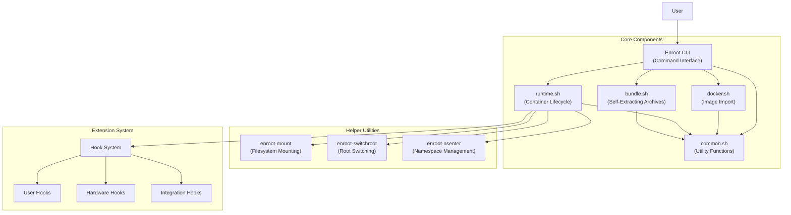
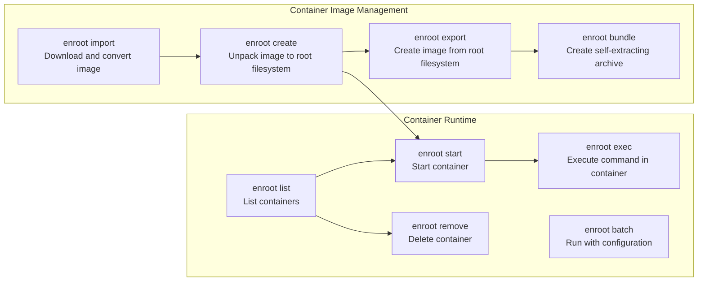
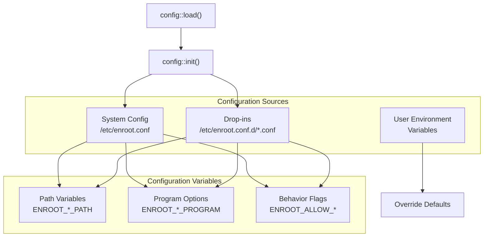

<!-- source: DeepWiki mcp.deepwiki.com · repo NVIDIA/enroot · page 1 Overview · fetched 2026-10-26 -->

# Overview

<details>
<summary>Relevant source files</summary>

The following files were used as context for generating this wiki page:

- [README.md](README.md)
- [enroot.in](enroot.in)

</details>


This document provides an introduction to Enroot, a tool designed to turn traditional container/OS images into unprivileged sandboxes. It covers the system's purpose, key features, architecture, and core capabilities. For detailed installation instructions, see [Installation](#2).

## What is Enroot?

Enroot is a lightweight container platform that can be thought of as an enhanced unprivileged `chroot(1)`. It uses the same underlying technologies as containers but removes much of the isolation they typically provide while preserving filesystem separation.

This approach is particularly beneficial in high-performance computing (HPC) environments or virtualized environments where portability and reproducibility are important, but additional isolation layers would introduce unnecessary overhead.

Unlike traditional container engines that focus on isolation, Enroot prioritizes:

1. Performance - minimal runtime overhead
2. Usability - simple filesystem format and user-friendly commands
3. Unprivileged operation - no root permissions required
4. Flexibility - extensible hook system for customization

Sources: [README.md:3-9]()

## Key Features

Enroot's design philosophy embraces the following principles:

- **Standalone operation**: No daemon processes required
- **Fully unprivileged**: No setuid binaries, supports multi-user environments
- **Simplicity**: Easy to use with a simple image format and intuitive commands
- **Composition**: System-wide and user-specific configurations
- **Performance**: Fast Docker image import (3-5x speedup on large images)
- **GPU integration**: Built-in support through libnvidia-container
- **Collaboration**: Support for bundles and in-memory containers

Sources: [README.md:20-30]()

## System Architecture

Enroot's architecture consists of several core components that work together to provide container functionality without requiring privileged access.



The architecture consists of:

1. **Command-Line Interface**: Processes user commands and routes them to appropriate handlers
2. **Core Components**: Manage container lifecycle, image import, and utility functions
3. **Helper Utilities**: Low-level tools for namespace and filesystem operations
4. **Extension System**: Hook-based framework for extending functionality

Sources: [enroot.in:111-114]()

## Container Workflow

Enroot provides a complete workflow for container management, from importing images to running containerized applications.



The typical workflow involves:

1. **Importing** a container image from a source like Docker Hub
2. **Creating** a container root filesystem from the image
3. **Starting** the container with optional configuration
4. **Executing** commands inside the running container

Sources: [enroot.in:173-187](), [enroot.in:208-226]()

## Command Structure

The Enroot CLI implements a command-based interface with a variety of options for each operation. The table below summarizes the main commands:

| Command | Purpose | Key Options |
|---------|---------|-------------|
| `import` | Import container images from registries | `--arch`, `--output` |
| `create` | Create container root filesystem | `--name`, `--force` |
| `start`  | Start a container | `--conf`, `--env`, `--mount`, `--rw` |
| `exec`   | Execute commands in containers | `--env` |
| `export` | Create container images | `--output`, `--force` |
| `bundle` | Create self-extracting archives | `--output`, `--desc`, `--checksum` |
| `list`   | List available containers | `--fancy` |
| `remove` | Delete containers | `--force` |
| `batch`  | Start with configuration | N/A |

Sources: [enroot.in:115-247]()

## Configuration System

Enroot uses a flexible configuration system that supports both system-wide and user-specific settings.



The configuration system provides:

1. System-wide defaults in `/etc/enroot.conf`
2. Modular configuration through drop-in files
3. User-specific overrides through environment variables
4. Command-specific options through directives in configuration scripts

Sources: [enroot.in:25-103]()

## Example Usage

Below is a basic example of using Enroot to import and run an Ubuntu container:

```bash
# Import an Ubuntu image from Docker Hub
enroot import docker://ubuntu

# Create a container from the image
enroot create ubuntu.sqsh

# Start the container
enroot start ubuntu
```

For more advanced usage, Enroot supports mounting host directories, environment variable injection, and GPU device access:

```bash
# Start a container with GPU access, a mounted directory, and custom environment
enroot start --mount /data:/container/data --env CUDA_VISIBLE_DEVICES=0 ubuntu
```

Sources: [README.md:13-18]()

## Related Documentation

For more specific details on individual components of the Enroot system, refer to:

- [Installation](#2): How to install Enroot
- [Core Architecture](#3): Details on internal architecture
- [Container Image Management](#4): In-depth documentation on image operations
- [Hook System](#5): Customizing container behavior with hooks

---

