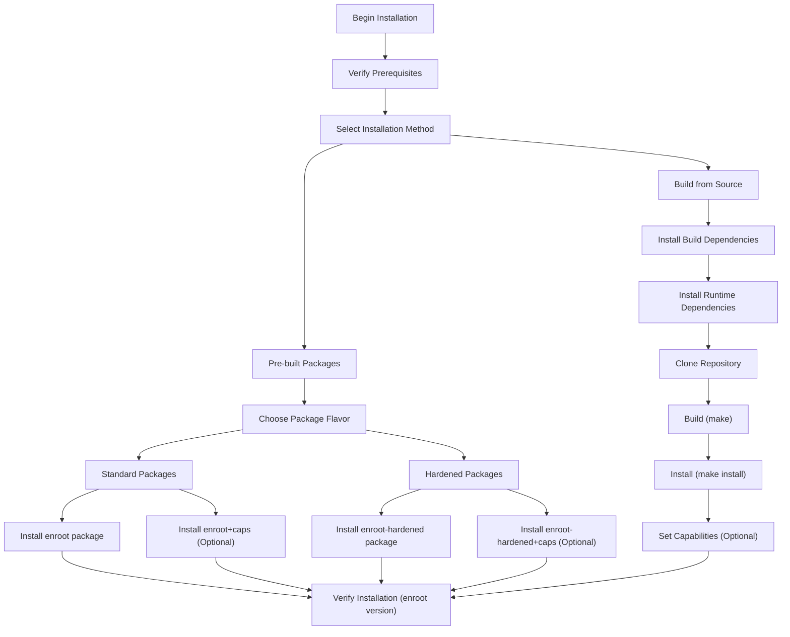
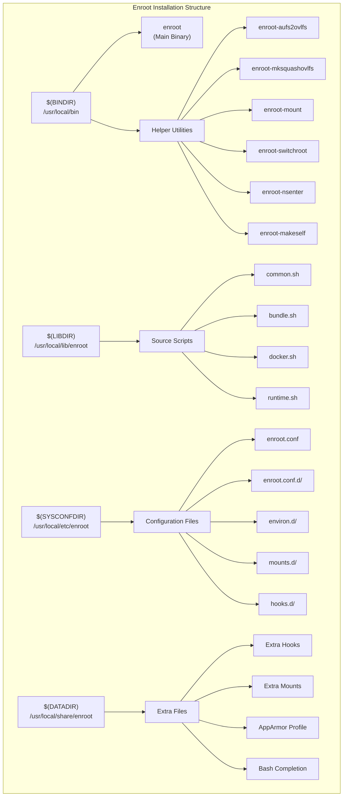

<!-- source: DeepWiki mcp.deepwiki.com · repo NVIDIA/enroot · page 2 Installation · fetched 2026-10-26 -->

# Installation

<details>
<summary>Relevant source files</summary>

The following files were used as context for generating this wiki page:

- [Makefile](Makefile)
- [doc/cmd/version.md](doc/cmd/version.md)
- [doc/installation.md](doc/installation.md)
- [doc/requirements.md](doc/requirements.md)

</details>


This page explains how to install Enroot on your system, including prerequisites and different installation methods. For information about using Enroot after installation, see [Running Containers](#7).

## Prerequisites

Before installing Enroot, ensure your system meets the necessary requirements.

### Kernel Requirements

| Requirement | Details |
|-------------|---------|
| Kernel Version | Linux Kernel >= 3.10 |
| Required Kernel Config | • `CONFIG_NAMESPACES`<br>• `CONFIG_USER_NS`<br>• `CONFIG_SECCOMP_FILTER` |
| For Docker Images | • `CONFIG_OVERLAY_FS` (for importing Docker images) |
| For older glibc | • `CONFIG_X86_VSYSCALL_EMULATION`<br>• `CONFIG_VSYSCALL_EMULATE` or `CONFIG_VSYSCALL_NATIVE` |

### System Settings

| Setting | Requirement |
|---------|-------------|
| Kernel Parameters | • `vsyscall=emulate` (for glibc <= 2.13)<br>• On RHEL: `namespace.unpriv_enable=1` and `user_namespace.enable=1` |
| Kernel Settings | • `/proc/sys/user/max_user_namespaces` > 1<br>• `/proc/sys/user/max_mnt_namespaces` > 1<br>• On some distributions: `/proc/sys/kernel/unprivileged_userns_clone` = 1<br>• On Ubuntu: `/proc/sys/kernel/apparmor_restrict_unprivileged_userns` = 0 |

You can verify your system meets these requirements using the `enroot-check` tool:

```sh
curl -fSsL -O https://github.com/NVIDIA/enroot/releases/download/v3.5.0/enroot-check_3.5.0_$(uname -m).run
chmod +x enroot-check_*.run
./enroot-check_*.run --verify
```

Sources: [doc/requirements.md:1-57]()

## Installation Workflow

#### Installation Process Diagram



Sources: [doc/installation.md:1-120](), [doc/cmd/version.md:1-15]()

## From Pre-built Packages

Enroot provides two package flavors: standard and hardened. The hardened flavor offers improved security but with some performance overhead.

### Package Flavors

| Flavor | Package | Description |
|--------|---------|-------------|
| Standard | `enroot` | Main utility, helper binaries, and standard configuration files.<br>• Open file descriptors are inherited<br>• Spectre variant 2 (IBPB/STIBP) mitigations are disabled<br>• Spectre variant 4 (SSBD) mitigations are disabled |
| Standard | `enroot+caps` | Grants extra capabilities to unprivileged users to import and convert container images |
| Hardened | `enroot-hardened` | Main utility, helper binaries, and standard configuration files with additional security measures |
| Hardened | `enroot-hardened+caps` | Grants extra capabilities to unprivileged users to import and convert container images |

### Standard Flavor Installation

For Debian-based distributions:
```sh
arch=$(dpkg --print-architecture)
curl -fSsL -O https://github.com/NVIDIA/enroot/releases/download/v3.5.0/enroot_3.5.0-1_${arch}.deb
curl -fSsL -O https://github.com/NVIDIA/enroot/releases/download/v3.5.0/enroot+caps_3.5.0-1_${arch}.deb # optional
sudo apt install -y ./*.deb
```

For RHEL-based distributions:
```sh
arch=$(uname -m)
sudo dnf install -y epel-release # required on some distributions
sudo dnf install -y https://github.com/NVIDIA/enroot/releases/download/v3.5.0/enroot-3.5.0-1.el8.${arch}.rpm
sudo dnf install -y https://github.com/NVIDIA/enroot/releases/download/v3.5.0/enroot+caps-3.5.0-1.el8.${arch}.rpm # optional
```

### Hardened Flavor Installation

For Debian-based distributions:
```sh
arch=$(dpkg --print-architecture)
curl -fSsL -O https://github.com/NVIDIA/enroot/releases/download/v3.5.0/enroot-hardened_3.5.0-1_${arch}.deb
curl -fSsL -O https://github.com/NVIDIA/enroot/releases/download/v3.5.0/enroot-hardened+caps_3.5.0-1_${arch}.deb # optional
sudo apt install -y ./*.deb
```

For RHEL-based distributions:
```sh
arch=$(uname -m)
sudo dnf install -y epel-release # required on some distributions
sudo dnf install -y https://github.com/NVIDIA/enroot/releases/download/v3.5.0/enroot-hardened-3.5.0-1.el8.${arch}.rpm
sudo dnf install -y https://github.com/NVIDIA/enroot/releases/download/v3.5.0/enroot-hardened+caps-3.5.0-1.el8.${arch}.rpm # optional
```

Sources: [doc/installation.md:3-76]()

## Build from Source

### Installation Structure Diagram



Sources: [Makefile:1-153]()

### Installation Steps

1. Install build dependencies:

```sh
# Debian-based distributions
sudo apt install -y git gcc make libcap2-bin libtool automake libmd-dev

# RHEL-based distributions
sudo dnf install -y git gcc make libcap libtool automake libmd-devel

# Archlinux-based distributions
sudo pacman --noconfirm -S git gcc make libtool automake libmd

git clone --recurse-submodules https://github.com/NVIDIA/enroot.git
```

2. Install runtime dependencies:

```sh
# Debian-based distributions
sudo apt install -y curl gawk jq squashfs-tools parallel
sudo apt install -y fuse-overlayfs libnvidia-container-tools pigz squashfuse # optional

# RHEL-based distributions
sudo dnf install -y epel-release # required on some distributions
sudo dnf install -y jq squashfs-tools parallel
sudo dnf install -y fuse-overlayfs libnvidia-container-tools pigz squashfuse # optional

# Archlinux-based distributions
sudo pacman --noconfirm -S jq parallel squashfs-tools
sudo pacman --noconfirm -S fuse-overlayfs libnvidia-container-tools pigz squashfuse # optional
```

3. Build and install:

```sh
cd enroot
sudo make install
```

4. (Optional) Allow unprivileged users to import images:

```sh
sudo make setcap
```

The build process can be customized with make variables defined in the Makefile:
- `prefix`: Installation prefix (default: `/usr/local`)
- `exec_prefix`: Executable installation prefix (default: `$(prefix)`)
- `bindir`: Directory for executable programs (default: `$(exec_prefix)/bin`)
- `libdir`: Directory for library files (default: `$(exec_prefix)/lib`)
- `sysconfdir`: Directory for configuration files (default: `$(prefix)/etc`)

Sources: [doc/installation.md:78-120](), [Makefile:1-176]()

## Verification

Verify your installation by checking the Enroot version:

```sh
$ enroot version
3.5.0
```

Sources: [doc/cmd/version.md:1-15]()

---

