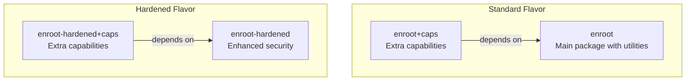
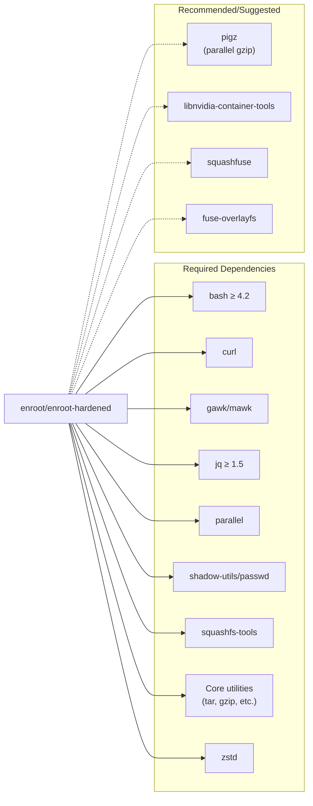
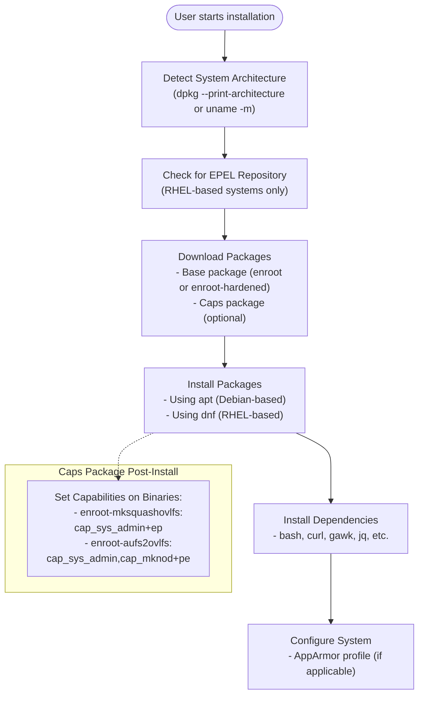
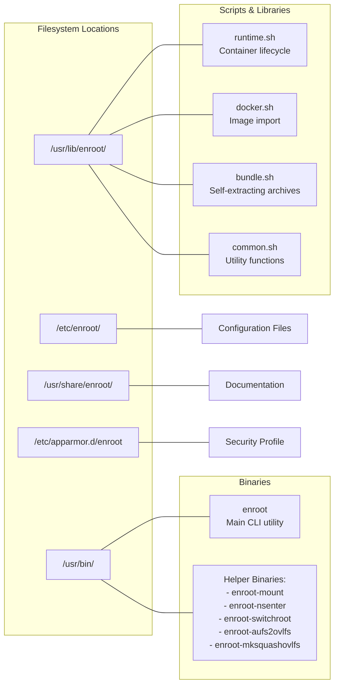

<!-- source: DeepWiki mcp.deepwiki.com · repo NVIDIA/enroot · page 2.1 Package Installation · fetched 2026-10-26 -->

# Package Installation

<details>
<summary>Relevant source files</summary>

The following files were used as context for generating this wiki page:

- [conf/apparmor.profile](conf/apparmor.profile)
- [doc/installation.md](doc/installation.md)
- [pkg/deb/control](pkg/deb/control)
- [pkg/deb/rules](pkg/deb/rules)
- [pkg/rpm/SPECS/enroot.spec](pkg/rpm/SPECS/enroot.spec)

</details>


This document explains how to install NVIDIA Enroot using pre-built packages (RPM and DEB). For instructions on building Enroot from source code, see [Building from Source](#2.2).

## Overview of Available Packages

Enroot provides two package flavors: standard and hardened. Each flavor comes in two variants: the base package and a companion "+caps" package that grants additional capabilities to unprivileged users.

| Flavor | Package | Description |
|--------|---------|-------------|
| Standard | `enroot` | Main utility, helper binaries, and standard configuration files. Has certain security mitigations disabled for better performance. |
| Standard | `enroot+caps` | Grants extra capabilities to unprivileged users allowing them to import and convert container images. |
| Hardened | `enroot-hardened` | Like the standard package but with all security mitigations enabled. |
| Hardened | `enroot-hardened+caps` | Grants extra capabilities to unprivileged users for the hardened version. |

Sources: [doc/installation.md:5-44]()

## Package Diagram



Sources: [doc/installation.md:5-44](), [pkg/rpm/SPECS/enroot.spec:37-52](), [pkg/deb/control:41-49]()

## Package Dependencies

Enroot packages have the following dependencies:



Sources: [pkg/rpm/SPECS/enroot.spec:20-23](), [pkg/deb/control:13-33]()

## Installation Instructions

### Standard Flavor Installation

#### For Debian-based Distributions (Ubuntu, Debian)

```bash
# Determine architecture
arch=$(dpkg --print-architecture)

# Download packages
curl -fSsL -O https://github.com/NVIDIA/enroot/releases/download/v3.5.0/enroot_3.5.0-1_${arch}.deb
curl -fSsL -O https://github.com/NVIDIA/enroot/releases/download/v3.5.0/enroot+caps_3.5.0-1_${arch}.deb # optional

# Install packages
sudo apt install -y ./*.deb
```

#### For RHEL-based Distributions (CentOS, Rocky Linux, RHEL)

```bash
# Determine architecture
arch=$(uname -m)

# Install EPEL repository if needed
sudo dnf install -y epel-release # required on some distributions

# Install packages
sudo dnf install -y https://github.com/NVIDIA/enroot/releases/download/v3.5.0/enroot-3.5.0-1.el8.${arch}.rpm
sudo dnf install -y https://github.com/NVIDIA/enroot/releases/download/v3.5.0/enroot+caps-3.5.0-1.el8.${arch}.rpm # optional
```

Sources: [doc/installation.md:48-60]()

### Hardened Flavor Installation

#### For Debian-based Distributions

```bash
# Determine architecture
arch=$(dpkg --print-architecture)

# Download packages
curl -fSsL -O https://github.com/NVIDIA/enroot/releases/download/v3.5.0/enroot-hardened_3.5.0-1_${arch}.deb
curl -fSsL -O https://github.com/NVIDIA/enroot/releases/download/v3.5.0/enroot-hardened+caps_3.5.0-1_${arch}.deb # optional

# Install packages
sudo apt install -y ./*.deb
```

#### For RHEL-based Distributions

```bash
# Determine architecture
arch=$(uname -m)

# Install EPEL repository if needed
sudo dnf install -y epel-release # required on some distributions

# Install packages
sudo dnf install -y https://github.com/NVIDIA/enroot/releases/download/v3.5.0/enroot-hardened-3.5.0-1.el8.${arch}.rpm
sudo dnf install -y https://github.com/NVIDIA/enroot/releases/download/v3.5.0/enroot-hardened+caps-3.5.0-1.el8.${arch}.rpm # optional
```

Sources: [doc/installation.md:64-76]()

## Package Installation Process



Sources: [doc/installation.md:48-76](), [pkg/rpm/SPECS/enroot.spec:46-51](), [pkg/deb/rules:33-42]()

## Package Contents and Structure

The Enroot package installs the following components:

1. **Main Binaries**: Located in `/usr/bin/`
   - `enroot` - Main command-line utility
   - Helper utilities (enroot-mount, enroot-nsenter, etc.)

2. **Library Files**: Located in `/usr/lib/enroot/`
   - Shell scripts implementing core functionality
   - Runtime libraries and utilities

3. **Configuration Files**: Located in `/etc/enroot/`
   - Default configuration settings
   - Hook configuration

4. **Security Profiles**: 
   - AppArmor profile (on supporting systems)



Sources: [pkg/rpm/SPECS/enroot.spec:32-34](), [pkg/deb/rules:35](), [conf/apparmor.profile:1-7]()

## Capabilities Added by the "+caps" Package

The "+caps" package variant adds specific Linux capabilities to certain Enroot binaries, allowing unprivileged users to perform operations that would normally require root privileges:

1. **enroot-mksquashovlfs**: Receives `cap_sys_admin+ep` capability
   - Allows creating SquashFS filesystems without root privileges

2. **enroot-aufs2ovlfs**: Receives `cap_sys_admin,cap_mknod+pe` capabilities
   - Allows converting AUFS to OverlayFS filesystems
   - Enables device node creation needed for container functionality

These capabilities are set during the package installation process using the `setcap` utility.

Sources: [pkg/rpm/SPECS/enroot.spec:46-51](), [pkg/deb/control:41-49]()

## Choosing Between Package Flavors

When deciding between standard and hardened package flavors, consider the following trade-offs:

| Consideration | Standard Flavor | Hardened Flavor |
|---------------|----------------|-----------------|
| Performance | Better performance due to disabled mitigations | Slightly lower performance |
| Security | Some Spectre mitigations disabled | All security mitigations enabled |
| File descriptor handling | Open file descriptors are inherited | Stricter file descriptor handling |
| Use case | Development, performance-critical applications | Security-sensitive environments |

The standard flavor disables certain security mitigations to improve performance:
- Spectre variant 2 (IBPB/STIBP) mitigations are disabled
- Spectre variant 4 (SSBD) mitigations are disabled
- Open file descriptors are inherited

The hardened flavor enables all security mitigations but may have slightly higher overhead.

Sources: [doc/installation.md:5-44]()

## Verification and Testing Installation

After installing Enroot packages, you can verify the installation by running:

```bash
# Check installed version
enroot version

# Test basic functionality
enroot list
```

If the `enroot+caps` or `enroot-hardened+caps` package is installed, you can verify that the appropriate capabilities have been set with:

```bash
# Verify capabilities
getcap /usr/bin/enroot-mksquashovlfs
getcap /usr/bin/enroot-aufs2ovlfs
```

The output should show the expected capabilities for each binary.

---

