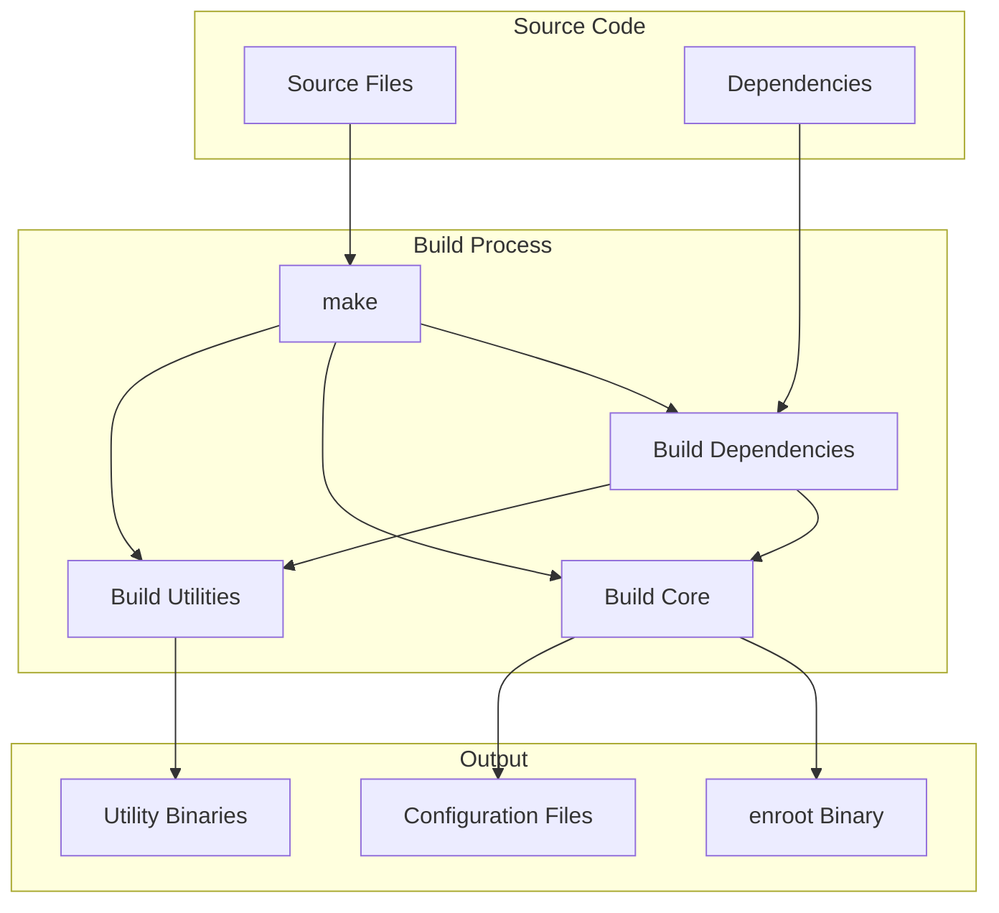
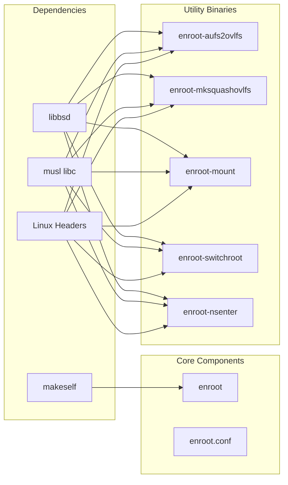
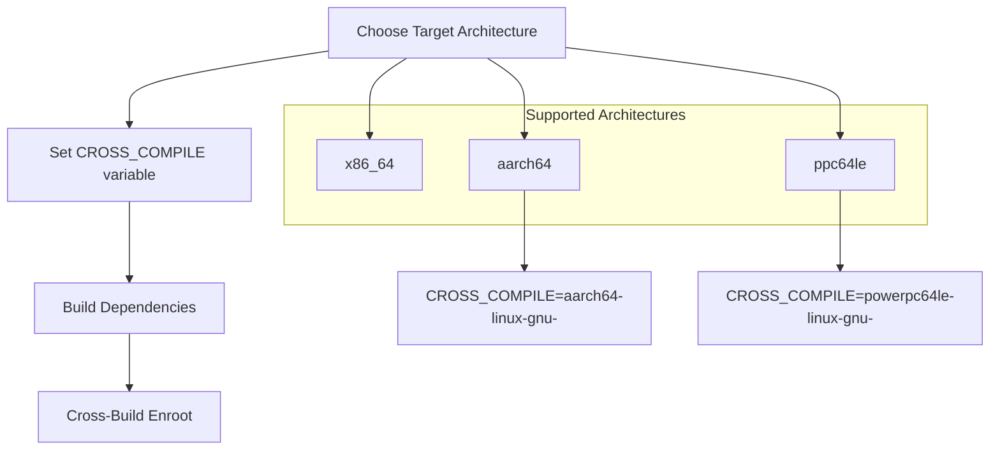

<!-- source: DeepWiki mcp.deepwiki.com · repo NVIDIA/enroot · page 2.2 Building from Source · fetched 2026-10-26 -->

# Building from Source

<details>
<summary>Relevant source files</summary>

The following files were used as context for generating this wiki page:

- [.gitmodules](.gitmodules)
- [Makefile](Makefile)
- [deps/Makefile](deps/Makefile)
- [pkg/debbuild](pkg/debbuild)
- [pkg/rpmbuild](pkg/rpmbuild)

</details>


This guide explains how to build Enroot from source code, including all necessary dependencies and build options. Building from source is useful when you need custom builds, want to develop or modify Enroot, or if pre-built packages aren't available for your platform. For information about installing pre-built packages, see [Package Installation](#2.1).

## Prerequisites

Before building Enroot, you'll need to ensure your system has the following dependencies:

| Category | Requirements |
|----------|-------------|
| **Build Tools** | GCC or Clang compiler, Make |
| **System Libraries** | libmd-dev (or equivalent) |
| **Optional Dependencies** | Git (for fetching submodules) |

### System-specific Build Dependencies

For Debian/Ubuntu systems:
```bash
apt-get install build-essential libmd-dev git
```

For CentOS/RHEL systems:
```bash
dnf install gcc make libmd-devel git
```

Sources: [pkg/debbuild:27-38](), [pkg/rpmbuild:15-23]()

## Getting the Source Code

Clone the Enroot repository and initialize the required submodules:

```bash
git clone https://github.com/NVIDIA/enroot.git
cd enroot
git submodule update --init
```

The submodules include:
- `makeself` - For creating self-extracting archives
- `musl` - For static linking of utilities
- `linux-headers` - For system call definitions

Sources: [.gitmodules:1-9](), [Makefile:133-134]()

## Build Process Overview



Sources: [Makefile:130-134]()

## Basic Build

To build Enroot with default options:

```bash
make
```

This will:
1. Build dependencies (if needed)
2. Compile utility binaries
3. Generate the main `enroot` script and configuration files

Sources: [Makefile:130]()

### Build Components



Sources: [Makefile:28-40](), [deps/Makefile:28-73]()

## Build Options

Enroot's build system supports several configuration options:

| Option | Description | Default |
|--------|-------------|---------|
| `DEBUG=1` | Enable debug build with sanitizers | Disabled |
| `CROSS_COMPILE=...` | Specify cross compilation prefix | None |
| `FORCE_GLIBC=1` | Build utilities with glibc instead of musl | Disabled |
| `prefix=...` | Installation prefix | `/usr/local` |
| `exec_prefix=...` | Executables installation prefix | `$(prefix)` |
| `bindir=...` | Binaries directory | `$(exec_prefix)/bin` |
| `libdir=...` | Library directory | `$(exec_prefix)/lib` |
| `sysconfdir=...` | Configuration directory | `$(prefix)/etc` |

Example with custom options:
```bash
make DEBUG=1 prefix=/opt/enroot
```

Sources: [Makefile:1-22](), [Makefile:81-86]()

## Cross-Compilation

Enroot supports cross-compilation for different architectures:



For example, to cross-compile for ARM64:
```bash
make CROSS_COMPILE=aarch64-linux-gnu-
```

Sources: [Makefile:93-99](), [pkg/debbuild:40-62]()

## Installation

After building, install Enroot:

```bash
make install
```

To install to a custom location:
```bash
make install prefix=/opt/enroot
```

To install as a package:
```bash
# Create a DEB package
make deb

# Create an RPM package
make rpm
```

Sources: [Makefile:139-152](), [Makefile:177-190]()

## Advanced Build Options

### Debug Build

Enable debug symbols and sanitizers:
```bash
make DEBUG=1
```

This adds:
- Debug symbols (-g3)
- Address, undefined behavior, and leak sanitizers
- Frame pointers for better stack traces

Sources: [Makefile:81-86]()

### Static Linking with Musl

By default, utility binaries are statically linked against musl libc for better portability. To force using glibc instead:
```bash
make FORCE_GLIBC=1
```

Sources: [Makefile:110-121](), [deps/Makefile:38-46]()

### Hardened Build

To create a hardened version of Enroot with additional security features:
```bash
# For DEB package
make deb PACKAGE=enroot-hardened

# For RPM package
make rpm PACKAGE=enroot-hardened
```

Sources: [pkg/debbuild:66-70](), [pkg/rpmbuild:27-31]()

## Installation Directory Structure

The installation process places files in the following directories:

| Directory | Contents |
|-----------|----------|
| `$(bindir)` | Main executable and utility binaries |
| `$(libdir)/enroot` | Core shell scripts |
| `$(sysconfdir)/enroot` | Configuration and hooks |
| `$(sysconfdir)/enroot/environ.d` | Environment configuration |
| `$(sysconfdir)/enroot/mounts.d` | Mount configurations |
| `$(sysconfdir)/enroot/hooks.d` | Hook scripts |
| `$(datadir)/enroot` | Additional data and examples |

Sources: [Makefile:10-14](), [Makefile:140-152]()

## Post-Installation Setup

After installation, consider adding capabilities to certain binaries for non-root operation:
```bash
make setcap
```

This adds the necessary capabilities to `enroot-mksquashovlfs` and `enroot-aufs2ovlfs` to allow non-root users to create containers.

Sources: [Makefile:173-175]()

## Cleaning the Build

To clean the build artifacts:
```bash
# Clean only the main components
make mostlyclean

# Clean everything including dependencies
make clean

# Clean distribution files
make distclean
```

Sources: [Makefile:158-171]()

---

