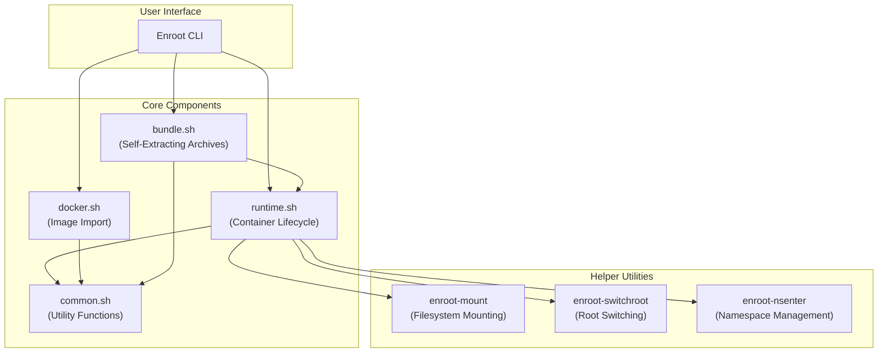
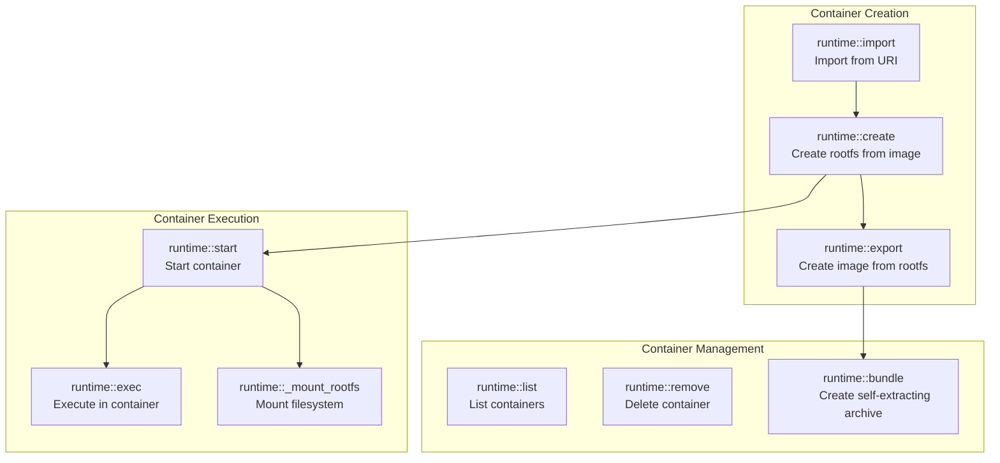
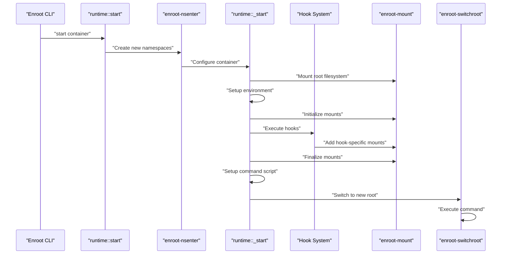
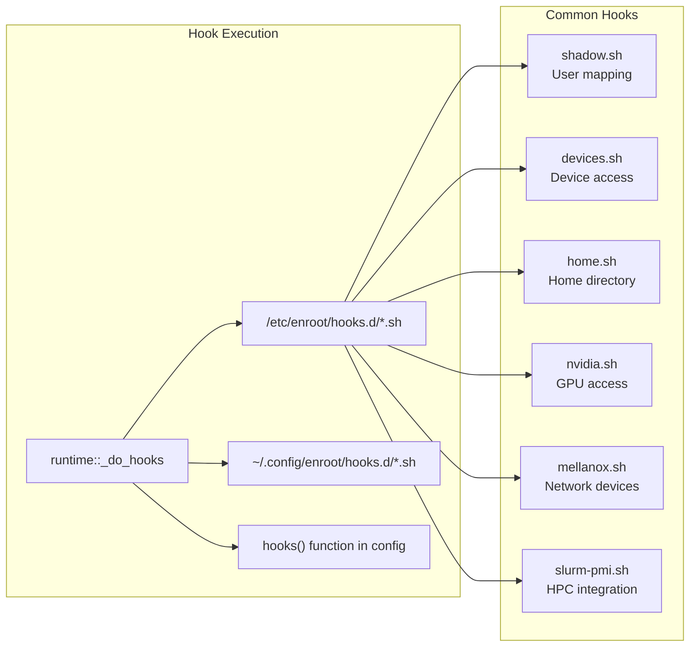
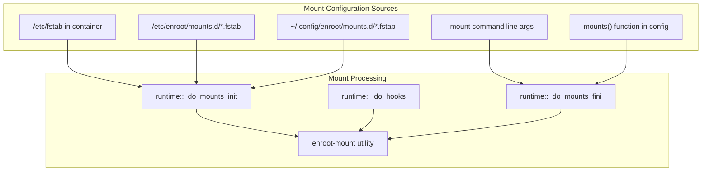
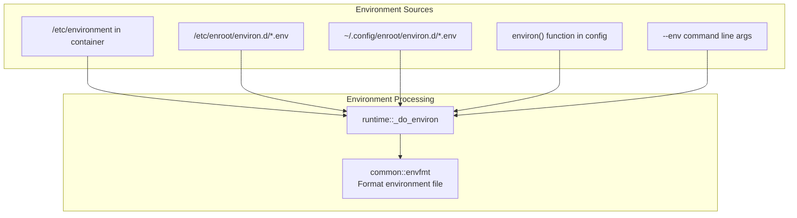

<!-- source: DeepWiki mcp.deepwiki.com · repo NVIDIA/enroot · page 3 Core Architecture · fetched 2026-10-26 -->

# Core Architecture

<details>
<summary>Relevant source files</summary>

The following files were used as context for generating this wiki page:

- [enroot.in](enroot.in)
- [src/common.sh](src/common.sh)
- [src/runtime.sh](src/runtime.sh)

</details>


This document provides an overview of NVIDIA Enroot's internal architecture, including its key components, their relationships, and how they function together to provide container management capabilities. For detailed information about using Enroot, see [Installation](#2), [Running Containers](#7), or [Container Image Management](#4).

## Overview

Enroot is designed as a set of modular shell scripts and utility binaries that work together to provide container management functionality. The system follows a layered architecture with clear separation of concerns, making it extensible and maintainable.



Sources: [enroot.in:1-675](), [src/runtime.sh:15-16](), [src/common.sh:15]()

## Command-Line Interface

The Enroot CLI serves as the user-facing interface to the system, providing commands for managing container images and running containers. It processes command-line arguments, sets up the environment, and delegates operations to the core components.

Key commands include:
- `import`: Import container images
- `create`: Create container root filesystems
- `start`: Start containers
- `exec`: Execute commands in running containers
- `export`: Create images from containers
- `bundle`: Create self-extracting archives
- `list`: List containers
- `remove`: Delete containers

The CLI is implemented in [enroot.in](), which sources the core component scripts and provides command-line parsing and dispatch functionality.

Sources: [enroot.in:115-673]()

## Core Components

Enroot's functionality is split across several core components, each responsible for a specific aspect of container management:

### Common Utilities (common.sh)

Provides shared functionality used throughout the codebase, including:
- Logging and error handling
- File and directory operations
- Environment variable management
- Process and execution utilities

This component forms the foundation on which other components are built.

Sources: [src/common.sh:15-276]()

### Runtime Management (runtime.sh)

Responsible for container lifecycle operations:
- Creating containers from images
- Starting containers
- Executing commands in running containers
- Managing container state
- Exporting containers to images



Sources: [src/runtime.sh:32-653]()

### Container Startup Process

When starting a container, Enroot follows these steps:

1. The `runtime::start` function is called from the CLI
2. It sets up the environment and resolves the rootfs path
3. It executes `enroot-nsenter` to create new namespaces
4. Within the new namespaces, `runtime::_start` is called, which:
   - Sets up a temporary working directory
   - Mounts the rootfs
   - Configures the container environment by:
     - Processing environment files (`runtime::_do_environ`)
     - Initializing mounts (`runtime::_do_mounts_init`)
     - Executing hooks (`runtime::_do_hooks`)
     - Finalizing mounts (`runtime::_do_mounts_fini`)
   - Sets up the command script (`runtime::_do_rc`)
   - Switches to the new root using `enroot-switchroot`
   - Executes the command in the container



Sources: [src/runtime.sh:277-350](), [src/runtime.sh:206-275]()

### Image Import (docker.sh)

Manages importing container images from external sources, particularly Docker registries and Docker daemons. This component is referenced in the provided files but its implementation details aren't fully visible in the excerpts.

Based on the code references, it supports:
- Docker registry import (`docker::import`)
- Docker daemon import (`docker::daemon::import`)
- Podman import

Sources: [src/runtime.sh:425-443]()

### Bundle Creation (bundle.sh)

Enables creating self-extracting archives that contain:
- The container image
- Runtime components needed to run the container
- Configuration files
- Optional user settings

This allows distributing containers in a standalone, executable format.

Sources: [src/runtime.sh:572-653]()

## Configuration System

Enroot uses a layered configuration system that combines:

1. System-wide configuration (`/etc/enroot/enroot.conf`)
2. User configuration (`~/.config/enroot`)
3. Command-line arguments
4. Configuration specified during container startup

Configuration areas include:
- Environment variables
- Mount points
- Hooks
- Command scripts

The system first loads default settings and then overrides them with user-specific settings and command-line options.

Sources: [enroot.in:25-104]()

## Hook System

The hook system allows customizing container behavior through scripts that are executed during container setup. Hooks can modify the container environment, add mounts, or perform other actions before the container starts.

Hook scripts are stored in:
- System-wide hook directory (`/etc/enroot/hooks.d`)
- User-specific hook directory (`~/.config/enroot/hooks.d`)

When starting a container, hooks are executed in order and can modify the mount configuration and environment.



Sources: [src/runtime.sh:17-19](), [src/runtime.sh:85-110]()

## Mount Management

Enroot manages mounts in three phases:

1. Initial mounts (`runtime::_do_mounts_init`): Processes mounts from the container's fstab and system mount configurations
2. Hook mounts (`runtime::_do_hooks`): Allows hooks to add custom mounts
3. Final mounts (`runtime::_do_mounts_fini`): Processes mounts specified by the user on the command line

Mount configurations are stored in:
- The container's `/etc/fstab`
- System-wide mount directory (`/etc/enroot/mounts.d`)
- User-specific mount directory (`~/.config/enroot/mounts.d`)
- Command-line arguments



Sources: [src/runtime.sh:64-83](), [src/runtime.sh:112-128]()

## Environment Management

Enroot sets up the container environment using these sources:

1. Container's `/etc/environment`
2. Environment files from system and user directories
3. Environment variables specified in the configuration
4. Environment variables specified on the command line



Sources: [src/runtime.sh:32-62](), [src/common.sh:190-204]()

## Helper Utilities

Enroot uses several helper utilities that are implemented as C programs:

1. `enroot-mount`: Handles filesystem mounting operations
2. `enroot-switchroot`: Switches to a new root filesystem
3. `enroot-nsenter`: Creates and joins namespaces
4. `enroot-aufs2ovlfs`: Converts AUFS to OverlayFS
5. `enroot-mksquashovlfs`: Creates SquashFS images

These utilities provide low-level functionality that can't be easily implemented in shell scripts.

Sources: [src/runtime.sh:82](), [src/runtime.sh:105](), [src/runtime.sh:127](), [src/runtime.sh:271-273](), [src/runtime.sh:348-349]()

## Container Lifecycle

The full container lifecycle in Enroot involves these major phases:

```mermaid
stateDiagram-v2
    [*] --> Imported: enroot import
    Imported --> Created: enroot create
    Created --> Started: enroot start
    Started --> Executed: enroot exec
    Executed --> Started
    Started --> [*]
    
    Created --> Exported: enroot export
    Exported --> Bundled: enroot bundle
    Bundled --> [*]
    
    Created --> Removed: enroot remove
    Removed --> [*]
    
    state Imported {
        DockerImport: docker::import
        DockerDaemonImport: docker::daemon::import
    }
    
    state Created {
        ExtractSquashFS: unsquashfs
        SetupRootFS: runtime::create
    }
    
    state Started {
        MountRootFS: runtime::_mount_rootfs
        SetupEnvironment: runtime::_do_environ
        InitializeMounts: runtime::_do_mounts_init
        ExecuteHooks: runtime::_do_hooks
        FinalizeMounts: runtime::_do_mounts_fini
        SwitchRoot: enroot-switchroot
    }
```

Sources: [enroot.in:650-672](), [src/runtime.sh:277-571]()

## Summary

Enroot's architecture is modular and flexible, built around shell scripts for most functionality with C-based utilities for low-level operations. The system's key features are:

1. A clear separation between user interface (CLI) and core functionality
2. A layered approach to configuration
3. An extensible hook system for customizing container behavior
4. A comprehensive mount and environment management system
5. Support for the full container lifecycle from image import to execution

This design makes Enroot both powerful and adaptable to different use cases, particularly in high-performance computing environments where GPU support and integration with tools like Slurm are crucial.

---

