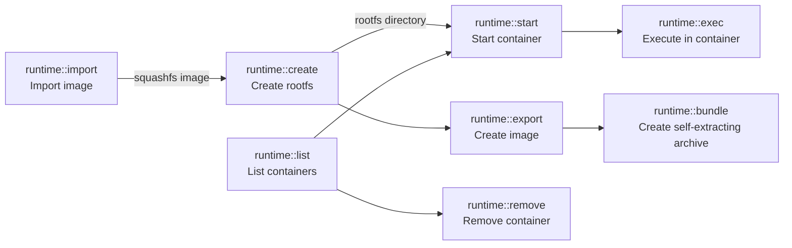
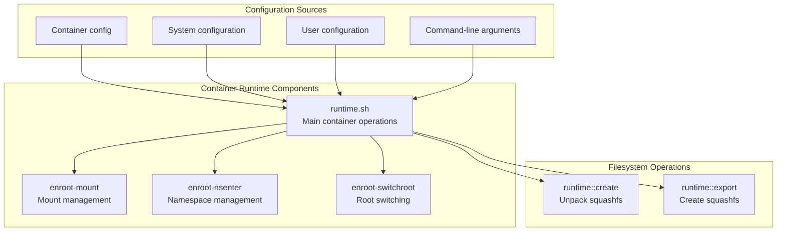
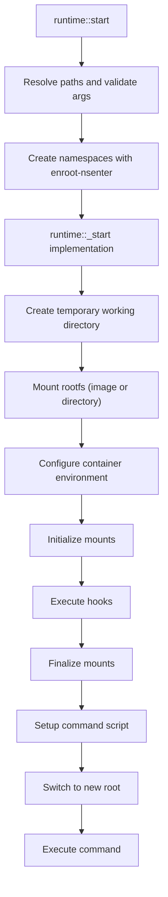

<!-- source: DeepWiki mcp.deepwiki.com · repo NVIDIA/enroot · page 3.1 Container Lifecycle Management · fetched 2026-10-26 -->

# Container Lifecycle Management

<details>
<summary>Relevant source files</summary>

The following files were used as context for generating this wiki page:

- [src/runtime.sh](src/runtime.sh)

</details>


## Purpose and Scope

This document provides a detailed technical overview of how Enroot manages container lifecycles—from creation and execution to termination and cleanup. It covers the core runtime operations that enable container management in Enroot.

For information about image import mechanisms specifically, see [Docker Image Import](#4.1). For information about hook systems that extend container functionality, see [Hook System](#5).

## 1. Container Lifecycle Overview

Enroot implements a complete container lifecycle management system through a set of shell functions in the `runtime.sh` module. These functions provide operations for creating, starting, executing commands in, exporting, and removing containers.



Sources: [src/runtime.sh:277-382](), [src/runtime.sh:384-570]()

## 2. Core Runtime Components

The Enroot runtime consists of several interacting components that work together to manage containers:



Sources: [src/runtime.sh:15-31](), [src/runtime.sh:206-275]()

## 3. Container Creation

### 3.1. Importing Container Images

The `runtime::import` function imports container images from supported sources:

- Docker registries (`docker://`)
- Docker daemon (`dockerd://`)
- Podman (`podman://`)

These import sources are handled by specialized functions in the Docker module which convert the images into squashfs format, Enroot's preferred container image format.

Sources: [src/runtime.sh:425-443]()

### 3.2. Creating Container Rootfs

The `runtime::create` function extracts a squashfs image into a container rootfs directory:

```
runtime::create <image> [<name>]
```

This process involves:
1. Resolving and validating the image and rootfs paths
2. Extracting the squashfs filesystem using `unsquashfs`
3. Fixing permissions in the extracted rootfs

The resulting rootfs directory serves as the basis for running containers.

Sources: [src/runtime.sh:384-423]()

## 4. Container Execution

### 4.1. Starting Containers

The `runtime::start` function starts a container from a rootfs:

```
runtime::start <rootfs> [<rc>] [<config>] [<mounts>] [<environ>] [<command...>]
```

The start process follows a complex sequence:



Important operations during container start:

1. **Namespace Creation**: Uses `enroot-nsenter` to create user and mount namespaces
2. **Rootfs Mounting**: Mounts rootfs with proper filesystem setup (overlayfs for images)
3. **Environment Configuration**: Configures environment from multiple sources
4. **Mount Management**: Sets up mounts from fstab files and user configuration
5. **Hook Execution**: Runs hook scripts to customize container configuration
6. **Root Switching**: Uses `enroot-switchroot` to switch to container root

Sources: [src/runtime.sh:277-350](), [src/runtime.sh:206-275](), [src/runtime.sh:32-83](), [src/runtime.sh:84-110]()

### 4.2. Executing Commands in Containers

The `runtime::exec` function executes commands in running containers:

```
runtime::exec <pid> [<environ>] <command...>
```

This function:
1. Validates the target process (container) exists
2. Generates the appropriate environment for command execution
3. Uses `enroot-nsenter` to join the container's namespaces
4. Executes the specified command in the container's context

Sources: [src/runtime.sh:352-382]()

## 5. Container Maintenance

### 5.1. Listing Containers

The `runtime::list` function lists existing containers:

```
runtime::list [<fancy>]
```

This function:
1. Lists container rootfs directories in the data path
2. With the `fancy` option, displays detailed process information about running containers

The fancy display includes information such as:
- Container name
- PID
- Command
- Process state
- Start time
- Namespace information
- Command line

Sources: [src/runtime.sh:491-546]()

### 5.2. Removing Containers

The `runtime::remove` function removes a container rootfs:

```
runtime::remove <rootfs>
```

This function:
1. Resolves and validates the rootfs path
2. Asks for confirmation (unless `ENROOT_FORCE_OVERRIDE` is set)
3. Removes the rootfs directory

Sources: [src/runtime.sh:548-570]()

## 6. Container Export and Distribution

### 6.1. Exporting Containers

The `runtime::export` function creates a squashfs image from a container rootfs:

```
runtime::export <rootfs> [<filename>]
```

This function:
1. Resolves and validates the rootfs and output file paths
2. Excludes mountpoints, the bundle directory, and the lockfile
3. Creates a squashfs image using `mksquashfs`

Sources: [src/runtime.sh:445-489]()

### 6.2. Creating Self-Extracting Bundles

The `runtime::bundle` function creates a self-extracting archive from a container image:

```
runtime::bundle <image> [<filename>] [<target>] [<desc>]
```

This function:
1. Resolves and validates paths
2. Extracts the container image to a temporary directory
3. Copies required runtime components to a bundle directory
4. Creates a self-extracting archive using `enroot-makeself`

The resulting bundle contains everything needed to run the container on a system without Enroot installed.

Sources: [src/runtime.sh:572-653]()

## 7. Key Configuration Elements

Enroot's container lifecycle management relies on several configuration elements:

| Element | Description | Source Location |
|---------|-------------|----------------|
| Hook directories | Directories containing hook scripts | `hook_dirs` - System and user config paths |
| Mount directories | Directories containing mount configs | `mount_dirs` - System and user config paths |
| Environment directories | Directories containing environment files | `environ_dirs` - System and user config paths |
| Environment file | File containing container environment | `environ_file` - Runtime path |
| Mount file | File containing container mount specifications | `mount_file` - Runtime path |
| RC file | Script executed in the container | `rc_file` - Runtime path |
| Bundle directory | Directory containing bundle components | `bundle_dir` - Root of container |

These configuration elements can be provided through system-wide configuration, user configuration, or command-line arguments.

Sources: [src/runtime.sh:15-31](), [src/runtime.sh:32-62](), [src/runtime.sh:63-83](), [src/runtime.sh:84-110](), [src/runtime.sh:130-139]()

## 8. Advanced Functionality

### 8.1. Rootfs Mounting

Enroot supports two methods for mounting rootfs:

1. **Directory-based rootfs**: Direct mounting of a directory
2. **Image-based rootfs**: Mounting a squashfs image using `squashfuse` with an overlay filesystem

The `runtime::_mount_rootfs` and `runtime::_mount_rootfs_shim` functions implement the image-based rootfs mounting, providing a read-only lower layer (the image) and a writable upper layer.

Sources: [src/runtime.sh:141-204]()

### 8.2. Resource Management

Container resources are managed through:

1. **Filesystem isolation**: Separate rootfs for each container
2. **Namespace isolation**: User and mount namespaces for process isolation
3. **Mount configuration**: Control over what host resources are accessible
4. **Environment configuration**: Control over container environment variables

The combination of these mechanisms provides the necessary isolation and resource management capabilities for containers.

Sources: [src/runtime.sh:277-350](), [src/runtime.sh:206-275]()

---

