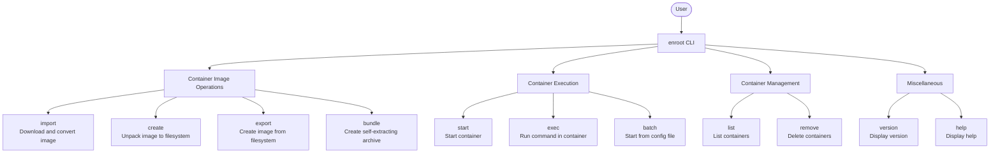
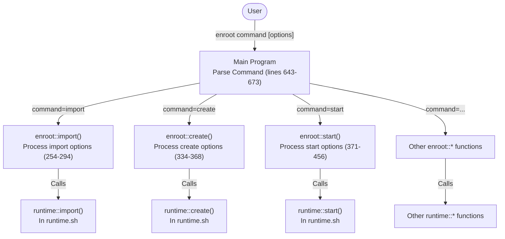
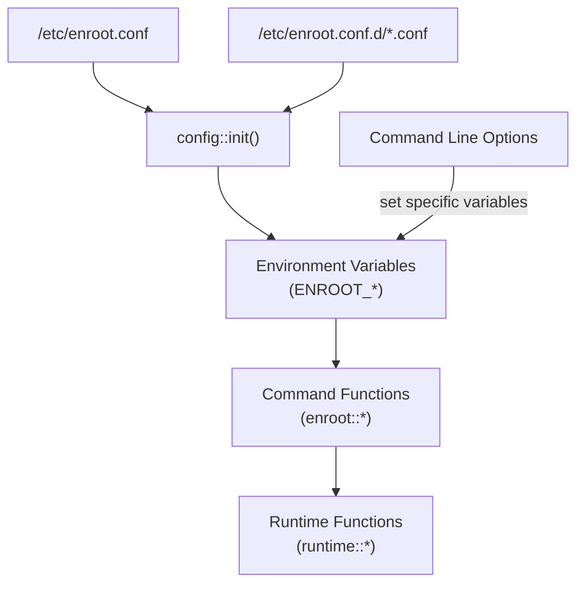

<!-- source: DeepWiki mcp.deepwiki.com · repo NVIDIA/enroot · page 3.2 Command-Line Interface · fetched 2026-10-26 -->

# Command-Line Interface

<details>
<summary>Relevant source files</summary>

The following files were used as context for generating this wiki page:

- [conf/enroot.conf.in](conf/enroot.conf.in)
- [doc/cmd/batch.md](doc/cmd/batch.md)
- [doc/cmd/bundle.md](doc/cmd/bundle.md)
- [doc/cmd/create.md](doc/cmd/create.md)
- [doc/cmd/export.md](doc/cmd/export.md)
- [doc/cmd/import.md](doc/cmd/import.md)
- [doc/cmd/list.md](doc/cmd/list.md)
- [doc/cmd/remove.md](doc/cmd/remove.md)
- [doc/cmd/start.md](doc/cmd/start.md)
- [enroot.in](enroot.in)

</details>


This document describes the Enroot command-line interface (CLI) structure, command usage, and available options. The CLI is the primary method for interacting with Enroot to manage container images and run containers. For information about container lifecycle management, see [Container Lifecycle Management](#3.1).

## Overview

The Enroot CLI provides a set of commands to import, create, run, and manage containers. It follows a consistent pattern where all commands are invoked through the main `enroot` executable followed by a subcommand and options.

Basic syntax:
```
enroot COMMAND [OPTIONS] [ARGUMENTS]
```

## CLI Architecture

The Enroot CLI is implemented as a Bash script that processes commands and options before calling the appropriate functions in the runtime library.

### Command Structure Diagram



Sources: [enroot.in:114-673]()

### Command Processing Flow



Sources: [enroot.in:643-673](), [enroot.in:254-294](), [enroot.in:334-368](), [enroot.in:371-456]()

## Available Commands

Enroot provides the following commands:

| Command | Description | Primary Options |
|---------|-------------|-----------------|
| `import` | Import a container image from a specific location | `--arch`, `--output` |
| `create` | Create a container root filesystem from an image | `--name`, `--force` |
| `start` | Start a container | `--conf`, `--env`, `--mount`, `--root`, `--rw` |
| `exec` | Execute a command inside an existing container | `--env` |
| `export` | Create a container image from a root filesystem | `--output`, `--force` |
| `bundle` | Create a self-extracting bundle | `--all`, `--checksum`, `--desc`, `--output` |
| `batch` | Start a container from a config file | (uses ENROOT_ROOTFS directive) |
| `list` | List available containers | `--fancy` |
| `remove` | Delete one or more containers | `--force` |
| `version` | Display Enroot version | none |
| `help` | Display help information | none |

Sources: [enroot.in:115-246]()

## Detailed Command Reference

### Container Image Operations

#### import

Imports a container image from a specified location, converting it to Enroot's format:

```
enroot import [options] [--] URI
```

Supported URI schemes:
- `docker://[USER@][REGISTRY#]IMAGE[:TAG]` - Import from a Docker registry
- `dockerd://IMAGE[:TAG]` - Import from a Docker daemon
- `podman://IMAGE[:TAG]` - Import from a local Podman repository

Options:
- `-a, --arch` - Image architecture (defaults to host architecture)
- `-o, --output` - Output filename (defaults to "URI.sqsh")

Sources: [doc/cmd/import.md:1-16](), [enroot.in:254-294]()

#### create

Creates a container root filesystem from an image:

```
enroot create [options] [--] IMAGE
```

Options:
- `-n, --name` - Container name (defaults to "IMAGE")
- `-f, --force` - Overwrite existing container

Sources: [doc/cmd/create.md:1-11](), [enroot.in:334-368]()

#### export

Creates a container image from a container root filesystem:

```
enroot export [options] [--] NAME
```

Options:
- `-o, --output` - Output filename (defaults to "NAME.sqsh")
- `-f, --force` - Overwrite existing image

Sources: [doc/cmd/export.md:1-11](), [enroot.in:297-332]()

#### bundle

Creates a self-extracting bundle from a container image:

```
enroot bundle [options] [--] IMAGE
```

Options:
- `-a, --all` - Include runtime and user configuration
- `-c, --checksum` - Generate embedded checksum
- `-d, --desc TEXT` - Description of the bundle
- `-o, --output` - Output filename (defaults to "IMAGE.run")
- `-t, --target` - Target extraction directory
- `-f, --force` - Overwrite existing bundle

Sources: [doc/cmd/bundle.md:1-14](), [enroot.in:578-641]()

### Container Execution

#### start

Starts a container and invokes the command script:

```
enroot start [options] [--] NAME|IMAGE [COMMAND] [ARG...]
```

Options:
- `-c, --conf CONFIG` - Configuration script to run before start
- `-e, --env KEY[=VAL]` - Export environment variable
- `--rc SCRIPT` - Override command script
- `-r, --root` - Remap current user to root inside container
- `-w, --rw` - Make root filesystem writable
- `-m, --mount FSTAB` - Mount from host (colon-separated)

Sources: [doc/cmd/start.md:1-18](), [enroot.in:371-456]()

#### exec

Executes a command inside an existing container:

```
enroot exec [options] [--] PID COMMAND [ARG...]
```

Options:
- `-e, --env KEY[=VAL]` - Export environment variable

Sources: [enroot.in:458-492]()

#### batch

Shorthand for `start -c CONFIG` where the root filesystem is specified in the config:

```
enroot batch [options] [--] CONFIG [COMMAND] [ARG...]
```

The configuration file must contain the `ENROOT_ROOTFS` directive to specify the container.

Sources: [doc/cmd/batch.md:1-7](), [enroot.in:494-525]()

### Container Management

#### list

Lists all container root filesystems:

```
enroot list [options]
```

Options:
- `-f, --fancy` - Display detailed information in tabular format

Sources: [doc/cmd/list.md:1-9](), [enroot.in:527-548]()

#### remove

Deletes one or multiple container root filesystems:

```
enroot remove [options] [--] NAME...
```

Options:
- `-f, --force` - Skip confirmation prompt

Sources: [doc/cmd/remove.md:1-9](), [enroot.in:550-576]()

## Configuration Integration

The CLI integrates with Enroot's configuration system to customize behavior through environment variables. Configuration is loaded from multiple sources:

1. System configuration (`/etc/enroot.conf`)
2. Drop-in configuration files (`/etc/enroot.conf.d/*.conf`)
3. Command-line options that set specific variables



Sources: [enroot.in:25-106](), [conf/enroot.conf.in:1-72]()

## Common Parameters and Environment Variables

Many CLI commands share common environment variables that modify their behavior:

| Variable | Default | Description |
|----------|---------|-------------|
| `ENROOT_FORCE_OVERRIDE` | `no` | Overwrite existing files without prompting |
| `ENROOT_MAX_PROCESSORS` | `$(nproc)` | Maximum processors for parallel tasks |
| `ENROOT_REMAP_ROOT` | `no` | Remap current user to root inside container |
| `ENROOT_ROOTFS_WRITABLE` | `no` | Make container root filesystem writable |
| `ENROOT_ALLOW_SUPERUSER` | `no` | Allow root to retain privileges inside container |

Sources: [conf/enroot.conf.in:9-61](), [enroot.in:78-101]()

## Examples

### Basic Container Workflow

```bash
# Import Ubuntu image from Docker Hub
enroot import docker://ubuntu:20.04

# Create container from the image
enroot create --name ubuntu-container ubuntu+20.04.sqsh

# Start the container with writable filesystem
enroot start --rw ubuntu-container

# Remove the container when finished
enroot remove ubuntu-container
```

### Advanced Usage

```bash
# Import CUDA container and mount local directory
enroot import docker://nvidia/cuda:11.0-devel
enroot start --mount $PWD:/workspace nvidia+cuda+11.0-devel.sqsh nvcc /workspace/mycode.cu -o /workspace/myprogram

# Create a self-extracting bundle with custom description
enroot bundle --desc "CUDA 11.0 Development Environment" --all nvidia+cuda+11.0-devel.sqsh

# Use batch mode with a configuration file
cat > my-config.conf << EOF
#ENROOT_ROOTFS=ubuntu-container
#ENROOT_REMAP_ROOT=y

mounts() {
    echo "/data /mnt none bind"
}
EOF

enroot batch my-config.conf ls /mnt
```

---

