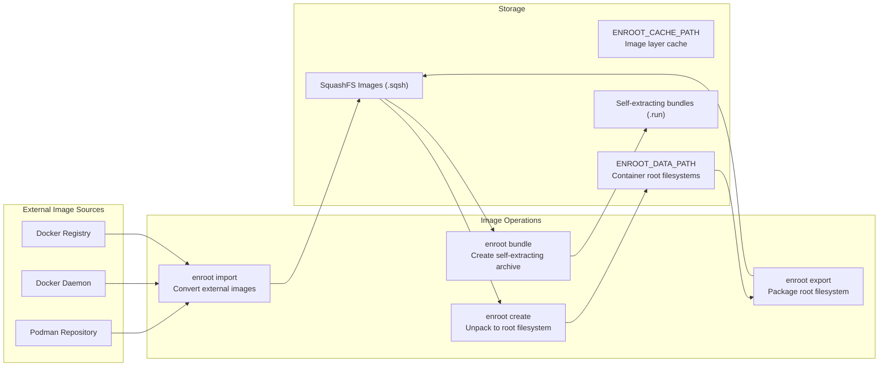
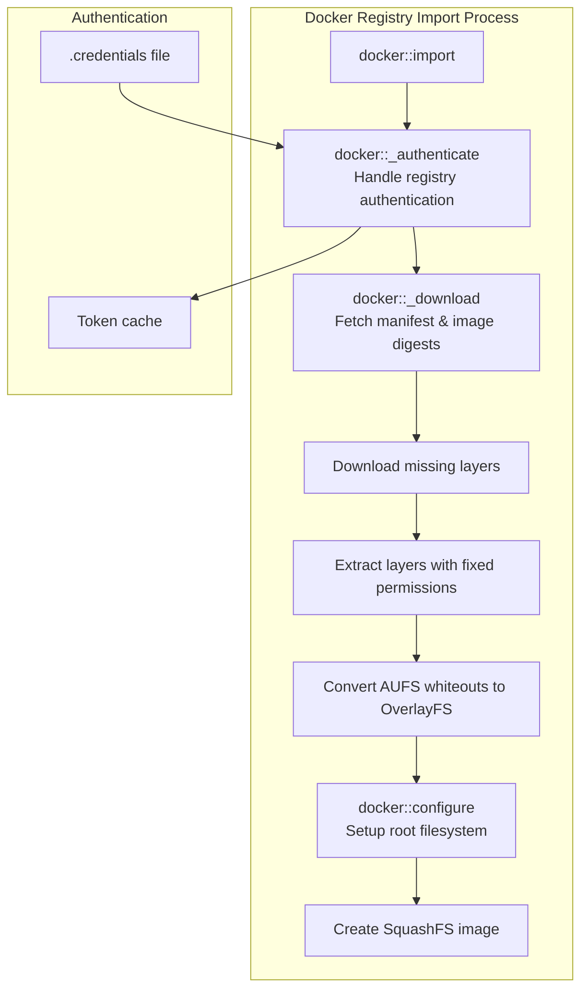
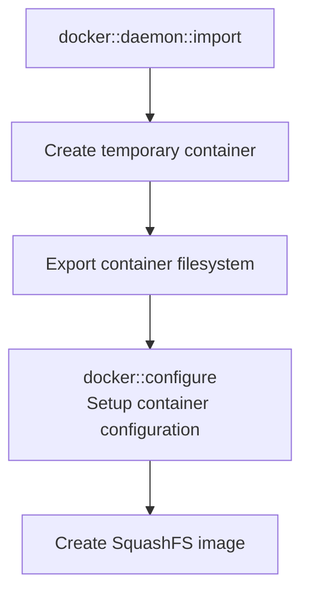
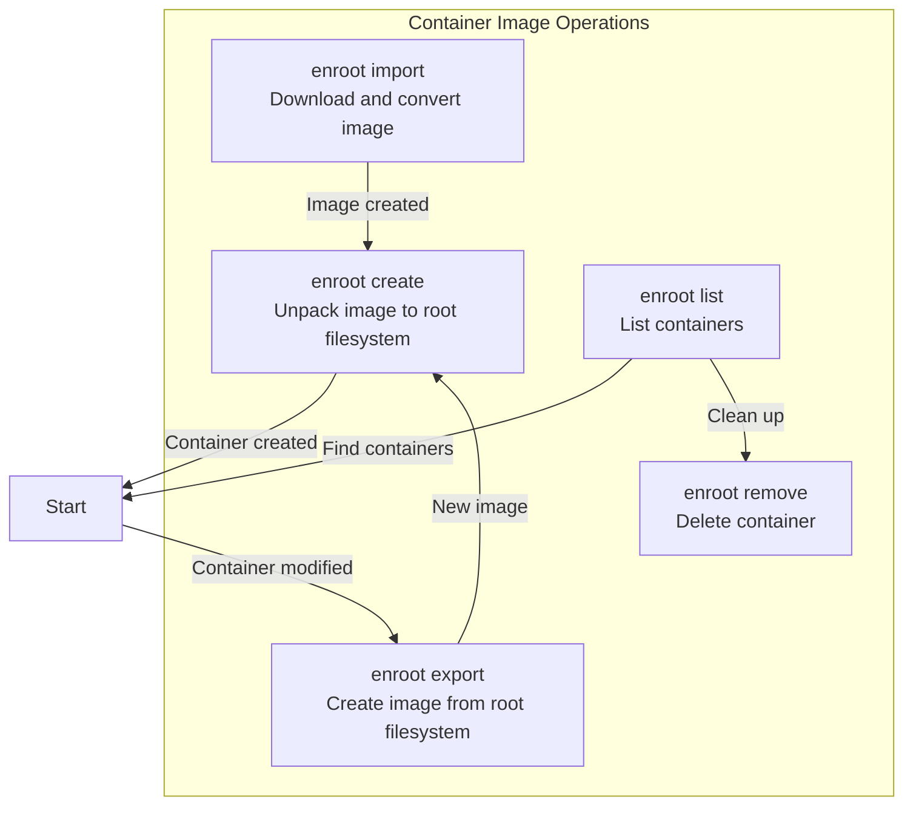

<!-- source: DeepWiki mcp.deepwiki.com · repo NVIDIA/enroot · page 4 Container Image Management · fetched 2026-10-26 -->

# Container Image Management

<details>
<summary>Relevant source files</summary>

The following files were used as context for generating this wiki page:

- [conf/enroot.conf.in](conf/enroot.conf.in)
- [doc/cmd/bundle.md](doc/cmd/bundle.md)
- [doc/cmd/create.md](doc/cmd/create.md)
- [doc/cmd/export.md](doc/cmd/export.md)
- [doc/cmd/import.md](doc/cmd/import.md)
- [doc/cmd/list.md](doc/cmd/list.md)
- [doc/cmd/remove.md](doc/cmd/remove.md)
- [src/docker.sh](src/docker.sh)

</details>


This document provides a comprehensive overview of how Enroot manages container images throughout their lifecycle. It covers the processes of importing images from various sources, creating container root filesystems from images, exporting containers back to images, and creating self-extracting bundles. For information about running containers after they've been created, see [Running Containers](#7).

## Image Management Overview

Enroot's container image management consists of four primary operations:

1. **Import** - Acquire images from external sources (Docker registries, Docker daemon, Podman)
2. **Create** - Unpack images into runnable root filesystems
3. **Export** - Package existing root filesystems into shareable images
4. **Bundle** - Generate self-extracting archives from images



Sources: [src/docker.sh:252-398](), [doc/cmd/import.md:1-90](), [doc/cmd/create.md:1-32](), [doc/cmd/export.md:1-35](), [doc/cmd/bundle.md:1-66]()

## Image Formats and Storage

Enroot uses SquashFS as its primary image format with a `.sqsh` extension. This format provides:

- Efficient compression
- Read-only filesystem image 
- Direct mountability without unpacking

Images and containers are stored in various locations controlled by environment variables:

| Location | Purpose | Default Path |
|----------|---------|-------------|
| `ENROOT_CACHE_PATH` | Downloaded image layers | `${XDG_CACHE_HOME}/enroot` |
| `ENROOT_DATA_PATH` | Container root filesystems | `${XDG_DATA_HOME}/enroot` |

When Enroot imports Docker images, it caches image layers in `ENROOT_CACHE_PATH` to avoid downloading the same layers multiple times.

Sources: [doc/cmd/import.md:20-65](), [conf/enroot.conf.in:1-72]()

## Image Import Process

Enroot can import container images from several sources using the `enroot import` command:

```
enroot import [options] [--] URI
```

Where URI can be:
- `docker://[USER@][REGISTRY#]IMAGE[:TAG]` - Docker registry
- `dockerd://IMAGE[:TAG]` - Docker daemon
- `podman://IMAGE[:TAG]` - Podman local repository

Sources: [doc/cmd/import.md:1-16]()

### Docker Registry Import

The Docker registry import process includes downloading image manifests and layers, then converting them to a SquashFS image.



The import process handles:

1. **Authentication** - Using credentials from `.credentials` file or user input
2. **Layer Management** - Downloading and caching image layers
3. **Filesystem Conversion** - Converting Docker's AUFS format to OverlayFS
4. **Configuration** - Setting up the container environment, entrypoint, and command

Sources: [src/docker.sh:28-192](), [src/docker.sh:252-337](), [doc/cmd/import.md:50-54]()

### Docker Daemon and Podman Import

For importing from a local Docker daemon or Podman, Enroot:

1. Creates a temporary container from the specified image
2. Exports the container filesystem
3. Configures the filesystem with container metadata
4. Creates a SquashFS image



Sources: [src/docker.sh:339-398](), [doc/cmd/import.md:56-64]()

## Container Root Filesystem Operations

### Creating Root Filesystems

The `enroot create` command unpacks a SquashFS image into a container root filesystem:

```
enroot create [options] [--] IMAGE
```

This operation:
1. Takes a `.sqsh` container image
2. Unpacks it into a directory under `$ENROOT_DATA_PATH/`
3. Makes the filesystem ready to start with `enroot start`

Sources: [doc/cmd/create.md:1-32]()

### Exporting Root Filesystems

The `enroot export` command creates a SquashFS image from an existing container:

```
enroot export [options] [--] NAME
```

This allows:
1. Capturing changes made to a container
2. Sharing modified containers with other users
3. Creating new base images for future containers

Sources: [doc/cmd/export.md:1-35]()

### Container Lifecycle Management



Sources: [doc/cmd/list.md:1-26](), [doc/cmd/remove.md:1-27]()

## Self-Extracting Bundles

Enroot can create self-extracting bundles with the `enroot bundle` command:

```
enroot bundle [options] [--] IMAGE
```

These bundles:
1. Package a container image with the necessary code to extract and run it
2. Are portable and can run on most Linux distributions without dependencies
3. Accept the same arguments as `enroot start` for runtime configuration

Bundle features:
- Can include user configuration with `--all`
- Can generate embedded checksums with `--checksum`
- Support keeping extracted files with `--keep`
- Allow verification of host compatibility with `--verify`

Sources: [doc/cmd/bundle.md:1-66]()

## Configuration Options

Enroot provides numerous configuration options for image management:

| Setting | Default | Description |
|---------|---------|-------------|
| `ENROOT_GZIP_PROGRAM` | `pigz` or `gzip` | Program for uncompressing digest layers |
| `ENROOT_ZSTD_OPTIONS` | `-1` | Options for zstd compression |
| `ENROOT_SQUASH_OPTIONS` | `-comp lzo -noD` | Options for SquashFS creation |
| `ENROOT_MAX_PROCESSORS` | `$(nproc)` | Maximum processors for parallel tasks |
| `ENROOT_MAX_CONNECTIONS` | `10` | Maximum concurrent download connections |
| `ENROOT_CONNECT_TIMEOUT` | `30` | Connection establishment timeout |
| `ENROOT_TRANSFER_TIMEOUT` | `0` | Network operation timeout |
| `ENROOT_TRANSFER_RETRIES` | `0` | Network operation retry count |
| `ENROOT_ALLOW_HTTP` | `no` | Allow HTTP instead of HTTPS (insecure) |
| `ENROOT_FORCE_OVERRIDE` | `no` | Always use --force on commands |
| `ENROOT_BUNDLE_ALL` | `no` | Include user configuration in bundles |
| `ENROOT_BUNDLE_CHECKSUM` | `no` | Generate checksums in bundles |

Sources: [doc/cmd/import.md:67-79](), [conf/enroot.conf.in:1-72](), [doc/cmd/export.md:19-24](), [doc/cmd/bundle.md:46-51]()

## Authentication for Registries

Enroot uses netrc-style credentials file (`$ENROOT_CONFIG_PATH/.credentials`) for registry authentication. The file format allows configuring credentials for different registries:

```
machine registry-hostname login username password credential
```

Special password handling:
- If the password starts with `$`, it will be substituted (useful for command output)
- Supports various authentication methods for cloud registries (AWS, Azure, Google)

Examples:
- NVIDIA GPU Cloud: `machine nvcr.io login $oauthtoken password <token>`
- Docker Hub: `machine auth.docker.io login <login> password <password>`
- AWS ECR: `machine 12345.dkr.ecr.eu-west-2.amazonaws.com login AWS password $(aws ecr get-login-password --region eu-west-2)`

Sources: [src/docker.sh:18](), [doc/cmd/import.md:23-48]()

---

