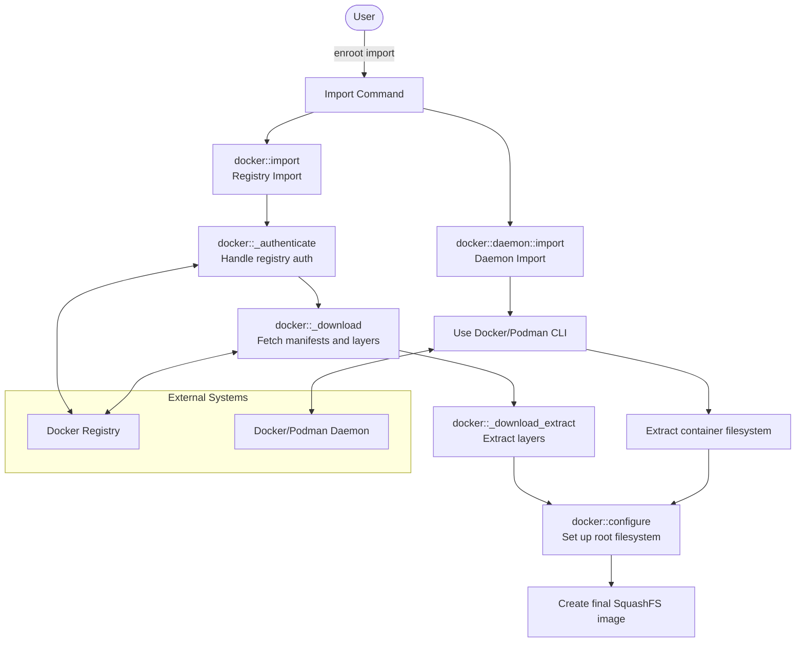
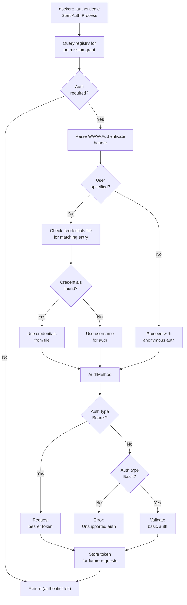
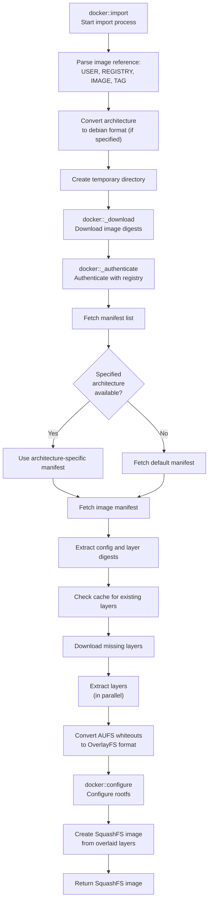
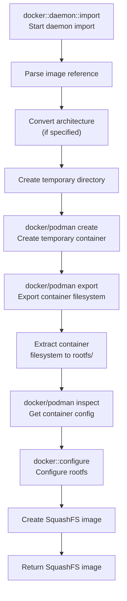
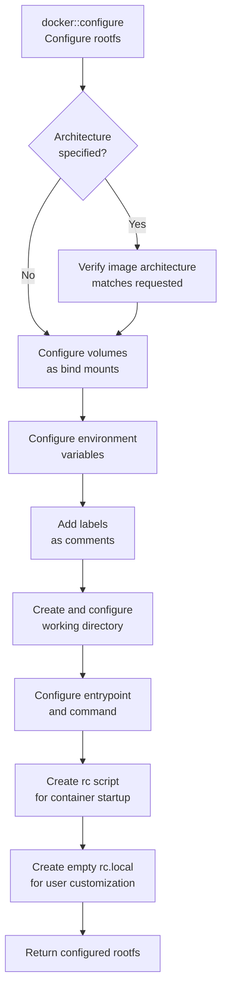

<!-- source: DeepWiki mcp.deepwiki.com · repo NVIDIA/enroot · page 4.1 Docker Image Import · fetched 2026-10-26 -->

# Docker Image Import

<details>
<summary>Relevant source files</summary>

The following files were used as context for generating this wiki page:

- [conf/enroot.conf.in](conf/enroot.conf.in)
- [doc/cmd/import.md](doc/cmd/import.md)
- [src/docker.sh](src/docker.sh)

</details>


This page documents the Docker image import capabilities in Enroot, focusing on how the system converts Docker container images into Enroot's SquashFS-based container format. For information on creating containers from imported images, see [Container Lifecycle Management](#3.1). For information on creating self-extracting bundles from container images, see [Self-Extracting Bundles](#4.2).

## Overview

Enroot supports importing Docker container images from three different sources:
- Docker registries (Docker Hub, NVIDIA NGC, etc.)
- Local Docker daemon
- Local Podman repository

During import, Enroot authenticates with the source (if required), downloads the image manifests and layers, extracts and configures the container filesystem, and finally converts it to Enroot's standard SquashFS-based format.



**Docker Image Import Process Overview**

Sources: [src/docker.sh:252-399]()

## Import Methods

Enroot supports three different methods for importing Docker images:

### Docker Registry Import

The `docker://` URI scheme allows importing directly from a Docker registry:

```
docker://[USER@][REGISTRY#]IMAGE[:TAG]
```

- `USER`: Optional registry username
- `REGISTRY`: Optional registry hostname (defaults to Docker Hub)
- `IMAGE`: Required image name
- `TAG`: Optional image tag (defaults to "latest")

The Docker Registry Import method connects directly to the registry API, authenticates, downloads the manifests and layers, and transforms them into Enroot's container format.

Sources: [src/docker.sh:252-337](), [doc/cmd/import.md:9-10]()

### Docker Daemon Import

The `dockerd://` URI scheme allows importing from a local Docker daemon:

```
dockerd://IMAGE[:TAG]
```

This method uses the Docker CLI to create a temporary container, export its filesystem, and convert it to Enroot's container format.

Sources: [src/docker.sh:339-398](), [doc/cmd/import.md:10-11]()

### Podman Import

The `podman://` URI scheme allows importing from a local Podman repository:

```
podman://IMAGE[:TAG]
```

This method uses the Podman CLI to create a temporary container, export its filesystem, and convert it to Enroot's container format.

Sources: [src/docker.sh:339-398](), [doc/cmd/import.md:11-12]()

## Authentication and Credentials

Enroot supports authentication with Docker registries through a credentials file located at `$ENROOT_CONFIG_PATH/.credentials`. This file follows the netrc format, allowing you to specify credentials for different registries.



**Registry Authentication Flow**

Sources: [src/docker.sh:28-92](), [doc/cmd/import.md:23-48]()

Example `.credentials` file:
```
# NVIDIA GPU Cloud
machine nvcr.io login $oauthtoken password <token>
machine authn.nvidia.com login $oauthtoken password <token>

# DockerHub
machine auth.docker.io login <login> password <password>
```

If the password field starts with a `$` sign, it will be treated as a environment variable or command to be substituted.

Sources: [doc/cmd/import.md:23-48]()

## Registry Import Process

The Docker registry import process works as follows:



**Docker Registry Import Process**

Sources: [src/docker.sh:252-337]()

### Downloading and Caching

When downloading from a registry, Enroot:

1. Caches downloaded layers in `$ENROOT_CACHE_PATH/` to avoid re-downloading
2. Uses parallel downloads for better performance
3. Verifies layer checksums for integrity
4. Performs retries on network failures (configurable)

Sources: [src/docker.sh:94-123](), [src/docker.sh:125-192]()

## Docker Daemon and Podman Import Process

The Docker daemon and Podman import processes are simpler:



**Docker Daemon/Podman Import Process**

Sources: [src/docker.sh:339-398]()

## Root Filesystem Configuration

After downloading and extracting the container layers, Enroot configures the root filesystem:



**Root Filesystem Configuration Flow**

Sources: [src/docker.sh:194-250]()

## Command-Line Usage

The import command supports the following options:

```
enroot import [options] [--] URI

Options:
  -a, --arch    Architecture of the image (defaults to host architecture)
  -o, --output  Name of the output image file (defaults to "URI.sqsh")
```

Sources: [doc/cmd/import.md:3-16]()

## Configuration Options

The Docker image import process can be configured through several environment variables:

| Setting | Default | Description |
| ------- | ------- | ----------- |
| `ENROOT_GZIP_PROGRAM` | `pigz` or `gzip` | Gzip program used to uncompress digest layers |
| `ENROOT_ZSTD_OPTIONS` | `-1` | Options passed to zstd to compress digest layers |
| `ENROOT_SQUASH_OPTIONS` | `-comp lzo -noD` | Options passed to mksquashfs to produce container images |
| `ENROOT_MAX_PROCESSORS` | `$(nproc)` | Maximum number of processors to use for parallel tasks |
| `ENROOT_MAX_CONNECTIONS` | `10` | Maximum number of concurrent connections |
| `ENROOT_CONNECT_TIMEOUT` | `30` | Maximum time in seconds to wait for connections establishment |
| `ENROOT_TRANSFER_TIMEOUT` | `0` | Maximum time in seconds to wait for network operations to complete |
| `ENROOT_TRANSFER_RETRIES` | `0` | Number of times network operations should be retried |
| `ENROOT_ALLOW_HTTP` | `no` | Use HTTP for outgoing requests instead of HTTPS (UNSECURE!) |

Sources: [doc/cmd/import.md:67-78](), [conf/enroot.conf.in:9-46]()

## Example Usage

Import a NVIDIA TensorFlow image from NGC:
```bash
enroot import --output tensorflow.sqsh 'docker://$oauthtoken@nvcr.io#nvidia/tensorflow:19.01-py3'
```

Import a container from the local Docker daemon:
```bash
enroot import --output ubuntu.sqsh 'dockerd://ubuntu:20.04'
```

Import a container from the local Podman repository:
```bash
enroot import --output fedora.sqsh 'podman://fedora:latest'
```

Sources: [doc/cmd/import.md:80-85]()

## Known Issues

- Older versions of curl (< 7.61) do not support more than 256 characters passwords, which can be an issue with some authentication tokens.

Sources: [doc/cmd/import.md:87-89]()

---

