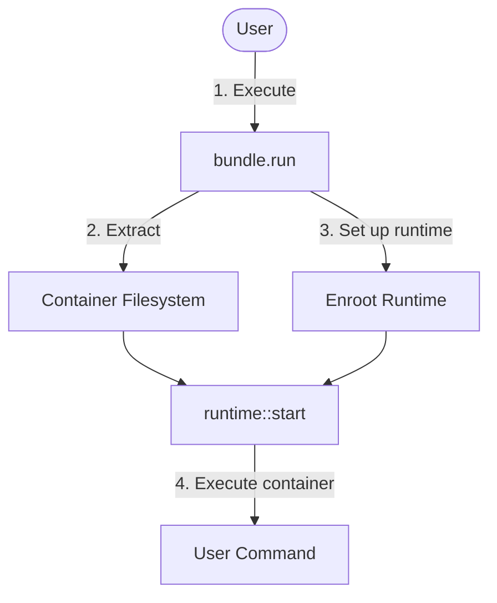
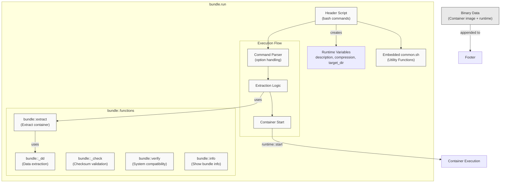
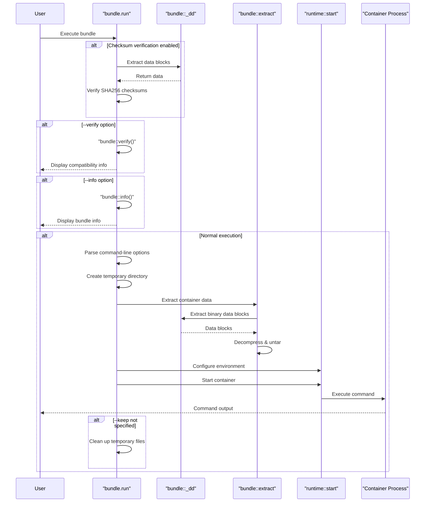

<!-- source: DeepWiki mcp.deepwiki.com · repo NVIDIA/enroot · page 4.2 Self-Extracting Bundles · fetched 2026-10-26 -->

# Self-Extracting Bundles

<details>
<summary>Relevant source files</summary>

The following files were used as context for generating this wiki page:

- [doc/cmd/bundle.md](doc/cmd/bundle.md)
- [doc/cmd/create.md](doc/cmd/create.md)
- [doc/cmd/export.md](doc/cmd/export.md)
- [doc/cmd/list.md](doc/cmd/list.md)
- [doc/cmd/remove.md](doc/cmd/remove.md)
- [src/bundle.sh](src/bundle.sh)

</details>


## Purpose and Scope

This document describes Enroot's self-extracting bundle functionality, which allows you to package a container image along with the necessary runtime components into a single executable file. These bundles can be distributed and executed on most Linux systems without requiring Enroot to be installed, making container deployment simpler in environments where installing additional software may be restricted. For information about creating regular container images, see [Container Image Management](#4) and for executing containers, see [Running Containers](#7).

Sources: [doc/cmd/bundle.md:33-36]()

## Overview

Self-extracting bundles are standalone executable files that contain:

1. An embedded container image
2. Essential Enroot runtime components
3. Extraction and execution logic

When executed, the bundle extracts its contents to a temporary or specified location and immediately starts the container, providing nearly identical functionality to using the `enroot start` command.



Title: Bundle Execution Flow

Sources: [src/bundle.sh:347-391]()

## Creating Bundles

To create a self-extracting bundle, use the `enroot bundle` command with a container image (SquashFS file) created from either `enroot import` or `enroot export`.

### Command Syntax

```
enroot bundle [options] [--] IMAGE
```

### Options

| Option | Description |
|--------|-------------|
| `-a, --all` | Include runtime and user configuration files in the bundle |
| `-c, --checksum` | Generate an embedded checksum for data verification |
| `-d, --desc TEXT` | Add a description to the bundle |
| `-o, --output BUNDLE` | Name of the output bundle file (defaults to "IMAGE.run") |
| `-t, --target DIR` | Target directory used by `--keep` (defaults to "$PWD/BUNDLE") |
| `-f, --force` | Overwrite an existing bundle |

### Configuration Settings

| Setting | Default | Description |
|---------|---------|-------------|
| `ENROOT_BUNDLE_ALL` | `no` | Include runtime and user configuration (same as `--all`) |
| `ENROOT_BUNDLE_CHECKSUM` | `no` | Generate embedded checksums (same as `--checksum`) |
| `ENROOT_FORCE_OVERRIDE` | `no` | Overwrite existing bundle (same as `--force`) |

Sources: [doc/cmd/bundle.md:1-14](), [doc/cmd/bundle.md:46-52]()

## Bundle Structure

A self-extracting bundle is a shell script with binary data appended to it. The script contains functions to extract and execute the container image.



Title: Self-Extracting Bundle Structure

Sources: [src/bundle.sh:15-38](), [src/bundle.sh:48-251]()

## Executing Bundles

Once created, a bundle can be executed like any other shell script. The bundle provides options similar to `enroot start` with additional bundle-specific commands.

### Command Syntax

```
bundle.run [options] [--] [COMMAND] [ARG...]
```

### Bundle-Specific Options

| Option | Description |
|--------|-------------|
| `-i, --info` | Display information about the bundle |
| `-k, --keep` | Keep the bundle extracted in the target directory |
| `-q, --quiet` | Suppress the progress bar output |
| `-v, --verify` | Verify host compatibility with the bundle |
| `-x, --extract` | Extract without execution (implies `--keep`) |

### Container Execution Options

| Option | Description |
|--------|-------------|
| `-c, --conf CONFIG` | Specify a configuration script to run before container start |
| `-e, --env KEY[=VAL]` | Export an environment variable inside the container |
| `-m, --mount FSTAB` | Perform a mount from host inside the container |
| `--rc SCRIPT` | Override the command script inside the container |
| `-r, --root` | Ask to be remapped to root inside the container |
| `-w, --rw` | Make the container root filesystem writable |

Sources: [doc/cmd/bundle.md:15-31](), [src/bundle.sh:215-237]()

## Bundle Execution Workflow

When a bundle is executed, it follows a specific workflow:



Title: Bundle Execution Workflow

Sources: [src/bundle.sh:253-391]()

## Internal Functions

The self-extracting bundle relies on several key internal functions to handle its operations:

### Checksum Validation

The `bundle::_check` function verifies data integrity by calculating SHA256 checksums of each data block and comparing them against embedded checksums.

### Extraction

The `bundle::extract` function handles extracting the container filesystem:

1. Calculates the start offset of binary data
2. Checks if there's enough disk space for extraction
3. Uses `bundle::_dd` to extract data blocks
4. Decompresses and untars the data to the target directory

### System Compatibility

The `bundle::verify` function checks if the host system meets all requirements:

1. Kernel version and configuration
2. Namespace support (user, mount)
3. Seccomp filter support
4. Kernel parameters for unprivileged containers
5. Additional packages (e.g., NVIDIA Container Runtime)

Sources: [src/bundle.sh:75-190](), [src/bundle.sh:193-213]()

## Use Cases and Examples

### Creating a Portable Container

```sh
# Import Ubuntu from DockerHub
enroot import docker://ubuntu:20.04

# Create a bundle with a description
enroot bundle --desc "Ubuntu 20.04 with Python" --checksum ubuntu:20.04.sqsh
```

### Distributing and Running the Bundle

```sh
# Check system compatibility
./ubuntu-20.04.run --verify

# Display bundle information
./ubuntu-20.04.run --info

# Run a command in the container
./ubuntu-20.04.run python3 --version

# Extract and keep the container
./ubuntu-20.04.run --keep --rw bash
```

### Using the Extracted Container with Enroot

If the bundle was extracted with `--keep`, the container can be managed using regular Enroot commands:

```sh
# Start the container from the extracted filesystem
enroot start ubuntu-20.04 bash

# List all containers including the extracted one
enroot list
```

Sources: [doc/cmd/bundle.md:53-65]()

## Important Considerations

1. **System Requirements**: Bundles require Bash 4.2+ and proper kernel configuration, which can be verified using the `--verify` option.

2. **Disk Space**: Sufficient disk space is needed for extraction. If `--keep` isn't specified, temporary storage in `$ENROOT_TEMP_PATH` is used.

3. **File Size**: Bundle files include both the container image and runtime components, making them larger than the original SquashFS image.

4. **Permissions**: When using `--root` in unprivileged mode, proper user namespace configuration is required on the host system.

Sources: [src/bundle.sh:17-21](), [src/bundle.sh:201-206]()

---

