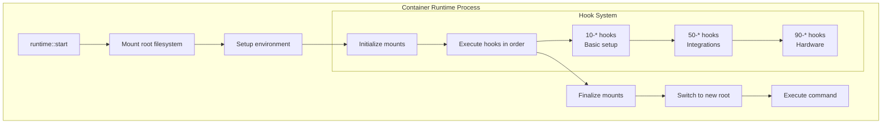
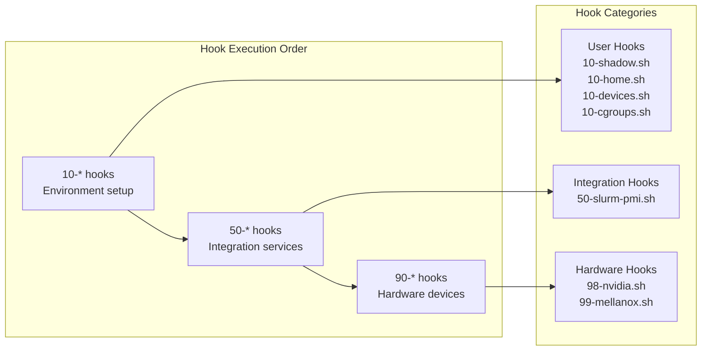
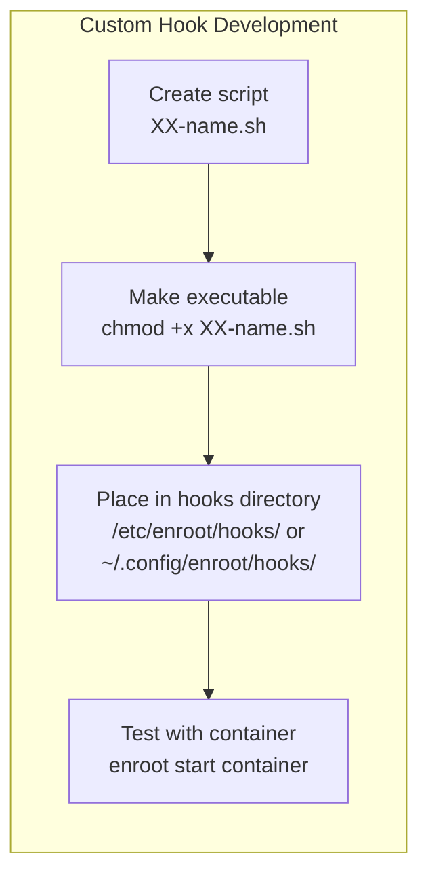
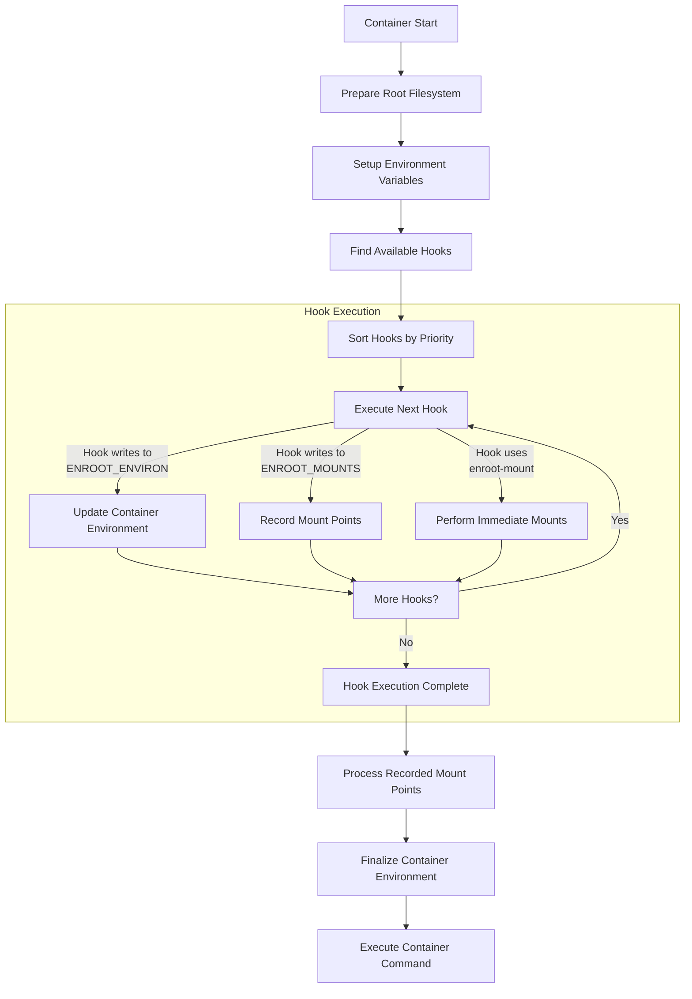

<!-- source: DeepWiki mcp.deepwiki.com · repo NVIDIA/enroot · page 5 Hook System · fetched 2026-10-26 -->

# Hook System

<details>
<summary>Relevant source files</summary>

The following files were used as context for generating this wiki page:

- [conf/hooks/10-cgroups.sh](conf/hooks/10-cgroups.sh)
- [conf/hooks/10-devices.sh](conf/hooks/10-devices.sh)
- [conf/hooks/10-home.sh](conf/hooks/10-home.sh)
- [conf/hooks/10-shadow.sh](conf/hooks/10-shadow.sh)
- [conf/hooks/98-nvidia.sh](conf/hooks/98-nvidia.sh)
- [conf/hooks/99-mellanox.sh](conf/hooks/99-mellanox.sh)
- [conf/hooks/extra/50-slurm-pmi.sh](conf/hooks/extra/50-slurm-pmi.sh)

</details>


The Hook System in NVIDIA Enroot provides a flexible mechanism to customize and extend container functionality. Hooks are executable scripts that run at specific points during container startup, allowing users to modify the container environment, mount hardware devices, configure system settings, and integrate with external services.

This page documents the architecture and functionality of Enroot's hook system, including built-in hooks and how to create custom hooks. For information about specific hook implementations, see [User and System Hooks](#5.1), [Hardware Integration Hooks](#5.2), and [HPC Integration Hooks](#5.3).

Sources: [conf/hooks/10-shadow.sh](), [conf/hooks/10-devices.sh](), [conf/hooks/98-nvidia.sh]()

## Hook System Architecture

The Hook System operates as part of Enroot's container runtime process. Hooks are executed during container startup, between the point where the root filesystem is mounted and before the container command is executed. Each hook can modify the container environment, set up mounts, or prepare hardware devices.



Sources: [conf/hooks/10-shadow.sh](), [conf/hooks/50-slurm-pmi.sh](), [conf/hooks/98-nvidia.sh](), [conf/hooks/99-mellanox.sh]()

### Hook Organization and Execution

Hooks are organized in a numerical prefix system that determines their execution order. This allows for predictable layering of container modifications:



Sources: [conf/hooks/10-shadow.sh](), [conf/hooks/10-home.sh](), [conf/hooks/10-devices.sh](), [conf/hooks/10-cgroups.sh](), [conf/hooks/50-slurm-pmi.sh](), [conf/hooks/98-nvidia.sh](), [conf/hooks/99-mellanox.sh]()

## Environment Variables and Shared Files

Hooks operate within a specific environment and can access or modify several shared files. The runtime provides hooks with environment variables containing important paths and configuration details.

| Environment Variable | Purpose |
|----------------------|---------|
| `ENROOT_LIBRARY_PATH` | Path to Enroot's library directory containing shared functions |
| `ENROOT_ROOTFS` | Path to the container's root filesystem |
| `ENROOT_ENVIRON` | Path to file containing environment variables for the container |
| `ENROOT_MOUNTS` | Path to file where hooks can add additional mount entries |
| `ENROOT_RUNTIME_PATH` | Path for temporary runtime files |

Hooks can:
1. Read from and write to `ENROOT_ENVIRON` to modify the container's environment variables
2. Add mount specifications to `ENROOT_MOUNTS` to mount additional filesystems
3. Use `enroot-mount` utility to perform immediate mounts

Sources: [conf/hooks/10-shadow.sh:21-22](), [conf/hooks/10-home.sh:23-28](), [conf/hooks/98-nvidia.sh:22-28]()

## Built-in Hooks

Enroot provides several built-in hooks that handle common container customization needs:

### User Setup Hooks

| Hook | Purpose |
|------|---------|
| `10-shadow.sh` | Configures container users/groups to match the host user |
| `10-home.sh` | Mounts the user's home directory inside the container |
| `10-cgroups.sh` | Sets up cgroup mounts for resource control |
| `10-devices.sh` | Configures basic device access |

### Hardware Integration Hooks

| Hook | Purpose |
|------|---------|
| `98-nvidia.sh` | Enables NVIDIA GPU access inside the container |
| `99-mellanox.sh` | Configures Mellanox networking devices |

### External Service Integration Hooks

| Hook | Purpose |
|------|---------|
| `50-slurm-pmi.sh` | Provides integration with Slurm's PMI for MPI applications |

Sources: [conf/hooks/10-shadow.sh](), [conf/hooks/10-home.sh](), [conf/hooks/10-cgroups.sh](), [conf/hooks/10-devices.sh](), [conf/hooks/98-nvidia.sh](), [conf/hooks/99-mellanox.sh](), [conf/hooks/extra/50-slurm-pmi.sh]()

## Creating Custom Hooks

Custom hooks can be created to extend container functionality. Hooks must:

1. Be executable shell scripts
2. Have a name following the pattern `[priority]-[name].sh` where priority is a number from 0-99
3. Handle errors gracefully and exit with an appropriate status code



### Hook Script Structure

A basic hook template:

```
#!/usr/bin/env bash

# Set strict error handling
set -eu

# Access Enroot environment variables
source "${ENROOT_LIBRARY_PATH}/common.sh"

# Check for required conditions
if [ ... ]; then
    exit 0  # Skip this hook if conditions aren't met
fi

# Perform setup actions
# ...

# Add mounts if needed
printf "source target none options\n" >> "${ENROOT_MOUNTS}"

# Add environment variables if needed
printf "VAR=value\n" >> "${ENROOT_ENVIRON}"
```

Sources: [conf/hooks/10-home.sh:17-37](), [conf/hooks/98-nvidia.sh:17-28]()

## Conditional Hook Execution

Most hooks check environment variables to determine whether they should run. This allows users to control hook behavior through container environment settings:

| Hook | Controlling Variable | Purpose |
|------|----------------------|---------|
| `10-devices.sh` | `ENROOT_RESTRICT_DEV` | Enables device restrictions |
| `10-home.sh` | `ENROOT_MOUNT_HOME` | Controls home directory mounting |
| `98-nvidia.sh` | `NVIDIA_VISIBLE_DEVICES` | Controls GPU visibility |
| `99-mellanox.sh` | `MELLANOX_VISIBLE_DEVICES` | Controls Mellanox device visibility |

Sources: [conf/hooks/10-devices.sh:19-21](), [conf/hooks/10-home.sh:19-21](), [conf/hooks/98-nvidia.sh:32-35](), [conf/hooks/99-mellanox.sh:30-32]()

## Hardware Integration Hooks

The hardware hooks for NVIDIA GPUs and Mellanox networking provide examples of more complex hook implementations:

### NVIDIA GPU Integration

The NVIDIA hook (`98-nvidia.sh`) integrates with the NVIDIA Container Runtime to provide GPU access inside containers:

1. Checks for `NVIDIA_VISIBLE_DEVICES` environment variable
2. Configures driver capabilities based on `NVIDIA_DRIVER_CAPABILITIES`
3. Uses `nvidia-container-cli` to set up the container environment
4. Handles requirements and special device access

### Mellanox Integration

The Mellanox hook (`99-mellanox.sh`) enables Mellanox networking devices:

1. Checks for `MELLANOX_VISIBLE_DEVICES` environment variable
2. Identifies available Mellanox devices and their drivers
3. Mounts necessary device files and creates symlinks
4. Sets up libraries required for Mellanox device access

Sources: [conf/hooks/98-nvidia.sh:26-85](), [conf/hooks/99-mellanox.sh:26-169]()

## Hook System Workflow

The complete hook system workflow can be visualized as:



Sources: [conf/hooks/10-shadow.sh](), [conf/hooks/10-home.sh](), [conf/hooks/98-nvidia.sh](), [conf/hooks/99-mellanox.sh]()

## Best Practices for Hooks

When working with or developing hooks:

1. Follow the numerical prefix convention to ensure proper execution order
2. Make hooks idempotent and safe to re-run
3. Use the `common.sh` library for consistent error handling and utilities
4. Consider conditional execution based on environment variables
5. Write hooks to gracefully skip operations if prerequisites aren't met
6. Use `common::checkcmd` to verify required tools are available
7. Be mindful of security implications, especially when binding host paths

Sources: [conf/hooks/10-shadow.sh:23](), [conf/hooks/98-nvidia.sh:24](), [conf/hooks/99-mellanox.sh:24]()

---

