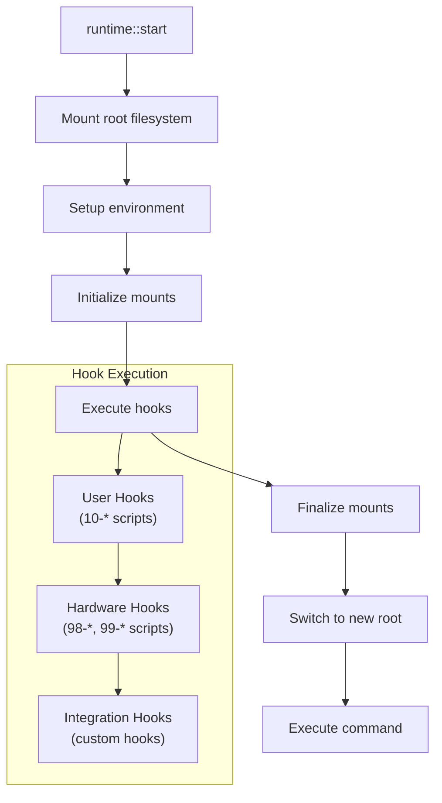
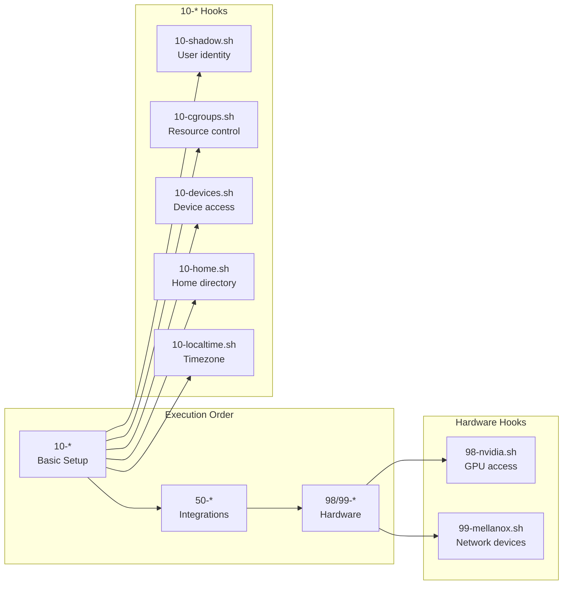
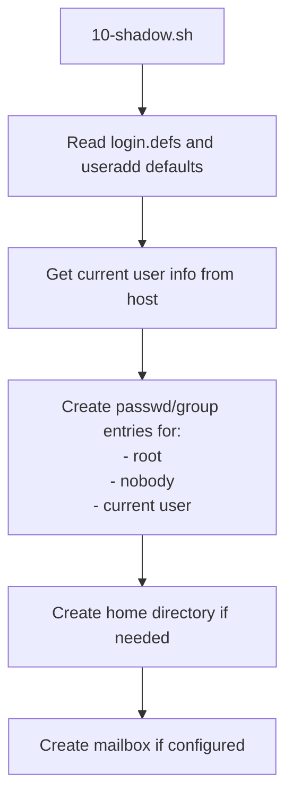
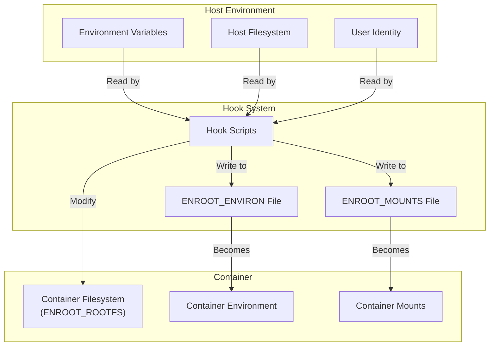

<!-- source: DeepWiki mcp.deepwiki.com · repo NVIDIA/enroot · page 5.1 User and System Hooks · fetched 2026-10-26 -->

# User and System Hooks

<details>
<summary>Relevant source files</summary>

The following files were used as context for generating this wiki page:

- [conf/hooks/10-cgroups.sh](conf/hooks/10-cgroups.sh)
- [conf/hooks/10-devices.sh](conf/hooks/10-devices.sh)
- [conf/hooks/10-home.sh](conf/hooks/10-home.sh)
- [conf/hooks/10-localtime.sh](conf/hooks/10-localtime.sh)
- [conf/hooks/10-shadow.sh](conf/hooks/10-shadow.sh)
- [conf/hooks/98-nvidia.sh](conf/hooks/98-nvidia.sh)
- [conf/hooks/99-mellanox.sh](conf/hooks/99-mellanox.sh)
- [conf/hooks/extra/50-slurm-pmi.sh](conf/hooks/extra/50-slurm-pmi.sh)
- [conf/mounts/10-system.fstab](conf/mounts/10-system.fstab)
- [conf/mounts/20-config.fstab](conf/mounts/20-config.fstab)

</details>


This page documents Enroot's hook system that allows customizing container environments. Hooks are shell scripts that execute during container startup to configure various aspects of the container environment, such as user identity, device access, and hardware integration. For information about hardware-specific hooks like NVIDIA GPU integration, see [Hardware Integration Hooks](#5.2), and for HPC integration hooks, see [HPC Integration Hooks](#5.3).

## Hook System Overview

The Enroot hook system provides a flexible way to customize containers at runtime. Hooks are executed during the container startup process, after mounts are initialized but before the container environment is finalized.



Sources: [conf/hooks/10-shadow.sh](), [conf/hooks/10-devices.sh](), [conf/hooks/10-home.sh](), [conf/hooks/10-cgroups.sh]()

## Hook Execution Order

Hooks are executed in numeric order based on their filename prefix. This order is important as it establishes dependencies between hooks:

1. **10-** prefix: Basic system and user setup (cgroups, devices, shadow, home, etc.)
2. **50-** prefix: Mid-level integrations (like Slurm PMI)
3. **98-99** prefix: Hardware integrations (NVIDIA GPUs, Mellanox networking)



Sources: [conf/hooks/10-shadow.sh](), [conf/hooks/10-devices.sh](), [conf/hooks/10-home.sh](), [conf/hooks/10-cgroups.sh](), [conf/hooks/10-localtime.sh](), [conf/hooks/98-nvidia.sh](), [conf/hooks/99-mellanox.sh]()

## Core System Hooks

### User Identity (10-shadow.sh)

The shadow hook configures user identity within the container by creating necessary entries in `/etc/passwd` and `/etc/group`. It ensures that:

1. The container has entries for root, nobody, and the current user
2. The user's home directory exists and is properly populated
3. User mailbox is created if configured



Sources: [conf/hooks/10-shadow.sh:17-90]()

### Resource Controls (10-cgroups.sh)

The cgroups hook mounts the host's cgroup filesystem into the container, allowing resource controls to be visible inside. This is important for monitoring and sometimes necessary for applications that need to read their resource limits.

Sources: [conf/hooks/10-cgroups.sh:17-33]()

### Device Access (10-devices.sh)

When `ENROOT_RESTRICT_DEV` is set, this hook restricts device access by creating a minimal `/dev` structure in the container with only essential devices:

- Basic devices: `/dev/null`, `/dev/zero`, `/dev/full`, `/dev/random`, `/dev/urandom`
- TTY devices: `/dev/tty`, `/dev/pts/*`, `/dev/console` (if stdin is a terminal)
- Communication: `/dev/shm`, `/dev/mqueue`, `/dev/log`
- File descriptor symlinks: `/dev/fd`, `/dev/stdin`, `/dev/stdout`, `/dev/stderr`

Sources: [conf/hooks/10-devices.sh:17-49]()

### Home Directory (10-home.sh)

When `ENROOT_MOUNT_HOME` is set, this hook mounts the user's home directory from the host into the container. If `ENROOT_REMAP_ROOT` is also set, the home directory is mounted at `/root`; otherwise, it's mounted at the same path as on the host.

Sources: [conf/hooks/10-home.sh:17-37]()

### Timezone (10-localtime.sh)

This hook ensures the container has the same timezone as the host by copying the host's `/etc/localtime` configuration.

Sources: [conf/hooks/10-localtime.sh:17-31]()

## Environment Variables Controlling Hooks

Many hooks are controlled by environment variables. Here's a summary of the most important ones:

| Environment Variable | Hook | Purpose |
|----------------------|------|---------|
| `ENROOT_RESTRICT_DEV` | 10-devices.sh | When set, restricts device access in the container |
| `ENROOT_MOUNT_HOME` | 10-home.sh | When set, mounts the user's home directory |
| `ENROOT_REMAP_ROOT` | 10-home.sh | When set with `ENROOT_MOUNT_HOME`, mounts home at `/root` |
| `NVIDIA_VISIBLE_DEVICES` | 98-nvidia.sh | Controls which GPUs are visible in the container |
| `NVIDIA_DRIVER_CAPABILITIES` | 98-nvidia.sh | Controls which GPU capabilities are enabled |
| `MELLANOX_VISIBLE_DEVICES` | 99-mellanox.sh | Controls which Mellanox devices are visible |
| `SLURM_*` | 50-slurm-pmi.sh | SLURM integration variables |

Sources: [conf/hooks/10-devices.sh](), [conf/hooks/10-home.sh](), [conf/hooks/98-nvidia.sh](), [conf/hooks/99-mellanox.sh](), [conf/hooks/extra/50-slurm-pmi.sh]()

## Hook Filesystem Interactions

Hooks interact with the container filesystem in several ways:



Sources: [conf/hooks/10-shadow.sh](), [conf/hooks/10-devices.sh](), [conf/hooks/10-home.sh](), [conf/hooks/10-cgroups.sh]()

### Key Files and Directories

Hooks have access to several environment variables that point to important files and directories:

| Variable | Purpose |
|----------|---------|
| `ENROOT_ROOTFS` | Root of the container filesystem |
| `ENROOT_MOUNTS` | File to add additional mount entries |
| `ENROOT_ENVIRON` | File to add environment variables for the container |
| `ENROOT_LIBRARY_PATH` | Path to Enroot's library functions |
| `ENROOT_RUNTIME_PATH` | Path to Enroot's runtime directory |

Sources: [conf/hooks/10-shadow.sh](), [conf/hooks/10-devices.sh](), [conf/hooks/10-home.sh](), [conf/hooks/10-cgroups.sh]()

## Creating Custom Hooks

Custom hooks can be created by placing shell scripts in the appropriate hooks directory. The default location is:

- System-wide hooks: `/etc/enroot/hooks/`
- User-specific hooks: `~/.config/enroot/hooks/`

Custom hooks should:

1. Start with a numeric prefix to define execution order
2. Be executable (`chmod +x`)
3. Use the environment variables provided by Enroot (`ENROOT_ROOTFS`, etc.)
4. Exit with code 0 on success

For example, a custom hook to mount an additional directory might look like:

```bash
#!/bin/bash
# 20-custom-mount.sh

# Skip if environment variable is not set
if [ -z "${MY_CUSTOM_DIR-}" ]; then
    exit 0
fi

# Add custom mount to ENROOT_MOUNTS
printf "%s %s none x-create=dir,bind,ro\n" "${MY_CUSTOM_DIR}" "${MY_CUSTOM_DIR}" >> "${ENROOT_MOUNTS}"
```

Sources: [conf/hooks/10-shadow.sh](), [conf/hooks/10-devices.sh](), [conf/hooks/10-home.sh]()

## Default System Mounts

In addition to the mounts created by hooks, Enroot provides default system mounts defined in the mount configuration files:

### System Mounts (10-system.fstab)

```
/proc       /proc       none    x-create=dir,rbind,rw,nosuid,nodev,noexec,rslave
/sys        /sys        none    x-create=dir,rbind,ro,nosuid,nodev,noexec,rslave
/dev        /dev        none    x-create=dir,rbind,rw,nosuid,noexec,rslave
tmpfs       /tmp        tmpfs   x-create=dir,rw,nosuid,nodev,mode=755,slave
tmpfs       /var/run    tmpfs   x-create=dir,rw,nosuid,nodev,mode=755,slave
tmpfs       /var/lock   tmpfs   x-create=dir,rw,nosuid,nodev,mode=755,slave
/dev/shm    /dev/shm    none    x-create=dir,bind,rw,nosuid,nodev,noexec,rslave
```

### Configuration Mounts (20-config.fstab)

```
/etc/hosts          /etc/hosts          none    x-create=file,bind,ro,nosuid,nodev,noexec,private
/etc/hostname       /etc/hostname       none    x-create=file,bind,ro,nosuid,nodev,noexec,private
/etc/resolv.conf    /etc/resolv.conf    none    x-create=file,bind,ro,nosuid,nodev,noexec,private
/etc/machine-id     /etc/machine-id     none    x-create=file,bind,ro,nosuid,nodev,noexec,private,nofail,silent
```

Sources: [conf/mounts/10-system.fstab](), [conf/mounts/20-config.fstab]()

These default mounts can be overridden or extended by hooks as needed.

---

