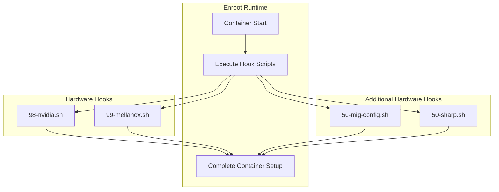
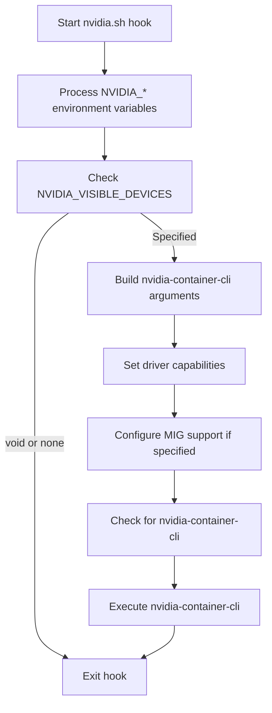
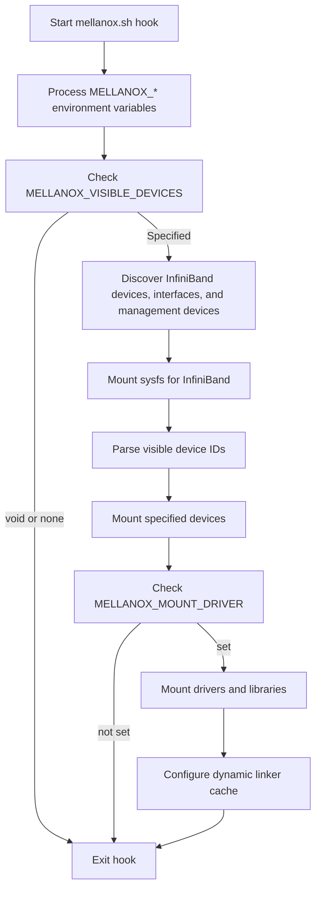
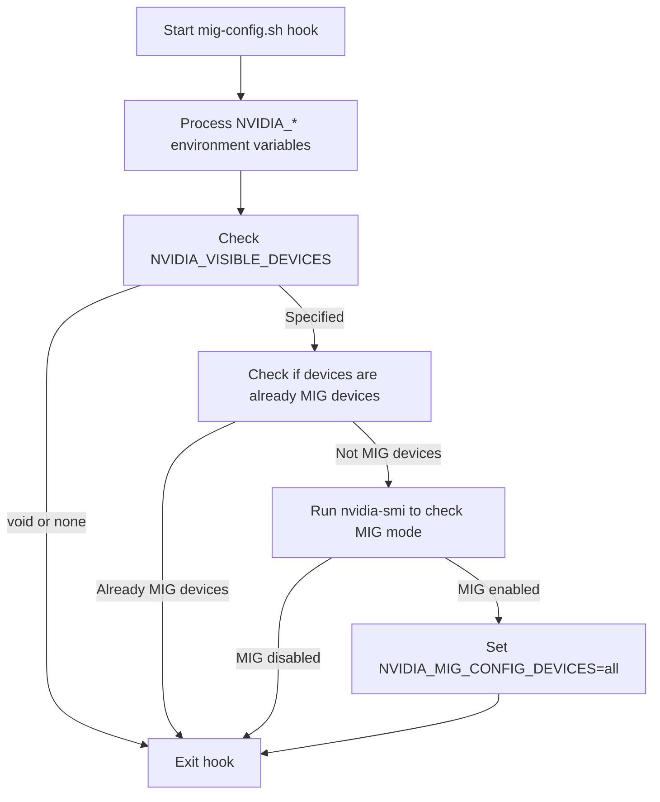
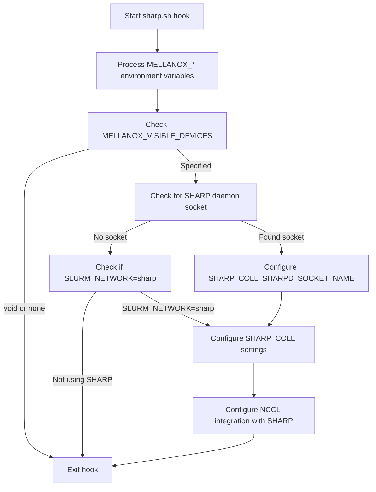
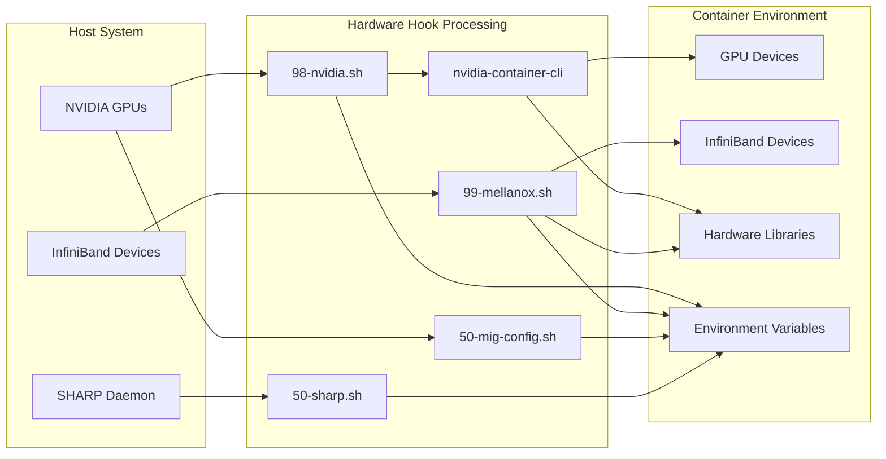

<!-- source: DeepWiki mcp.deepwiki.com · repo NVIDIA/enroot · page 5.2 Hardware Integration Hooks · fetched 2026-10-26 -->

# Hardware Integration Hooks

<details>
<summary>Relevant source files</summary>

The following files were used as context for generating this wiki page:

- [conf/hooks/10-shadow.sh](conf/hooks/10-shadow.sh)
- [conf/hooks/98-nvidia.sh](conf/hooks/98-nvidia.sh)
- [conf/hooks/99-mellanox.sh](conf/hooks/99-mellanox.sh)
- [conf/hooks/extra/50-mig-config.sh](conf/hooks/extra/50-mig-config.sh)
- [conf/hooks/extra/50-sharp.sh](conf/hooks/extra/50-sharp.sh)
- [conf/hooks/extra/50-slurm-pmi.sh](conf/hooks/extra/50-slurm-pmi.sh)

</details>


## Introduction

The Hardware Integration Hooks provide mechanisms to expose and configure specialized hardware devices within Enroot containers. These hooks focus primarily on NVIDIA GPUs and Mellanox networking devices, enabling containerized applications to utilize hardware acceleration and high-performance networking capabilities. For information about general user hooks or HPC integration hooks, see [User and System Hooks](#5.1) and [HPC Integration Hooks](#5.3) respectively.

Sources: [conf/hooks/98-nvidia.sh](), [conf/hooks/99-mellanox.sh]()

## Hook System Architecture

The hardware integration hooks are implemented as shell scripts that are executed during container startup and are responsible for configuring hardware access within the container environment.

### Hook Execution Flow Diagram



Sources: [conf/hooks/98-nvidia.sh](), [conf/hooks/99-mellanox.sh](), [conf/hooks/extra/50-mig-config.sh](), [conf/hooks/extra/50-sharp.sh]()

## NVIDIA GPU Integration

The NVIDIA GPU integration hook (98-nvidia.sh) enables containerized applications to access NVIDIA GPUs using the NVIDIA Container Toolkit (`nvidia-container-cli`).

### Configuration Environment Variables

| Environment Variable | Description |
|---------------------|-------------|
| `NVIDIA_VISIBLE_DEVICES` | Controls which GPUs are accessible inside the container. Use "all" for all GPUs, "none" to disable, or a comma-separated list of device indices. |
| `NVIDIA_DRIVER_CAPABILITIES` | Specifies which driver capabilities to enable (compute, compat32, display, graphics, utility, video, or all) |
| `NVIDIA_MIG_CONFIG_DEVICES` | Specifies devices for MIG configuration |
| `NVIDIA_MIG_MONITOR_DEVICES` | Specifies devices for MIG monitoring |
| `NVIDIA_REQUIRE_*` | Sets requirements for the NVIDIA driver |
| `NVIDIA_DISABLE_REQUIRE` | If set, disables the NVIDIA_REQUIRE_* check |

### NVIDIA Integration Workflow Diagram



### Implementation Details

The NVIDIA GPU hook performs the following operations:

1. Processes environment variables with the `NVIDIA_` prefix to configure GPU access [conf/hooks/98-nvidia.sh:26-28]()
2. Verifies the visibility settings in `NVIDIA_VISIBLE_DEVICES` [conf/hooks/98-nvidia.sh:32-38]()
3. Constructs command-line arguments for `nvidia-container-cli` based on these variables
4. Configures driver capabilities based on `NVIDIA_DRIVER_CAPABILITIES` [conf/hooks/98-nvidia.sh:50-64]()
5. Adds support for GDRCopy (required for GPUDirect RDMA) [conf/hooks/98-nvidia.sh:81-83]()
6. Executes `nvidia-container-cli` to configure GPU access in the container rootfs [conf/hooks/98-nvidia.sh:85]()

The hook requires the NVIDIA Container Toolkit (`nvidia-container-cli`) to be installed on the host system.

Sources: [conf/hooks/98-nvidia.sh:16-86]()

## Mellanox Networking Integration

The Mellanox networking integration hook (99-mellanox.sh) enables containerized applications to access Mellanox InfiniBand devices, particularly useful for high-performance computing workloads.

### Configuration Environment Variables

| Environment Variable | Description |
|---------------------|-------------|
| `MELLANOX_VISIBLE_DEVICES` | Controls which devices are accessible. Use "all" for all devices, "none" to disable, or a comma-separated list of device indices. |
| `MELLANOX_CONFIG_DIR` | Specifies the location of the InfiniBand configuration directory (default: /etc/libibverbs.d) |
| `MELLANOX_PROVIDER_DIR` | Specifies the location of the InfiniBand provider directory (distro-specific defaults) |
| `MELLANOX_MOUNT_DRIVER` | Controls whether to mount the driver inside the container |

### Mellanox Integration Workflow Diagram



### Implementation Details

The Mellanox networking hook performs the following operations:

1. Discovers InfiniBand devices, interfaces, and management devices on the host [conf/hooks/99-mellanox.sh:42-64]()
2. Mounts the necessary sysfs entries for InfiniBand support [conf/hooks/99-mellanox.sh:66-76]()
3. Mounts the specified devices based on `MELLANOX_VISIBLE_DEVICES` [conf/hooks/99-mellanox.sh:78-97]()
4. If `MELLANOX_MOUNT_DRIVER` is set, mounts the necessary drivers and libraries [conf/hooks/99-mellanox.sh:99-151]()
5. Configures the dynamic linker to find the mounted libraries [conf/hooks/99-mellanox.sh:153-157]()
6. Verifies compatibility by running `ibv_devices` if available [conf/hooks/99-mellanox.sh:159-169]()

The hook supports both MLX4 and MLX5 devices and handles the differences between Debian-based and other distributions.

Sources: [conf/hooks/99-mellanox.sh:16-169]()

## Additional Hardware Integration Hooks

### MIG Configuration Hook

The MIG configuration hook (50-mig-config.sh) detects Multi-Instance GPU (MIG) enabled GPUs and automatically configures the appropriate environment variables.



This hook:
1. Checks if GPUs are specified in `NVIDIA_VISIBLE_DEVICES` [conf/hooks/extra/50-mig-config.sh:28-33]()
2. Skips configuration if devices are already MIG devices [conf/hooks/extra/50-mig-config.sh:31-33]()
3. Uses `nvidia-smi` to detect if MIG mode is enabled on the GPUs [conf/hooks/extra/50-mig-config.sh:35-41]()
4. If MIG is enabled, sets `NVIDIA_MIG_CONFIG_DEVICES=all` in the container environment [conf/hooks/extra/50-mig-config.sh:43-45]()

Sources: [conf/hooks/extra/50-mig-config.sh:16-46]()

### SHARP Integration Hook

The SHARP integration hook (50-sharp.sh) enables support for Mellanox SHARP (Scalable Hierarchical Aggregation and Reduction Protocol), which accelerates collective operations for HPC applications.



This hook configures SHARP for use with NCCL (NVIDIA Collective Communications Library) by:
1. Detecting the SHARP daemon socket [conf/hooks/extra/50-sharp.sh:32-34]()
2. Setting appropriate environment variables for SHARP configuration [conf/hooks/extra/50-sharp.sh:44-55]()
3. Configuring NCCL to use SHARP for collective operations [conf/hooks/extra/50-sharp.sh:57-59]()
4. Setting optimal thresholds based on Slurm or OpenMPI job size [conf/hooks/extra/50-sharp.sh:62-67]()

Sources: [conf/hooks/extra/50-sharp.sh:16-67]()

## Hardware Hook Integration System

The diagram below illustrates how the hardware integration hooks connect with physical hardware and the container environment:



Sources: [conf/hooks/98-nvidia.sh](), [conf/hooks/99-mellanox.sh](), [conf/hooks/extra/50-mig-config.sh](), [conf/hooks/extra/50-sharp.sh]()

## Usage Examples

### Basic GPU Access

```bash
# Make all GPUs visible
export NVIDIA_VISIBLE_DEVICES=all

# Enable compute and utility capabilities
export NVIDIA_DRIVER_CAPABILITIES=compute,utility

# Start the container
enroot start mycontainer
```

### InfiniBand Access

```bash
# Make all Mellanox devices visible
export MELLANOX_VISIBLE_DEVICES=all

# Mount the Mellanox driver inside the container
export MELLANOX_MOUNT_DRIVER=yes

# Start the container
enroot start mycontainer
```

### MIG Configuration

```bash
# Make specific GPUs visible
export NVIDIA_VISIBLE_DEVICES=0,1

# MIG configuration will be automatically detected by the 50-mig-config.sh hook
enroot start mycontainer
```

### SHARP for HPC Collectives

```bash
# Make all Mellanox devices visible
export MELLANOX_VISIBLE_DEVICES=all

# Configure NCCL to use SHARP (optional, done automatically by the hook)
export NCCL_COLLNET_ENABLE=1

# Start the container
enroot start mycontainer
```

Sources: [conf/hooks/98-nvidia.sh](), [conf/hooks/99-mellanox.sh](), [conf/hooks/extra/50-mig-config.sh](), [conf/hooks/extra/50-sharp.sh]()

---

