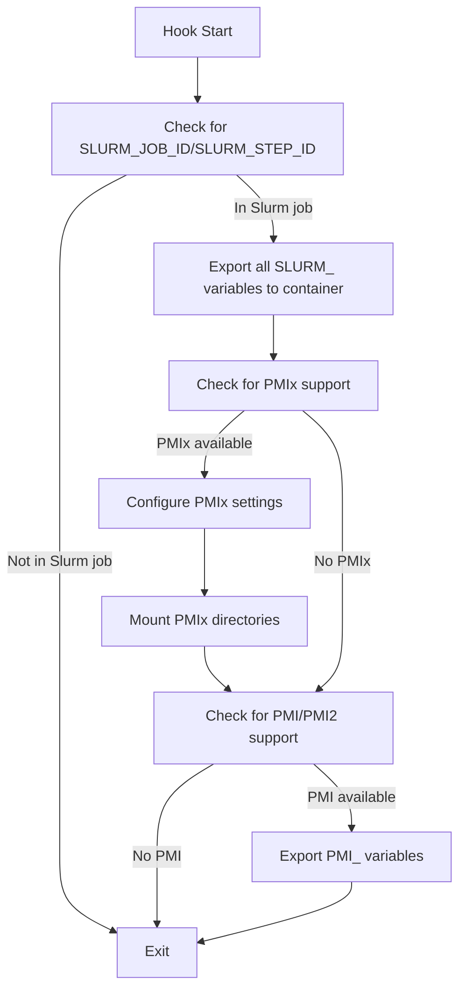
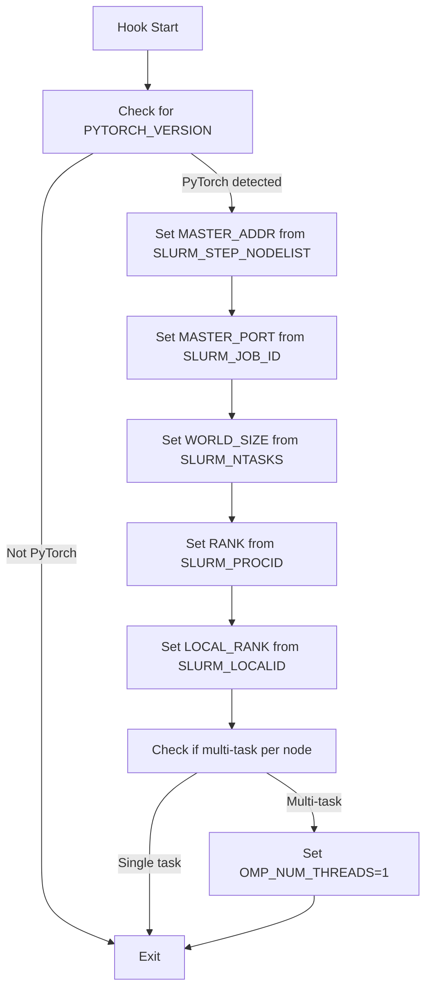
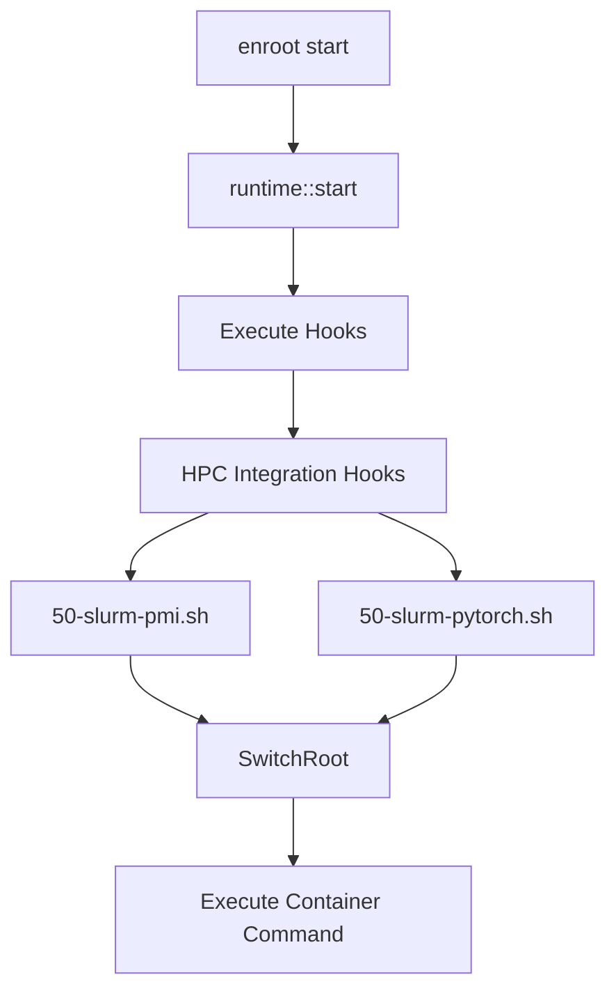

<!-- source: DeepWiki mcp.deepwiki.com · repo NVIDIA/enroot · page 5.3 HPC Integration Hooks · fetched 2026-10-26 -->

# HPC Integration Hooks

<details>
<summary>Relevant source files</summary>

The following files were used as context for generating this wiki page:

- [conf/hooks/10-shadow.sh](conf/hooks/10-shadow.sh)
- [conf/hooks/98-nvidia.sh](conf/hooks/98-nvidia.sh)
- [conf/hooks/99-mellanox.sh](conf/hooks/99-mellanox.sh)
- [conf/hooks/extra/50-slurm-pmi.sh](conf/hooks/extra/50-slurm-pmi.sh)
- [conf/hooks/extra/50-slurm-pytorch.sh](conf/hooks/extra/50-slurm-pytorch.sh)

</details>


Enroot's HPC Integration Hooks provide seamless integration between containerized applications and High-Performance Computing (HPC) infrastructure such as Slurm workload manager and distributed training frameworks. These hooks enable containers to leverage HPC resources by properly configuring process management interfaces and environment variables required for parallel and distributed execution.

For hardware-specific integration with GPUs and networking hardware, see [Hardware Integration Hooks](#5.2).

## Slurm Process Management Interface (PMI) Integration

The Slurm PMI integration hook enables containerized applications to leverage Slurm's process management capabilities for MPI and other parallel applications.

### Key Features

- **Automatic Slurm Environment Variable Propagation**: All Slurm environment variables (prefixed with `SLURM_`) are passed into the container
- **PMIx Support**: Process Management Interface Exascale (PMIx) configuration and directory mounting
- **Legacy PMI/PMI2 Support**: Support for applications using older PMI versions

### Implementation Details



The hook first checks if it's running within a Slurm job by examining `SLURM_JOB_ID` and `SLURM_STEP_ID` environment variables. For PMIx support, it:

1. Uses `scontrol` to discover Slurm spool directory and temporary filesystem paths
2. Exports all PMIx environment variables to the container
3. Sets up PMIx MCA (Modular Component Architecture) parameters
4. Mounts necessary PMIx directories from the host into the container

Sources: [conf/hooks/extra/50-slurm-pmi.sh:17-61]()

## PyTorch Integration with Slurm

The PyTorch Slurm hook automates configuration for PyTorch distributed training in Slurm environments.

### Key Features

- **Automatic Distributed Environment Setup**: Sets up all variables required for PyTorch distributed training
- **Performance Optimization**: Configures thread settings for optimal performance

### Environment Variables Configured

| Variable | Source | Purpose |
|----------|--------|---------|
| `MASTER_ADDR` | First node in `SLURM_STEP_NODELIST` | Address of master node for distributed coordination |
| `MASTER_PORT` | Derived from `SLURM_JOB_ID` | Communication port for distributed processes |
| `WORLD_SIZE` | `SLURM_NTASKS` | Total number of processes in the job |
| `RANK` | `SLURM_PROCID` | Global rank of current process |
| `LOCAL_RANK` | `SLURM_LOCALID` | Rank of process on the current node |
| `OMP_NUM_THREADS` | Set to 1 when multi-task | Controls OpenMP thread count |



The hook inspects the Slurm environment variables and translates them into the format expected by PyTorch's distributed training framework, writing them to `ENROOT_ENVIRON` for use inside the container.

Sources: [conf/hooks/extra/50-slurm-pytorch.sh:17-42]()

## Integration with Enroot's Hook System

HPC hooks are part of Enroot's hook architecture, executed during container initialization before the application starts.



The hook numbering scheme (`50-*`) determines execution order, with HPC hooks generally running after hardware integration hooks (`98-nvidia.sh`, `99-mellanox.sh`) but before application-specific hooks.

Sources: [conf/hooks/extra/50-slurm-pmi.sh](), [conf/hooks/extra/50-slurm-pytorch.sh]()

## Using HPC Integration Hooks

### Enabling the Hooks

HPC Integration Hooks are located in the `conf/hooks/extra` directory and must be explicitly enabled:

```bash
# Enable Slurm PMI integration
ln -sf /etc/enroot/hooks/extra/50-slurm-pmi.sh /etc/enroot/hooks/

# Enable PyTorch with Slurm integration
ln -sf /etc/enroot/hooks/extra/50-slurm-pytorch.sh /etc/enroot/hooks/
```

### Example: MPI Application with Slurm

With the Slurm PMI hook enabled, MPI applications gain access to Slurm's process management infrastructure:

```bash
# Run a 4-node MPI job with Enroot
srun -N 4 -n 16 enroot start my-mpi-container mpirun ./my_application
```

### Example: Distributed PyTorch Training

With the PyTorch hook enabled:

```bash
# Run distributed PyTorch training
srun -N 4 -n 16 --gpus-per-task=1 enroot start pytorch-container \
    python train.py --distributed
```

No manual environment configuration is needed as the hook automatically sets up `MASTER_ADDR`, `MASTER_PORT`, `WORLD_SIZE`, `RANK`, and `LOCAL_RANK`.

## Interactions with Other Hooks

The HPC integration hooks work in conjunction with other hooks in the Enroot ecosystem:

1. **Hardware Integration**: When used with [NVIDIA GPU hooks](#5.2), containers can access GPUs in an HPC environment
2. **User Integration**: Works with user namespace mapping provided by the shadow hook
3. **Network Integration**: Can be used with the Mellanox hook for high-speed networking

Sources: [conf/hooks/98-nvidia.sh](), [conf/hooks/99-mellanox.sh](), [conf/hooks/10-shadow.sh]()

---

