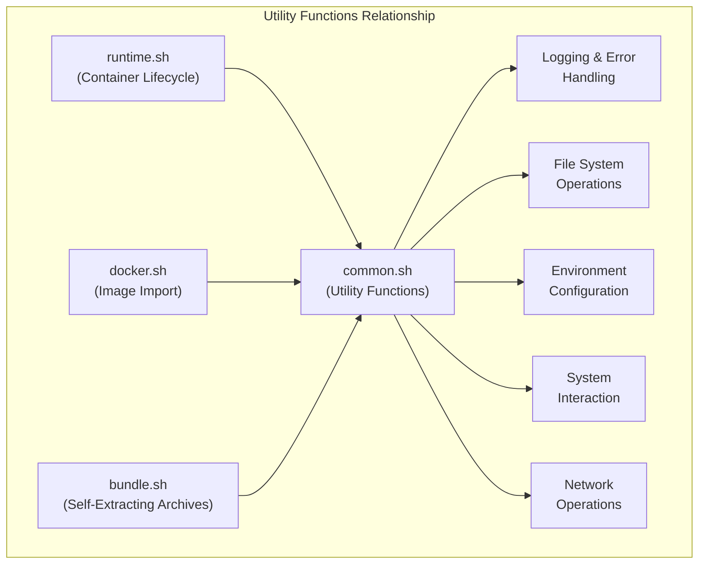
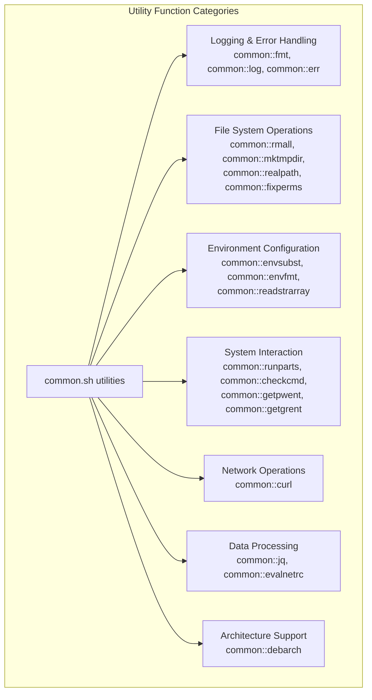
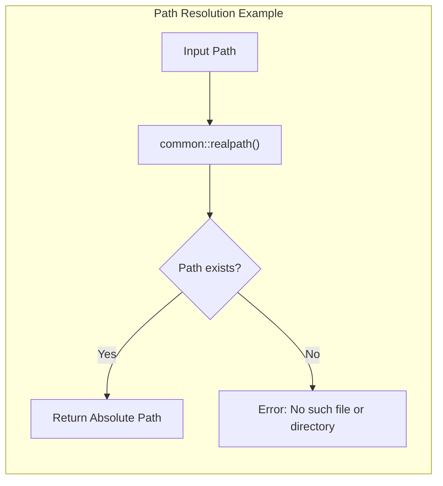
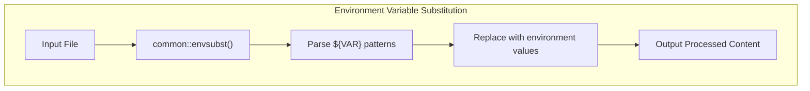
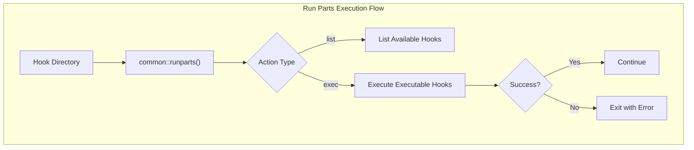
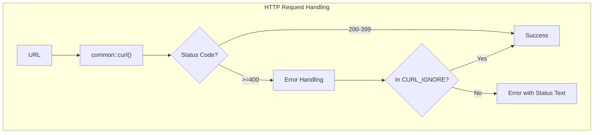
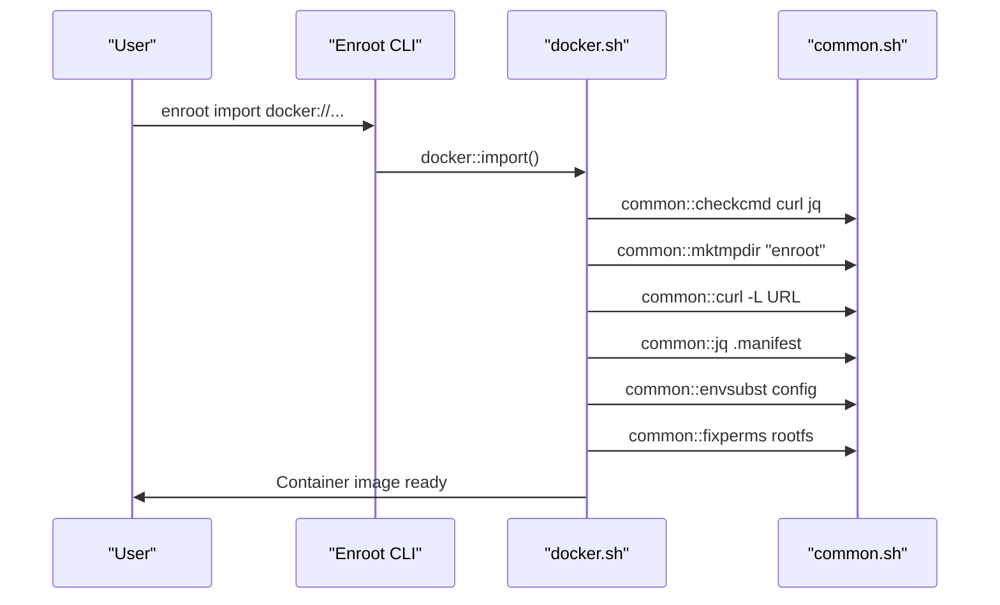

<!-- source: DeepWiki mcp.deepwiki.com · repo NVIDIA/enroot · page 6 Utility Functionality · fetched 2026-10-26 -->

# Utility Functionality

<details>
<summary>Relevant source files</summary>

The following files were used as context for generating this wiki page:

- [src/common.sh](src/common.sh)

</details>


## Introduction

Enroot includes a comprehensive set of utility functions that provide common services across the entire codebase. These utilities handle error management, file operations, environment configuration, and other low-level tasks that support the container management system.

This page documents the common utility functions located primarily in the `common.sh` file, which serves as a shared library for other major components like the runtime, Docker image handling, and bundle creation systems. For information about the core architecture, see [Core Architecture](#3).



Sources: [src/common.sh:15-276]()

## Core Utility Categories

The utility functions in Enroot can be divided into several categories based on their functionality:



Sources: [src/common.sh:15-276]()

## Logging and Error Handling

Enroot provides a flexible logging system that supports different log levels and output formatting. These functions handle information display, warnings, and error conditions.

| Function | Purpose | Implementation |
|----------|---------|----------------|
| `common::fmt` | Formats text with optional colors for terminal output | [src/common.sh:30-34]() |
| `common::log` | Logs messages at INFO, WARN, or ERROR levels | [src/common.sh:36-59]() |
| `common::err` | Logs an error message and exits with status code 1 | [src/common.sh:61-66]() |

Terminal colors are automatically detected and used only when standard error is connected to a terminal with color support.

Example usage pattern:
```
common::log INFO "Starting container preparation"
# Process execution...
[[ $success != true ]] && common::err "Container preparation failed"
common::log INFO "Container ready"
```

Sources: [src/common.sh:17-66]()

## File System Operations

Enroot includes several utility functions for file system management, which are crucial for container operations that require manipulation of directories, files, and paths.

| Function | Purpose | Implementation |
|----------|---------|----------------|
| `common::rmall` | Safely removes a path recursively, handling permission issues | [src/common.sh:68-73]() |
| `common::mktmpdir` | Creates a temporary directory with secure permissions | [src/common.sh:75-80]() |
| `common::chdir` | Changes directory with error handling | [src/common.sh:94-96]() |
| `common::realpath` | Resolves a path to its absolute form with error handling | [src/common.sh:145-153]() |
| `common::fixperms` | Fixes file permissions for container operation | [src/common.sh:230-237]() |
| `common::mountpoint` | Finds the mount point of a given path | [src/common.sh:268-276]() |

The file system operations prioritize safety with features like `--one-file-system` and `--preserve-root` to prevent accidental data loss.



Sources: [src/common.sh:68-80](), [src/common.sh:94-96](), [src/common.sh:145-153](), [src/common.sh:230-237](), [src/common.sh:268-276]()

## Environment and Configuration

Enroot provides utilities for handling environment variables, configuration files, and string processing, which support the container's runtime environment setup.

| Function | Purpose | Implementation |
|----------|---------|----------------|
| `common::read` | Safe read operation that doesn't fail on EOF | [src/common.sh:82-84]() |
| `common::readstrarray` | Converts a string into an array | [src/common.sh:86-92]() |
| `common::envsubst` | Performs environment variable substitution in files | [src/common.sh:155-173]() |
| `common::evalnetrc` | Evaluates .netrc-style files with password expressions | [src/common.sh:175-188]() |
| `common::envfmt` | Formats environment variable files by cleaning and validating | [src/common.sh:190-204]() |

The environment processing functions are particularly important for container configuration where environment variables define behavior.



Sources: [src/common.sh:82-92](), [src/common.sh:155-204]()

## System Interaction

These utilities allow Enroot to interact with the host system, execute commands, and check system requirements.

| Function | Purpose | Implementation |
|----------|---------|----------------|
| `common::runparts` | Executes scripts in a directory similar to run-parts | [src/common.sh:206-222]() |
| `common::checkcmd` | Verifies the existence of required commands | [src/common.sh:224-228]() |
| `common::getpwent` | Gets the current user's password entry based on UID map | [src/common.sh:239-244]() |
| `common::getgrent` | Gets the current group entry based on GID map | [src/common.sh:246-251]() |

The `common::runparts` function is especially important for the hook system in Enroot, allowing modular extension of container functionality. For more information on hooks, see [Hook System](#5).



Sources: [src/common.sh:206-251]()

## Network Operations

Enroot includes utilities for network operations, particularly for downloading container images and interacting with registries.

| Function | Purpose | Implementation |
|----------|---------|----------------|
| `common::curl` | Wrapper around curl with error handling and status code processing | [src/common.sh:98-137]() |

The `common::curl` function enhances the standard `curl` command with comprehensive HTTP status code handling and error reporting. It's a critical function for the Docker image import system, which relies heavily on HTTP communications with registries.



Sources: [src/common.sh:98-137]()

## Data Processing

Enroot provides utilities for processing various data formats, particularly JSON which is commonly used in container metadata.

| Function | Purpose | Implementation |
|----------|---------|----------------|
| `common::jq` | Wrapper around jq for JSON processing with error handling | [src/common.sh:139-143]() |

The `common::jq` function simplifies the use of the `jq` tool for processing JSON data, which is extensively used when handling container image manifests and configuration.

Sources: [src/common.sh:139-143]()

## Architecture Support

Enroot includes functions to handle architecture-specific operations, which are important for container image compatibility.

| Function | Purpose | Implementation |
|----------|---------|----------------|
| `common::debarch` | Converts system architecture names to Debian package architecture names | [src/common.sh:253-266]() |

This function is particularly useful when working with Debian-based container images, allowing for architecture-specific operations based on the host system's architecture.

Sources: [src/common.sh:253-266]()

## Usage Patterns

The utility functions in Enroot are designed to be composed together to implement higher-level operations. Here's a diagram illustrating how these utilities might be used in a typical container import workflow:



The utility functions provide a foundation of reliable, reusable components that simplify the implementation of more complex operations throughout the Enroot codebase.

Sources: [src/common.sh:15-276]()

## Summary

The utility functionality in Enroot provides a robust foundation of helper functions that are used throughout the codebase. These utilities handle common tasks such as logging, file operations, environment management, and system interactions, allowing the higher-level components to focus on their specific responsibilities.

By centralizing these common functions in `common.sh`, Enroot achieves greater code reuse, consistency, and maintainability across the project.

---

