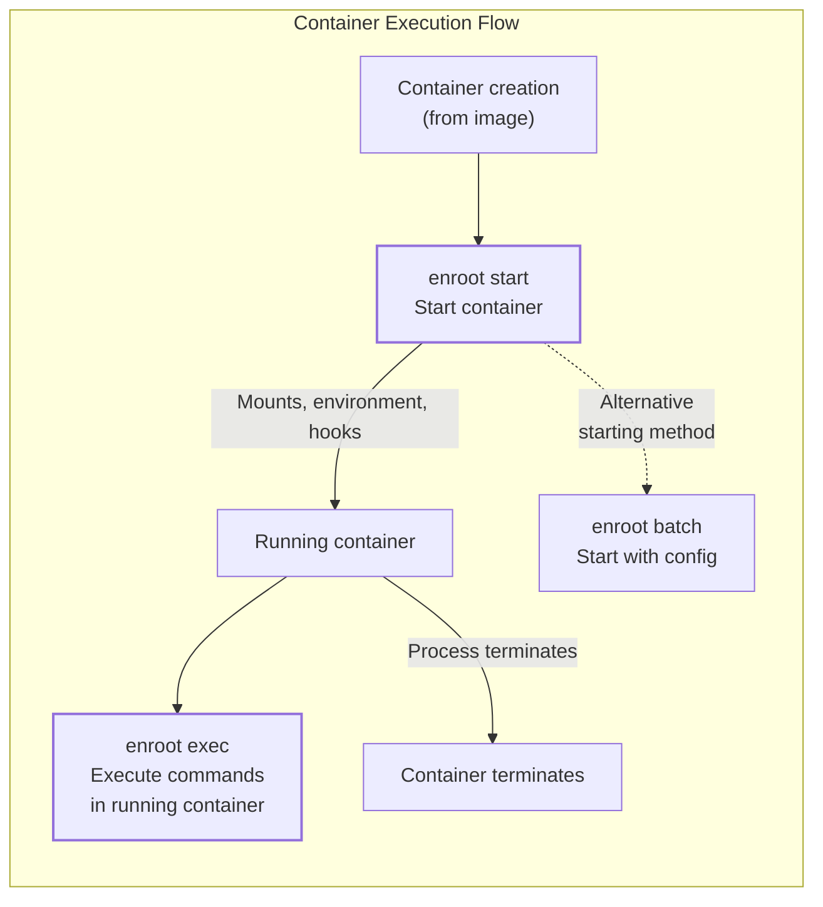
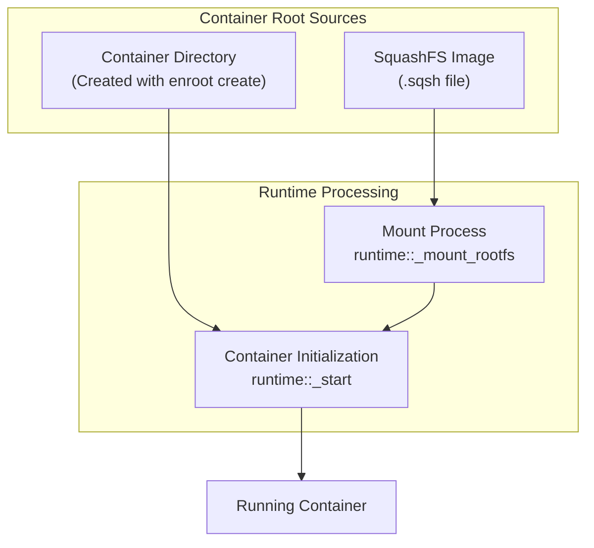
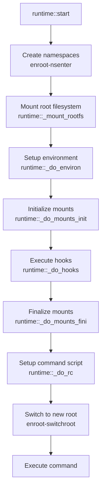

<!-- source: DeepWiki mcp.deepwiki.com · repo NVIDIA/enroot · page 7 Running Containers · fetched 2026-10-26 -->

# Running Containers

<details>
<summary>Relevant source files</summary>

The following files were used as context for generating this wiki page:

- [doc/cmd/batch.md](doc/cmd/batch.md)
- [doc/cmd/start.md](doc/cmd/start.md)
- [src/runtime.sh](src/runtime.sh)

</details>


This document provides a detailed guide on how to run and manage containers with Enroot. It covers the core commands and techniques for executing containers, configuring their runtime environment, and managing their lifecycle. For information about container image management, see [Container Image Management](#4).

## Container Execution Overview

Enroot provides several commands for running containers, with `enroot start` being the primary method. Container execution is the final stage of the container lifecycle after importing an image and creating a container root filesystem.



Sources: [src/runtime.sh:277-350](), [doc/cmd/start.md:1-32](), [doc/cmd/batch.md:1-13]()

## Starting Containers

The `enroot start` command is the primary method to run containers. It sets up the container environment and launches the command specified in the container's command script (entrypoint).

### Basic Usage

```
enroot start [options] [--] NAME|IMAGE [COMMAND] [ARG...]
```

Where:
- `NAME` is a container name (filesystem directory in `$ENROOT_DATA_PATH`)
- `IMAGE` is a SquashFS image file (.sqsh)
- `COMMAND` and `ARG...` are passed to the container's command script

If no command is specified, an interactive shell is started within the container.

### Key Options

| Option | Description |
|--------|-------------|
| `-c, --conf CONFIG` | Specify a configuration script to run before the container starts |
| `-e, --env KEY[=VAL]` | Export an environment variable inside the container |
| `--rc SCRIPT` | Override the command script inside the container |
| `-r, --root` | Ask to be remapped to root inside the container |
| `-w, --rw` | Make the container root filesystem writable |
| `-m, --mount FSTAB` | Perform a mount from the host inside the container (colon-separated) |

Sources: [src/runtime.sh:277-350](), [doc/cmd/start.md:1-32]()

### Container Root Types

Enroot supports starting containers from two types of roots:

1. **Container filesystem directory** - A directory created using `enroot create`
2. **SquashFS image file** - Direct execution from a SquashFS image



Starting a container directly from an image requires:
- Linux kernel ≥ 4.18
- [fuse-overlayfs](https://github.com/containers/fuse-overlayfs)
- [squashfuse](https://github.com/vasi/squashfuse)

When starting from an image, changes are stored in memory and do not persist after the container terminates.

Sources: [src/runtime.sh:141-204](), [src/runtime.sh:206-275](), [doc/cmd/start.md:80-86]()

## Runtime Configuration

### Configuration Script

A configuration script can be specified with the `--conf` option to customize the container environment before it starts. This is a standard bash script that can define one or more of the following functions:

| Function | Description |
|----------|-------------|
| `environ()` | Outputs environment configuration |
| `mounts()` | Outputs mount configuration |
| `hooks()` | Specific instance of pre-start hook scripts |
| `rc()` | Override the command script inside the container |

Configuration parameters can also be passed through special comment directives, for example:
```bash
#ENROOT_REMAP_ROOT=y
```

Example configuration script:
```bash
#ENROOT_REMAP_ROOT=y

environ() {
    # Keep all the environment from the host
    env
}

mounts() {
    # Mount the current working directory to /mnt
    echo "${PWD} /mnt none bind"
}
```

Sources: [doc/cmd/start.md:33-77](), [src/runtime.sh:32-139]()

### Mounting Filesystems

Mounts allow exposing host directories or files inside the container. There are several ways to define mounts:

1. Command line with `-m` or `--mount` option (colon-separated fields)
2. Through the `mounts()` function in a configuration script (space-separated fields)
3. Using mount configuration files in system or user directories

The mount specification follows the format:
```
SOURCE DESTINATION TYPE OPTIONS
```

For example:
```
/host/path /container/path none bind
```

Sources: [src/runtime.sh:64-83](), [src/runtime.sh:112-128](), [doc/cmd/start.md:28-30]()

### Environment Variables

Environment variables can be specified in several ways:

1. Command line with `-e` or `--env` option
2. Through the `environ()` function in a configuration script
3. Using environment configuration files in system or user directories

Environment configuration files are processed in the following order:
1. `/etc/environment` from the container root
2. System and user environment configuration directories
3. User-defined `environ()` function
4. Command-line `-e` options

Sources: [src/runtime.sh:32-62](), [doc/cmd/start.md:27-30]()

## Container Execution Flow

When you run `enroot start`, the following sequence of operations occurs:



The startup process:

1. Creates new namespaces for isolation
2. Mounts the container root filesystem
3. Sets up the container environment
4. Performs initial mounts from configuration
5. Runs hook scripts for customization
6. Performs final mounts from command line and config
7. Sets up the command script (entrypoint)
8. Switches to the new root filesystem
9. Executes the command within the container

Sources: [src/runtime.sh:206-275](), [src/runtime.sh:276-350]()

### Container Isolation

Enroot uses Linux namespaces to provide isolation for containers:

1. **User namespace** - Maps container UIDs/GIDs to host UIDs/GIDs
2. **Mount namespace** - Provides filesystem isolation

By default, containers run with the user's UID/GID. The `--root` option (or `ENROOT_REMAP_ROOT=yes`) can remap the user to root inside the container.

Sources: [src/runtime.sh:345-349]()

## Batch Command for Simplified Execution

The `enroot batch` command provides a simplified approach to starting containers using a configuration script. It's equivalent to `enroot start -c CONFIG` with the root filesystem specified in the configuration file.

Usage:
```
enroot batch [options] [--] CONFIG [COMMAND] [ARG...]
```

The configuration script must include the `ENROOT_ROOTFS` directive to specify the root filesystem:

```bash
#! /usr/bin/enroot batch
#ENROOT_ROOTFS=ubuntu
#ENROOT_REMAP_ROOT=y

mounts() {
    echo "${PWD} /mnt none bind"
}
```

This can be made executable and run directly as a script.

Sources: [doc/cmd/batch.md:1-50]()

## Running Commands in Existing Containers

The `enroot exec` command allows executing commands in an already running container:

```
enroot exec PID [COMMAND] [ARG...]
```

Where `PID` is the process ID of a running container.

This command:
1. Joins the namespaces of the target process
2. Sets up the environment
3. Executes the specified command in the container's context

Sources: [src/runtime.sh:352-382]()

## Global Configuration Settings

These environment variables control container execution behavior:

| Setting | Default | Description |
|---------|---------|-------------|
| `ENROOT_LOGIN_SHELL` | `yes` | Use a login shell to run the container initialization |
| `ENROOT_ROOTFS_WRITABLE` | `no` | Make the container root filesystem writable (same as `--rw`) |
| `ENROOT_REMAP_ROOT` | `no` | Remap the current user to root inside containers (same as `--root`) |
| `ENROOT_ALLOW_SUPERUSER` | `no` | Allow root to retain superuser privileges inside containers |

Sources: [doc/cmd/start.md:89-96](), [doc/cmd/batch.md:25-31]()