# Page: Overview

# Overview

<details>
<summary>Relevant source files</summary>

The following files were used as context for generating this wiki page:

- [README.md](README.md)
- [enroot.in](enroot.in)

</details>


This document provides an introduction to Enroot, a tool designed to turn traditional container/OS images into unprivileged sandboxes. It covers the system's purpose, key features, architecture, and core capabilities. For detailed installation instructions, see [Installation](#2).

## What is Enroot?

Enroot is a lightweight container platform that can be thought of as an enhanced unprivileged `chroot(1)`. It uses the same underlying technologies as containers but removes much of the isolation they typically provide while preserving filesystem separation.

This approach is particularly beneficial in high-performance computing (HPC) environments or virtualized environments where portability and reproducibility are important, but additional isolation layers would introduce unnecessary overhead.

Unlike traditional container engines that focus on isolation, Enroot prioritizes:

1. Performance - minimal runtime overhead
2. Usability - simple filesystem format and user-friendly commands
3. Unprivileged operation - no root permissions required
4. Flexibility - extensible hook system for customization

Sources: [README.md:3-9]()

## Key Features

Enroot's design philosophy embraces the following principles:

- **Standalone operation**: No daemon processes required
- **Fully unprivileged**: No setuid binaries, supports multi-user environments
- **Simplicity**: Easy to use with a simple image format and intuitive commands
- **Composition**: System-wide and user-specific configurations
- **Performance**: Fast Docker image import (3-5x speedup on large images)
- **GPU integration**: Built-in support through libnvidia-container
- **Collaboration**: Support for bundles and in-memory containers

Sources: [README.md:20-30]()

## System Architecture

Enroot's architecture consists of several core components that work together to provide container functionality without requiring privileged access.

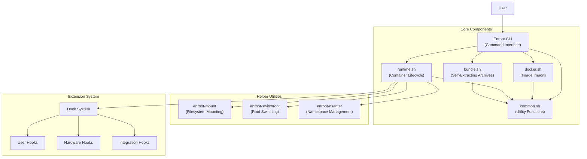

The architecture consists of:

1. **Command-Line Interface**: Processes user commands and routes them to appropriate handlers
2. **Core Components**: Manage container lifecycle, image import, and utility functions
3. **Helper Utilities**: Low-level tools for namespace and filesystem operations
4. **Extension System**: Hook-based framework for extending functionality

Sources: [enroot.in:111-114]()

## Container Workflow

Enroot provides a complete workflow for container management, from importing images to running containerized applications.

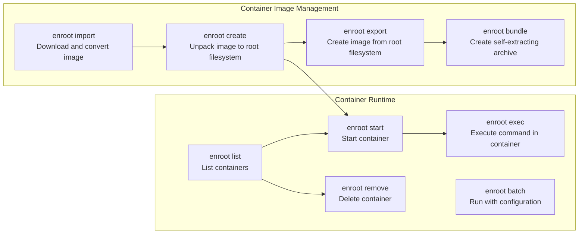

The typical workflow involves:

1. **Importing** a container image from a source like Docker Hub
2. **Creating** a container root filesystem from the image
3. **Starting** the container with optional configuration
4. **Executing** commands inside the running container

Sources: [enroot.in:173-187](), [enroot.in:208-226]()

## Command Structure

The Enroot CLI implements a command-based interface with a variety of options for each operation. The table below summarizes the main commands:

| Command | Purpose | Key Options |
|---------|---------|-------------|
| `import` | Import container images from registries | `--arch`, `--output` |
| `create` | Create container root filesystem | `--name`, `--force` |
| `start`  | Start a container | `--conf`, `--env`, `--mount`, `--rw` |
| `exec`   | Execute commands in containers | `--env` |
| `export` | Create container images | `--output`, `--force` |
| `bundle` | Create self-extracting archives | `--output`, `--desc`, `--checksum` |
| `list`   | List available containers | `--fancy` |
| `remove` | Delete containers | `--force` |
| `batch`  | Start with configuration | N/A |

Sources: [enroot.in:115-247]()

## Configuration System

Enroot uses a flexible configuration system that supports both system-wide and user-specific settings.

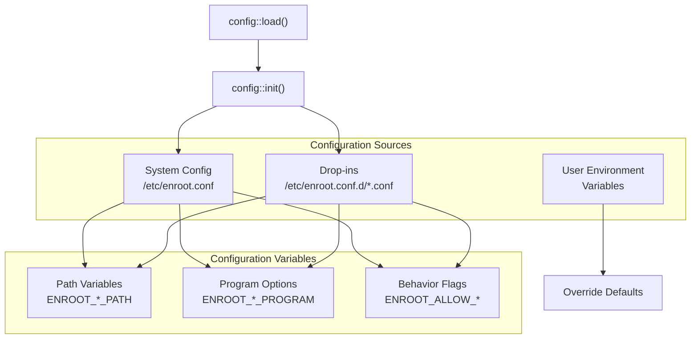

The configuration system provides:

1. System-wide defaults in `/etc/enroot.conf`
2. Modular configuration through drop-in files
3. User-specific overrides through environment variables
4. Command-specific options through directives in configuration scripts

Sources: [enroot.in:25-103]()

## Example Usage

Below is a basic example of using Enroot to import and run an Ubuntu container:

```bash
# Import an Ubuntu image from Docker Hub
enroot import docker://ubuntu

# Create a container from the image
enroot create ubuntu.sqsh

# Start the container
enroot start ubuntu
```

For more advanced usage, Enroot supports mounting host directories, environment variable injection, and GPU device access:

```bash
# Start a container with GPU access, a mounted directory, and custom environment
enroot start --mount /data:/container/data --env CUDA_VISIBLE_DEVICES=0 ubuntu
```

Sources: [README.md:13-18]()

## Related Documentation

For more specific details on individual components of the Enroot system, refer to:

- [Installation](#2): How to install Enroot
- [Core Architecture](#3): Details on internal architecture
- [Container Image Management](#4): In-depth documentation on image operations
- [Hook System](#5): Customizing container behavior with hooks

---

# Page: Installation

# Installation

<details>
<summary>Relevant source files</summary>

The following files were used as context for generating this wiki page:

- [Makefile](Makefile)
- [doc/cmd/version.md](doc/cmd/version.md)
- [doc/installation.md](doc/installation.md)
- [doc/requirements.md](doc/requirements.md)

</details>


This page explains how to install Enroot on your system, including prerequisites and different installation methods. For information about using Enroot after installation, see [Running Containers](#7).

## Prerequisites

Before installing Enroot, ensure your system meets the necessary requirements.

### Kernel Requirements

| Requirement | Details |
|-------------|---------|
| Kernel Version | Linux Kernel >= 3.10 |
| Required Kernel Config | • `CONFIG_NAMESPACES`<br>• `CONFIG_USER_NS`<br>• `CONFIG_SECCOMP_FILTER` |
| For Docker Images | • `CONFIG_OVERLAY_FS` (for importing Docker images) |
| For older glibc | • `CONFIG_X86_VSYSCALL_EMULATION`<br>• `CONFIG_VSYSCALL_EMULATE` or `CONFIG_VSYSCALL_NATIVE` |

### System Settings

| Setting | Requirement |
|---------|-------------|
| Kernel Parameters | • `vsyscall=emulate` (for glibc <= 2.13)<br>• On RHEL: `namespace.unpriv_enable=1` and `user_namespace.enable=1` |
| Kernel Settings | • `/proc/sys/user/max_user_namespaces` > 1<br>• `/proc/sys/user/max_mnt_namespaces` > 1<br>• On some distributions: `/proc/sys/kernel/unprivileged_userns_clone` = 1<br>• On Ubuntu: `/proc/sys/kernel/apparmor_restrict_unprivileged_userns` = 0 |

You can verify your system meets these requirements using the `enroot-check` tool:

```sh
curl -fSsL -O https://github.com/NVIDIA/enroot/releases/download/v3.5.0/enroot-check_3.5.0_$(uname -m).run
chmod +x enroot-check_*.run
./enroot-check_*.run --verify
```

Sources: [doc/requirements.md:1-57]()

## Installation Workflow

#### Installation Process Diagram

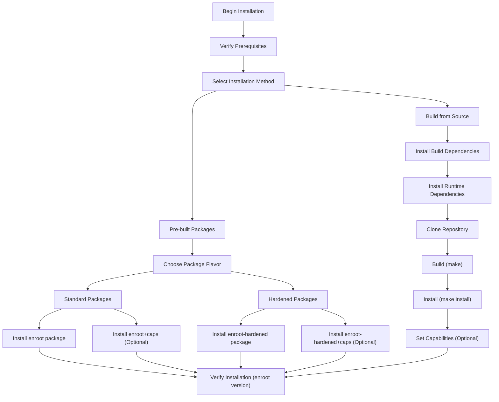

Sources: [doc/installation.md:1-120](), [doc/cmd/version.md:1-15]()

## From Pre-built Packages

Enroot provides two package flavors: standard and hardened. The hardened flavor offers improved security but with some performance overhead.

### Package Flavors

| Flavor | Package | Description |
|--------|---------|-------------|
| Standard | `enroot` | Main utility, helper binaries, and standard configuration files.<br>• Open file descriptors are inherited<br>• Spectre variant 2 (IBPB/STIBP) mitigations are disabled<br>• Spectre variant 4 (SSBD) mitigations are disabled |
| Standard | `enroot+caps` | Grants extra capabilities to unprivileged users to import and convert container images |
| Hardened | `enroot-hardened` | Main utility, helper binaries, and standard configuration files with additional security measures |
| Hardened | `enroot-hardened+caps` | Grants extra capabilities to unprivileged users to import and convert container images |

### Standard Flavor Installation

For Debian-based distributions:
```sh
arch=$(dpkg --print-architecture)
curl -fSsL -O https://github.com/NVIDIA/enroot/releases/download/v3.5.0/enroot_3.5.0-1_${arch}.deb
curl -fSsL -O https://github.com/NVIDIA/enroot/releases/download/v3.5.0/enroot+caps_3.5.0-1_${arch}.deb # optional
sudo apt install -y ./*.deb
```

For RHEL-based distributions:
```sh
arch=$(uname -m)
sudo dnf install -y epel-release # required on some distributions
sudo dnf install -y https://github.com/NVIDIA/enroot/releases/download/v3.5.0/enroot-3.5.0-1.el8.${arch}.rpm
sudo dnf install -y https://github.com/NVIDIA/enroot/releases/download/v3.5.0/enroot+caps-3.5.0-1.el8.${arch}.rpm # optional
```

### Hardened Flavor Installation

For Debian-based distributions:
```sh
arch=$(dpkg --print-architecture)
curl -fSsL -O https://github.com/NVIDIA/enroot/releases/download/v3.5.0/enroot-hardened_3.5.0-1_${arch}.deb
curl -fSsL -O https://github.com/NVIDIA/enroot/releases/download/v3.5.0/enroot-hardened+caps_3.5.0-1_${arch}.deb # optional
sudo apt install -y ./*.deb
```

For RHEL-based distributions:
```sh
arch=$(uname -m)
sudo dnf install -y epel-release # required on some distributions
sudo dnf install -y https://github.com/NVIDIA/enroot/releases/download/v3.5.0/enroot-hardened-3.5.0-1.el8.${arch}.rpm
sudo dnf install -y https://github.com/NVIDIA/enroot/releases/download/v3.5.0/enroot-hardened+caps-3.5.0-1.el8.${arch}.rpm # optional
```

Sources: [doc/installation.md:3-76]()

## Build from Source

### Installation Structure Diagram

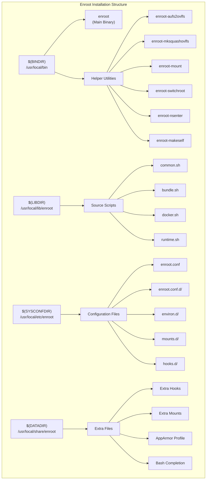

Sources: [Makefile:1-153]()

### Installation Steps

1. Install build dependencies:

```sh
# Debian-based distributions
sudo apt install -y git gcc make libcap2-bin libtool automake libmd-dev

# RHEL-based distributions
sudo dnf install -y git gcc make libcap libtool automake libmd-devel

# Archlinux-based distributions
sudo pacman --noconfirm -S git gcc make libtool automake libmd

git clone --recurse-submodules https://github.com/NVIDIA/enroot.git
```

2. Install runtime dependencies:

```sh
# Debian-based distributions
sudo apt install -y curl gawk jq squashfs-tools parallel
sudo apt install -y fuse-overlayfs libnvidia-container-tools pigz squashfuse # optional

# RHEL-based distributions
sudo dnf install -y epel-release # required on some distributions
sudo dnf install -y jq squashfs-tools parallel
sudo dnf install -y fuse-overlayfs libnvidia-container-tools pigz squashfuse # optional

# Archlinux-based distributions
sudo pacman --noconfirm -S jq parallel squashfs-tools
sudo pacman --noconfirm -S fuse-overlayfs libnvidia-container-tools pigz squashfuse # optional
```

3. Build and install:

```sh
cd enroot
sudo make install
```

4. (Optional) Allow unprivileged users to import images:

```sh
sudo make setcap
```

The build process can be customized with make variables defined in the Makefile:
- `prefix`: Installation prefix (default: `/usr/local`)
- `exec_prefix`: Executable installation prefix (default: `$(prefix)`)
- `bindir`: Directory for executable programs (default: `$(exec_prefix)/bin`)
- `libdir`: Directory for library files (default: `$(exec_prefix)/lib`)
- `sysconfdir`: Directory for configuration files (default: `$(prefix)/etc`)

Sources: [doc/installation.md:78-120](), [Makefile:1-176]()

## Verification

Verify your installation by checking the Enroot version:

```sh
$ enroot version
3.5.0
```

Sources: [doc/cmd/version.md:1-15]()

---

# Page: Package Installation

# Package Installation

<details>
<summary>Relevant source files</summary>

The following files were used as context for generating this wiki page:

- [conf/apparmor.profile](conf/apparmor.profile)
- [doc/installation.md](doc/installation.md)
- [pkg/deb/control](pkg/deb/control)
- [pkg/deb/rules](pkg/deb/rules)
- [pkg/rpm/SPECS/enroot.spec](pkg/rpm/SPECS/enroot.spec)

</details>


This document explains how to install NVIDIA Enroot using pre-built packages (RPM and DEB). For instructions on building Enroot from source code, see [Building from Source](#2.2).

## Overview of Available Packages

Enroot provides two package flavors: standard and hardened. Each flavor comes in two variants: the base package and a companion "+caps" package that grants additional capabilities to unprivileged users.

| Flavor | Package | Description |
|--------|---------|-------------|
| Standard | `enroot` | Main utility, helper binaries, and standard configuration files. Has certain security mitigations disabled for better performance. |
| Standard | `enroot+caps` | Grants extra capabilities to unprivileged users allowing them to import and convert container images. |
| Hardened | `enroot-hardened` | Like the standard package but with all security mitigations enabled. |
| Hardened | `enroot-hardened+caps` | Grants extra capabilities to unprivileged users for the hardened version. |

Sources: [doc/installation.md:5-44]()

## Package Diagram

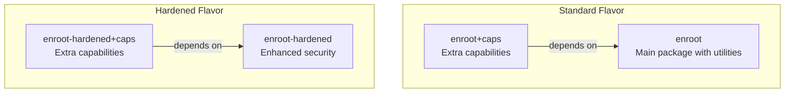

Sources: [doc/installation.md:5-44](), [pkg/rpm/SPECS/enroot.spec:37-52](), [pkg/deb/control:41-49]()

## Package Dependencies

Enroot packages have the following dependencies:

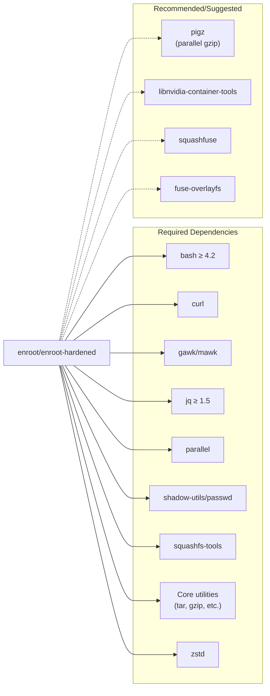

Sources: [pkg/rpm/SPECS/enroot.spec:20-23](), [pkg/deb/control:13-33]()

## Installation Instructions

### Standard Flavor Installation

#### For Debian-based Distributions (Ubuntu, Debian)

```bash
# Determine architecture
arch=$(dpkg --print-architecture)

# Download packages
curl -fSsL -O https://github.com/NVIDIA/enroot/releases/download/v3.5.0/enroot_3.5.0-1_${arch}.deb
curl -fSsL -O https://github.com/NVIDIA/enroot/releases/download/v3.5.0/enroot+caps_3.5.0-1_${arch}.deb # optional

# Install packages
sudo apt install -y ./*.deb
```

#### For RHEL-based Distributions (CentOS, Rocky Linux, RHEL)

```bash
# Determine architecture
arch=$(uname -m)

# Install EPEL repository if needed
sudo dnf install -y epel-release # required on some distributions

# Install packages
sudo dnf install -y https://github.com/NVIDIA/enroot/releases/download/v3.5.0/enroot-3.5.0-1.el8.${arch}.rpm
sudo dnf install -y https://github.com/NVIDIA/enroot/releases/download/v3.5.0/enroot+caps-3.5.0-1.el8.${arch}.rpm # optional
```

Sources: [doc/installation.md:48-60]()

### Hardened Flavor Installation

#### For Debian-based Distributions

```bash
# Determine architecture
arch=$(dpkg --print-architecture)

# Download packages
curl -fSsL -O https://github.com/NVIDIA/enroot/releases/download/v3.5.0/enroot-hardened_3.5.0-1_${arch}.deb
curl -fSsL -O https://github.com/NVIDIA/enroot/releases/download/v3.5.0/enroot-hardened+caps_3.5.0-1_${arch}.deb # optional

# Install packages
sudo apt install -y ./*.deb
```

#### For RHEL-based Distributions

```bash
# Determine architecture
arch=$(uname -m)

# Install EPEL repository if needed
sudo dnf install -y epel-release # required on some distributions

# Install packages
sudo dnf install -y https://github.com/NVIDIA/enroot/releases/download/v3.5.0/enroot-hardened-3.5.0-1.el8.${arch}.rpm
sudo dnf install -y https://github.com/NVIDIA/enroot/releases/download/v3.5.0/enroot-hardened+caps-3.5.0-1.el8.${arch}.rpm # optional
```

Sources: [doc/installation.md:64-76]()

## Package Installation Process

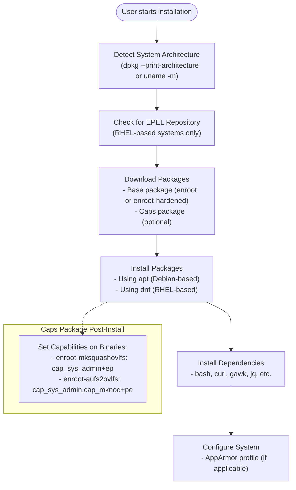

Sources: [doc/installation.md:48-76](), [pkg/rpm/SPECS/enroot.spec:46-51](), [pkg/deb/rules:33-42]()

## Package Contents and Structure

The Enroot package installs the following components:

1. **Main Binaries**: Located in `/usr/bin/`
   - `enroot` - Main command-line utility
   - Helper utilities (enroot-mount, enroot-nsenter, etc.)

2. **Library Files**: Located in `/usr/lib/enroot/`
   - Shell scripts implementing core functionality
   - Runtime libraries and utilities

3. **Configuration Files**: Located in `/etc/enroot/`
   - Default configuration settings
   - Hook configuration

4. **Security Profiles**: 
   - AppArmor profile (on supporting systems)

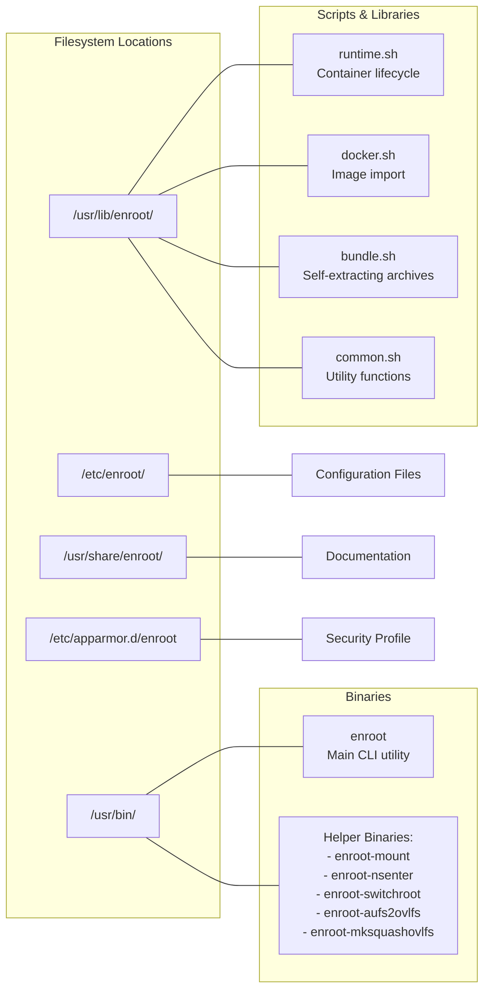

Sources: [pkg/rpm/SPECS/enroot.spec:32-34](), [pkg/deb/rules:35](), [conf/apparmor.profile:1-7]()

## Capabilities Added by the "+caps" Package

The "+caps" package variant adds specific Linux capabilities to certain Enroot binaries, allowing unprivileged users to perform operations that would normally require root privileges:

1. **enroot-mksquashovlfs**: Receives `cap_sys_admin+ep` capability
   - Allows creating SquashFS filesystems without root privileges

2. **enroot-aufs2ovlfs**: Receives `cap_sys_admin,cap_mknod+pe` capabilities
   - Allows converting AUFS to OverlayFS filesystems
   - Enables device node creation needed for container functionality

These capabilities are set during the package installation process using the `setcap` utility.

Sources: [pkg/rpm/SPECS/enroot.spec:46-51](), [pkg/deb/control:41-49]()

## Choosing Between Package Flavors

When deciding between standard and hardened package flavors, consider the following trade-offs:

| Consideration | Standard Flavor | Hardened Flavor |
|---------------|----------------|-----------------|
| Performance | Better performance due to disabled mitigations | Slightly lower performance |
| Security | Some Spectre mitigations disabled | All security mitigations enabled |
| File descriptor handling | Open file descriptors are inherited | Stricter file descriptor handling |
| Use case | Development, performance-critical applications | Security-sensitive environments |

The standard flavor disables certain security mitigations to improve performance:
- Spectre variant 2 (IBPB/STIBP) mitigations are disabled
- Spectre variant 4 (SSBD) mitigations are disabled
- Open file descriptors are inherited

The hardened flavor enables all security mitigations but may have slightly higher overhead.

Sources: [doc/installation.md:5-44]()

## Verification and Testing Installation

After installing Enroot packages, you can verify the installation by running:

```bash
# Check installed version
enroot version

# Test basic functionality
enroot list
```

If the `enroot+caps` or `enroot-hardened+caps` package is installed, you can verify that the appropriate capabilities have been set with:

```bash
# Verify capabilities
getcap /usr/bin/enroot-mksquashovlfs
getcap /usr/bin/enroot-aufs2ovlfs
```

The output should show the expected capabilities for each binary.

---

# Page: Building from Source

# Building from Source

<details>
<summary>Relevant source files</summary>

The following files were used as context for generating this wiki page:

- [.gitmodules](.gitmodules)
- [Makefile](Makefile)
- [deps/Makefile](deps/Makefile)
- [pkg/debbuild](pkg/debbuild)
- [pkg/rpmbuild](pkg/rpmbuild)

</details>


This guide explains how to build Enroot from source code, including all necessary dependencies and build options. Building from source is useful when you need custom builds, want to develop or modify Enroot, or if pre-built packages aren't available for your platform. For information about installing pre-built packages, see [Package Installation](#2.1).

## Prerequisites

Before building Enroot, you'll need to ensure your system has the following dependencies:

| Category | Requirements |
|----------|-------------|
| **Build Tools** | GCC or Clang compiler, Make |
| **System Libraries** | libmd-dev (or equivalent) |
| **Optional Dependencies** | Git (for fetching submodules) |

### System-specific Build Dependencies

For Debian/Ubuntu systems:
```bash
apt-get install build-essential libmd-dev git
```

For CentOS/RHEL systems:
```bash
dnf install gcc make libmd-devel git
```

Sources: [pkg/debbuild:27-38](), [pkg/rpmbuild:15-23]()

## Getting the Source Code

Clone the Enroot repository and initialize the required submodules:

```bash
git clone https://github.com/NVIDIA/enroot.git
cd enroot
git submodule update --init
```

The submodules include:
- `makeself` - For creating self-extracting archives
- `musl` - For static linking of utilities
- `linux-headers` - For system call definitions

Sources: [.gitmodules:1-9](), [Makefile:133-134]()

## Build Process Overview

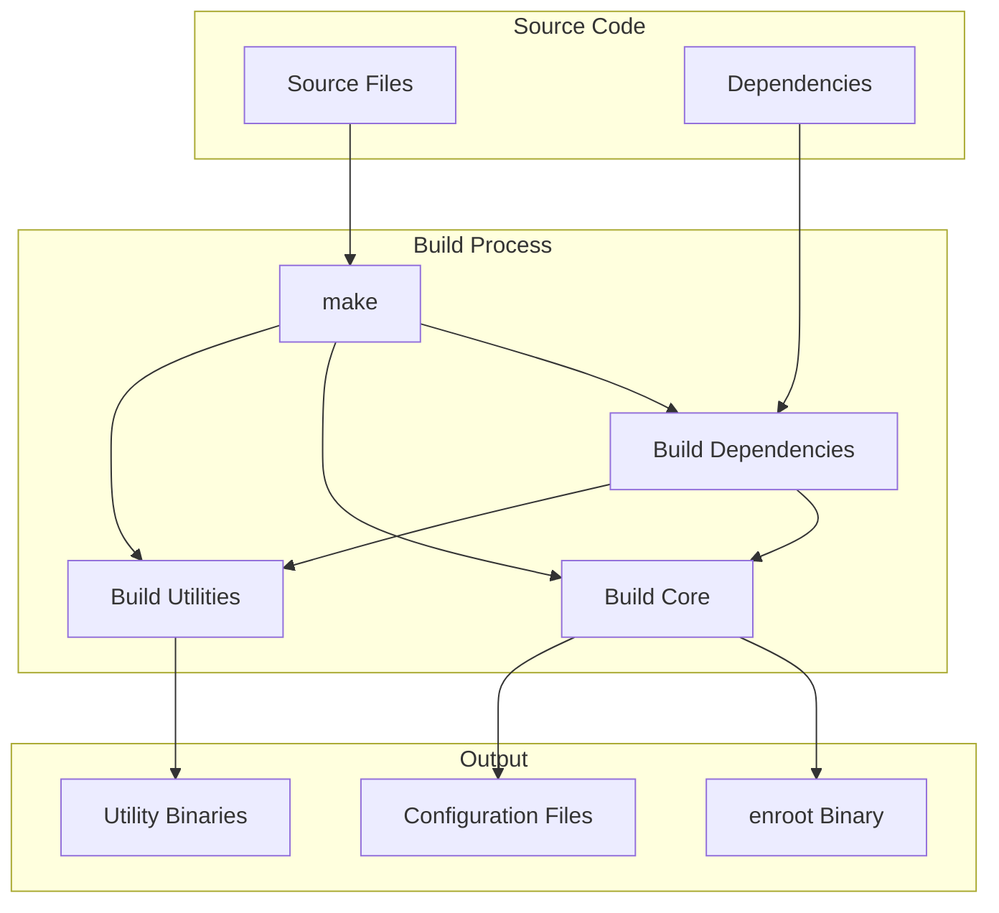

Sources: [Makefile:130-134]()

## Basic Build

To build Enroot with default options:

```bash
make
```

This will:
1. Build dependencies (if needed)
2. Compile utility binaries
3. Generate the main `enroot` script and configuration files

Sources: [Makefile:130]()

### Build Components

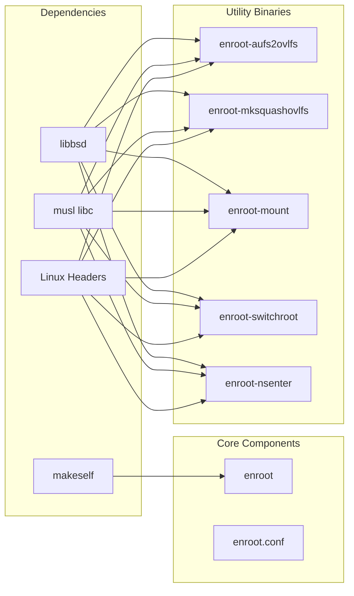

Sources: [Makefile:28-40](), [deps/Makefile:28-73]()

## Build Options

Enroot's build system supports several configuration options:

| Option | Description | Default |
|--------|-------------|---------|
| `DEBUG=1` | Enable debug build with sanitizers | Disabled |
| `CROSS_COMPILE=...` | Specify cross compilation prefix | None |
| `FORCE_GLIBC=1` | Build utilities with glibc instead of musl | Disabled |
| `prefix=...` | Installation prefix | `/usr/local` |
| `exec_prefix=...` | Executables installation prefix | `$(prefix)` |
| `bindir=...` | Binaries directory | `$(exec_prefix)/bin` |
| `libdir=...` | Library directory | `$(exec_prefix)/lib` |
| `sysconfdir=...` | Configuration directory | `$(prefix)/etc` |

Example with custom options:
```bash
make DEBUG=1 prefix=/opt/enroot
```

Sources: [Makefile:1-22](), [Makefile:81-86]()

## Cross-Compilation

Enroot supports cross-compilation for different architectures:

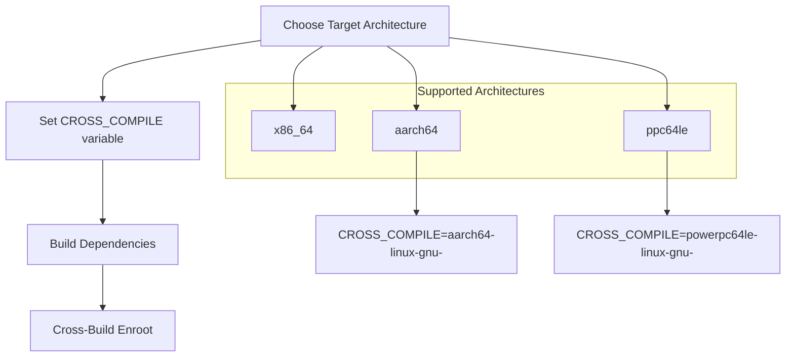

For example, to cross-compile for ARM64:
```bash
make CROSS_COMPILE=aarch64-linux-gnu-
```

Sources: [Makefile:93-99](), [pkg/debbuild:40-62]()

## Installation

After building, install Enroot:

```bash
make install
```

To install to a custom location:
```bash
make install prefix=/opt/enroot
```

To install as a package:
```bash
# Create a DEB package
make deb

# Create an RPM package
make rpm
```

Sources: [Makefile:139-152](), [Makefile:177-190]()

## Advanced Build Options

### Debug Build

Enable debug symbols and sanitizers:
```bash
make DEBUG=1
```

This adds:
- Debug symbols (-g3)
- Address, undefined behavior, and leak sanitizers
- Frame pointers for better stack traces

Sources: [Makefile:81-86]()

### Static Linking with Musl

By default, utility binaries are statically linked against musl libc for better portability. To force using glibc instead:
```bash
make FORCE_GLIBC=1
```

Sources: [Makefile:110-121](), [deps/Makefile:38-46]()

### Hardened Build

To create a hardened version of Enroot with additional security features:
```bash
# For DEB package
make deb PACKAGE=enroot-hardened

# For RPM package
make rpm PACKAGE=enroot-hardened
```

Sources: [pkg/debbuild:66-70](), [pkg/rpmbuild:27-31]()

## Installation Directory Structure

The installation process places files in the following directories:

| Directory | Contents |
|-----------|----------|
| `$(bindir)` | Main executable and utility binaries |
| `$(libdir)/enroot` | Core shell scripts |
| `$(sysconfdir)/enroot` | Configuration and hooks |
| `$(sysconfdir)/enroot/environ.d` | Environment configuration |
| `$(sysconfdir)/enroot/mounts.d` | Mount configurations |
| `$(sysconfdir)/enroot/hooks.d` | Hook scripts |
| `$(datadir)/enroot` | Additional data and examples |

Sources: [Makefile:10-14](), [Makefile:140-152]()

## Post-Installation Setup

After installation, consider adding capabilities to certain binaries for non-root operation:
```bash
make setcap
```

This adds the necessary capabilities to `enroot-mksquashovlfs` and `enroot-aufs2ovlfs` to allow non-root users to create containers.

Sources: [Makefile:173-175]()

## Cleaning the Build

To clean the build artifacts:
```bash
# Clean only the main components
make mostlyclean

# Clean everything including dependencies
make clean

# Clean distribution files
make distclean
```

Sources: [Makefile:158-171]()

---

# Page: Core Architecture

# Core Architecture

<details>
<summary>Relevant source files</summary>

The following files were used as context for generating this wiki page:

- [enroot.in](enroot.in)
- [src/common.sh](src/common.sh)
- [src/runtime.sh](src/runtime.sh)

</details>


This document provides an overview of NVIDIA Enroot's internal architecture, including its key components, their relationships, and how they function together to provide container management capabilities. For detailed information about using Enroot, see [Installation](#2), [Running Containers](#7), or [Container Image Management](#4).

## Overview

Enroot is designed as a set of modular shell scripts and utility binaries that work together to provide container management functionality. The system follows a layered architecture with clear separation of concerns, making it extensible and maintainable.

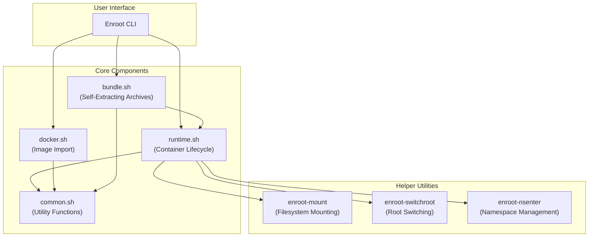

Sources: [enroot.in:1-675](), [src/runtime.sh:15-16](), [src/common.sh:15]()

## Command-Line Interface

The Enroot CLI serves as the user-facing interface to the system, providing commands for managing container images and running containers. It processes command-line arguments, sets up the environment, and delegates operations to the core components.

Key commands include:
- `import`: Import container images
- `create`: Create container root filesystems
- `start`: Start containers
- `exec`: Execute commands in running containers
- `export`: Create images from containers
- `bundle`: Create self-extracting archives
- `list`: List containers
- `remove`: Delete containers

The CLI is implemented in [enroot.in](), which sources the core component scripts and provides command-line parsing and dispatch functionality.

Sources: [enroot.in:115-673]()

## Core Components

Enroot's functionality is split across several core components, each responsible for a specific aspect of container management:

### Common Utilities (common.sh)

Provides shared functionality used throughout the codebase, including:
- Logging and error handling
- File and directory operations
- Environment variable management
- Process and execution utilities

This component forms the foundation on which other components are built.

Sources: [src/common.sh:15-276]()

### Runtime Management (runtime.sh)

Responsible for container lifecycle operations:
- Creating containers from images
- Starting containers
- Executing commands in running containers
- Managing container state
- Exporting containers to images

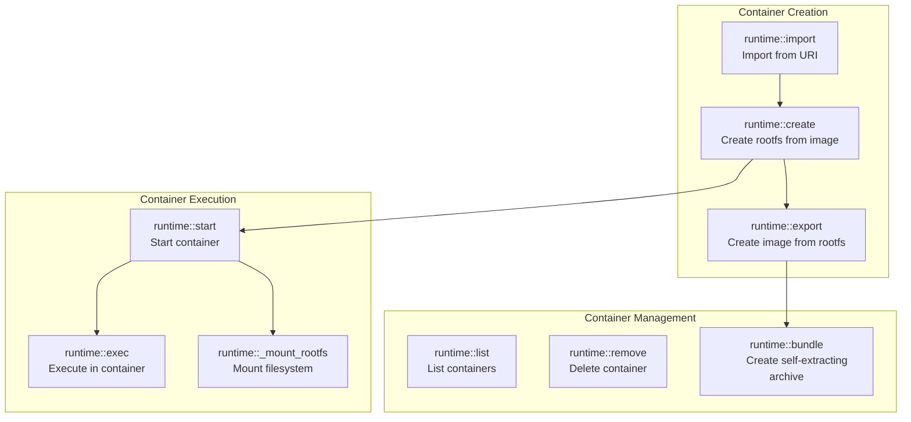

Sources: [src/runtime.sh:32-653]()

### Container Startup Process

When starting a container, Enroot follows these steps:

1. The `runtime::start` function is called from the CLI
2. It sets up the environment and resolves the rootfs path
3. It executes `enroot-nsenter` to create new namespaces
4. Within the new namespaces, `runtime::_start` is called, which:
   - Sets up a temporary working directory
   - Mounts the rootfs
   - Configures the container environment by:
     - Processing environment files (`runtime::_do_environ`)
     - Initializing mounts (`runtime::_do_mounts_init`)
     - Executing hooks (`runtime::_do_hooks`)
     - Finalizing mounts (`runtime::_do_mounts_fini`)
   - Sets up the command script (`runtime::_do_rc`)
   - Switches to the new root using `enroot-switchroot`
   - Executes the command in the container

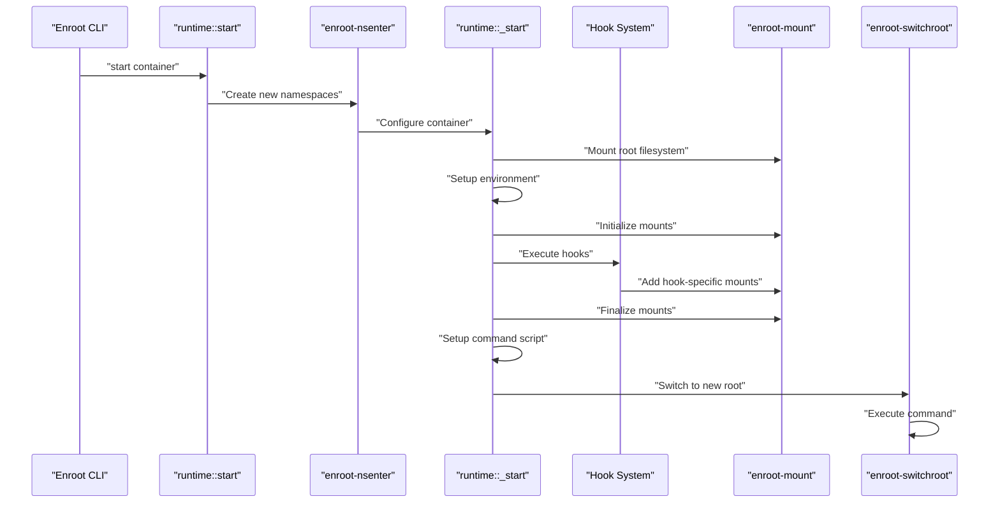

Sources: [src/runtime.sh:277-350](), [src/runtime.sh:206-275]()

### Image Import (docker.sh)

Manages importing container images from external sources, particularly Docker registries and Docker daemons. This component is referenced in the provided files but its implementation details aren't fully visible in the excerpts.

Based on the code references, it supports:
- Docker registry import (`docker::import`)
- Docker daemon import (`docker::daemon::import`)
- Podman import

Sources: [src/runtime.sh:425-443]()

### Bundle Creation (bundle.sh)

Enables creating self-extracting archives that contain:
- The container image
- Runtime components needed to run the container
- Configuration files
- Optional user settings

This allows distributing containers in a standalone, executable format.

Sources: [src/runtime.sh:572-653]()

## Configuration System

Enroot uses a layered configuration system that combines:

1. System-wide configuration (`/etc/enroot/enroot.conf`)
2. User configuration (`~/.config/enroot`)
3. Command-line arguments
4. Configuration specified during container startup

Configuration areas include:
- Environment variables
- Mount points
- Hooks
- Command scripts

The system first loads default settings and then overrides them with user-specific settings and command-line options.

Sources: [enroot.in:25-104]()

## Hook System

The hook system allows customizing container behavior through scripts that are executed during container setup. Hooks can modify the container environment, add mounts, or perform other actions before the container starts.

Hook scripts are stored in:
- System-wide hook directory (`/etc/enroot/hooks.d`)
- User-specific hook directory (`~/.config/enroot/hooks.d`)

When starting a container, hooks are executed in order and can modify the mount configuration and environment.

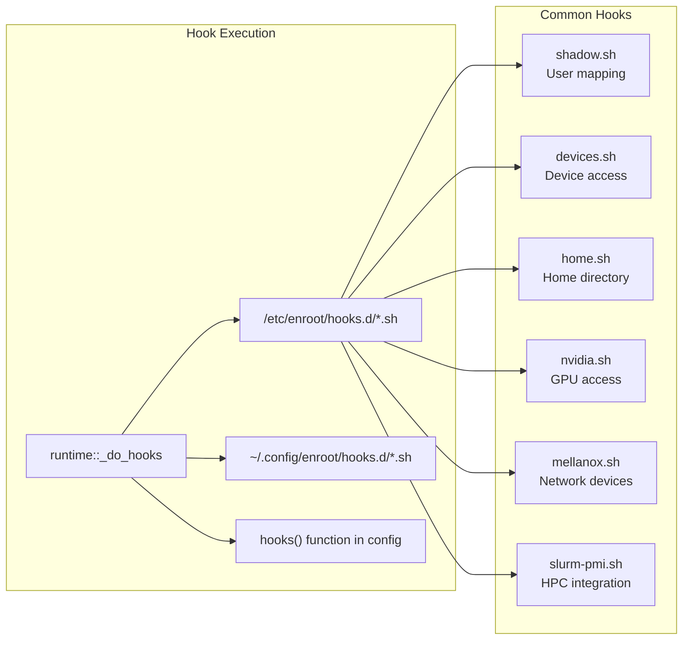

Sources: [src/runtime.sh:17-19](), [src/runtime.sh:85-110]()

## Mount Management

Enroot manages mounts in three phases:

1. Initial mounts (`runtime::_do_mounts_init`): Processes mounts from the container's fstab and system mount configurations
2. Hook mounts (`runtime::_do_hooks`): Allows hooks to add custom mounts
3. Final mounts (`runtime::_do_mounts_fini`): Processes mounts specified by the user on the command line

Mount configurations are stored in:
- The container's `/etc/fstab`
- System-wide mount directory (`/etc/enroot/mounts.d`)
- User-specific mount directory (`~/.config/enroot/mounts.d`)
- Command-line arguments

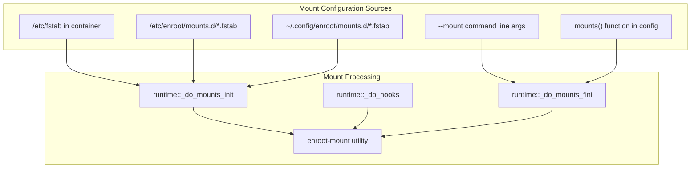

Sources: [src/runtime.sh:64-83](), [src/runtime.sh:112-128]()

## Environment Management

Enroot sets up the container environment using these sources:

1. Container's `/etc/environment`
2. Environment files from system and user directories
3. Environment variables specified in the configuration
4. Environment variables specified on the command line

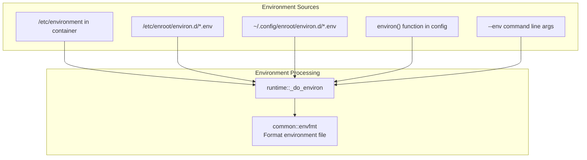

Sources: [src/runtime.sh:32-62](), [src/common.sh:190-204]()

## Helper Utilities

Enroot uses several helper utilities that are implemented as C programs:

1. `enroot-mount`: Handles filesystem mounting operations
2. `enroot-switchroot`: Switches to a new root filesystem
3. `enroot-nsenter`: Creates and joins namespaces
4. `enroot-aufs2ovlfs`: Converts AUFS to OverlayFS
5. `enroot-mksquashovlfs`: Creates SquashFS images

These utilities provide low-level functionality that can't be easily implemented in shell scripts.

Sources: [src/runtime.sh:82](), [src/runtime.sh:105](), [src/runtime.sh:127](), [src/runtime.sh:271-273](), [src/runtime.sh:348-349]()

## Container Lifecycle

The full container lifecycle in Enroot involves these major phases:

```mermaid
stateDiagram-v2
    [*] --> Imported: enroot import
    Imported --> Created: enroot create
    Created --> Started: enroot start
    Started --> Executed: enroot exec
    Executed --> Started
    Started --> [*]
    
    Created --> Exported: enroot export
    Exported --> Bundled: enroot bundle
    Bundled --> [*]
    
    Created --> Removed: enroot remove
    Removed --> [*]
    
    state Imported {
        DockerImport: docker::import
        DockerDaemonImport: docker::daemon::import
    }
    
    state Created {
        ExtractSquashFS: unsquashfs
        SetupRootFS: runtime::create
    }
    
    state Started {
        MountRootFS: runtime::_mount_rootfs
        SetupEnvironment: runtime::_do_environ
        InitializeMounts: runtime::_do_mounts_init
        ExecuteHooks: runtime::_do_hooks
        FinalizeMounts: runtime::_do_mounts_fini
        SwitchRoot: enroot-switchroot
    }
```

Sources: [enroot.in:650-672](), [src/runtime.sh:277-571]()

## Summary

Enroot's architecture is modular and flexible, built around shell scripts for most functionality with C-based utilities for low-level operations. The system's key features are:

1. A clear separation between user interface (CLI) and core functionality
2. A layered approach to configuration
3. An extensible hook system for customizing container behavior
4. A comprehensive mount and environment management system
5. Support for the full container lifecycle from image import to execution

This design makes Enroot both powerful and adaptable to different use cases, particularly in high-performance computing environments where GPU support and integration with tools like Slurm are crucial.

---

# Page: Container Lifecycle Management

# Container Lifecycle Management

<details>
<summary>Relevant source files</summary>

The following files were used as context for generating this wiki page:

- [src/runtime.sh](src/runtime.sh)

</details>


## Purpose and Scope

This document provides a detailed technical overview of how Enroot manages container lifecycles—from creation and execution to termination and cleanup. It covers the core runtime operations that enable container management in Enroot.

For information about image import mechanisms specifically, see [Docker Image Import](#4.1). For information about hook systems that extend container functionality, see [Hook System](#5).

## 1. Container Lifecycle Overview

Enroot implements a complete container lifecycle management system through a set of shell functions in the `runtime.sh` module. These functions provide operations for creating, starting, executing commands in, exporting, and removing containers.

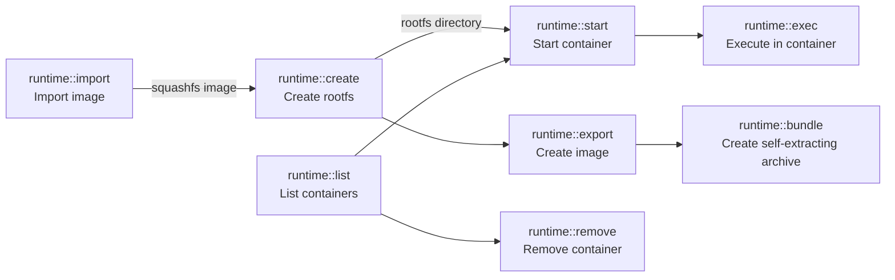

Sources: [src/runtime.sh:277-382](), [src/runtime.sh:384-570]()

## 2. Core Runtime Components

The Enroot runtime consists of several interacting components that work together to manage containers:

```mermaid
graph TD
    subgraph "Container Runtime Components"
        Runtime["runtime.sh<br>Main container operations"]
        Mount["enroot-mount<br>Mount management"]
        NSEnter["enroot-nsenter<br>Namespace management"] 
        SwitchRoot["enroot-switchroot<br>Root switching"]
    end
    
    subgraph "Filesystem Operations"
        Create["runtime::create<br>Unpack squashfs"]
        Export["runtime::export<br>Create squashfs"]
    end
    
    subgraph "Configuration Sources"
        Config["Container config"]
        SysConf["System configuration"]
        UserConf["User configuration"]
        CLIArgs["Command-line arguments"]
    end
    
    Runtime --> Mount
    Runtime --> NSEnter
    Runtime --> SwitchRoot
    Runtime --> Create
    Runtime --> Export
    
    Config --> Runtime
    SysConf --> Runtime
    UserConf --> Runtime
    CLIArgs --> Runtime
```

Sources: [src/runtime.sh:15-31](), [src/runtime.sh:206-275]()

## 3. Container Creation

### 3.1. Importing Container Images

The `runtime::import` function imports container images from supported sources:

- Docker registries (`docker://`)
- Docker daemon (`dockerd://`)
- Podman (`podman://`)

These import sources are handled by specialized functions in the Docker module which convert the images into squashfs format, Enroot's preferred container image format.

Sources: [src/runtime.sh:425-443]()

### 3.2. Creating Container Rootfs

The `runtime::create` function extracts a squashfs image into a container rootfs directory:

```
runtime::create <image> [<name>]
```

This process involves:
1. Resolving and validating the image and rootfs paths
2. Extracting the squashfs filesystem using `unsquashfs`
3. Fixing permissions in the extracted rootfs

The resulting rootfs directory serves as the basis for running containers.

Sources: [src/runtime.sh:384-423]()

## 4. Container Execution

### 4.1. Starting Containers

The `runtime::start` function starts a container from a rootfs:

```
runtime::start <rootfs> [<rc>] [<config>] [<mounts>] [<environ>] [<command...>]
```

The start process follows a complex sequence:

```mermaid
flowchart TD
    Start["runtime::start"] --> Resolve["Resolve paths and validate args"]
    Resolve --> NSEnter["Create namespaces with enroot-nsenter"]
    NSEnter --> StartImpl["runtime::_start implementation"]
    StartImpl --> TmpDir["Create temporary working directory"]
    
    TmpDir --> MountRootfs["Mount rootfs (image or directory)"]
    MountRootfs --> Environment["Configure container environment"]
    Environment --> InitMounts["Initialize mounts"]
    InitMounts --> Hooks["Execute hooks"]
    Hooks --> FinalMounts["Finalize mounts"]
    FinalMounts --> SetupRC["Setup command script"]
    SetupRC --> SwitchRoot["Switch to new root"]
    SwitchRoot --> Exec["Execute command"]
```

Important operations during container start:

1. **Namespace Creation**: Uses `enroot-nsenter` to create user and mount namespaces
2. **Rootfs Mounting**: Mounts rootfs with proper filesystem setup (overlayfs for images)
3. **Environment Configuration**: Configures environment from multiple sources
4. **Mount Management**: Sets up mounts from fstab files and user configuration
5. **Hook Execution**: Runs hook scripts to customize container configuration
6. **Root Switching**: Uses `enroot-switchroot` to switch to container root

Sources: [src/runtime.sh:277-350](), [src/runtime.sh:206-275](), [src/runtime.sh:32-83](), [src/runtime.sh:84-110]()

### 4.2. Executing Commands in Containers

The `runtime::exec` function executes commands in running containers:

```
runtime::exec <pid> [<environ>] <command...>
```

This function:
1. Validates the target process (container) exists
2. Generates the appropriate environment for command execution
3. Uses `enroot-nsenter` to join the container's namespaces
4. Executes the specified command in the container's context

Sources: [src/runtime.sh:352-382]()

## 5. Container Maintenance

### 5.1. Listing Containers

The `runtime::list` function lists existing containers:

```
runtime::list [<fancy>]
```

This function:
1. Lists container rootfs directories in the data path
2. With the `fancy` option, displays detailed process information about running containers

The fancy display includes information such as:
- Container name
- PID
- Command
- Process state
- Start time
- Namespace information
- Command line

Sources: [src/runtime.sh:491-546]()

### 5.2. Removing Containers

The `runtime::remove` function removes a container rootfs:

```
runtime::remove <rootfs>
```

This function:
1. Resolves and validates the rootfs path
2. Asks for confirmation (unless `ENROOT_FORCE_OVERRIDE` is set)
3. Removes the rootfs directory

Sources: [src/runtime.sh:548-570]()

## 6. Container Export and Distribution

### 6.1. Exporting Containers

The `runtime::export` function creates a squashfs image from a container rootfs:

```
runtime::export <rootfs> [<filename>]
```

This function:
1. Resolves and validates the rootfs and output file paths
2. Excludes mountpoints, the bundle directory, and the lockfile
3. Creates a squashfs image using `mksquashfs`

Sources: [src/runtime.sh:445-489]()

### 6.2. Creating Self-Extracting Bundles

The `runtime::bundle` function creates a self-extracting archive from a container image:

```
runtime::bundle <image> [<filename>] [<target>] [<desc>]
```

This function:
1. Resolves and validates paths
2. Extracts the container image to a temporary directory
3. Copies required runtime components to a bundle directory
4. Creates a self-extracting archive using `enroot-makeself`

The resulting bundle contains everything needed to run the container on a system without Enroot installed.

Sources: [src/runtime.sh:572-653]()

## 7. Key Configuration Elements

Enroot's container lifecycle management relies on several configuration elements:

| Element | Description | Source Location |
|---------|-------------|----------------|
| Hook directories | Directories containing hook scripts | `hook_dirs` - System and user config paths |
| Mount directories | Directories containing mount configs | `mount_dirs` - System and user config paths |
| Environment directories | Directories containing environment files | `environ_dirs` - System and user config paths |
| Environment file | File containing container environment | `environ_file` - Runtime path |
| Mount file | File containing container mount specifications | `mount_file` - Runtime path |
| RC file | Script executed in the container | `rc_file` - Runtime path |
| Bundle directory | Directory containing bundle components | `bundle_dir` - Root of container |

These configuration elements can be provided through system-wide configuration, user configuration, or command-line arguments.

Sources: [src/runtime.sh:15-31](), [src/runtime.sh:32-62](), [src/runtime.sh:63-83](), [src/runtime.sh:84-110](), [src/runtime.sh:130-139]()

## 8. Advanced Functionality

### 8.1. Rootfs Mounting

Enroot supports two methods for mounting rootfs:

1. **Directory-based rootfs**: Direct mounting of a directory
2. **Image-based rootfs**: Mounting a squashfs image using `squashfuse` with an overlay filesystem

The `runtime::_mount_rootfs` and `runtime::_mount_rootfs_shim` functions implement the image-based rootfs mounting, providing a read-only lower layer (the image) and a writable upper layer.

Sources: [src/runtime.sh:141-204]()

### 8.2. Resource Management

Container resources are managed through:

1. **Filesystem isolation**: Separate rootfs for each container
2. **Namespace isolation**: User and mount namespaces for process isolation
3. **Mount configuration**: Control over what host resources are accessible
4. **Environment configuration**: Control over container environment variables

The combination of these mechanisms provides the necessary isolation and resource management capabilities for containers.

Sources: [src/runtime.sh:277-350](), [src/runtime.sh:206-275]()

---

# Page: Command-Line Interface

# Command-Line Interface

<details>
<summary>Relevant source files</summary>

The following files were used as context for generating this wiki page:

- [conf/enroot.conf.in](conf/enroot.conf.in)
- [doc/cmd/batch.md](doc/cmd/batch.md)
- [doc/cmd/bundle.md](doc/cmd/bundle.md)
- [doc/cmd/create.md](doc/cmd/create.md)
- [doc/cmd/export.md](doc/cmd/export.md)
- [doc/cmd/import.md](doc/cmd/import.md)
- [doc/cmd/list.md](doc/cmd/list.md)
- [doc/cmd/remove.md](doc/cmd/remove.md)
- [doc/cmd/start.md](doc/cmd/start.md)
- [enroot.in](enroot.in)

</details>


This document describes the Enroot command-line interface (CLI) structure, command usage, and available options. The CLI is the primary method for interacting with Enroot to manage container images and run containers. For information about container lifecycle management, see [Container Lifecycle Management](#3.1).

## Overview

The Enroot CLI provides a set of commands to import, create, run, and manage containers. It follows a consistent pattern where all commands are invoked through the main `enroot` executable followed by a subcommand and options.

Basic syntax:
```
enroot COMMAND [OPTIONS] [ARGUMENTS]
```

## CLI Architecture

The Enroot CLI is implemented as a Bash script that processes commands and options before calling the appropriate functions in the runtime library.

### Command Structure Diagram

```mermaid
flowchart TD
    User([User]) --> CLI["enroot CLI"]
    
    CLI --> ImgOps["Container Image Operations"]
    CLI --> ContExec["Container Execution"]
    CLI --> ContMgmt["Container Management"]
    CLI --> Misc["Miscellaneous"]
    
    ImgOps --> Import["import<br>Download and convert image"]
    ImgOps --> Create["create<br>Unpack image to filesystem"]
    ImgOps --> Export["export<br>Create image from filesystem"]
    ImgOps --> Bundle["bundle<br>Create self-extracting archive"]
    
    ContExec --> Start["start<br>Start container"]
    ContExec --> Exec["exec<br>Run command in container"]
    ContExec --> Batch["batch<br>Start from config file"]
    
    ContMgmt --> List["list<br>List containers"]
    ContMgmt --> Remove["remove<br>Delete containers"]
    
    Misc --> Version["version<br>Display version"]
    Misc --> Help["help<br>Display help"]
```

Sources: [enroot.in:114-673]()

### Command Processing Flow

```mermaid
flowchart TD
    User([User]) --> |"enroot command [options]"| Main["Main Program<br>Parse Command (lines 643-673)"]
    
    Main --> |"command=import"| ImportFunc["enroot::import()<br>Process import options (254-294)"]
    Main --> |"command=create"| CreateFunc["enroot::create()<br>Process create options (334-368)"]
    Main --> |"command=start"| StartFunc["enroot::start()<br>Process start options (371-456)"]
    Main --> |"command=..."| OtherFunc["Other enroot::* functions"]
    
    ImportFunc --> |"Calls"| RuntimeImport["runtime::import()<br>In runtime.sh"]
    CreateFunc --> |"Calls"| RuntimeCreate["runtime::create()<br>In runtime.sh"]
    StartFunc --> |"Calls"| RuntimeStart["runtime::start()<br>In runtime.sh"]
    OtherFunc --> |"Calls"| RuntimeFuncs["Other runtime::* functions"]
```

Sources: [enroot.in:643-673](), [enroot.in:254-294](), [enroot.in:334-368](), [enroot.in:371-456]()

## Available Commands

Enroot provides the following commands:

| Command | Description | Primary Options |
|---------|-------------|-----------------|
| `import` | Import a container image from a specific location | `--arch`, `--output` |
| `create` | Create a container root filesystem from an image | `--name`, `--force` |
| `start` | Start a container | `--conf`, `--env`, `--mount`, `--root`, `--rw` |
| `exec` | Execute a command inside an existing container | `--env` |
| `export` | Create a container image from a root filesystem | `--output`, `--force` |
| `bundle` | Create a self-extracting bundle | `--all`, `--checksum`, `--desc`, `--output` |
| `batch` | Start a container from a config file | (uses ENROOT_ROOTFS directive) |
| `list` | List available containers | `--fancy` |
| `remove` | Delete one or more containers | `--force` |
| `version` | Display Enroot version | none |
| `help` | Display help information | none |

Sources: [enroot.in:115-246]()

## Detailed Command Reference

### Container Image Operations

#### import

Imports a container image from a specified location, converting it to Enroot's format:

```
enroot import [options] [--] URI
```

Supported URI schemes:
- `docker://[USER@][REGISTRY#]IMAGE[:TAG]` - Import from a Docker registry
- `dockerd://IMAGE[:TAG]` - Import from a Docker daemon
- `podman://IMAGE[:TAG]` - Import from a local Podman repository

Options:
- `-a, --arch` - Image architecture (defaults to host architecture)
- `-o, --output` - Output filename (defaults to "URI.sqsh")

Sources: [doc/cmd/import.md:1-16](), [enroot.in:254-294]()

#### create

Creates a container root filesystem from an image:

```
enroot create [options] [--] IMAGE
```

Options:
- `-n, --name` - Container name (defaults to "IMAGE")
- `-f, --force` - Overwrite existing container

Sources: [doc/cmd/create.md:1-11](), [enroot.in:334-368]()

#### export

Creates a container image from a container root filesystem:

```
enroot export [options] [--] NAME
```

Options:
- `-o, --output` - Output filename (defaults to "NAME.sqsh")
- `-f, --force` - Overwrite existing image

Sources: [doc/cmd/export.md:1-11](), [enroot.in:297-332]()

#### bundle

Creates a self-extracting bundle from a container image:

```
enroot bundle [options] [--] IMAGE
```

Options:
- `-a, --all` - Include runtime and user configuration
- `-c, --checksum` - Generate embedded checksum
- `-d, --desc TEXT` - Description of the bundle
- `-o, --output` - Output filename (defaults to "IMAGE.run")
- `-t, --target` - Target extraction directory
- `-f, --force` - Overwrite existing bundle

Sources: [doc/cmd/bundle.md:1-14](), [enroot.in:578-641]()

### Container Execution

#### start

Starts a container and invokes the command script:

```
enroot start [options] [--] NAME|IMAGE [COMMAND] [ARG...]
```

Options:
- `-c, --conf CONFIG` - Configuration script to run before start
- `-e, --env KEY[=VAL]` - Export environment variable
- `--rc SCRIPT` - Override command script
- `-r, --root` - Remap current user to root inside container
- `-w, --rw` - Make root filesystem writable
- `-m, --mount FSTAB` - Mount from host (colon-separated)

Sources: [doc/cmd/start.md:1-18](), [enroot.in:371-456]()

#### exec

Executes a command inside an existing container:

```
enroot exec [options] [--] PID COMMAND [ARG...]
```

Options:
- `-e, --env KEY[=VAL]` - Export environment variable

Sources: [enroot.in:458-492]()

#### batch

Shorthand for `start -c CONFIG` where the root filesystem is specified in the config:

```
enroot batch [options] [--] CONFIG [COMMAND] [ARG...]
```

The configuration file must contain the `ENROOT_ROOTFS` directive to specify the container.

Sources: [doc/cmd/batch.md:1-7](), [enroot.in:494-525]()

### Container Management

#### list

Lists all container root filesystems:

```
enroot list [options]
```

Options:
- `-f, --fancy` - Display detailed information in tabular format

Sources: [doc/cmd/list.md:1-9](), [enroot.in:527-548]()

#### remove

Deletes one or multiple container root filesystems:

```
enroot remove [options] [--] NAME...
```

Options:
- `-f, --force` - Skip confirmation prompt

Sources: [doc/cmd/remove.md:1-9](), [enroot.in:550-576]()

## Configuration Integration

The CLI integrates with Enroot's configuration system to customize behavior through environment variables. Configuration is loaded from multiple sources:

1. System configuration (`/etc/enroot.conf`)
2. Drop-in configuration files (`/etc/enroot.conf.d/*.conf`)
3. Command-line options that set specific variables

```mermaid
flowchart TD
    SysConfig["/etc/enroot.conf"] --> ConfigInit["config::init()"]
    DropinConfig["/etc/enroot.conf.d/*.conf"] --> ConfigInit
    
    ConfigInit --> EnvVars["Environment Variables<br>(ENROOT_*)"]
    
    CLI["Command Line Options"] --> |"set specific variables"| EnvVars
    
    EnvVars --> Commands["Command Functions<br>(enroot::*)"]
    Commands --> RuntimeFunctions["Runtime Functions<br>(runtime::*)"]
```

Sources: [enroot.in:25-106](), [conf/enroot.conf.in:1-72]()

## Common Parameters and Environment Variables

Many CLI commands share common environment variables that modify their behavior:

| Variable | Default | Description |
|----------|---------|-------------|
| `ENROOT_FORCE_OVERRIDE` | `no` | Overwrite existing files without prompting |
| `ENROOT_MAX_PROCESSORS` | `$(nproc)` | Maximum processors for parallel tasks |
| `ENROOT_REMAP_ROOT` | `no` | Remap current user to root inside container |
| `ENROOT_ROOTFS_WRITABLE` | `no` | Make container root filesystem writable |
| `ENROOT_ALLOW_SUPERUSER` | `no` | Allow root to retain privileges inside container |

Sources: [conf/enroot.conf.in:9-61](), [enroot.in:78-101]()

## Examples

### Basic Container Workflow

```bash
# Import Ubuntu image from Docker Hub
enroot import docker://ubuntu:20.04

# Create container from the image
enroot create --name ubuntu-container ubuntu+20.04.sqsh

# Start the container with writable filesystem
enroot start --rw ubuntu-container

# Remove the container when finished
enroot remove ubuntu-container
```

### Advanced Usage

```bash
# Import CUDA container and mount local directory
enroot import docker://nvidia/cuda:11.0-devel
enroot start --mount $PWD:/workspace nvidia+cuda+11.0-devel.sqsh nvcc /workspace/mycode.cu -o /workspace/myprogram

# Create a self-extracting bundle with custom description
enroot bundle --desc "CUDA 11.0 Development Environment" --all nvidia+cuda+11.0-devel.sqsh

# Use batch mode with a configuration file
cat > my-config.conf << EOF
#ENROOT_ROOTFS=ubuntu-container
#ENROOT_REMAP_ROOT=y

mounts() {
    echo "/data /mnt none bind"
}
EOF

enroot batch my-config.conf ls /mnt
```

---

# Page: Container Image Management

# Container Image Management

<details>
<summary>Relevant source files</summary>

The following files were used as context for generating this wiki page:

- [conf/enroot.conf.in](conf/enroot.conf.in)
- [doc/cmd/bundle.md](doc/cmd/bundle.md)
- [doc/cmd/create.md](doc/cmd/create.md)
- [doc/cmd/export.md](doc/cmd/export.md)
- [doc/cmd/import.md](doc/cmd/import.md)
- [doc/cmd/list.md](doc/cmd/list.md)
- [doc/cmd/remove.md](doc/cmd/remove.md)
- [src/docker.sh](src/docker.sh)

</details>


This document provides a comprehensive overview of how Enroot manages container images throughout their lifecycle. It covers the processes of importing images from various sources, creating container root filesystems from images, exporting containers back to images, and creating self-extracting bundles. For information about running containers after they've been created, see [Running Containers](#7).

## Image Management Overview

Enroot's container image management consists of four primary operations:

1. **Import** - Acquire images from external sources (Docker registries, Docker daemon, Podman)
2. **Create** - Unpack images into runnable root filesystems
3. **Export** - Package existing root filesystems into shareable images
4. **Bundle** - Generate self-extracting archives from images

```mermaid
flowchart LR
    subgraph "External Image Sources"
        DockerRegistry["Docker Registry"]
        DockerDaemon["Docker Daemon"]
        Podman["Podman Repository"]
    end

    subgraph "Image Operations"
        Import["enroot import\nConvert external images"]
        Create["enroot create\nUnpack to root filesystem"]
        Export["enroot export\nPackage root filesystem"]
        Bundle["enroot bundle\nCreate self-extracting archive"]
    end

    subgraph "Storage"
        Cache["ENROOT_CACHE_PATH\nImage layer cache"]
        RootFS["ENROOT_DATA_PATH\nContainer root filesystems"]
        Images["SquashFS Images (.sqsh)"]
        Bundles["Self-extracting bundles (.run)"]
    end

    DockerRegistry --> Import
    DockerDaemon --> Import
    Podman --> Import
    
    Import --> Images
    Images --> Create
    RootFS --> Export
    Export --> Images
    Images --> Bundle
    Bundle --> Bundles
    
    Create --> RootFS
```

Sources: [src/docker.sh:252-398](), [doc/cmd/import.md:1-90](), [doc/cmd/create.md:1-32](), [doc/cmd/export.md:1-35](), [doc/cmd/bundle.md:1-66]()

## Image Formats and Storage

Enroot uses SquashFS as its primary image format with a `.sqsh` extension. This format provides:

- Efficient compression
- Read-only filesystem image 
- Direct mountability without unpacking

Images and containers are stored in various locations controlled by environment variables:

| Location | Purpose | Default Path |
|----------|---------|-------------|
| `ENROOT_CACHE_PATH` | Downloaded image layers | `${XDG_CACHE_HOME}/enroot` |
| `ENROOT_DATA_PATH` | Container root filesystems | `${XDG_DATA_HOME}/enroot` |

When Enroot imports Docker images, it caches image layers in `ENROOT_CACHE_PATH` to avoid downloading the same layers multiple times.

Sources: [doc/cmd/import.md:20-65](), [conf/enroot.conf.in:1-72]()

## Image Import Process

Enroot can import container images from several sources using the `enroot import` command:

```
enroot import [options] [--] URI
```

Where URI can be:
- `docker://[USER@][REGISTRY#]IMAGE[:TAG]` - Docker registry
- `dockerd://IMAGE[:TAG]` - Docker daemon
- `podman://IMAGE[:TAG]` - Podman local repository

Sources: [doc/cmd/import.md:1-16]()

### Docker Registry Import

The Docker registry import process includes downloading image manifests and layers, then converting them to a SquashFS image.

```mermaid
flowchart TD
    subgraph "Docker Registry Import Process"
        direction TB
        Start["docker::import"] --> Auth["docker::_authenticate\nHandle registry authentication"]
        Auth --> Download["docker::_download\nFetch manifest & image digests"]
        Download --> FetchLayers["Download missing layers"]
        FetchLayers --> ExtractLayers["Extract layers with fixed permissions"]
        ExtractLayers --> ConvertWhiteouts["Convert AUFS whiteouts to OverlayFS"]
        ConvertWhiteouts --> Configure["docker::configure\nSetup root filesystem"]
        Configure --> CreateSquashFS["Create SquashFS image"]
    end

    subgraph "Authentication"
        CredFile[".credentials file"]
        TokenCache["Token cache"]
    end

    CredFile --> Auth
    Auth --> TokenCache
```

The import process handles:

1. **Authentication** - Using credentials from `.credentials` file or user input
2. **Layer Management** - Downloading and caching image layers
3. **Filesystem Conversion** - Converting Docker's AUFS format to OverlayFS
4. **Configuration** - Setting up the container environment, entrypoint, and command

Sources: [src/docker.sh:28-192](), [src/docker.sh:252-337](), [doc/cmd/import.md:50-54]()

### Docker Daemon and Podman Import

For importing from a local Docker daemon or Podman, Enroot:

1. Creates a temporary container from the specified image
2. Exports the container filesystem
3. Configures the filesystem with container metadata
4. Creates a SquashFS image

```mermaid
flowchart TD
    Start["docker::daemon::import"] --> CreateContainer["Create temporary container"]
    CreateContainer --> ExportContainer["Export container filesystem"]
    ExportContainer --> Configure["docker::configure\nSetup container configuration"]
    Configure --> CreateSquashFS["Create SquashFS image"]
```

Sources: [src/docker.sh:339-398](), [doc/cmd/import.md:56-64]()

## Container Root Filesystem Operations

### Creating Root Filesystems

The `enroot create` command unpacks a SquashFS image into a container root filesystem:

```
enroot create [options] [--] IMAGE
```

This operation:
1. Takes a `.sqsh` container image
2. Unpacks it into a directory under `$ENROOT_DATA_PATH/`
3. Makes the filesystem ready to start with `enroot start`

Sources: [doc/cmd/create.md:1-32]()

### Exporting Root Filesystems

The `enroot export` command creates a SquashFS image from an existing container:

```
enroot export [options] [--] NAME
```

This allows:
1. Capturing changes made to a container
2. Sharing modified containers with other users
3. Creating new base images for future containers

Sources: [doc/cmd/export.md:1-35]()

### Container Lifecycle Management

```mermaid
flowchart TB
    subgraph "Container Image Operations"
        Import["enroot import\nDownload and convert image"]
        Create["enroot create\nUnpack image to root filesystem"]
        Export["enroot export\nCreate image from root filesystem"]
        List["enroot list\nList containers"]
        Remove["enroot remove\nDelete container"]
    end
    
    Import --> |Image created| Create
    Create --> |Container created| Start
    
    Start --> |Container modified| Export
    Export --> |New image| Create
    
    List --> |Find containers| Start
    List --> |Clean up| Remove
```

Sources: [doc/cmd/list.md:1-26](), [doc/cmd/remove.md:1-27]()

## Self-Extracting Bundles

Enroot can create self-extracting bundles with the `enroot bundle` command:

```
enroot bundle [options] [--] IMAGE
```

These bundles:
1. Package a container image with the necessary code to extract and run it
2. Are portable and can run on most Linux distributions without dependencies
3. Accept the same arguments as `enroot start` for runtime configuration

Bundle features:
- Can include user configuration with `--all`
- Can generate embedded checksums with `--checksum`
- Support keeping extracted files with `--keep`
- Allow verification of host compatibility with `--verify`

Sources: [doc/cmd/bundle.md:1-66]()

## Configuration Options

Enroot provides numerous configuration options for image management:

| Setting | Default | Description |
|---------|---------|-------------|
| `ENROOT_GZIP_PROGRAM` | `pigz` or `gzip` | Program for uncompressing digest layers |
| `ENROOT_ZSTD_OPTIONS` | `-1` | Options for zstd compression |
| `ENROOT_SQUASH_OPTIONS` | `-comp lzo -noD` | Options for SquashFS creation |
| `ENROOT_MAX_PROCESSORS` | `$(nproc)` | Maximum processors for parallel tasks |
| `ENROOT_MAX_CONNECTIONS` | `10` | Maximum concurrent download connections |
| `ENROOT_CONNECT_TIMEOUT` | `30` | Connection establishment timeout |
| `ENROOT_TRANSFER_TIMEOUT` | `0` | Network operation timeout |
| `ENROOT_TRANSFER_RETRIES` | `0` | Network operation retry count |
| `ENROOT_ALLOW_HTTP` | `no` | Allow HTTP instead of HTTPS (insecure) |
| `ENROOT_FORCE_OVERRIDE` | `no` | Always use --force on commands |
| `ENROOT_BUNDLE_ALL` | `no` | Include user configuration in bundles |
| `ENROOT_BUNDLE_CHECKSUM` | `no` | Generate checksums in bundles |

Sources: [doc/cmd/import.md:67-79](), [conf/enroot.conf.in:1-72](), [doc/cmd/export.md:19-24](), [doc/cmd/bundle.md:46-51]()

## Authentication for Registries

Enroot uses netrc-style credentials file (`$ENROOT_CONFIG_PATH/.credentials`) for registry authentication. The file format allows configuring credentials for different registries:

```
machine registry-hostname login username password credential
```

Special password handling:
- If the password starts with `$`, it will be substituted (useful for command output)
- Supports various authentication methods for cloud registries (AWS, Azure, Google)

Examples:
- NVIDIA GPU Cloud: `machine nvcr.io login $oauthtoken password <token>`
- Docker Hub: `machine auth.docker.io login <login> password <password>`
- AWS ECR: `machine 12345.dkr.ecr.eu-west-2.amazonaws.com login AWS password $(aws ecr get-login-password --region eu-west-2)`

Sources: [src/docker.sh:18](), [doc/cmd/import.md:23-48]()

---

# Page: Docker Image Import

# Docker Image Import

<details>
<summary>Relevant source files</summary>

The following files were used as context for generating this wiki page:

- [conf/enroot.conf.in](conf/enroot.conf.in)
- [doc/cmd/import.md](doc/cmd/import.md)
- [src/docker.sh](src/docker.sh)

</details>


This page documents the Docker image import capabilities in Enroot, focusing on how the system converts Docker container images into Enroot's SquashFS-based container format. For information on creating containers from imported images, see [Container Lifecycle Management](#3.1). For information on creating self-extracting bundles from container images, see [Self-Extracting Bundles](#4.2).

## Overview

Enroot supports importing Docker container images from three different sources:
- Docker registries (Docker Hub, NVIDIA NGC, etc.)
- Local Docker daemon
- Local Podman repository

During import, Enroot authenticates with the source (if required), downloads the image manifests and layers, extracts and configures the container filesystem, and finally converts it to Enroot's standard SquashFS-based format.

```mermaid
flowchart TD
    User([User]) -->|"enroot import"| ImportCmd["Import Command"]
    
    ImportCmd --> DockerRegistry["docker::import<br>Registry Import"]
    ImportCmd --> DockerDaemon["docker::daemon::import<br>Daemon Import"]
    
    DockerRegistry --> Auth["docker::_authenticate<br>Handle registry auth"]
    Auth --> Download["docker::_download<br>Fetch manifests and layers"]
    Download --> DownloadExtract["docker::_download_extract<br>Extract layers"]
    DownloadExtract --> Configure
    
    DockerDaemon --> DockerCLI["Use Docker/Podman CLI"]
    DockerCLI --> Export["Extract container filesystem"]
    Export --> Configure["docker::configure<br>Set up root filesystem"]
    
    Configure --> MkSquashFS["Create final SquashFS image"]
    
    subgraph "External Systems"
        Registry["Docker Registry"]
        Daemon["Docker/Podman Daemon"]
    end
    
    Auth <--> Registry
    Download <--> Registry
    DockerCLI <--> Daemon
```

**Docker Image Import Process Overview**

Sources: [src/docker.sh:252-399]()

## Import Methods

Enroot supports three different methods for importing Docker images:

### Docker Registry Import

The `docker://` URI scheme allows importing directly from a Docker registry:

```
docker://[USER@][REGISTRY#]IMAGE[:TAG]
```

- `USER`: Optional registry username
- `REGISTRY`: Optional registry hostname (defaults to Docker Hub)
- `IMAGE`: Required image name
- `TAG`: Optional image tag (defaults to "latest")

The Docker Registry Import method connects directly to the registry API, authenticates, downloads the manifests and layers, and transforms them into Enroot's container format.

Sources: [src/docker.sh:252-337](), [doc/cmd/import.md:9-10]()

### Docker Daemon Import

The `dockerd://` URI scheme allows importing from a local Docker daemon:

```
dockerd://IMAGE[:TAG]
```

This method uses the Docker CLI to create a temporary container, export its filesystem, and convert it to Enroot's container format.

Sources: [src/docker.sh:339-398](), [doc/cmd/import.md:10-11]()

### Podman Import

The `podman://` URI scheme allows importing from a local Podman repository:

```
podman://IMAGE[:TAG]
```

This method uses the Podman CLI to create a temporary container, export its filesystem, and convert it to Enroot's container format.

Sources: [src/docker.sh:339-398](), [doc/cmd/import.md:11-12]()

## Authentication and Credentials

Enroot supports authentication with Docker registries through a credentials file located at `$ENROOT_CONFIG_PATH/.credentials`. This file follows the netrc format, allowing you to specify credentials for different registries.

```mermaid
flowchart TD
    Start["docker::_authenticate<br>Start Auth Process"] --> CheckAuth["Query registry for<br>permission grant"]
    CheckAuth --> NeedAuth{"Auth<br>required?"}
    NeedAuth -->|"No"| Done["Return (authenticated)"]
    NeedAuth -->|"Yes"| ParseAuth["Parse WWW-Authenticate<br>header"]
    
    ParseAuth --> UserCreds{"User<br>specified?"}
    UserCreds -->|"Yes"| CheckCredsFile["Check .credentials file<br>for matching entry"]
    UserCreds -->|"No"| AnonymousAuth["Proceed with<br>anonymous auth"]
    
    CheckCredsFile --> CredsFound{"Credentials<br>found?"}
    CredsFound -->|"Yes"| UseCredsFile["Use credentials<br>from file"]
    CredsFound -->|"No"| UserAuth["Use username<br>for auth"]
    
    UseCredsFile --> AuthMethod
    UserAuth --> AuthMethod
    AnonymousAuth --> AuthMethod
    
    AuthMethod --> IsBearerAuth{"Auth type<br>Bearer?"}
    IsBearerAuth -->|"Yes"| RequestToken["Request<br>bearer token"]
    IsBearerAuth -->|"No"| IsBasicAuth{"Auth type<br>Basic?"}
    
    IsBasicAuth -->|"Yes"| ValidateBasic["Validate<br>basic auth"]
    IsBasicAuth -->|"No"| UnsupportedAuth["Error:<br>Unsupported auth"]
    
    RequestToken --> StoreToken["Store token<br>for future requests"]
    ValidateBasic --> StoreToken
    
    StoreToken --> Done
```

**Registry Authentication Flow**

Sources: [src/docker.sh:28-92](), [doc/cmd/import.md:23-48]()

Example `.credentials` file:
```
# NVIDIA GPU Cloud
machine nvcr.io login $oauthtoken password <token>
machine authn.nvidia.com login $oauthtoken password <token>

# DockerHub
machine auth.docker.io login <login> password <password>
```

If the password field starts with a `$` sign, it will be treated as a environment variable or command to be substituted.

Sources: [doc/cmd/import.md:23-48]()

## Registry Import Process

The Docker registry import process works as follows:

```mermaid
flowchart TD
    Start["docker::import<br>Start import process"] --> ParseURI["Parse image reference:<br>USER, REGISTRY, IMAGE, TAG"]
    ParseURI --> ConvertArch["Convert architecture<br>to debian format (if specified)"]
    ConvertArch --> CreateTmpDir["Create temporary directory"]
    
    CreateTmpDir --> DownloadDigests["docker::_download<br>Download image digests"]
    DownloadDigests --> Authenticate["docker::_authenticate<br>Authenticate with registry"]
    Authenticate --> FetchManifestList["Fetch manifest list"]
    FetchManifestList --> CheckArch{"Specified<br>architecture<br>available?"}
    
    CheckArch -->|"Yes"| UseManifest["Use architecture-specific manifest"]
    CheckArch -->|"No"| FetchManifest["Fetch default manifest"]
    
    UseManifest --> FetchImageManifest["Fetch image manifest"]
    FetchManifest --> FetchImageManifest
    
    FetchImageManifest --> ExtractInfo["Extract config and layer digests"]
    ExtractInfo --> CheckCache["Check cache for existing layers"]
    CheckCache --> DownloadMissing["Download missing layers"]
    
    DownloadMissing --> ExtractLayers["Extract layers<br>(in parallel)"]
    ExtractLayers --> ConvertWhiteouts["Convert AUFS whiteouts<br>to OverlayFS format"]
    
    ConvertWhiteouts --> ConfigureRootFS["docker::configure<br>Configure rootfs"]
    ConfigureRootFS --> CreateSquashFS["Create SquashFS image<br>from overlaid layers"]
    CreateSquashFS --> End["Return SquashFS image"]
```

**Docker Registry Import Process**

Sources: [src/docker.sh:252-337]()

### Downloading and Caching

When downloading from a registry, Enroot:

1. Caches downloaded layers in `$ENROOT_CACHE_PATH/` to avoid re-downloading
2. Uses parallel downloads for better performance
3. Verifies layer checksums for integrity
4. Performs retries on network failures (configurable)

Sources: [src/docker.sh:94-123](), [src/docker.sh:125-192]()

## Docker Daemon and Podman Import Process

The Docker daemon and Podman import processes are simpler:

```mermaid
flowchart TD
    Start["docker::daemon::import<br>Start daemon import"] --> ParseURI["Parse image reference"]
    ParseURI --> ConvertArch["Convert architecture<br>(if specified)"]
    ConvertArch --> CreateTmpDir["Create temporary directory"]
    
    CreateTmpDir --> DockerCreate["docker/podman create<br>Create temporary container"]
    DockerCreate --> DockerExport["docker/podman export<br>Export container filesystem"]
    DockerExport --> ExtractRootFS["Extract container<br>filesystem to rootfs/"]
    
    ExtractRootFS --> GetConfig["docker/podman inspect<br>Get container config"]
    GetConfig --> ConfigureRootFS["docker::configure<br>Configure rootfs"]
    ConfigureRootFS --> CreateSquashFS["Create SquashFS image"]
    CreateSquashFS --> End["Return SquashFS image"]
```

**Docker Daemon/Podman Import Process**

Sources: [src/docker.sh:339-398]()

## Root Filesystem Configuration

After downloading and extracting the container layers, Enroot configures the root filesystem:

```mermaid
flowchart TD
    Start["docker::configure<br>Configure rootfs"] --> CheckArch{"Architecture<br>specified?"}
    CheckArch -->|"Yes"| VerifyArch["Verify image architecture<br>matches requested"]
    CheckArch -->|"No"| ConfigVolumes["Configure volumes<br>as bind mounts"]
    
    VerifyArch --> ConfigVolumes
    ConfigVolumes --> ConfigEnv["Configure environment<br>variables"]
    ConfigEnv --> AddLabels["Add labels<br>as comments"]
    
    AddLabels --> ConfigWorkDir["Create and configure<br>working directory"]
    ConfigWorkDir --> ConfigEntrypoint["Configure entrypoint<br>and command"]
    ConfigEntrypoint --> CreateRcScript["Create rc script<br>for container startup"]
    CreateRcScript --> CreateRcLocal["Create empty rc.local<br>for user customization"]
    CreateRcLocal --> End["Return configured rootfs"]
```

**Root Filesystem Configuration Flow**

Sources: [src/docker.sh:194-250]()

## Command-Line Usage

The import command supports the following options:

```
enroot import [options] [--] URI

Options:
  -a, --arch    Architecture of the image (defaults to host architecture)
  -o, --output  Name of the output image file (defaults to "URI.sqsh")
```

Sources: [doc/cmd/import.md:3-16]()

## Configuration Options

The Docker image import process can be configured through several environment variables:

| Setting | Default | Description |
| ------- | ------- | ----------- |
| `ENROOT_GZIP_PROGRAM` | `pigz` or `gzip` | Gzip program used to uncompress digest layers |
| `ENROOT_ZSTD_OPTIONS` | `-1` | Options passed to zstd to compress digest layers |
| `ENROOT_SQUASH_OPTIONS` | `-comp lzo -noD` | Options passed to mksquashfs to produce container images |
| `ENROOT_MAX_PROCESSORS` | `$(nproc)` | Maximum number of processors to use for parallel tasks |
| `ENROOT_MAX_CONNECTIONS` | `10` | Maximum number of concurrent connections |
| `ENROOT_CONNECT_TIMEOUT` | `30` | Maximum time in seconds to wait for connections establishment |
| `ENROOT_TRANSFER_TIMEOUT` | `0` | Maximum time in seconds to wait for network operations to complete |
| `ENROOT_TRANSFER_RETRIES` | `0` | Number of times network operations should be retried |
| `ENROOT_ALLOW_HTTP` | `no` | Use HTTP for outgoing requests instead of HTTPS (UNSECURE!) |

Sources: [doc/cmd/import.md:67-78](), [conf/enroot.conf.in:9-46]()

## Example Usage

Import a NVIDIA TensorFlow image from NGC:
```bash
enroot import --output tensorflow.sqsh 'docker://$oauthtoken@nvcr.io#nvidia/tensorflow:19.01-py3'
```

Import a container from the local Docker daemon:
```bash
enroot import --output ubuntu.sqsh 'dockerd://ubuntu:20.04'
```

Import a container from the local Podman repository:
```bash
enroot import --output fedora.sqsh 'podman://fedora:latest'
```

Sources: [doc/cmd/import.md:80-85]()

## Known Issues

- Older versions of curl (< 7.61) do not support more than 256 characters passwords, which can be an issue with some authentication tokens.

Sources: [doc/cmd/import.md:87-89]()

---

# Page: Self-Extracting Bundles

# Self-Extracting Bundles

<details>
<summary>Relevant source files</summary>

The following files were used as context for generating this wiki page:

- [doc/cmd/bundle.md](doc/cmd/bundle.md)
- [doc/cmd/create.md](doc/cmd/create.md)
- [doc/cmd/export.md](doc/cmd/export.md)
- [doc/cmd/list.md](doc/cmd/list.md)
- [doc/cmd/remove.md](doc/cmd/remove.md)
- [src/bundle.sh](src/bundle.sh)

</details>


## Purpose and Scope

This document describes Enroot's self-extracting bundle functionality, which allows you to package a container image along with the necessary runtime components into a single executable file. These bundles can be distributed and executed on most Linux systems without requiring Enroot to be installed, making container deployment simpler in environments where installing additional software may be restricted. For information about creating regular container images, see [Container Image Management](#4) and for executing containers, see [Running Containers](#7).

Sources: [doc/cmd/bundle.md:33-36]()

## Overview

Self-extracting bundles are standalone executable files that contain:

1. An embedded container image
2. Essential Enroot runtime components
3. Extraction and execution logic

When executed, the bundle extracts its contents to a temporary or specified location and immediately starts the container, providing nearly identical functionality to using the `enroot start` command.

```mermaid
flowchart TD
    User([User]) -->|"1. Execute"| Bundle["bundle.run"]
    
    Bundle -->|"2. Extract"| Filesystem["Container Filesystem"]
    Bundle -->|"3. Set up runtime"| Runtime["Enroot Runtime"]
    
    Filesystem --> Start["runtime::start"]
    Runtime --> Start
    
    Start -->|"4. Execute container"| Command["User Command"]
```

Title: Bundle Execution Flow

Sources: [src/bundle.sh:347-391]()

## Creating Bundles

To create a self-extracting bundle, use the `enroot bundle` command with a container image (SquashFS file) created from either `enroot import` or `enroot export`.

### Command Syntax

```
enroot bundle [options] [--] IMAGE
```

### Options

| Option | Description |
|--------|-------------|
| `-a, --all` | Include runtime and user configuration files in the bundle |
| `-c, --checksum` | Generate an embedded checksum for data verification |
| `-d, --desc TEXT` | Add a description to the bundle |
| `-o, --output BUNDLE` | Name of the output bundle file (defaults to "IMAGE.run") |
| `-t, --target DIR` | Target directory used by `--keep` (defaults to "$PWD/BUNDLE") |
| `-f, --force` | Overwrite an existing bundle |

### Configuration Settings

| Setting | Default | Description |
|---------|---------|-------------|
| `ENROOT_BUNDLE_ALL` | `no` | Include runtime and user configuration (same as `--all`) |
| `ENROOT_BUNDLE_CHECKSUM` | `no` | Generate embedded checksums (same as `--checksum`) |
| `ENROOT_FORCE_OVERRIDE` | `no` | Overwrite existing bundle (same as `--force`) |

Sources: [doc/cmd/bundle.md:1-14](), [doc/cmd/bundle.md:46-52]()

## Bundle Structure

A self-extracting bundle is a shell script with binary data appended to it. The script contains functions to extract and execute the container image.

```mermaid
graph TD
    subgraph "bundle.run"
        Header["Header Script<br>(bash commands)"] -->|creates| Variables["Runtime Variables<br>description, compression, target_dir"]
        Header --> CommonSH["Embedded common.sh<br>(Utility Functions)"]
        
        subgraph "bundle::functions"
            BundleDD["bundle::_dd<br>(Data extraction)"]
            BundleCheck["bundle::_check<br>(Checksum validation)"]
            BundleVerify["bundle::verify<br>(System compatibility)"]
            BundleExtract["bundle::extract<br>(Extract container)"]
            BundleInfo["bundle::info<br>(Show bundle info)"]
        end
        
        subgraph "Execution Flow"
            CommandParse["Command Parser<br>(option handling)"]
            ExtractFlow["Extraction Logic"]
            StartContainer["Container Start"]
        end
    end
    
    BinaryData["Binary Data<br>(Container image + runtime)"] -->|appended to| Footer
    
    Header --> CommandParse
    CommandParse --> ExtractFlow
    ExtractFlow -->|uses| BundleExtract
    BundleExtract -->|uses| BundleDD
    ExtractFlow --> StartContainer
    StartContainer -->|"runtime::start"| ContainerExec["Container Execution"]
    
    classDef script fill:#f9f9f9,stroke:#333,stroke-width:1px;
    classDef binary fill:#e9e9e9,stroke:#333,stroke-width:1px;
    
    class Header,CommonSH,BundleDD,BundleCheck,BundleVerify,BundleExtract,BundleInfo,CommandParse,ExtractFlow,StartContainer script;
    class BinaryData binary;
```

Title: Self-Extracting Bundle Structure

Sources: [src/bundle.sh:15-38](), [src/bundle.sh:48-251]()

## Executing Bundles

Once created, a bundle can be executed like any other shell script. The bundle provides options similar to `enroot start` with additional bundle-specific commands.

### Command Syntax

```
bundle.run [options] [--] [COMMAND] [ARG...]
```

### Bundle-Specific Options

| Option | Description |
|--------|-------------|
| `-i, --info` | Display information about the bundle |
| `-k, --keep` | Keep the bundle extracted in the target directory |
| `-q, --quiet` | Suppress the progress bar output |
| `-v, --verify` | Verify host compatibility with the bundle |
| `-x, --extract` | Extract without execution (implies `--keep`) |

### Container Execution Options

| Option | Description |
|--------|-------------|
| `-c, --conf CONFIG` | Specify a configuration script to run before container start |
| `-e, --env KEY[=VAL]` | Export an environment variable inside the container |
| `-m, --mount FSTAB` | Perform a mount from host inside the container |
| `--rc SCRIPT` | Override the command script inside the container |
| `-r, --root` | Ask to be remapped to root inside the container |
| `-w, --rw` | Make the container root filesystem writable |

Sources: [doc/cmd/bundle.md:15-31](), [src/bundle.sh:215-237]()

## Bundle Execution Workflow

When a bundle is executed, it follows a specific workflow:

```mermaid
sequenceDiagram
    participant User
    participant Bundle as "bundle.run"
    participant BundleDD as "bundle::_dd"
    participant BundleExtract as "bundle::extract"
    participant RuntimeStart as "runtime::start"
    participant Container as "Container Process"
    
    User->>Bundle: Execute bundle
    
    alt Checksum verification enabled
        Bundle->>BundleDD: Extract data blocks
        BundleDD-->>Bundle: Return data
        Bundle->>Bundle: Verify SHA256 checksums
    end
    
    alt --verify option
        Bundle->>Bundle: "bundle::verify()"
        Bundle-->>User: Display compatibility info
    end
    
    alt --info option
        Bundle->>Bundle: "bundle::info()"
        Bundle-->>User: Display bundle info
    end
    
    alt Normal execution
        Bundle->>Bundle: Parse command-line options
        
        Bundle->>Bundle: Create temporary directory
        
        Bundle->>BundleExtract: Extract container data
        BundleExtract->>BundleDD: Extract binary data blocks
        BundleDD-->>BundleExtract: Data blocks
        BundleExtract->>BundleExtract: Decompress & untar
        
        Bundle->>RuntimeStart: Configure environment
        Bundle->>RuntimeStart: Start container
        RuntimeStart->>Container: Execute command
        Container-->>User: Command output
        
        alt --keep not specified
            Bundle->>Bundle: Clean up temporary files
        end
    end
```

Title: Bundle Execution Workflow

Sources: [src/bundle.sh:253-391]()

## Internal Functions

The self-extracting bundle relies on several key internal functions to handle its operations:

### Checksum Validation

The `bundle::_check` function verifies data integrity by calculating SHA256 checksums of each data block and comparing them against embedded checksums.

### Extraction

The `bundle::extract` function handles extracting the container filesystem:

1. Calculates the start offset of binary data
2. Checks if there's enough disk space for extraction
3. Uses `bundle::_dd` to extract data blocks
4. Decompresses and untars the data to the target directory

### System Compatibility

The `bundle::verify` function checks if the host system meets all requirements:

1. Kernel version and configuration
2. Namespace support (user, mount)
3. Seccomp filter support
4. Kernel parameters for unprivileged containers
5. Additional packages (e.g., NVIDIA Container Runtime)

Sources: [src/bundle.sh:75-190](), [src/bundle.sh:193-213]()

## Use Cases and Examples

### Creating a Portable Container

```sh
# Import Ubuntu from DockerHub
enroot import docker://ubuntu:20.04

# Create a bundle with a description
enroot bundle --desc "Ubuntu 20.04 with Python" --checksum ubuntu:20.04.sqsh
```

### Distributing and Running the Bundle

```sh
# Check system compatibility
./ubuntu-20.04.run --verify

# Display bundle information
./ubuntu-20.04.run --info

# Run a command in the container
./ubuntu-20.04.run python3 --version

# Extract and keep the container
./ubuntu-20.04.run --keep --rw bash
```

### Using the Extracted Container with Enroot

If the bundle was extracted with `--keep`, the container can be managed using regular Enroot commands:

```sh
# Start the container from the extracted filesystem
enroot start ubuntu-20.04 bash

# List all containers including the extracted one
enroot list
```

Sources: [doc/cmd/bundle.md:53-65]()

## Important Considerations

1. **System Requirements**: Bundles require Bash 4.2+ and proper kernel configuration, which can be verified using the `--verify` option.

2. **Disk Space**: Sufficient disk space is needed for extraction. If `--keep` isn't specified, temporary storage in `$ENROOT_TEMP_PATH` is used.

3. **File Size**: Bundle files include both the container image and runtime components, making them larger than the original SquashFS image.

4. **Permissions**: When using `--root` in unprivileged mode, proper user namespace configuration is required on the host system.

Sources: [src/bundle.sh:17-21](), [src/bundle.sh:201-206]()

---

# Page: Hook System

# Hook System

<details>
<summary>Relevant source files</summary>

The following files were used as context for generating this wiki page:

- [conf/hooks/10-cgroups.sh](conf/hooks/10-cgroups.sh)
- [conf/hooks/10-devices.sh](conf/hooks/10-devices.sh)
- [conf/hooks/10-home.sh](conf/hooks/10-home.sh)
- [conf/hooks/10-shadow.sh](conf/hooks/10-shadow.sh)
- [conf/hooks/98-nvidia.sh](conf/hooks/98-nvidia.sh)
- [conf/hooks/99-mellanox.sh](conf/hooks/99-mellanox.sh)
- [conf/hooks/extra/50-slurm-pmi.sh](conf/hooks/extra/50-slurm-pmi.sh)

</details>


The Hook System in NVIDIA Enroot provides a flexible mechanism to customize and extend container functionality. Hooks are executable scripts that run at specific points during container startup, allowing users to modify the container environment, mount hardware devices, configure system settings, and integrate with external services.

This page documents the architecture and functionality of Enroot's hook system, including built-in hooks and how to create custom hooks. For information about specific hook implementations, see [User and System Hooks](#5.1), [Hardware Integration Hooks](#5.2), and [HPC Integration Hooks](#5.3).

Sources: [conf/hooks/10-shadow.sh](), [conf/hooks/10-devices.sh](), [conf/hooks/98-nvidia.sh]()

## Hook System Architecture

The Hook System operates as part of Enroot's container runtime process. Hooks are executed during container startup, between the point where the root filesystem is mounted and before the container command is executed. Each hook can modify the container environment, set up mounts, or prepare hardware devices.

```mermaid
flowchart TD
    subgraph "Container Runtime Process"
        Start["runtime::start"] --> Mount["Mount root filesystem"]
        Mount --> SetupEnv["Setup environment"]
        SetupEnv --> InitMounts["Initialize mounts"]
        
        subgraph "Hook System"
            InitMounts --> HookExec["Execute hooks in order"]
            HookExec --> Hook1["10-* hooks<br>Basic setup"]
            Hook1 --> Hook2["50-* hooks<br>Integrations"]
            Hook2 --> Hook3["90-* hooks<br>Hardware"]
        end
        
        HookExec --> FinalMounts["Finalize mounts"]
        FinalMounts --> SwitchRoot["Switch to new root"]
        SwitchRoot --> Exec["Execute command"]
    end
```

Sources: [conf/hooks/10-shadow.sh](), [conf/hooks/50-slurm-pmi.sh](), [conf/hooks/98-nvidia.sh](), [conf/hooks/99-mellanox.sh]()

### Hook Organization and Execution

Hooks are organized in a numerical prefix system that determines their execution order. This allows for predictable layering of container modifications:

```mermaid
flowchart LR
    subgraph "Hook Execution Order"
        direction LR
        Early["10-* hooks<br>Environment setup"] --> Middle["50-* hooks<br>Integration services"] --> Late["90-* hooks<br>Hardware devices"]
    end
    
    subgraph "Hook Categories"
        direction TB
        User["User Hooks<br>10-shadow.sh<br>10-home.sh<br>10-devices.sh<br>10-cgroups.sh"]
        Integration["Integration Hooks<br>50-slurm-pmi.sh"]
        Hardware["Hardware Hooks<br>98-nvidia.sh<br>99-mellanox.sh"]
    end
    
    Early --> User
    Middle --> Integration
    Late --> Hardware
```

Sources: [conf/hooks/10-shadow.sh](), [conf/hooks/10-home.sh](), [conf/hooks/10-devices.sh](), [conf/hooks/10-cgroups.sh](), [conf/hooks/50-slurm-pmi.sh](), [conf/hooks/98-nvidia.sh](), [conf/hooks/99-mellanox.sh]()

## Environment Variables and Shared Files

Hooks operate within a specific environment and can access or modify several shared files. The runtime provides hooks with environment variables containing important paths and configuration details.

| Environment Variable | Purpose |
|----------------------|---------|
| `ENROOT_LIBRARY_PATH` | Path to Enroot's library directory containing shared functions |
| `ENROOT_ROOTFS` | Path to the container's root filesystem |
| `ENROOT_ENVIRON` | Path to file containing environment variables for the container |
| `ENROOT_MOUNTS` | Path to file where hooks can add additional mount entries |
| `ENROOT_RUNTIME_PATH` | Path for temporary runtime files |

Hooks can:
1. Read from and write to `ENROOT_ENVIRON` to modify the container's environment variables
2. Add mount specifications to `ENROOT_MOUNTS` to mount additional filesystems
3. Use `enroot-mount` utility to perform immediate mounts

Sources: [conf/hooks/10-shadow.sh:21-22](), [conf/hooks/10-home.sh:23-28](), [conf/hooks/98-nvidia.sh:22-28]()

## Built-in Hooks

Enroot provides several built-in hooks that handle common container customization needs:

### User Setup Hooks

| Hook | Purpose |
|------|---------|
| `10-shadow.sh` | Configures container users/groups to match the host user |
| `10-home.sh` | Mounts the user's home directory inside the container |
| `10-cgroups.sh` | Sets up cgroup mounts for resource control |
| `10-devices.sh` | Configures basic device access |

### Hardware Integration Hooks

| Hook | Purpose |
|------|---------|
| `98-nvidia.sh` | Enables NVIDIA GPU access inside the container |
| `99-mellanox.sh` | Configures Mellanox networking devices |

### External Service Integration Hooks

| Hook | Purpose |
|------|---------|
| `50-slurm-pmi.sh` | Provides integration with Slurm's PMI for MPI applications |

Sources: [conf/hooks/10-shadow.sh](), [conf/hooks/10-home.sh](), [conf/hooks/10-cgroups.sh](), [conf/hooks/10-devices.sh](), [conf/hooks/98-nvidia.sh](), [conf/hooks/99-mellanox.sh](), [conf/hooks/extra/50-slurm-pmi.sh]()

## Creating Custom Hooks

Custom hooks can be created to extend container functionality. Hooks must:

1. Be executable shell scripts
2. Have a name following the pattern `[priority]-[name].sh` where priority is a number from 0-99
3. Handle errors gracefully and exit with an appropriate status code

```mermaid
flowchart LR
    subgraph "Custom Hook Development"
        Create["Create script<br>XX-name.sh"] --> Permissions["Make executable<br>chmod +x XX-name.sh"]
        Permissions --> Place["Place in hooks directory<br>/etc/enroot/hooks/ or<br>~/.config/enroot/hooks/"]
        Place --> Test["Test with container<br>enroot start container"]
    end
```

### Hook Script Structure

A basic hook template:

```
#!/usr/bin/env bash

# Set strict error handling
set -eu

# Access Enroot environment variables
source "${ENROOT_LIBRARY_PATH}/common.sh"

# Check for required conditions
if [ ... ]; then
    exit 0  # Skip this hook if conditions aren't met
fi

# Perform setup actions
# ...

# Add mounts if needed
printf "source target none options\n" >> "${ENROOT_MOUNTS}"

# Add environment variables if needed
printf "VAR=value\n" >> "${ENROOT_ENVIRON}"
```

Sources: [conf/hooks/10-home.sh:17-37](), [conf/hooks/98-nvidia.sh:17-28]()

## Conditional Hook Execution

Most hooks check environment variables to determine whether they should run. This allows users to control hook behavior through container environment settings:

| Hook | Controlling Variable | Purpose |
|------|----------------------|---------|
| `10-devices.sh` | `ENROOT_RESTRICT_DEV` | Enables device restrictions |
| `10-home.sh` | `ENROOT_MOUNT_HOME` | Controls home directory mounting |
| `98-nvidia.sh` | `NVIDIA_VISIBLE_DEVICES` | Controls GPU visibility |
| `99-mellanox.sh` | `MELLANOX_VISIBLE_DEVICES` | Controls Mellanox device visibility |

Sources: [conf/hooks/10-devices.sh:19-21](), [conf/hooks/10-home.sh:19-21](), [conf/hooks/98-nvidia.sh:32-35](), [conf/hooks/99-mellanox.sh:30-32]()

## Hardware Integration Hooks

The hardware hooks for NVIDIA GPUs and Mellanox networking provide examples of more complex hook implementations:

### NVIDIA GPU Integration

The NVIDIA hook (`98-nvidia.sh`) integrates with the NVIDIA Container Runtime to provide GPU access inside containers:

1. Checks for `NVIDIA_VISIBLE_DEVICES` environment variable
2. Configures driver capabilities based on `NVIDIA_DRIVER_CAPABILITIES`
3. Uses `nvidia-container-cli` to set up the container environment
4. Handles requirements and special device access

### Mellanox Integration

The Mellanox hook (`99-mellanox.sh`) enables Mellanox networking devices:

1. Checks for `MELLANOX_VISIBLE_DEVICES` environment variable
2. Identifies available Mellanox devices and their drivers
3. Mounts necessary device files and creates symlinks
4. Sets up libraries required for Mellanox device access

Sources: [conf/hooks/98-nvidia.sh:26-85](), [conf/hooks/99-mellanox.sh:26-169]()

## Hook System Workflow

The complete hook system workflow can be visualized as:

```mermaid
flowchart TD
    Start["Container Start"] --> PrepareFS["Prepare Root Filesystem"]
    PrepareFS --> SetupEnv["Setup Environment Variables"]
    SetupEnv --> FindHooks["Find Available Hooks"]
    FindHooks --> SortHooks["Sort Hooks by Priority"]
    
    subgraph "Hook Execution"
        SortHooks --> ExecuteHook["Execute Next Hook"]
        ExecuteHook -- "Hook writes to<br>ENROOT_ENVIRON" --> UpdateEnv["Update Container Environment"]
        ExecuteHook -- "Hook writes to<br>ENROOT_MOUNTS" --> RecordMounts["Record Mount Points"]
        ExecuteHook -- "Hook uses<br>enroot-mount" --> ImmediateMounts["Perform Immediate Mounts"]
        
        UpdateEnv --> CheckMoreHooks["More Hooks?"]
        RecordMounts --> CheckMoreHooks
        ImmediateMounts --> CheckMoreHooks
        
        CheckMoreHooks -- "Yes" --> ExecuteHook
        CheckMoreHooks -- "No" --> CompleteHooks["Hook Execution Complete"]
    end
    
    CompleteHooks --> ProcessMounts["Process Recorded Mount Points"]
    ProcessMounts --> FinalizeEnv["Finalize Container Environment"]
    FinalizeEnv --> ExecCommand["Execute Container Command"]
```

Sources: [conf/hooks/10-shadow.sh](), [conf/hooks/10-home.sh](), [conf/hooks/98-nvidia.sh](), [conf/hooks/99-mellanox.sh]()

## Best Practices for Hooks

When working with or developing hooks:

1. Follow the numerical prefix convention to ensure proper execution order
2. Make hooks idempotent and safe to re-run
3. Use the `common.sh` library for consistent error handling and utilities
4. Consider conditional execution based on environment variables
5. Write hooks to gracefully skip operations if prerequisites aren't met
6. Use `common::checkcmd` to verify required tools are available
7. Be mindful of security implications, especially when binding host paths

Sources: [conf/hooks/10-shadow.sh:23](), [conf/hooks/98-nvidia.sh:24](), [conf/hooks/99-mellanox.sh:24]()

---

# Page: User and System Hooks

# User and System Hooks

<details>
<summary>Relevant source files</summary>

The following files were used as context for generating this wiki page:

- [conf/hooks/10-cgroups.sh](conf/hooks/10-cgroups.sh)
- [conf/hooks/10-devices.sh](conf/hooks/10-devices.sh)
- [conf/hooks/10-home.sh](conf/hooks/10-home.sh)
- [conf/hooks/10-localtime.sh](conf/hooks/10-localtime.sh)
- [conf/hooks/10-shadow.sh](conf/hooks/10-shadow.sh)
- [conf/hooks/98-nvidia.sh](conf/hooks/98-nvidia.sh)
- [conf/hooks/99-mellanox.sh](conf/hooks/99-mellanox.sh)
- [conf/hooks/extra/50-slurm-pmi.sh](conf/hooks/extra/50-slurm-pmi.sh)
- [conf/mounts/10-system.fstab](conf/mounts/10-system.fstab)
- [conf/mounts/20-config.fstab](conf/mounts/20-config.fstab)

</details>


This page documents Enroot's hook system that allows customizing container environments. Hooks are shell scripts that execute during container startup to configure various aspects of the container environment, such as user identity, device access, and hardware integration. For information about hardware-specific hooks like NVIDIA GPU integration, see [Hardware Integration Hooks](#5.2), and for HPC integration hooks, see [HPC Integration Hooks](#5.3).

## Hook System Overview

The Enroot hook system provides a flexible way to customize containers at runtime. Hooks are executed during the container startup process, after mounts are initialized but before the container environment is finalized.

```mermaid
flowchart TD
    Start["runtime::start"] --> Mount["Mount root filesystem"]
    Mount --> SetupEnv["Setup environment"]
    SetupEnv --> InitMounts["Initialize mounts"]
    InitMounts --> ExecHooks["Execute hooks"]
    ExecHooks --> FinalMounts["Finalize mounts"]
    FinalMounts --> SwitchRoot["Switch to new root"]
    SwitchRoot --> Exec["Execute command"]
    
    subgraph "Hook Execution"
        ExecHooks --> UserHooks["User Hooks<br>(10-* scripts)"]
        UserHooks --> HardwareHooks["Hardware Hooks<br>(98-*, 99-* scripts)"]
        HardwareHooks --> IntegrationHooks["Integration Hooks<br>(custom hooks)"]
    end
```

Sources: [conf/hooks/10-shadow.sh](), [conf/hooks/10-devices.sh](), [conf/hooks/10-home.sh](), [conf/hooks/10-cgroups.sh]()

## Hook Execution Order

Hooks are executed in numeric order based on their filename prefix. This order is important as it establishes dependencies between hooks:

1. **10-** prefix: Basic system and user setup (cgroups, devices, shadow, home, etc.)
2. **50-** prefix: Mid-level integrations (like Slurm PMI)
3. **98-99** prefix: Hardware integrations (NVIDIA GPUs, Mellanox networking)

```mermaid
flowchart LR
    subgraph "Execution Order"
        direction LR
        First["10-*<br>Basic Setup"] --> Middle["50-*<br>Integrations"] --> Last["98/99-*<br>Hardware"]
    end
    
    subgraph "10-* Hooks"
        direction TB
        shadow["10-shadow.sh<br>User identity"]
        cgroups["10-cgroups.sh<br>Resource control"]
        devices["10-devices.sh<br>Device access"]
        home["10-home.sh<br>Home directory"]
        localtime["10-localtime.sh<br>Timezone"]
    end
    
    subgraph "Hardware Hooks"
        direction TB
        nvidia["98-nvidia.sh<br>GPU access"]
        mellanox["99-mellanox.sh<br>Network devices"]
    end
    
    First --> shadow
    First --> cgroups
    First --> devices
    First --> home
    First --> localtime
    
    Last --> nvidia
    Last --> mellanox
```

Sources: [conf/hooks/10-shadow.sh](), [conf/hooks/10-devices.sh](), [conf/hooks/10-home.sh](), [conf/hooks/10-cgroups.sh](), [conf/hooks/10-localtime.sh](), [conf/hooks/98-nvidia.sh](), [conf/hooks/99-mellanox.sh]()

## Core System Hooks

### User Identity (10-shadow.sh)

The shadow hook configures user identity within the container by creating necessary entries in `/etc/passwd` and `/etc/group`. It ensures that:

1. The container has entries for root, nobody, and the current user
2. The user's home directory exists and is properly populated
3. User mailbox is created if configured

```mermaid
flowchart TD
    shadow["10-shadow.sh"] --> ReadConfig["Read login.defs and useradd defaults"]
    ReadConfig --> GetUserInfo["Get current user info from host"]
    GetUserInfo --> CreateEntries["Create passwd/group entries for:<br>- root<br>- nobody<br>- current user"]
    CreateEntries --> CreateHome["Create home directory if needed"]
    CreateHome --> CreateMailbox["Create mailbox if configured"]
```

Sources: [conf/hooks/10-shadow.sh:17-90]()

### Resource Controls (10-cgroups.sh)

The cgroups hook mounts the host's cgroup filesystem into the container, allowing resource controls to be visible inside. This is important for monitoring and sometimes necessary for applications that need to read their resource limits.

Sources: [conf/hooks/10-cgroups.sh:17-33]()

### Device Access (10-devices.sh)

When `ENROOT_RESTRICT_DEV` is set, this hook restricts device access by creating a minimal `/dev` structure in the container with only essential devices:

- Basic devices: `/dev/null`, `/dev/zero`, `/dev/full`, `/dev/random`, `/dev/urandom`
- TTY devices: `/dev/tty`, `/dev/pts/*`, `/dev/console` (if stdin is a terminal)
- Communication: `/dev/shm`, `/dev/mqueue`, `/dev/log`
- File descriptor symlinks: `/dev/fd`, `/dev/stdin`, `/dev/stdout`, `/dev/stderr`

Sources: [conf/hooks/10-devices.sh:17-49]()

### Home Directory (10-home.sh)

When `ENROOT_MOUNT_HOME` is set, this hook mounts the user's home directory from the host into the container. If `ENROOT_REMAP_ROOT` is also set, the home directory is mounted at `/root`; otherwise, it's mounted at the same path as on the host.

Sources: [conf/hooks/10-home.sh:17-37]()

### Timezone (10-localtime.sh)

This hook ensures the container has the same timezone as the host by copying the host's `/etc/localtime` configuration.

Sources: [conf/hooks/10-localtime.sh:17-31]()

## Environment Variables Controlling Hooks

Many hooks are controlled by environment variables. Here's a summary of the most important ones:

| Environment Variable | Hook | Purpose |
|----------------------|------|---------|
| `ENROOT_RESTRICT_DEV` | 10-devices.sh | When set, restricts device access in the container |
| `ENROOT_MOUNT_HOME` | 10-home.sh | When set, mounts the user's home directory |
| `ENROOT_REMAP_ROOT` | 10-home.sh | When set with `ENROOT_MOUNT_HOME`, mounts home at `/root` |
| `NVIDIA_VISIBLE_DEVICES` | 98-nvidia.sh | Controls which GPUs are visible in the container |
| `NVIDIA_DRIVER_CAPABILITIES` | 98-nvidia.sh | Controls which GPU capabilities are enabled |
| `MELLANOX_VISIBLE_DEVICES` | 99-mellanox.sh | Controls which Mellanox devices are visible |
| `SLURM_*` | 50-slurm-pmi.sh | SLURM integration variables |

Sources: [conf/hooks/10-devices.sh](), [conf/hooks/10-home.sh](), [conf/hooks/98-nvidia.sh](), [conf/hooks/99-mellanox.sh](), [conf/hooks/extra/50-slurm-pmi.sh]()

## Hook Filesystem Interactions

Hooks interact with the container filesystem in several ways:

```mermaid
flowchart TD
    subgraph "Host Environment"
        hostEnv["Environment Variables"]
        hostFS["Host Filesystem"]
        hostUser["User Identity"]
    end
    
    subgraph "Hook System"
        hooks["Hook Scripts"]
        envFile["ENROOT_ENVIRON File"]
        mountsFile["ENROOT_MOUNTS File"]
    end
    
    subgraph "Container"
        cfs["Container Filesystem<br>(ENROOT_ROOTFS)"]
        cenv["Container Environment"]
        cMounts["Container Mounts"]
    end
    
    hostEnv -->|"Read by"| hooks
    hostFS -->|"Read by"| hooks
    hostUser -->|"Read by"| hooks
    
    hooks -->|"Modify"| cfs
    hooks -->|"Write to"| envFile
    hooks -->|"Write to"| mountsFile
    
    envFile -->|"Becomes"| cenv
    mountsFile -->|"Becomes"| cMounts
```

Sources: [conf/hooks/10-shadow.sh](), [conf/hooks/10-devices.sh](), [conf/hooks/10-home.sh](), [conf/hooks/10-cgroups.sh]()

### Key Files and Directories

Hooks have access to several environment variables that point to important files and directories:

| Variable | Purpose |
|----------|---------|
| `ENROOT_ROOTFS` | Root of the container filesystem |
| `ENROOT_MOUNTS` | File to add additional mount entries |
| `ENROOT_ENVIRON` | File to add environment variables for the container |
| `ENROOT_LIBRARY_PATH` | Path to Enroot's library functions |
| `ENROOT_RUNTIME_PATH` | Path to Enroot's runtime directory |

Sources: [conf/hooks/10-shadow.sh](), [conf/hooks/10-devices.sh](), [conf/hooks/10-home.sh](), [conf/hooks/10-cgroups.sh]()

## Creating Custom Hooks

Custom hooks can be created by placing shell scripts in the appropriate hooks directory. The default location is:

- System-wide hooks: `/etc/enroot/hooks/`
- User-specific hooks: `~/.config/enroot/hooks/`

Custom hooks should:

1. Start with a numeric prefix to define execution order
2. Be executable (`chmod +x`)
3. Use the environment variables provided by Enroot (`ENROOT_ROOTFS`, etc.)
4. Exit with code 0 on success

For example, a custom hook to mount an additional directory might look like:

```bash
#!/bin/bash
# 20-custom-mount.sh

# Skip if environment variable is not set
if [ -z "${MY_CUSTOM_DIR-}" ]; then
    exit 0
fi

# Add custom mount to ENROOT_MOUNTS
printf "%s %s none x-create=dir,bind,ro\n" "${MY_CUSTOM_DIR}" "${MY_CUSTOM_DIR}" >> "${ENROOT_MOUNTS}"
```

Sources: [conf/hooks/10-shadow.sh](), [conf/hooks/10-devices.sh](), [conf/hooks/10-home.sh]()

## Default System Mounts

In addition to the mounts created by hooks, Enroot provides default system mounts defined in the mount configuration files:

### System Mounts (10-system.fstab)

```
/proc       /proc       none    x-create=dir,rbind,rw,nosuid,nodev,noexec,rslave
/sys        /sys        none    x-create=dir,rbind,ro,nosuid,nodev,noexec,rslave
/dev        /dev        none    x-create=dir,rbind,rw,nosuid,noexec,rslave
tmpfs       /tmp        tmpfs   x-create=dir,rw,nosuid,nodev,mode=755,slave
tmpfs       /var/run    tmpfs   x-create=dir,rw,nosuid,nodev,mode=755,slave
tmpfs       /var/lock   tmpfs   x-create=dir,rw,nosuid,nodev,mode=755,slave
/dev/shm    /dev/shm    none    x-create=dir,bind,rw,nosuid,nodev,noexec,rslave
```

### Configuration Mounts (20-config.fstab)

```
/etc/hosts          /etc/hosts          none    x-create=file,bind,ro,nosuid,nodev,noexec,private
/etc/hostname       /etc/hostname       none    x-create=file,bind,ro,nosuid,nodev,noexec,private
/etc/resolv.conf    /etc/resolv.conf    none    x-create=file,bind,ro,nosuid,nodev,noexec,private
/etc/machine-id     /etc/machine-id     none    x-create=file,bind,ro,nosuid,nodev,noexec,private,nofail,silent
```

Sources: [conf/mounts/10-system.fstab](), [conf/mounts/20-config.fstab]()

These default mounts can be overridden or extended by hooks as needed.

---

# Page: Hardware Integration Hooks

# Hardware Integration Hooks

<details>
<summary>Relevant source files</summary>

The following files were used as context for generating this wiki page:

- [conf/hooks/10-shadow.sh](conf/hooks/10-shadow.sh)
- [conf/hooks/98-nvidia.sh](conf/hooks/98-nvidia.sh)
- [conf/hooks/99-mellanox.sh](conf/hooks/99-mellanox.sh)
- [conf/hooks/extra/50-mig-config.sh](conf/hooks/extra/50-mig-config.sh)
- [conf/hooks/extra/50-sharp.sh](conf/hooks/extra/50-sharp.sh)
- [conf/hooks/extra/50-slurm-pmi.sh](conf/hooks/extra/50-slurm-pmi.sh)

</details>


## Introduction

The Hardware Integration Hooks provide mechanisms to expose and configure specialized hardware devices within Enroot containers. These hooks focus primarily on NVIDIA GPUs and Mellanox networking devices, enabling containerized applications to utilize hardware acceleration and high-performance networking capabilities. For information about general user hooks or HPC integration hooks, see [User and System Hooks](#5.1) and [HPC Integration Hooks](#5.3) respectively.

Sources: [conf/hooks/98-nvidia.sh](), [conf/hooks/99-mellanox.sh]()

## Hook System Architecture

The hardware integration hooks are implemented as shell scripts that are executed during container startup and are responsible for configuring hardware access within the container environment.

### Hook Execution Flow Diagram

```mermaid
flowchart TD
    subgraph "Enroot Runtime"
        Start["Container Start"]
        ExecHooks["Execute Hook Scripts"]
        Complete["Complete Container Setup"]
    end
    
    subgraph "Hardware Hooks"
        NvidiaHook["98-nvidia.sh"]
        MellanoxHook["99-mellanox.sh"]
    end
    
    subgraph "Additional Hardware Hooks"
        MigHook["50-mig-config.sh"]
        SharpHook["50-sharp.sh"]
    end
    
    Start --> ExecHooks
    ExecHooks --> NvidiaHook
    ExecHooks --> MellanoxHook
    ExecHooks --> MigHook
    ExecHooks --> SharpHook
    NvidiaHook --> Complete
    MellanoxHook --> Complete
    MigHook --> Complete
    SharpHook --> Complete
```

Sources: [conf/hooks/98-nvidia.sh](), [conf/hooks/99-mellanox.sh](), [conf/hooks/extra/50-mig-config.sh](), [conf/hooks/extra/50-sharp.sh]()

## NVIDIA GPU Integration

The NVIDIA GPU integration hook (98-nvidia.sh) enables containerized applications to access NVIDIA GPUs using the NVIDIA Container Toolkit (`nvidia-container-cli`).

### Configuration Environment Variables

| Environment Variable | Description |
|---------------------|-------------|
| `NVIDIA_VISIBLE_DEVICES` | Controls which GPUs are accessible inside the container. Use "all" for all GPUs, "none" to disable, or a comma-separated list of device indices. |
| `NVIDIA_DRIVER_CAPABILITIES` | Specifies which driver capabilities to enable (compute, compat32, display, graphics, utility, video, or all) |
| `NVIDIA_MIG_CONFIG_DEVICES` | Specifies devices for MIG configuration |
| `NVIDIA_MIG_MONITOR_DEVICES` | Specifies devices for MIG monitoring |
| `NVIDIA_REQUIRE_*` | Sets requirements for the NVIDIA driver |
| `NVIDIA_DISABLE_REQUIRE` | If set, disables the NVIDIA_REQUIRE_* check |

### NVIDIA Integration Workflow Diagram

```mermaid
flowchart TD
    Start["Start nvidia.sh hook"]
    ProcessEnv["Process NVIDIA_* environment variables"]
    CheckVisible["Check NVIDIA_VISIBLE_DEVICES"]
    BuildArgs["Build nvidia-container-cli arguments"]
    SetCapabilities["Set driver capabilities"]
    ConfigureMIG["Configure MIG support if specified"]
    CheckCLI["Check for nvidia-container-cli"]
    ExecNCC["Execute nvidia-container-cli"]
    
    Start --> ProcessEnv
    ProcessEnv --> CheckVisible
    CheckVisible -- "void or none" --> End["Exit hook"]
    CheckVisible -- "Specified" --> BuildArgs
    BuildArgs --> SetCapabilities
    SetCapabilities --> ConfigureMIG
    ConfigureMIG --> CheckCLI
    CheckCLI --> ExecNCC
    ExecNCC --> End
```

### Implementation Details

The NVIDIA GPU hook performs the following operations:

1. Processes environment variables with the `NVIDIA_` prefix to configure GPU access [conf/hooks/98-nvidia.sh:26-28]()
2. Verifies the visibility settings in `NVIDIA_VISIBLE_DEVICES` [conf/hooks/98-nvidia.sh:32-38]()
3. Constructs command-line arguments for `nvidia-container-cli` based on these variables
4. Configures driver capabilities based on `NVIDIA_DRIVER_CAPABILITIES` [conf/hooks/98-nvidia.sh:50-64]()
5. Adds support for GDRCopy (required for GPUDirect RDMA) [conf/hooks/98-nvidia.sh:81-83]()
6. Executes `nvidia-container-cli` to configure GPU access in the container rootfs [conf/hooks/98-nvidia.sh:85]()

The hook requires the NVIDIA Container Toolkit (`nvidia-container-cli`) to be installed on the host system.

Sources: [conf/hooks/98-nvidia.sh:16-86]()

## Mellanox Networking Integration

The Mellanox networking integration hook (99-mellanox.sh) enables containerized applications to access Mellanox InfiniBand devices, particularly useful for high-performance computing workloads.

### Configuration Environment Variables

| Environment Variable | Description |
|---------------------|-------------|
| `MELLANOX_VISIBLE_DEVICES` | Controls which devices are accessible. Use "all" for all devices, "none" to disable, or a comma-separated list of device indices. |
| `MELLANOX_CONFIG_DIR` | Specifies the location of the InfiniBand configuration directory (default: /etc/libibverbs.d) |
| `MELLANOX_PROVIDER_DIR` | Specifies the location of the InfiniBand provider directory (distro-specific defaults) |
| `MELLANOX_MOUNT_DRIVER` | Controls whether to mount the driver inside the container |

### Mellanox Integration Workflow Diagram

```mermaid
flowchart TD
    Start["Start mellanox.sh hook"]
    ProcessEnv["Process MELLANOX_* environment variables"]
    CheckVisible["Check MELLANOX_VISIBLE_DEVICES"]
    DiscoverDevices["Discover InfiniBand devices, interfaces, and management devices"]
    MountSysfs["Mount sysfs for InfiniBand"]
    ParseDevices["Parse visible device IDs"]
    MountDevices["Mount specified devices"]
    CheckDriver["Check MELLANOX_MOUNT_DRIVER"]
    MountDriver["Mount drivers and libraries"]
    ConfigureLinker["Configure dynamic linker cache"]
    
    Start --> ProcessEnv
    ProcessEnv --> CheckVisible
    CheckVisible -- "void or none" --> End["Exit hook"]
    CheckVisible -- "Specified" --> DiscoverDevices
    DiscoverDevices --> MountSysfs
    MountSysfs --> ParseDevices
    ParseDevices --> MountDevices
    MountDevices --> CheckDriver
    CheckDriver -- "set" --> MountDriver
    CheckDriver -- "not set" --> End
    MountDriver --> ConfigureLinker
    ConfigureLinker --> End
```

### Implementation Details

The Mellanox networking hook performs the following operations:

1. Discovers InfiniBand devices, interfaces, and management devices on the host [conf/hooks/99-mellanox.sh:42-64]()
2. Mounts the necessary sysfs entries for InfiniBand support [conf/hooks/99-mellanox.sh:66-76]()
3. Mounts the specified devices based on `MELLANOX_VISIBLE_DEVICES` [conf/hooks/99-mellanox.sh:78-97]()
4. If `MELLANOX_MOUNT_DRIVER` is set, mounts the necessary drivers and libraries [conf/hooks/99-mellanox.sh:99-151]()
5. Configures the dynamic linker to find the mounted libraries [conf/hooks/99-mellanox.sh:153-157]()
6. Verifies compatibility by running `ibv_devices` if available [conf/hooks/99-mellanox.sh:159-169]()

The hook supports both MLX4 and MLX5 devices and handles the differences between Debian-based and other distributions.

Sources: [conf/hooks/99-mellanox.sh:16-169]()

## Additional Hardware Integration Hooks

### MIG Configuration Hook

The MIG configuration hook (50-mig-config.sh) detects Multi-Instance GPU (MIG) enabled GPUs and automatically configures the appropriate environment variables.

```mermaid
flowchart TD
    Start["Start mig-config.sh hook"]
    ProcessEnv["Process NVIDIA_* environment variables"]
    CheckVisible["Check NVIDIA_VISIBLE_DEVICES"]
    CheckMIG["Check if devices are already MIG devices"]
    RunNvidiaSMI["Run nvidia-smi to check MIG mode"]
    ConfigMIG["Set NVIDIA_MIG_CONFIG_DEVICES=all"]
    
    Start --> ProcessEnv
    ProcessEnv --> CheckVisible
    CheckVisible -- "void or none" --> End["Exit hook"]
    CheckVisible -- "Specified" --> CheckMIG
    CheckMIG -- "Already MIG devices" --> End
    CheckMIG -- "Not MIG devices" --> RunNvidiaSMI
    RunNvidiaSMI -- "MIG enabled" --> ConfigMIG
    RunNvidiaSMI -- "MIG disabled" --> End
    ConfigMIG --> End
```

This hook:
1. Checks if GPUs are specified in `NVIDIA_VISIBLE_DEVICES` [conf/hooks/extra/50-mig-config.sh:28-33]()
2. Skips configuration if devices are already MIG devices [conf/hooks/extra/50-mig-config.sh:31-33]()
3. Uses `nvidia-smi` to detect if MIG mode is enabled on the GPUs [conf/hooks/extra/50-mig-config.sh:35-41]()
4. If MIG is enabled, sets `NVIDIA_MIG_CONFIG_DEVICES=all` in the container environment [conf/hooks/extra/50-mig-config.sh:43-45]()

Sources: [conf/hooks/extra/50-mig-config.sh:16-46]()

### SHARP Integration Hook

The SHARP integration hook (50-sharp.sh) enables support for Mellanox SHARP (Scalable Hierarchical Aggregation and Reduction Protocol), which accelerates collective operations for HPC applications.

```mermaid
flowchart TD
    Start["Start sharp.sh hook"]
    ProcessEnv["Process MELLANOX_* environment variables"]
    CheckVisible["Check MELLANOX_VISIBLE_DEVICES"]
    CheckSharp["Check for SHARP daemon socket"]
    CheckSlurm["Check if SLURM_NETWORK=sharp"]
    ConfigSocket["Configure SHARP_COLL_SHARPD_SOCKET_NAME"]
    ConfigSharp["Configure SHARP_COLL settings"]
    ConfigNCCL["Configure NCCL integration with SHARP"]
    
    Start --> ProcessEnv
    ProcessEnv --> CheckVisible
    CheckVisible -- "void or none" --> End["Exit hook"]
    CheckVisible -- "Specified" --> CheckSharp
    CheckSharp -- "Found socket" --> ConfigSocket
    CheckSharp -- "No socket" --> CheckSlurm
    CheckSlurm -- "SLURM_NETWORK=sharp" --> ConfigSharp
    CheckSlurm -- "Not using SHARP" --> End
    ConfigSocket --> ConfigSharp
    ConfigSharp --> ConfigNCCL
    ConfigNCCL --> End
```

This hook configures SHARP for use with NCCL (NVIDIA Collective Communications Library) by:
1. Detecting the SHARP daemon socket [conf/hooks/extra/50-sharp.sh:32-34]()
2. Setting appropriate environment variables for SHARP configuration [conf/hooks/extra/50-sharp.sh:44-55]()
3. Configuring NCCL to use SHARP for collective operations [conf/hooks/extra/50-sharp.sh:57-59]()
4. Setting optimal thresholds based on Slurm or OpenMPI job size [conf/hooks/extra/50-sharp.sh:62-67]()

Sources: [conf/hooks/extra/50-sharp.sh:16-67]()

## Hardware Hook Integration System

The diagram below illustrates how the hardware integration hooks connect with physical hardware and the container environment:

```mermaid
flowchart LR
    subgraph "Host System"
        GPU["NVIDIA GPUs"]
        IB["InfiniBand Devices"]
        SHARP["SHARP Daemon"]
    end
    
    subgraph "Hardware Hook Processing"
        NvidiaHook["98-nvidia.sh"]
        MellanoxHook["99-mellanox.sh"]
        MigHook["50-mig-config.sh"]
        SharpHook["50-sharp.sh"]
        NCCLI["nvidia-container-cli"]
    end
    
    subgraph "Container Environment"
        ContainerGPU["GPU Devices"]
        ContainerIB["InfiniBand Devices"]
        ContainerLibs["Hardware Libraries"]
        ContainerEnv["Environment Variables"]
    end
    
    GPU --> NvidiaHook
    GPU --> MigHook
    IB --> MellanoxHook
    SHARP --> SharpHook
    
    NvidiaHook --> NCCLI
    NCCLI --> ContainerGPU
    NCCLI --> ContainerLibs
    
    NvidiaHook --> ContainerEnv
    MellanoxHook --> ContainerIB
    MellanoxHook --> ContainerLibs
    MellanoxHook --> ContainerEnv
    MigHook --> ContainerEnv
    SharpHook --> ContainerEnv
```

Sources: [conf/hooks/98-nvidia.sh](), [conf/hooks/99-mellanox.sh](), [conf/hooks/extra/50-mig-config.sh](), [conf/hooks/extra/50-sharp.sh]()

## Usage Examples

### Basic GPU Access

```bash
# Make all GPUs visible
export NVIDIA_VISIBLE_DEVICES=all

# Enable compute and utility capabilities
export NVIDIA_DRIVER_CAPABILITIES=compute,utility

# Start the container
enroot start mycontainer
```

### InfiniBand Access

```bash
# Make all Mellanox devices visible
export MELLANOX_VISIBLE_DEVICES=all

# Mount the Mellanox driver inside the container
export MELLANOX_MOUNT_DRIVER=yes

# Start the container
enroot start mycontainer
```

### MIG Configuration

```bash
# Make specific GPUs visible
export NVIDIA_VISIBLE_DEVICES=0,1

# MIG configuration will be automatically detected by the 50-mig-config.sh hook
enroot start mycontainer
```

### SHARP for HPC Collectives

```bash
# Make all Mellanox devices visible
export MELLANOX_VISIBLE_DEVICES=all

# Configure NCCL to use SHARP (optional, done automatically by the hook)
export NCCL_COLLNET_ENABLE=1

# Start the container
enroot start mycontainer
```

Sources: [conf/hooks/98-nvidia.sh](), [conf/hooks/99-mellanox.sh](), [conf/hooks/extra/50-mig-config.sh](), [conf/hooks/extra/50-sharp.sh]()

---

# Page: HPC Integration Hooks

# HPC Integration Hooks

<details>
<summary>Relevant source files</summary>

The following files were used as context for generating this wiki page:

- [conf/hooks/10-shadow.sh](conf/hooks/10-shadow.sh)
- [conf/hooks/98-nvidia.sh](conf/hooks/98-nvidia.sh)
- [conf/hooks/99-mellanox.sh](conf/hooks/99-mellanox.sh)
- [conf/hooks/extra/50-slurm-pmi.sh](conf/hooks/extra/50-slurm-pmi.sh)
- [conf/hooks/extra/50-slurm-pytorch.sh](conf/hooks/extra/50-slurm-pytorch.sh)

</details>


Enroot's HPC Integration Hooks provide seamless integration between containerized applications and High-Performance Computing (HPC) infrastructure such as Slurm workload manager and distributed training frameworks. These hooks enable containers to leverage HPC resources by properly configuring process management interfaces and environment variables required for parallel and distributed execution.

For hardware-specific integration with GPUs and networking hardware, see [Hardware Integration Hooks](#5.2).

## Slurm Process Management Interface (PMI) Integration

The Slurm PMI integration hook enables containerized applications to leverage Slurm's process management capabilities for MPI and other parallel applications.

### Key Features

- **Automatic Slurm Environment Variable Propagation**: All Slurm environment variables (prefixed with `SLURM_`) are passed into the container
- **PMIx Support**: Process Management Interface Exascale (PMIx) configuration and directory mounting
- **Legacy PMI/PMI2 Support**: Support for applications using older PMI versions

### Implementation Details

```mermaid
flowchart TD
    start["Hook Start"]
    checkJob["Check for SLURM_JOB_ID/SLURM_STEP_ID"]
    exportVars["Export all SLURM_ variables to container"]
    checkPMIx["Check for PMIx support"]
    configPMIx["Configure PMIx settings"]
    mountPMIx["Mount PMIx directories"]
    checkPMI["Check for PMI/PMI2 support"]
    exportPMI["Export PMI_ variables"]
    finish["Exit"]

    start --> checkJob
    checkJob -->|"Not in Slurm job"| finish
    checkJob -->|"In Slurm job"| exportVars
    exportVars --> checkPMIx
    checkPMIx -->|"PMIx available"| configPMIx
    configPMIx --> mountPMIx
    mountPMIx --> checkPMI
    checkPMIx -->|"No PMIx"| checkPMI
    checkPMI -->|"PMI available"| exportPMI
    checkPMI -->|"No PMI"| finish
    exportPMI --> finish
```

The hook first checks if it's running within a Slurm job by examining `SLURM_JOB_ID` and `SLURM_STEP_ID` environment variables. For PMIx support, it:

1. Uses `scontrol` to discover Slurm spool directory and temporary filesystem paths
2. Exports all PMIx environment variables to the container
3. Sets up PMIx MCA (Modular Component Architecture) parameters
4. Mounts necessary PMIx directories from the host into the container

Sources: [conf/hooks/extra/50-slurm-pmi.sh:17-61]()

## PyTorch Integration with Slurm

The PyTorch Slurm hook automates configuration for PyTorch distributed training in Slurm environments.

### Key Features

- **Automatic Distributed Environment Setup**: Sets up all variables required for PyTorch distributed training
- **Performance Optimization**: Configures thread settings for optimal performance

### Environment Variables Configured

| Variable | Source | Purpose |
|----------|--------|---------|
| `MASTER_ADDR` | First node in `SLURM_STEP_NODELIST` | Address of master node for distributed coordination |
| `MASTER_PORT` | Derived from `SLURM_JOB_ID` | Communication port for distributed processes |
| `WORLD_SIZE` | `SLURM_NTASKS` | Total number of processes in the job |
| `RANK` | `SLURM_PROCID` | Global rank of current process |
| `LOCAL_RANK` | `SLURM_LOCALID` | Rank of process on the current node |
| `OMP_NUM_THREADS` | Set to 1 when multi-task | Controls OpenMP thread count |

```mermaid
flowchart TD
    start["Hook Start"]
    checkPyTorch["Check for PYTORCH_VERSION"]
    setMasterAddr["Set MASTER_ADDR from SLURM_STEP_NODELIST"]
    setMasterPort["Set MASTER_PORT from SLURM_JOB_ID"]
    setWorldSize["Set WORLD_SIZE from SLURM_NTASKS"]
    setRank["Set RANK from SLURM_PROCID"]
    setLocalRank["Set LOCAL_RANK from SLURM_LOCALID"]
    checkThreads["Check if multi-task per node"]
    setThreads["Set OMP_NUM_THREADS=1"]
    finish["Exit"]

    start --> checkPyTorch
    checkPyTorch -->|"Not PyTorch"| finish
    checkPyTorch -->|"PyTorch detected"| setMasterAddr
    setMasterAddr --> setMasterPort
    setMasterPort --> setWorldSize
    setWorldSize --> setRank
    setRank --> setLocalRank
    setLocalRank --> checkThreads
    checkThreads -->|"Multi-task"| setThreads
    checkThreads -->|"Single task"| finish
    setThreads --> finish
```

The hook inspects the Slurm environment variables and translates them into the format expected by PyTorch's distributed training framework, writing them to `ENROOT_ENVIRON` for use inside the container.

Sources: [conf/hooks/extra/50-slurm-pytorch.sh:17-42]()

## Integration with Enroot's Hook System

HPC hooks are part of Enroot's hook architecture, executed during container initialization before the application starts.

```mermaid
flowchart TD
    start["enroot start"]
    runtime["runtime::start"]
    hookSystem["Execute Hooks"]
    hpcHooks["HPC Integration Hooks"]
    slurmPMI["50-slurm-pmi.sh"]
    slurmPyTorch["50-slurm-pytorch.sh"]
    switchRoot["SwitchRoot"]
    exec["Execute Container Command"]

    start --> runtime
    runtime --> hookSystem
    hookSystem --> hpcHooks
    hpcHooks --> slurmPMI
    hpcHooks --> slurmPyTorch
    slurmPMI --> switchRoot
    slurmPyTorch --> switchRoot
    switchRoot --> exec
```

The hook numbering scheme (`50-*`) determines execution order, with HPC hooks generally running after hardware integration hooks (`98-nvidia.sh`, `99-mellanox.sh`) but before application-specific hooks.

Sources: [conf/hooks/extra/50-slurm-pmi.sh](), [conf/hooks/extra/50-slurm-pytorch.sh]()

## Using HPC Integration Hooks

### Enabling the Hooks

HPC Integration Hooks are located in the `conf/hooks/extra` directory and must be explicitly enabled:

```bash
# Enable Slurm PMI integration
ln -sf /etc/enroot/hooks/extra/50-slurm-pmi.sh /etc/enroot/hooks/

# Enable PyTorch with Slurm integration
ln -sf /etc/enroot/hooks/extra/50-slurm-pytorch.sh /etc/enroot/hooks/
```

### Example: MPI Application with Slurm

With the Slurm PMI hook enabled, MPI applications gain access to Slurm's process management infrastructure:

```bash
# Run a 4-node MPI job with Enroot
srun -N 4 -n 16 enroot start my-mpi-container mpirun ./my_application
```

### Example: Distributed PyTorch Training

With the PyTorch hook enabled:

```bash
# Run distributed PyTorch training
srun -N 4 -n 16 --gpus-per-task=1 enroot start pytorch-container \
    python train.py --distributed
```

No manual environment configuration is needed as the hook automatically sets up `MASTER_ADDR`, `MASTER_PORT`, `WORLD_SIZE`, `RANK`, and `LOCAL_RANK`.

## Interactions with Other Hooks

The HPC integration hooks work in conjunction with other hooks in the Enroot ecosystem:

1. **Hardware Integration**: When used with [NVIDIA GPU hooks](#5.2), containers can access GPUs in an HPC environment
2. **User Integration**: Works with user namespace mapping provided by the shadow hook
3. **Network Integration**: Can be used with the Mellanox hook for high-speed networking

Sources: [conf/hooks/98-nvidia.sh](), [conf/hooks/99-mellanox.sh](), [conf/hooks/10-shadow.sh]()

---

# Page: Utility Functionality

# Utility Functionality

<details>
<summary>Relevant source files</summary>

The following files were used as context for generating this wiki page:

- [src/common.sh](src/common.sh)

</details>


## Introduction

Enroot includes a comprehensive set of utility functions that provide common services across the entire codebase. These utilities handle error management, file operations, environment configuration, and other low-level tasks that support the container management system.

This page documents the common utility functions located primarily in the `common.sh` file, which serves as a shared library for other major components like the runtime, Docker image handling, and bundle creation systems. For information about the core architecture, see [Core Architecture](#3).

```mermaid
graph TD
    subgraph "Utility Functions Relationship"
        Common["common.sh<br>(Utility Functions)"]
        
        Runtime["runtime.sh<br>(Container Lifecycle)"] --> Common
        Docker["docker.sh<br>(Image Import)"] --> Common
        Bundle["bundle.sh<br>(Self-Extracting Archives)"] --> Common
        
        Common --> Logging["Logging & Error<br>Handling"]
        Common --> FileOps["File System<br>Operations"]
        Common --> EnvConfig["Environment<br>Configuration"]
        Common --> SysInteraction["System<br>Interaction"]
        Common --> Network["Network<br>Operations"]
    end
```

Sources: [src/common.sh:15-276]()

## Core Utility Categories

The utility functions in Enroot can be divided into several categories based on their functionality:

```mermaid
graph TD
    subgraph "Utility Function Categories"
        Common["common.sh utilities"]
        
        Common --> Logging["Logging & Error Handling<br>common::fmt, common::log, common::err"]
        Common --> FileOps["File System Operations<br>common::rmall, common::mktmpdir,<br>common::realpath, common::fixperms"]
        Common --> EnvConfig["Environment Configuration<br>common::envsubst, common::envfmt,<br>common::readstrarray"]
        Common --> SysInteraction["System Interaction<br>common::runparts, common::checkcmd,<br>common::getpwent, common::getgrent"]
        Common --> Network["Network Operations<br>common::curl"]
        Common --> DataProc["Data Processing<br>common::jq, common::evalnetrc"]
        Common --> ArchSupport["Architecture Support<br>common::debarch"]
    end
```

Sources: [src/common.sh:15-276]()

## Logging and Error Handling

Enroot provides a flexible logging system that supports different log levels and output formatting. These functions handle information display, warnings, and error conditions.

| Function | Purpose | Implementation |
|----------|---------|----------------|
| `common::fmt` | Formats text with optional colors for terminal output | [src/common.sh:30-34]() |
| `common::log` | Logs messages at INFO, WARN, or ERROR levels | [src/common.sh:36-59]() |
| `common::err` | Logs an error message and exits with status code 1 | [src/common.sh:61-66]() |

Terminal colors are automatically detected and used only when standard error is connected to a terminal with color support.

Example usage pattern:
```
common::log INFO "Starting container preparation"
# Process execution...
[[ $success != true ]] && common::err "Container preparation failed"
common::log INFO "Container ready"
```

Sources: [src/common.sh:17-66]()

## File System Operations

Enroot includes several utility functions for file system management, which are crucial for container operations that require manipulation of directories, files, and paths.

| Function | Purpose | Implementation |
|----------|---------|----------------|
| `common::rmall` | Safely removes a path recursively, handling permission issues | [src/common.sh:68-73]() |
| `common::mktmpdir` | Creates a temporary directory with secure permissions | [src/common.sh:75-80]() |
| `common::chdir` | Changes directory with error handling | [src/common.sh:94-96]() |
| `common::realpath` | Resolves a path to its absolute form with error handling | [src/common.sh:145-153]() |
| `common::fixperms` | Fixes file permissions for container operation | [src/common.sh:230-237]() |
| `common::mountpoint` | Finds the mount point of a given path | [src/common.sh:268-276]() |

The file system operations prioritize safety with features like `--one-file-system` and `--preserve-root` to prevent accidental data loss.

```mermaid
flowchart LR
    subgraph "Path Resolution Example"
        Input["Input Path"] --> common_realpath["common::realpath()"]
        common_realpath --> Check{"Path exists?"}
        Check -->|Yes| AbsPath["Return Absolute Path"]
        Check -->|No| Error["Error: No such file or directory"]
    end
```

Sources: [src/common.sh:68-80](), [src/common.sh:94-96](), [src/common.sh:145-153](), [src/common.sh:230-237](), [src/common.sh:268-276]()

## Environment and Configuration

Enroot provides utilities for handling environment variables, configuration files, and string processing, which support the container's runtime environment setup.

| Function | Purpose | Implementation |
|----------|---------|----------------|
| `common::read` | Safe read operation that doesn't fail on EOF | [src/common.sh:82-84]() |
| `common::readstrarray` | Converts a string into an array | [src/common.sh:86-92]() |
| `common::envsubst` | Performs environment variable substitution in files | [src/common.sh:155-173]() |
| `common::evalnetrc` | Evaluates .netrc-style files with password expressions | [src/common.sh:175-188]() |
| `common::envfmt` | Formats environment variable files by cleaning and validating | [src/common.sh:190-204]() |

The environment processing functions are particularly important for container configuration where environment variables define behavior.

```mermaid
flowchart TD
    subgraph "Environment Variable Substitution"
        Input["Input File"] --> common_envsubst["common::envsubst()"]
        common_envsubst --> Parse["Parse ${VAR} patterns"]
        Parse --> Replace["Replace with environment values"]
        Replace --> Output["Output Processed Content"]
    end
```

Sources: [src/common.sh:82-92](), [src/common.sh:155-204]()

## System Interaction

These utilities allow Enroot to interact with the host system, execute commands, and check system requirements.

| Function | Purpose | Implementation |
|----------|---------|----------------|
| `common::runparts` | Executes scripts in a directory similar to run-parts | [src/common.sh:206-222]() |
| `common::checkcmd` | Verifies the existence of required commands | [src/common.sh:224-228]() |
| `common::getpwent` | Gets the current user's password entry based on UID map | [src/common.sh:239-244]() |
| `common::getgrent` | Gets the current group entry based on GID map | [src/common.sh:246-251]() |

The `common::runparts` function is especially important for the hook system in Enroot, allowing modular extension of container functionality. For more information on hooks, see [Hook System](#5).

```mermaid
flowchart TD
    subgraph "Run Parts Execution Flow"
        Dir["Hook Directory"] --> common_runparts["common::runparts()"]
        common_runparts --> Action{"Action Type"}
        Action -->|"list"| ListFiles["List Available Hooks"]
        Action -->|"exec"| ExecFiles["Execute Executable Hooks"]
        ExecFiles --> CheckResult{"Success?"}
        CheckResult -->|"Yes"| Continue["Continue"]
        CheckResult -->|"No"| Error["Exit with Error"]
    end
```

Sources: [src/common.sh:206-251]()

## Network Operations

Enroot includes utilities for network operations, particularly for downloading container images and interacting with registries.

| Function | Purpose | Implementation |
|----------|---------|----------------|
| `common::curl` | Wrapper around curl with error handling and status code processing | [src/common.sh:98-137]() |

The `common::curl` function enhances the standard `curl` command with comprehensive HTTP status code handling and error reporting. It's a critical function for the Docker image import system, which relies heavily on HTTP communications with registries.

```mermaid
flowchart TD
    subgraph "HTTP Request Handling"
        URL["URL"] --> common_curl["common::curl()"]
        common_curl --> Status{"Status Code?"}
        Status -->|"200-399"| Success["Success"]
        Status -->|">=400"| ErrorHandling["Error Handling"]
        ErrorHandling --> IgnoreCheck{"In CURL_IGNORE?"}
        IgnoreCheck -->|"Yes"| Success
        IgnoreCheck -->|"No"| ErrorMsg["Error with Status Text"]
    end
```

Sources: [src/common.sh:98-137]()

## Data Processing

Enroot provides utilities for processing various data formats, particularly JSON which is commonly used in container metadata.

| Function | Purpose | Implementation |
|----------|---------|----------------|
| `common::jq` | Wrapper around jq for JSON processing with error handling | [src/common.sh:139-143]() |

The `common::jq` function simplifies the use of the `jq` tool for processing JSON data, which is extensively used when handling container image manifests and configuration.

Sources: [src/common.sh:139-143]()

## Architecture Support

Enroot includes functions to handle architecture-specific operations, which are important for container image compatibility.

| Function | Purpose | Implementation |
|----------|---------|----------------|
| `common::debarch` | Converts system architecture names to Debian package architecture names | [src/common.sh:253-266]() |

This function is particularly useful when working with Debian-based container images, allowing for architecture-specific operations based on the host system's architecture.

Sources: [src/common.sh:253-266]()

## Usage Patterns

The utility functions in Enroot are designed to be composed together to implement higher-level operations. Here's a diagram illustrating how these utilities might be used in a typical container import workflow:

```mermaid
sequenceDiagram
    participant User as "User"
    participant CLI as "Enroot CLI"
    participant Docker as "docker.sh"
    participant Common as "common.sh"
    
    User->>CLI: enroot import docker://...
    CLI->>Docker: docker::import()
    Docker->>Common: common::checkcmd curl jq
    Docker->>Common: common::mktmpdir "enroot"
    Docker->>Common: common::curl -L URL
    Docker->>Common: common::jq .manifest
    Docker->>Common: common::envsubst config
    Docker->>Common: common::fixperms rootfs
    Docker->>User: Container image ready
```

The utility functions provide a foundation of reliable, reusable components that simplify the implementation of more complex operations throughout the Enroot codebase.

Sources: [src/common.sh:15-276]()

## Summary

The utility functionality in Enroot provides a robust foundation of helper functions that are used throughout the codebase. These utilities handle common tasks such as logging, file operations, environment management, and system interactions, allowing the higher-level components to focus on their specific responsibilities.

By centralizing these common functions in `common.sh`, Enroot achieves greater code reuse, consistency, and maintainability across the project.

---

# Page: Running Containers

# Running Containers

<details>
<summary>Relevant source files</summary>

The following files were used as context for generating this wiki page:

- [doc/cmd/batch.md](doc/cmd/batch.md)
- [doc/cmd/start.md](doc/cmd/start.md)
- [src/runtime.sh](src/runtime.sh)

</details>


This document provides a detailed guide on how to run and manage containers with Enroot. It covers the core commands and techniques for executing containers, configuring their runtime environment, and managing their lifecycle. For information about container image management, see [Container Image Management](#4).

## Container Execution Overview

Enroot provides several commands for running containers, with `enroot start` being the primary method. Container execution is the final stage of the container lifecycle after importing an image and creating a container root filesystem.

```mermaid
flowchart LR
    subgraph "Container Execution Flow"
        Start["enroot start<br>Start container"] --> |"Mounts, environment, hooks"| Running["Running container"]
        Running --> Exec["enroot exec<br>Execute commands<br>in running container"]
        Create["Container creation<br>(from image)"] --> Start
        Running --> |"Process terminates"| End["Container terminates"]
        
        Start -.-> |"Alternative<br>starting method"| Batch["enroot batch<br>Start with config"]
    end
    
    classDef main stroke-width:2px
    class Start,Exec main
```

Sources: [src/runtime.sh:277-350](), [doc/cmd/start.md:1-32](), [doc/cmd/batch.md:1-13]()

## Starting Containers

The `enroot start` command is the primary method to run containers. It sets up the container environment and launches the command specified in the container's command script (entrypoint).

### Basic Usage

```
enroot start [options] [--] NAME|IMAGE [COMMAND] [ARG...]
```

Where:
- `NAME` is a container name (filesystem directory in `$ENROOT_DATA_PATH`)
- `IMAGE` is a SquashFS image file (.sqsh)
- `COMMAND` and `ARG...` are passed to the container's command script

If no command is specified, an interactive shell is started within the container.

### Key Options

| Option | Description |
|--------|-------------|
| `-c, --conf CONFIG` | Specify a configuration script to run before the container starts |
| `-e, --env KEY[=VAL]` | Export an environment variable inside the container |
| `--rc SCRIPT` | Override the command script inside the container |
| `-r, --root` | Ask to be remapped to root inside the container |
| `-w, --rw` | Make the container root filesystem writable |
| `-m, --mount FSTAB` | Perform a mount from the host inside the container (colon-separated) |

Sources: [src/runtime.sh:277-350](), [doc/cmd/start.md:1-32]()

### Container Root Types

Enroot supports starting containers from two types of roots:

1. **Container filesystem directory** - A directory created using `enroot create`
2. **SquashFS image file** - Direct execution from a SquashFS image

```mermaid
flowchart TD
    subgraph "Container Root Sources"
        Directory["Container Directory<br>(Created with enroot create)"]
        Image["SquashFS Image<br>(.sqsh file)"]
    end
    
    subgraph "Runtime Processing"
        Mount["Mount Process<br>runtime::_mount_rootfs"]
        Init["Container Initialization<br>runtime::_start"]
    end
    
    Directory --> Init
    Image --> Mount --> Init
    
    Init --> Run["Running Container"]
```

Starting a container directly from an image requires:
- Linux kernel ≥ 4.18
- [fuse-overlayfs](https://github.com/containers/fuse-overlayfs)
- [squashfuse](https://github.com/vasi/squashfuse)

When starting from an image, changes are stored in memory and do not persist after the container terminates.

Sources: [src/runtime.sh:141-204](), [src/runtime.sh:206-275](), [doc/cmd/start.md:80-86]()

## Runtime Configuration

### Configuration Script

A configuration script can be specified with the `--conf` option to customize the container environment before it starts. This is a standard bash script that can define one or more of the following functions:

| Function | Description |
|----------|-------------|
| `environ()` | Outputs environment configuration |
| `mounts()` | Outputs mount configuration |
| `hooks()` | Specific instance of pre-start hook scripts |
| `rc()` | Override the command script inside the container |

Configuration parameters can also be passed through special comment directives, for example:
```bash
#ENROOT_REMAP_ROOT=y
```

Example configuration script:
```bash
#ENROOT_REMAP_ROOT=y

environ() {
    # Keep all the environment from the host
    env
}

mounts() {
    # Mount the current working directory to /mnt
    echo "${PWD} /mnt none bind"
}
```

Sources: [doc/cmd/start.md:33-77](), [src/runtime.sh:32-139]()

### Mounting Filesystems

Mounts allow exposing host directories or files inside the container. There are several ways to define mounts:

1. Command line with `-m` or `--mount` option (colon-separated fields)
2. Through the `mounts()` function in a configuration script (space-separated fields)
3. Using mount configuration files in system or user directories

The mount specification follows the format:
```
SOURCE DESTINATION TYPE OPTIONS
```

For example:
```
/host/path /container/path none bind
```

Sources: [src/runtime.sh:64-83](), [src/runtime.sh:112-128](), [doc/cmd/start.md:28-30]()

### Environment Variables

Environment variables can be specified in several ways:

1. Command line with `-e` or `--env` option
2. Through the `environ()` function in a configuration script
3. Using environment configuration files in system or user directories

Environment configuration files are processed in the following order:
1. `/etc/environment` from the container root
2. System and user environment configuration directories
3. User-defined `environ()` function
4. Command-line `-e` options

Sources: [src/runtime.sh:32-62](), [doc/cmd/start.md:27-30]()

## Container Execution Flow

When you run `enroot start`, the following sequence of operations occurs:

```mermaid
flowchart TD
    Start["runtime::start"] --> NSEnter["Create namespaces<br>enroot-nsenter"]
    NSEnter --> Mount["Mount root filesystem<br>runtime::_mount_rootfs"]
    Mount --> Setup["Setup environment<br>runtime::_do_environ"]
    Setup --> InitMounts["Initialize mounts<br>runtime::_do_mounts_init"]
    InitMounts --> ExecHooks["Execute hooks<br>runtime::_do_hooks"]
    ExecHooks --> FinalMounts["Finalize mounts<br>runtime::_do_mounts_fini"]
    FinalMounts --> SetupRC["Setup command script<br>runtime::_do_rc"]
    SetupRC --> SwitchRoot["Switch to new root<br>enroot-switchroot"]
    SwitchRoot --> Exec["Execute command"]
```

The startup process:

1. Creates new namespaces for isolation
2. Mounts the container root filesystem
3. Sets up the container environment
4. Performs initial mounts from configuration
5. Runs hook scripts for customization
6. Performs final mounts from command line and config
7. Sets up the command script (entrypoint)
8. Switches to the new root filesystem
9. Executes the command within the container

Sources: [src/runtime.sh:206-275](), [src/runtime.sh:276-350]()

### Container Isolation

Enroot uses Linux namespaces to provide isolation for containers:

1. **User namespace** - Maps container UIDs/GIDs to host UIDs/GIDs
2. **Mount namespace** - Provides filesystem isolation

By default, containers run with the user's UID/GID. The `--root` option (or `ENROOT_REMAP_ROOT=yes`) can remap the user to root inside the container.

Sources: [src/runtime.sh:345-349]()

## Batch Command for Simplified Execution

The `enroot batch` command provides a simplified approach to starting containers using a configuration script. It's equivalent to `enroot start -c CONFIG` with the root filesystem specified in the configuration file.

Usage:
```
enroot batch [options] [--] CONFIG [COMMAND] [ARG...]
```

The configuration script must include the `ENROOT_ROOTFS` directive to specify the root filesystem:

```bash
#! /usr/bin/enroot batch
#ENROOT_ROOTFS=ubuntu
#ENROOT_REMAP_ROOT=y

mounts() {
    echo "${PWD} /mnt none bind"
}
```

This can be made executable and run directly as a script.

Sources: [doc/cmd/batch.md:1-50]()

## Running Commands in Existing Containers

The `enroot exec` command allows executing commands in an already running container:

```
enroot exec PID [COMMAND] [ARG...]
```

Where `PID` is the process ID of a running container.

This command:
1. Joins the namespaces of the target process
2. Sets up the environment
3. Executes the specified command in the container's context

Sources: [src/runtime.sh:352-382]()

## Global Configuration Settings

These environment variables control container execution behavior:

| Setting | Default | Description |
|---------|---------|-------------|
| `ENROOT_LOGIN_SHELL` | `yes` | Use a login shell to run the container initialization |
| `ENROOT_ROOTFS_WRITABLE` | `no` | Make the container root filesystem writable (same as `--rw`) |
| `ENROOT_REMAP_ROOT` | `no` | Remap the current user to root inside containers (same as `--root`) |
| `ENROOT_ALLOW_SUPERUSER` | `no` | Allow root to retain superuser privileges inside containers |

Sources: [doc/cmd/start.md:89-96](), [doc/cmd/batch.md:25-31]()