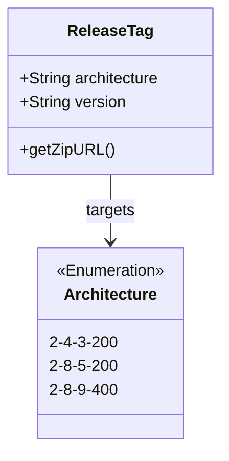

<!-- source: DeepWiki mcp.deepwiki.com · repo NVIDIA/enterprise-ras · page 1.1 Repository Structure and Components · fetched 2026-10-26 -->

# Repository Structure and Components

<details>
<summary>Relevant source files</summary>

The following files were used as context for generating this wiki page:

- [CONTRIBUTING.md](CONTRIBUTING.md)
- [README.md](README.md)
- [license](license)
- [spectrum-era/2-4-3-200/license](spectrum-era/2-4-3-200/license)
- [spectrum-era/README.md](spectrum-era/README.md)
- [spectrum-era/license](spectrum-era/license)

</details>


The NVIDIA Enterprise Reference Architecture (ERA) repository is a monorepo containing automation tools, reference configurations, and observability assets designed to facilitate the deployment of AI factories. The repository is organized into three primary functional areas: `net-configurator` (active automation), `spectrum-era` (legacy reference), and `observability` (monitoring).

## Top-Level Layout

The repository follows a monorepo structure where each directory serves a specific phase or methodology of the ERA lifecycle.

| Component | Directory | Status | Primary Purpose |
| :--- | :--- | :--- | :--- |
| **net-configurator** | `/net-configurator` | **Active** | The primary Python/Ansible framework for generating and deploying switch configurations based on Excel inputs. |
| **spectrum-era** | `/spectrum-era` | **Deprecated** | Static reference configurations and playbooks for older architecture versions (e.g., 2-4-3-200). |
| **Observability RA** | `/observability` | **Active** | Production-ready Grafana dashboards and Prometheus alerting rules for AI/HPC clusters. |

### Component Relationships and Usage

The following diagram illustrates the data flow and relationship between the core components:

**Component Interaction and Data Flow**
```mermaid
graph TD
    subgraph "Input Layer"
        "Excel Template"["Excel Template (xlsx)"]
    end

    subgraph "Automation Layer (net-configurator)"
        "Parser"["excel_parser.py"]
        "Gen"["topology_generator.py"]
        "Ansible"["Ansible Playbooks/Roles"]
    end

    subgraph "Deployment Targets"
        "NV_Air"["NVIDIA Air (Simulation)"]
        "Physical"["Physical Switches (ZTP)"]
    end

    subgraph "Reference & Monitoring"
        "SpecERA"["spectrum-era (Legacy Ref)"]
        "ObsRA"["Observability RA (Dashboards/Alerts)"]
    end

    "Excel Template" --> "Parser"
    "Parser" --> "Gen"
    "Gen" --> "Ansible"
    "Ansible" --> "NV_Air"
    "Ansible" --> "Physical"
    "Physical" -.-> "ObsRA"
    "SpecERA" -.-> "net-configurator"
```
**Sources:** [README.md:1-3](), [spectrum-era/README.md:4-10]()

---

## net-configurator: The Active Toolchain

The `net-configurator` directory is the current standard for ERA deployments. It replaces static YAML configurations with a dynamic generation engine. Users define their network topology, node roles, and IP plans in a standardized Excel template, which the tool then parses to generate:
1.  **Ansible Inventory:** Host-specific variables and group mappings.
2.  **NVUE Configurations:** CLI commands for NVIDIA Spectrum switches.
3.  **Topology JSON:** Definitions for importing the environment into the NVIDIA Air simulation platform.

### Key Implementation Entities
The logic is centered around transforming structured data into network state:
*   **Parser Logic:** `excel_parser.py` validates the input and creates the internal representation of the network.
*   **Topology Engine:** `topology_generator.py` maps the logical nodes to physical or simulated interfaces.
*   **Orchestration:** A `Makefile` provides the entry point for common tasks like `make generate` and `make deploy`.

**Sources:** [spectrum-era/README.md:6-7]()

---

## spectrum-era: Deprecated Reference Configurations

The `spectrum-era` directory contains historical assets for specific ERA versions. While `net-configurator` is recommended for all new deployments, `spectrum-era` is maintained for reference by users managing existing clusters based on older release tags.

### Supported Legacy Architectures
The legacy directory is organized by architecture type, using the `CPUs-GPUs-NICs-Bandwidth` naming convention:
*   **2-4-3-200:** [spectrum-era/README.md:23-23]()
*   **2-8-5-200:** [spectrum-era/README.md:24-24]()
*   **2-8-9-400:** [spectrum-era/README.md:25-25]()

Each architecture folder contains its own `inventory` files and specific `era-config.yml` playbooks for environment setup.

**Sources:** [spectrum-era/README.md:1-26]()

---

## Observability Reference Architecture

The `observability` component provides the "Day 2" operations framework. It is designed to work alongside the network deployed by `net-configurator` to monitor the health of the AI fabric.

### Core Entities
*   **Grafana Dashboards:** Pre-configured JSON files for monitoring NVIDIA DCGM (GPU) metrics, BGP/EVPN network states, and Kubernetes cluster health.
*   **Alerting Rules:** Prometheus rules for detecting critical failures like `network_port_down` or `gpu_alert_temp`.
*   **Provisioning:** The `graf_upload.py` script automates the idempotent upload of these assets to a Grafana instance.

---

## Versioning and Release Management

The repository uses a specific tagging convention for releases to ensure compatibility between the automation scripts and the reference architectures.

### Release Tag Convention
Tags follow the pattern `sp-<architecture>-v<version-number>`. For example, `sp-2-8-9-400-v3.0.0` indicates a release specifically validated for the 2-8-9-400 architecture at version 3.0.0.

**Code Entity to Release Mapping**


**Sources:** [spectrum-era/README.md:12-17](), [spectrum-era/README.md:21-25]()

---

