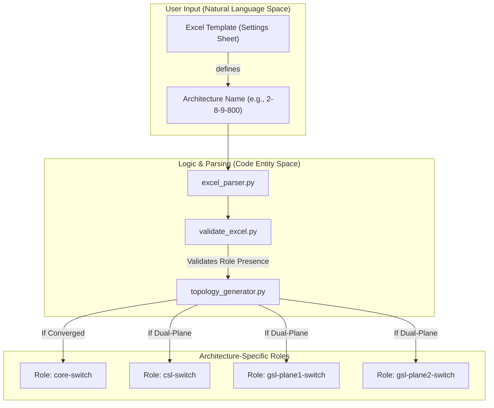
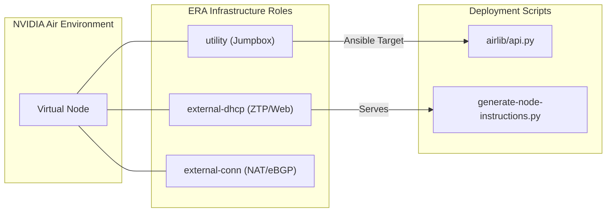

<!-- source: DeepWiki mcp.deepwiki.com · repo NVIDIA/enterprise-ras · page 1.2 Architecture Support Matrix · fetched 2026-10-26 -->

# Architecture Support Matrix

Relevant source files

The following files were used as context for generating this wiki page:

- [net-configurator/.gitignore](net-configurator/.gitignore)
- [net-configurator/README.md](net-configurator/README.md)
- [spectrum-era/2-4-3-200/README.md](spectrum-era/2-4-3-200/README.md)
- [spectrum-era/2-4-3-200/license](spectrum-era/2-4-3-200/license)
- [spectrum-era/2-8-5-200/README.md](spectrum-era/2-8-5-200/README.md)
- [spectrum-era/2-8-9-400/README.md](spectrum-era/2-8-9-400/README.md)
- [spectrum-era/README.md](spectrum-era/README.md)
- [spectrum-era/license](spectrum-era/license)

This page documents the supported NVIDIA Enterprise Reference Architectures (ERA) within the `net-configurator` tool. It details the naming conventions, fabric topologies, and the specific resource requirements for deploying these architectures in the NVIDIA Air simulation environment.

## Naming Convention

ERA architecture names follow a standardized four-part numeric pattern: `{CPUs}-{GPUs}-{NICs}-{Bandwidth}` [net-configurator/README.md:28-30]().

*   **CPUs**: Number of CPU sockets per compute node.
*   **GPUs**: Number of NVIDIA GPUs per compute node.
*   **NICs**: Number of Network Adapters (NICs) per compute node.
*   **Bandwidth**: Average per-GPU bandwidth on the East/West (compute) network, measured in Gbps.

For example, in the `2-4-3-200` architecture, compute nodes have 2 CPUs, 4 GPUs, and 3 NICs, providing 200 Gbps of bandwidth per GPU [net-configurator/README.md:32-34]().

## Supported Architectures Matrix

The following table summarizes the technical specifications for each supported architecture.

| Architecture | CPUs | GPUs | NICs | Per-GPU E/W Bandwidth | Fabric Type |
| :--- | :---: | :---: | :---: | :---: | :--- |
| `2-4-3-200` | 2 | 4 | 3 | 200 Gbps* | Converged (core) |
| `2-8-5-200` | 2 | 8 | 5 | 200 Gbps* | Converged (core); dedicated CSL+GSL split at scale |
| `2-8-9-400` | 2 | 8 | 9 | 400 Gbps | Converged (core); dedicated CSL+GSL 2-tier at scale |
| `2-4-5-800` | 2 | 4 | 5 | 800 Gbps | Multi-tier dedicated-GPU dual-plane (GB300 NVL72) |
| `2-8-9-800` | 2 | 8 | 9 | 800 Gbps | Dual-plane (CSL + GSL) |
| `2-8-9-400-SP`| 2 | 8 | 9 | 400 Gbps | Dedicated-GPU single-plane (GSL Plane 1 only) |

*\*200 Gbps represents the per-NIC link speed; these architectures utilize a 1:2 NIC-to-GPU ratio* [net-configurator/README.md:32-41]().

**Sources:**
* [net-configurator/README.md:26-59]()

---

## Fabric Topologies

The repository supports three primary fabric design philosophies, selected automatically based on the architecture and scale defined in the Excel input.

### 1. Converged Fabric
In a converged fabric, a single tier of `core-*` switches handles all traffic types: CPU/in-band, storage, support, Out-of-Band (OOB), and GPU East-West compute traffic [net-configurator/README.md:45-47]().
*   **Used by:** `2-4-3-200`, `2-8-5-200`, `2-8-9-400`.

### 2. Dual-Plane Fabric
A dual-plane fabric physically and logically separates the GPU compute traffic from the management and storage traffic.
*   **CSL (Compute Services Layer):** Carries CPU/in-band, storage, and OOB traffic [net-configurator/README.md:48-49]().
*   **GSL (GPU Services Layer):** Dedicated to GPU traffic, split across two independent planes (`gsl-plane1-*` and `gsl-plane2-*`). Each plane has its own underlay loopback subnet, EVPN scope, and BGP graph [net-configurator/README.md:50-52]().
*   **Used by:** `2-8-9-800` (HGX B300) and `2-4-5-800` (GB300 NVL72 Mini-Cloud).

### 3. Single-Plane Variant
The `2-8-9-400-SP` architecture is a specific variant of the dual-plane design that utilizes only **Plane 1** of the GSL, effectively halving the compute fabric requirements while maintaining the dedicated layer structure [net-configurator/README.md:54-55]().

**Sources:**
* [net-configurator/README.md:43-56]()

---

## Code Entity Mapping: Architecture to Logic

The following diagram illustrates how architecture selection in the natural language space (Excel/User Input) maps to specific code entities and generated outputs within the `net-configurator` pipeline.

### Architecture Logic Flow

**Sources:**
* [net-configurator/README.md:6-7]()
* [net-configurator/README.md:43-55]()
* [net-configurator/README.md:90-91]()

---

## NVIDIA Air Resource Sizing

When deploying to NVIDIA Air, the tool calculates resource requirements based on the architecture and scale. The "Tested" status indicates configurations that have been verified within the simulation environment.

### Validation Matrix
The following features are validated across all supported architectures in NVIDIA Air:
*   **L3 OOB Underlay + EVPN**: Verified via `make validate-switch-health` [net-configurator/README.md:72]().
*   **Inter-VRF DHCP Relay**: Verified for OOB and EXIT VRFs [net-configurator/README.md:73]().
*   **LDAP Authentication**: Auto-detected and configured from Excel `Settings` [net-configurator/README.md:75]().
*   **NVIDIA Air Simulation (NOZTP)**: Default deployment mode for virtual environments [net-configurator/README.md:76]().

### Topology Entity Mapping
This diagram maps the simulation infrastructure nodes to their respective code roles and deployment scripts.

**Sources:**
* [net-configurator/README.md:18-23]()
* [net-configurator/README.md:70-82]()

---

## Deprecated Architectures (spectrum-era)

The `spectrum-era` directory contains legacy, manually-maintained reference configurations. These are retained for historical reference only and have been superseded by the `net-configurator` automation [spectrum-era/README.md:9]().

*   **2-4-3-200 (Legacy)**: [spectrum-era/2-4-3-200/README.md:13]()
*   **2-8-5-200 (Legacy)**: [spectrum-era/2-8-5-200/README.md:13]()
*   **2-8-9-400 (Legacy)**: [spectrum-era/2-8-9-400/README.md:7]()

Release tags for these legacy versions follow the pattern `sp-{architecture}-v{version}` (e.g., `sp-2-8-9-400-v3.0.0`) [spectrum-era/README.md:15-17]().

**Sources:**
* [spectrum-era/README.md:4-18]()
* [spectrum-era/2-4-3-200/README.md:4-9]()
* [spectrum-era/2-8-5-200/README.md:4-9]()
* [spectrum-era/2-8-9-400/README.md:4-9]()

---

