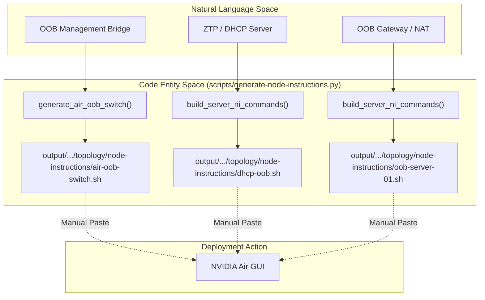
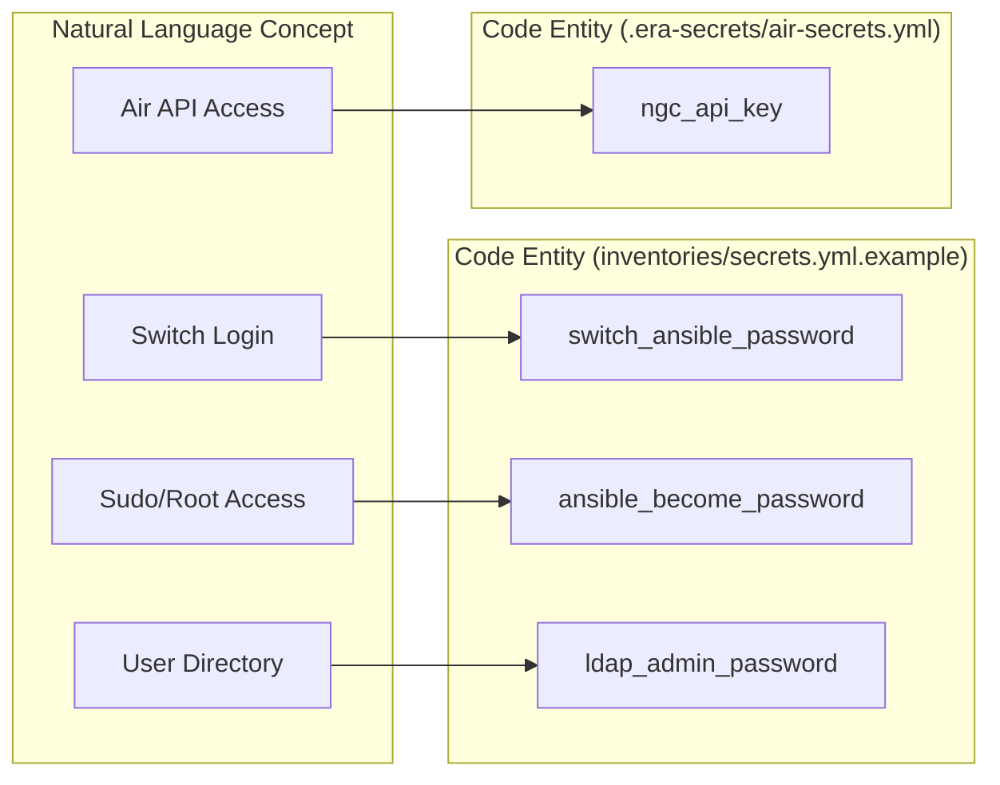

<!-- source: DeepWiki mcp.deepwiki.com · repo NVIDIA/enterprise-ras · page 10 Glossary · fetched 2026-10-26 -->

# Glossary

Relevant source files

The following files were used as context for generating this wiki page:

- [Observability RA/README.md](Observability RA/README.md)
- [Observability RA/dashboards/.DS_Store](Observability RA/dashboards/.DS_Store)
- [Observability RA/dashboards/Network Dashboard.json](Observability RA/dashboards/Network Dashboard.json)
- [README.md](README.md)
- [net-configurator/.gitignore](net-configurator/.gitignore)
- [net-configurator/README.md](net-configurator/README.md)
- [net-configurator/docs/MANUAL_FALLBACK_GUIDE.md](net-configurator/docs/MANUAL_FALLBACK_GUIDE.md)
- [net-configurator/inventories/secrets.yml.example](net-configurator/inventories/secrets.yml.example)
- [net-configurator/scripts/generate-node-instructions.py](net-configurator/scripts/generate-node-instructions.py)
- [spectrum-era/2-4-3-200/license](spectrum-era/2-4-3-200/license)
- [spectrum-era/README.md](spectrum-era/README.md)
- [spectrum-era/license](spectrum-era/license)

This page provides technical definitions for domain-specific terms, abbreviations, and architectural concepts used within the NVIDIA Enterprise Reference Architecture (ERA) repository. It serves as a reference for understanding how natural language requirements map to specific code entities and implementation logic.

## Core Concepts & Terms

| Term | Definition | Implementation Detail |
|:---|:---|:---|
| **ERA** | **Enterprise Reference Architecture**. A standardized set of network topologies (e.g., 2-4-3-200) designed for AI/HPC workloads. | Defined as a set of supported schemas in `net-configurator/README.md` [12-12](). |
| **NVUE** | **NVIDIA User Experience**. The object-model based CLI and API for Cumulus Linux switches. | The tool generates `.sh` scripts containing `nv set` commands [net-configurator/README.md:13-13](). |
| **ZTP** | **Zero Touch Provisioning**. A mechanism where switches fetch and execute a provisioning script (typically via DHCP Option 239) on first boot. | Managed via the `ztp-setup` make target and `external-dhcp` node [net-configurator/README.md:15-15](). |
| **Site** | A specific deployment instance of an architecture (e.g., `lab`, `production`). | Scoped via the `.era-context` file and stored in `output/<arch>/<site>/` [net-configurator/README.md:24-24](). |
| **Air** | **NVIDIA Air**. A cloud-hosted network simulation platform used for validating configurations before physical deployment. | Orchestrated by `net-configurator/scripts/air-deploy.py` [net-configurator/scripts/generate-node-instructions.py:44-51](). |

**Sources:** [net-configurator/README.md:10-24](), [net-configurator/scripts/generate-node-instructions.py:44-51]()

---

## Infrastructure Node Roles

The following table defines the specialized nodes used to manage the OOB (Out-of-Band) and ZTP infrastructure.

| Role Name | Description | Code Entity / Service |
|:---|:---|:---|
| `utility` | The L3 OOB jumpbox and DHCP relay target. | Replaces legacy `oob-server-01` [net-configurator/README.md:19-19](). |
| `external-dhcp` | Host for ZTP scripts and DHCP server for switch provisioning. | Replaces legacy `dhcp-oob` [net-configurator/README.md:20-20](). |
| `external-conn` | The NAT host (`172.20.0.1`) providing internet and eBGP control plane for OOB. | NAT Gateway [net-configurator/README.md:21-21](). |
| `cust-net-edge` | Simulated customer-edge switches bridging the management network. | L3 Underlay Edge [net-configurator/README.md:22-22](). |
| `air-oob-switch` | A virtual VLAN-aware bridge used in NVIDIA Air to connect management interfaces. | Configured via `generate_air_oob_switch` in `scripts/generate-node-instructions.py` [106-172](). |

### Data Flow: Infrastructure Bootstrapping
This diagram illustrates how the `generate-node-instructions.py` script bridges the natural language concept of "Infrastructure Setup" to specific code-generated shell scripts.

Natural Language to Code Entity: Infrastructure Setup

**Sources:** [net-configurator/scripts/generate-node-instructions.py:106-183](), [net-configurator/docs/MANUAL_FALLBACK_GUIDE.md:95-103]()

---

## Fabric & Architecture Terms

*   **Converged Fabric**: A topology where a single switch tier (e.g., `core-*` switches) handles all traffic types: CPU, Storage, Support, and GPU East-West [net-configurator/README.md:45-47]().
*   **Dual-Plane GPU Fabric**: A high-scale topology where GPU traffic is split across two L3-isolated planes (`gsl-plane1` and `gsl-plane2`) while other traffic stays on the CSL (Compute/Storage Leaf) [net-configurator/README.md:48-52]().
*   **CSL**: Compute/Storage Leaf.
*   **GSL**: GPU/System Leaf.
*   **Architecture Naming**: Follows `{CPUs}-{GPUs}-{NICs}-{Bandwidth}`. For example, `2-8-9-400` represents a node with 2 CPUs, 8 GPUs, 9 NICs, and 400 Gbps per-GPU bandwidth [net-configurator/README.md:28-30]().

**Sources:** [net-configurator/README.md:28-55]()

---

## Security & Secrets

The repository utilizes a two-vault model to separate environment-wide credentials from site-specific secrets.

| Secret Store | Path | Purpose |
|:---|:---|:---|
| **Air Vault** | `.era-secrets/air-secrets.yml` | Contains NGC API keys and Air SSH keys. Shared across all sites [net-configurator/inventories/secrets.yml.example:60-67](). |
| **Deployment Secrets** | `output/<arch>/<site>/inventory/group_vars/all/secrets.yml` | Contains `switch_ansible_password`, `ldap_admin_password`, and `switch_password` [net-configurator/inventories/secrets.yml.example:19-49](). |

### Entity Mapping: Security Variables
This diagram maps security concepts to the specific variable names used in the Ansible inventory and secrets files.

Natural Language to Code Entity: Security & Secrets

**Sources:** [net-configurator/inventories/secrets.yml.example:14-67]()

---

## Observability Definitions

*   **DCGM**: NVIDIA Data Center GPU Manager. Source for GPU-specific telemetry [Observability RA/README.md:3-3]().
*   **Prometheus Node Exporter**: Standard exporter for hardware and OS metrics [Observability RA/README.md:3-3]().
*   **graf_upload.py**: A provisioning script used to idempotently upload alert rules and configurations to a Grafana instance [Observability RA/README.md:19-24]().
*   **Network Dashboard**: A Grafana visualization targeting `nvswitch` and `nvrouting` metrics, such as BGP peer states (`nvrouting_bgp_peer_state`) and interface throughput (`nvswitch_interface_tc_tx_octet`) [Observability RA/dashboards/Network Dashboard.json:166-181]().

**Sources:** [Observability RA/README.md:1-26](), [Observability RA/dashboards/Network Dashboard.json:160-206]()