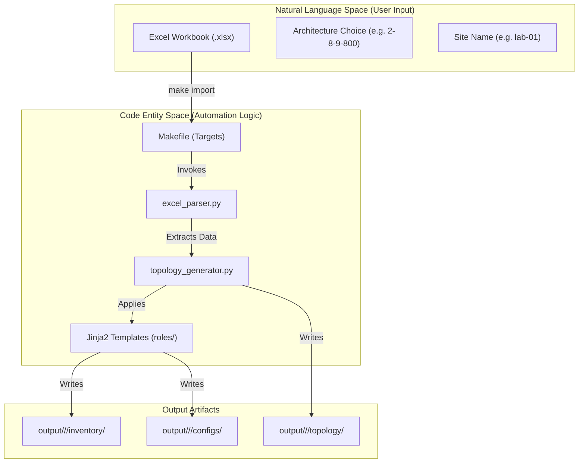
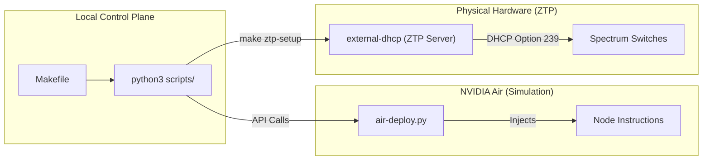

<!-- source: DeepWiki mcp.deepwiki.com · repo NVIDIA/enterprise-ras · page 2 net-configurator: Active Deployment Tool · fetched 2026-10-26 -->

# net-configurator: Active Deployment Tool

Relevant source files

The following files were used as context for generating this wiki page:

- [net-configurator/.gitignore](net-configurator/.gitignore)
- [net-configurator/README.md](net-configurator/README.md)
- [net-configurator/docs/MANUAL_FALLBACK_GUIDE.md](net-configurator/docs/MANUAL_FALLBACK_GUIDE.md)
- [net-configurator/inventories/secrets.yml.example](net-configurator/inventories/secrets.yml.example)
- [net-configurator/scripts/generate-node-instructions.py](net-configurator/scripts/generate-node-instructions.py)

The `net-configurator` is the primary automation framework within the Enterprise Reference Architecture (ERA) repository. It provides an Ansible and Python-based pipeline designed to transform high-level network designs—captured in a standardized Excel template—into production-ready switch configurations and simulation topologies.

The tool supports the full lifecycle of a deployment: from initial configuration generation and validation to automated deployment in NVIDIA Air or on physical hardware via Zero Touch Provisioning (ZTP) [net-configurator/README.md:4-6]().

## Workflow Overview

The `net-configurator` follows a "Source of Truth" model where the Excel workbook defines the entire fabric. The automation logic consumes this workbook to produce three primary artifacts:
1.  **Ansible Inventory**: Host definitions, group variables, and secrets required for fabric management.
2.  **NVUE Configurations**: CLI-ready shell scripts (`.sh`) containing `nv set` commands for Cumulus Linux switches [net-configurator/README.md:13-15]().
3.  **Topology JSON**: A definition file used to instantiate virtualized environments in the NVIDIA Air simulation platform [net-configurator/README.md:17-17]().

### The "Natural Language" to "Code Entity" Bridge

The following diagram maps user-facing concepts (Natural Language Space) to the specific Python scripts and Ansible entities that implement them (Code Entity Space).

**Mapping: Design Intent to Code Implementation**

Sources: [net-configurator/README.md:90-95](), [net-configurator/docs/MANUAL_FALLBACK_GUIDE.md:89-93]()

## Key Components and Subsystems

### 1. Excel Configuration Guide
The Excel template is the primary interface for users. It contains four critical sheets: `Settings`, `Nodes`, `VLANs & Profiles`, and `Wire Map`. The parser validates these sheets to ensure the design adheres to ERA principles, such as proper GPU VLAN topology and IP planning [net-configurator/README.md:91-91]().
*   **For details, see [Excel Configuration Guide](#2.1)**

### 2. Configuration Generation Pipeline
This subsystem handles the transformation of Excel data into machine-readable code. It utilizes `excel_parser.py` to ingest data and `topology_generator.py` to build the relationship graph between nodes. This data is then fed into Jinja2 templates located within the `roles/` directory to produce final switch and server configurations [net-configurator/docs/MANUAL_FALLBACK_GUIDE.md:44-47]().
*   **For details, see [Configuration Generation Pipeline](#2.2)**

### 3. Makefile Workflow Reference
The `Makefile` serves as the entry point for all operations. It manages the `.era-context` file, which tracks the current `ARCH` and `SITE` to prevent accidental deployments to the wrong environment [net-configurator/.gitignore:5-5]().
*   **Common Targets**: `make generate`, `make deploy`, `make ztp-setup`, and `make validate-all` [net-configurator/README.md:90-94]().
*   **For details, see [Makefile Workflow Reference](#2.3)**

### 4. Node Roles and Switch Fabric Taxonomy
The framework recognizes a specific taxonomy of roles (e.g., `gpu`, `core`, `csl`, `gsl-plane1`). These roles determine how the parser classifies a node and which Ansible roles are applied during deployment. The taxonomy varies between **Converged** fabrics (where one tier handles all traffic) and **Dual-Plane** fabrics (where compute traffic is isolated) [net-configurator/README.md:43-55]().
*   **For details, see [Node Roles and Switch Fabric Taxonomy](#2.4)**

## Deployment Contexts

The tool is designed to bridge the gap between simulation and reality. It uses the same configuration logic for both NVIDIA Air and physical hardware.

**System Interaction: Simulation vs. Physical**

Sources: [net-configurator/README.md:15-17](), [net-configurator/scripts/generate-node-instructions.py:17-21]()

### Secrets and Security
The `net-configurator` utilizes a two-tier secrets model. Global credentials for the NVIDIA Air API are stored in a shared vault (`.era-secrets/air-secrets.yml`), while deployment-specific passwords (switches, LDAP, etc.) are stored in the site's `inventory/group_vars/all/secrets.yml` [net-configurator/inventories/secrets.yml.example:7-12](), [net-configurator/inventories/secrets.yml.example:62-67]().
*   **For details, see [Secrets Management and Security](#5)**

### Manual Fallback
In scenarios where the Air API is unavailable, the tool provides a `generate-node-instructions.py` script. This script generates standalone bash fragments that can be manually pasted into the Air GUI to bootstrap the environment [net-configurator/scripts/generate-node-instructions.py:5-10]().
*   **For details, see [Manual Fallback Deployment Guide](#3.3)**

---
**Sources:**
*   [net-configurator/README.md:1-102]()
*   [net-configurator/scripts/generate-node-instructions.py:1-52]()
*   [net-configurator/inventories/secrets.yml.example:1-67]()
*   [net-configurator/docs/MANUAL_FALLBACK_GUIDE.md:1-103]()
*   [net-configurator/.gitignore:1-103]()

---

