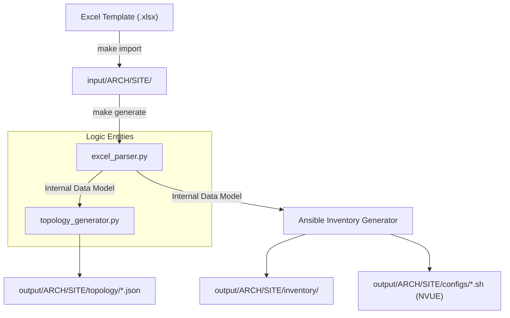
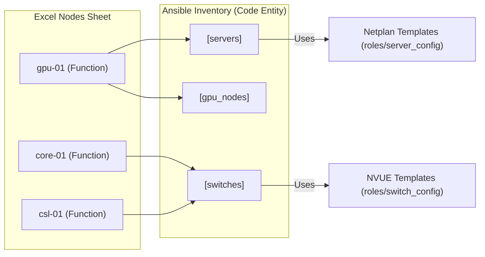
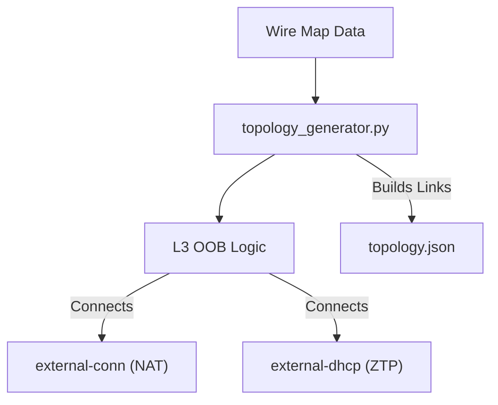

<!-- source: DeepWiki mcp.deepwiki.com · repo NVIDIA/enterprise-ras · page 2.1 Excel Configuration Guide · fetched 2026-10-26 -->

# Excel Configuration Guide

Relevant source files

The following files were used as context for generating this wiki page:

- [net-configurator/.gitignore](net-configurator/.gitignore)
- [net-configurator/README.md](net-configurator/README.md)
- [net-configurator/docs/MANUAL_FALLBACK_GUIDE.md](net-configurator/docs/MANUAL_FALLBACK_GUIDE.md)
- [net-configurator/inventories/secrets.yml.example](net-configurator/inventories/secrets.yml.example)
- [net-configurator/scripts/generate-node-instructions.py](net-configurator/scripts/generate-node-instructions.py)

The NVIDIA Enterprise Reference Architecture (ERA) automation is driven by a single Excel spreadsheet. This template defines the physical topology, logical network settings, VLAN profiles, and IP addressing for the entire cluster. The `net-configurator` tool parses this workbook to generate Ansible inventories, NVUE (NVIDIA User Experience) switch configurations, and NVIDIA Air simulation topologies.

## Configuration Workflow

The data flow begins with the user-provided Excel file and terminates in the `output/` directory, which contains all deployment artifacts.

**Sources:** [net-configurator/README.md:6-7](), [net-configurator/docs/MANUAL_FALLBACK_GUIDE.md:81-93]()

---

## 1. Settings Sheet
The **Settings** sheet defines global parameters for the deployment, including the architecture type, OOB (Out-of-Band) management modes, and authentication services.

### Key Fields
| Field | Description | Code Reference / Impact |
|:---|:---|:---|
| **Architecture** | The ERA architecture ID (e.g., `2-8-9-800`). | Used by `excel_parser.py` to select validation rules. |
| **oob_uplink_mode** | `l3` (default) or `l2`. | Controls whether `oob-server-01` (L2) or `utility` (L3) is used [net-configurator/README.md:18-23](). |
| **ldap_enabled** | `Yes` or `No`. | If `Yes`, triggers generation of LDAP client configs for switches [net-configurator/README.md:96-96](). |
| **status_page_enabled** | `Yes` or `No`. | Enables the ZTP status dashboard on the `utility` node [net-configurator/inventories/secrets.yml.example:54-57](). |

**Sources:** [net-configurator/README.md:18-23](), [net-configurator/README.md:75-75]()

---

## 2. Nodes Sheet
The **Nodes** sheet acts as the source of truth for every device in the fabric. It maps physical hardware to functional roles.

### Field Documentation
*   **Function / Name**: A canonical string identifying the node's role (e.g., `gpu-01`, `core-01`, `csl-01`). The parser uses these prefixes to classify nodes into groups like `[switches]` or `[servers]`.
*   **Display in Air**: A boolean (`Yes`/`No`) determining if the node is included in the generated NVIDIA Air topology JSON.
*   **MAC Address**: Required for physical ZTP deployments. Used by `external-dhcp` to map DHCP requests to specific NVUE configuration scripts.

### Node Roles and Code Entities
The following diagram maps Excel node roles to the internal Ansible groups and deployment logic.

**Sources:** [net-configurator/README.md:57-59](), [net-configurator/scripts/generate-node-instructions.py:17-21]()

---

## 3. VLANs & Profiles Sheet
This sheet defines the logical segmentation of the network. ERA typically utilizes several standard VRFs (Virtual Routing and Forwarding) instances to isolate traffic.

### Standard VRFs
*   **default**: The underlay and management plane.
*   **compute**: High-bandwidth GPU East-West traffic.
*   **storage**: Dedicated storage traffic (first-class in 800G architectures).
*   **exit**: External connectivity and NAT services.

### GPU VLAN Topology Modes
For high-scale architectures like `2-8-9-800`, the tool supports **Per-rail-per-plane** GPU VLAN modes. This ensures that each GPU rail is mapped to a specific fabric plane for maximum throughput and isolation [net-configurator/README.md:81-82]().

**Sources:** [net-configurator/README.md:48-55](), [net-configurator/README.md:80-82]()

---

## 4. Wire Map Sheet
The **Wire Map** defines every physical cable in the cluster. This data is critical for generating the `topology.json` file used by NVIDIA Air and for validating the LLDP neighbor state on physical hardware.

### Column Definitions
1.  **Local Node**: The source node name (must match the **Nodes** sheet).
2.  **Local Interface**: The port identifier (e.g., `swp1`, `eth0`).
3.  **Remote Node**: The destination node name.
4.  **Remote Interface**: The destination port identifier.

### Topology Generation Logic
The `topology_generator.py` script processes these entries to build the Air-compatible JSON. For infrastructure nodes, specific logic is applied to handle the `air-oob-switch` (VLAN-aware bridge) and the NAT gateway.

**Sources:** [net-configurator/scripts/generate-node-instructions.py:106-127](), [net-configurator/README.md:19-22]()

---

## 5. IP Planning and Secrets
IP addresses are typically derived from the **VLANs & Profiles** sheet based on defined subnets. However, sensitive information is never stored in the Excel file.

### Secrets Management
Passwords and API keys are handled via Ansible Vault.
*   **Air Credentials**: Stored in `.era-secrets/air-secrets.yml` (Shared across all sites) [net-configurator/inventories/secrets.yml.example:60-67]().
*   **Deployment Secrets**: Stored in `output/<arch>/<site>/inventory/group_vars/all/secrets.yml`. This includes `switch_password`, `ldap_admin_password`, and `ansible_become_password` [net-configurator/inventories/secrets.yml.example:19-51]().

**Sources:** [net-configurator/inventories/secrets.yml.example:4-12](), [net-configurator/README.md:98-98]()

---

