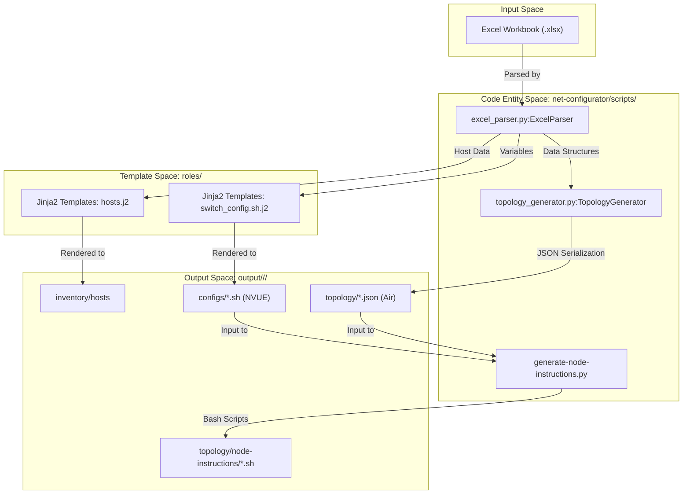

<!-- source: DeepWiki mcp.deepwiki.com · repo NVIDIA/enterprise-ras · page 2.2 Configuration Generation Pipeline · fetched 2026-10-26 -->

# Configuration Generation Pipeline

<details>
<summary>Relevant source files</summary>

The following files were used as context for generating this wiki page:

- [net-configurator/.gitignore](net-configurator/.gitignore)
- [net-configurator/README.md](net-configurator/README.md)
- [net-configurator/docs/ANSIBLE_SUDO_SETUP.md](net-configurator/docs/ANSIBLE_SUDO_SETUP.md)
- [net-configurator/docs/MANUAL_FALLBACK_GUIDE.md](net-configurator/docs/MANUAL_FALLBACK_GUIDE.md)
- [net-configurator/inventories/secrets.yml.example](net-configurator/inventories/secrets.yml.example)
- [net-configurator/scripts/generate-node-instructions.py](net-configurator/scripts/generate-node-instructions.py)

</details>


The Configuration Generation Pipeline is the core engine of `net-configurator`. It transforms high-level network design specifications defined in Excel into low-level, deployable artifacts including Ansible inventories, NVUE (NVIDIA User Experience) switch configuration scripts, and NVIDIA Air topology definitions.

## Pipeline Overview

The pipeline follows a strictly sequential flow, moving from a user-provided Excel workbook to structured Python objects, and finally to rendered text files.

### Data Flow Diagram

The following diagram illustrates the transition from the "Natural Language Space" (Excel) to the "Code Entity Space" (Python classes and Jinja2 templates).

**Logic Flow: Excel to Artifacts**

**Sources:** [net-configurator/README.md:4-6](), [net-configurator/scripts/generate-node-instructions.py:5-27]()

---

## 1. Input Parsing (`excel_parser.py`)

The first stage involves `excel_parser.py`, which reads the four primary sheets of the ERA Excel template: **Settings**, **Nodes**, **VLANs & Profiles**, and **Wire Map**.

### Key Responsibilities
*   **Role Classification**: It maps every node to one of the 11+ canonical roles (e.g., `gpu`, `core`, `gsl-plane1`).
*   **Variable Extraction**: Extracts global settings such as `ldap_enabled`, `oob_uplink_mode`, and `gpu_vlan_mode`.
*   **Validation**: Triggers `validate_excel.py` to ensure the input adheres to the architecture's constraints (e.g., correct NIC-to-GPU ratios).

**Sources:** [net-configurator/README.md:90-91](), [net-configurator/docs/ROLES.md:1-50]()

---

## 2. Topology Generation (`topology_generator.py`)

This component consumes the parsed data to build a comprehensive map of the network. It is responsible for generating the `topology.json` file required by the NVIDIA Air API or for manual upload.

### Implementation Details
The `TopologyGenerator` class performs the following:
1.  **Node Definition**: Creates a JSON object for every switch and server marked with "Display in Air = Yes".
2.  **Interface Mapping**: Translates the **Wire Map** sheet into a list of links, defining exactly which local interface connects to which remote interface.
3.  **Metadata Injection**: Injects specific metadata for infrastructure nodes like `air-oob-switch` and `oob-server-01` to facilitate automated OOB setup.

**Sources:** [net-configurator/scripts/generate-node-instructions.py:106-117](), [net-configurator/docs/MANUAL_FALLBACK_GUIDE.md:89-93]()

---

## 3. Configuration Rendering (Jinja2)

`net-configurator` uses Ansible's Jinja2 engine to render final configuration files. Unlike standard Ansible roles that apply configuration directly to live devices, this pipeline often renders these to the `output/` directory first for ZTP (Zero Touch Provisioning) consumption.

### Template Structure
*   **Switch Configs**: The `switch_config.sh.j2` template (found in the switch roles) generates a sequence of `nv set` commands. These commands are wrapped in a script that includes `nv config apply -y`.
*   **Inventory**: The `hosts.j2` template generates the Ansible `hosts` file, organizing nodes into groups based on their ERA roles.

### Secret Handling
Secrets are merged during this phase. Values from `inventories/secrets.yml` (e.g., `switch_ansible_password`, `ldap_admin_password`) are injected into the templates to ensure the generated configs are fully functional.

**Sources:** [net-configurator/inventories/secrets.yml.example:19-49](), [net-configurator/README.md:13-15]()

---

## 4. Node Instructions Generation

For NVIDIA Air deployments, especially in "NOZTP" mode or manual fallback scenarios, the pipeline generates "Node Instructions" (NI). These are standalone bash scripts that are executed by the Air hypervisor upon node boot.

### `generate-node-instructions.py`
This script produces one `.sh` file per node in `output/<arch>/<site>/topology/node-instructions/`.

**Node Instruction Logic Mapping**
| Entity in Code | Target Node | Purpose |
| :--- | :--- | :--- |
| `generate_air_oob_switch` | `air-oob-switch` | Configures the VLAN-aware bridge [net-configurator/scripts/generate-node-instructions.py:106-172]() |
| `build_server_ni_commands` | `gpu`, `storage`, etc. | Sets up netplan, hostnames, and ARP-flux fixes [net-configurator/scripts/generate-node-instructions.py:49-51]() |
| `build_switch_ni_commands` | `core`, `csl`, `gsl` | Injects a wrapper to source the rendered NVUE config from `/opt/era/` [net-configurator/scripts/generate-node-instructions.py:17-20]() |

**Sources:** [net-configurator/scripts/generate-node-instructions.py:1-52](), [net-configurator/docs/MANUAL_FALLBACK_GUIDE.md:95-103]()

---

## 5. Output Directory Structure

The final results of the pipeline are organized into a predictable hierarchy within the `output/` directory. This structure allows for multi-site deployments under the same architecture.

```text
output/
└── <architecture>/          # e.g., 2-8-9-800
    └── <site>/              # e.g., default or lab-01
        ├── configs/         # Rendered NVUE .sh scripts for every switch
        ├── inventory/       # Ansible hosts file and group_vars
        │   └── group_vars/
        │       └── all/
        │           └── secrets.yml
        └── topology/        # Air topology JSON and Node Instructions
            ├── <arch>-topology.json
            └── node-instructions/
                ├── air-oob-switch.sh
                ├── oob-server-01.sh
                └── ...
```

**Sources:** [net-configurator/.gitignore:83-96](), [net-configurator/docs/MANUAL_FALLBACK_GUIDE.md:89-93]()

---

