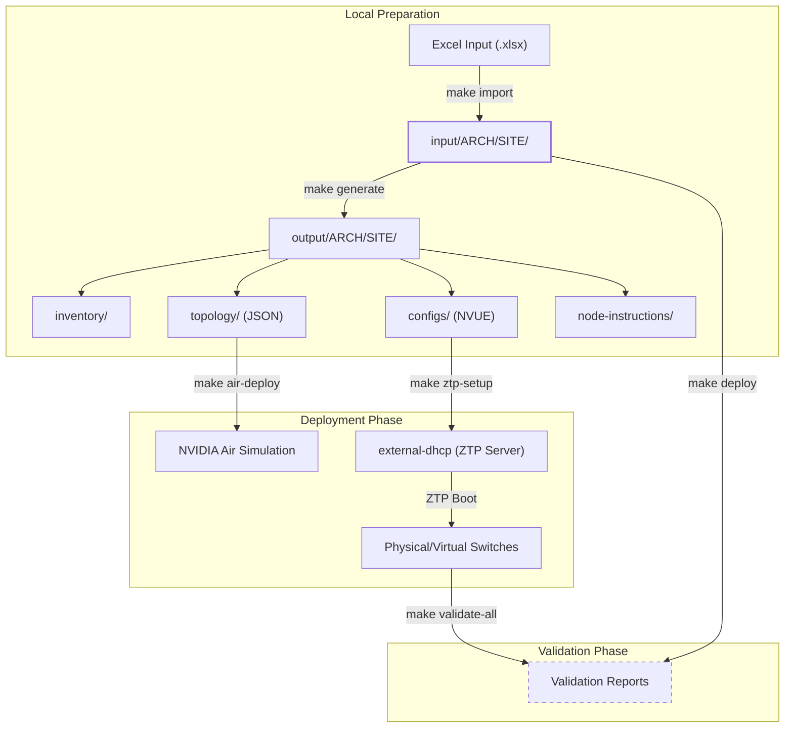
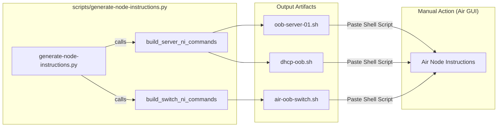

<!-- source: DeepWiki mcp.deepwiki.com · repo NVIDIA/enterprise-ras · page 2.3 Makefile Workflow Reference · fetched 2026-10-26 -->

# Makefile Workflow Reference

Relevant source files

The following files were used as context for generating this wiki page:

- [net-configurator/.gitignore](net-configurator/.gitignore)
- [net-configurator/README.md](net-configurator/README.md)
- [net-configurator/docs/MANUAL_FALLBACK_GUIDE.md](net-configurator/docs/MANUAL_FALLBACK_GUIDE.md)
- [net-configurator/inventories/secrets.yml.example](net-configurator/inventories/secrets.yml.example)
- [net-configurator/scripts/generate-node-instructions.py](net-configurator/scripts/generate-node-instructions.py)

The NVIDIA Enterprise Reference Architecture (ERA) `net-configurator` tool uses a `Makefile` to orchestrate a multi-stage pipeline that transforms Excel-based network designs into fully functional simulated or physical fabrics. This workflow manages everything from local artifact generation to remote NVIDIA Air API interactions and Ansible-based switch provisioning.

## Workflow Overview

The workflow is designed to be idempotent and context-aware. It utilizes a hidden file, `.era-context`, to track the current active architecture (`ARCH`) and site (`SITE`), allowing users to execute targets without repeatedly specifying parameters [net-configurator/.gitignore:5-5]().

### Data Flow and Target Chaining

The following diagram illustrates how major `make` targets chain together to move data from the input Excel sheet to a deployed environment.

**ERA Configuration Data Flow**

**Sources:** [net-configurator/README.md:90-99](), [net-configurator/scripts/generate-node-instructions.py:7-23]()

---

## Core Targets

### `make import`
Copies a user-provided Excel file into the internal directory structure. It automatically detects the architecture and site name defined within the spreadsheet to set the `.era-context`.
*   **Input:** `EXCEL=/path/to/file.xlsx`
*   **Result:** Files placed in `input/<arch>/<site>/` [net-configurator/.gitignore:65-81]().

### `make generate`
The primary local processing engine. It executes the Python-based parser and topology generator to create all deployment artifacts.
*   **Implementation:** Calls `excel_parser.py` and `topology_generator.py`.
*   **Artifacts:**
    *   Ansible inventory for the specific site.
    *   NVUE `.sh` configuration scripts for every switch.
    *   NVIDIA Air topology JSON.
    *   Node Instruction (NI) scripts for infrastructure nodes [net-configurator/scripts/generate-node-instructions.py:85-93]().

### `make deploy`
The "one-command" target. It chains `generate`, `air-deploy` (if using Air), `ztp-setup`, and `validate-all`. It is the standard entry point for most users [net-configurator/README.md:90-90]().

---

## NVIDIA Air Simulation Targets

These targets interact with the NVIDIA Air API via the `airlib` Python library to automate simulation lifecycles.

| Target | Description |
| :--- | :--- |
| `make air-setup` | Wizard to configure NGC API keys and SSH keys in the `.era-secrets/air-secrets.yml` vault [net-configurator/inventories/secrets.yml.example:62-67](). |
| `make air-deploy` | Uploads the generated topology JSON, creates a simulation, and injects Node Instructions for NOZTP mode [net-configurator/scripts/generate-node-instructions.py:9-10](). |
| `make deploy-switches-only` | Deploys the fabric but omits server VMs to save Air budget and simulation startup time [net-configurator/README.md:94-94](). |

**Sources:** [net-configurator/README.md:16-17](), [net-configurator/docs/MANUAL_FALLBACK_GUIDE.md:23-28]()

---

## Provisioning and ZTP Targets

Once the infrastructure is reachable (either in Air or physically), these targets handle the application of the generated NVUE configurations.

### `make ztp-setup`
Configures the `external-dhcp` node (or `dhcp-oob` in legacy L2) to act as a ZTP server. It installs `dnsmasq` and `nginx`, then hosts the NVUE `.sh` scripts generated during the `make generate` phase [net-configurator/README.md:20-20](), [net-configurator/docs/MANUAL_FALLBACK_GUIDE.md:36-39]().

### `make switch-ztp-deploy`
Triggers the ZTP process on switches. In an Air environment using `NOZTP` Node Instructions, this is handled by a deferred-apply wrapper that sources the rendered NVUE config from `/opt/era/` on first boot [net-configurator/scripts/generate-node-instructions.py:19-20]().

---

## Validation Targets

The validation framework ensures the deployed state matches the Excel design.

*   **`make validate-excel`**: Runs `validate_excel.py` to check for canonical role enforcement and field errors.
*   **`make validate-topology`**: Compares the wire map against the generated Air JSON.
*   **`make validate-all`**: A meta-target that runs the full suite:
    1.  **Config Validation**: `nv config diff` check.
    2.  **Health Validation**: Checks BGP peerings and EVPN VNI status.
    3.  **Connectivity**: Runs a ping matrix across VRFs.
    4.  **ZTP Status**: Verifies all switches successfully completed provisioning.

**Sources:** [net-configurator/README.md:72-82](), [net-configurator/scripts/generate-node-instructions.py:90-93]()

---

## Manual Fallback Workflow

If the Air API is unavailable, the `Makefile` supports a manual workflow using the generated Node Instructions.

**Manual Node Instruction Logic**

**Sources:** [net-configurator/scripts/generate-node-instructions.py:44-51](), [net-configurator/docs/MANUAL_FALLBACK_GUIDE.md:95-103]()

### Manual Steps
1.  **Generate locally**: `make generate` produces `output/<arch>/<site>/topology/node-instructions/` [net-configurator/docs/MANUAL_FALLBACK_GUIDE.md:85-88]().
2.  **Upload Topology**: Manually upload the JSON to the Air GUI [net-configurator/docs/MANUAL_FALLBACK_GUIDE.md:112-113]().
3.  **Paste Instructions**: Paste the generated `.sh` scripts into the Air GUI for `air-oob-switch`, `oob-server-01`, and `dhcp-oob` [net-configurator/docs/MANUAL_FALLBACK_GUIDE.md:132-138]().
4.  **Internal Ansible**: Run Ansible directly from the `dhcp-oob` node within the simulation to bypass SSH tunneling bottlenecks [net-configurator/docs/MANUAL_FALLBACK_GUIDE.md:48-53]().

---

## Context and Secrets Management

### `.era-context`
This file is generated by `make import` or `make set-context`. It contains the current `ARCH` and `SITE`. If this file is missing, most `make` targets will fail or prompt for these variables [net-configurator/.gitignore:4-5]().

### Secrets (`ansible-vault`)
The workflow utilizes two distinct secret stores:
1.  **Global Air Secrets**: `.era-secrets/air-secrets.yml` contains the `ngc_api_key`.
2.  **Deployment Secrets**: `output/<arch>/<site>/inventory/group_vars/all/secrets.yml` contains `switch_password`, `ldap_admin_password`, and `ansible_become_password` [net-configurator/inventories/secrets.yml.example:1-67]().

**Sources:** [net-configurator/.gitignore:7-9](), [net-configurator/inventories/secrets.yml.example:60-67]()

---

