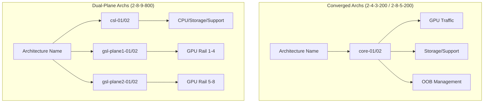
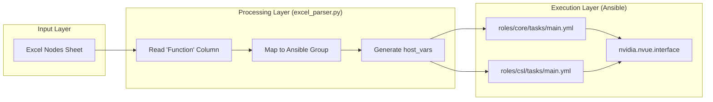

<!-- source: DeepWiki mcp.deepwiki.com · repo NVIDIA/enterprise-ras · page 2.4 Node Roles and Switch Fabric Taxonomy · fetched 2026-10-26 -->

# Node Roles and Switch Fabric Taxonomy

Relevant source files

The following files were used as context for generating this wiki page:

- [net-configurator/.gitignore](net-configurator/.gitignore)
- [net-configurator/README.md](net-configurator/README.md)
- [spectrum-era/2-4-3-200/roles/core/tasks/main.yml](spectrum-era/2-4-3-200/roles/core/tasks/main.yml)
- [spectrum-era/2-8-5-200/roles/core/tasks/main.yml](spectrum-era/2-8-5-200/roles/core/tasks/main.yml)
- [spectrum-era/2-8-9-400/roles/core/tasks/main.yml](spectrum-era/2-8-9-400/roles/core/tasks/main.yml)

This page provides a technical reference for the canonical node roles and fabric classifications used within the NVIDIA Enterprise Reference Architecture (ERA) automation. It details how the `net-configurator` parser identifies nodes and the architectural differences between converged and dedicated-GPU fabrics.

## Node Role Reference

The ERA framework recognizes 11+ distinct roles. These roles are defined in the **Nodes** sheet of the Excel configuration and are used by the `excel_parser.py` to generate the Ansible inventory and NVUE configurations.

### Switch Roles

| Role | Name | Description |
|---|---|---|
| `core` | Core Switch | A converged switch handling all traffic types (Compute, Storage, Support, OOB) in smaller architectures. |
| `csl` | Compute Storage Leaf | Dedicated leaf for CPU/In-band, Storage, and Support traffic in multi-tier architectures. |
| `cs` | Compute Spine | Spine switch connecting `csl` leaves. |
| `gsl-plane1` | GPU Leaf Plane 1 | Leaf switch for the first plane of the GPU East-West fabric. |
| `gsl-plane2` | GPU Leaf Plane 2 | Leaf switch for the second plane of the GPU East-West fabric. |
| `gs` | GPU Spine | Spine switch connecting `gsl` leaves. |
| `cl` | Compute Leaf | Dedicated leaf for compute-only traffic (used in specific large-scale variants). |
| `gl` | GPU Leaf | Generic GPU leaf (often aliased to `gsl-planeX`). |
| `oob-switch` | OOB Switch | Dedicated management switch for out-of-band traffic. |
| `cust-net-edge` | Customer Edge | Simulated edge switches providing external connectivity and NAT. |

### Server and Support Roles

| Role | Name | Description |
|---|---|---|
| `gpu` | GPU Server | Compute nodes (e.g., HGX H100/B200) containing multiple GPUs and NICs. |
| `storage` | Storage Node | Nodes providing storage services, typically mapped to the STORAGE VRF. |
| `support` | Support Node | Infrastructure nodes (DNS, NTP, etc.) mapped to the SUPPORT VRF. |
| `utility` | Utility Host | The L3 OOB jumpbox and Ansible control node. |
| `external-dhcp`| ZTP Server | Host providing DHCP and HTTP services for switch Zero Touch Provisioning. |

**Sources:**
- `net-configurator/README.md:10-24`()
- `net-configurator/README.md:32-39`()
- `net-configurator/README.md:48-55`()

---

## Fabric Taxonomy: Converged vs. Dedicated-GPU

The architecture of the switch fabric is determined by the specific ERA model selected.

### Converged Fabric
In converged architectures (e.g., `2-4-3-200`, `2-8-5-200`), a single tier of `core` switches handles all traffic types. This simplifies the physical topology but aggregates all failure domains.
- **Key Files:** `spectrum-era/2-4-3-200/roles/core/tasks/main.yml`() defines how these multi-functional interfaces are configured via NVUE.

### Dual-Plane GPU Fabric
In high-bandwidth architectures (e.g., `2-8-9-800`), the GPU East-West traffic is isolated into dedicated planes.
- **CSL Tier:** Handles CPU/In-band, Storage, and Support.
- **GSL Planes:** Two independent L3-isolated planes (`gsl-plane1` and `gsl-plane2`) handle GPU traffic. They share VLAN IDs but use different loopback subnets and BGP graphs.

### Fabric Architecture Mapping
The following diagram maps the logical architecture names to the switch roles utilized in the codebase.

**Diagram: Architecture to Node Role Mapping**

**Sources:**
- `net-configurator/README.md:43-55`()
- `net-configurator/README.md:78-82`()

---

## Parser Classification and Excel Convention

The `net-configurator` uses a strict convention in the **Nodes** sheet to classify hardware.

### Function vs. Name Column
1. **Function:** This column must match one of the canonical roles (e.g., `gpu`, `core`, `csl`). The parser uses this to assign Ansible groups and select Jinja2 templates.
2. **Name:** The unique hostname for the device (e.g., `gpu-01`, `spine-01`).

### Implementation Flow
The transformation from Excel to a configured switch involves several stages in the pipeline.

**Diagram: Node Classification Data Flow**

### NVUE Interface Configuration
Depending on the role, the `nvidia.nvue.interface` module is called with different parameters. For example, a `core` switch handles multiple interface types in one task file:
- **Storage:** `storage_interfaces` [spectrum-era/2-4-3-200/roles/core/tasks/main.yml:136-150]()
- **Support:** `support_interfaces` [spectrum-era/2-4-3-200/roles/core/tasks/main.yml:152-166]()
- **GPU:** `gpu_interfaces` [spectrum-era/2-4-3-200/roles/core/tasks/main.yml:194-208]()

**Sources:**
- `spectrum-era/2-4-3-200/roles/core/tasks/main.yml:136-208`()
- `spectrum-era/2-8-5-200/roles/core/tasks/main.yml:136-208`()
- `spectrum-era/2-8-9-400/roles/core/tasks/main.yml:136-208`()

---

## Architecture Presence Matrix

The presence of specific roles depends on the scale and architecture type.

| Architecture | core | csl | gsl-plane1 | gsl-plane2 | cs/gs (Spines) |
|---|:---:|:---:|:---:|:---:|:---:|
| `2-4-3-200` | ✅ | — | — | — | — |
| `2-8-5-200` | ✅ | ✅* | — | — | ✅* |
| `2-8-9-400` | ✅ | ✅* | — | — | ✅* |
| `2-4-5-800` | — | ✅ | ✅ | ✅ | ✅ |
| `2-8-9-800` | — | ✅ | ✅ | ✅ | ✅* |
| `2-8-9-400-SP`| — | ✅ | ✅ | — | ✅* |

*\* Present only at larger scales (Multi-tier).*

**Sources:**
- `net-configurator/README.md:32-39`()
- `net-configurator/README.md:78-79`()

---

