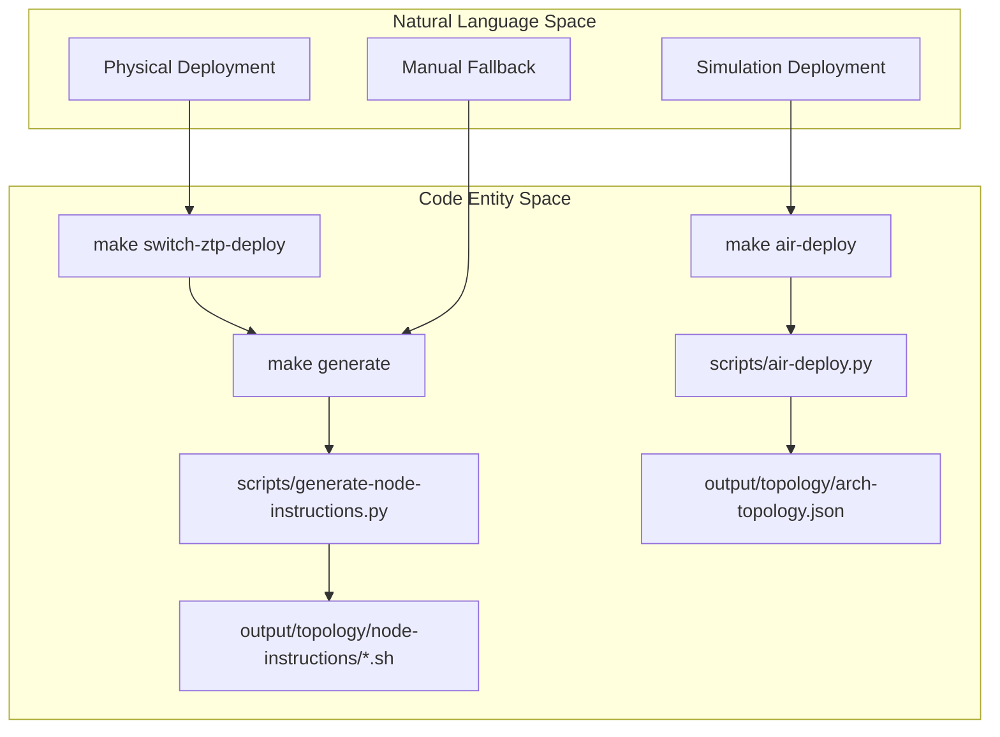
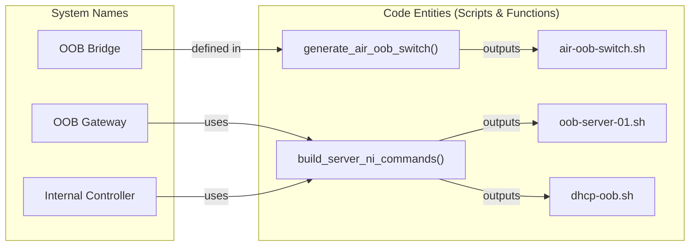

<!-- source: DeepWiki mcp.deepwiki.com · repo NVIDIA/enterprise-ras · page 3 Deployment Workflows · fetched 2026-10-26 -->

# Deployment Workflows

Relevant source files

The following files were used as context for generating this wiki page:

- [net-configurator/.gitignore](net-configurator/.gitignore)
- [net-configurator/README.md](net-configurator/README.md)
- [net-configurator/docs/MANUAL_FALLBACK_GUIDE.md](net-configurator/docs/MANUAL_FALLBACK_GUIDE.md)
- [net-configurator/inventories/secrets.yml.example](net-configurator/inventories/secrets.yml.example)
- [net-configurator/scripts/generate-node-instructions.py](net-configurator/scripts/generate-node-instructions.py)

This page provides an overview of the two primary deployment paths supported by the Enterprise Reference Architecture (ERA) automation tool: **NVIDIA Air Simulation** and **Physical Hardware (ZTP)**. 

The ERA automation framework is designed to be environment-agnostic. It consumes an Excel configuration to generate the necessary artifacts (Ansible inventories, NVUE switch configurations, and topology definitions) which can then be applied to either a virtualized cloud environment for validation or directly to physical Spectrum switches via Zero Touch Provisioning (ZTP) [net-configurator/README.md:4-17]().

### Deployment Path Comparison

| Feature | NVIDIA Air Simulation | Physical Hardware (ZTP) |
| :--- | :--- | :--- |
| **Primary Use Case** | Pre-production validation and "dry-runs" | Production deployment |
| **Connectivity** | API-driven or SSH via `utility` jumpbox | Local network or OOB management plane |
| **Provisioning** | NOZTP (Direct injection of configs) | DHCP-based ZTP (Option 239) |
| **Infrastructure** | Virtual VMs (Ubuntu/Cumulus) | Physical Spectrum Switches & Servers |
| **Automation Target** | `make air-deploy` | `make switch-ztp-deploy` |

---

## 1. NVIDIA Air Simulation Deployment

NVIDIA Air is a cloud-hosted network simulation platform that allows users to spin up a virtual representation of their ERA topology [net-configurator/README.md:17-17](). This workflow is the recommended first step for any deployment to ensure that the generated configurations are logically sound before they are pushed to physical hardware.

The deployment utilizes the `airlib` Python library to interact with the Air API for simulation lifecycle management, including creation, node instruction injection, and resource budgeting [net-configurator/README.md:93-94]().

**Key Components:**
* **NGC API Key:** Required for authentication with the Air service [net-configurator/README.md:16-16]().
* **NOZTP Mode:** A specialized injection method where configurations are pushed directly into the virtual nodes during the simulation boot process, bypassing the need for an external DHCP server [net-configurator/README.md:76-76]().
* **Air Setup Wizard:** The `make air-setup` command initializes the local environment with the necessary credentials [net-configurator/inventories/secrets.yml.example:64-64]().

For a step-by-step guide on NGC setup and API-driven deployment, see **[NVIDIA Air Simulation Deployment (#3.1)]**.

---

## 2. Physical Hardware Deployment via ZTP

The physical deployment workflow relies on **Zero Touch Provisioning (ZTP)**. In this mode, unconfigured switches boot up and request an IP address via DHCP. The DHCP server provides a provisioning script (typically via DHCP Option 239) that the switch executes to download and apply its final NVUE configuration [net-configurator/README.md:15-15]().

**Infrastructure Requirements:**
* **`external-dhcp`:** A node (or container) running `dnsmasq` and `nginx` to serve IP addresses and configuration scripts [net-configurator/README.md:20-20]().
* **`utility`:** The management jumpbox used by Ansible to orchestrate the deployment and monitor ZTP status [net-configurator/README.md:19-19]().
* **MAC Address Mapping:** The Excel `Nodes` sheet must contain the physical MAC addresses of the switches to ensure the correct configuration is mapped to the correct hardware.

For details on setting up the ZTP server and executing the physical rollout, see **[Physical Hardware Deployment via ZTP (#3.2)]**.

---

## 3. Manual Fallback Deployment

In scenarios where the NVIDIA Air API is unavailable or restricted, the tool provides a manual fallback path. This workflow involves generating the topology and "Node Instructions" locally and then manually uploading them to the Air Web GUI [net-configurator/docs/MANUAL_FALLBACK_GUIDE.md:21-30]().

**The `generate-node-instructions.py` script** is the core of this workflow. It produces standalone shell scripts for critical infrastructure nodes:
1. `air-oob-switch.sh`: Configures the virtual VLAN-aware bridge [net-configurator/scripts/generate-node-instructions.py:106-113]().
2. `oob-server-01.sh`: Configures NAT and routing for the OOB management plane [net-configurator/scripts/generate-node-instructions.py:100-100]().
3. `dhcp-oob.sh`: Prepares the internal Ansible control node [net-configurator/scripts/generate-node-instructions.py:101-101]().

For the procedure on manual GUI uploads and internal simulation execution, see **[Manual Fallback Deployment Guide (#3.3)]**.

---

## Architecture to Code Mapping

The following diagrams illustrate how the conceptual deployment workflows map to specific scripts and files within the `net-configurator` toolset.

### Workflow Orchestration Logic
This diagram bridges the natural language deployment paths to the `Makefile` targets and Python scripts that execute them.

Sources: [net-configurator/README.md:90-95](), [net-configurator/scripts/generate-node-instructions.py:4-27](), [net-configurator/docs/MANUAL_FALLBACK_GUIDE.md:32-41]()

### Node Instruction Logic
This diagram shows how the code associates infrastructure roles with specific shell scripts used in both automated and manual Air deployments.

Sources: [net-configurator/scripts/generate-node-instructions.py:49-51](), [net-configurator/scripts/generate-node-instructions.py:106-113](), [net-configurator/docs/MANUAL_FALLBACK_GUIDE.md:97-101]()

---

