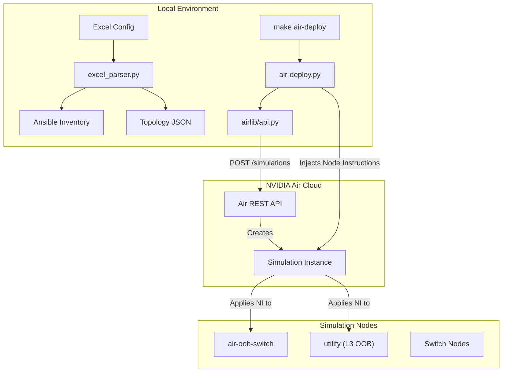
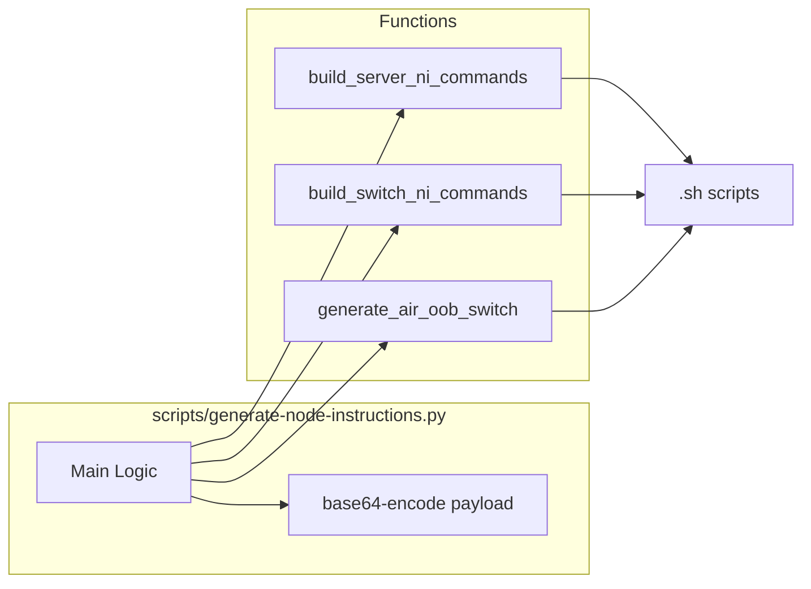

<!-- source: DeepWiki mcp.deepwiki.com · repo NVIDIA/enterprise-ras · page 3.1 NVIDIA Air Simulation Deployment · fetched 2026-10-26 -->

# NVIDIA Air Simulation Deployment

Relevant source files

The following files were used as context for generating this wiki page:

- [.github/workflows/monorepo-release.yml](.github/workflows/monorepo-release.yml)
- [net-configurator/.gitignore](net-configurator/.gitignore)
- [net-configurator/README.md](net-configurator/README.md)
- [net-configurator/docs/MANUAL_FALLBACK_GUIDE.md](net-configurator/docs/MANUAL_FALLBACK_GUIDE.md)
- [net-configurator/inventories/secrets.yml.example](net-configurator/inventories/secrets.yml.example)
- [net-configurator/scripts/generate-node-instructions.py](net-configurator/scripts/generate-node-instructions.py)

The NVIDIA Enterprise Reference Architecture (ERA) provides a high-fidelity simulation environment via NVIDIA Air, a cloud-hosted network simulator. This allows for the validation of complex L3 fabrics, Zero Touch Provisioning (ZTP), and server connectivity using virtual Cumulus Linux switches and Ubuntu server nodes before deploying to physical hardware [net-configurator/README.md:16-17]().

## Deployment Workflow Overview

The deployment process follows a structured pipeline: local configuration generation, simulation creation in Air, and node bootstrapping. The `net-configurator` tool supports two primary modes for Air:
1.  **Automated API Deployment**: Uses the `airlib` Python library to interact with the Air API for end-to-end automation [net-configurator/README.md:90-93]().
2.  **Manual Fallback (NOZTP)**: Used when the API is unavailable or restricted. This relies on generating "Node Instructions" (NI) that are manually pasted into the Air GUI [net-configurator/docs/MANUAL_FALLBACK_GUIDE.md:9-19]().

### Data Flow and Code Entities

The following diagram maps the relationship between the local environment, the Air API, and the simulated infrastructure.

**Air Deployment Data Flow**

**Sources:** [net-configurator/README.md:90-95](), [net-configurator/scripts/generate-node-instructions.py:5-23](), [net-configurator/docs/MANUAL_FALLBACK_GUIDE.md:33-42]()

---

## Prerequisites and Credentials

### NGC Account and API Key
To use NVIDIA Air, an NVIDIA GPU Cloud (NGC) account is required [net-configurator/README.md:16]().
*   **API Key**: Generated in the NGC portal.
*   **SSH Key**: Must be registered in the Air profile to allow Ansible to communicate with the virtual nodes [net-configurator/docs/MANUAL_FALLBACK_GUIDE.md:66]().

### Shared Secrets Vault
Air credentials are stored in a shared Ansible Vault at `.era-secrets/air-secrets.yml`. This file is not committed to the repository [net-configurator/.gitignore:8]().

The `make air-setup` wizard facilitates the creation of this vault, prompting for:
*   NGC API Key
*   NVIDIA Air URL
*   Path to the local SSH private key

**Sources:** [net-configurator/inventories/secrets.yml.example:60-67](), [net-configurator/.gitignore:8]()

---

## Deployment Commands

The `Makefile` provides the primary interface for managing Air simulations.

| Target | Description |
| :--- | :--- |
| `make air-setup` | Runs the wizard to configure API credentials and SSH keys. |
| `make air-deploy` | Creates the simulation, injects Node Instructions, and starts all nodes. |
| `make deploy` | Executes the full pipeline: `generate` -> `air-deploy` -> `ztp-setup` -> `deploy-servers`. |
| `make deploy-switches-only` | Deploys the fabric without server nodes to save Air budget and speed up boot times [net-configurator/README.md:94](). |
| `make air-terminate` | Tears down the simulation in NVIDIA Air to release resources. |

**Sources:** [net-configurator/README.md:90-95](), [net-configurator/Makefile]() (implied by workflow description)

---

## The airlib Python Library

The `airlib/` directory contains the core logic for interacting with the simulation environment.

*   **`api.py`**: Handles REST API interactions, including simulation creation, node status polling, and topology uploads.
*   **`auth.py`**: Manages authentication tokens using the NGC API key.
*   **`budget.py`**: Checks available Air credits before launching large-scale simulations to prevent mid-deployment failures.
*   **`ssh.py`**: Manages SSH connection parameters and host key verification for the `utility` jump host and simulation nodes [net-configurator/scripts/generate-node-instructions.py:65-66]().

---

## NOZTP Node Instructions Mode

In environments where ZTP (Zero Touch Provisioning) via DHCP is not used, or for initial infrastructure bootstrapping, `net-configurator` uses **Node Instructions**. These are shell scripts executed by the Air hypervisor immediately upon node boot [net-configurator/scripts/generate-node-instructions.py:5-10]().

### Infrastructure Node Roles
Three critical nodes require specific instructions to enable the OOB management plane:

1.  **`air-oob-switch`**: Configured as a VLAN-aware bridge. It maps simulated ports to management subnets [net-configurator/scripts/generate-node-instructions.py:106-113]().
2.  **`oob-server-01` (or `utility`)**: Acts as the OOB gateway. The NI configures IP forwarding, static IP assignments, and NAT masquerade to provide internet access to the simulation [net-configurator/scripts/generate-node-instructions.py:14-15]().
3.  **`dhcp-oob` (or `external-dhcp`)**: The Ansible control node within the simulation. The NI installs `git`, `python3`, and `pip` so that ZTP services can be hosted internally [net-configurator/docs/MANUAL_FALLBACK_GUIDE.md:159-160]().

### Node Instruction Generation
The script `scripts/generate-node-instructions.py` extracts configuration from the generated inventory and writes bash scripts to `output/<arch>/<site>/topology/node-instructions/` [net-configurator/scripts/generate-node-instructions.py:8-10]().

**Node Instruction Logic**

**Sources:** [net-configurator/scripts/generate-node-instructions.py:42-52](), [net-configurator/scripts/generate-node-instructions.py:54-68]()

### Implementation Detail: Base64 Encoding
To ensure shell scripts survive the Air API's parser without corruption from special characters or multi-line heredocs, the content is base64-encoded. The resulting NI is a single-line command:
`echo <b64_string> | base64 -d > <target_path>` [net-configurator/scripts/generate-node-instructions.py:54-68]().

**Sources:** [net-configurator/scripts/generate-node-instructions.py:1-68](), [net-configurator/docs/MANUAL_FALLBACK_GUIDE.md:95-103]()

---

