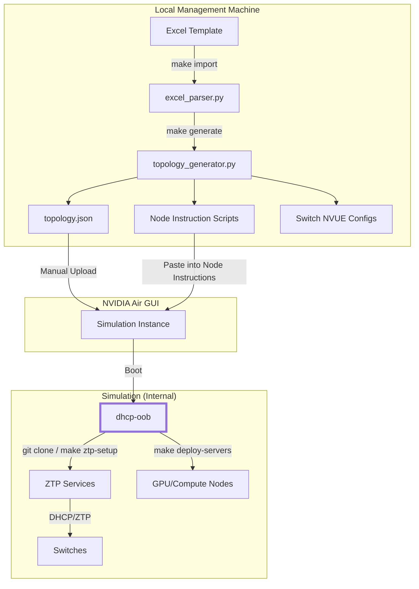

<!-- source: DeepWiki mcp.deepwiki.com · repo NVIDIA/enterprise-ras · page 3.3 Manual Fallback Deployment Guide · fetched 2026-10-26 -->

# Manual Fallback Deployment Guide

<details>
<summary>Relevant source files</summary>

The following files were used as context for generating this wiki page:

- [net-configurator/docs/MANUAL_FALLBACK_GUIDE.md](net-configurator/docs/MANUAL_FALLBACK_GUIDE.md)
- [net-configurator/inventories/secrets.yml.example](net-configurator/inventories/secrets.yml.example)
- [net-configurator/scripts/generate-node-instructions.py](net-configurator/scripts/generate-node-instructions.py)

</details>


The Manual Fallback Deployment Guide provides a technical procedure for deploying the NVIDIA Enterprise Reference Architecture (ERA) within NVIDIA Air when the Air API is unavailable or restricted. This path bypasses the `airlib` API interaction layer in favor of manual topology uploads and Node Instruction injection via the NVIDIA Air web interface.

## 1. Overview and Rationale

The standard deployment workflow ([3.1. NVIDIA Air Simulation Deployment]()) relies on `air-deploy.py` to programmatically create simulations, upload topologies, and inject configuration scripts. The manual fallback is necessary when:
*   The Air API is experiencing outages or rate-limiting.
*   The user lacks an API key but has web GUI access.
*   The deployment environment restricts outbound API calls.

This workflow shifts the execution of Ansible from the local management machine to the `dhcp-oob` node within the simulation itself, eliminating SSH tunneling bottlenecks through `oob-server-01` [net-configurator/docs/MANUAL_FALLBACK_GUIDE.md:48-53]().

### Deployment Data Flow
The following diagram illustrates the transition from local generation to internal simulation execution.

**Manual Fallback Data Flow**

**Sources:** [net-configurator/docs/MANUAL_FALLBACK_GUIDE.md:32-42](), [net-configurator/scripts/generate-node-instructions.py:4-23]()

---

## 2. Node Instruction Generation

The fallback path relies on `generate-node-instructions.py` to create the bootstrap scripts that initialize the Out-of-Band (OOB) management network.

### 2.1 Implementation Details
The script `generate-node-instructions.py` imports logic directly from `air-deploy.py` to ensure parity between API-injected and manually-pasted instructions [net-configurator/scripts/generate-node-instructions.py:39-51](). It generates specific bash scripts for three critical infrastructure nodes:

| Node | Function | Key Script Logic |
| :--- | :--- | :--- |
| `air-oob-switch` | L2 Bridge | Configures a VLAN-aware bridge using NVUE commands to segment management traffic [net-configurator/scripts/generate-node-instructions.py:106-116](). |
| `oob-server-01` | OOB Gateway | Configures IP forwarding, static IP assignments, and NAT masquerade for internet access [net-configurator/scripts/generate-node-instructions.py:14-15](). |
| `dhcp-oob` | Ansible Controller | Configures static OOB IPs and installs `git`, `python3-pip`, and `python3-venv` [net-configurator/docs/MANUAL_FALLBACK_GUIDE.md:68-71](). |

### 2.2 Shell Command Encoding
To prevent Air's shell executor from mangling multi-line scripts or special characters, the `write_file_cmd` function base64-encodes the script content. The resulting Node Instruction is a single-line command that decodes and executes the payload on the target node [net-configurator/scripts/generate-node-instructions.py:54-68]().

**Node Instruction Logic Association**
```mermaid
classDiagram
    class "generate-node-instructions.py" {
        +generate_air_oob_switch(topology)
        +write_file_cmd(path, content)
    }
    class "air_deploy.py" {
        +build_server_ni_commands()
        +build_switch_ni_commands()
    }
    "generate-node-instructions.py" ..> "air_deploy.py" : imports NI builders
    "generate-node-instructions.py" --|> "air-oob-switch.sh" : emits
    "generate-node-instructions.py" --|> "oob-server-01.sh" : emits
    "generate-node-instructions.py" --|> "dhcp-oob.sh" : emits
```
**Sources:** [net-configurator/scripts/generate-node-instructions.py:49-51](), [net-configurator/scripts/generate-node-instructions.py:67-68]()

---

## 3. GUI Configuration and Boot Sequence

Once the topology JSON is uploaded to the Air GUI, the Node Instructions must be manually added to each infrastructure node **before** starting the simulation [net-configurator/docs/MANUAL_FALLBACK_GUIDE.md:119-130]().

### 3.1 Instruction Settings
For each script, the following parameters are mandatory in the Air UI:
*   **Type**: Must be set to `Shell` (not `Ansible` or `Cloud-init`).
*   **Wait for network**: Must be **unchecked**. This prevents the boot process from hanging while waiting for a DHCP lease that the script itself is responsible for configuring [net-configurator/docs/MANUAL_FALLBACK_GUIDE.md:127-146]().

### 3.2 Boot Execution Order
1.  **air-oob-switch**: Initializes the bridge domain `br_default` and maps physical `swp` ports to management VLANs [net-configurator/scripts/generate-node-instructions.py:158-172]().
2.  **oob-server-01**: Enables NAT, allowing internal nodes to reach the internet for package installation.
3.  **dhcp-oob**: Bootstraps the local environment needed to run the ERA Ansible playbooks.

**Sources:** [net-configurator/docs/MANUAL_FALLBACK_GUIDE.md:152-156](), [net-configurator/scripts/generate-node-instructions.py:158-172]()

---

## 4. Internal Simulation Deployment

After the infrastructure nodes are online, the remainder of the deployment is executed from the `dhcp-oob` console.

### 4.1 Environment Setup
The user must clone the repository and initialize the environment on `dhcp-oob`:
```bash
git clone https://github.com/NVIDIA/enterprise-ras.git
cd enterprise-ras/net-configurator
make venv-create
```

### 4.2 Secrets Management
Because the manual flow does not use the Air API, the `.era-secrets/air-secrets.yml` file is not required. However, the deployment secrets (switch and server passwords) must be present in `inventories/<arch>/group_vars/all/secrets.yml` [net-configurator/inventories/secrets.yml.example:7-11]().

### 4.3 Execution Sequence
The deployment is finalized by running the following targets from `dhcp-oob`:
1.  `make ztp-setup`: Configures `dnsmasq` and `nginx` on `dhcp-oob` to serve ZTP scripts and OS images to the switches [net-configurator/docs/MANUAL_FALLBACK_GUIDE.md:37-38]().
2.  `make deploy-servers`: Runs the server-side playbooks to configure NICs, hostnames, and LLDP [net-configurator/docs/MANUAL_FALLBACK_GUIDE.md:39-40]().

**Sources:** [net-configurator/docs/MANUAL_FALLBACK_GUIDE.md:180-210](), [net-configurator/inventories/secrets.yml.example:19-31]()

---

