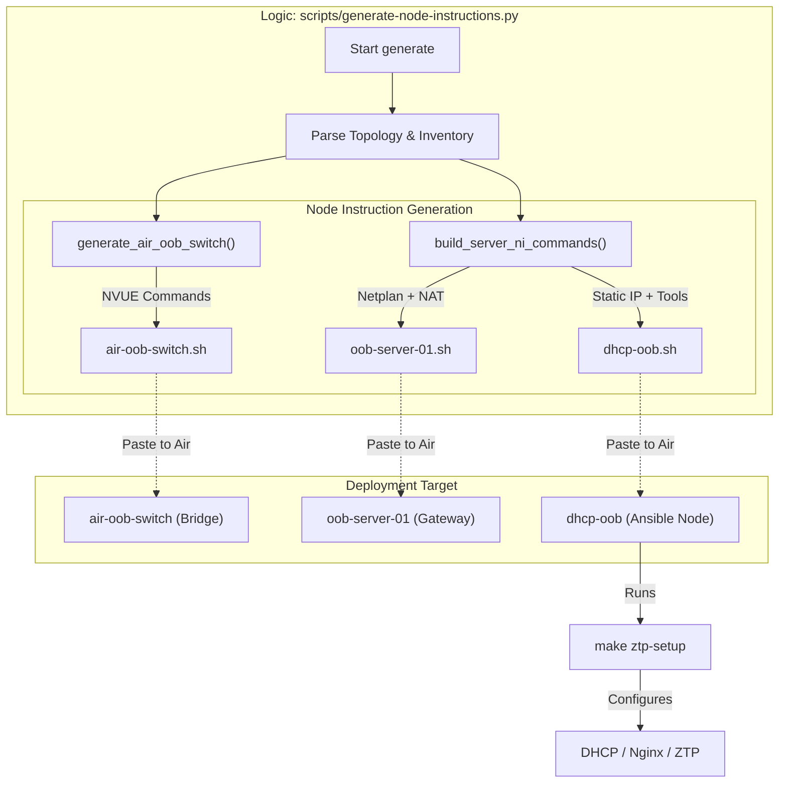
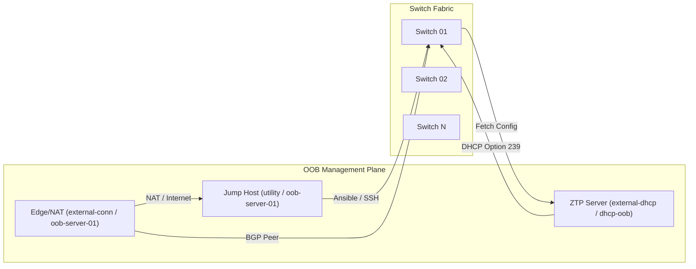

<!-- source: DeepWiki mcp.deepwiki.com · repo NVIDIA/enterprise-ras · page 4 Out-of-Band (OOB) Management Network · fetched 2026-10-26 -->

# Out-of-Band (OOB) Management Network

Relevant source files

The following files were used as context for generating this wiki page:

- [net-configurator/.gitignore](net-configurator/.gitignore)
- [net-configurator/README.md](net-configurator/README.md)
- [net-configurator/docs/MANUAL_FALLBACK_GUIDE.md](net-configurator/docs/MANUAL_FALLBACK_GUIDE.md)
- [net-configurator/inventories/secrets.yml.example](net-configurator/inventories/secrets.yml.example)
- [net-configurator/scripts/generate-node-instructions.py](net-configurator/scripts/generate-node-instructions.py)

The Out-of-Band (OOB) management network is a dedicated management plane that provides a secure and isolated path for configuring and monitoring the network fabric, separate from the high-performance data plane [net-configurator/README.md:18-18](). This system ensures that management traffic does not compete with compute or storage traffic and remains accessible even during data plane congestion or failure.

The `net-configurator` tool automates the deployment of the OOB network for every supported ERA architecture, supporting both modern routed (L3) and legacy bridged (L2) topologies [net-configurator/README.md:18-18]().

## Management Plane Architecture

The OOB network facilitates critical infrastructure services including Zero Touch Provisioning (ZTP), DHCP, and centralized authentication. Depending on the deployment requirements, the OOB network operates in one of two primary modes, controlled by the `oob_uplink_mode` setting in the Excel configuration.

### L3 OOB Architecture (Default)
The L3 OOB design is the current standard for ERA deployments. It utilizes a routed approach with a dedicated `OOB` VRF and `EXIT` VRF to manage external connectivity and ZTP services.

*   **External Connectivity**: Managed by the `external-conn` NAT host (`172.20.0.1`), providing internet access and the eBGP control plane [net-configurator/README.md:21-21]().
*   **ZTP Services**: Handled by the `external-dhcp` node, which acts as the ZTP server and inter-VRF EXIT relay target [net-configurator/README.md:20-20]().
*   **Jump Host**: The `utility` node serves as the L3 jumpbox for Ansible and the OOB-side DHCP relay target [net-configurator/README.md:19-19]().
*   **Edge Routing**: `cust-net-edge-01` and `02` switches bridge the management network and run the EXIT-VRF eBGP underlay [net-configurator/README.md:22-22]().

For details, see [L3 OOB Architecture (Default)](#4.1).

### L2 OOB Architecture (Legacy)
The legacy L2 design uses a flat-bridge OOB subnet. While superseded by the L3 design, it is still supported for compatibility with older deployments and specific simulation scenarios.

*   **Gateway**: The `oob-server-01` node acts as the OOB gateway, providing IP forwarding and NAT [net-configurator/README.md:23-23]().
*   **ZTP/DHCP**: The `dhcp-oob` node manages DHCP and ZTP bootstrap scripts [net-configurator/README.md:23-23]().
*   **Bridging**: The `air-oob-switch` acts as a VLAN-aware bridge to connect infrastructure nodes [net-configurator/scripts/generate-node-instructions.py:106-113]().

For details, see [L2 OOB Architecture (Legacy)](#4.2).

## Infrastructure Node Roles

The following table summarizes the key nodes involved in the OOB management plane across both architectures:

| Role | L3 Entity (Modern) | L2 Entity (Legacy) | Primary Function |
| :--- | :--- | :--- | :--- |
| **Jump Host** | `utility` | `oob-server-01` | Ansible control point and SSH entry. |
| **ZTP/DHCP** | `external-dhcp` | `dhcp-oob` | Hosts bootstrap scripts and leases IPs. |
| **NAT/Edge** | `external-conn` | `oob-server-01` | Provides outbound internet and routing. |
| **Bridge** | N/A (Routed) | `air-oob-switch` | L2 connectivity for management ports. |

Sources: [net-configurator/README.md:18-23](), [net-configurator/scripts/generate-node-instructions.py:12-23]()

## Logic Flow: OOB Node Initialization

This diagram illustrates how the `net-configurator` pipeline prepares the specialized infrastructure nodes required for the OOB network, specifically focusing on the Node Instruction (NI) generation used in simulations and manual fallbacks.

**OOB Infrastructure Initialization Flow**

Sources: [net-configurator/scripts/generate-node-instructions.py:103-184](), [net-configurator/docs/MANUAL_FALLBACK_GUIDE.md:95-101]()

## LDAP Authentication
Centralized authentication is integrated into the OOB management plane. When enabled via the Excel `Settings` sheet (`ldap_enabled=Yes`), the automation configures switches and servers to authenticate against a central LDAP directory.

*   **Switch Auth**: Configured via NVUE to point to the LDAP servers defined in the inventory.
*   **Server Auth**: Configured via standard Linux PAM/LDAP modules.
*   **Secrets**: LDAP bind and admin passwords are managed via Ansible Vault in `secrets.yml` [net-configurator/inventories/secrets.yml.example:41-49]().

For details, see [LDAP Authentication](#4.3).

## Relationship to Deployment Workflows

The OOB network is the first component established during a deployment. In physical environments, this involves setting up the ZTP server (`external-dhcp` or `dhcp-oob`) to listen for switch DHCP requests [net-configurator/README.md:92-92](). In NVIDIA Air, the `air-deploy.py` script (or manual fallback) injects specific "Node Instructions" to bootstrap these management nodes before the main switch fabric is powered on [net-configurator/docs/MANUAL_FALLBACK_GUIDE.md:119-147]().

**OOB Connectivity and Provisioning**

Sources: [net-configurator/README.md:18-23](), [net-configurator/docs/MANUAL_FALLBACK_GUIDE.md:32-42]()

---

