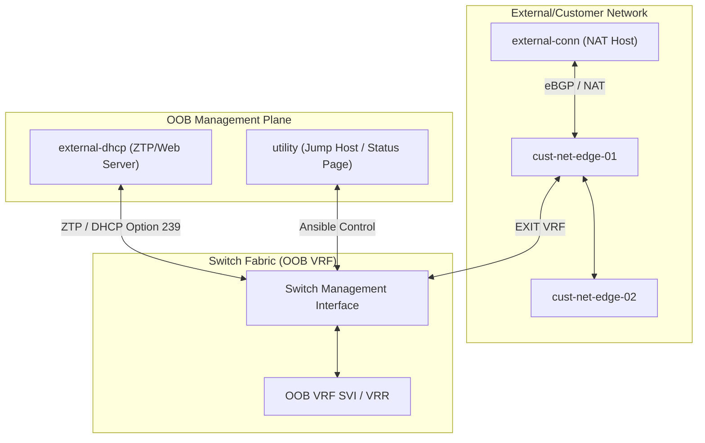
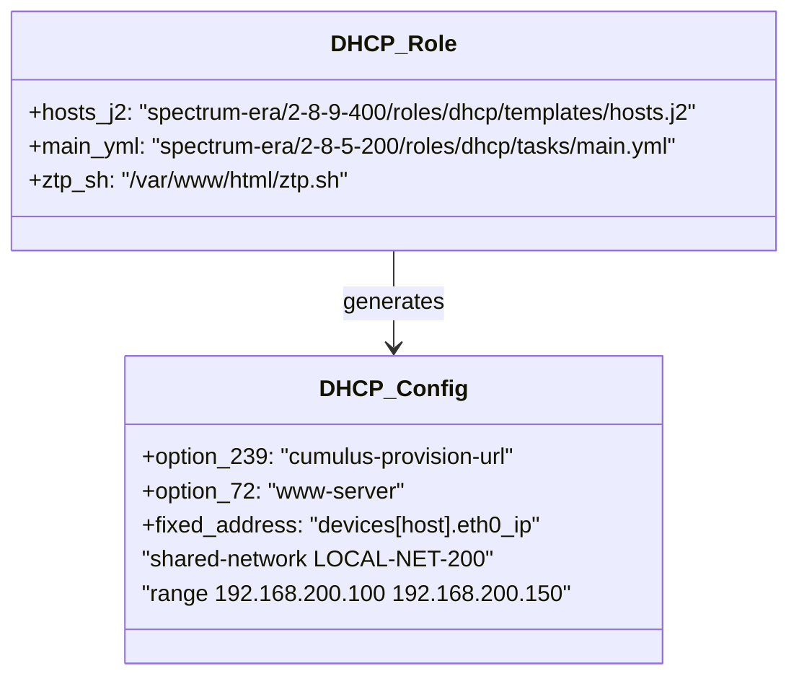

<!-- source: DeepWiki mcp.deepwiki.com · repo NVIDIA/enterprise-ras · page 4.1 L3 OOB Architecture (Default) · fetched 2026-10-26 -->

# L3 OOB Architecture (Default)

Relevant source files

The following files were used as context for generating this wiki page:

- [net-configurator/.gitignore](net-configurator/.gitignore)
- [net-configurator/README.md](net-configurator/README.md)
- [spectrum-era/2-8-5-200/roles/dhcp/tasks/main.yml](spectrum-era/2-8-5-200/roles/dhcp/tasks/main.yml)
- [spectrum-era/2-8-9-400/roles/dhcp/templates/hosts.j2](spectrum-era/2-8-9-400/roles/dhcp/templates/hosts.j2)

The Out-of-Band (OOB) management plane in the NVIDIA Enterprise Reference Architecture (ERA) defaults to a routed **L3 OOB** design. This architecture provides a dedicated, scalable management network that is logically and physically separated from the high-performance data fabric. Unlike legacy flat L2 networks, the L3 OOB design utilizes its own VRF, eBGP underlay, and NAT-enabled external connectivity to ensure robust management access and automated provisioning capabilities across large-scale clusters [net-configurator/README.md:18-18]().

## Architectural Components

The L3 OOB architecture is composed of several specialized node roles and simulated infrastructure components that facilitate management, Zero Touch Provisioning (ZTP), and external access.

| Component | Code Identifier | Role Description |
|---|---|---|
| **Jump Host** | `utility` | The central management node. Ansible connects through this host to reach the fabric. It also hosts the deployment status page and acts as the DHCP relay target for OOB segments [net-configurator/README.md:19-19](). |
| **ZTP Server** | `external-dhcp` | Runs the `isc-dhcp-server` and `apache2` web server. Switches fetch their initial bootstrap scripts (`ztp.sh`) from this node via DHCP Option 239 [net-configurator/README.md:20-20](). |
| **NAT Gateway** | `external-conn` | A host (typically `172.20.0.1`) providing outbound NAT for the OOB network and participating in the eBGP control plane for the OOB VRF [net-configurator/README.md:21-21](). |
| **Edge Switches** | `cust-net-edge-01/02` | Simulated customer edge switches that bridge the OOB management network and run the EXIT-VRF eBGP underlay. `-02` provides HA for the NAT return path [net-configurator/README.md:22-22](). |

**Sources:** [net-configurator/README.md:18-23]()

## Data Flow and Logical Connectivity

The architecture relies on an **EXIT VRF** and an **OOB VRF** to isolate management traffic from the GPU/Compute fabric. Inter-VRF DHCP relaying is a core feature, allowing clients in any VRF to lease IP addresses from servers located in the OOB or EXIT segments [net-configurator/README.md:97-97]().

### L3 OOB Logical Topology

This diagram illustrates the relationship between the management entities and the switch fabric in the L3 routed model.

**Sources:** [net-configurator/README.md:18-23](), [net-configurator/README.md:97-97]()

## Implementation Details

### Zero Touch Provisioning (ZTP)
The `external-dhcp` node (or legacy `dhcp-oob`) automates switch deployment by serving a `ztp.sh` script. The DHCP configuration uses specific options to point switches to the provisioning URL.

*   **DHCP Option 239**: Used to provide the `cumulus-provision-url` [spectrum-era/2-8-5-200/roles/dhcp/tasks/main.yml:45-45]().
*   **Provisioning Flow**: The switch boots, receives an IP via DHCP, identifies the URL in option 239, downloads `ztp.sh` via HTTP from the `apache2` service, and executes the NVUE configuration [net-configurator/README.md:15-15](), [spectrum-era/2-8-5-200/roles/dhcp/tasks/main.yml:9-14]().

### Configuration Generation
The architecture is triggered by the `oob_uplink_mode=l3` setting in the Excel configuration. The `net-configurator` pipeline parses this to generate:
1.  **NVUE CLI Scripts**: Located in `output/<arch>/<site>/configs/`, these contain the `nv set` commands for VRFs, SVIs, and BGP peering.
2.  **Ansible Inventory**: Defines the `utility` host as the `ansible_ssh_common_args` proxy jump point for the fabric.

### DHCP Server Configuration (Code Entity Space)
The following diagram maps the DHCP server implementation to the configuration files and variables used in the legacy and L3 components.

**Sources:** [spectrum-era/2-8-5-200/roles/dhcp/tasks/main.yml:41-78](), [spectrum-era/2-8-9-400/roles/dhcp/templates/hosts.j2:8-10]()

## Key Files and Roles

| Path | Purpose |
|---|---|
| `net-configurator/README.md` | Defines the primary roles: `utility`, `external-dhcp`, `external-conn` [net-configurator/README.md:19-21](). |
| `spectrum-era/.../roles/dhcp/tasks/main.yml` | Installs `isc-dhcp-server` and `apache2`, and configures the ZTP environment [spectrum-era/2-8-5-200/roles/dhcp/tasks/main.yml:9-33](). |
| `spectrum-era/.../roles/dhcp/templates/hosts.j2` | Jinja2 template for mapping MAC addresses to fixed IP addresses for OOB management [spectrum-era/2-8-9-400/roles/dhcp/templates/hosts.j2:1-11](). |

**Sources:** [net-configurator/README.md:19-21](), [spectrum-era/2-8-5-200/roles/dhcp/tasks/main.yml:9-33](), [spectrum-era/2-8-9-400/roles/dhcp/templates/hosts.j2:1-11]()

---

