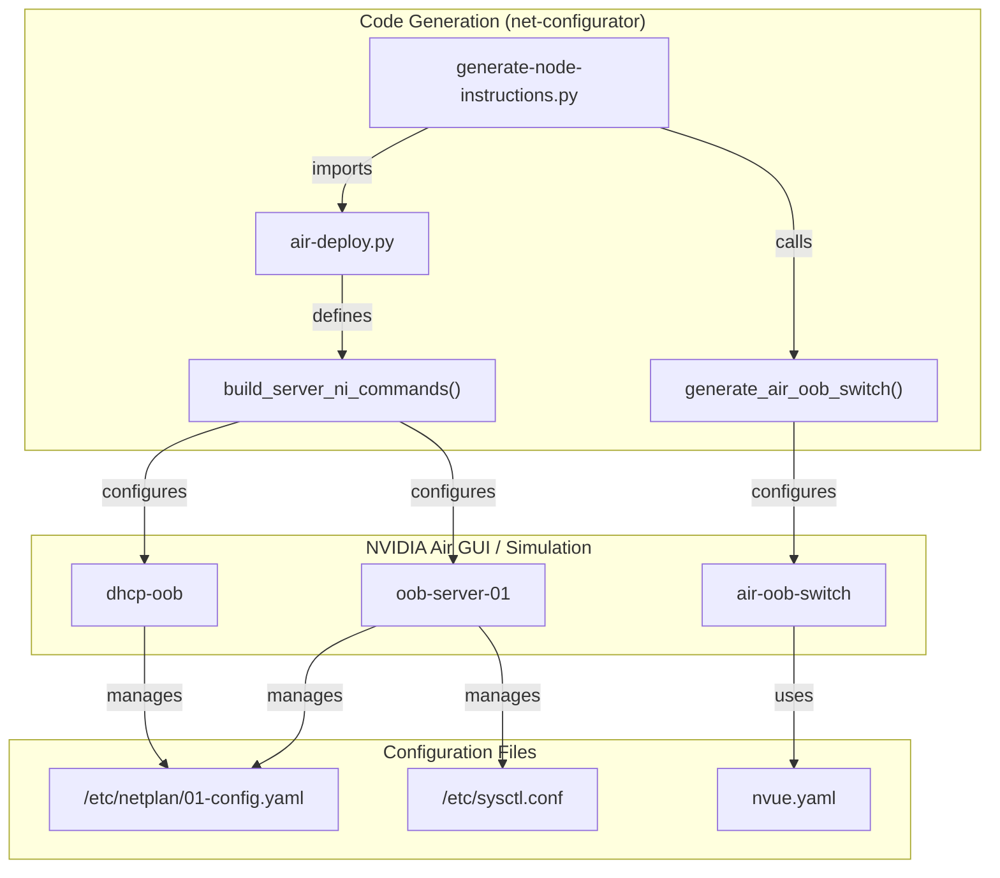
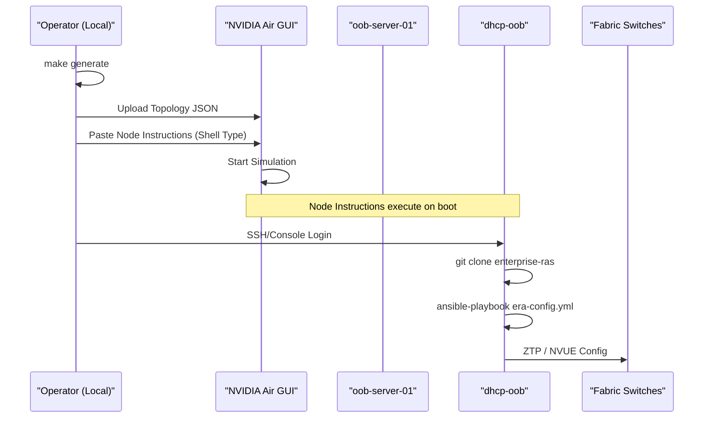

<!-- source: DeepWiki mcp.deepwiki.com · repo NVIDIA/enterprise-ras · page 4.2 L2 OOB Architecture (Legacy) · fetched 2026-10-26 -->

# L2 OOB Architecture (Legacy)

Relevant source files

The following files were used as context for generating this wiki page:

- [net-configurator/docs/MANUAL_FALLBACK_GUIDE.md](net-configurator/docs/MANUAL_FALLBACK_GUIDE.md)
- [net-configurator/inventories/secrets.yml.example](net-configurator/inventories/secrets.yml.example)
- [net-configurator/scripts/generate-node-instructions.py](net-configurator/scripts/generate-node-instructions.py)
- [spectrum-era/2-8-5-200/README.md](spectrum-era/2-8-5-200/README.md)
- [spectrum-era/2-8-9-400/README.md](spectrum-era/2-8-9-400/README.md)

This page documents the legacy Layer 2 (L2) flat-bridge Out-of-Band (OOB) management design. While the current NVIDIA Enterprise Reference Architecture (ERA) defaults to an L3 routed OOB design, the L2 architecture is maintained for historical reference and specific simulation scenarios within NVIDIA Air.

## Overview

The L2 OOB architecture relies on a centralized management bridge (`air-oob-switch`) and two primary infrastructure nodes (`oob-server-01` and `dhcp-oob`) to provide connectivity, DHCP, ZTP services, and external NAT access to the cluster. In this model, all management interfaces reside on the same broadcast domain or are separated by simple VLAN tagging at the bridge level.

### Key Components

| Component | Role | Implementation |
| :--- | :--- | :--- |
| `air-oob-switch` | L2 Bridge | A Cumulus Linux switch configured as a VLAN-aware bridge to interconnect all OOB ports. |
| `oob-server-01` | Gateway/NAT | An Ubuntu-based node providing IP forwarding and NAT masquerade for internet access. |
| `dhcp-oob` | Services | An Ubuntu-based node hosting DHCP (dnsmasq), ZTP (Nginx), and LDAP services. |

**Sources:** [net-configurator/scripts/generate-node-instructions.py:12-15](), [spectrum-era/2-8-9-400/README.md:21-23]()

---

## Infrastructure Node Implementation

The legacy architecture is primarily defined through manual configuration or "Node Instructions" (NI) injected during the simulation boot process.

### 1. air-oob-switch (VLAN-aware Bridge)
The `air-oob-switch` acts as the physical or virtual patch panel. It uses NVUE to define a `br_default` bridge. 

*   **Port Classification**:
    *   **Untagged (VLAN 1)**: Standard management interfaces (`eth0` on switches).
    *   **Tagged (VLAN 777+)**: Used for OOB switch uplinks and infrastructure node secondary interfaces to isolate management subnets.

**Logic Reference**: [net-configurator/scripts/generate-node-instructions.py:106-172]()

### 2. oob-server-01 (OOB Gateway)
This node provides the routing logic for the OOB network. It is configured with static IPs via Netplan and enables IPv4 forwarding to act as a gateway.

*   **Configuration**:
    *   Disables IPv6 to prevent neighbor discovery overhead [spectrum-era/2-8-9-400/README.md:67-70]().
    *   Enables `net.ipv4.ip_forward` in `sysctl.conf` [spectrum-era/2-8-9-400/README.md:71-74]().
    *   Configures multiple eth interfaces (eth1, eth2, eth3) with static IPs (e.g., `192.168.200.1/24`) to serve different OOB segments [spectrum-era/2-8-9-400/README.md:80-97]().

### 3. dhcp-oob (DHCP/ZTP Server)
The `dhcp-oob` server handles the lifecycle of switches and servers. In the legacy design, it is also the primary node for running Ansible playbooks when performing a manual deployment [net-configurator/docs/MANUAL_FALLBACK_GUIDE.md:29-31]().

*   **Services**:
    *   **LDAP**: Pre-configured with default users (e.g., `jdoe`) for switch authentication [spectrum-era/2-8-5-200/README.md:189-194]().
    *   **Static Networking**: Configured similarly to the OOB server but with high-range IPs (e.g., `192.168.200.252/24`) [spectrum-era/2-8-5-200/README.md:123-140]().

---

## Data Flow and Connectivity

The following diagram illustrates the relationship between the legacy infrastructure nodes and the code entities that configure them.

### L2 OOB Logic to Code Entity Map
Title: Legacy OOB Component Mapping

**Sources:** [net-configurator/scripts/generate-node-instructions.py:44-51](), [net-configurator/scripts/generate-node-instructions.py:106-113](), [spectrum-era/2-8-9-400/README.md:80-85]()

---

## Deployment Workflow (Manual Fallback)

In the legacy L2 OOB setup, especially when the Air API is unavailable, a manual multi-phase workflow is required.

### Phase 1: Local Generation
The `make generate` command runs `excel_parser.py` and `topology_generator.py`. This produces the `node-instructions/` directory containing bash scripts for the infrastructure nodes.

**Sources:** [net-configurator/docs/MANUAL_FALLBACK_GUIDE.md:81-93]()

### Phase 2: GUI Injection
Before starting the simulation, the generated scripts must be pasted into the Air GUI for the following nodes:
1.  **air-oob-switch.sh**: Sets up the VLAN bridge.
2.  **oob-server-01.sh**: Configures NAT and IP forwarding.
3.  **dhcp-oob.sh**: Prepares the environment for Ansible.

**Sources:** [net-configurator/docs/MANUAL_FALLBACK_GUIDE.md:132-140]()

### Phase 3: Internal Execution
Once the simulation is running, the operator logs into `dhcp-oob` and executes the configuration playbooks locally to avoid the SSH bottleneck of the `oob-server-01` jump host.

Title: Manual Fallback Execution Flow

**Sources:** [net-configurator/docs/MANUAL_FALLBACK_GUIDE.md:33-41](), [net-configurator/docs/MANUAL_FALLBACK_GUIDE.md:159-172]()

---

## Migration Path to L3 OOB

The legacy L2 OOB is considered deprecated in favor of the L3 Routed OOB architecture. Users migrating should note the following changes:

*   **Gateway Location**: In L3 OOB, the gateway functionality moves from a Linux server (`oob-server-01`) to a pair of `cust-net-edge` switches.
*   **Routing**: Flat L2 subnets are replaced by BGP/EVPN advertisements for management prefixes.
*   **Excel Configuration**: Change the `oob_uplink_mode` field in the **Settings** tab from `l2` to `l3`.
*   **Secrets**: The legacy `inventories/hosts` files are replaced by the dynamic inventory generated in `output/<arch>/<site>/inventory/`.

**Sources:** [net-configurator/inventories/secrets.yml.example:7-11](), [spectrum-era/2-8-5-200/README.md:9-11]()

---

