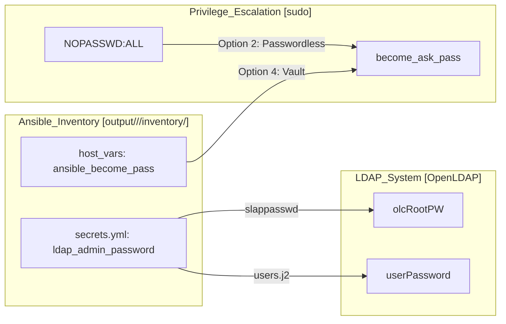

<!-- source: DeepWiki mcp.deepwiki.com · repo NVIDIA/enterprise-ras · page 4.3 LDAP Authentication · fetched 2026-10-26 -->

# LDAP Authentication

Relevant source files

The following files were used as context for generating this wiki page:

- [net-configurator/docs/ANSIBLE_SUDO_SETUP.md](net-configurator/docs/ANSIBLE_SUDO_SETUP.md)
- [spectrum-era/2-4-3-200/roles/ldap/tasks/main.yml](spectrum-era/2-4-3-200/roles/ldap/tasks/main.yml)
- [spectrum-era/2-8-5-200/roles/ldap/tasks/main.yml](spectrum-era/2-8-5-200/roles/ldap/tasks/main.yml)
- [spectrum-era/2-8-9-400/roles/ldap/tasks/main.yml](spectrum-era/2-8-9-400/roles/ldap/tasks/main.yml)

The NVIDIA Enterprise Reference Architecture (ERA) provides a centralized LDAP (Lightweight Directory Access Protocol) authentication framework to manage user access across the switch fabric and management servers. This system automates the deployment of OpenLDAP servers and the configuration of LDAP clients on networking devices and Linux hosts.

## Configuration Parameters

LDAP behavior is controlled via the `Settings` sheet in the ERA Excel template. The configuration generation pipeline parses these fields to populate the Ansible inventory.

### Excel Settings Fields
The following fields in the `Settings` sheet drive the LDAP integration:

| Field | Description |
| :--- | :--- |
| `ldap_enabled` | Boolean flag to enable/disable LDAP configuration across the fabric. |
| `ldap_domain` | The base domain for the LDAP directory (e.g., `nvidia.com`). |
| `ldap_servers` | A list or single IP/hostname of the LDAP server(s). |

**Sources:**
* `net-configurator` Excel structure (refer to section 2.1 for field mapping).

## LDAP Deployment Architecture

The ERA deployment includes an Ansible role specifically for provisioning an OpenLDAP server (`slapd`) on designated management nodes.

### LDAP Provisioning Flow
The deployment process follows a sequence of pre-seeding, installation, and directory structure initialization.

### Logic Flow: LDAP Server Setup
"This diagram illustrates the task execution sequence within the LDAP role."

```mermaid
graph TD
    subgraph "LDAP_Server_Role [spectrum-era/2-8-9-400/roles/ldap/tasks/main.yml]"
        A["apt: debconf-utils"] --> B["apt: purge slapd"]
        B --> C["shell: debconf-set-selections"]
        C --> D["apt: install slapd & ldap-utils"]
        D --> E["service: slapd started"]
        E --> F["command: slappasswd"]
        F --> G["command: ldapmodify (RootDN/RootPW)"]
        G --> H["shell: ldapadd (OU=Users/Groups)"]
        H --> I["template: users.j2"]
        I --> J["command: ldapadd (Populate Users)"]
    end
```

**Sources:**
* [spectrum-era/2-8-9-400/roles/ldap/tasks/main.yml:4-135]()
* [spectrum-era/2-8-5-200/roles/ldap/tasks/main.yml:4-135]()
* [spectrum-era/2-4-3-200/roles/ldap/tasks/main.yml:4-135]()

## Implementation Details

### Server-Side Provisioning
The `ldap` role ensures a clean state by purging existing `slapd` installations and clearing `debconf` entries before installation [spectrum-era/2-8-9-400/roles/ldap/tasks/main.yml:10-18](). 

Key implementation steps include:
1.  **Pre-seeding**: Uses `debconf-set-selections` to set the admin password and domain non-interactively [spectrum-era/2-8-9-400/roles/ldap/tasks/main.yml:20-28]().
2.  **Password Hashing**: Generates SSHA hashes for the `olcRootPW` using the `slappasswd` utility [spectrum-era/2-8-9-400/roles/ldap/tasks/main.yml:46-49]().
3.  **Schema Initialization**: Applies LDIF (LDAP Data Interchange Format) updates to configure the `olcDatabase` and creates Organizational Units (OUs) for `Users` and `Groups` [spectrum-era/2-8-9-400/roles/ldap/tasks/main.yml:55-93]().
4.  **User Population**: Iterates through the `ldap.users` list, hashes their passwords, and applies a `users.j2` template to generate the final LDIF for mass import [spectrum-era/2-8-9-400/roles/ldap/tasks/main.yml:111-135]().

### Security and Privilege Escalation
LDAP tasks require elevated privileges. The repository supports multiple `become` methods, though interactive password prompts are the default for safety.

### Code-to-System Mapping: Authentication Secrets
"Mapping of Ansible variables to system security entities."

**Sources:**
* [net-configurator/docs/ANSIBLE_SUDO_SETUP.md:121-130]()
* [spectrum-era/2-8-9-400/roles/ldap/tasks/main.yml:23-24]()
* [spectrum-era/2-8-9-400/roles/ldap/tasks/main.yml:47]()

## Troubleshooting

Common issues encountered during LDAP deployment and authentication:

| Error | Cause | Resolution |
| :--- | :--- | :--- |
| `sudo: a password is required` | Ansible `become` is active without a password provided. | Use `--ask-become-pass` or configure passwordless sudo in `/etc/sudoers` [net-configurator/docs/ANSIBLE_SUDO_SETUP.md:223-224](). |
| `Entry Already Exists` | The LDAP task is attempting to add an OU or user that is already present. | These errors are caught and ignored by the `ldap` role to ensure idempotency [spectrum-era/2-8-9-400/roles/ldap/tasks/main.yml:80-81](). |
| `SSH permission denied` | SSH keys are not correctly distributed to the target management server. | Use `ssh-copy-id` to transfer the automation public key [net-configurator/docs/ANSIBLE_SUDO_SETUP.md:226-227](). |

**Sources:**
* [net-configurator/docs/ANSIBLE_SUDO_SETUP.md:221-250]()
* [spectrum-era/2-8-9-400/roles/ldap/tasks/main.yml:80-93]()

---

