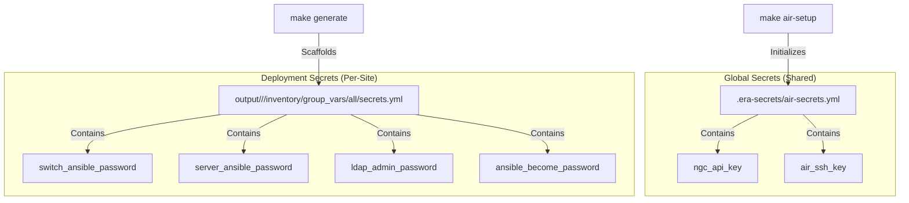
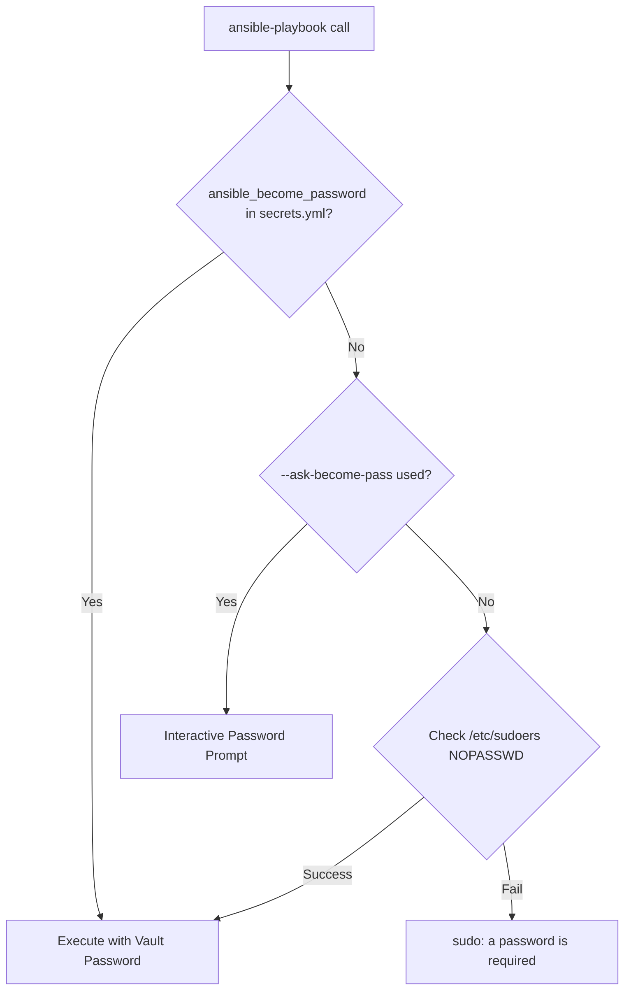

<!-- source: DeepWiki mcp.deepwiki.com · repo NVIDIA/enterprise-ras · page 5 Secrets Management and Security · fetched 2026-10-26 -->

# Secrets Management and Security

Relevant source files

The following files were used as context for generating this wiki page:

- [net-configurator/docs/ANSIBLE_SUDO_SETUP.md](net-configurator/docs/ANSIBLE_SUDO_SETUP.md)
- [net-configurator/docs/MANUAL_FALLBACK_GUIDE.md](net-configurator/docs/MANUAL_FALLBACK_GUIDE.md)
- [net-configurator/inventories/secrets.yml.example](net-configurator/inventories/secrets.yml.example)
- [net-configurator/scripts/generate-node-instructions.py](net-configurator/scripts/generate-node-instructions.py)

This section provides an overview of how the NVIDIA Enterprise Reference Architecture (ERA) repository manages sensitive information, including API keys, SSH credentials, and system passwords. The framework utilizes a **two-vault model** to balance global convenience for simulation environments with granular security for site-specific physical deployments.

### Two-Vault Model Overview

The repository distinguishes between "Shared Air Secrets" (used for NVIDIA Air simulation infrastructure) and "Per-Deployment Secrets" (used for specific hardware sites or architectures).

1.  **Shared Air Vault**: A single encrypted file located at `.era-secrets/air-secrets.yml`. It contains global credentials such as the NGC API key and the simulation SSH key. This allows a single user to manage multiple architectures without re-entering API credentials [net-configurator/inventories/secrets.yml.example:60-67]().
2.  **Per-Deployment Secrets**: A site-specific `secrets.yml` file located within the generated inventory directory (`output/<arch>/<site>/inventory/group_vars/all/secrets.yml`). This file stores passwords for switches, servers, LDAP, and ZTP status pages [net-configurator/inventories/secrets.yml.example:7-12]().

#### Credential Space Mapping
The following diagram maps the logical secret categories to their corresponding file entities in the codebase.

**Secret Entity Relationship**

**Sources:** [net-configurator/inventories/secrets.yml.example:7-67]()

---

### Shared Air Vault and Per-Deployment Secrets
The shared vault is managed via the `make air-setup` wizard, which uses `ansible-vault` to encrypt sensitive strings. Per-deployment secrets are scaffolded from a template (`secrets.yml.example`) during the generation phase.

Key security features include:
*   **Ansible Vault Integration**: Both secret stores are designed to be encrypted using `ansible-vault` to prevent accidental commits of plaintext passwords [net-configurator/inventories/secrets.yml.example:10-11]().
*   **LDAP Security**: Centralized authentication secrets for switches and servers are isolated in the per-deployment vault [net-configurator/inventories/secrets.yml.example:41-49]().

For details, see **[Shared Air Vault and Per-Deployment Secrets](#5.1)**.

**Sources:** [net-configurator/inventories/secrets.yml.example:1-67]()

---

### Ansible Sudo and SSH Configuration
Deploying ERA requires privilege escalation (`become: true`) on target nodes. The repository supports multiple workflows ranging from interactive password prompts to passwordless sudo for lab environments.

#### Privilege Escalation Logic
The deployment scripts and Makefiles are configured to handle `sudo` requirements across different environments (Air vs. Physical).

**Privilege Escalation Workflow**

**Sources:** [net-configurator/docs/ANSIBLE_SUDO_SETUP.md:8-32](), [net-configurator/docs/ANSIBLE_SUDO_SETUP.md:121-129]()

Key configuration areas:
*   **Interactive Prompts**: The default Makefile targets include `--ask-become-pass` for immediate out-of-the-box use [net-configurator/docs/ANSIBLE_SUDO_SETUP.md:19-26]().
*   **SSH Host Key Checking**: Managed via `ansible.cfg` to handle the dynamic nature of NVIDIA Air simulation instances [net-configurator/docs/ANSIBLE_SUDO_SETUP.md:102-102]().
*   **Manual Fallback Security**: When deploying without the Air API, Node Instructions are injected as base64-encoded shell commands to prevent shell metacharacter injection [net-configurator/scripts/generate-node-instructions.py:54-68]().

For details, see **[Ansible Sudo and SSH Configuration](#5.2)**.

**Sources:** [net-configurator/docs/ANSIBLE_SUDO_SETUP.md:1-218](), [net-configurator/scripts/generate-node-instructions.py:54-68]()

---

