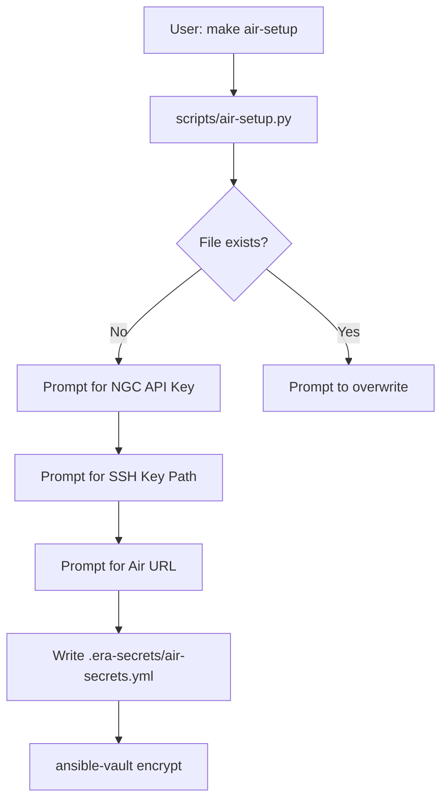
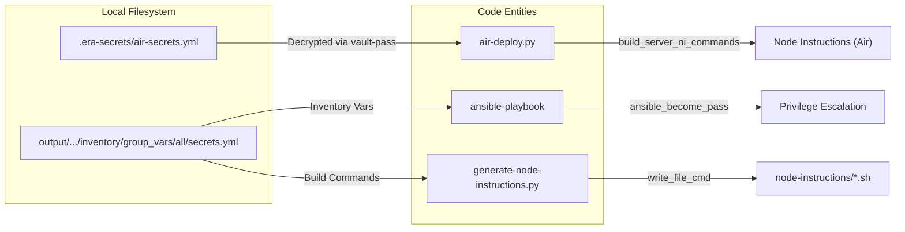

<!-- source: DeepWiki mcp.deepwiki.com · repo NVIDIA/enterprise-ras · page 5.1 Shared Air Vault and Per-Deployment Secrets · fetched 2026-10-26 -->

# Shared Air Vault and Per-Deployment Secrets

Relevant source files

The following files were used as context for generating this wiki page:

- [net-configurator/docs/ANSIBLE_SUDO_SETUP.md](net-configurator/docs/ANSIBLE_SUDO_SETUP.md)
- [net-configurator/docs/MANUAL_FALLBACK_GUIDE.md](net-configurator/docs/MANUAL_FALLBACK_GUIDE.md)
- [net-configurator/inventories/secrets.yml.example](net-configurator/inventories/secrets.yml.example)
- [net-configurator/scripts/generate-node-instructions.py](net-configurator/scripts/generate-node-instructions.py)

This page documents the dual-vault security model used in the NVIDIA Enterprise Reference Architecture (ERA) repository. To balance multi-deployment efficiency with per-site security, secrets are partitioned into a **Shared Air Vault** for global simulation credentials and **Per-Deployment Secrets** for site-specific infrastructure passwords.

### 1. The Two-Vault Architecture

The ERA framework utilizes two distinct secret stores to manage credentials. This separation allows a single developer to manage multiple architectures and sites using one set of NVIDIA Air credentials while maintaining unique passwords for different physical or virtual environments.

| Vault Type | Path | Scope | Purpose |
| :--- | :--- | :--- | :--- |
| **Shared Air Vault** | `.era-secrets/air-secrets.yml` | Global (All Arch/Sites) | NVIDIA Air API keys, SSH keys, and Air URL. |
| **Per-Deployment Secrets** | `output/<arch>/<site>/inventory/group_vars/all/secrets.yml` | Local (Specific Site) | Switch/Server OS passwords, LDAP bind credentials, and ZTP status page logins. |

#### Data Flow and Precedence
When running deployment playbooks or the `air-deploy.py` script, Ansible and Python merge these two sources. If a variable exists in both, the per-deployment `secrets.yml` takes precedence, though the schema is designed to prevent overlap.

Sources: [net-configurator/inventories/secrets.yml.example:60-67](), [net-configurator/docs/ANSIBLE_SUDO_SETUP.md:117-130]()

---

### 2. Shared Air Vault (`.era-secrets`)

The Shared Air Vault is designed to persist across multiple deployments on a single management workstation. It is typically created once during the initial setup of the repository.

#### Implementation: `make air-setup`
The `air-setup` wizard (triggered via the `Makefile`) guides the user through entering their NGC API Key and selecting an SSH key. It then uses `ansible-vault` to encrypt the resulting YAML file.

#### Key Variables in `air-secrets.yml`
*   `air_api_key`: The NGC-generated API key for authentication with the Air API.
*   `air_ssh_key_path`: The local path to the private key registered in the Air GUI.
*   `air_url`: The base URL for the Air environment (e.g., `https://air-ngc.nvidia.com`).

Sources: [net-configurator/inventories/secrets.yml.example:62-67]()

---

### 3. Per-Deployment Secrets

Each generated architecture and site has its own `inventory/group_vars/all/secrets.yml`. This file contains the "runtime" credentials for the network and compute nodes.

#### Implementation: `secrets.yml`
The repository provides a template at `net-configurator/inventories/secrets.yml.example` [net-configurator/inventories/secrets.yml.example:1-12](). During the `make import` or `make generate` process, users are expected to copy this template to their specific output directory.

#### Credential Categories
1.  **Ansible Connection Passwords**:
    *   `switch_ansible_password`: Used for SSH into Cumulus Linux switches [net-configurator/inventories/secrets.yml.example:19-20]().
    *   `server_ansible_password`: Used for SSH into Ubuntu servers [net-configurator/inventories/secrets.yml.example:22-23]().
2.  **Privilege Escalation**:
    *   `ansible_become_password`: The sudo password for remote hosts. If defined, Ansible will not prompt for `--ask-become-pass` [net-configurator/inventories/secrets.yml.example:31]().
3.  **LDAP Credentials**:
    *   `ldap_admin_password`: Bind password for the LDAP directory [net-configurator/inventories/secrets.yml.example:45-46]().
    *   `ldap_user_default_password`: Default password for users created via the LDAP role [net-configurator/inventories/secrets.yml.example:48-49]().

Sources: [net-configurator/inventories/secrets.yml.example:14-58](), [net-configurator/docs/ANSIBLE_SUDO_SETUP.md:127-130]()

---

### 4. Code Entity Space: Secret Injection and Usage

The following diagram maps how these secrets are consumed by the deployment scripts and Ansible playbooks.

#### Node Instruction Generation
The `generate-node-instructions.py` script imports logic from `air-deploy.py` to create bash scripts that embed these secrets for initial bootstrapping. It uses the `write_file_cmd` function to base64-encode secret payloads, ensuring they survive the Air shell executor's parser [net-configurator/scripts/generate-node-instructions.py:44-50](), [net-configurator/scripts/generate-node-instructions.py:54-68]().

Sources: [net-configurator/scripts/generate-node-instructions.py:5-23](), [net-configurator/scripts/generate-node-instructions.py:54-68](), [net-configurator/docs/MANUAL_FALLBACK_GUIDE.md:95-103]()

---

### 5. Ansible Sudo Operations

Privilege escalation (`become: true`) is required for most ZTP and server configuration tasks. The repository supports five escalation methods, ranging from interactive prompts to encrypted vault files.

#### Privilege Escalation Methods

| Method | Implementation | Configuration |
| :--- | :--- | :--- |
| **Interactive** | `--ask-become-pass` | Default in Makefile targets [net-configurator/docs/ANSIBLE_SUDO_SETUP.md:21-26](). |
| **Passwordless** | `NOPASSWD:ALL` | Configured via `visudo` on target nodes [net-configurator/docs/ANSIBLE_SUDO_SETUP.md:53-56](). |
| **Ansible Vault** | `ansible_become_pass` | Stored in `group_vars/all/vault.yml` [net-configurator/docs/ANSIBLE_SUDO_SETUP.md:127-130](). |
| **ansible.cfg** | `become_ask_pass = True` | Global project configuration [net-configurator/docs/ANSIBLE_SUDO_SETUP.md:98-108](). |

#### Best Practices
*   **Lab/Dev**: Use **Passwordless Sudo** to minimize friction during iterative deployments [net-configurator/docs/ANSIBLE_SUDO_SETUP.md:201-205]().
*   **Production**: Use **SSH Keys + Passwordless Sudo** for the most secure and auditable path [net-configurator/docs/ANSIBLE_SUDO_SETUP.md:208-211]().

Sources: [net-configurator/docs/ANSIBLE_SUDO_SETUP.md:17-36](), [net-configurator/docs/ANSIBLE_SUDO_SETUP.md:199-215]()

---

