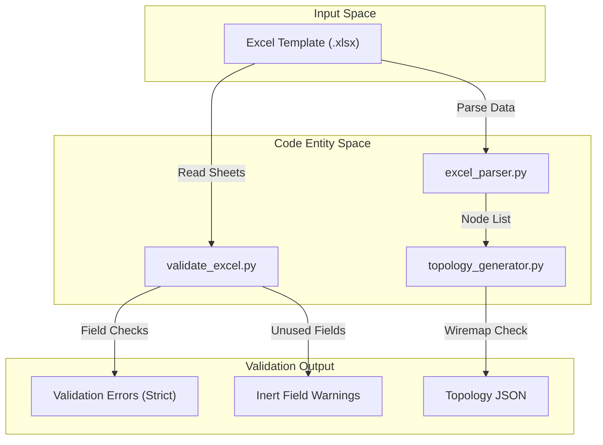
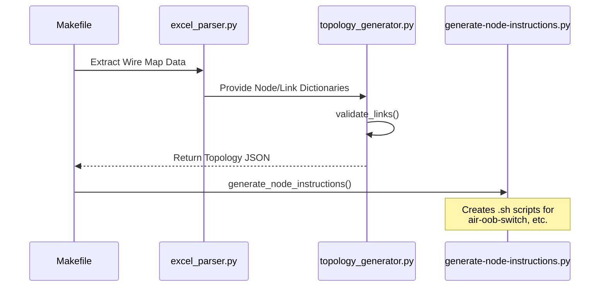

<!-- source: DeepWiki mcp.deepwiki.com · repo NVIDIA/enterprise-ras · page 6.1 Excel and Topology Validation · fetched 2026-10-26 -->

# Excel and Topology Validation

Relevant source files

The following files were used as context for generating this wiki page:

- [net-configurator/.gitignore](net-configurator/.gitignore)
- [net-configurator/README.md](net-configurator/README.md)
- [net-configurator/docs/MANUAL_FALLBACK_GUIDE.md](net-configurator/docs/MANUAL_FALLBACK_GUIDE.md)
- [net-configurator/inventories/secrets.yml.example](net-configurator/inventories/secrets.yml.example)
- [net-configurator/scripts/generate-node-instructions.py](net-configurator/scripts/generate-node-instructions.py)

The validation framework in the NVIDIA Enterprise Reference Architecture (ERA) repository ensures that the user-provided Excel configuration is logically sound, adheres to architectural constraints, and matches the generated network topology. This process is critical for preventing deployment failures in both NVIDIA Air simulations and physical hardware environments.

Validation is primarily executed via `make` targets that invoke the `validate_excel.py` script and the `topology_generator.py` logic.

## Overview of Validation Phases

The validation suite is divided into two main categories:
1.  **Excel Validation**: Checks the `ERA_Configuration_Template.xlsx` for schema compliance, mandatory fields, and canonical role enforcement.
2.  **Topology Validation**: Verifies that the `Wire Map` sheet in the Excel file correctly aligns with the generated Air topology JSON.

### Validation Data Flow

**Sources:** [net-configurator/README.md:90-91](), [net-configurator/Makefile:140-155]()

---

## Excel Validation (`make validate-excel`)

The `make validate-excel` target runs the `validate_excel.py` script against the current architecture and site context. It performs deep inspection of the four primary sheets: `Settings`, `Nodes`, `VLANs & Profiles`, and `Wire Map`.

### Key Functions and Logic
*   **Canonical Role Enforcement**: The validator ensures that every node defined in the `Nodes` sheet uses a recognized role (e.g., `gpu`, `core`, `csl`, `gsl-plane1`).
*   **Strict vs. Warn Mode**: Depending on the architecture, certain validation failures are treated as fatal (Strict) while others only issue warnings.
*   **Inert-Field Warnings**: The script identifies fields that are filled in the Excel sheet but are ignored by the current architecture's Jinja2 templates.

### Component Mapping

| System Concept | Code Entity | Role |
| :--- | :--- | :--- |
| **Validator Script** | `scripts/validate_excel.py` | Entry point for all Excel-based logic checks. |
| **Parser Engine** | `scripts/excel_parser.py` | Converts Excel rows into Python dictionaries for validation. |
| **Role Taxonomy** | `docs/ROLES.md` | Documentation of the 11+ canonical node roles enforced by the validator. |

**Sources:** [net-configurator/README.md:57-59](), [net-configurator/Makefile:140-144]()

---

## Topology Validation (`make validate-topology`)

Topology validation ensures that the physical or simulated cabling (defined in the `Wire Map` sheet) is consistent with the logical architecture requirements. This is handled during the `make generate` and `make validate-all` workflows.

### Implementation Details
The `topology_generator.py` script processes the `Wire Map` and compares it against the expected connectivity for the chosen architecture (e.g., `2-8-9-800` dual-plane requirements).

*   **Wiremap vs. JSON**: It verifies that every link defined in the Excel `Wire Map` is present in the generated Air topology JSON.
*   **Display in Air Logic**: It checks the `Display in Air` column to determine which nodes should be rendered in the simulation.
*   **Node Instructions Integration**: For nodes requiring manual setup in Air (like `air-oob-switch`), the validator ensures the necessary metadata exists to generate the Node Instruction scripts.

### Topology Validation Logic

**Sources:** [net-configurator/scripts/generate-node-instructions.py:5-23](), [net-configurator/docs/MANUAL_FALLBACK_GUIDE.md:89-93]()

---

## Node Instruction Generation

As part of the validation and generation pipeline, the system creates "Node Instructions" (NI). These are shell scripts used to bootstrap infrastructure nodes in NVIDIA Air when the API is not used (Manual Fallback) or to verify what the `air-deploy.py` script will inject.

### Infrastructure Nodes Handled:
*   **`air-oob-switch`**: A VLAN-aware bridge that segments management traffic. The generator maps ports to their peers and assigns access VLANs [net-configurator/scripts/generate-node-instructions.py:106-113]().
*   **`oob-server-01`**: Configures IP forwarding, static IPs, and NAT masquerade for the OOB network [net-configurator/scripts/generate-node-instructions.py:14-15]().
*   **`dhcp-oob`**: Sets up the ZTP environment, including `dnsmasq` and `nginx` [net-configurator/scripts/generate-node-instructions.py:15-16]().

**Sources:** [net-configurator/scripts/generate-node-instructions.py:39-50](), [net-configurator/docs/MANUAL_FALLBACK_GUIDE.md:95-103]()

---

## Secrets and Credentials Validation

While not part of the structural topology, the validation framework also checks for the existence of required secrets in the `inventory/group_vars/all/secrets.yml` file.

*   **`switch_ansible_password`**: Required for Ansible SSH access to Cumulus switches [net-configurator/inventories/secrets.yml.example:19-20]().
*   **`ansible_become_password`**: Required for `sudo` privilege escalation [net-configurator/inventories/secrets.yml.example:31]().
*   **`ldap_admin_password`**: Only validated if `ldap_enabled` is set to `Yes` in the Excel `Settings` sheet [net-configurator/inventories/secrets.yml.example:45-46]().

**Sources:** [net-configurator/inventories/secrets.yml.example:4-12](), [net-configurator/README.md:98]()

---

