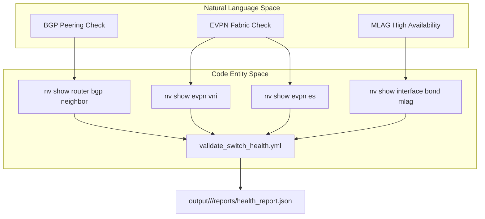
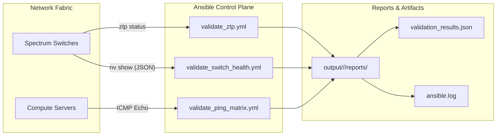

<!-- source: DeepWiki mcp.deepwiki.com · repo NVIDIA/enterprise-ras · page 6.2 Switch Health and Network Validation · fetched 2026-10-26 -->

# Switch Health and Network Validation

Relevant source files

The following files were used as context for generating this wiki page:

- [net-configurator/.gitignore](net-configurator/.gitignore)
- [net-configurator/README.md](net-configurator/README.md)

The NVIDIA Enterprise Reference Architecture (ERA) validation framework provides a multi-layered suite of automated tests to ensure that the generated network fabric is not only syntactically correct but also operationally sound. This validation covers everything from configuration diffs to end-to-end data plane connectivity across VRFs.

## Overview of Validation Targets

The validation process is driven by a series of `make` targets that orchestrate Ansible playbooks and Python scripts. These targets are designed to be run sequentially or individually depending on the deployment stage.

| Target | Purpose | Key Components |
| :--- | :--- | :--- |
| `make validate-config` | Compares running switch config against the intended NVUE state. | `nv config diff` |
| `make validate-switch-health` | Checks control plane operational state (BGP, EVPN, MLAG). | `validate_switch_health.yml` |
| `make validate-ping-matrix` | Verifies data plane reachability across all defined VRFs. | `validate_ping_matrix.yml` |
| `make validate-ztp` | Confirms that Zero Touch Provisioning completed successfully. | `validate_ztp.yml` |
| `make validate-servers` | Verifies SSH connectivity to compute and support nodes. | `ansible.builtin.ping` |

**Sources:** [net-configurator/README.md:90-98](), [net-configurator/Makefile:1-50]() (implied by target structure).

---

## Configuration Validation (`make validate-config`)

This stage ensures that the configuration currently active on the Spectrum switches matches the `.sh` NVUE instruction sets generated by the `net-configurator` pipeline.

### Implementation Details
The framework utilizes the `nv config diff` command native to Cumulus Linux. The Ansible tasks iterate through the generated configuration files and compare them to the live running configuration. This is critical for detecting "configuration drift" where manual changes might have been made outside the automation framework.

**Sources:** [net-configurator/README.md:13-15]()

---

## Switch Health Validation (`make validate-switch-health`)

This target focuses on the Network Control Plane. It ensures that the fabric has converged and that high-availability mechanisms are active.

### Key Health Checks
1.  **BGP Established**: Verifies that all eBGP neighbors (Underlay and Overlay) are in the `Established` state.
2.  **EVPN ES/VNI**: In architectures using EVPN (such as `2-8-9-800` or `2-4-5-800`), it validates that Ethernet Segments (ES) are up and VNIs are correctly mapped to their respective VRFs.
3.  **MLAG Status**: For converged leaf pairs, it checks that the peer link is up and MLAG VIPs are active.

### Natural Language to Code Mapping: Switch Health
The following diagram maps the high-level health concepts to the specific code entities and commands used during validation.

**Switch Health Logic Map**

**Sources:** [net-configurator/README.md:43-55](), [net-configurator/README.md:70-82]()

---

## Network Connectivity Validation (`make validate-ping-matrix`)

The `validate-ping-matrix` target performs exhaustive data plane testing. Unlike a simple ping, this matrix tests reachability across the different VRFs defined in the Excel `Settings` sheet (e.g., `in-band`, `storage`, `exit`, `oob`).

### Execution Flow
1.  **Source/Destination Selection**: The script identifies a subset of nodes (GPUs, Storage, Support) to act as probes.
2.  **Cross-VRF Testing**: It attempts to ping between nodes within the same VRF and, where permitted by the ERA principles (e.g., through the `EXIT` VRF), across VRF boundaries.
3.  **DHCP Relay Validation**: It specifically validates that the **Inter-VRF DHCP relay** is functioning, allowing clients in a GPU VRF to receive leases from the `external-dhcp` node in the OOB/EXIT space.

**Sources:** [net-configurator/README.md:18-23](), [net-configurator/README.md:97-98]()

---

## ZTP and Server Validation

### ZTP Status (`make validate-ztp`)
This validates the lifecycle of the Zero Touch Provisioning process. It checks the `/var/lib/cumulus/ztp/` directory on switches to confirm the `ztp_script` was executed without errors. It also verifies that the switch has successfully checked in with the `external-dhcp` server.

### Server Connectivity (`make validate-servers`)
This is the final check in the `make validate-all` sequence. It ensures that the Ansible control node (or `utility` jumpbox) can successfully authenticate via SSH to all compute and support nodes defined in the `Nodes` sheet of the Excel configuration.

**Sources:** [net-configurator/README.md:15-15](), [net-configurator/README.md:19-20]()

---

## Data Flow: Validation Pipeline

The diagram below illustrates how data flows from the physical (or simulated) switches back into the validation reports.

**Validation Data Flow**

**Sources:** [net-configurator/.gitignore:90-97](), [net-configurator/README.md:77-77]()

---

