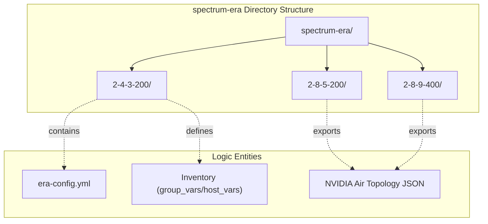
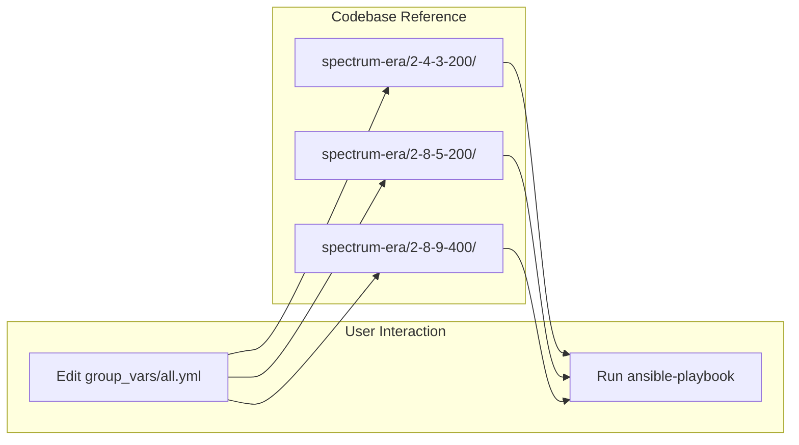

<!-- source: DeepWiki mcp.deepwiki.com · repo NVIDIA/enterprise-ras · page 7 spectrum-era: Deprecated Reference Configurations · fetched 2026-10-26 -->

# spectrum-era: Deprecated Reference Configurations

Relevant source files

The following files were used as context for generating this wiki page:

- [spectrum-era/2-4-3-200/license](spectrum-era/2-4-3-200/license)
- [spectrum-era/README.md](spectrum-era/README.md)
- [spectrum-era/license](spectrum-era/license)

The `spectrum-era` directory serves as a historical repository for NVIDIA Enterprise Reference Architecture (ERA) configurations. It contains static, pre-validated Ansible playbooks and inventory files for specific network topologies.

> [!IMPORTANT]
> This directory has been **deprecated** and is superseded by the [`net-configurator`](../net-configurator) tool. While `spectrum-era` is no longer actively maintained, it is retained for reference purposes to support legacy deployments and historical audits [spectrum-era/README.md:6-6]().

## Purpose and Scope

The `spectrum-era` configurations were designed to automate ERA setup on core switches using the NVIDIA NVUE Ansible Collection [spectrum-era/README.md:4-8](). Unlike the dynamic, Excel-driven generation found in `net-configurator`, these configurations rely on static inventory files and manual variable customization within the `spectrum-era` subdirectories [spectrum-era/README.md:8-9]().

### Migration Path
Users are encouraged to migrate to `net-configurator`. The primary differences are summarized below:

| Feature | `spectrum-era` (Deprecated) | `net-configurator` (Active) |
| :--- | :--- | :--- |
| **Configuration Source** | Static YAML Inventory files | Excel Spreadsheet (`ERA_Configurations.xlsx`) |
| **Flexibility** | Fixed architectures | Dynamic scaling and custom wire-maps |
| **Automation** | Basic Ansible playbooks | Full Python pipeline with validation suite |
| **Maintenance** | Reference only | Actively updated for Cumulus Linux versions |

## Supported Architectures

The deprecated configurations support three specific architectures, categorized by their scale and bandwidth. Each architecture is packaged with its own NVIDIA Air simulation topology and exported configurations.

### 2-4-3-200 Architecture
This is the entry-level reference architecture. It includes the setup for OOB (Out-of-Band) switch bootstrapping and uses `oob-server-01` as the primary Ansible control node. It provides specific roles for LDAP and DHCP integration.
*   For details, see [spectrum-era Architecture: 2-4-3-200](#7.1).

### 2-8-5-200 Architecture
A mid-scale architecture featuring a converged core with a dedicated split between Compute Storage Layer (CSL) and General Storage Layer (GSL). It includes comprehensive exported configurations and Jinja2 role templates for switch fabric deployment.
*   For details, see [spectrum-era Architecture: 2-8-5-200](#7.2).

### 2-8-9-400 Architecture
The high-performance 400G reference architecture, utilizing a dedicated-GPU 2-tier CSL+GSL fabric. This architecture represents the most complex topology in the deprecated set, providing full inventory structures for large-scale GPU clusters.
*   For details, see [spectrum-era Architecture: 2-8-9-400](#7.3).

**Sources:**
* [spectrum-era/README.md:19-26]()

## Code-to-Entity Mapping

The following diagram illustrates how the `spectrum-era` directory structure maps to the deployment entities used in the legacy workflow.

### Reference Configuration Mapping

**Sources:**
* [spectrum-era/README.md:8-10]()

## Release and Versioning

Releases for `spectrum-era` are distributed as tagged zip files. The naming convention for these releases follows the pattern `sp-<architecture>-v<version-number>` [spectrum-era/README.md:12-17]().

### Release Table (Final Versions)
| Version | Architecture | Release Tag |
| :--- | :--- | :--- |
| 3.0.0 | 2-4-3-200 | `sp-2-4-3-200-v3.0.0` |
| 3.0.0 | 2-8-5-200 | `sp-2-8-5-200-v3.0.0` |
| 3.0.0 | 2-8-9-400 | `sp-2-8-9-400-v3.0.0` |

**Sources:**
* [spectrum-era/README.md:21-25]()

### Deprecated Workflow vs Code Structure
The legacy workflow required users to manually edit files within the specific architecture subdirectories before running Ansible.

**Sources:**
* [spectrum-era/README.md:8-10]()

---

