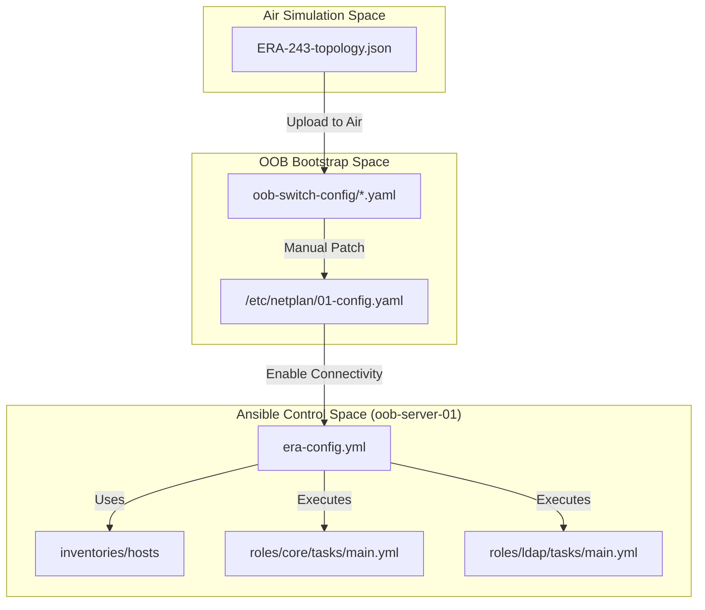
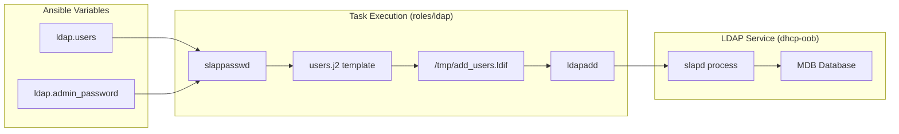

<!-- source: DeepWiki mcp.deepwiki.com · repo NVIDIA/enterprise-ras · page 7.1 spectrum-era Architecture: 2-4-3-200 · fetched 2026-10-26 -->

# spectrum-era Architecture: 2-4-3-200

Relevant source files

The following files were used as context for generating this wiki page:

- [spectrum-era/2-4-3-200/ERA-243-topology.json](spectrum-era/2-4-3-200/ERA-243-topology.json)
- [spectrum-era/2-4-3-200/README.md](spectrum-era/2-4-3-200/README.md)
- [spectrum-era/2-4-3-200/exported-configurations/core-01.yaml](spectrum-era/2-4-3-200/exported-configurations/core-01.yaml)
- [spectrum-era/2-4-3-200/playbooks/era-config.yml](spectrum-era/2-4-3-200/playbooks/era-config.yml)
- [spectrum-era/2-4-3-200/roles/core/tasks/main.yml](spectrum-era/2-4-3-200/roles/core/tasks/main.yml)
- [spectrum-era/2-4-3-200/roles/ldap/tasks/main.yml](spectrum-era/2-4-3-200/roles/ldap/tasks/main.yml)

This page provides technical reference documentation for the **2-4-3-200** architecture within the `spectrum-era` directory. This architecture represents a specific NVIDIA Enterprise Reference Architecture (ERA) topology designed for a scale of 2 Core switches, 4 GPUs, 3 NICs, and 200Gbps bandwidth. 

> [!WARNING]
> This directory is **deprecated** and has been superseded by `net-configurator`. It is retained for historical reference and manual deployment workflows [spectrum-era/2-4-3-200/README.md:5-9]().

## Architecture Overview

The 2-4-3-200 topology is defined by a high-level JSON file used for NVIDIA Air simulation and a set of Ansible playbooks for configuring the resulting network fabric. The design utilizes EVPN Multihoming (MH) and a standard Out-of-Band (OOB) management plane.

### Topology Components
| Component | Count | Role | OS |
| :--- | :--- | :--- | :--- |
| `core-01`, `core-02` | 2 | Spine/Leaf Fabric | Cumulus Linux 5.13.0 |
| `oob-switch-01/02` | 2 | OOB Management Bridge | Cumulus Linux 5.13.0 |
| `oob-server-01` | 1 | Ansible Control Node / Gateway | Ubuntu 22.04 |
| `dhcp-oob` | 1 | DHCP & LDAP Server | Ubuntu 22.04 |
| `storage-01/02` | 2 | Storage Nodes | Ubuntu 22.04 |
| `su-01-node-0X` | 4 | Compute Nodes (GPU) | Ubuntu 22.04 |

**Sources:** [spectrum-era/2-4-3-200/ERA-243-topology.json:6-224]()

## Data Flow: Deployment & Configuration

The deployment follows a tiered approach: bootstrapping the OOB network, setting up infrastructure services (DHCP/LDAP), and finally applying the fabric configuration via Ansible.

### Code Entity Mapping: Deployment Workflow

The following diagram maps the natural language deployment steps to the specific code entities and files responsible for execution.

**Sources:** [spectrum-era/2-4-3-200/README.md:15-166](), [spectrum-era/2-4-3-200/playbooks/era-config.yml:4-111]()

## OOB Management Bootstrapping

Before Ansible can manage the fabric, the OOB management plane must be manually bootstrapped. This involves:

1.  **OOB Switches**: Applying basic L2/L3 configuration to `oob-switch-01` and `oob-switch-02` using NVUE YAML files found in `oob-switch-config/` [spectrum-era/2-4-3-200/README.md:25-55]().
2.  **OOB Server**: Configuring `oob-server-01` as the primary Ansible control node. This includes setting a static IP (192.168.200.1/24) via Netplan and enabling IPv4 forwarding [spectrum-era/2-4-3-200/README.md:57-92]().
3.  **DHCP/LDAP Node**: Configuring `dhcp-oob` with static IPs (192.168.200.252-253) to serve infrastructure requests [spectrum-era/2-4-3-200/README.md:94-130]().

**Sources:** [spectrum-era/2-4-3-200/README.md:23-138]()

## Ansible Configuration Pipeline

The `era-config.yml` playbook orchestrates the end-to-end setup of the fabric. It targets different host groups defined in the inventory to apply specific roles.

### Playbook Structure
The playbook `playbooks/era-config.yml` is divided into functional blocks:
*   **DHCP Setup**: Configures the `dhcp` role on `dhcp-oob` [spectrum-era/2-4-3-200/playbooks/era-config.yml:4-9]().
*   **Connectivity Check**: Uses `wait_for` tasks to ensure servers and switches have received DHCP leases and are reachable via SSH [spectrum-era/2-4-3-200/playbooks/era-config.yml:18-39]().
*   **LDAP Provisioning**: Sets up the OpenLDAP server on `dhcp-oob` using the `ldap` role [spectrum-era/2-4-3-200/playbooks/era-config.yml:64-69]().
*   **Switch Fabric**: Applies the `core` and `core-misc` roles to the switches using the `nvidia.nvue.httpapi` connection plugin [spectrum-era/2-4-3-200/playbooks/era-config.yml:71-87]().

### Switch Configuration Logic (`roles/core`)
The `core` role uses the `nvidia.nvue` collection to push state to Cumulus Linux switches. Key tasks include:
*   **Revision Management**: Creating a new NVUE revision via `nvidia.nvue.config` [spectrum-era/2-4-3-200/roles/core/tasks/main.yml:4-7]().
*   **Interface Configuration**: Handling breakouts, bonds, and loopback IPs [spectrum-era/2-4-3-200/roles/core/tasks/main.yml:48-121]().
*   **EVPN Multihoming**: Enabling EVPN MH and configuring segment IDs for bonds [spectrum-era/2-4-3-200/roles/core/tasks/main.yml:105-121]().
*   **VLAN/VNI Mapping**: Mapping bridge VLANs to VXLAN VNIs [spectrum-era/2-4-3-200/roles/core/tasks/main.yml:123-134]().

**Sources:** [spectrum-era/2-4-3-200/playbooks/era-config.yml:1-111](), [spectrum-era/2-4-3-200/roles/core/tasks/main.yml:1-283]()

## Infrastructure Roles: LDAP and DHCP

### LDAP Implementation
The `ldap` role automates the installation of `slapd` and the population of the directory.
*   **Preseeding**: Uses `debconf-set-selections` to handle non-interactive installation of the LDAP backend [spectrum-era/2-4-3-200/roles/ldap/tasks/main.yml:20-29]().
*   **Directory Structure**: Creates `ou=Users` and `ou=Groups` organizational units [spectrum-era/2-4-3-200/roles/ldap/tasks/main.yml:71-93]().
*   **User Provisioning**: Generates SSHA hashes for passwords and applies them via Jinja2 templates (`users.j2`) and `ldapadd` [spectrum-era/2-4-3-200/roles/ldap/tasks/main.yml:111-135]().

### Code Entity Mapping: LDAP Data Flow

**Sources:** [spectrum-era/2-4-3-200/roles/ldap/tasks/main.yml:46-135]()

## Exported Configurations

For users not wishing to use Ansible, the repository provides full NVUE YAML configuration snapshots in the `exported-configurations/` directory. These files represent the final state of the switches after a successful ERA deployment.

*   **File Example**: `core-01.yaml` contains the full declarative state including bridge domains, EVPN multihoming segments, and interface definitions [spectrum-era/2-4-3-200/exported-configurations/core-01.yaml:1-312]().
*   **Manual Application**: These can be applied manually using the command `nv config replace <filename>` followed by `nv config apply` [spectrum-era/2-4-3-200/README.md:168-175]().

**Sources:** [spectrum-era/2-4-3-200/exported-configurations/core-01.yaml:1-312](), [spectrum-era/2-4-3-200/README.md:168-176]()

---

