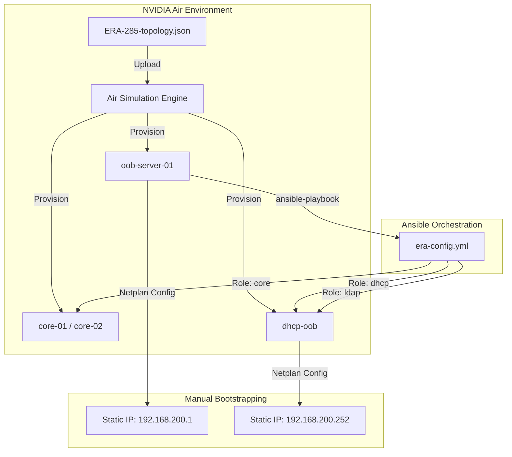
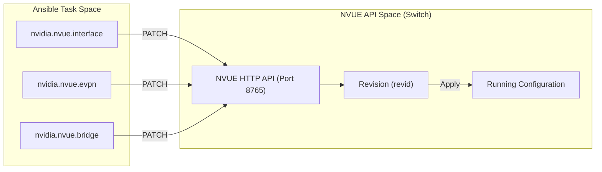

<!-- source: DeepWiki mcp.deepwiki.com · repo NVIDIA/enterprise-ras · page 7.2 spectrum-era Architecture: 2-8-5-200 · fetched 2026-10-26 -->

# spectrum-era Architecture: 2-8-5-200

Relevant source files

The following files were used as context for generating this wiki page:

- [spectrum-era/2-8-5-200/ERA-285-topology.json](spectrum-era/2-8-5-200/ERA-285-topology.json)
- [spectrum-era/2-8-5-200/README.md](spectrum-era/2-8-5-200/README.md)
- [spectrum-era/2-8-5-200/exported-configurations/core-01.yaml](spectrum-era/2-8-5-200/exported-configurations/core-01.yaml)
- [spectrum-era/2-8-5-200/playbooks/era-config.yml](spectrum-era/2-8-5-200/playbooks/era-config.yml)
- [spectrum-era/2-8-5-200/roles/core/tasks/main.yml](spectrum-era/2-8-5-200/roles/core/tasks/main.yml)
- [spectrum-era/2-8-5-200/roles/ldap/tasks/main.yml](spectrum-era/2-8-5-200/roles/ldap/tasks/main.yml)

This page provides reference documentation for the **2-8-5-200** NVIDIA Enterprise Reference Architecture (ERA) within the deprecated `spectrum-era` directory. This specific topology is characterized by a converged core design with a dedicated CSL (Compute Switch Link) and GSL (GPU Switch Link) split at scale, providing 200Gbps bandwidth per link [spectrum-era/2-8-5-200/README.md:7-9]().

## Overview
The 2-8-5-200 architecture serves as a historical reference for large-scale AI fabrics. It utilizes NVIDIA NVUE for switch configuration and Ansible for end-to-end orchestration [spectrum-era/2-8-5-200/README.md:4-11](). While superseded by the `net-configurator` tool, this architecture remains a baseline for understanding the converged core topology.

### Key Components
*   **Topology:** Converged Core (2 Switches) with split CSL/GSL planes.
*   **Automation:** Ansible playbooks targeting the `nvidia.nvue` collection [spectrum-era/2-8-5-200/playbooks/era-config.yml:52-62]().
*   **Simulation:** Pre-defined NVIDIA Air topology JSON for rapid prototyping [spectrum-era/2-8-5-200/ERA-285-topology.json:1-7]().
*   **Management:** Integrated LDAP authentication and DHCP services for Out-of-Band (OOB) management [spectrum-era/2-8-5-200/README.md:188-194]().

---

## Topology and Simulation

The 2-8-5-200 architecture is defined for NVIDIA Air using a comprehensive JSON topology file. This file specifies the hardware resources (CPU, Memory, Storage) and OS versions for every node in the fabric [spectrum-era/2-8-5-200/ERA-285-topology.json:6-50]().

### Air Resource Sizing
| Node Role | OS | CPU | Memory | Storage |
| :--- | :--- | :--- | :--- | :--- |
| `core-01/02` | Cumulus VX 5.13.0 | 2 | 2048 MB | 10 GB |
| `oob-switch-0X` | Cumulus VX 5.13.0 | 1 | 2048 MB | 10 GB |
| `oob-server-01` | Ubuntu 22.04 | 1 | 1024 MB | 10 GB |
| `dhcp-oob` | Ubuntu 22.04 | 1 | 1024 MB | 10 GB |

**Sources:** [spectrum-era/2-8-5-200/ERA-285-topology.json:6-160]()

### Logic Flow: Topology to Deployment
The following diagram illustrates how the `ERA-285-topology.json` is consumed to reach a functional Ansible state.

**Sources:** [spectrum-era/2-8-5-200/README.md:15-100](), [spectrum-era/2-8-5-200/playbooks/era-config.yml:4-57]()

---

## Configuration Management

The architecture uses a modular Ansible structure. The primary entry point is the `era-config.yml` playbook, which orchestrates the configuration of DHCP, DNS, LDAP, and the switch fabric [spectrum-era/2-8-5-200/playbooks/era-config.yml:1-92]().

### Core Switch Role
The `core` role utilizes the `nvidia.nvue` collection to push state-based configurations to Cumulus Linux switches via the NVUE HTTP API [spectrum-era/2-8-5-200/playbooks/era-config.yml:52-62]().

**Key Tasks in `roles/core/tasks/main.yml`:**
*   **Revision Management:** Creates a new NVUE revision using `nvidia.nvue.config` [spectrum-era/2-8-5-200/roles/core/tasks/main.yml:4-7]().
*   **Interface Breakouts:** Configures physical port lanes based on the `breakout_config` variable [spectrum-era/2-8-5-200/roles/core/tasks/main.yml:82-92]().
*   **EVPN Multihoming:** Sets up bond interfaces with specific `segment_id` and `anycast_mac` for redundancy [spectrum-era/2-8-5-200/roles/core/tasks/main.yml:105-121]().
*   **RoCE/QoS:** Applies RoCE (RDMA over Converged Ethernet) settings to ensure lossless GPU communication [spectrum-era/2-8-5-200/roles/core/tasks/main.yml:280-283]().

### Data Flow: Ansible to NVUE
This diagram bridges the Ansible task definitions to the resulting NVUE configuration state on the switch.

**Sources:** [spectrum-era/2-8-5-200/roles/core/tasks/main.yml:4-135](), [spectrum-era/2-8-5-200/playbooks/era-config.yml:59-62]()

---

## Management Services

### LDAP Authentication
The `dhcp-oob` node acts as the LDAP server, providing centralized authentication for the cluster [spectrum-era/2-8-5-200/README.md:188-194](). The `ldap` role handles the installation of `slapd`, creation of Organizational Units (OUs), and user provisioning [spectrum-era/2-8-5-200/roles/ldap/tasks/main.yml:30-135]().

**User Management:**
The role generates SSHA hashes for passwords and applies them via LDIF templates [spectrum-era/2-8-5-200/roles/ldap/tasks/main.yml:111-132]().

### Out-of-Band (OOB) Setup
The OOB network requires manual bootstrapping before Ansible can take over.
1.  **OOB Switches:** Configured via `nv config patch` using files in `oob-switch-config/` [spectrum-era/2-8-5-200/README.md:46-55]().
2.  **OOB Server:** Configured with static Netplan IPs (e.g., `192.168.200.1/24` on `eth1`) and IPv4 forwarding enabled [spectrum-era/2-8-5-200/README.md:66-100]().

**Sources:** [spectrum-era/2-8-5-200/README.md:57-100](), [spectrum-era/2-8-5-200/roles/ldap/tasks/main.yml:1-135]()

---

## Exported Configurations
For users not using Ansible, the repository provides full NVUE YAML exports for each switch in the `exported-configurations/` directory. These files can be applied directly using the `nv config replace` command [spectrum-era/2-8-5-200/README.md:180-187]().

**Example Structure (`core-01.yaml`):**
*   **Bridge Domain:** Defines VLAN-to-VNI mappings (e.g., VLAN 200 to VNI 4200) [spectrum-era/2-8-5-200/exported-configurations/core-01.yaml:11-28]().
*   **Bonding:** Configures EVPN multihoming segments for compute and storage nodes [spectrum-era/2-8-5-200/exported-configurations/core-01.yaml:33-53]().
*   **LACP Bypass:** Enabled on bond interfaces to allow PXE/ZTP before LACP is established [spectrum-era/2-8-5-200/exported-configurations/core-01.yaml:54-56]().

**Sources:** [spectrum-era/2-8-5-200/exported-configurations/core-01.yaml:1-56]()

---

