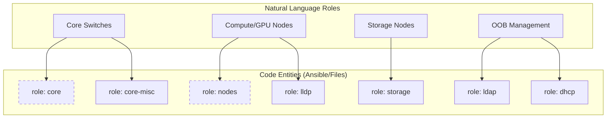
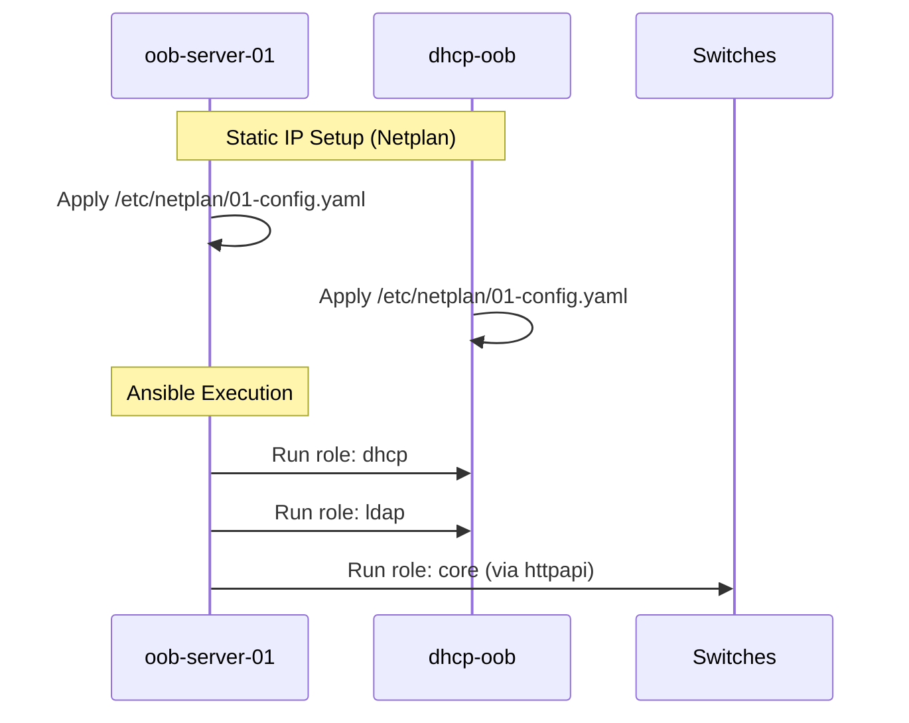

<!-- source: DeepWiki mcp.deepwiki.com · repo NVIDIA/enterprise-ras · page 7.3 spectrum-era Architecture: 2-8-9-400 · fetched 2026-10-26 -->

# spectrum-era Architecture: 2-8-9-400

<details>
<summary>Relevant source files</summary>

The following files were used as context for generating this wiki page:

- [spectrum-era/2-8-9-400/ERA-289-topology.json](spectrum-era/2-8-9-400/ERA-289-topology.json)
- [spectrum-era/2-8-9-400/README.md](spectrum-era/2-8-9-400/README.md)
- [spectrum-era/2-8-9-400/exported-configurations/core-01.yaml](spectrum-era/2-8-9-400/exported-configurations/core-01.yaml)
- [spectrum-era/2-8-9-400/playbooks/era-config.yml](spectrum-era/2-8-9-400/playbooks/era-config.yml)
- [spectrum-era/2-8-9-400/roles/core/tasks/main.yml](spectrum-era/2-8-9-400/roles/core/tasks/main.yml)
- [spectrum-era/2-8-9-400/roles/ldap/tasks/main.yml](spectrum-era/2-8-9-400/roles/ldap/tasks/main.yml)

</details>


This page provides reference documentation for the **2-8-9-400** NVIDIA Enterprise Reference Architecture (ERA) within the deprecated `spectrum-era` directory. This specific topology represents a large-scale deployment featuring 2 CPUs, 8 GPUs, and 9 NICs per node, utilizing a 400Gbps fabric.

> [!WARNING]
> This architecture and its associated scripts are **deprecated**. New deployments should use the `net-configurator` tool described in [Section 2.0](). The contents here are retained for historical reference and maintenance of existing v3.0.0 installations `[spectrum-era/2-8-9-400/README.md:5-9]()`.

## Architecture Overview

The 2-8-9-400 topology is designed for high-density GPU clusters where compute and storage fabrics are physically or logically segregated to ensure maximum throughput for AI workloads.

### Key Components
*   **Fabric:** 2-tier Dedicated-GPU CSL (Compute Switch Leaf) + GSL (GPU Switch Leaf) at scale.
*   **Switching:** NVIDIA Spectrum switches running Cumulus Linux 5.13.0 `[spectrum-era/2-8-9-400/exported-configurations/core-01.yaml:7-7]()`.
*   **Automation:** Driven by Ansible using the `nvidia.nvue` collection `[spectrum-era/2-8-9-400/playbooks/era-config.yml:59-59]()`.
*   **Simulation:** Fully compatible with NVIDIA Air using the provided `ERA-289-topology.json` `[spectrum-era/2-8-9-400/README.md:15-15]()`.

### Data Flow and Code Mapping
The following diagram bridges the logical network roles to the specific Ansible roles and configuration files used in the deployment.

**Topology to Code Entity Mapping**

**Sources:** `[spectrum-era/2-8-9-400/playbooks/era-config.yml:4-92]()`

---

## NVIDIA Air Simulation Setup

The architecture is defined for NVIDIA Air via a JSON topology file that specifies node resources and connectivity.

### Node Resource Definitions
Switch nodes (e.g., `core-01`, `core-02`) are provisioned with:
*   **CPU:** 2 Cores `[spectrum-era/2-8-9-400/ERA-289-topology.json:9-9]()`
*   **Memory:** 2048 MB `[spectrum-era/2-8-9-400/ERA-289-topology.json:10-10]()`
*   **OS:** `cumulus-vx-5.13.0` `[spectrum-era/2-8-9-400/ERA-289-topology.json:16-16]()`

OOB Servers (e.g., `oob-server-01`, `dhcp-oob`) are provisioned with:
*   **OS:** `generic/ubuntu2204` `[spectrum-era/2-8-9-400/ERA-289-topology.json:96-96]()`
*   **Memory:** 1024 MB `[spectrum-era/2-8-9-400/ERA-289-topology.json:90-90]()`

### Management Network (OOB)
The Out-of-Band network requires manual bootstrapping of three OOB switches (`oob-switch-01`, `oob-switch-02`, `oob-switch-03`) using `nv config patch` with pre-defined YAML files `[spectrum-era/2-8-9-400/README.md:44-53]()`.

**OOB Server Configuration Flow**

**Sources:** `[spectrum-era/2-8-9-400/README.md:77-140]()`, `[spectrum-era/2-8-9-400/playbooks/era-config.yml:4-62]()`

---

## Ansible Role Implementation

The deployment is modularized into Ansible roles targeting specific switch functions.

### Core Switch Configuration (`role: core`)
This role utilizes the `nvidia.nvue` collection to perform state-based configuration. Key tasks include:
*   **Revision Management:** Creates a new NVUE revision for atomic changes `[spectrum-era/2-8-9-400/roles/core/tasks/main.yml:4-7]()`.
*   **Interface Management:** 
    *   Configures breakouts and lanes per port `[spectrum-era/2-8-9-400/roles/core/tasks/main.yml:82-92]()`.
    *   Sets up Multi-Homing (EVPN-MH) bonds with unique `local_id` and shared `mac_address` `[spectrum-era/2-8-9-400/roles/core/tasks/main.yml:105-121]()`.
*   **Network Services:**
    *   **EVPN:** Enables EVPN and Multi-homing `[spectrum-era/2-8-9-400/roles/core/tasks/main.yml:270-277]()`.
    *   **RoCE:** Configures Quality of Service (QoS) for RDMA over Converged Ethernet `[spectrum-era/2-8-9-400/roles/core/tasks/main.yml:281-283]()`.
    *   **VXLAN:** Enables VXLAN with Head-End Replication (HER) `[spectrum-era/2-8-9-400/roles/core/tasks/main.yml:251-269]()`.

### LDAP Service (`role: ldap`)
Deployed on the `dhcp-oob` server, this role provides centralized authentication:
*   **Package Management:** Installs `slapd` and `ldap-utils` `[spectrum-era/2-8-9-400/roles/ldap/tasks/main.yml:30-39]()`.
*   **Security:** Generates SSHA hashes for admin and user passwords `[spectrum-era/2-8-9-400/roles/ldap/tasks/main.yml:46-49]()`.
*   **Data Structure:** Creates `ou=Users` and `ou=Groups` organizational units `[spectrum-era/2-8-9-400/roles/ldap/tasks/main.yml:71-93]()`.

---

## Exported Configurations Reference

For users not using Ansible, the repository provides full YAML exports of the NVUE configuration for each switch. These can be applied manually using the Cumulus Linux CLI:

```bash
# Example application on core-01
nv config replace core-01.yaml
nv config apply -y
```
`[spectrum-era/2-8-9-400/README.md:182-185]()`

### Configuration Snippet: `core-01.yaml`
The exported files contain the declarative state of the switch, including VLAN-to-VNI mappings for the fabric:
| VLAN | VNI | Purpose |
| :--- | :--- | :--- |
| 200 | 4200 | GPU Fabric |
| 300 | 4300 | Compute Fabric |
| 400 | 4400 | Storage Fabric |
| 900 | 4900 | Management |

**Sources:** `[spectrum-era/2-8-9-400/exported-configurations/core-01.yaml:14-28]()`

---

## Deployment Summary Table

| Step | Component | Action | Reference File |
| :--- | :--- | :--- | :--- |
| 1 | NVIDIA Air | Upload Topology | `ERA-289-topology.json` |
| 2 | OOB Switches | Apply Manual Config | `oob-switch-config/*.yaml` |
| 3 | OOB Server | Setup Netplan/Sysctl | `README.md` |
| 4 | Automation | Run Ansible Playbook | `playbooks/era-config.yml` |

**Sources:** `[spectrum-era/2-8-9-400/README.md:15-176]()`

---

